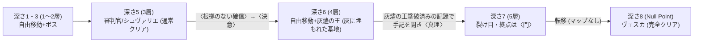

# DICE BOUND — 統合仕様書

## 0. 概要・正本・設計規約

**DICE BOUND** — Unity 3D ローグライク（ボードゲーム調・ダイス戦闘）。分岐するフロアを航行し、各層のボスを撃破して深部へ潜る。

| 項目 | 値 |
|---|---|
| エンジン / 描画 | Unity 2022.3.22f1 / Built-in RP（ポスト処理は自前 `OnRenderImage`） |
| 言語 | C# |
| 開始 HP / 層構造 | HP 30（整備盤適用前の基準は §9-1） / 画面表示 1→5 層（内部深さ 0, 1, 3, 5, 6, 7, 8・通常クリアは深さ 5） |

### 0-1. 正本の階層とディレクトリ

**最終正本は常に実コード。** 本書は設計意図とルールの上位構造のみを保持し、個別数値のカタログや変更履歴は記載しない。

| 対象 | 正本 | 本書の扱い |
|---|---|---|
| ダメージ計算式・適用順・ctx 用語 | [DAMAGE_CALC_REFERENCE.md](../Assets/Scripts/CombatSystem/DAMAGE_CALC_REFERENCE.md) | 骨子のみ |
| アイテム全カタログ | [items.json](../Assets/Data/InventorySystem/items.json) | 分類とルールのみ |
| パッシブ全 166 種 | `AllPassiveSkillEffects.cs` / `EnemyPassiveSkillEffects.cs` / 軸別 `*Effects.cs` | 体系と機構のみ |
| 敵ステータス | [enemies.json](../Assets/Resources/enemies.json) | 構造と主要値のみ |
| 七つの大罪 | [PermanentDebuffIds.cs](../Assets/Scripts/MetaProgression/PermanentDebuffIds.cs) / `ChallengeCards.cs` | 位置づけと概要 |
| ID 定数 | [Ids.cs](../Assets/Scripts/GameLoop/Ids.cs) (`ItemIds` / `BossIds`) | 規約のみ |
| イベント定義 | [event_list.txt](../Assets/Resources/Events/event_list.txt) | フォーマットと規則のみ |
| 筐体レイアウト実寸 | [docs/design/cabinet-layout.html](design/cabinet-layout.html) 他 | 設計思想のみ |
| プレイヤー向け手引き | [handbook.md](handbook.md) | 表示契機のみ |
| バランス学習結果 | `BALANCE_CHANGELOG_*.md` / `BALANCE_TIER_LIST_*.md` | BOT 自動生成・改変禁止 |

- **主ディレクトリ**: 戦闘 `CombatSystem/`・マップ/ラン `MapSystem/` (`FreeMove/` は素の C#)・`GameLoop/` (`Contracts/`)・アイテム/店 `ItemSystem/`（データは `Assets/Data/InventorySystem/`）・メタ進行 `MetaProgression/`・イベント `EventSystem/`・BOT `AutoTest/`。
- **手引き表示**: `handbook.md` の各節を初到達時に 1 度だけ液晶中央 (`Game2DTutorial`) に表示。既読は `PlayerPrefs` (`UI.TutorialSeen`) で保持し、設定の「手引きをもう一度」でリセット。BOT 実行中は非表示。

### 0-2. 記述規約

- 実装され動作している仕様のみを記載する。未実装・未決事項は §15 に隔離する。
- 変更履歴・日付つきの経緯・旧値・廃止機能の説明・測定の物語は書かない。値変更時は上書きし、廃止時は削除する。

### 0-3. 設計原則（変更禁止）

- **画中画の原則**: ゲーム世界は盤内チップの演算結果。UI 部品（計器・帯・窓・手引き）はすべて液晶内に描画し、液晶エフェクト（湾曲・走査線・残像等）を適用する。lore 側も筐体に言及しない。情報表示は液晶内、物理操作（ダイス・端子）はワールド側。
- **ピクセル規約**: ピクセル要素 (PPU=32) の状態表現に `localScale` 倍率を使わず、色・明度・別スプライトで表現する。ピクセルパーフェクト (1dot = 4×4px) は LCD 上のみの制約。
- **ID 直書き禁止**: 跨ファイル参照・日本語 ID・ロジック分岐用 ID は `Ids.cs` (`ItemIds` / `BossIds`) または `ClassStarter` の定数を経由する。ボス判定は `BossIds.IsBoss(id)`。
- **CombatContext の 3 区分**: フィールド追加時は `perTurn` / `decay` / `persistent` を XML コメントに明記し、`perTurn`/`decay` は `BeginNewTurn` で必ずリセットする。1〜2 箇所しか触らない一時値は `accumulatedValues` / `nextTurnBuffs` 辞書へ。
- **シングルトン規約**: `_shuttingDown` + `[RuntimeInitializeOnLoadMethod]` を徹底する。

### 0-4. 用語・表示名規約

| 概念 | 正本表記 | 禁止・非推奨表記 |
|---|---|---|
| 振るダイス本数 / 各目 | **ダイス個数** / **出目** | 曖昧な「1ダイス」 |
| 端子に挿した出目の和 / 攻撃加算 | **端子配線合計+N** / **攻撃+N** | ダイス合計+N（禁止語彙） |
| 会心率加算 / 確定 | **会心率+N%** / **会心確定** | 会心ダイス合計値+N / 必ず会心ヒット |
| ダメージ方向 / 軽減無視 | **与ダメージ**・**被ダメージ** / **軽減不可** | 与ダメ・被ダメ / 軽減不能 |
| 軸の所持数（総称） | **偏重**（心眼・血晶・瘴気・炉温・電流・堅牢・采配・賽目） | 深さ・深度 / 機巧・戦術 |
| ラン内の常時所持品 / 宝箱マス | **秘宝**（コード・本書内では「パッシブ」併用可。敵・武器効果は「パッシブ」のまま） | 画面上の「パッシブ」「遺物」 |
| ラン外装備（旧名称の名残） | **遺物**（世界観上は大穴産出物の総称） | 秘宝 |

- **スキル表示名統一**: 同一 `internalName` は武器・パッシブで統一する（Might=`筋力`, Fortitude=`頑強`, Insight=`心眼`, Steadfast=`堅忍`〔敗北時の条件付き軽減専用〕）。

---

## 1. ラン構造

### 1-1. 層進行

正本: [FloorPlan.cs](../Assets/Scripts/MapSystem/FreeMove/FloorPlan.cs)。画面表示の層番号 `currentFloor` (0→5) と内部深さ `Run.Depth` (0, 1, 3, 5, 6, 7, 8) は `FloorPlan.DepthOf` / `OrdinalOf` で相互変換する。

- **深さ 0（序層）**: ファーム用一本道。難易度指標・メタトークン層到達ボーナス・全回復/前哨補給の対象外。
- **深さ 1, 3, 5（画面 1〜3 層）**: 自由移動マップ + 層ボス。深さ 5 ボス撃破で**通常クリア** (`IsNormalClear`)。
- **深さ 6（画面 4 層）**: 自由移動マップ + 灰燼の王。〈決意〉所持で進入可。
- **深さ 7（画面 5 層）**: 一本道航行マップ。ボスはおらず終端の〈門〉処理で層クリア。〈真理〉所持で進入可。
- **深さ 8（Null Point）**: マップなしのヴェスカ連戦専用層（`RunState.inFinalStage`）。前哨基地での回復・補給は無い。



### 1-2. 〈確信〉ゲートと〈灰に埋もれた基地〉

- `convictionStage`: イベント「災厄の予兆」で〈根拠のない確信〉取得時に 1、以降エリート戦勝利ごとに +1（画面非表示、記録と BOT 用）。
- 資格の正本はフラグ (`layer6Unlocked` / `layer7Unlocked`)。品（〈根拠のない確信〉→〈決意〉→〈真理〉）は同一 1 枠を書き換え、手放せない品 (`ItemIds.Undroppable`) として扱う。
- **灰に埋もれた基地**: 深さ 6 で最初に踏んだイベントマスが必ずこのイベントになる（1 ラン 1 回・召喚専用）。イベントマスを踏まずにボスへ到達した場合はボス戦前に起動する安全弁 (`StartBossTileOrAshBase`) がある。
- メタ記録 `MetaProgressState.ashKingBeaten`（灰燼の王の撃破歴）で内容が分岐する。〈真理〉はランを跨がないため、ヴェスカ到達は 2 回目以降の潜行から。

| 撃破歴 | 版 | 選択肢と結果 |
|---|---|---|
| 未撃破 | 灰に埋もれた基地 | 1 択: 時限デバフ〈徒労〉を受ける。王撃破で 4 層クリア（END3） |
| 撃破済み | 灰に埋もれた基地・再訪 | ① 手記を開く: 〈真理〉(`layer7Unlocked`) + 時限バフ〈開眼〉→ 深さ 7 へ / ② 開かない: 〈徒労〉→ 4 層クリア |

### 1-3. 7 層の〈門〉と不完全起動（GateFlaw）

正本: [GateFlaws.cs](../Assets/Scripts/GameLoop/GateFlaws.cs)。深さ 7 終端 `Gate` で 3 工程の代償を問われる。払わなかった工程の罰（複数同時所持可・プレイヤー側規則・七つの大罪とは別系統）が深さ 8 ヴェスカ戦にのみ適用される。

| 工程 | 代償 | 怠った場合の罰（GateFlaw） |
|---|---|---|
| ① 外縁の再構成 | 最大 HP −25% | 〈不完全な修復〉毎ターン終了時に充電が半減（支出計上しない） |
| ② 起動 | ランダムに秘宝 2 個 | 〈不完全な起動〉攻撃値 (`atkBase`) −12% |
| ③ 転移 | 物資 −4（上限の 40%） | 〈不完全な転移〉ボスの攻撃がブロック出目を貫通 |

### 1-4. 特殊フラグと中断セーブ

- **特殊フラグ**: `defeatedSaintGeorges`（深さ 5 裏ボス・シュヴァリエ撃破）。
- **中断セーブ**（正本: `RunSave.cs` / `GameManager.Save.cs` / `SafeFile.cs`）:
  - 1 枠・再開は 1 回限り（読込後に削除）。保存先は `persistentDataPath/run_suspend.json`。
  - **保存可能時点**: 航行マップ上で待機中かつ未処理ウィンドウ・追跡者接触が無い時のみ (`CanSuspendNow`)。戦闘・店・イベント・休憩・〈門〉・深さ 8 中は不可。
  - **入口**: 設定窓の「中断して終える」または製品版終了時の自動保存 (`wantsToQuit`)。再開はタイトル「はじめる」時の確認窓から。BOT・計測中は無効。
  - **保存内容**: `RunState` 全公開フィールド（リフレクション + バージョン/型指紋検証）、盤面・`FreeMapSim` 状態、`GameRng` 塩/カウンタ、戦闘連番、`IRunStatePersistent`、実績ラン進捗。乱数は決定論的に再現。
  - **安全性**: `.tmp` 書き出し → 既存を `.bak` 退避 → リネーム → `.bak` 削除の原子更新。削除時は 3 ファイル全て消去。メタ進行 (`MetaProgressState_v1`) も `BackedPrefs.cs` で `.bak` 退避と破損時 `.corrupt` 隔離を行う。

---

## 2. マップ・航行

正本: [FreeMove/](../Assets/Scripts/MapSystem/FreeMove/)（UnityEngine 非依存）・[FreeMapParams.cs](../Assets/Scripts/MapSystem/FreeMove/FreeMapParams.cs)。

### 2-1. マップ構造と生成

- 広さ **16.4 × 9.4**、点 **50 個**（最小間隔 1.15）、通行不可の山岳楕円 3〜5 箇所。通常は左端が始点（前哨基地）・右端が終点（ボス/門）。
- 道は最小全域木 + 長さ 1.9 未満の非交差組を 45% で追加し、行き止まり解消（全点次数 2 以上）と近道追加を行う。
- 乱数は `GameRng` キー `map.free` のみ。三角関数不使用でプラットフォーム間の決定性を保証。

### 2-2. マス種別・危険の帯・ノード状態

| TileType | 内容 | 重み |
|---|---|---:|
| Battle | 通常戦闘 | 29 |
| Event | イベント | 25 |
| EliteBattle | エリート（精鋭単体・報酬ゴールド ×2.0） | 14 |
| Exchange | 交換（最低レア度の秘宝 1 つを差し出し、上位レア度 2 択から 1 つ取得・§10-3） | 7 |
| Shop | ショップ（層に必ず 1 つ以上） | 7 |
| Treasure | 秘宝 | 3 |
| Rest | 休憩（層に必ず 1 つ以上） | 3 |

固定配置: Outpost（始点）/ Boss・Gate（終点）。

- **危険の帯** (`BandOf`): 始点→終点間を 3 分割（通常は x 座標比、嵐の層は始点・終点への直線距離比）。敵の数値は変えず、配置と抽選のみ制御する。
  - **安全（始点側 1/3）**: 脅威度 (`danger` = 実効 HP × 平均攻撃 ÷ 100) 下位 1/3 の敵のみ。エリート・2 体戦・〈高負荷ドライブ〉格上げ無し。
  - **中間**: 通常抽選。
  - **危険（終点側 1/3）**: 脅威度下位 1/3 を除外。
- **ノード状態**: `visited` / `activated`（使い切り・再訪時は無反応）/ `revealed`（始点・終点は初期公開だが、**嵐の層の終点は伏せる**。未確認点は「?」、開示済みはホバーで戦闘名表示）。点と道のトポロジは層全体が見える。
- **エリート**: `enemies.json` の独立エントリ (`"elite": true`, id=`<敵>_elite`)。常に単体で、隠し倍率は掛けず JSON 実数値で強さを定義する。

### 2-3. フロアモディファイアと層タイトル

正本: `FloorModifier.cs` / `LayerTitles.cs`。前哨基地で適用され、その層の間持続する。

| 深さ（画面層） | 層タイトル | 層ボス | フロアモディファイア |
|---|---|---|---|
| 0（序層） | 古い倉庫（仮） | 古い宝箱 | 〈倉庫の仕入れ〉ショップ価格 −20% |
| 1（第 1 層） | 陽の差す浅層 | トレジャーゴブリン | なし |
| 3（第 2 層） | 毒の沼 | ゴブリン王 / 毒沼の主 / 鏡の双子 | 〈瘴気侵蝕〉戦闘終了後 1 ダメージ / 休憩回復 30%→50% |
| 5（第 3 層） | 審きの淵 | 審判官（裏: シュヴァリエ） | 〈地獄門〉被ダメージ −2（1 撃ごと）/ ショップ価格 +40% |
| 6（第 4 層） | 灰の玉座 | 灰燼の王 | 〈深淵の洗礼〉毎ターン自傷 1 / 武器会心率 −15% / 敵毎ターン HP+3 / 入口で最大 HP+5 |
| 7（第 5 層） | 裂け目 | なし（終端は〈門〉） | なし |
| 8（最終段） | Null Point | ヴェスカ | なし（前哨基地での回復・補給も無し） |

### 2-4. 移動・手番・索敵・道具

道で繋がった隣点へ 1 歩ずつ進む手番制。着いた未起動マスは必ず起動する。操作口は `MoveStep` / `WaitTurn` / `RestHealMore`（手番消費）と `Survey`（測量）。

| 行動 | 手番 | 資源 | 備考 |
|---|---:|---|---|
| 隣へ 1 歩 | 1 | 物資 1 | 物資不足分は HP で支払う（物資 1 = HP 5・致死移動可）。〈近道+N〉中は手番 0・物資 0 |
| 待つ | 1 | なし | 追跡者・嵐が進行 |
| **測量**（キー F） | 1 | なし | 3 歩先までの種別と戦闘名を永続記録。範囲内の追跡者/使い魔も可視化 |
| 囮罠を置く | 0 | 消耗品 | 6 歩以内の巡回中追跡者を誘引し、踏むと 2 手番足止め（8 手番持続・開始時 2 個・店 8G） |
| 休憩（通常 / 多め） | 0 / 1 | なし | 多めに回復 = 最大 HP の 60%。1 マスにつき回復/鍛える/抜く/端子強化から 1 回 |
| マス起動（戦闘等） | 0 | なし | イベントの `ターン+N` は地図帰還時に `PassTurnsExternal` で適用 |

- **素の視界**: 1 歩先までのマス種別と追跡者/使い魔（戦闘名は非表示・〈夜目の指輪〉で 2 歩）。

### 2-5. 追跡者（深さ 3 以降・1 層 1 体）

- **縄張り**: 層中ほどの連結 7〜11 点（始点から直線距離 3 以上）。赤いインクと破線で表示。本体・使い魔とも縄張りの外へ出ない。
- **迂回保証** (`TerritoryBypass.Compute`): 縄張りを踏まずに始点→終点へ行ける道が存在しない場合、通過点が最小の経路上の縄張り点を削って連結性を保ちつつ迂回路を保証する（下限 5 点に満たなければ隣接点補完、3 点未満なら追跡者を配置しない）。
- **縄張りの宝**: 中心以外の縄張り点のうち中心に最も近い点（最初から「宝」表示・天候で沈まない）。到達時に点の起動前に「最大偏重軸の秘宝 3 択（軸未所持なら通常 3 択）」を付与（1 層 1 回・不安定化 +3）。追跡者と重なった場合は戦闘が先。
- **発見と追跡**: 状態は「巡回 ↔ 追跡」の 2 値。縄張り内のプレイヤーと道で隣り合うと（移動前後で判定）発見し追跡開始。縄張りの外へ出る、3 手番隣り合わない (`QuietLose`)、または 8 手番追跡 (`ChaseGiveUp`→4 手番休止 `ChaseRest`) で見失い巡回へ戻る。可視中は次の一歩が予告され、捕捉中は最短捕捉手数 (ETA) を表示。
- **接触・撃破**: 接触で専用エネミーと戦闘（基礎攻撃・上限 ×1.6）。勝利で物資 +6 とアイテム 1 個。
- **性質**（層ごとに 1 種・非公開）:

| 性質 | マップ挙動 | 戦闘特徴 | 出る層 |
|---|---|---|---|
| 召喚者（群れ呼び） | 中心から不動。発見中 3 手番ごとに使い魔（1 歩/手）放出 | 2 体戦（本体 HP×1.8 + 層通常敵） | 深さ 3〜 |
| 猟犬使い | 本体 1 歩/手 + 猟犬 2 歩/手（撃破しても本体へ戻る） | 2 体戦（本体 HP×1.5 + 猟犬） | 深さ 3〜 |
| 疾走者（影走り） | 本体 2 歩/手 | 最初の 2T 攻撃 ×1.5・HP×1.4 | 深さ 5〜 |
| 重装（鉄塊の追手） | 本体 1 歩/手 | 防御 10 以上・〈積み上がる装甲〉・HP×1.8 | 深さ 3〜 |

- **道具・効果の扱い**: 囮罠を縄張り外に置くと縁まで寄って待機。煙玉は縄張り内での発見時のみ発動。〈補給線〉で縄張り外へ跳ぶと見失う。使い魔は接触で通常敵 1 体と戦闘（報酬物資なし・逃走可）。

### 2-6. 逃げる

戦闘中・配線前に選択可 (`RequestFlee`)。層ボス・イベント戦闘・偽の商人は不可。

- **代償**: 物資 2（旧 100）+ 所持金半減（切り捨て）、報酬なし。
- そのターンは攻撃せず、敵の予告攻撃をブロック有効で受けて生存すれば離脱。直前の点へ戻り、通常マスは未起動のまま残る。追跡者は 2 手番足止め、使い魔は消滅。

### 2-7. 天候 ── 嵐（不安定化の時計）

正本: `Storm.cs` / `Instability.cs`。深さ 1, 3, 5, 6 で有効（深さ 0, 7, 8 はなし）。大穴から物を取るほど**不安定化ポイント**が溜まり、安全圏の円（輪）が縮む。

- **初期値**: 深さ 1, 3, 5 は 0（深さ 1 のみフェーズ 1 開始が 20、他は 15）。深さ 6 は **12** から開始。
- **溜まり方** (`Instability.PointsOf`):
  - **+3**: 宝マス開封・縄張りの宝取得・秘宝取得（進行用資格品は対象外）
  - **+2**: エリート・追跡者撃破
  - **+1**: 通常戦勝利・イベントでの持ち物増加（秘宝以外）・戦闘中のエスカレーション段上昇（ボス戦除外）・**崩れ始めた後**の 1 歩/待つ（朱の雪は +2）
  - **±N**: イベントの `ターン+N` (+N) / `前線を遠ざける/近づける+N` (−N / +N)
  - **0**: 店・交換・休憩・測量・〈補給線〉・近道・逃走・ボス戦・端子報酬・崩れ始める前の移動
- **フェーズと輪**:
  - 0〜14（深さ 1 は 19）: 静か（移動で溜まらない）
  - 15〜 (Phase 1): 崩れ始める。地図中央中心で半径 100%→60%
  - 30〜 (Phase 2): 中心がボス近傍（乱数オフセット）へ寄りつつ 60%→30%
  - 45〜 (Phase 3): **ボスの点の種別が開示**。中心がボス点へ移り 30%→隣接点距離へ
  - 50〜 (Phase 4): ボス点以外すべて嵐の中（ボス点自体は常に嵐の外）
- **嵐の中の罰**: 嵐内の点への移動・待機・〈補給線〉で **HP −3**（近道中も支払う・致死あり）。嵐内での戦闘は敵に〈嵐〉（攻撃 +3）が付与される。
- **嵐の種類**（層ごとに 1 種・深さ 1 は常に素の嵐）: 素の嵐（追加なし）/ **落石のような雹**（移動 HP さらに −1）/ **削る砂**（移動物資 +1 確定）/ **朱の雪**（移動に 2 手番・不安定 +2）/ **霧**（2 歩以上離れた嵐内の点が「?」に戻る）。
- **嵐の層の配置**: 始点は最外周（凸包頂点）から、ボスは外周 2 層を除いた内側から始点 5 歩以上の点を選び直し、種別は隠す（測量・隣接・Phase 3 で開示）。

---

## 3. 戦闘

### 3-1. ターン構造（相互攻撃モデル・ADR-0009）

正本: [DAMAGE_CALC_REFERENCE.md](../Assets/Scripts/CombatSystem/DAMAGE_CALC_REFERENCE.md) §9。早期決着と長期戦のジレンマを完全情報下で成立させ、膠着は段階エスカレーションで防ぐ。

```text
0. ターン開始 : DoT/ステータス tick ・ ボスのダウン判定 ・ 手札を 5 枚になるまで引く
1. 敵ロール   : 敵ダイス発火 + 敵パッシブ集計 → 敵攻撃合計確定
2. 予告       : 敵攻撃値・スケール段階・次段階残ターン・大技予告を完全公開
3. 自ロール   : 装備賽を 3 回振り、出目と役を確定
4. 任意行動   : リロール（充電消費で全振り直し）または 逃げる（配線前のみ）
5. 配線       : 場の端子（常設 + 手札）を出目 1 個に 1 枚ずつ挿す → 収支プレビュー
6. 解決       : プレイヤー攻撃（攻撃端子 1 枚につき 1 撃）→ 敵攻撃（敵撃破時は敵攻撃なし）
7. ターン終了 : OnTurnEnd 系処理 → 1 へループ
```

- **リロール規則**: ダイスを**すべて**振り直す（手札は不変）。費用は充電 `個数 × 戦闘内回数`（ターンでリセットされず戦闘中上昇し続ける）。〈特別・対〉の無料分は回数に数えず、時限デバフ〈無力感〉中は有料時に毎回 +1。1 ターンの回数上限は無し。

### 3-2. 端子の山札（ADR-0014）

正本: [TerminalCards.cs](../Assets/Scripts/CombatSystem/TerminalCards.cs) / [ADR-0014](adr/0014-terminal-deck.md)。

- **山札とドロー**: ラン単位 (`RunState.terminalDeck`)。初期構成は **攻撃 2・防御 2・充電 1** の 5 枚。ターン頭に前ターンの手札を捨て札へ送り 5 枚になるまで引く（山切れで捨て札を再シャッフル）。
- **残す印（Pick 規則）**: 挿さなかった手札の端子に「残す」印を付けると次ターンも手札に残る（残した分だけ次ターンのドロー枚数が減る）。挿した端子・常設・停止中端子には効かない。
- **配線と種類**: 端子 1 枚につき出目 1 個（記載あれば複数）。条件に合わない出目は不発。種類は **攻撃・防御・充電・補助**。攻撃端子を 1 枚も挿さないターンは攻撃しない。
- **特殊タグ**:
  - **使い捨て**: 使用するとその戦闘中のみ除外（使わなければ残す印で保持可）。発動条件（被弾後・予告・使い捨て後等）を持つものがある。
  - **常設**: 一度引くと戦闘中ずっと場に残り手札枠を圧迫しない（例: 〈千刃〉〈歯車の軸〉）。
  - **最後の攻撃端子保護** (`KeepsLastAttack`): 山札全体で最後の攻撃端子は、廃棄・使い捨て・削除効果を受けても除外されず捨て札へ戻る（詰み防止）。
- **主要特殊端子の挙動**:
  - **〈有効活用〉**: 出目をブロックに入れ、捨て札から 1 枚を次ターン手札へ戻す（手札上限を超えても戻す）。
  - **〈先読み〉**: 次ターン「5+2 枚になるまで」引く。
  - **〈影写し〉/〈火葬の剣〉**: 未配線の他手札を対象に取る（候補が無ければ不発）。〈影写し〉の写しは次ターンのドローとは別に手札へ追加。
  - **撃破ボーナス**（〈魂狩り〉〈処刑の刃〉等）: 挿したターンに敵が倒れれば撃破経路（毒・出血・爆発含む）を問わず発動。
  - **軸端子**: 偏重ではなく戦闘中の状態（会心回数・出血・毒・爆発・過充電・シールド等）を参照する。
- **入手・削除・強化**: 戦闘報酬（通常 2 択 / エリート 3 択 / ボスレア 3 択・辞退可）、店（3 枚棚・削除）、休憩（削除・素材払いで「＋」強化：初回 4・以後 +2、〈残響〉〈激昂〉〈共鳴〉〈千刃〉〈打ち直し〉は強化不可）。
- **出来事**: `OnDeckShuffle` / `OnKeptTerminalUse` / `OnSupportTerminalUse` / `OnRoleFired` / `OnBossDown` / `OnHeavyCanceled`。端子の出力変更は `TerminalCards.Resolve` 内で一元処理し、本体・画面見込み・BOT の一致を保証する。

### 3-3. ダメージ計算骨子・収支トリガー

式の正本は `DAMAGE_CALC_REFERENCE.md` §9。

- **プレイヤー攻撃（ADR-0016）**: 攻撃端子 1 枚につき 1 撃（挿した順）。各撃 = `端子出力 + 端子の外の攻撃（武器基礎・品の攻撃+N 等）`（連係・変圧・賽加算等の端子非紐づけ加算は 1 撃目のみ）。撃ごとに与ダメ % 池・会心・敵防御・ボスの目盛り判定を適用し、敵 HP を減算する。
- **敵攻撃**: `enemyAtk = round(段階倍率 × (baseAttack + 敵出目合計))` → プレイヤー防御軽減（予告値） → `max(0, enemyAtk − Σブロック出目)` → 被ダメ修飾 → HP 減算。敵攻撃値は「基礎攻撃 + 実ダイス合計 + パッシブ/倍率」の 3 段のみで決定し、予告と盤上数値が一致しない中間係数を禁じる。
- **収支トリガー**: 解決後に `balance = (与ダメ + 固定ダメ) − 被ダメ` を算出し、`playerWonRoll` / `playerLostRoll` を上書きして `OnRollWin` / `OnRollLose` / `OnRollDraw` を発火。

### 3-4. 段階エスカレーションと狂暴化

敵攻撃値のみが **T5 / T10 / T15 / T20** で段階スケールする（HP/防御は不変）。

| プロファイル | 段階倍率 (stage 0..4) | 用途 |
|---|---|---|
| `std`（既定） | 1.00 / 1.20 / 1.40 / 1.60 / 1.80 | 標準 |
| `rush` | 1.00 / 1.40 / 1.80 / 2.20 / 2.60 | 早期決着型 |
| `gentle` | 1.00 / 1.15 / 1.30 / 1.45 / 1.60 | 長期戦許容 |
| `spike` | `std` + T12 のみ `max(std, 2.5)` | 断罪周期系 |

- **狂暴化 (`Berserk`)**: 膠着防止のため全戦闘の敵が所持。**51 ターン目**から攻撃 +10（以後 5T ごとに +10・上限なし）、敵攻撃が防御・ブロック・シールド・軽減をすべて貫通、プレイヤー回復封印、敵の被主攻撃ダメージ ×2。

### 3-5. 会心

- 会心率は float (%) で線形加算し 0〜100% へクランプ。**100% 超過分は会心倍率へ 1% ごとに +0.015 変換**（基礎倍率 ×2.0）。
- 武器基礎会心率 + 層補正のみ先に 0〜50% クランプしてから他ソースを加算（層のマイナスは武器分のみ削る）。
- 優先順位: `forceCritical`（確定会心） > `critSuppressed`（封印） > 通常判定。

### 3-6. 役（ADR-0011）と装備賽（ADR-0015）

- **役 (`YachtRoles.cs`)**: 振った時点の 3 個の出目で自動判定（配線先不問・1 ターン最大 1 役）。目 1〜9 × {2 個そろい, ゾロ目} の 18 種 + 〈連なり〉（連なりの賽装備時のみ、3 連番で全挿し端子倍化 + 手札 +1）。小さい目ほど役が強く、大きい目ほど数字が強い（テーマ: 1 特別 / 2 封じ / 3 追撃 / 4 攻め / 5 守り / 6 時間 / 7 充電 / 8 癒し / 9 富）。数値の正本は `DAMAGE_CALC_REFERENCE.md`。
- **賽 (`EquippedDie`)**: 1 個装備し毎ターン 3 回振る。初期は〈角の取れた賽〉（面 2,3,4,5・無効果）。全 20 種（[ADR-0015](adr/0015-equipped-die.md)）。入手は店の賽枠 ×2（購入で入替）やイベントのみ（宝箱なし）。パッシブは出目確定後に 1 個ずつ発動（最大 3 回）し、出目自体は書き換えない。軸は持たない。

### 3-7. ボスのダウン（混乱ゲージ）

正本: [BossDown.cs](../Assets/Scripts/CombatSystem/BossDown.cs)。深さ 3（画面 2 層）以降のボス専用。

- **蓄積**: 配線確定直後に、攻撃端子へ挿したダイスの**素の面の和**が溜まる（補正・倍率除外）。品による固定加算は行動後分を次ターン頭へ持ち越し。大ダウン中は溜まらない。
- **満タン時**: ゲージは 0 に戻り、次の上限が `×(1 + 増え方)`（最低 +1）に伸びる。発動時の挙動はボスの周期位置で決まる。

| 満タン時の敵行動 | 効果 |
|---|---|
| 山場（大技・業火・天与）または周期なし | 今ターンの行動と山場を取り消し、次ターン **大ダウン**（行動不能・被ダメ ×2.0） |
| チャージ中 | 無効（怯まない） |
| 小技 | 今ターンの行動のみ取り消し（**よろめき**・倍率なし） |

- 大技周期は大ダウンの頭でリセット。エスカレーションはダウンターンを数えない。
- 止まるのは攻撃のみだが、一部ボス固有パッシブ（`BossDownPassives`: 毒の侵蝕・鏡映の応答・審判の炎・灰の再生・遺物学者・回帰性真理）はダウン中停止する。
- ヴェスカは段ごとにリセット（〈止まらない時計〉所持時は各段 50% から開始）。

### 3-8. 防御力と貫通（ADR-0013）

正本: [DefenseFormula.cs](../Assets/Scripts/CombatSystem/DefenseFormula.cs)。

- 両陣営が整数防御値を持ち、同一の逓減式で軽減率へ変換。**貫通**は相手防御値を固定減算（余剰は無効）。
- プレイヤー防御は予告値計算時（ブロック前）に適用。敵防御は与ダメ計算終盤に適用（固定ダメ・毒・出血・軽減無視には非適用）。
- 〈虚体〉（被ダメ半減）や〈霊体〉（偶数ターン被ダメ 1）は防御値とは別系統で貫通不可。
- **装甲持ちの敵の 4 型**: 高防御・低 HP（貫通で抜く）/ 割れる装甲（被弾ターン終わりに防御 −4）/ 積み上がる装甲（毎ターン防御 +3・最大 24）/ 予告つき構え（周期で防御増+攻撃減→次ターン防御 0）。精鋭は〈精鋭〉で防御 +2。
- **敵パッシブの欄規約**: `CombatContext` は名前どおり絶対視点（`player*` = プレイヤー、`enemy*` = 敵）。敵の軽減不可ダメージは `ctx.EnemyDealUnmitigable`（シールド肩代わり可）を通す。

---

## 4. パッシブ体系・キーワード 8 軸

### 4-1. レイヤリング・構造・発火順の注意点

- **3 層分離**: ダイス（物理特性: 個数・面数のみ・ロジックなし）/ 端子（能動変換）/ パッシブ（常時修飾）。LED 表示値（出目）を見えない補正で書き換えない。
- **規模**: 全 166 種（プレイヤー 102 / 敵 64）。汎用 Tier 制 (I〜IV)、8 軸、鈍器系、会心系、剣の舞セット（4 枚集約で〈無銘の剣舞譜〉へ変化：全攻撃会心確定・防御無視・2 回命中）、敵・ボス固有で構成。
- **ステータス統一フレーム (`StatusRegistry`)**: `playerStatusStacks` / `enemyStatusStacks` は絶対視点保持。`TickStatuses(TurnStart)` で一括処理（DOT は軽減不可）。既存の出血・威圧・負傷は専用フィールド据え置き。
- **発火順の罠**:
  - 攻撃/ダイス加算は `IPassiveSkillEffect.OnPostRoll` に書く（`ITimedEffect.OnRoll` は `RecomputeDiceTotals` に上書きされる）。
  - 敵がダイス合計を判定に乗せる場合は `OnTurnStart` で `enemyDiceTotalBonus` へ積む。
  - `criticalMultiplier` / `critRatePctAdd` は毎ターン初期化されるため、`OnCriticalCheck` で毎ターン再適用する。
  - `accumulatedValues` は戦闘中持続。

### 4-2. 軸と偏重の設計

パッシブは `axis` を持ち、原則「資源を読む（発動条件）側の軸」へ分類する（条件なしは生成側の軸）。軸ごとの所持数（**偏重**）は **心眼**（会心）・**血晶**（出血）・**瘴気**（毒）・**炉温**（臨界）・**電流**（充電）・**堅牢**（シールド）・**采配**（山札）・**賽目**（役）の 8 種。枠外に **金** と **軸なし汎用** がある。

- どの品も「資源を増やす」か「資源を条件にする」役割を持ち、全構成に無条件で効く汎用変換器は置かない。
- キーワード出来事（爆発・充電獲得/消費・過充電・シールド増減/割れ・毒・出血など）を `Keywords.cs` 経由で連鎖処理する。
- 毒・臨界の入り口効果には、浅いツマミ食いを防ぐため偏重条件（最大偏重・上位 2 軸・絶対数）を設ける。
- 移動蓄積品（〈火打ち底の旅靴〉等）は `RunState.stepsSinceBattle` を次戦開始時に 1 度消費する。

### 4-3. 8 軸の仕様概要

各品の数値・計算位置は実コード（`*Effects.cs` / `*Core.cs`）および `DAMAGE_CALC_REFERENCE.md` §3 を正本とする。

#### ① 毒（瘴気）— 蝕み・【劇症】
- **対象・処理**: 敵に付与。ターン開始時に `スタック × 敵最大HP × 0.1%`（切捨・下限 1・軽減不可）を与え、その後残りを **50%** に減衰（上限 **99**・〈腐蝕の王冠〉で上限解除）。ヴェスカの段交代で 0（王冠で半減維持）。
- **【劇症】** (`PoisonCore`): 毒を 1/3（切上）消費し `max(消費×4, floor(消費×敵最大HP×25/10000))` の軽減不可ダメージを与え、ボスの次の目盛りをそのダメージの **35%** ぶん前進。分岐 A（蝕み：攻撃/防御低下）と分岐 B（劇症）の 2 面。

#### ② 出血（血晶）— 多段ヒット加速・血晶回収
- **対象・処理**: 敵に付与。ターン終了時に出血量そのままのダメージ。毎ターン開始時に `1 + floor(出血 / 10)` の比例減衰（上限なし）。
- **撃ごと処理** (`BleedCore`): 攻撃端子 1 枚 = 1 撃ごとに命中直後へ出血が入る（次撃は増加後の出血を参照）。分岐 A（多段加速）と分岐 B（血晶回収・処刑）。

#### ③ 充電（電流）— 戦闘のマナ
- **獲得・上限**: 充電端子への配線出目合計や品で獲得。上限 **30**、**10 以上で過充電** (`ChargeCore.OverchargeAt`)。
- **用途**: リロール、充電消費端子、**【再起動】**（〈二股の導線〉: 充電 6 で発動済み攻/防端子 1 枚をダイス不要で再発動）、**【オーバークロック】**（〈雷鳴の太鼓〉: 充電 15 以上から 12 消費で初撃最終与ダメ +60%・防御全無視）。

#### ④ 臨界（炉温）— 過熱ゲージ＆連続バースト
- **有効化・蓄積** (`HeatCore`): 臨界品を 1 つ以上所持で有効。毎ターン**配線時（攻撃前）**に `floor(攻撃端子出目合計 / 2)` を蓄積（基礎攻撃・倍率・再起動は含まない）。
- **爆発**: 閾値 **30**（下限 12）到達時に即座に基礎 **25** ダメージ（敵防御 50% 無視・会心/与ダメ池非適用・ボス次目盛り 40% 前進）を与え、ゲージ 0 に戻る。爆発が起きたターンは **【過熱】** 状態。閾値 **1.5 倍以上** での爆発は**超臨界爆発**（×1.85）。分岐 A（高速連鎖）と分岐 B（高圧超臨界）。

#### ⑤ シールド（堅牢）— 【ジャスト防御】と要塞
- **減衰**: T2 以降のターン開始時に残量 **50%** へ減衰。
- **【ジャスト防御】** (`ShieldCore.IsJustGuard`): 敵直接攻撃予告 `E > 0` のターン、HP を 1 も失わず `E ≤ ブロック + シールド ≤ E + 許容幅`（既定 2）で成立（ダウン・チャージ・狂暴化は対象外）。分岐 A（ジャスト防御・見切り）と分岐 B（要塞蓄積）。

#### ⑥ 会心（心眼）— 【練気】と【集中】
- **基礎・超過** (`CritCore`): 基礎倍率 ×2.0、100% 超過分は 1% ごとに +0.015。確定会心は品からは配らず消耗品・一部特殊条件のみ。
- **【練気】**: 会心秘宝所持中、会心撃ごとに +1（戦闘中不減・上限なし）。会心時に 1 つにつき倍率 **+0.06**。
- **【集中】**: 集中品 3 つ以上所持・攻撃端子 1 枚のみのターンで、`会心率 − 賭け金` ≥ 1% なら発動。`賭け金 = max(0, 25% + Σ品賭け金 − Σ品相殺 × 会心秘宝所持数)`（G: 18/2%, L: 24/3%）。集中会心時は【練気】+1 後に半分（切上）を消費して集中品効果を発動。分岐 A（練気維持）と分岐 B（集中）。

#### ⑦ 山札（采配）— 廃棄回転・盤面構築
- 使い捨て使用回数・切り直し枚数・残す印発動・補助端子・常設端子を参照（偏重数は読まない）。
- 端子出力や山札挙動を変える品は効果クラスではなく `TerminalBattleState.deckItems` の旗として `TerminalCards.Resolve` 内で処理し、本体・画面・BOT を完全一致させる。分岐 A（廃棄回転ループ）と分岐 B（永続・Pick 構築）。

#### ⑧ 役（賽目）— 出目制御・役連打・格上げ
- 戦闘中の役成立回数・前ターンの役の目・リロール有無・成立した目を参照（品ごとに指定目を設定）。
- 役の規則を変える品（〈万象の賽盆〉〈曇りの合わせ鏡〉〈宿命の音叉〉）は `CombatManager.ResolveRoles` 内で処理（重ねた効果・持ち越し効果は役成立回数や `OnRoleFired` に数えない）。分岐 A（低目連打）と分岐 B（リロール＆格上げ）。

#### 枠外: 金・軸なし汎用
- **金（12 品）**: 他軸イベントを読まない純経済系。動的 4 枠ロック対象外。
- **軸なし汎用**: 戦術系（〈隙突きの短槍〉〈崩しの一手〉〈構え崩しの鉄杭〉〈背水の錨〉等）や汎用耐久/火力品。

---

## 5. アイテム・装備

### 5-1. カテゴリ・レアリティ・重複規則

- **カテゴリ**: パッシブ（秘宝）/ 消費 / 武器 / 賽 / 武器強化素材 / フラグアイテム。
- **レアリティ**: BRONZE / SILVER / GOLD / LEGENDARY / MYTHIC（MYTHIC はヴェスカ専用）。
- **パッシブ重複禁止**: `ownedPassiveItems` だけでなく `seenPassiveItemIds`（ラン内既取得・売却後も保持）とも照合し、**同名パッシブは 1 ラン 1 個限り**とする。

### 5-2. 武器スロット・強化・反映経路

- **武器は 1 本のみ所持**: 装備中 1 本だけ保持。店以外で新規武器取得時は「入れ替え確認窓」を出し、店購入時は現武器の下取り差額（売値下限）を差し引く。
- **強化段階 (`weaponPlus`)**: 休憩で `0→1 (+)`、次 Tier へ置換で `0` に戻る。**T4+ が終点**。
- **防具スロットなし**: 防御値は初期値・武器・アイテムの `def` ステータスから算出。
- **注意**: 武器の `diceMax` は死にデータ（面は装備賽が供給）。進行武器の `items.json` 内 `skills` は表示専用で実行時は `WeaponProgression.Compute` を読むため、変更時は必ず同期する。

### 5-3. 武器 4 家系と竜閃

正本: `WeaponFamilyEffects.cs` / `WeaponProgression.cs`。貫通〜防御の 1 軸上に配置（交換レート: 防御 1 = 貫通 2）。

| 家系 | 位置・弱点 | T2 / T3 / T4 (攻・貫・防・会心%) | ラダー A (T2〜) | ラダー B (T3〜) | 固有 1 (T3+〜) | 固有 2 (T4〜) |
|---|---|---|---|---|---|---|
| **短剣** | 貫通最大・防御 0 / 6T 以降減速 | 攻3貫6 / 攻5貫10 / 攻7貫16 (会心15/20/25) | 疾手（5T 攻+4/6/9・1T 手札+1/1/2） | 連刃（攻端子2枚以上で防御無視追撃） | 急所（会心撃と2撃目以降防御無視） | 処刑（敵HP≤40%で+50%・≤15%〔ボス10%〕で即死） |
| **斧** | 貫通高・防御低 / 開幕遅・無防備 | 攻5貫4防1-2 / 攻8貫6-8防2-3 / 攻12貫10-12防3-4 (会心10/15/15) | 猛り（経過Tごと攻+1・ボス目盛り削り増） | 鎧砕き（命中ごと敵防−2/−3・0化後+20/35%） | 捨て身（防端子0のT +35%） | 血令（失HP60%を血に・次攻撃へ加算し1/3回復） |
| **剣** | 中・中 / 2体戦で〈一対一〉無効 | 攻4貫2防2-3 / 攻6貫4防3-4 / 攻9貫6防4-5 (会心15/20/25) | 間合（攻出目+25/40/60%・敵固定削り軽減） | 一対一（単体戦+15/25%・防+3/5） | 切り返し（攻防両挿しT ブロック×0.6を攻へ） | 不滅の刃（攻防両挿し連続Tごと+12%・最大+72%） |
| **盾** | 貫通 0・防御最大 / 溜めT火力0 | 攻3防3-4 / 攻4防5-6 / 攻6防8-9 (会心5/5/5) | 城壁（余剰ブロックをシールドへ・JG時追加） | シールドバッシュ（防0攻撃T シールドを攻へ） | 堅守の構え（防端子2個以上T シールド+18・3T毎） | 黎明（無傷受けで敵最大HP割合反撃・JG時目盛り前進） |

- **竜閃**（家系なし・攻 10・貫 99・会心 100%〔items.json 正本〕）: 〈画竜点睛〉攻撃端子 1 枚のみ発動かつ最大出目で最終与ダメ ×2.0（装備賽最大面なら ×3.0 + 目盛り前進）/ 〈無我無心〉攻撃端子 1 枚のターン他端子出目合計 ×1.5 を加算（2 枚以上は武器攻撃 0）。
- 剣・盾の配線条件段は `OnWired` で判定。武器段の出目割合強化は `attackDicePct`、パッシブの与ダメージ割合強化は 1 本の加算池 `AddOutgoingPct` を使用する。

---

## 6. 物資

正本: `ProvisionSystem.cs` / `ProvisionRules.cs`。**1 歩 = 物資 1、上限 10 固定**。移動の燃料であり、0（払底）の不足分は **HP で支払う（物資 1 = HP 5）**。

| 減少源 | 量 | 補給源 | 量 |
|---|---:|---|---:|
| 移動（削る砂の嵐内は +1） | 1 | 前哨基地（1 層・8 層除く） | +4 |
| 測量 | 1 | ボス撃破（通常・エリートは 0） | +3 |
| 逃げる / 悪選択（強盗等） | 2 | 追跡者撃破 | +6 |
| 〈門〉③ 転移 | 4 | ショップ（1 店 60 まで） | 1 = 2G |
| イベント（払う） | 1〜3 | イベント（得る） | +1〜+3 |

---

## 7. 職業（出自）

ラン開始時に選択。ビルド硬直化を防ぐため常時バフは持たせず、**開始武器 + 専用スターター消耗品（`EventOnlyItemFilter` で店/宝箱除外）** のみ配布する。どの職業も「何者にもなれずに帰還した空白の数年」であり、主人公を特別な存在にしない。

| 職業 | 開始武器 | スターター消耗品 | 効果（ハズレ条件を必ず持つ設計） |
|---|---|---|---|
| 剣士（既定） | 訓練用の剣 | 瞬間研磨剤 | 次の 1 撃のみ与ダメージ +150% |
| 騎士 | 端材の盾 | 不抜の聖紋 | HP 80% 以上維持中、被ダメージ −40%（一度割ると戦闘中永久無効） |
| 狂戦士 | 薪割りの斧 | 痛覚遮断剤 | 致死ダメージを HP 1 で耐え、次ターン HP 1 なら大幅強化・そのターン終了時死亡 |
| 暗殺者 | 懐刀 | 仕込み刃 | 使用ターンの被ダメージを 0 にし、その 5 倍を敵へ軽減不可ダメージ（1T 限り） |

---

## 8. ボス・難易度・敵スケーリング

### 8-1. 各層ボス一覧

正本: [enemies.json](../Assets/Resources/enemies.json) / [BossParams.cs](../Assets/Scripts/CombatSystem/BossParams.cs)。全ボス共通で 51T 目から〈狂暴化〉。大技周期 N は「小技 ×(N−2) → チャージ（非攻撃）→ 大技」。ボスの強さは単発火力ではなく **予想損失（1T あたり平均損失 × 平均撃破ターン）** で評価する。

| 深さ（層） | ボス (`id`) | HP | 攻 | 出目 | 防 | 大技 (周期・小・大) | 混乱 (満・増) | 主なパッシブ |
|---|---|---:|---:|---|---:|---|---|---|
| 1（1） | トレジャーゴブリン (`boss_layer1`) | 380 | 5 | 0-1 | 0 | なし | なし | — |
| 3（2） | ゴブリン王 (`boss_layer2`) | 1201 | 20 | 1-4 | 0 | 3・×0.6・×2.0 | 27・+30% | 〈号令〉毎T 攻+3 |
| 3（2） | 毒沼の主 (`boss_layer3`) | 1111 | 17 | 1-4 | 0 | 3・×0.6・×2.0 | 27・+60% | 〈毒の侵蝕〉T終毒+1(上限4)・軽減無視ダメ(ダウンで−2) |
| 3（2） | 鏡の双子 (`boss_layer4`) | 1111 | 17 | 4-4 | 0 | 3・×0.6・×2.0 | 27・+30% | 〈鏡映の応答〉与ダメが最大HP4%(下限12)未満なら次T差を反射(上限9)・〈威圧+〉 |
| 5（3） | 審判官 (`boss_layer5`) | 3353 | 18 | 2-4 | 3 | 5・×0.8・×3.5 | 45・+25% | 〈審判の炎〉T終 1+⌈T/3⌉+罪(上限2)の軽減無視(上限10)・〈威圧+〉 |
| 5（3裏） | シュヴァリエ (`boss_layer5_hidden`) | 3800 | 22 | 2-4 | 5 | 5・×0.8・×3.5 | 45・+35% | 〈決闘術/三本勝負〉2 構えを行き来し〈一本〉3 本先取。レイピア所持時のみ出現 |
| 6（4） | 灰燼の王 (`boss_layer6`) | 11000 | 25 | 2-6 | 3 | 業火・×1.0・×2.33 | 36・+25% | 〈業火〉4T毎(HP≤50%は3T)+烈炎×5 / 〈灰の再生〉HP>50%で6%回復 / 〈烈炎〉シールド受けで蓄積(大ダウン0) |
| 7（5） | ヴェスカ 1〜4 段 (`boss_layer7`..`_p4`) | 5481/5481/5566/5187 | 28/27/27/21 | 2-7..2-8 | 14 | 1-2無 / 3-4: 5・×0.8・×3.0 | 30/30/45/45・+40% | 〈連続実験〉4段連戦 / 〈遺物学者〉/ 〈停滞する時間〉札停止 / 〈裂け目〉毎T互いの最大HP減少 / 4段〈回帰性真理〉〈天与の才〉 |

### 8-2. ヴェスカ固有仕様

正本: `VescaEffects.cs` / `TenyoHeavy.cs`。

- **〈遺物学者〉**: ターン頭に現在段までの等級プール（段 1: 〜S / 段 2: 〜G / 段 3: 〜L / 段 4: 〜MYTHIC）から 1 枚使用（段移行直後は新規等級から、〈天与の才〉閾値 66%/33% 割れの次 T は 2 枚）。
  - **B**: 鉛芯の握斧(攻+4) / 革の手甲(シ+5) / 医家の反り刃(命中で大出血+1)
  - **S**: 溜め打ちの拳套(次T以降永続攻+1・最大5) / 返しの盾(シールド軽減分100%反射) / 腐敗の塗り薬(2T回復半減)
  - **G**: 落雷の避雷針(自ダイス1個最小面) / 貫きの錐(ブロック無視) / 麻痺毒の小瓶(自攻撃−3)
  - **L**: 抱え式の破城槌(攻+8) / 不落の城盾(シ+10・200%反射) / 処刑人の烙印(攻撃後HP≤20%で即死)
  - **M**: 殺戮(攻+10・大出血+2) / 灼(攻+5・最大HP−3) / 刻(充電半分奪い攻+)
- **大出血**: 解除不可・不減・段跨ぎ維持。ターン頭 1 スタックにつき 1 軽減不可ダメージ。ヴェスカのシールドは毎ターン半減して持ち越し。
- **大技〈天与〉（3・4 段目・周期 5）**: チャージ頭に 3 種から非連続抽選（遺物抽選は休止）。**剣**（大技攻撃+命中で最大 HP −6）/ **盾**（最大 HP 20% シールド）/ **指輪**（次ターン引いた全端子停止）。

### 8-3. 難易度目標と敵の強さ尺度

- **目標（Super BOT・難易度 0・標準完成整備盤 9/9）**: ヴェスカ完全クリア **20〜25%**（難易度 0〜10 はバランス凍結済み）。
- **層ごとの役割と到達者死亡率目安**: 1 層（ファーム・≤1%）/ 2 層（初関門・12〜15%）/ 3 層（中盤関門・20〜25%）/ 4 層（終盤・25〜30%）/ 5 層（決戦・45〜50%）。
- **戦闘長調整の原則**: 長くしたい時は敵防御ではなく **HP** を増やす（防御は火力投資を一律目減りさせるため装甲テーマ敵のみ）。
- **敵強さ尺度 `s` (0〜1)**（`Tools/enemy_scale.py` / `EnemyData.scale`）: 層の境目で段差を作らない連続 3 次補間曲線（`s = 0 / 0.25 / 0.5 / 0.75 / 1` で HP `100/200/900/1350/1800`・攻撃 `4/6.5/11/14/16`）。精鋭は同型 HP×1.6・攻撃×1.15。層窓は 1 層 `0〜0.25` / 2 層 `0.2〜0.5` / 3 層 `0.45〜0.75` / 4〜5 層 `0.7〜1.0`。

---

## 9. メタ進行

### 9-1. 整備盤（3×3 ポリオミノ盤）

正本: [meta_board_panels.json](../Assets/Resources/meta_board_panels.json) / [MetaBoard.cs](../Assets/Scripts/MetaProgression/MetaBoard.cs)。ラン外成長は盤 1 枚とトークン 1 本に集約。素の開始値（HP 85・防御 5・10G・特売 1）は不変。

- **開放規則**: 3×3（9 マス）を **中心 (1T) → 辺 4 マス (40/80/140/220T) → 角 4 マス (320/460/640/880T)** の順に開放（全開放累計 2,781T）。
- **パネル配置**: 1〜4 マスのポリオミノ 41 種（90° 回転可・反転不可・各 1 枚・ラン前無料組替可・隣接ボーナスなし）。4 マス（T / 2×2 / S / Z）は構造上必ず中心を使うため盤に 1 枚まで。
- **パネル構成**:
  - **1 マス (9 種・20〜50T / 実績)**: 最大 HP+5・防御+1・特売+1・開幕+10G・与ダメ+5%・開始充電+2・1T ブロック+3・会心+3%・見送り換金+10%。
  - **I2 (8 種・80T / 実績)**: 攻/防端子チューナー（出目毎 +2）・軸指定リレー・戦術カートリッジ・間引きフィルタ・補給ユニット・予備スロット・並列探索。
  - **L3 / I3 (6 種・120T / 実績)**: 多層防護基板・商隊ネットワーク・先制解析ユニット・整備ファームウェア・探査レーダー・再調整クロック。
  - **T (8 種・150T)**: 主方針（非常用バックアップ電源・戦歴カウンタ・高負荷ドライブ・複利演算チップ・不正改造ジャンパ・桁落ち回路・初期選別フィルタ・過電流ブレーカ）+ 基礎能力。
  - **2×2 (8 種・160T)**: オーバーロード 8 軸（開始時から出現枠 1 つ目に登録 + HP+5・特売+1）。
  - **S / Z (2 種・実績)**: 並列配線コア S / リブートコア Z。
- **標準完成盤（測定基準）**: 非常用バックアップ電源 (T) + 多層防護基板 (L3) + 攻撃端子チューナー (I2)。

### 9-2. 挑戦カード（難易度 0〜10）と七つの大罪

正本: [ChallengeCards.cs](../Assets/Scripts/MetaProgression/ChallengeCards.cs) / [PermanentDebuffIds.cs](../Assets/Scripts/MetaProgression/PermanentDebuffIds.cs)。

- **仕組み**: 難易度 = ラン中にカードを引く回数（記録 +1 まで選択可）。画面の層の入口ごとに 1 回（難易度 1〜9 は Tier I〜III、難易度 10 の 4→5 層入口のみ七つの大罪）。
- **2 択（表デバフ＋裏バフ）**: 表 16 種（攻撃・耐久・手札・経済の 4 系統、2 枚は別系統）と裏 14 種（8 軸各 1 種 + 汎用 6 種）は独立。同一種は 1 ラン 1 度限り。裏バフは出現ロック枠 (`lockedAxes`) に合わせる。
- **特殊カード**:
  - **〈猫の手〉（バフ）**: 毎ターン一定確率で配線頭に Super BOT 評価の最良 1 組を自動固定配線（外せない）。
  - **〈金で殴る〉**: 本体実装済みだが UI 未実装のため `pending`（排出停止）。
- **七つの大罪（難易度 10・5 層入口限定・裏バフなし・7 柱から 2 択）**:

| 名称 | 効果 |
|---|---|
| カイロスの傲慢 | 防御端子出目 −80%・シールド獲得 −50% |
| ヤルノクの嫉妬 | 残 HP 割合が敵より高い間、敵攻撃 +80% |
| ムシュファの強欲 | 所持金・消耗品全喪失・5 層店不可・秘宝 1 個につき敵攻撃 +1% |
| コルヴェンの憤怒 | ボス各形態 1T 目、現在 HP −40%（下限 1）・その T 敵攻撃 +120% |
| クェシナの怠惰 | 全出目 −2（下限 1・役判定は減少前の目）・毎 T 手札 2 枚停止 |
| トゥルハドの暴食 | 回復 −100%（5 層入口全回復含む）・最大 HP −35% |
| クァディルの色欲 | 1T 配線上限 2 個・秘宝見送り換金不可 |

### 9-3. 実績（90 個）

正本: `AchievementCatalog.cs` / `AchievementService.cs`。

- 戦闘強度の報酬は無し（一部整備盤パネル解禁）。手動プレイ時のみ解除 (`BotDriving` 中は停止)。
- **隠し実績**: 取得まで「？？？」。4〜5 層名・灰燼の王・ヴェスカ・結末名・結末キーアイテム名は非隠し実績に出さない。
- 判定は内部 `Run.Depth` 基準（0 層宝箱はボス撃破系に数えない）。〈傷一つなく〉は戦闘開始 HP 基準で被弾 0。〈清貧〉は品購入のみカウント。〈持たざる者〉は盤空・消耗品（囮罠含む）不使用で 3 層ボス撃破。

---

## 10. 経済・ショップ

正本: `ItemSystem/Shop/`。

### 10-1. ショップ構成・レア度重み・価格

| 枠 | 数 | ルール・備考 |
|---|---:|---|
| パッシブ（秘宝） | 5 | 深さ別重み: 深さ 1 (B55/S32/G11/L2%)・深さ 3 (B35/S35/G22/L8%)・深さ 5〜7 (B20/S30/G32/L18%) |
| 消費 | 3 | 1 枠目=回復固定 / 2 枠目=シールドまたは攻撃強化 / 3 枠目=戦術消耗品 |
| 賽 | 2 | 初期賽・装備中賽は除外。購入で入替 |
| 武器 | 1 | 重み B90/S10%（実質 T2 のみ・T4 は強化完走専用のため引き上げ禁止） |
| 武器強化素材 | 1 | 在庫無限・価格 `base × 2^N × 倍率` |
| 端子棚・削除 | 3 / 1 | 3 枚販売 + 山札 1 枚削除（削除ごとに値上がり） |
| 物資・囮罠（棚外） | 常設 | 物資 1 包 = 2G（1 店 60 まで）・囮罠 8G（在庫無限） |

- **基準価格**: パッシブは帯固定（**B 4G / S 6G / G 8G / L 10G**、非売品 0G、サイズ無関係）。消費は T1〜T4 = **4/5/6/7G**。武器は **8/12/16/20G**。
- **割引・割増**: 5 層 +40%、強盗後割増、商人の符牒/鈴で半額、特売枠（素 1 枠 + 整備盤で増加・15/30/50% 割・〈桁落ち回路〉で 99% 枠）。
- **軸指定リロール**: 出現枠内の軸または金を指定可能（通常リロールと回数共有）。指定軸の秘宝および未購入の端子棚（重み ×4）を引き直す。

### 10-2. 出現の枠（動的 4 枠ロック）・軸均等抽選・見送り換金

- **動的 4 枠ロック (`RunState.lockedAxes`)**: 8 軸の秘宝を取得するたび未登録軸を末尾追加（最大 4・オーバーロード装備時は開始時 1 枠目確定）。**4 枠埋まるとロック成立**し、以降の秘宝・軸端子はロック 4 軸と枠外（金・軸なし）のみ排出（手放しても解除されない）。
- **軸均等抽選 (`AxisPool.Narrow`)**: 全秘宝抽選の第 1 段で「軸あり 80% / 枠外 20%」→ 排出可能軸から等確率 1 軸 → 経路別レア度重みで選出。
- **見送り換金 (`AxisPool.TakeSkip`)**: 店外の秘宝提示（支給・宝箱・戦闘報酬・縄張りの宝・イベント選択・交換マス）を辞退して換金可（**B 15G / S 22G / G 35G / L 50G**・複数択時は提示内最高レア度額・見送り品は既出にしない）。

### 10-3. 売却・フィルタ・強盗・交換マス

- **売却**: ショップ滞在中のみ可。売値は `basePrice × 0.50〜0.75`（下限 1G・強化素材 15G）。商人の符牒所持中は不可。
- **フィルタ**:
  - `EventOnlyItemFilter`: イベント限定固有・職業スターター 4 品・レイピア・無銘の剣舞譜・止まらない時計を通常プールから除外。
  - `ItemIds.Undroppable`（確信 3 品 + `Entrusted`）: 売却・交換・ランダム喪失不可。
  - `ItemIds.Entrusted`（止まらない時計）: 未取得時は図鑑枠自体を非表示。
  - `ItemIds.ProgressionItems`: 〈門〉供物・大罪（強欲/色欲）・BOT 学習の対象外。
- **値下げ交渉（強盗）**: 物資 −2（悪選択）で怪しい商人戦へ。勝利で陳列品獲得、罰は以降の店価格割増。
- **交換マス (`TileType.Exchange`)**: 手放せる最低レア度秘宝から 1 つ差し出し、上位レア度（L は L）の 2 択から 1 つ取得。

### 10-4. 消費アイテム・戦術消耗品・マクロ秘宝

- **基本 3 系統（T1〜T4）**: 回復（最大 HP 25/40/60/100%）/ シールド（15/30/50/80）/ 攻撃強化（その戦闘中与ダメ +15/30/50/75%）。
- **戦術消耗品 8 種**（戦闘中・判断フェーズのみ使用可）: 風替わりの羽根（手札総入替）/ 無銘の潤滑油（この T 条件無視配線）/ 鎧割りの酸瓶（戦闘中敵防御 −12）/ 急所突きの針（次 1 撃会心確定+防御無視）/ 瞬光ランタン（15 ダメ・通常攻撃扱いで目盛り割る）/ 反転の砂（エスカレーション 1 段戻し/遅延）/ 倍化の共鳴玉（この T 全挿し端子 2 回発動）/ 複製の水銀（手札 1 枚をこの T の手札へ 2 枚複製）。
- **消耗品連動秘宝 3 種**: 帯革の薬嚢（使用たび 1 ドロー+ブロック 6）/ 二度点きの燐寸（戦闘初回の消耗品を消費せず再使用可）/ 行商人の見本箱（戦術消耗品半額・消耗品 0 で開幕 B/S 戦術品貸与）。
- **マクロ秘宝 9 種**: 嵐読みの風見鶏（嵐内勝利 +8G・不安定 −3）/ 気圧計のペンダント（開始時嵐フェーズ毎にシ+5・攻+2）/ 防嵐の天幕（層初回 3 回の「取る」不安定半減）/ 研ぎ代の領収書（店/休憩で端子抜くたび永続基礎攻+2）/ 相場師の算盤（リロール毎に 1T ブロック+2・初撃攻+1・最大 10）/ 黄金の通行手形（店 80G 消費ごとに次店秘宝棚 +1 レア度）/ 目利きの紹介状（各店初回通常リロール無料・軸指定追加 3G）/ 戦利の目録（戦闘後端子報酬 +1 枚）/ 古物商の交換帳（交換マス 2 択をロック内最多所持軸へ確定）。

---

## 11. イベントシステム

正本: `EventSystem/`・[event_list.txt](../Assets/Resources/Events/event_list.txt)（67 イベント・うち抽選 62）。

### 11-1. フォーマットと出現層

```text
イベント名:出現条件:フレーバー:選択肢-結果-選択後フレ@@記録の文/選択肢-...
```

- `@@` 以降は戦記（§13-3）用（三人称・過去形）。全角 `／` は画面の頁区切り。
- **確率分岐ごとの文**: `50%でA、50%でB` の分岐に対応し、選択後フレ・記録の文を `||` で分岐順に分離可能。分岐前に書いた効果は全分岐共通。
- **出現層**: 範囲指定には実在する深さ（1, 3, 5, 6, 7）のみ記載する（深さ 0 はイベントマス無し）。召喚専用（〈灰に埋もれた基地〉・〈さびれた観測所〉）は通常抽選外。
- **重み札 (`EventWeights.cs`)**: 条件成立時に抽選重みへ倍率適用（`重み[追跡]` 捕捉中×3/4歩以内×2・`重み[地図]` 開示3割未満×2・`重み[素材]` 素材10+/20+で×1.5/×2）。

### 11-2. 主要効果・代償表示・選択可否

- **装備・山札・航行連動効果**:
  - `賽ロール[N]:成功|失敗`: 装備賽を 1 回振り N 以上で成功。
  - `条件[種別]:効果`: `偏重[軸,N]` / `武器[家系]` / `物資>=N` を満たす時のみ選択可（安全弁でも開かない）。
  - `賽を提示して交換` / `軸の秘宝をNつから選ぶ` / `端子をNつから選ぶ` / `レアの端子をNつから選ぶ` / `山札から端子を抜く`（複製効果は作らない）。
  - 航行効果（`地図を明かす+N` / `戦闘を見抜く+N` / `補給の場所が分かる` / `追跡者を撒く/遠ざける/呼ぶ` / `近道+N` / `前線を遠ざける/近づける+N`）と `ターン+N` は、イベントを閉じて地図へ戻った時に「航行効果 → ターン」の順で適用する。
  - **近道+N**: 以後 N 歩ぶん物資・手番・追跡者行動・嵐時計進行が 0（ただし嵐内の HP 払いと着地マス起動・追跡者マス踏み込みは通常どおり発生）。
- **代償の見せ方 (`EventEffectRoles`)**: 「自分から差し出すもの（ターン・ゴールド・素材・秘宝廃棄/交換）は見せ、ハプニングや確率分岐内・勝利後効果は見せない」。例外は効果頭の `〔見せる〕` / `〔伏せる〕` で指定。見せる支払いは不足時選択不可、見せない支払いは不足時も選択可（ある分だけ失う）。
- **選択不可と安全弁**: 支払い不能、または得になる効果が 1 つも起きない選択肢（追跡者/嵐/地図なし等）は暗転して理由を表示。全選択肢が選択不可の場合のみ安全弁で全開放（`条件[...]` 除く）。

### 11-3. 損得規則と時限効果・主要イベント

- **時限デバフ（悪選択等の罰・次の N 戦闘持続・勝敗逃走問わず戦闘終了で減少）**:
  - **〈感傷〉**（3 戦闘）: 全出目 −1（下限 1）。
  - **〈罪悪感〉**（2 戦闘）: 防御端子に挿した出目のみ −2（下限 0・条件判定は元の目）。
  - **〈無力感〉**（2 戦闘）: 有料リロール費用 +1。
- **災厄の予兆**: 〈根拠のない確信〉を取得し `convictionStage` 始動。
- **さびれた観測所**: 写し所持時の再訪限定で 5 択目「時計を預かる」が出現。進行用預かり秘宝〈止まらない時計〉を得て、深さ 8 ヴェスカ各段の混乱ゲージを 50% から開始できる。
- **灰に埋もれた基地（§1-2）**:
  - **〈徒労〉**（灰燼の王撃破まで消えない）: 通常戦闘マスの勝利報酬が 0、与ダメージ −50%。
  - **〈開眼〉**（通常戦闘勝利 3 回ぶん）: 通常戦闘のゴールド・素材 2 倍、ドロップ抽選 2 回。

---

## 12. ビジュアル・UI・サウンド

### 12-1. 二層構造（ADR-0008）と画面構成

- **LCD（平行投影・RT 転写）**: ドット厳密（1dot = 物理 4×4px）。奥行きは素材に描き込む。
- **ワールド（透視カメラ）**: 盤・筐体・部屋。ドット制約なし（疑似 3D 配置可）。
- **ホーム画面 (`TitleMenuLayout`)**: ロゴ下に `ENTER THE HOLLOW` / `SKILL TREE` / `GALLERY` / `SETTINGS` の 4 行を縦配置（昼夜切替対応）。
- **戦闘画面 (`Game2DBattleLcd` / `BattleLcdLayout`)**: 液晶内の 1 枚絵として描画（樽型湾曲を考慮し安全域 `x 16〜464, y 9〜259` に配置、残像対策で移動は 1 コマ 6 dot まで）。
  - 敵頭上に予告・激化段、足もとに HP 棒・ダウン目盛り・見込み削り量。左下に自 HP・被弾/防御見込み・シールド・充電・リロール、右下に「決める」、右上に山/捨て札、左上に秘宝列と [持ち物]、下部に手札と床の出目（ドラッグ配線・タップで残す印）。解決中は手札が引っ込み、敵と HP 棒のみ残る。
- **戦闘演出とプリロード (`BossFx` / `FxLayerPreload`)**: 24fps の事前ベイク形式 (`.fxb.bytes`) を層ロード画面で一括読込（戦闘中ロードなし）。ボス大技発動中・ヴェスカ形態移行中は外枠 GUI を画面外へ格納する。

### 12-2. サウンド

- **効果音 (`Game2DSfx`)**: 液晶内（地図・戦闘演出）は 8bit 音源、液晶外（窓・GUI・ダイス）は実物アナログ音。操作音は操作関数または本体イベント側で 1 経路のみ鳴らし、不可操作は `ui_error` で分離する（同一音 30ms 重複抑止）。
- **BGM (`Game2DBgm` / `TitleBgm`)**: タイトルは昼夜 2 曲。タイトル外は場面別（ロード / 航行 / 嵐航行 / 通常・精鋭・ボス・灰燼の王・ヴェスカ・追跡者戦 / 店 / 休憩 / イベント / 門 / 層クリア / ゲームオーバー / エンディング 3 種）を 0.8 秒クロスフェード切替。音源未配置時は無音。

---

## 13. エンディング・図鑑・戦記

### 13-1. エンディング（5 種）

正本: `GameLoop/Endings.cs`。敗北時はエンディングを出さない。深さ 8 ヴェスカ撃破直後は `GamePhase.RiftChoice` で停止し、プレイヤーの一択（`ChooseRiftFate`）を経て `RunClear` へ進む。

| id | 番号・タイトル | 条件 | 結末と姿勢 |
|---|---|---|---|
| `end1` | ENDING:1 英雄の帰還 | 審判官撃破 | 富を得て帰還するが、大穴を忘れられない（**帰る**） |
| `end2` | ENDING:2 無明の剣 | シュヴァリエ撃破 | 語らず剣を携え独り街を去る（**帰る**） |
| `end3` | ENDING:3 灰の玉座 | 灰燼の王撃破 | 空いた玉座に着き次の王となる（**座る**） |
| `end_good` | ENDING:4 帰路 (GOOD) | ヴェスカ撃破 → **[2] 閉じない** | 自分と家族を優先し、手帳も紙束も捨てて帰還（**見送る**） |
| `end_true` | ENDING:5 終始 (TRUE) | ヴェスカ撃破 → **[1] 閉じる** | 自らと遺物の山を対価に裂け目を塞ぐ。遺物経済は破綻し主人公は帰らない。手帳を裂け目へ投げ入れる（**塞ぐ**） |

- **画面演出 (`Game2DEndingScreen`)**: 液晶内にドット字で 1 頁 15 行・0.12 秒おきに行浮上。読了後に結末ごとの結びの絵（`day`/`night`/`ash`/`cross`/`true_end`）とエンディング番号・タイトルを表示し、踏破リザルトへ続く。

### 13-2. 図鑑・ギャラリー (`Game2DGalleryScreen`)

入口から **品 / 本（読み物）/ 実績** の 3 画面へ遷移。重大な真相ほど後の段階で解禁される。

- **解禁段階 (`VignetteUnlockState`)**: 段 0 常時「ある朝」→ 段 1 遭遇/取得で品解説・深さ 5 到達で「弔い金」→ 段 2 いずれかの結末初回で「豊作」→ 段 3 結末別初回（end1/end2/end3）→ 段 4 end_good/end_true 初回 → 段 5 全 5 結末閲覧で「おとぎ話」。
- **品**: 武器・秘宝・消耗品を格子表示。未入手は影、結末キーアイテム（確信 3 品・止まらない時計）は入手まで影も非表示。

### 13-3. ラン記録のダイジェスト（戦記）

正本: `RunChronicle.cs`（24 コード記録）・`RunDigest.cs`（選抜と文章化）。記録（文字列コード）と表現（文面）を分離する。

- **厳守事項**: 文中に実数値を出さない / 第三者視点の記録（内心・決め台詞禁止）/ `postFlavor` 代用禁止 / バリアントは戦闘の「形」のみ表す。
- **選抜規則（上限 20 件・時系列維持）**: ① ボス戦は無条件採用 ② 敗北は無条件採用 ③ ボス以外の戦闘は層ごとに最も重い 1 件のみ ④ 残枠をイベント等で埋める。

---

## 14. ツール・BOT

| ツール | 用途 |
|---|---|
| `AutoTest/AutoRunner*.cs` | ヘッドレス自動プレイ・バランス計測の中核 |
| `AutoTest/PolicyParameters` / `PolicyExplorer` | 方策パラメータ学習 |
| `AutoTest/InventoryPower.cs` / `ItemLearningStats.cs` | 所持品評価・アイテム別 lift 集計 |
| `docs/tools/item-dex.html` | アイテム辞書ビューア |

- **BOT 技量梯子 (`AutoRunner.Begin`)**:
  - **Naive**: 最短航行・追跡者/嵐無視・リロールなし。
  - **Optimal（経験者）**: ITT を 3 段丸め購入・貪欲航行・HP 帳簿配線（ミス率 10%、致死見落としなし）・追跡者回避。
  - **Super（熟練者・目標基準）**: ITT 無段階購入・対数オッズによる 5 手先航行計画（嵐の HP/戦闘増/死の見込みを可視情報のみで評価し、隠しボス探索も実施）・HP 帳簿（連続残りターン数）+ 混乱待ち・予告基準の護符使用。
- **職業運用**: 4 職均等ランダム。品改名時は学習データの品名も同期必須。

---

## 15. 未決事項・残作業

完了済み項目・凍結済みバランス項目は除外し、未解消の作業のみ記載する。

- **表記・用語整理**:
  - `items.json` の説明文に残存する旧表記「ダイス合計+N」の一括置換。
  - ゲーム内用語の強調表示とホバー説明（持ち物・店・報酬・戦闘の秘宝列）の実装、および説明文内の定義記述の短縮（現在は `KeywordGlossary` による【】7 語の併記のみ）。用語表記は「目盛り前進」「亀裂」「よろめき」「【劇症】」で統一済み。
- **UI・ビジュアル未実装/仮置き**:
  - ショップ固有ビジュアル、整備盤の本 UI（回転・配置操作）、中断セーブ専用ボタン、手引き本 UI（出自節は契機画面未実装のため保留）、〈金で殴る〉の金額指定 UI。
  - 戦闘画面 (`Game2DBattleLcd`): カード枠/絵の取り込み、1 撃ずつの着弾・爆発演出（現在は合計 1 回表示）、湾曲設定高値時の下部切れ対策、解決中秘宝発光の可視性、札印位置の本決定。
  - 航行画面: 縄張り/宝の本番アート、時限バフ/デバフ専用表示欄。
  - ギャラリー入口アイコン 3 枚（48×48）、博士の〈止まらない時計〉専用アイコン、タイトルロゴのにじみ、敵防御削り (`EnemyData.armorPen`) の値配分。
- **仕様の未決**:
  - 山札削除下限の不整合解消（コード `MinDeckSize = 3` vs §3-2 の手札枚数 5 基準）。
  - 実績 2 件の仮名確定（「燃え残り」「底を割る」）。
  - 深さ 7〈門〉の文面・代償を〈真理〉の流れに合わせて見直すか、〈油布の靴〉の雹軽減効果を実装するか。
  - 装備賽〈呪物の賽〉（店外秘宝の呪い LEGENDARY 置換）・〈逆巻きの賽〉（マイナス段の最終与ダメ化）の挙動検証。

## See Also

- プレイヤー向け文面: [handbook.md](handbook.md)
- ダメージ計算の正本: [DAMAGE_CALC_REFERENCE.md](../Assets/Scripts/CombatSystem/DAMAGE_CALC_REFERENCE.md)
- 決定履歴の原本: [docs/adr/](adr/)
- 筐体設計: [docs/design/](design/)
- ツール: [docs/tools/](tools/)
