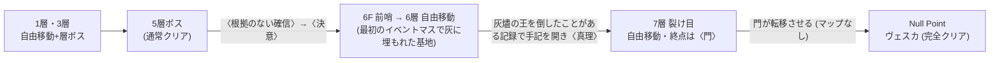

---
title: DICE BOUND — 統合仕様書
description: 設計・ロジック・仕様の統合正本。旧 docs/specs, docs/plans, docs/open-questions を吸収
status: current
updated: 2026-07-30
---

# DICE BOUND — 統合仕様書

本ドキュメントは **設計・ロジック・仕様の統合正本**。
2026-07-27 に `docs/specs/` (18 本)・`docs/plans/`・`docs/open-questions/` を吸収して一本化した。

---

## 0. この文書について

### 0-1. 正本の階層

**最終正本は常に実コード。** 本書はその上位構造（設計意図・ルール）を保持する。
巨大カタログ（個別数値の羅列）は転記せず、下表の外部正本を指す。

| 対象 | 正本 | 本書の扱い |
|---|---|---|
| ダメージ計算の式・適用順・ctx 用語集 | [DAMAGE_CALC_REFERENCE.md](../Assets/Scripts/CombatSystem/DAMAGE_CALC_REFERENCE.md) | 骨子のみ記述・式は複製しない |
| アイテム全カタログ | [items.json](../Assets/Data/InventorySystem/items.json) | 分類とルールのみ |
| パッシブ全 166 種の効果 | `AllPassiveSkillEffects.cs` / `EnemyPassiveSkillEffects.cs` | 体系と機構のみ |
| 敵ステータス | [enemies.json](../Assets/Resources/enemies.json) | 構造のみ |
| 七つの大罪の ID・効果 | [PermanentDebuffIds.cs](../Assets/Scripts/MetaProgression/PermanentDebuffIds.cs) | 位置づけのみ |
| ID 定数 | [Ids.cs](../Assets/Scripts/GameLoop/Ids.cs) (`ItemIds` / `BossIds`) | 規約のみ |
| イベント定義 | [event_list.txt](../Assets/Resources/Events/event_list.txt) | フォーマットのみ |
| 筐体レイアウト実寸 | [docs/design/cabinet-layout.html](design/cabinet-layout.html) 他 | 設計思想のみ |
| バランス学習結果 | `BALANCE_CHANGELOG_*.md` / `BALANCE_TIER_LIST_*.md` | **BOT 自動生成・改変禁止** |

### 0-2. プレイヤー向け文面

ゲーム内チュートリアル文面は [handbook.md](handbook.md) が正本。本書とは目的が違う
（あちらは「どう遊ぶか」まで、攻略情報は書かない）。

**画面へ出す**: handbook の各節を、 その節の「出す契機」の場面に初めて来た時に 1 度だけ、 液晶の中央の板 (`Game2DTutorial`) で出す。 見出しが見た印の鍵 (`TutorialTopics`)、 印は PlayerPrefs (`UI.TutorialSeen`) でランをまたいで覚え、 設定の画面の「手引きをもう一度」で全部消す。 BOT がランを動かしている間は出さない。 今のコードと食い違う節は出さずに止めてある (`Game2DTutorial.Table` の held・§23-6)。

### 0-3. 記述規約

- 実装され動いているものだけを「仕様」として書く。未実装・保留は §23 に隔離し、silent gap を作らない。
- 数値を書く前に実コードか DAMAGE_CALC_REFERENCE を確認する。**憶測で書かない**。
- 実装を変えたら本書と DAMAGE_CALC_REFERENCE を同時に直す。
- **本書は今の仕様の詳細で、変更ログではない。** 日付つきの経緯・「旧:」の値・作者の決定の引用・測定の物語・廃止の説明は書かない。
  値を変えたら上書きし、旧い値を残さない。廃止したら節ごと消す。経緯は git と `Captures/` の作業記録に任せる。
- §23 には開いている項目だけを書く。済んだら消す。

---

## 1. プロジェクト概要

**DICE BOUND** — Unity 3D ローグライク（ボードゲーム調・ダイス戦闘）。
分岐するボード状のフロアを進み、マスを解決し、各層のボスを倒して深部へ潜る。

| 項目 | 値 |
|---|---|
| エンジン | Unity 2022.3.22f1 |
| レンダリング | Built-in Render Pipeline（URP/HDRP 不使用・ポスト処理は自前 `OnRenderImage`） |
| 言語 | C# |
| 開始 HP | 30 |
| 層 | 1 → 7（`normalClearFloor` = 5） |

### ディレクトリ地図

| 領域 | 主ディレクトリ |
|---|---|
| 戦闘 | `Assets/Scripts/CombatSystem/` |
| マップ・ラン | `Assets/Scripts/MapSystem/`, `GameLoop/` |
| 自由移動の中身（素の C#） | `Assets/Scripts/MapSystem/FreeMove/` |
| アイテム・パッシブ・ショップ | `Assets/Scripts/ItemSystem/`（名前空間 `ItemSystem`・2026-10-28 に `InventorySystem` から改名。データは `Assets/Data/InventorySystem/` のまま） |
| メタ進行 | `Assets/Scripts/MetaProgression/` |
| 契約 | `Assets/Scripts/GameLoop/Contracts/` |
| イベント | `Assets/Scripts/EventSystem/` |
| BOT・自動調整 | `Assets/Scripts/AutoTest/` |

---

## 2. 設計原則（変更禁止の規約）

### 2-1. 正本ポリシー

- 唯一の正本は実コード。
- ダメージ計算の正本は `DAMAGE_CALC_REFERENCE.md`。
- 七つの大罪の正本は `PermanentDebuffIds.cs`。
- アイテムカタログの正本は `items.json`。
- `BALANCE_CHANGELOG_*` / `BALANCE_TIER_LIST_*` は BOT 自動生成＝改変しない。

### 2-2. 画中画の原則

**ゲーム世界はゲーム盤内チップの演算結果にすぎない。**

- **液晶の外に部品は無い**: 画面の部品（計器盤・帯・窓・手引き）は全部**液晶の中身**で、液晶の効果（湾曲・走査線・にじみ・色ずれ・残像・粒・ブルーム・自動露出）が全部掛かる。
- **lore 側も筐体に言及しない**。
- 情報表示（予告・収支プレビュー）は液晶の中、物理的な操作対象（ダイス・端子）はワールド側。

### 2-3. ピクセル規約

- ピクセル要素（PPU=32）の状態表現に `transform.localScale` 倍率を**使わない**。
  色／明度／別スプライトで表現する。
- ピクセルパーフェクト（1dot = 物理 4×4px）は **LCD 上のみ**の制約。ワールド側は透視カメラで
  距離により密度が変わるため、そもそも 1:1 対応が成立しない。

### 2-4. ID 直書き禁止

複数ファイルから参照する ID・日本語 ID・ロジック分岐に使う ID/prefix は
`Ids.cs`（`ItemIds` / `BossIds`）か `ClassStarter` の定数を経由する。
ボス判定は `BossIds.IsBoss(id)`。新しい ID を跨ファイル参照する時は先に定数を足す。

### 2-5. CombatContext の 3 区分

新フィールドを足す時は `perTurn` / `decay` / `persistent` の区分を XML コメントに明記し、
perTurn/decay は `BeginNewTurn` の該当 Phase に必ずリセットを追加する。
1〜2 箇所しか触らない一時値はフィールドではなく `accumulatedValues` / `nextTurnBuffs` 辞書へ。

### 2-6. シングルトン規約

`_shuttingDown` + `[RuntimeInitializeOnLoadMethod]` パターンを守る（シーン破棄時の再生成警告防止）。

### 2-7. 用語規約

| 概念 | 正本表記 | 使わない |
|---|---|---|
| 振るダイスの本数 | **ダイス個数**（`playerDiceCount`） | 曖昧な「1ダイス」 |
| 各ダイスの目 | **出目** | — |
| 端子を挿した出目の和 | **端子配線合計+N** | ダイス合計+N |
| 攻撃力への加算 | **攻撃+N** | ダイス合計+N |
| 会心率への加算 | **会心率+N%** | 会心ダイス合計値+N / 会心率+N/9 |
| 与える側 | **与ダメージ** | 与ダメ（略さない） |
| 受ける側 | **被ダメージ** | 被ダメ（略さない） |
| 軽減を無視 | **軽減不可** | 軽減不能 |
| 軸の品を持っている数（心眼・血晶・瘴気・炉温・電流・堅牢・采配・賽目の総称） | **偏重** | 深さ / 深度（層と紛れる） |
| 山札の軸の偏重（山札の軸の品を持っている数） | **采配** | 機巧（設計書の仮称）・戦術（戦術消耗品と紛れる） |
| 役の軸の偏重（役の軸の品を持っている数） | **賽目** | — |
| 会心の確定 | **会心確定** | 必ず会心ヒット |
| ランの中で集める、持っているだけで効く品（コード上は `passive`・`ownedPassiveItems`・items.json の `category: passive`） | **秘宝** | 画面で「パッシブ」「パッシブアイテム」・「遺物」 |
| ランの外で持ち続ける装備（整備パネルで持ち込む冠・環・符。★・セット・強化あり・§15-5） | **遺物** | 秘宝 |
| 地図の点の種類（宝箱の点・`TileType.Treasure`） | **秘宝**（点の名前） | — |

**「ダイス合計+N」は禁止語彙。** ADR-0009 の相互攻撃モデルでは合計比較が存在しない。

**秘宝と遺物。** 画面ではランの中の持ち物を**秘宝**と呼ぶ（秘宝の点で秘宝を得る、と揃う）。
本書の「パッシブ」「パッシブアイテム」は、プレイヤーの持ち物を指す限り秘宝と同じ物（仕様の説明では書き換えない）。
敵の常時効果（敵のパッシブ）・武器の常時効果は持ち物ではないので「パッシブ」のまま。
**遺物**はラン外の装備だけを指す。世界観の「遺物」は大穴から産出される品の総称で、こちらとも結び付いている（鑑定所が鑑定書を出す）。
識別子（`PassiveSkill*`・`passive*`）・データの項目名・`event_list.txt` の効果の書式（「パッシブアイテム獲得」など・`EventParser` が読む）は変えない。

識別子は Terminal* のまま。`event_list.txt` の効果の書式（「端子をNつから選ぶ」「山札から端子を抜く」・画面には出ない）も据え置き。

> **未解消**: `items.json` の効果説明文には旧表記「ダイス合計+N」が残存。一括置換は未実施（§23）。

### 2-8. スキル表示名の統一

同一 `internalName` は武器・パッシブアイテムで同じ `skillName` を使う。

|---|---|---|
| Might I–IV | **筋力** | 剛力 |
| Fortitude I–IV | **頑強** | 堅忍 |
| Insight I–IV | **心眼** | 慧眼 |
| Steadfast | **堅忍** | — |

`堅忍` は Steadfast 専用（敗北時の条件付き軽減）。Fortitude の常時軽減は `頑強` で別効果。

---

## 4. ラン構造

### 4-1. 進行

- 層の番号 `currentFloor` は **0 → 5**。
  難易度の指標（死亡率・撃破ターン・損耗・`fightCount`・ブロック実績・`HpLossDiag`）には数えない。メタトークンの層到達ボーナスも 0 層は対象外。
  `FirstFloor` は 0（全回復と前哨基地の +200 補給は 1 層から効く）。
- **層の順は 1 → 2 → 3 → 4 → 5**（正本 [FloorPlan.cs](../Assets/Scripts/MapSystem/FreeMove/FloorPlan.cs)）。
  （5 層の〈門〉を処理すると、層は 5 のまま `RunState.inFinalStage` が立ってヴェスカ戦へ入る）。
  層タイトル・報酬・§13-5 の目標・学習ファイルは深さのまま（詰めるとデータが全部ずれ、バランスも動くので、換算で吸収した）。
  `currentFloor` は表示と進行にだけ使う。深さ ⇄ 番号の変換は `FloorPlan.DepthOf` / `OrdinalOf`。
- **通常クリア** (`IsNormalClear`)：5 層ボス撃破。
- 1/3/5/6/7 層は**自由移動のマップ**（§5）。前哨基地で始まり、終点（ボス／7 層は〈門〉）へ至る。
- **ボスが居るのは 1/3/5/6/8 層**（`FloorPlan.HasBoss`）。7 層は終点の〈門〉を処理し終えてマップへ戻った瞬間が
  層クリア（`GameManager.IsBosslessFloorCleared`）。
- **8 層は内部でボス戦だけの層**。〈門〉を処理したら**マップを挟まずヴェスカ戦**へ入る
  （`GameManager.EnterFloor` が 8 層だけ前哨基地の処理の直後にボスを起動する）。



7 層の終端は〈門〉で、
そこが補給と代償の最終地点になる。`boss_layer7`〜`_p4` という **ID は据え置き** ──
学習ファイル・Tier 表・`boss_tuning.json` のキーが ID 基準なので、層番号に合わせて
改名すると過去データと切れる（3 層プールの `boss_layer2`/`boss_layer4` と同じ扱い）。

### 4-2. 〈確信〉ゲート

`convictionStage` — イベント「災厄の予兆」で〈根拠のない確信〉取得時 1、以降**エリート戦勝利毎に +1**。
段階値は確信の強さを表すが、深層ゲートとは分離する。段の加算は**段が 1 以上か**で決める（品を持っているかでは決めない）。
段を読むのは記録と BOT の道選び（段 1〜4 の間はエリートを優先）だけで、画面には出ない。

| 条件 | 名称 | ゲート |
|---|---|---|
| 〈根拠のない確信〉を持って5層ボス撃破 | 〈決意〉 | 6F 進入可 (`layer6Unlocked`) |
| 6層〈灰に埋もれた基地・再訪〉で手記の最後の頁を開く（灰燼の王を倒したことがある記録だけ） | 〈真理〉 | 7F 進入可 (`layer7Unlocked`) |

**品と資格**: 資格の正本はフラグ（`layer6Unlocked`・`layer7Unlocked`）と段で、品はそれを見せる物。
〈根拠のない確信〉→〈決意〉→〈真理〉は同じ 1 枠を書き換えて持ち、**手放せない品**（`ItemIds.Undroppable`・§16-4/16-5）なので
売れず・取り替えに出さず・偽の商人で失わない。図鑑では時計と違い枠を隠さない。古い中断セーブで既に確信を売ってしまったランは、
書き換える時（深さ 5 のボス撃破・灰に埋もれた基地で頁を開く）に元の品が無ければ書き換え先を足す（`ConvictionSystem.ReplaceConvictionItem`・このランで一度持った品は足せない）。

6層（深さ 6 = 画面の第 4 層・灰燼の王の層）は自由移動の層で、**この層で最初に踏んだイベントマスが〈灰に埋もれた基地〉になる**。
その点の通常のイベントの抽選の代わりに出す（`BeginWith`・乱数を引かない）。**点は決め打ちしない** ── 地図のどのイベントマスでもよく、地図の種別は生成どおり
（ボスの隣の点もふつうの種別・専用の絵や目印は無い）。2 つ目以降のイベントマスは通常の抽選。**イベントマスを 1 つも踏まずに終点（ボス）に着いた時は、
ボス戦の前に基地を出し、閉じたらそのままボス戦へ入る**（安全弁・`GameManager.StartBossTileOrAshBase`）。基地は 1 ランに 1 回（召喚専用・一度のみ）。
規則の正本は `MapSystem.FreeMove.AshBase.Forces`（本体と `Tools/freemap_check` が同じ式を使う）、版の選び方は `GameLoop.AshBaseEvent`。

**基地の中身はランの外の記録で変わる**（`MetaProgressState.ashKingBeaten` ── 灰燼の王を倒した瞬間に立てる・結末の種類によらない）:

| 記録 | 版（event_list.txt） | 選択肢 | 結果 |
|---|---|---|---|
| 灰燼の王を**まだ一度も倒したことがない** | 〈灰に埋もれた基地〉 | 1 つ: 時限デバフ〈徒労〉を受ける | 手記は開けない。灰燼の王を倒すと**第 4 層のクリアの結末で終わる**（〈真理〉無しの終了） |
| 灰燼の王を**倒したことがある** | 〈灰に埋もれた基地・再訪〉 | ① 手記の最後の頁を開く ② 頁を開かない（〈徒労〉） | ① その場で〈真理〉（品と `layer7Unlocked`）+ 時限バフ〈開眼〉（〈徒労〉は受けない）→ 灰燼の王の後に深さ 7 → ヴェスカ。② 第 4 層のクリアで終わる |

- **〈真理〉はランをまたいで残らない**（毎回、基地で得る）。ヴェスカ（深さ 7〜8）へ進めるのは 2 回目以降の潜行から。
- 〈真理〉を立てるのは選択肢の効果「真理を得る」（`EventEffectType.GainTruth` → `ConvictionSystem.RevealTruthInLayer6`）── 選択肢の並びや名前に依存しない。
- 〈徒労〉〈開眼〉の中身は §17 の「灰に埋もれた基地」の項。文は作者の確定文。
- **イベントなしの測定**（`SuppressEvents` / `SuppressConvictionChain`）は層に入る時に〈真理〉を無償で配るので、基地も安全弁も出さず、
  ふだんの深さ 6 には固定の点は無い。
- **測定の口** `ashKingBeatenEver`（`GameHooks.AshKingBeatenEver`・既定 True）: BOT は毎回空の記録で走るので、既定では「倒したことがある記録」で走る
  （ヴェスカまで通す・目標のクリア率はこの条件で測る）。False で「はじめて」の形。BOT は再訪の版で必ず手記を開く（効果で選ぶ・`ablateEvent` でも潰さない）。
  記録の欄 `ashBase`（0 = 起きていない / 1 = イベントマス / 2 = 安全弁）・`ashBaseRevisit`・`ashBaseChoice`・`ashBaseTurn`・`ashBaseOpened` とサマリーの「灰に埋もれた基地」の行。
7層は航行マップで終点が〈門〉（ボスなし・追跡者の専用エネミーは 7 層のエリートが土台）。8層はボス戦だけで、
**8層の前哨基地は回復しない**（転移した先の一点であって野営地ではない・物資の補給も無い）。

lore 的には「ギルド管轄も 5 層まで」「5 層を抜けた時点で凱旋級の栄誉」であり、
6 層以降に降りるのは確信に憑かれた者だけ。

### 4-3. 7 層の〈門〉と不完全起動（GateFlaw）

7 層の終端マス `Gate`。地獄の果ての壁に、大きな円盤が立てかけられている。
横に書かれた文が不思議と読める ── これは**門**で、いくつかの代償を払えば起動する。

門は 3 工程で動く。**手を抜いた工程が、そのまま向こう側での欠陥になる。**

| 工程 | 問われること | 代償 | 怠ると |
|---|---|---|---|
| ① 外縁の再構成 | 生物の血が要るらしい | **最大HP −25%** | 〈不完全な修復〉充電が毎ターン終了時に半減する |
| ② 起動 | いくつかの秘宝が要るらしい | **ランダムに秘宝 2 個** | 〈不完全な起動〉攻撃値が 12% 削られる |
| ③ 転移 | 意識が薄れてゆく | **物資 −400** | 〈不完全な転移〉ボスの攻撃がブロック出目を貫通する |

複数同時所持可（フラグ）。効果は**門をくぐった後の戦闘**＝ 8 層ヴェスカ戦にだけ乗る。
数値の正本は [GateFlaws.cs](../Assets/Scripts/GameLoop/GateFlaws.cs)。
罰の実装は 3 つとも**プレイヤー側の規則**で、敵は一切強化しない。

- 〈不完全な修復〉`CombatContext.ConsumeHalfCharge` をターン終了時に呼ぶ。
  **支出には計上しない**（`ConsumeCharge` を使うと〈短絡〉と充電経済の計装が汚れる）。
- 〈不完全な起動〉攻撃値（atkBase）を 12% 削る（`GateFlaws.ApplyIgnitionCut`・`IgnitionAttackCutPct`）。
  割合にして「厚く配線した分は必ず残る」形にしてある。実値は 8 層ボス戦の
  ブロック／被ダメ分布を採ってから決めること。

> GateFlaw と七つの大罪（メタ恒久デバフ）は**全く別系統**。同時に両方を背負い得る。

### 4-4. 特殊フラグ

- `defeatedSaintGeorges` — 5 層裏ボス（シュヴァリエ）撃破。

### 4-5. 中断セーブ

ローグライクの中断セーブ。**1 枠**・**再開は 1 回きり**（読み込んだらファイルを消す）。正本は
[RunSave.cs](../Assets/Scripts/GameLoop/RunSave.cs) と [GameManager.Save.cs](../Assets/Scripts/GameLoop/GameManager.Save.cs)。

- **セーブできる時点**: 航行のマップ（`MapNavigation`・自由移動の層）で、何も待っていない時だけ（`GameManager.CanSuspendNow`）。
  窓（挑戦カード・開幕パッシブ・武器の入れ替え・端子の報酬・報酬の択）が残っている間、追跡者・使い魔と接触している間、
  戦闘・店・イベント・休憩・〈門〉の途中、8 層（マップの無いヴェスカ戦）は保存しない（その場の状態を写す口を持たない）。
- **入口**: 中断 = 設定の窓（Esc）の「中断して終える」（航行のマップで開いた時だけ出る）→ 書いてタイトルへ。ランは終えない（`EndRun` を通らない＝遺物は出ない）。
  再開 = タイトルの「はじめる」を押した時に中断セーブがあれば窓が出る（続きから／新しく始める（確かめてから消す）／やめる）。
  製品版でゲームを閉じた時、セーブできる時点にいれば自動で中断セーブする（`Application.wantsToQuit`。エディタの再生停止では書かない）。
- **写す物**: `RunState` の公開フィールド**全部**（リフレクション。写せない型を足すとセーブを断って error）、盤面（ノードの状態・航行マップの形・
  `FreeMapSim` の動く中身 ＝ 位置・ターン・崩れた道・追跡者・使い魔・囮罠・前線・嵐の時計のずらし・煙玉/前哨の旗の残り。形には嵐の層の印とフェーズ 2 のずらしの量・点の帯も写す）、
  乱数（`GameRng` の塩・キー別カウンタ・シード設定）、戦闘の通し番号（`CombatManager._combatSeq`）、追跡者・使い魔の戦闘の回数、
  ラン中の状態を持つスキル（`IRunStatePersistent`・いまは〈無銘の剣舞譜〉の剣先だけ）、実績のラン中の進み具合。
- **決定性**: 乱数は `hash(塩, キー, 連番)` なので、塩とカウンタと戦闘の通し番号を戻せば**中断しなかった時と同じ続き**になる
  （実数は丸めずビット列で持つ）。写さないのは診断用の累計（`RunStats`・`HpOutsideDiag` など・バッチ累計で判断に使わない）だけ。
- **混ぜない物**: メタ進行（整備パネル・遺物・実績の解除済み）は従来どおり `MetaProgressManager`（PlayerPrefs）。中断セーブは
  `Application.persistentDataPath/run_suspend.json`。中断中に整備パネル・遺物・難易度を変えると、再開したランには今の設定が効く（警告をログに出すだけ）。
- **版**: `RunSave.Version`（形式の版）と `RunState` のフィールドの名前・型の指紋。どちらかが違うセーブは読まずに捨てて新しく始める。
- **書き込みの安全**（spec-gaps G-24）: 書きかけ `run_suspend.json.tmp` に書いてディスクまで落とす → 本番を控え `.bak` へ名前を変えて退ける →
  書きかけを本番へ名前を変える → 控えを消す（[SafeFile.cs](../Assets/Scripts/GameLoop/SafeFile.cs)）。どこで落ちても完全な記録が 1 つ残る。
  読む時は本番が無い・使えない（JSON として読めない・版や指紋が違う）と控え → 書きかけの順に試し、読めたら本番の名前へ戻してログに出す。
  **消す時は 3 つとも消す**（控えが残ると、終わったランが次の起動で生き返る）。ファイルを開けなかった時（他のプロセスが掴んでいる等）は消さない。
- **メタ進行の記録の安全**（spec-gaps G-25）: `MetaProgressState_v1` は保存のたびに 1 つ前の値を `MetaProgressState_v1.bak` に残す
  （[BackedPrefs.cs](../Assets/Scripts/MetaProgression/BackedPrefs.cs)・製品版だけ）。鍵があるのに読めない時は、壊れた値を `MetaProgressState_v1.corrupt` へ退避して控えから読み、
  控えも駄目なら空で始める（どちらもログ・画面への知らせは未実装）。鍵が無い時は初回なので控えを見ない。エディタ（毎回空で始める）と
  並列ワーカー（`GameHooks.MetaPersistenceDisabled`）の動きは変えていない。
- **BOT はセーブしない**: `GameHooks.BotDriving`・バッチ実行・遺物の付与を止めた計測の間は、保存・読み込み・削除のどれもしない。

---

## 5. マップ

### 5-1. マップの構造（手番制の航行）

正本: [FreeMove/](../Assets/Scripts/MapSystem/FreeMove/)（素の C#・UnityEngine 非依存）。数値は
[FreeMapParams.cs](../Assets/Scripts/MapSystem/FreeMove/FreeMapParams.cs)、参照実装は
[docs/design/map-grid-prototype.html](design/map-grid-prototype.html)。

**点と道で出来た層を、道でつながった隣の点へ 1 歩ずつ進む。** 始点（前哨基地）と終点（ボス／7 層は〈門〉）が決まっていて、
その間の道順を選ぶ。

- **1/3/5/6/7 層**が航行マップ。**8 層はボス戦だけ**（§4-1）。
- 層の広さは **16.4 × 9.4**・点は **50 個**（最小間隔 1.15）。始点は左端、終点は右端。始点→終点は平均 12.4 歩（9〜17）。**嵐の層（§5-12）は、始点を地図の最外周から、ボスの点を外周 2 層の内側から選び直す**（点と道はそのまま・始点→ボス 5〜21 歩・平均 7.8）。
  （GAME.md の旧記述は 11.6 × 6.6・28 点。試作で調整した値が正 ── 監査 D20。）
- **道 = 最小全域木（つながりを保証）＋ 長さ 1.9 未満の組を 45% で**（交差しない範囲）。
  さらに**どの点からも道が 2 本以上**になるよう行き止まりを 2 段（距離 2.6 → 4.0）で潰し、道だと 2 倍以上遠回りな近い組には近道を足す。
  それでも行き止まりが残った層・山岳で分断された層は引き直す（40 回で諦めたら山岳なし）。
- **山岳**: 層に 3〜5 か所の通行不可の楕円。点も道も置かれない。
- 生成は `FreeMapGenerator`。**乱数は `GameRng` のキー `map.free`（連番 = 層 × 1,000,000 + 生成内の通し番号）だけ**。
  座標は生成時に float で確定し、三角関数は使わない（実装ごとの最下位ビットの揺れで層が変わらないように）。
- 6 層（深さ 6 = 画面の第 4 層）は、最初に踏んだイベントマスが〈灰に埋もれた基地〉（§4-2）。点は決め打ちしない（地図の種別は生成どおり）。
  イベントなしの測定の層だけ、層の 3 分の 1 あたりに固定のイベントの点 1 つ（`fixedEvent`）。
- ゲーム側の規則（整備パネル〈高負荷ドライブ〉の格上げ・挑戦デバフ〈偽の商人〉）は `MapGenerator.FromLayout` が掛ける。
  エンカウントの乱数添字は点の添字（`FloorManager.NodeRngIndex` の自由移動の帯）。

### 5-2. マス種別と抽選重み

| TileType | 内容 | 重み |
|---|---|---|
| Battle | 戦闘 | 29 |
| Event | イベント | 25 |
| EliteBattle | エリート（**精鋭の敵 1 体**・報酬ゴールド ×2.0） | 14 |
| Exchange | 交換（いちばん低いレア度の秘宝から 1 つ選んで差し出す → 上のレア度の 2 択から 1 つ・§16-10） | 7 |
| Shop | ショップ | 7 |
| Treasure | 秘宝 | 3 |
| Rest | 休憩（HP 回復 or 強化） | 3（試作の値） |

店と休憩は**層に必ず 1 つずつ**（無ければ店・休憩以外の点を置き換える）。層による表の違いは無い

非抽選（固定配置）: Outpost（始点）/ Boss・Gate（終点）/ LambdaRing / LambdaExit。

いずれも生成されない。`TileType` の enum 値と表示ラベルのみ**セーブ互換のため残置**。
（道具の「罠」§5-10 はマスではなく消耗品で、この `Trap` とは無関係。）

#### 危険の帯

層を左右で 3 つの帯に分ける（`FreeMapParams.BandOf`・始点の x を 0、終点の x を 1 とした割合を 1/3 と 2/3 で切る）。
**始点（左端）側ほど安全、終点（右端・ボス）側ほど危険。** 1 層の開幕から強い敵に当たらないようにしつつ、層全体を無害にはしない。
**敵の数値は変えない**（倍率なし）。変えるのは、どの敵が出るか・どのマスが置かれるかだけ。

| 帯 | 戦闘の敵 | エリート | 2 体戦 |
|---|---|---|---|
| 安全（左 1/3） | 候補を脅威度の低い順に並べた下の 1/3 だけ。その層の新顔の優先もしない | 置かない（生成時に通常の戦闘へ替える・〈高負荷ドライブ〉の格上げもしない） | 出さない |
| 中間 | 今どおり | 今どおり | 今どおり |
| 危険（右 1/3） | 下の 1/3 を外す（新顔の優先は残す） | 今どおり | 今どおり |

- **脅威度**（`EnemyData.danger`・内部値）= 実効 HP × 1 ターンの平均攻撃 ÷ 100。実効 HP は防御の軽減・〈虚体〉・割れる/積み上がる装甲・構えを反映する。
  値は `Tools/enemy_danger.py` が enemies.json に書く。
- 同じ脅威度の敵は同じ側に入れる（1 層のスライム 9・ゴブリン 9 はどちらも安全な帯に出る）。どちら側にも最低 1 体は残す。
- 追跡者・使い魔の戦闘は点の位置に縛られないので帯を使わない。
- **エリートの数は減る**（安全な帯の分を通常の戦闘へ替えるので、層のエリートは約 3 分の 1 減る）。報酬の総量も同じだけ減る。

### 5-3. ノード状態

`visited` / `activated`（**使い切り** ── 一度起動したマスは再訪しても起動しない。戻ってもよいが得は無い）/
`revealed`（**マスの種別が見えているか**。始点・終点・深さ 6 の固定のイベントの点（イベントなしの測定の層だけ）は最初から（**嵐の層の終点は伏せる** ── 測量・隣・嵐のフェーズ 3 で見える・§5-12）、他は視界 1 歩・測量 3 歩で見える。
開示済みの点はカーソルを乗せると戦闘名が出る（敵の名前は出さない）。**見えていない点は「?」で置かれる** ── 点と道の配置は層全体が見える）/ `isFalseMerchant`（挑戦デバフ「偽の商人」用）/ 自由移動の `freeMap` / `index` / `x` / `y` /
`isFixedEvent`（深さ 6 の固定のイベントの点・〈真理〉を持って入った層 = イベントなしの測定の時だけ）。**点と道の配置は層全体が見える**。`connections` は道で結ばれた点（双方向）。

### 5-4. エリート

**エリートは [enemies.json](../Assets/Resources/enemies.json) の独立した敵**（`"elite": true`、id は `<元の敵>_elite`、
表示名は「精鋭〜」）。EliteBattle マスはエリート敵からだけ、通常の戦闘マスは雑魚からだけ抽選する
（[FloorManager.cs](../Assets/Scripts/GameLoop/FloorManager.cs)）。**強さは JSON の数値そのもの**で、
戦闘直前に倍率を掛ける処理は無い。調整するときは enemies.json の値を直接動かす
（CLAUDE.md「隠し倍率禁止・実数値を直接調整」）。

- **エリートは常に単体。** 2 体戦は通常マスの引き（報酬 ×2 の賭け）として残す。
  **BOT の航行スコアも同じ値を読む**ので、ここを動かすと BOT の進路選択も動く。
- 4 層以降の敵のエリートは、固有のエリートパッシブ（早業 / 不死の軍勢 / 霊体 …）を持つ。

### 5-5. フロアモディファイア

正本は [FloorModifier.cs](../Assets/Scripts/MapSystem/FloorModifier.cs)。前哨基地で適用し、その層の間ずっと続く。表の層は深さ（括弧は画面の層）。

| 深さ（層） | 名前 | 効果 |
|---|---|---|
| 0（序層） | 倉庫の仕入れ | ショップ価格 −20% |
| 3（2） | 瘴気侵蝕 | 戦闘終了後に固定 1 ダメージ／休憩の回復量 30% → 50% |
| 5（3） | 地獄門 | 受けるダメージ −2（1 撃ごと）／ショップ価格 +40% |
| 6（4） | 深淵の洗礼 | 毎ターン自傷 1／武器の会心率 −15%（0% で止まる）／敵が毎ターン HP +3 回復／前哨基地で最大 HP +5 |

深さ 1・7 には層効果が無い。〈地獄門〉の「全ダイスの最大値 −1」（`diceMaxBonus`）は、装備した賽の面で振るので効かない。

### 5-6. 層タイトル（正本: `LayerTitles.cs`）

| 深さ（画面の層） | ボス | タイトル | サブタイトル |
|---|---|---|---|
| 0（序層） | 古い宝箱 | 序層　古い倉庫（仮置き） | 潜る前に、なまった手足の感覚を確かめておく |
| 1（第一層） | トレジャーゴブリン | 第一層　陽の差す浅層 | 振り返れば、まだ入口の光と街の音が届く |
| 3（第二層） | 毒沼の主など | 第二層　毒の沼 | 陽はもう届かない。ぬかるみが靴底を捕まえる |
| 5（第三層） | 審判官 | 第三層　審きの淵 | 多くの者がここで折れ、生き残りは酒場へ還る |
| 6（第四層） | 灰燼の王 | 第四層　灰の玉座 | 音もなく降る灰が、帰りの足跡を埋めていく |
| 7（第五層） | （なし・終端は〈門〉） | 第五層　裂け目 | 落ちかけた水滴が、空中で光ったまま止まっている |
| 8（第五層の最終段） | ヴェスカ | Null Point | すべての始まりにして終着点 |

削除した層（深さ 2「第二層　群れの領分」・深さ 4「第四層　鏡像の界」）の文言は `LayerTitles.cs` に残置（呼ばれない）。

第五層は「裂け目」へ改名（灰の玉座の続き）、 最終段は「Null Point / すべての始まりにして終着点」。
発火は `GameManager.EnterFloor` / `EnterLambda`。

### 5-8. 移動と手番

**移動は道でつながった隣の点へ 1 歩**。道の外へは出られず、山岳も通れない。**物資は距離によらず 1 歩ごとに一定**（50）で、
速さの区別は無い。**着いた点は必ず起動する**（途中の点を飛ばせない ── 通る点が全部起動するので、道順の選択が「どのマスを踏むか」になる）。
使い切った点は再訪しても起動しない。

**時間は連続ではなく手番制。** 自分が 1 歩動く（または待つ）と **1 手番が進み、追跡者が 1 度動く**。

| 行動 | 手番 | 物資 |
|---|---:|---|
| 隣へ 1 歩 | 1 | 1 |
| 待つ | 1 | ― |
| **測量**（道で 3 歩先までの点の種別と戦闘名を地図に書き込む・その層の間消えない） | 0 | 1 |
| 囮罠を置く | 0 | 消耗品 |
| 戦闘・イベント・ショップ・秘宝など点の起動 | **0** | ― |
| 休憩（通常の回復） | 0 | ― |
| 休憩（多めに回復 = 最大 HP の 60%） | **1** | ― |

- 物資が足りない分は **HP で払う**（物資 10 ごとに HP 1 ＝ 物資 0 の 1 歩は HP 5）。**死ぬ移動も許す**（拒むとデッドロック）。
- イベントを閉じて地図へ戻った時に `PassTurnsExternal` で進める。
  イベントの画面には捕捉中の「最短で何ターンで捕まるか」を出す。
  イベントの航行の効果（地図を明かす・追跡者を撒く・近道・前線 …）も同じ時に、ターンより先に適用する（§17）。
  **近道+N** は「この後の移動 N 回は物資もターンも使わない」（`FreeMapSim.FreeMovesLeft`）。自分は動かず、どこへ動くかは遊ぶ人が選ぶ。
  ただの 1 歩は表の「隣へ 1 歩」の手番 0・物資 0 版で、待つ・測量・〈補給線〉には効かない。層を出たら残りは消える。
- 時間を進める口は `GameManager.MoveStep / WaitTurn / RestHealMore` の 3 つだけ（いずれも `FreeMapSim` の操作 1 回）。測量（`GameManager.Survey`）は手番を進めない。
  人も BOT も同じ口を同期的に叩く。同じ操作列なら同じ結果になる。

### 5-9. 追跡者

**追跡者**は縄張りを巡回する強敵。**3 層から**・1 層に 1 体（`FloorPlan.HasWanderer`）。**道の上しか動けない**。
縄張りに入らなければ会わない。
入るなら、道具（測量・囮罠・煙玉）で宝を盗むか、戦って取る。

**見つかる**: 追跡者（本体）は、縄張りの中のプレイヤーと**道で隣の点**に居れば見つける。
性質によらず同じ。追跡者の手番の**動く前と動いた後**に見る ──
自分から隣へ来た時は動く前に見つかってそのまま詰められ（足で動く追跡者なら捕まる）、巡回で隣へ来られた時は見つかって次の手番から詰めてくる（`FreeMapSim.Look`）。
使い魔も同じく隣の点で見つける（`FreeMapParams.FamiliarSee` = 1・〈鏡の護符〉で 0 = 重なった時だけ）。状態は**巡回 ↔ 追跡の 2 つ**だけ。
**撒く**: 縄張りを出ない追跡者は、縄張りの外へ出られたら**すぐ見失う**。縄張りの中では、隣に来られないまま `QuietLose`（3）手番で見失う。追跡の上限（下）は今どおり。
**見え方**: 追跡者と使い魔は、**素の視界（1 歩・〈夜目の指輪〉で 2）か、測量・〈前哨の旗〉・イベントで明かした範囲（`FreeMapSim.Scouted`）に居る時だけ**地図に駒として出る（`FoeVisible`・`VisibleFamiliars`）。
地図の上の動きの違い（召喚者は動かない・猟犬使いは猟犬と 2 体・疾走者は 1 手に 2 歩）は残す。

- **縄張り**: 層の中ほどの一角の、道でつながった 7〜11 点（始点から直線距離 3 未満の点は入れない）。巡回は縄張りの全点を
  **中心の周りの角度順に、毎回同じ順で**回る。地図に出す（追跡者が生きている間、縄張りの**点の絵そのものを赤みのインク**で描き、縄張りの点どうしの道を赤・
  点に赤の破線の輪。強調は彩度で、明度は上げない。**仮の印**）。
- **縄張りの外へ出ない**: 本体も使い魔も、縄張りの中の道だけを歩く（`FreeMapSim.FoeStepToward`・`Leashed`）。
  **縄張りの外に居るプレイヤーには気づかない**（見つけることも煙玉も起きない）。追跡中に外へ出られたら、縁で止まり、
  性質・道具ごとの扱いは下の表。
- **縄張りを避ける道の保証**: どの層でも、縄張りの点を
  1 つも踏まずに始点から終点へ行ける道がある。**地図の形（点・道・種類）と乱数の消費は変えず、縄張りの側を削る**
  （`TerritoryBypass.Compute`・層に入った時に `FreeMapSim.ConfigureTerritory` が形の縄張りから計算する。形は書き換えないので、中断セーブから戻しても同じ縄張りになる）。
  規則（乱数を使わない）:
  ① 縄張りを踏まない道が既にあれば何もしない。無ければ、始点から終点への道のうち**踏む縄張りの点が一番少ない道**（同数なら歩数の短い道・それも同じなら
  添字の小さい点を先に広げた道）を選び、その道の上の縄張りの点を外し、中心から縄張りの中の道でつながる点だけを残す（道でつながったまとまりのまま）。
  道を選ぶ時、**中心と宝の点は通れないもの**として扱う。
  ② それで道が無いか、宝の点が中心から離れたら、中心だけを通れないものとして選び直し、宝の点は残った縄張りで決め直す（決め方は下の「縄張りの宝」と同じ）。
  ③ 削った縄張りが**下限 5 点**（`FreeMapParams.TerritoryTrimMin`）に満たなければ、縄張りに道で隣り合う点を中心に直線で近い順に足す
  （選んだ道の上・始点・終点・始点から直線距離 3 未満の点は足さない）。それでも足りないか、中心そのものが道の上にある（どの道も中心を通る）時は、
  削った縄張りの残りのまとまりごとに同じく足してみて、**一番大きくなるまとまりへ中心を移す**（新しい中心は元の中心に直線で一番近い点・宝の点は決め直す）。
  ④ 最後に 3 点（生成が受け入れる最小・`TerritoryHardMin`）に満たなければ、**その層には追跡者を置かない**（宝も無い）。
  巡回の輪は生成と同じ規則（中心の周りの角度順）で並べ直す。地図の赤い印は削った後の縄張りを描く。
  測定の口 `territoryKeepBypass=False` で削らない作りに戻る。
  「縄張りを通らない」は縄張りの点を踏まないことだけで数える ── 見つけること・使い魔・煙玉は縄張りの外のプレイヤーに働かない（`FreeMapSim.Look`・`FamiliarSeesMe` が
  避ける道がある層 **70.5% → 100%**（深さ 3/5/6 で削る前 71.5/71.0/69.0%）。削る層 29.5%（中心と宝を残す 22.8%・宝を決め直す 2.6%・中心を移す 3.7%・追跡者を置かない 0.39%）。
  外す点 中央値 2・90% 点 6・最大 10。縄張りの大きさ 全層 平均 7.80 → 7.15（中央値 7 のまま）・削った層だけ 平均 8.07 → 5.86（中央値 8 → 6・3 点 28 層・4 点 45 層・5 点 1153 層）。
  **宝の位置が変わる層 6.3%**（他に追跡者ごと無くなる 0.39%）。
  避ける道が最短の道より長い歩数: 全層 中央値 0・90% 点 3・最大 10（削った層だけ 中央値 0・90% 点 3・最大 8）。避ける道の歩数 中央値 13（最短 12）。
  物資（上限 10・店で上限まで買い足す・HP で払わない）で終点まで着ける層: 層に入る時 10 なら 縄張りを通ってよい道 99.1% / 避ける道 94.4%
  （通ってよいなら賄えるのに避けると賄えない層 **4.8%**・うち削った層 1.7%。残りは削らなかった層で、店が縄張りの中にある・避ける道が長いもの）、
  層に入る時 4 なら 91.6% / 84.1%（7.5%）。賄えない分は HP で払う（物資 1 = HP 5）── 不利な遠回りとして受け入れる。
- **縄張りの宝**: 縄張りの中心（追跡者の最初の居場所）を除いた縄張りの点のうち、中心に直線で一番近い点
  （`FreeMapSim.TreasurePointOf`・乱数を使わない）。**層に入った時から地図に「宝」の印が見える**（点の種類は見えないまま）。
  中心を外すのは、動かない召喚者だと取る手が戦うしか無くなるため。置き場所は性質で変えない（置き場所から性質が読めないように）。
  着くと点の起動の前に中身を渡す。**1 層 1 回**。取った後も追跡者の動きは変えない。
  中身: **偏重が一番高い軸の秘宝 3 択**（`GameManager.OfferTerritoryRelics`・軸は `EventEffectExecutor.TopAxis`・
  引き方はイベントの「軸の秘宝をNつから選ぶ」と同じ `PickRandomItemId(…, axis)`）。軸の秘宝を 1 つも持たなければ普通の秘宝 3 択。人は地図へ戻ってからの「品を選ぶ」、BOT は買いの点の高い方。
  不安定化は宝の +3 だけ（中身の秘宝では重ねない）。1 つも引けなければ宝箱の中身。測定の口 `territoryTreasure` の既定 `AxisRelic`。
  旧の中身: **武器を 1 段鍛える**（休憩の「鍛える」と同じ強化・素材は取らない。鍛えられない武器なら宝箱の中身・`territoryTreasure=Forge`）。
  前哨基地の自動強化を消した分を、自分で取りに行く形で補っていた。`territoryTreasure=Chest` で通常の宝箱と同じ中身、
  `None` で宝を置かない。追跡者を倒した時の報酬（物資とアイテム 1 個）は別にそのまま。
- **宝の点の種類と、追跡者との重なり**: 宝は点の種類とは別に置く。宝の点も戦闘・エリート・イベントなどの
  普通の種類を持ち、種類は近づくまで見えない（宝の印だけが最初から見える）。着くと**宝を先に渡し、続けてその点を起動する**
  （戦闘の点なら、鍛えた武器でその戦闘に入る）。**追跡者が宝の点に居る・着いた手番に捕まった時は、先に追跡者の戦闘**
  （下の「捕まる」と同じ）。勝てば 宝 → 点の起動 の順、逃げれば直前の点へ戻り、宝も点もそのまま残る。
  理由: 「着いた点は必ず起動する」「捕まった手番の点の起動は戦闘の後」という既存の規則をそのまま使い、宝だけの例外を作らない。
  宝の点を戦闘以外の種類に寄せると、置き場所（中心の隣）から種類が読める上に、地図の生成を変えることになる。
  宝の点は天候で沈まない（沈む点の候補から外す）。

| 性質・道具 | 縄張りを出ない追跡者での扱い |
|---|---|
| 召喚者 | 動かない（中心から動かない）。見つけるのはほかと同じ隣の点（旧 5 歩）、ただし縄張りの中のプレイヤーだけ。放つ使い魔も縄張りの外へ出ず、縄張りの中では目標に届かなければその場で消える |
| 猟犬使い | 本体も猟犬も縄張りの中だけ。猟犬は倒しても本体の元へ戻る（今どおり） |
| 疾走者 | 1 手に 2 歩のまま、2 歩とも縄張りの中だけ |
| 重装 | 今どおり（縄張りの中だけ） |
| 囮罠 | 縄張りの中に置けば今どおり（巡回中の番人の気を引き、踏めば 2 手番足止め・気を引かれても状態は巡回のまま）。**縄張りの外に置くと、気を引かれて縄張りの縁（囮罠へ道で一番近づける点）まで来て待ち、踏まない**。囮罠が切れたら巡回へ戻る（切れた囮罠の位置へは向かわない） |
| 煙玉 | 見つかる時に発動し、見つからなかったことにする（縄張りの外では見つからないので減らない） |
| 測量 | 縄張りの外から縄張りの中を書き込んでもよい（書き込んだ範囲に居る番人と使い魔が見える）。気づかれやすくはならない |
| 〈補給線〉 | 縄張りの中へ跳んだら追跡者はそこへ向かう（今どおり）。**縄張りの外へ跳ぶと追う先が無く、見失う** |
| 逃げた後 | 今どおり（直前の点へ戻り、追跡者は 2 手番足止め）。直前の点が縄張りの外なら、そのまま安全 |
| イベントの「追跡者を呼ぶ+N」「追跡者を遠ざける+N」（§17） | 縄張りの中の道だけで動かす。呼ぶは追跡者が歩く時と同じ道で寄り、自分が縄張りの外なら縁で止まる。遠ざけるは縄張りの中の隣だけへ。旧い作りでは縄張りを見ない |
| 「最短で何手で捕まるか」（ETA） | 縄張りの外に居る間は出ない。中に居る間は縄張りの中の道で数える |
- **状態**: 巡回（**置かれた囮罠**には巡回のまま寄り道する）→ 追跡（**見つけた**位置＝最後に分かった位置へ向かう）
  → 縄張りの外へ出られるか、3 手番隣に来られなければ巡回へ（見失う）。
- **追跡の上限**: 追跡が **8 手番**続いたら諦めて巡回へ戻り、その後 **4 手番**は見つけない
  （`FreeMapParams.ChaseGiveUp` / `ChaseRest`）。同じ速さの追跡者は、下がり続けるプレイヤーとの距離が永遠に縮まらないため。
- **見つける**: 上の「見つかる」のとおり、**縄張りの中で**道で**隣の点**（`FreeMapParams.DetectRange` = 1）に居れば見つける。確率は無い。性質で変わらない。
- **捕まる**: 追跡者が自分の居る点に着く。**捕まったら専用エネミーとの 1 戦**（下）。戦闘の間、手番は進まない。
  勝つと追跡者は倒れ、**物資 +3 とアイテム 1 個**。点に着いた手番に捕まった場合、その点の起動は戦闘の後。
- **予告**: 追跡者が見えている（素の視界か明かした範囲の内）間は、**次の一歩**が分かる（`PeekFoeStep`・予告と実際の移動は同じ関数）。
  捕捉されている間は「**最短で何手で捕まるか**」（`Eta`・こちらが動かなかった場合）を表示する。

| 性質 | 名前 | 戦い方 |
|---|---|---|
| 召喚者 | 群れ呼び | 2 体戦。 本体（HP ×1.8）と、 その層の通常の敵 1 体 |
| 猟犬使い | 猟犬使い | 2 体戦。 本体（HP ×1.5）と猟犬（HP は本体の 40%・攻撃は 70%・パッシブなし） |
| 疾走者 | 影走り | 最初の 2 ターンは攻撃 ×1.5（`openingTurns`）・HP ×1.4 |
| 重装 | 鉄塊の追手 | 防御 10 以上・〈積み上がる装甲〉・HP ×1.8 |

4 種とも本体の攻撃（基礎攻撃と攻撃ロールの上限）×1.6（Super 10%）。

**性質**: 追跡者は層ごとに性質を 1 つ引く（`FoeProfile.ForFloor`・GameRng キー `map.free.profile`）。
**味変**であって標準装備ではない。**プレイヤーには明かさない**（見え方から推理する。BOT も読まない）。

| 性質 | 本体 | 使い魔 | 特徴 | 出る層 |
|---|---|---|---|---|
| 召喚者 | **動かない** | 1 手に 1 歩 | 見つけている間は 3 手番ごとに使い魔を放つ | 3〜 |
| 猟犬使い | 1 手に 1 歩 | **1 手に 2 歩**（猟犬・最初から 1 体） | 本体と猟犬の 2 体で最短距離から追う。猟犬は倒しても本体の元へ戻る | 3〜 |
| 疾走者 | **1 手に 2 歩** | なし | | 5〜 |
| 重装 | 1 手に 1 歩 | なし | 捕まった時の戦闘が重い | 3〜 |

**使い魔**: 本体の手先。プレイヤーの最後に分かった位置へ向かい、道で 1 歩以内に入るとプレイヤーへ向きを変える。
目標の点に着いてもプレイヤーが 1 歩以内に居なければ消える。**接触すると戦闘**（その層の通常の戦闘相手 1 体・物資は得ない・逃げられる）。

### 5-10. 索敵と道具

範囲は道で何歩先か。

| 手段 | 分かること | 代償 |
|---|---|---|
| 何もしない | 1 歩先までのマスの種別・その範囲に居る追跡者と使い魔（**戦闘名は出ない**） | なし |
| **測量** | 今いる点から 3 歩先（`FreeMapParams.SurveyRange`）までのマス**と戦闘名**を地図に書き込む。**その層の間ずっと消えない**（中断セーブも跨ぐ）。書き込んだ範囲に居る追跡者と使い魔も見える | **1 手番**・物資 0（待つのと同じ払い: 追跡者が動き、嵐の中なら HP、崩れ始めた後は不安定化）。見つかりやすくはならない |

ボタンは航行の計器の右の列の [測量]（キー F）。BOT は口 `freeNavScout`（既定 切）と S4（`v3.superNav`）で測量を使う（同じ点では 1 回まで）。

**道具（消耗品・items.json の `consFamily` で判定。id は表示名）**:

| 道具 | 効果 | 入手 |
|---|---|---|
| **囮罠**（`lure`・2026-10-18 に旧〈囮〉〈罠〉を統合） | 今いる点に仕掛ける（手番は使わない）。**近く（6 歩以内）の追跡していない敵の気を引き**、**踏んだ追跡者を 2 手番足止めする**。8 手番で効果が切れる | 開始時 2 個・ショップ 8G |

### 5-11. 逃げる

戦闘中の**自分の手番（配線の前）**に選べる（`CombatManager.RequestFlee`）。

- **代償**: 物資 100 ＋ ゴールド半減（切り捨て）、報酬なし。
- そのターンは**こちらの攻撃が発生しない**（素火力・パッシブ・追撃・固定ダメの枠も捨てる）。敵の予告攻撃は**ブロック有効**で受ける
  （防御の端子を挿した出目で軽減できる）。生き残ればそこで戦闘を抜ける（`CombatResult.playerFled`）。
- **直前の点へ戻る**（出発した点）。通常のマスの戦闘から逃げた場合、そのマスは**使い切りにならない**（敵が残る）。
- 追跡者の戦闘から逃げた場合は、直前の点へ戻り、**追跡者は 2 手番足止めされる**。連戦は無いので「途中で救済」は戦闘 1 回の話
  （救済が発動した場合も逃げた扱い・代償なし）。使い魔の戦闘から逃げても使い魔は消える。
- **層のボスからは逃げられない**。イベントの戦闘・偽の商人も対象外（`CombatManager.FleeAllowed` は
  航行マップの層の戦闘・エリート・追跡者／使い魔の戦闘でだけ立つ）。

### 5-12. 天候 ──「嵐」（不安定化の時計）

正本は [Storm.cs](../Assets/Scripts/MapSystem/FreeMove/Storm.cs)・[Instability.cs](../Assets/Scripts/MapSystem/FreeMove/Instability.cs) と `FreeMapSim` の嵐の欄、数値は [FreeMapParams.cs](../Assets/Scripts/MapSystem/FreeMove/FreeMapParams.cs) の「嵐」「不安定化」（**全部最初の置き値**）。
手番で進む嵐（storm-boss）は測定の口 `stormClock=Turns`（`GameHooks.StormClock`）で戻る ── storm-boss と 1 手も変わらない
（`Tools/freemap_check` が b7bbc01 と storm-boss の FreeMove をそれぞれ別の名前空間で一緒にコンパイルし、生成と同じ操作列で比べる）。

**世界の理屈: 大穴は、狭間から物が流れ込むほど広がる。大穴から何かを取るたびに不安定になる。** 嵐を進めるのは手番ではなく、**不安定化ポイントの累計**。

**層ごとの出方**

| 深さ（画面の層） | 嵐 |
|---|---|
| 0（序層）・7（画面の第 5 層の 1 本道）・8（第 5 層の最終段・地図なし） | なし（天候もなし・不安定化も溜まらない） |
| 1・3・5（画面の第 1〜3 層） | 累計 0 から。15 で崩れ始める |
| 6（画面の第 4 層） | **累計 12 から**（崩れ始める境目 15 の 3 つ手前。旧 15 = 入った時からフェーズ 1・歩くだけで溜まる） |

> 深さ 6 は始まりが 12（`FreeMapParams.InstabilityDepth6Start`・ほかの層は 15）。境目は 15/30/45/50。
> 換算: 嵐は手番ではなく累計で始まる。崩れ始める前は歩く・待つで溜まらないので、静かな間に溜まるのは歩く以外（取る・激化・イベントのターン・嵐を動かす）だけ。
> 崩れ始めた後は前と同じ動きなので、嵐の全体（フェーズ 2〜4 も）が約 3 手番遅れる。累計で決まるので、取らずに歩けばもっと長く静かなまま（取るほど早く崩れる）。
> 手番の時計（`stormClock=Turns`・測定の口）の深さ 6 の静かな時間 0 は変えていない（storm-boss と 1 手も変わらない約束のため）。測定は `Captures/experience_storm_c/`。

**溜まり方**（`Instability.PointsOf` が 1 か所の表。本体は理由を渡すだけ。効果の種類・点の種別・戦闘の種類で決める ── id の綴りで判定しない）

| 行動 | ポイント | 呼ぶ所 |
|---|---:|---|
| 宝の点を開ける・縄張りの宝を取る | +3 | `OpenTreasure` / `TakeTerritoryTreasure`（中身の品が秘宝でも重ねない） |
| 秘宝を 1 つ得る（イベント・戦闘の報酬・番人の報酬・〈強奪〉〈高負荷ドライブ〉の戦利品・観測所の写しの上乗せ） | +3 ずつ | `GrantRewardItem` ほか（秘宝 = items.json の category が Passive）。**進行の資格の品（確信の 3 品・`ItemIds.QualificationItems`）は数えない**（大穴から取った物ではない・2026-11-13・`ItemIds.CountsAsTakenRelic`）── 〈灰に埋もれた基地〉の「真理を得る」・「災厄の予兆」の〈根拠のない確信〉は +0 |
| エリートを倒す・追跡者（番人）を倒す | +2 | `ConfirmBattleResult` / `HandlePursuerWon` |
| 通常の戦闘（使い魔・イベントの戦闘も）に勝つ | +1 | 同上 |
| イベントで**持ち物が増える**（下の「数える」効果が 1 つ以上起きた・秘宝を得た時は +3 だけ） | +1 | `SettleEventInstability`（選んだ効果と「勝利後」の効果で +1 は重ねない） |
| 戦闘の中でエスカレーションの段が 1 つ上がるごと（**ボス戦では溜めない**） | +1 | `CombatManager.NoteEscalationForInstability`（§6-8） |
| イベントの「ターン+N」 | +N | `FreeMapSim.PassEventTurns` |
| **崩れ始めた後**の 1 歩・待つ | +1（朱の雪の嵐の中へ動く時は +2 = 手番の数） | `FreeMapSim.MoveTo / Wait` |
| 「前線を遠ざける+N」/「前線を近づける+N」（イベントの書式は旧い名前のまま） | −N / +N（0 未満にしない・境目を下回れば静かへ戻る） | `FreeMapSim.ShiftStorm` |
| 店・交換マス・強盗・偽の商人・休憩（多めに休むの手番も）・測量・〈補給線〉・近道の 1 歩・崩れ始める前の 1 歩 / 待つ・逃げた戦闘・負けて救済された戦闘・ボス戦・端子の報酬 | 0 | |

  `EventEffectExecutor` が効果の種類を読み替えて渡す ── 綴りでは判定しない）: ゴールド・消耗品・強化素材・物資・名指しの品（秘宝でないもの = 武器・出目パーツ・消耗品）・フラグアイテム（秘宝は +3 の側）。
  **数えない得**（物が増えない）: HP の回復 / 全回復・最大 HP の増加・時限バフ・航行の効果（明かす・撒く・追跡者を遠ざける・近道）・次の店の値引き・次の休憩の上乗せ・観測所の写し。
  **得として渡さない**: 嵐を遠ざける（それ自体が −N）・秘宝を差し出して替える（交換）・武器を鍛える（自分の素材を払う・休憩の鍛えると同じ）。
- 宝の点が空になることは無い（素材 +1 が必ず入る）ので、開けたら必ず +3。N つから選ぶ秘宝は、人が後で選ぶ時も提示した時点で +3。
- 秘宝で変わる所（§16-10）: 〈防嵐の天幕〉= 層に入ってから最初の 3 回の「取る」（宝・秘宝・戦闘の勝ち・イベントの得 = `Instability.PartTake` の行）を半分（切り捨て・`GameManager.TentCut` → `FreeMapSim.AddInstability` の `cut`）。
  エスカレーション・歩く・イベントのターン・嵐を動かすは行動ではないので数えない。〈嵐読みの風見鶏〉= 嵐の中の点での勝ち（ボス以外・`AddBattleWinInstability`）のあと −3（「嵐を動かす」の行に積む）。
- 何で何ポイント溜まったかは、本体のログ（「不安定 +3（宝の点・累計 12）」）と、理由ごとの通算（`GameManager.InstabilityTotals`）・中断セーブの内訳（取る / 激化 / 歩く / イベントのターン / 嵐を動かす）に残す。

**フェーズの境目**（累計 → 段 → 輪は、累計と層の定数だけで決まる純粋な関数・`Storm.RingAt(L, 累計 − 15, Instability.Schedule)`・境目は `FreeMapParams.InstabilityPhase1At`〜`4At`・段の途中は線形に補間）

| 累計 | 状態 | 輪（安全な円） |
|---|---|---|
| 0〜14 | 静か（歩いても溜まらない） | 嵐なし。画面に「不安定 7/15」（分母は境目の定数から） |
| 15〜（深さ 1 は 20〜・50・55） | フェーズ 1: **崩れ始める**（ここから歩くだけでも溜まる） | 地図の中心（層の広さの真ん中）のまま、全部の点を含む半径 → その 60% |
| 30〜 | フェーズ 2 | 中心がボスの点を**少しずらした位置**へ寄りながら 60% → 30%。ずらしは層の生成時に専用の乱数（キー `map.free.storm`）で決める ── 長さはフェーズ 2 の終わりの半径の 30〜70% |
| 45〜 | フェーズ 3: **ボスの点の種別が見える** | 中心がボスの点へ移り、30% → ボスの点から一番遠い隣の点までの半径 |
| 50〜 | フェーズ 4 | ボスの点のほかは全部が嵐の中 |

- **輪の外の点が「嵐の中」**（`Storm.InStorm`）。内訳が空の写し（これより前のセーブ）は層の始まりから数え直す。
  **ボスの点（終点）は常に嵐の外**（ボス戦に〈嵐〉は付かない・終点への 1 歩で嵐の HP は払わない）。
- **点・道・種別には触らない**。嵐の中の店・休憩・イベント・宝も踏めば普通に使える。
- **手番で動く物は手番のまま**（追跡者・使い魔・囮罠・雪の 2 手番・`FreeMapSim.Turn`）。嵐だけがポイントで進む。
- 手番の時計（`stormClock=Turns`）の境目は 静かな時間 10 手番 → フェーズ 1（10）→ 2（10）→ 3（5）→ 4（深さ 6 は静かな時間 0）。輪の式は同じで、段の長さだけが手番になる（`Storm.TurnSchedule`）。

**嵐の中の罰**

- 嵐の中で**待つ**も −3（その場で 1 手番を過ごすので）。〈補給線〉で嵐の中の点へ跳んでも −3。
  イベントの「ターン+N」・多めに休む（`PassTurnsExternal`）では払わない。HP が 0 になったら死亡（物資切れの HP 払いと同じ扱い・死因の文は「嵐の中で力尽きた」）。
  **近道（`FreeMovesLeft`）の間も払う**（近道が消すのは手番と物資だけ）。
- **嵐の中の点で始まった戦闘は、敵に〈嵐〉が付く**: 敵の攻撃 +3（戦闘を通して）。敵のパッシブの欄に「嵐 ── 嵐の中で戦っている。攻撃 +3」と出る（隠し倍率にしない）。
  足し先は威圧+ と同じ `enemyDiceTotalBonus`（[DAMAGE_CALC_REFERENCE](../Assets/Scripts/CombatSystem/DAMAGE_CALC_REFERENCE.md) の表）。点の戦闘・追跡者（番人）・使い魔・イベントの戦闘・偽の商人のどれも、
  始まった時に自分の居る点が嵐の中なら付く。2 体戦は 1 体目に付く（敵側の状態は 1 体目のもの）。
- 追跡者・使い魔は嵐の影響を受けない（動きは今のまま）。

**嵐の種類**（層ごとに 1 つ・`WeatherInfo.ForFloor`・キー `map.free.weather` をそのまま引く。効果は嵐の中でだけ働く）

| 種類 | 嵐の中での追加 |
|---|---|
| （なし = 素の嵐） | なし。深さ 1 はいつもこれ（旧い作りの「深さ 1 は天候なし」を引き継ぐ） |
| 落石のような雹 | 嵐の中の点への 1 歩の HP がさらに −1（計 −4）。待つは −3 のまま。〈油布の靴〉を持てば雹の中の 1 歩は −1 少ない（嵐の無い層の雹の点も −1 → 0） |
| 削る砂 | 嵐の中の点への 1 歩の物資がさらに +1（確定・乱数を引かない）。 |
| 朱の雪 | 嵐の中の点への移動に 2 手番（追跡者は 2 回動き、嵐の時計も 2 進む） |
| 霧 | 嵐の中の、道で 2 歩以上離れた点の種別が「?」に戻る（近づけば見える・中身は引き直さない）。始点・ボスの点は隠れない |

種類は地図の右上（「嵐まで N 霧」「嵐 フェーズ k・次まで N 霧」）・上の帯の天気・層に入る時のロード画面の右上に名前で出す。

**始点とボス**（§5-1・§5-3・`Storm.Apply`・生成の後に 1 回。点・道・山岳・縄張りは作り直さず、キー `map.free` の引く回数も変えない）

- **外周の層**（`Storm.OuterRings`）: 1 層目 = 点の凸包の頂点と、その凸包の辺から直線で 0.3（`StormOuterEdgeSlack`・点の最小間隔 1.15 の約 1/4）以内の点（辺にほぼ乗っていて見た目で外周に見える点）。
  2 層目 = 1 層目を除いた残りで同じように作る。どちらにも入らない点が「内側」。12000 層で 1 層目 中央値 16 点・2 層目 13 点・内側 21 点（最小でも数点はある）。
- **始点を先に選ぶ**: 1 層目の凸包の頂点のうち、生成の終点（右端）でない・道が 2 本以上・追跡者の居る深さでは縄張りの全部の点から直線で 3 以上の点から、専用の乱数（キー `map.free.storm`）で 1 つ。
  前哨基地と、その点の元の種別を入れ替える。候補が無ければ生成の始点のまま（12000 層で 0）。
- **ボスの点（終点）を後から選ぶ**: 内側の点のうち、始点でない・縄張りの中でない・道が 2 本以上・
  （深さ 6 のイベントなしの測定の）固定のイベントの点でない・**始点から道で 5 歩以上**（`StormBossMinHops`・実装役の決定）の点から、専用の乱数（キー `map.free.storm.boss`）で 1 つ。満たす点が無ければ下限を 1 歩ずつ下げる
  （12000 層で 0 件）。ボスと生成の終点（右端）の種別を入れ替える ── 右端の点は入れ替えで来た種別の普通の点になる。距離の下限はボスの側だけで確かめる（始点 → ボスの順で、循環させない）。
- 深さ 6 のボスの隣の点は、ほかの深さと同じく生成どおりの種別。
  ボスに隣り合う点の数 中央値 3（2〜6・2:2736 3:5724 4:3087 5:442 6:11 / 12000 層）。
- **危険の帯**（§5-2）は嵐の層では横の位置ではなく、始点と終点への直線距離の比（始点から ÷（始点から + 終点から））を 1/3・2/3 で切る（`FreeMapLayout.BandOf`・`MapNode.band`）。
  新しい安全な帯のエリートは通常の戦闘へ替える。
- **ボスの点は種別を隠す** ── ほかの未確認の点と同じ「?」で描き、出口の方角（左下のコンパス）も「？」。見えるのは (a) 測量・地図を明かす効果などで種別が分かった
  (b) 隣の点に立った（視界 1 歩） (c) 嵐がフェーズ 3 になった。
  分布 5:2394 6:1982 7:1776 8:1640 9:1506 10:1095 11:728 12:425 13:220 14:104 15:63 16:30 17:18 18:8 19:4 20:4 21:3。
  縄張りを避ける道は全層にある（削る前にある 84.8%・削った 15.2%・追跡者を置かない 13 / 9000 層）。店と休憩は全層に 1 つ以上。
- 「ボスの点は常に嵐の外」の扱いは残す。この扱いが無かったら、ボスの点が輪の外になる層はフェーズ 1 の終わりで 15.5%・フェーズ 2 の終わりで 0%（4000 層）。

**イベントの航行の効果**（§17）: 「前線を遠ざける+N」= 不安定化 −N、「前線を近づける+N」= +N（手番は進めない・追跡者は動かない・HP も払わない）。
手番の時計では 嵐の時計を N 手番遅らせる / 進める。

- 地図の右上・上の帯: 静かな間は「不安定 7/15」（あと 8 で崩れ始める）、崩れ始めたら「嵐 フェーズ k・次まで N」（N は不安定化ポイント）と種類の名前。言い方は「不安定」「崩れ始める」で揃える。
- **点に乗せた時の見積もり**: その点を踏む / 開けると何ポイント溜まるか（「不安定 +3」）。戦闘は下限で「+1〜」、イベント（持ち物が増えるかは選び方しだい）と種別の分からない点は「+0〜」（崩れ始めた後は歩く分が乗る）。境目を越えるなら「崩れ始める」「フェーズ 2 へ」。嵐の中の点なら「HP-3」も。
- 戦闘の右の欄: 激化の段が上がって溜まった分「不安定 +N」（ボス戦では出ない）。報酬の画面（端子の報酬・2 つから選ぶ報酬・報酬）・宝の画面とイベントの結果の行に「不安定 +N（累計 M）」。
- **輪の見た目だけ絶えず動かす（規則は変えない）**（`Game2DMapView.Storm.cs`）: 崩れ始めた後、輪の線の半径の揺らぎ・破線の流れ・彩度の高い橙での明滅と、嵐の側の加算の粒。コマ送りは 8 コマ/秒。
  フェーズが進むほど揺らぎを大きく・速く・粒を多く。静かな間は動かさない（対比）。累計が増えて輪が縮む時は 0.5 秒かけて縮む（操作は止めない）。
  輪の判定は論理の位置だけで、見た目の揺らぎは判定に入らない。実時間で進む規則は無い。乱数は見た目専用のハッシュで `GameRng` を引かない。BOT が動かしている間・バッチでは揺らさない。
  **実時間で縮む案は採らなかった**（BOT の測定とシードでの再現が壊れる・戦闘の読み合いを守る・[design-rejects.md](design-rejects.md)）。

**BOT**（最小の対応・航行の作り直しは後の仕事）: 終点の位置は今までどおり知っている。出口へ切り替える条件「フェーズ 3 に入った」と、出口までの見積もり（`exitOk`・`Sustainable`）で
HP で歩ける分から道の上の嵐の HP（今の輪のまま）を先に引く規則は、段を `StormPhase` で読むので時計の種類によらずそのまま働く。**不安定化は値付けに入れない**（取り方は今までどおり）。
イベントの「前線」の値付けは 1 ポイント = 前線 1 段の値段 ÷ 5（`FrontEvery`・手番の時計の 1 手番と同じ値）。

---

## 6. 戦闘

### 6-1. 現況

**ADR-0009 相互攻撃モデルが正式仕様であり、既定で有効**。

計算経路の正本は DAMAGE_CALC_REFERENCE.md §9（補正チェーンの各段は §1）。

### 6-2. 設計思想（ADR-0009）

相互攻撃モデルは「早期決着に賭けるか、安全な長期戦を組むか」のジレンマを**構造が素で生成する**。
完全情報でも成立し、被弾を"効率よく受ける"レース判断が熟練の中身になる。

残課題「ブロック合戦の膠着」は**段階エスカレーション**が時計として解決する。

### 6-3. ターン構造（8 段）

```
0. ターン開始処理  : DoT/ステータス tick ・ ボスのダウンの判定（§6-15）・ 端子の山札から手札が 5 枚になるまで引く（§6-4）
1. 敵ロール        : 敵ダイス発火 + 敵パッシブ集計 → 敵攻撃合計 確定
2. 予告            : LCD に敵攻撃値・スケール段階・次段階までの残ターンを表示
3. 自ロール        : 自ダイス発火 + 自パッシブ集計
4. リロール (任意) : 充電を払って、手札を**全部**振り直す ── 配線前のみ可
   逃げる   (任意) : 自分の手番・配線の前に選べる (§5-11)。攻撃せず、敵の予告攻撃をブロックで受けて離脱
5. 配線            : 場の端子（常設 + 手札）を、出目 1 個に 1 枚ずつ挿す → LCD に収支プレビュー
6. 解決            : プレイヤー攻撃 → 敵攻撃（敵 HP 0 で即終了・敵攻撃は発生しない）
7. ターン終了処理  : OnTurnEnd 系 → 1 へループ
```

- **6 の解決順（プレイヤー先制・撃破時は敵攻撃なし）は全戦闘の体感難度を決める急所。**
  変更する場合は AutoRunner 再計測が必須。
- **リロールの規則**: ダイスを**全部**振り直す（振り直せない面は ADR-0011 で無くなった）。
  費用は充電で `振り直す個数 × この戦闘で何回目か`。**回目はターンでは戻らず、戦闘の中で上がり続ける**
  （3 個なら 1 回目 3・2 回目 6・3 回目 9 …）。次の戦闘で 0 に戻る。〈特別・対〉（目 1 の 2 個そろい）で得た
  無料の 2 回は回目に数えない。時限デバフ〈無力感〉（§17）を持っている間は毎回 **+1**（3 個なら 4・7・10 …・無料の振り直しには足さない）。
  費用の式は `CombatManager.RerollCostNow`（→ `TimedDebuffRule.RerollCost`）の 1 か所で、本体の支払い・画面の表示・BOT の方策が同じ値を読む。**1 ターンの回数に規則上の上限は無い**（充電が払える限り振れる）。
  ADR-0011 の「1 ターン 2 回まで」は BOT の方策（`AutoRunner.RerollMaxPerTurn`）にしか入っていない。
  旧規則（選んだダイスだけ・回目は毎ターン戻る）では、1〜2 個を刻んで追えたので充電さえあれば役がほぼ任意に作れた
  （素の 6 面の試算で、〈極〉が設計の 0.077%/ターン → 充電 12 で約 10%、〈満〉4% → 59%）。
  全部振り直しでは、今の手を捨てて引き直す賭けになり、同じ戦闘で続けるほど高くつく（選べるが、続けるとジリ貧）。
  正本は `CombatManager.RerollPhase`。
- 配線の時点で敵の実値も自分の出目も見えているのが正規の状態で、防ぐべき事後情報は無い。

### 6-4. 端子の山札（ADR-0014）

配線は**端子の山札**で行う。規則の正本は [ADR-0014](adr/0014-terminal-deck.md)、端子の一覧と数値の正本は
`TerminalCards.cs`（`Build()` と定数）。式は [DAMAGE_CALC_REFERENCE §9.2「配線」](../Assets/Scripts/CombatSystem/DAMAGE_CALC_REFERENCE.md)。

- **山札**: ラン単位（`RunState.terminalDeck`）。開始は **攻撃 2・防御 2・充電 1** の 5 枚（`TerminalCards.StartingDeck`）。
  攻撃・防御・充電も山札の 1 枚で、常設ではない。
- **引く**: 戦闘の始めにランの山札を写して切る（乱数は `GameRng` の専用キー）。ターンの頭に**前のターンの手札を捨て札へ送る**。
  ただし、**挿さなかった端子のうち「残す」の印を付けた端子は、次のターンも手札に残る**（手札の規則 Pick）。
  （規定の枚数が自然な上限・残す枚数の上限は置かない・それ以上残っていれば引かない）。
  出目は 3 個なので、5 枚から選んで使う。山が尽きたら捨て札を切り直して続きを引く。振り直しの判断より前に引くので、手札を見て振り直せる。
  - 画面: 挿していない手札の端子を押す（つかんで動かさずに放す）と印を付け外しする。印は本体の上の帯と「残す」の字（仮の見た目）。
    挿すと印は効かない。配線の答え（`AnswerWiringSlots` の `keep` / BOT の `WiringPlan.keep`）で本体へ渡り、`TerminalDeckState.KeepFromMarks` が直す。
  - 規則の正本は `TerminalDeckState.SplitHand`（本体の `DrawTurn` と BOT の先読みが同じ関数を呼ぶ）。
  - BOT の残す方策 `handKeepPolicy`: `None`（残さない）/ `Greedy`（素の点が山と捨て札の平均より高い端子・次のターンが大技なら防御の種類も）/
    `Lookahead`（残さない・1 枚ずつ・Greedy の組を、次のターンの最良効用の期待値で比べる）/
    `Planned`（**次のターンに使う当てがある端子だけ**残す・下）。**既定 `Auto` = どの技量でも None**。
    （1 枚残すと新しく引くのが 1 枚減る・`TerminalDeckState.DrawTurn`）ので、当てがある時だけ残す。残す口の数（容量の和）は次のターンの出目の数まで。
    前のターンに残して使わなかった端子は残し直さない。当ては 3 つ:
    ① 次のターンがダウン（選んだ挿し方の後の HP で `BossDown.NextTurnIsDown`）→ 攻撃の種類を、常設の攻撃と合わせて出目の数の口が埋まるまで（点の高い順）。ほかは残さない。
    ② 次のターンが大技（予告 `turnsToHeavy = 1`・ダウンでない）→ 防御の種類を、常設の防御と合わせて ⌈次のターンの攻撃の見込み ÷ 出目の平均⌉（出目の数まで）の口が埋まるまで。
    ③ このターンに出目を全部挿し切って、それでも挿さなかった、条件の無い端子のうち、山と捨て札の平均より点の高い物。
    〈有効活用〉も同じ当てで選ぶ: 予告で次のターンがダウン（`downPending > 0`）なら攻撃の種類・次が大技なら防御の種類の中で点の最大（無ければ全体で点の最大 = 今まで）。
    計装はサマリーの `[残す印 Planned]` 行（理由ごとに、残した数と次のターンに挿した数）。
  - 残す印の扱い:

    | 端子 | 残す印 |
    |---|---|
    | 挿した端子 | 付けても効かない（捨て札へ・使い捨ては戦闘から外れる） |
    | 挿さなかった手札の端子（使い捨てを含む） | 付ければ残る（使い捨ては使うまで手札に持っておける） |
    | 常設（〈千刃〉） | 付けられない（手札に無い・場に残り続ける） |
    | 止まっている端子（ヴェスカ〈停滞する時間〉） | 付けられない（印が無くても次のターンまで残る・今までどおり） |
    | 〈有効活用〉が戻す 1 枚 | 印で残した分の後に戻す。手札が規定の枚数に満ちていても戻す（説明文に無い制限だったので外した） |
- **挿す**: 端子 1 枚は出目 1 個に挿す（記載があればその数まで）。**条件に合わない出目には挿せない**（不発）。端子を挿さない出目は捨てる。**ターンの頭は何も挿していない状態で始める**（前ターンの配線は残らない）。
- **種類**: 攻撃・防御・充電・補助。「攻撃の端子を挿した個数」などを読む既存の品・武器・敵の規則は、この種類で数える
  （補助の個数は既存の「特殊の端子を挿した個数」の欄へ入る）。**攻撃の種類の端子を 1 枚も挿さないターンは攻撃しない**（§6-6）。
- **振り直しは出目だけ**。手札は変わらない。
- **使い捨て**はその戦闘中は山札に戻らない（次の戦闘ではまた入っている）。**使い捨ての決まりはこれだけ**。
  **常設**は一度引くとその戦闘中ずっと場に残り、手札の枠を使わない。
- **最後の攻撃の端子は消えない**: 山札（戦闘中は山・手札・場・捨て札・戻る使い捨てを合わせた持ち札）に残る最後の攻撃の種類の端子は、
  戦闘から外す効果（〈無銘の設計図〉・使い捨て・〈火葬の剣〉）を受けても外れず、**外れる代わりに捨て札へ戻る**（〈無銘の設計図〉は次の基本の端子を外す）。
  ランの山札から抜く所（店・休憩・イベント・使うと抜ける端子）でも最後の攻撃の端子は抜けない。判定は種類（`TerminalKind.Attack`）で、1 か所 `TerminalCards.KeepsLastAttack`
  （ランの山札は `GameManager.CanRemoveTerminalAt`）。きっかけはラン #1012542（〈無銘の設計図〉が攻撃 2 枚を外し、〈防御〉〈防御陣〉〈打ち直し〉の 3 枚で攻撃できなくなった）。
- **報酬**: 勝った戦闘の後に、通常戦 2 択・エリート 3 択・層ボスはレア 3 択（1〜4 層のボスだけ）から 1 枚を山札に加えるか、受け取らない
  （`GameManager.OfferTerminalReward`）。軸の端子はその軸の品を持っているほど出やすい。
- **店と休憩**: 店に端子の棚（3 枚・レアも混ざる）と「山札から 1 枚抜く」（店で抜くたびに値段が上がる）。休憩は回復の代わりに 1 枚抜ける。
  休憩の**「端子を強化する」**（数値は仮）: 素材を払って、山札の端子 1 枚（強化できる端子）を強化した端子（下の「＋」）に差し替える。
  値段は 1 回目 4・以後 1 回ごとに +2（このランの間・`GameManager.TerminalUpgradeCost` / `RunState.terminalUpgrades`）。休憩の行動は 1 マス 1 回（回復・鍛える・抜く・強化から 1 つ）。
  素材の使い道に数える（`GameManager.CanSpendMaterials` = 武器を強化できる、または強化できる端子が山札にある）。
  BOT（最小限の規則・`AutoRunner.Step` の休憩）: 武器の強化の判断を先に通し、武器を強化できない時に、HP が十分（HP の理由で回復を選んでいない）で素材が足りれば、
  山札の強化できる端子のうち報酬の点（`RewardBaseScore`）が最も高い 1 枚を強化する（`TryRestUpgradeTerminal`）。
  山札が手札の枚数を下回る抜き方はできない（`GameManager.Terminals`・数値は仮）。
  基の端子の定義を写して、表の分だけ変えて作る（`TerminalCards.MakeUpgraded`・強化後の説明文は `TerminalCards.UpgradedText`・数値は `*Up` の定数）。
  名前を作るのは `TerminalIds.Upgraded` だけ・基の端子を引くのは `TerminalCards.BaseOf`（定義の `baseId` を読む・名前の綴りは切らない）。
  **強化できない端子: 〈残響〉〈激昂〉〈共鳴〉〈千刃〉〈打ち直し〉**（〈時計〉は山札に入らない）。強化した端子の強化は無い。
  溜まり・〈反復突き〉の連続は名前ごとに数える（素と強化は別）。〈影写し〉で強化した端子を写せば写しも強化した端子。
  **店・報酬・付与（ITT）の抽選には出ない**（強化は休憩でだけ得る・`TerminalDef.upgraded`）。アイコン・札の絵は基の端子と同じ。
  強化の表（強化前 / 強化後 / 理由）は `Captures/overhaul/work/terminal_upgrades_draft.md`。
- **撃破のボーナス**（〈魂狩り〉〈処刑の刃〉〈賞金狩り〉〈剥ぎ取り〉）は、挿したターンに敵が倒れれば**撃破の経路を問わず**入る（毒・出血・爆発・反撃・ターン終了時の削りでも。
  式と時点は `DAMAGE_CALC_REFERENCE.md`）。
- **対象を取る端子**（〈影写し〉〈火葬の剣〉）は、挿していない手札の端子から対象を選ぶ（選ばなければ左端）。
  〈影写し〉の写しは**次のターンの手札に入る**。次のターンに引く 5 枚とは別に足すので、次のターンは手札が 1 枚多い
  （残す印で残した端子は引く枚数を減らすが、写しは減らさない・`TerminalDeckState.copyNext` を `DrawTurn` が引いた後に足す）。そのターンに使わなければ、ほかの手札と同じに捨て札へ行き、
  この戦闘の山札を回る（戦闘が終われば消える）。使い捨ての端子を写した写しも使い捨て（使えばこの戦闘から外れる）。手札の画面は 6 枚目以降を詰めて並べる（〈先読み〉の 7 枚と同じ）。
  **外す端子（候補）が無いターンは、挿しても不発**（挿した出目を外す ── 条件に合わない・充電が足りない時と同じ扱い。攻撃にもならず、使い捨ても消費しない・`TerminalCards.Resolve` の 4.）。
  ほかの「倍にする」端子との重なり: 〈剛腕〉は攻撃の端子に挿した出目を 2 倍にしてから入れるので出目 ×2 にもう ×2（合計 ×4）、〈残響〉は効果を 2 回走らせるので ×2 をもう一度（合計 ×4・外すのは 1 枚）、
  〈号令の剣〉は先に出目 +1 してから ×2、〈激昂〉〈共鳴〉は与ダメージの別枠の掛け算（攻撃の量とは別に掛かる）。上限は付けない。
- **説明文と動きの食い違いの残り**: 〈後の先〉の「防いだ量」は**ブロックで実際に防いだ量**（敵が攻撃しないターンは 0・〈大結界〉で減った攻撃はその量まで）。
  〈千刃〉の「以後の攻撃 +1」は〈千刃〉自身の攻撃（説明文を「以後のこの端子の攻撃」に）。〈打ち直し〉は溜まりが届いた**そのターンから**、まだ効果の出ていない端子の出目 +1（次のターンからは振った出目に足す）。
  今は 1 ターンに +1 の直線。
  〈残響〉で 2 回発動しても**払う充電・HP は 1 回だけ**（〈裁きの雷〉は 2 回目も払った量で攻撃に足す）。
  式は `DAMAGE_CALC_REFERENCE.md` の「配線」。
- **手札の規則で役目が変わる端子**（下の表は「挿さなかった端子が全部残る」形 All で書いたもの。既定の Pick では、印を付けた端子についてだけ当てはまる）:

  | 端子 | 新しい規則での動き |
  |---|---|
  | 〈有効活用〉 | 「空けた端子を 1 枚残す」は役目を失ったので、**捨て札から 1 枚を次のターンの手札に戻す**に作り替えた（ユーザーの決定）。出目はブロックに入れる（ADR-0014 の値付けの規則 2: 準備役は出目を素の端子と同じに入れたうえで効果を足す）。対象は挿した時点の捨て札（使い捨てで外れた・焼き切った端子は捨て札に無いので選べない）。選ばなければ最後に捨てた 1 枚。捨て札が空なら挿せるが戻す効果は無し。戻した 1 枚は次のターンの手札に数え（その分引く枚数が減る）、手札が既に規定の枚数でも戻す（旧: 戻さなかった）。BOT は素の点が最大の 1 枚（同点は後に捨てた方）。正本 `TerminalDeckState.RecallPick` / `ApplyRecall`（本体と BOT の先読みが同じ関数）。旧い規則（`handCarry=Off`）では元の「空けた端子を 1 枚残す」のまま（名前と説明文は今の規則のまま）。人の画面: 〈有効活用〉を出目に挿すと捨て札の窓が開き（挿してある〈有効活用〉を押しても開く・捨て札が空なら開かない）、今戻る 1 枚に「戻す」の印が付いて選ばれた状態で始まる。[これを戻す] で決め、[閉じる] は今の 1 枚のまま（`BattleWindows.OpenRecall`・窓は道具の窓と同じ部品の仮の見た目） |
  | 〈先読み〉 | 次のターンは「5 + 2 枚になるまで」引く。持ち越しで手札が埋まっていると、多く引く分が少なくなる（残った手札は捨てない） |
  | 使い捨て（〈火薬樽〉〈身代わり札〉〈応急箱〉ほか） | 使ったら今までどおり戦闘から外れる。**使わなければ手札に残る**ので、使い時（大技・ダウン）まで持っておける |
  | 〈影写し〉 | **写しは次のターンの手札に入る**。対象の元の端子は手札に残る（印を付ければ） |
  | 〈火葬の剣〉 | 変わらない。居座る要らない端子を抜く手段として値打ちが上がる（下） |
  | 常設（〈千刃〉） | 変わらない（手札の枠を使わない） |
  | ヴェスカ〈停滞する時間〉 | 止まるのは新しく引いた端子だけ（変わらない）。持ち越しで新しく引く枚数が減るので、止まる枚数も減る。止まった端子は挿せないので手札に残る（今までと同じ） |
  | 溜める端子・〈力溜め〉〈後の先〉 | 変わらない（挿した時だけ動く） |
- **アイコン**: 17×17・2 色（明るい主役＋後ろの暗めの飾り・主役の中の線は抜き）。
- **BOT**（`AutoRunner.Terminals`）: 挿し方は全列挙して効用で選ぶ。**どの技量でも配線は `DeckWiringPlanPolicy`、振り直しは `MutualRerollPolicy`**
  （素朴版は振り直さない）に上書きされる（`AutoRunner.Combat`）。
  Super と Optimal の戦闘での違いは、効用への入力（与ダメージの倍率と敵のパッシブを読む）・
  重い攻撃の予告で振り直しを 1 回増やす・護符の使い時だけで、残りの差は航行と買い物（§13-7）。先読みは既定では通らない ──
  切り替え式の 2 ターン先読み `deckLookahead`（既定 OFF・素朴版では使わない・既定はボス戦だけ `deckLookaheadBossOnly`・上位 `deckLookaheadTopK` 3 本 × 標本 `deckLookaheadSamples` 6）を
  振り直しの値付けと〈猫の手〉には掛けない。撃破のボーナス・対象・使い捨ては
  「この戦闘であと何回引くか」などから値付けする。端子ごとの使われ方は `CombatSystem.TerminalDiag`（`Tools/terminal_diag_report.py`）、
  効き目は端子だけを配る ITT（並列メニュー「■ ITT 並列 (端子 57 種)」・結果は `AutoRunLogs/terminal_itt/`）で測る。
- 端子の結果（攻撃・ブロック・充電に入る量、与ダメージの別枠の掛け算、被ダメージの率、シールド、充電の支払い、敵の攻撃の率など）は
  `TerminalCards.Resolve` の 1 か所で計算し、本体（`CombatManager.ApplyTerminalOutcome`）と BOT（`AutoRunner.Terminals`）が同じ関数を呼ぶ。
  〈一刀両断〉（攻・使い捨て: 出目 ×3・この撃は防御無視・挿した攻撃の端子がこれ 1 枚だけのターンだけ発動）・
  〈歯車の軸〉（補・常設・**出目を挿せない**〔capacity 0〕: 場にあれば、毎ターン最初に発動した基本以外の端子の挿した目 1 つにつき +2）・
  〈巡りの鐘〉（補・使い捨て・レア: この戦闘の残りの間、切り直すたび次のターンに 1 枚多く引く・設計書の〈残響の鐘〉は〈残響〉と紛れるので仮に改名）・
  〈見切りの構え〉（防・3 以下: 出目をブロックに・大技の予告のターンなら 2 倍）・〈崩し斬り〉（攻・5 以上: 出目を攻撃に・この撃でボスの目盛りを割ったら最大 HP の 5% の軽減不可）。
  入れない: 〈早回し〉（〈有効活用〉〈先読み〉と重なる・§12-4）。
  強化版（＋）: 〈焼却斬り＋〉出目 ×3・〈緊急再装填＋〉出目を充電に・〈一刀両断＋〉出目 ×4・〈歯車の軸＋〉+3・〈巡りの鐘＋〉出目を充電に・〈見切りの構え＋〉4 以下・〈崩し斬り＋〉出目 +1 と 6%
  （段 1-b の方針: 端子 1 枚の見込みの 2〜3 割・使い捨ては回数・枚数を増やさない）。報酬・店の抽選は既存の端子と同じ（`GameManager.RollTerminals`・〈焼却斬り〉は采配の偏重で寄る）。
  〈崩し斬り〉の「この撃」は撃の輪の h 番目 = 攻撃の端子の h 枚目（`TerminalOutcome.attackHitIds`・1 撃目には端子に紐づかない攻撃も入る）。追加のダメージは預かり（ターンの最後に通る・通常攻撃ではないので次の目盛りは割らない）。
- **軸の端子と使い捨ての条件**（式は DAMAGE_CALC_REFERENCE の「配線」）: 軸の端子は偏重でなく戦闘の状態を読む
  （〈一閃〉〈弱点看破〉この戦闘の会心の回数 × 0.08・〈鉤爪〉敵の出血 ÷ 4〔最低 2〕・〈毒霧〉+3〔敵に毒 +5〕・〈火種〉+5〔前のターンかこのターンに爆発 +10〕・〈招雷〉+3〔過充電 +6〕・
  〈裁きの雷〉このターンに先に充電を使った 1 回につき +25%・〈装甲板〉シールド +4〔前のターンにジャスト防御 +8〕・〈重装突撃〉今のシールドの 50%〔＋ 75%〕）。
  使い捨ては出目の条件と**発動の条件**（`TerminalCards.SituationOk`・画面の条件の表記に「被弾後」「予告」「使い捨て後」）で機会を絞る:
  〈応急箱〉3 以下・被弾後・出目 ×1／〈火薬樽〉5 以上 ×3／〈貫通弾〉奇数／〈身代わり札〉3 以下・予告／〈緊急再装填〉5 以上／〈焼却斬り〉使い捨て後。
  `OnDeckShuffle`（捨て札を切り直した・量 = 切り直した枚数）・`OnKeptTerminalUse`（残す印で残した端子を発動した・量 = 挿した出目の合計）・
  `OnSupportTerminalUse`（補助の端子を発動した・基本の〈時計〉を除く・量 = 挿した出目の合計）。配るのは `CombatManager.RaiseTerminalEvents`（配線の解決の直後・OnWired の前）と
  `RaiseDeckShuffles`（ターンの頭に引いた直後）。切り直しを数えるのは `TerminalDeckState.BeforeShuffle`（本体の引く所と BOT の先読みが同じ関数）。
  **端子の出力を変える効果は出来事で書かない**（`Resolve` の中で効かせる・BOT と自動で一致・§8-8）。出来事で書くのは端子の解決の外の効果（敵へのダメージ・ボスの目盛りの削り）だけ。
  配線は振り直しの後なので、そのターンの振り直しには効かない・§12-4）・〈役落とし〉（攻・役の軸: 出目を攻撃に・このターン役が成立していれば攻撃 +この戦闘で役が成立した回数 ×3、ゾロ目・連なりなら 2 倍）。
  強化版: 〈賽振り台＋〉min(8, 回数)・〈役落とし＋〉回数 ×4。立つ役は端子の解決の中でも `TerminalCards.RoleOf`（役の適用と同じ判定）で決めるので、BOT の配線の評価・先読みと一致する。
- **役とボスの出来事**（段 1-f）: `OnRoleFired`（役が立った直後・OnWired の前・量 = 2 個そろい 1 / ゾロ目・連なり 2）・
  `OnBossDown`（目盛りを割ってダウンが決まった・量 = 割った数・通常攻撃かひびかは `Kw.BossDownCrackKey`）・`OnHeavyCanceled`（ダウンか〈封じ・揃〉で大技を取り消した・量 1）。

### 6-6. ダメージ計算（骨子・式の正本は DAMAGE_CALC_REFERENCE §9）

```
自攻撃 攻撃の端子 1 枚につき 1 撃（ADR-0016・2026-11-20）
       撃の順 = 攻撃の端子に出目を挿した順 (2026-11-25・作者の決定)（挿し直すと最後へ・端子の効果を解く順は場の順のまま）
       1 撃 = その端子の出力 + 端子の外の攻撃（playerAttackPower・ctx.mutualAttackBonus = 品の攻撃 +N・消耗品・遺物 ＝ 毎回に乗せる）
              端子に紐づかない加算（連係・変圧・溜めた攻撃・賽の加算・〈電流〉の②・〈金で殴る〉）は最初の 1 撃だけ
                → 1 撃ごとに ProcessDamage → ApplyWinDamageModifiers（会心の判定・与ダメ % の池・敵の防御・「攻撃が通るたび」）
                → 1 撃ずつ敵HP 減算（首落とし・ボスの目盛りを割る判定も 1 撃ごと）

敵攻撃 enemyAtk = Escalation.EnemyAttackValue(敵, ターン, 敵出目合計)
                = round(段階倍率 × (baseAttack + 敵出目合計))
                → プレイヤーの防御で軽減（§6-14・予告に出る値はここまで）
       lossBase = max(0, enemyAtk − Σ(ブロック端子の出目))
                → ProcessDamage → ApplyLossDamageModifiers → プレイヤーHP 減算
```

**攻撃を端子ごとに分ける（ADR-0016）。** 以前は攻撃の端子の合計を 1 回の攻撃にしていたが、まとめる理由はどこにも書かれていなかった
（敵の防御は割合で減らす式なので、分けても防御で不利にはならない）。
与ダメ % の池・会心倍率・会心率は 2 撃目以降も 1 撃目の前の値から数える（同じ % を重ねて足さない）。攻撃の端子が 0 枚なら攻撃しない。
ターンの終わりに臨界へ足すのは攻撃の端子の合計のまま。画面は今は合計を 1 回の攻撃として見せる（1 撃ずつの見せ方は残作業・§23-33）。

**敵の攻撃値は 通常/エリート/ボス を問わず、必ずこの 3 段だけで決まる**:

1. **規定の基礎攻撃力**（`baseAttack`、未指定なら `threat`）
2. **このターンのダイス合計値** ── パッシブ補正込みの実値を**そのまま**加算
3. **パッシブ等の追加分・倍率・バフ/デバフ**（エスカレーション段階倍率を含む）

**この結果がそのまま予告値になる。** 予告と盤上の数字が一致しない中間係数を置いてはならない。

**enemies.json 未指定時の既定**: `baseAttack = max(1, threat)` / `escalationProfile = "std"`。

#### 構造知見（実装時の必須制約・シミュレート由来）

   「旧ロール勝負用ダイスを直加算するとレースが閉じない」という観測自体は正しかったが、
   対処として**隠し係数で出目を目減りさせた**のが誤り。予告に出る数字と盤上のダイスが
   一致しなくなる。**正しい対処は署名ダイスそのものをナーフすること**（§13-2 の面を直す）。
   実効攻撃が約 3.3 倍になるので、AutoRunner による全面再調整が必須（§23-7）。
2. **エスカレーション倍率は敵攻撃値全体（基礎+ダイス寄与）に適用** ── 基礎のみだとシールド蓄積系の
   成長を追い越せずグラインド無敵化する。

### 6-7. 収支トリガー

`balance = (与ダメ + 固定ダメ) − 被ダメ` を解決後に算出し、
`playerWonRoll = balance > 0` / `playerLostRoll = balance < 0` を上書きしてから
`OnRollWin` / `OnRollLose` / `OnRollDraw` を再発火する。

既存 79 箇所のトリガー効果は無改修で動く。
収支はレースの進捗そのもの＝痕跡ではなく本物の指標。

> **副作用**: 出目参照系は `ProcessPostRoll` 時点で発火するため、収支確定前の `playerWonRoll` を
> 参照する効果は値が古い（§23）。

### 6-8. 段階エスカレーション（時計）

敵攻撃値が **T5/10/15/20** の可視閾値で段階スケールする。
**スケール対象は攻撃値のみ**（HP/防御をスケールさせると長期戦だけが一方的に壊れる）。

| プロファイル | 段階倍率 (stage 0..4) | 用途 |
|---|---|---|
| `std`（既定） | 1.00 / 1.20 / 1.40 / 1.60 / 1.80 | 中庸曲線（旧 1.30/1.60/1.95/2.30） |
| `rush` | 1.00 / 1.40 / 1.80 / 2.20 / 2.60 | 早期決着教師 |
| `gentle` | 1.00 / 1.15 / 1.30 / 1.45 / 1.60 | グラインド許容 |
| `spike` | std + T12 のみ `max(std, 2.5)` | 断罪周期の後継 |

>
> | | S0 | S1 | S2 | S3 | S4 |
> |---|---|---|---|---|---|
> | 雑魚/精鋭 | **80.8%** | 17.2% | 1.7% | 0.2% | 0.1% |
> | ボス | 51.1% | 28.1% | 12.9% | 4.8% | 3.0% |
>
> 後半 3 段は**実質ボス専用**。雑魚戦の 8 割のターンは倍率 1.00 のまま終わるので、
> 曲線を緩めても道中の難度は動かず、長期戦のボスだけが緩む。
> **閾値 T5/10/15/20 は据え置き** ── 全戦闘の平均は 5.3T で設計時の想定どおりであり、
> 動かすべきは倍率側だった。

狂暴化（T50）は最終段階として体系に統合。
**狂暴化（全部の戦闘・あらゆる膠着の最後の受け皿）**: ボスに限らず全部の戦闘の敵が持つ（`CombatManager.AddBerserk`）。51 ターン目から
敵の攻撃 +10・以後 5 ターンごとにさらに +10（上限なし・51/56/61… ターン目に +10/+20/+30…）・**敵の攻撃はこちらの防御・ブロック・シールド・被ダメの軽減をすべて通さず HP に入る**（予告にもその値が出る）・回復封印・敵の受ける主攻撃のダメージ ×2。
数値と説明文の正本は `Berserk` の定数（`EnrageTurn` / `DiceBonus` / `StepTurns` / `StepBonus` / `EnemyDamageTakenMult`・`Berserk.Description`）。式は [DAMAGE_CALC_REFERENCE.md](../Assets/Scripts/CombatSystem/DAMAGE_CALC_REFERENCE.md)。
きっかけ: ラン #1012542 で攻撃の端子が山札から消え、〈打ち直し〉で膨らんだ防御で受け切るスライム戦が 250 ターン続いた（本体の戦闘には上限が無いので、人が同じ山札にすると詰む）。
チューニング目安: シールド蓄積系のグラインドビルドが**第 2〜3 閾値までに損益分岐**する傾斜。

**嵐の層の不安定化（§5-12）**: 予告の段が上がるたびに、地図の嵐の不安定化ポイント +1（`CombatManager.NoteEscalationForInstability`・この戦闘で見た一番高い段を超えた分だけ・〈鎮静香〉で下がってまた上がった段は数え直さない）。
**ボス戦では溜めない**（`Instability.EscalationPoints`）。戦闘の規則には何も効かない（段が上がった時は戦闘の画面の右の欄に「不安定 +N」）。

### 6-9. 完全情報テレグラフ

敵の攻撃値・スケール段階・次段階までの残ターンを盤上/LCD で公開する。
隠すことで守っていた均衡（情報切断）は不要になったため、読める情報は全部見せる。

### 6-10. 会心

> 被弾が「基礎 + ロール × エスカレーション」だけになり、プレイヤーが読める量になる。
> `criticalNumerator` はプレイヤー側と旧データ互換のために残っているが、`enemies.json` は全て 0。
> ボスの実数値による相殺は行っていない。

**旧**: 会心率 = 有効分子/9（11% 刻み・分子 9 で 100% 常時会心）／倍率 ×2.0
会心率(%) を float で加算し、**0〜1 へクランプするだけ**。

**式の正本は [DAMAGE_CALC_REFERENCE.md §2-B](../Assets/Scripts/CombatSystem/DAMAGE_CALC_REFERENCE.md)。
ここでは再記述しない**（二重管理で片方が腐るため・CLAUDE.md 正本ポリシー）。設計上の要点だけ:

- **加算した分がそのまま実効会心率になる。** 積むほど効かなくなる区間は無い
- **加算が 100% に届けば常時会心。** 旧カーブは 100% へ漸近するだけで、通常経路では
  常時会心が成立しなかった。`forceCritical` の「確定会心の特権」は、
  **到達コストの差**（特権側は 1 ターンで確定する）へ置き換わった
- 天井は 100%（`ResolveCritRate`）だけ。 **100% を超えた分は会心倍率へ変わる**（1% ごとに +0.015・§7-6）

**確定/封印フラグ**:

| フラグ | 意味 | 該当 |
|---|---|---|
| `forceCritical` | 必ず会心（最優先） | 天極(ゾロ目) / 短絡(過充電3T) / 末那識(HP≤35%・与ダメ+30% も) / 画竜点睛(出目最大) |
| `critSuppressed` | 会心を封印 | 無心の刃 |

優先順位は `forceCritical` > `critSuppressed` > 通常判定。

> `items.json` の武器は `critRatePct`（例 11 = 11%）、層効果は `critRatePctBonus`、
> パッシブ・消耗品・戦闘中バフは `ctx.critRatePctAdd`（小数）へ足す。
> 武器＋層補正だけを 0〜50% にクランプしてから他の会心ソースを加える（層のマイナスは武器分しか削れない）。
> 式の正本は `DAMAGE_CALC_REFERENCE.md` §2-B。 **UI** は `ItemDataV2.CriticalRateLabel()` が判定と同じ変換を通す。

### 6-11. 武器ダメージ分離（ADR-0004）

**ダイス＝勝負（命中）／武器＝威力／会心＝独立** に役割分離。

- `attackPower` は武器の素火力（items.json）。
  面は装備中の賽（§6-14・ADR-0015）が供給する。持つ賽は 1 個で、それを毎ターン 3 回振る。
- 武器の性能差は **attackPower ＋ critRatePct ＋ パッシブ** のみ。

下表は **`attackPower`**（B〜L ＝ T1〜T4）:

| 武器 | B | S | G | L |
|---|---|---|---|---|
| 盾 | 1 | 2 | 3 | 4 |
| 剣 | 2 | 3 | 4 | 5 |
| 斧 | 3 | 4 | 6 | 8 |
| ダガー | 1 | 2 | 3 | 4 |

（呪い系 2/3/4/5・竜閃 3・炎の杖 3・デフォルト 2d6 = 2。数値は BOT 較正対象）

### 6-12. 敵のパッシブの欄の読み方

敵のパッシブは、`CombatContext` の欄を**名前どおりの意味**で読み書きする: `player*` はプレイヤー、`enemy*` は敵自身。
敵がプレイヤーへ軽減不可のダメージを与える時は `ctx.EnemyDealUnmitigable`（シールドは肩代わりする）を通す。
---

### 6-13. 役（ADR-0011）
役は **目（1〜9）× {2 個そろい, ゾロ目}** の 18 種で、
**振った時点の 3 個で判定し、端子への置き方は条件にしない**。成立すれば自動で効く（1 戦闘 1 回の制限も、
発動の任意選択も、使用済みの管理も無い）。3 個では 2 つの役を同時に作れないので、効くのは 1 ターンに高々 1 つ。

賽がその目の面を持っていれば、2 個そろいもゾロ目も効く。
最初の賽〈角の取れた賽〉（2,3,4,5）でも役が出る。**小さい目ほど役が強く、大きい目ほど数字が強い**。
連なりの賽を持つ時だけ、3 つの連番（例 2・3・4）も役〈連なり〉になる（そのターン、挿した端子がすべて倍化する・手札 +1 枚）。

目ごとのテーマは 1 特別 / 2 封じ / 3 追撃 / 4 攻め / 5 守り / 6 時間 / 7 充電 / 8 癒し / 9 富。
**効果の数値はここに写さない** ── 一覧は [DAMAGE_CALC_REFERENCE.md の「役」](../Assets/Scripts/CombatSystem/DAMAGE_CALC_REFERENCE.md)（§9.2 の「役 (ADR-0011・…)」の段）を見る。

賽目（役の軸・§8-9）の【規則】と締めは役の適用（`CombatManager.ResolveRoles`）の中にある: 〈万象の賽盆〉（ゾロ目の効果を 2 回・2 個そろいを確率でゾロ目として扱う ──
配線の前に決めるので、配線の判断はその結果を見られる）・〈曇りの合わせ鏡〉（2 個そろいに 1 つ小さい目の 2 個そろいの効果を重ねる）・〈宿命の音叉〉（立ったゾロ目の効果が次のターンにももう 1 回）。
重ねた効果・もう 1 回の効果は「役が立った」に数えない（出来事 OnRoleFired・計装・〈揃いのメトロノーム〉の連続）。同じターンに 2 回働いた追撃は割合を足し、守りは掛け合わせる。

数値は叩き台（バランス調整で見直す）。**正本は実コード** [YachtRoles.cs](../Assets/Scripts/CombatSystem/YachtRoles.cs)（判定）・
[ADR-0011](adr/0011-three-dice-matching-roles.md)。特定の目の確率は面数 n だけで決まる
（ゾロ目 = 1/n³、どれかのゾロ目 = 1/n²）。

### 6-14. 賽（ADR-0015）

**持つ賽は 1 個で、その 1 個を毎ターン 3 回振る。** 賽は items.json の品（`category: "Dice"`・`diceFaces` が面・id = 表示名）で、
装備は `RunState.equippedDiceId` の 1 つ（読むのは `EquippedDie`）。最初は全員〈角の取れた賽〉（2,3,4,5・効果なし）。

- **入手**: 店の賽の枠 ×2（最初の賽と装備中の賽は並ばない）。**買うと今の賽と入れ替わる**（前の賽は残らない）。宝箱には入らない。イベントでは交換する・捧げる・自分の賽を振って選ぶ。
- **パッシブ**は出目が決まった後に効き、3 つの目・挿した先・捨てたかだけを読む。目 1 つごとに効くので 1 ターンに最大 3 回効く。**出目は書き換えない**。
- **軸を持たない**。軸は秘宝の仕上げが受け持つ（`docs/experience-goal.md` の「蹂躙の作り方」）。
- **釣り合いの線**: 平均 5 以上の賽は置かない・面の種類は 4 以上（軽石だけ例外）・LEGENDARY も 1 個で蹂躙が起きる形にしない。
- 20 種（5-5-5-5）の面と効果の一覧は [ADR-0015](adr/0015-equipped-die.md)。**正本は実コード**: items.json（面・説明）・
  TerminalCards（時計の端子・繋ぎの残す印）・YachtRoles（連なり）・YachtRoleEffects（古銭の〈癒し〉+1・Phase 4 較正）。
- **フルリワーク Phase 3g（台帳 §⑪）**: 〈錆釘の賽〉を 4 面 1,2,5,6 → 5 面 1,2,4,5,6（ITT +17.04 の 4 面の役の抜け道を塞ぐ・効果は据え置き）・〈拾い物の賽〉1G → 2G・〈鈍色の賽〉+1 → +2・〈古銭の賽〉+2G → +4G とそのターンの〈癒し〉の回復量 +3。ほかの 16 種は据え置き（Phase 4 の ITT で突出・底辺の物だけ直す）。

### 6-15. ボスのダウン（混乱ゲージ）

規則の正本は [BossDown.cs](../Assets/Scripts/CombatSystem/BossDown.cs)、値は `BossParams.DownGauge`（§13-1 の表）、式は DAMAGE_CALC_REFERENCE の「ボスの混乱ゲージ」。
対象は画面の第 2 層（深さ 3）以降のボスだけ。エリート・雑魚・追跡者には無い。

- **溜まる量**: 配線を決めた直後（撃と敵の攻撃より前）に、**攻撃の種類の端子に挿して発動したダイスの、止まった面の数字の和**。
  出目 +N・端子の倍率・基礎攻撃などの補正は入れない。振り直した後の面で数える。配線の時点で、満ちるかが分かる。
- **品の混乱 +N**: 固定値（〈猛り〉〈シールドバッシュ〉〈瞬光ランタン〉+10 など・一覧は DAMAGE_CALC_REFERENCE）。
  敵の行動の後に足された分は預かり、次のターンの何よりも先に入れる。大ダウンのターンは溜まらない。
- **満ちた瞬間**: ゲージは 0 に戻り、満タンの量が「×（1 + 増え方）」に伸びる（最低 +1）。その場で、このターンの周期の位置で効き方が決まる:

  | このターン | 効き方 |
  |---|---|
  | 山場（大技・業火・天与）のターン、または周期を持たない敵 | このターンの行動を取り消し、山場も取り消す。次のターンは**大ダウン**（攻撃しない・受けるダメージ ×2.0） |
  | チャージのターン | 効かない（溜め中は怯まない） |
  | 小技のターン | このターンの行動を取り消す（**よろめき**・倍率なし・次のターンは普段どおり） |

  〈連撃〉〈多頭攻撃〉の 2 回目も止まる。2 体戦の 2 体目は止まらない（ボスには 2 体目が付かない）。
- **大技の周期**は大ダウンのターンの頭で頭に戻る。エスカレーションはダウンのターンを数えない。
- **止まるのは攻撃だけ**: 敵のパッシブ・エスカレーションは動く。ただし「ダウン中は発動しない」を名乗ったパッシブ（`BossDownPassives`: 〈毒の侵蝕〉〈鏡映の応答〉〈審判の炎〉〈灰の再生〉〈遺物学者〉〈回帰性真理〉）は、ダウンのターンに鳴らない。名乗ったパッシブは enemies.json の説明文に「ダウン中は発動しない。」と書く。
- **ヴェスカ**は段ごとにゲージを 0 から入れ直す。博士の「止まらない時計」を持っていれば、各段が満タンの 50% から始まる。
- **挑戦カード〈受身〉III** は満タンの量を +N% する。端子〈崩し斬り〉は、このターンに混乱が満ちていれば攻撃の撃で最大 HP の 5% の軽減不可（1 ターン 1 回）。
- **画面**: 液晶に「混乱 N/M」と「大技まで N」、満ちれば止まる時は「今満たせば止まる」。敵の欄に満ちた時に何が起きるか。
- **BOT**: 配線ごとに混乱の溜まりを本体と同じ式で見積もり（品の +N も数える）、満ちて大技が止まる手を値付けする。Super は、次のターンに満たして大技を止めるために、このターンの攻撃を 0 本にして待つ手を選べる（`downGaugeNoAttackHold`）。
- 中断セーブは戦闘中に書かない（§4-5）ので、ゲージは保存の対象外。

### 6-14. 防御力と貫通（ADR-0013）

[DAMAGE_CALC_REFERENCE.md](../Assets/Scripts/CombatSystem/DAMAGE_CALC_REFERENCE.md)、実装は
[DefenseFormula.cs](../Assets/Scripts/CombatSystem/DefenseFormula.cs)。

- **両陣営が防御値（整数）を持ち、同じ逓減式で軽減率になる。** 積むほど実効 HP の伸びが落ちる。
- **貫通は相手の防御値を固定値で引く。** 余った貫通は何にもならない。
- **プレイヤーの防御は敵の攻撃値に掛ける（ブロックの前）。** 予告の数字は防御を引いた後の値。
  出どころは初期値・武器・アイテム（ステータス `def`）。
- **敵の防御は与ダメの最後のほう**（敵の軽減パッシブの後）に掛かる。固定ダメージ・出血・毒・軽減無視には掛からない。
- **武器の家系は貫通〜防御の線に並ぶ**: 短剣 ＝ 貫通最大・防御 0 ／ 斧 ＝ 貫通高・防御低 ／ 剣 ＝ 中・中 ／
  盾 ＝ 貫通 0・防御最大（§9-4b）。〈竜閃〉は貫通 99・防御 0。
- **貫通の効かない硬さは別系統**: 〈虚体〉（被ダメ半減）と〈霊体〉（偶数ターンは被ダメ 1）は防御値ではない。
  固定ダメージ・手数で答える。
- 敵がプレイヤーの防御を削る固定削り（`EnemyData.armorPen`）は仕組みだけ入っていて、値はエネミー再編で配る（§23-22）。

#### 装甲持ちの敵

**防御を持つ敵は、 なぜ硬いのかを説明できるものに限る**（フレーバー・性能・ゲーム上の役割のどれか）。 ばら撒かない。
4 つの型があり、 どれも「貫通で剥がす」以外の答え方を持つ。

| 型 | 仕組み | 答え方 |
|---|---|---|
| 高防御・低 HP | `defense` が高く、 HP が層の平均より低い | 貫通。 無くても HP が低いので長引かない |
| 割れる装甲 | 〈割れる装甲〉: ダメージを受けたターンの終わりに防御 −4 | 手数。 早く・多く当てるほど柔らかくなる |
| 積み上がる装甲 | 〈積み上がる装甲〉: 毎ターンの終わりに防御 +3（24 まで） | 早く倒す。 長引くほど硬い |
| 予告つきの構え | `guardPeriod` ターンごとに構える。 構えのターンは防御 +`guardDefense`・攻撃 ×`guardAttackMul`、 次のターンは防御 0 | 構えのターンは守りに回し、 隙のターンに撃つ。 予告（INTENT: GUARD / NEXT: GUARD）で見える |

| 敵（名前は 2026-11-18 に改名・正本は `enemies.json`） | 出る層（深さ） | 防御 | 理由 |
|---|---|---|---|
| 硬皮の蛇兵（旧 蛇鱗の戦士） | 4 | 〈硬鱗〉+4 | 鱗 |
| 刻印の石巨人（旧 ゴーレム） | 5 | 〈硬鱗〉+4 | 石の体 |
| 双角の暴牛 | 4 | 6 | 分厚い皮。 突進型の重い敵が軽い攻撃を通しにくい |
| 薄明の騎士（旧 黎明騎士） | 4 | 8 | 鎧を着たまま堕ちた騎士 |
| 落日の騎士 | 5 | 16・〈割れる装甲〉 | 古い鎧が限界。 〈死の宣告〉の時間制限と組んで「割り切るまで殴るか」を問う |
| 甲殻の這い虫（新） | 3 | 16（精鋭 20）・HP は層の平均の 55% | 殻だけが育ちすぎた虫 |
| 継ぎはぎの脱走兵（新・旧 継ぎはぎ鎧の脱走兵） | 5 | 20（精鋭 24）・〈割れる装甲〉 | 拾った板金を継いだ鎧。 打てば外れる |
| 石食いの虫（新・旧 石喰いの蟲） | 5 | 0 から〈積み上がる装甲〉 | 鉱脈を食んで殻に変える |
| 大盾の番兵（新） | 5 | 構え（3 ターンごと・+30・攻撃 ×0.5） | 隊列が崩れても大盾を下ろさない |

精鋭は〈精鋭〉で防御 +2。 敵の防御は戦闘画面の右に `DEF` として出る（今の値・構えや装甲の増減を反映）。

## 7. キーワード 4 軸

キーワードは「溜める役 / 増やす役 / 消費する役」で構成され、揃って初めて回る。
各キーワードは §15 のメタ「種火」トラックと接続している。

### 7-1. 毒 — 蝕み・【劇症】（旧【起爆】・§23-35）（full-item-rework-ledger §②）

正本: `StatusRegistry.Defs["poison"]`（量・減衰）・`CombatSystem.PoisonCore`（起爆の式）

| 項目 | 値 |
|---|---|
| 対象 | 敵 |
| tick | ターン開始時 |
| DoT | スタック数 × 敵の**最大 HP** の **0.1%**（切り捨て・下限 1・軽減不可） |
| 減衰 | ターン開始の毒のダメージの後、残りを **50%** に（切り捨て・〈腐れ沼の苔玉〉で 75%） |
| 上限 | **99**（〈腐蝕の王冠〉で無し） |
| 段の交代 | ヴェスカの段が替わると毒は 0（〈腐蝕の王冠〉は半分が残る） |
| 【起爆】 | 敵の毒を **3 分の 1**（切り上げ）消費し、**max(消費量 × 4, floor(消費量 × 敵の最大 HP × 25 / 10000))** の軽減不可ダメージ（〈劇毒の火薬庫〉で ×5・32 / 10000。最大 HP の項は HP の大きいボスで起爆が細るのを補う・ヴェスカは段ごとの最大 HP）。ボスの次の目盛りを、そのダメージの **35%** ぶん上げる（§6-15） |

毒は「毎ターンの微ダメ」でなく、**蝕み**（敵の攻撃・防御を毒の量で削る・分岐 A）と **【起爆】**（溜めた毒を一気に使う・分岐 B）の 2 面。
押す札は無い。
品 25 品は `PoisonEffects.cs`（端子の解決の中で効く 6 品の分は `PoisonCore.ApplyToTerminals`・本体・画面の見込み・BOT が同じ）、計算の位置は [DAMAGE_CALC_REFERENCE.md](../Assets/Scripts/CombatSystem/DAMAGE_CALC_REFERENCE.md) §3-J。
BOT は〈蓋付きの毒指輪〉の起爆を配線の見積もりに足す（毒を 24 へ押し上げて殴る挿し方を選ぶ）。

### 7-2. 出血 — 多段ヒット加速・血晶回収（full-item-rework-ledger §④）

正本: `CombatSystem.BleedCore`（撃ごとの出血・処刑の線）・`AxisRules.BleedDecay`（減り方）

| 項目 | 値 |
|---|---|
| 対象 | 敵 |
| ダメージ | ターンの終わりに出血の量そのまま |
| 減衰 | **毎ターン 1 + 出血 / 10（切り捨て）**の比例減衰（〈医書の隠し針〉で無効・〈止血禁じの軟膏〉で割る数 +15） |
| 上限 | なし（毎ターン P 与えると約 10 × (P − 1) で落ち着く） |
| 撃ごと | 攻撃の端子 1 枚 = 1 撃（ADR-0016）。撃ごとの出血はその撃が当たった直後に入る（次の撃は増えた出血を見る）。条件の敵の HP・出血は配線の時点 |

撃を重ねるほど出血が増え（分岐 A〈超多段ヒット加速〉）、溜めた出血を品が使って大ダメージ・吸血・ブロックに換える（分岐 B〈血晶回収・処刑〉）。
撃ごとの出血と撃ごとの攻撃 +N を書く 12 品は `BleedCore.ApplyToTerminals`（端子の解決の 5f・本体・画面の見込み・BOT が同じ）、残りは `BleedEffects.cs`。計算の位置は [DAMAGE_CALC_REFERENCE.md](../Assets/Scripts/CombatSystem/DAMAGE_CALC_REFERENCE.md) §3-L。
BOT は撃ごとの出血と〈血桜〉〈血の楔〉〈紅の搾り具〉を配線の見積もりに足す（攻撃の端子を並べる挿し方が選ばれる）。

### 7-3. 充電 — 戦闘のマナ（full-item-rework-ledger §①）

| 項目 | 値 |
|---|---|
| 獲得 | 充電の端子を挿した**ダイスの出目の合計**と品 |
| 上限 | **30**（`CombatManager.ChargeMax`。オーバーロード・充電と〈雷鳴の太鼓〉+15 で増える・〈雷壷〉で無くなる） |
| 過充電 | **10 以上**（`ChargeCore.OverchargeAt`・2026-11-21 に 7 から） |
| 使い道 | 振り直し（ADR-0010）・充電を払う端子・**【再起動】**（〈二股の導線〉: 充電 6 でこのターン発動した攻撃か防御の端子 1 枚をダイス不要でもう 1 回）・**【オーバークロック】**（〈雷鳴の太鼓〉: 充電 15 以上で 12 を払い、最初の 1 撃の最終与ダメージ +60%・敵の防御を全部無視）・〈逆さ避雷針〉 |

式の正本は `ChargeCore` と `TerminalCards.Resolve` の 5c（本体・画面の見込み・BOT の見積もりが同じ関数）。品 26 品は `ChargeEffects.cs`、計算の位置は [DAMAGE_CALC_REFERENCE.md](../Assets/Scripts/CombatSystem/DAMAGE_CALC_REFERENCE.md)。
BOT は再起動を払える時はいつも（対象はおまかせ）・オーバークロックは使える時はいつも。

### 7-4. 臨界 — 過熱ゲージ＆連続バースト（full-item-rework-ledger §⑤）

正本: `CombatSystem.HeatCore`（獲得・爆発・ダメージ・防御・見込み）

その後継軸。

| 項目 | 値 |
|---|---|
| 蓄積 | 毎ターン **配線のとき（攻撃の前）** に `meter += floor(攻撃の端子に挿した出目の合計 / 2)`（2026-11-25 作者: 旧 ターンの終わり。ここで爆発すればそのターンの攻撃すべてに【過熱】が乗る。`HeatCore.EndGain`・`TerminalOutcome.attackPips`・基礎攻撃・端子の倍率・品の攻撃 +N・【再起動】は入らない・2026-11-22 neon 収束: 旧 攻撃の端子の合計 attackSum = タダの自動爆発になっていた）。閾値は下の行。 品・端子が溜める分はその時点で足す（`Kw.AddHeat`）。 配線で決まる品の分（〈過熱石〉〈燻りの革胸当て〉〈火守りの火掻き棒〉〈点火スパナ〉〈荒砥〉）は撃より前に入る |
| 閾値 | **30**（2026-11-25 作者: 32 → 30。経緯 30 → 36 → 32 → 30）（〈早沸かし釜〉−5 = 25（旧 −4）・〈暴れ窯の火床〉超臨界のたび −4（最大 −16）・下限 12・〈恒温の竈〉は閾値の半分から = 15） |
| 爆発 | 閾値に届いた**その場で**基礎 **25**（上乗せ・倍率は §3-M）のダメージ。 **敵の防御の 50% を無視**（〈火花読みの眼鏡〉は全部）・会心と与ダメの池は乗らない。 **ボスの次の目盛りを、その爆発のダメージの 40% ぶん上げる**（§6-15・〈柱折りの発破筒〉は即座に割る） |
| 爆発後 | meter = 0（〈帳簿外の爆薬〉は閾値ぶんだけ減らして続けて爆発・1 ターン 5 回まで／〈恒温の竈〉は 8 から） |
| 【過熱】 | 爆発が起きたターン。〈二度目の打金〉〈天工開物〉〈烈刃〉〈燐晶〉が読む |
| 超臨界爆発 | 臨界が**閾値の 1.5 倍以上**で起きた爆発（旧 2 倍）。 ダメージ **×1.85**（〈暴れ窯の火床〉で ×2.6・`HeatCore.SuperMulPct` / `KilnSuperMulPct`） |
| 有効化条件 | **臨界の品を 1 つ以上所持**（戦闘開始時に `Kw.EnableHeat`） |

分岐 A〈高速連鎖〉（〈帳簿外の爆薬〉〈早沸かし釜〉〈燧石の指輪〉）と分岐 B〈高圧超臨界〉（〈溢れ取りの鋳型〉〈天工開物〉〈暴れ窯の火床〉）。
品 26 品は `HeatEffects.cs`（出来事で働く 15 品）と `HeatCore` の旗（爆発の式・端子の解決の 5g に効く 16 品・5 品は両方）。計算の位置は [DAMAGE_CALC_REFERENCE.md](../Assets/Scripts/CombatSystem/DAMAGE_CALC_REFERENCE.md) §3-M。
BOT は本体と同じ `HeatCore.Forecast` で爆発のダメージと【過熱】の品の得を配線の見積もりに足す。

### 7-5. シールド — 【ジャスト防御】と要塞（full-item-rework-ledger §③）

正本: `CombatSystem.ShieldCore`（判定・許容幅・端子の解決の 5e）・`CombatManager.FinalBlockSum` / `JustGuardForecast`

| 項目 | 値 |
|---|---|
| 減衰 | ターン頭（T2 以降）に残りを **50%** に（〈油染みの盾革〉で前のターンにジャスト防御か完封なら 70%・〈脈打たぬ鋼の心臓〉はシールド 50 以上なら減衰しない・〈重装兵の隠し刃〉はボスのダウンのターンは減衰しない） |
| 【ジャスト防御】 | 敵の直接攻撃の予告 **E > 0** のターン、敵の攻撃で HP を 1 も失わず、**E ≤ ブロック + シールド ≤ E + 許容幅**（既定 **2**・〈擦り減った小盾〉で 4）で成立。E は 1 体目の攻撃。ダウン・チャージ・行動不能のターン（攻撃しない）と〈狂暴化〉の攻撃は対象外 |

シールドは「耐えるだけ」でなく、予告を読んで防御をぴったり合わせる **分岐 A〈ジャスト防御・見切り〉**（反撃・次のターンの乗算・ボスの目盛り）と、
判定は 1 か所（`ShieldCore.IsJustGuard`）で、本体・配線の見込みの画面・BOT の見積もりが同じ式とブロックの関数を通す。
品 22 品は `ShieldEffects.cs`（端子の解決の中で効く 4 品は `ShieldCore.ApplyToTerminals`）、計算の位置は [DAMAGE_CALC_REFERENCE.md](../Assets/Scripts/CombatSystem/DAMAGE_CALC_REFERENCE.md) §3-K。
BOT はジャスト防御で働く品を持つと、成立する挿し方に得を足す。

### 7-6. 会心 — 【練気】の維持と【集中】

正本: `CombatSystem.CritCore`（超過会心率の変換・会心倍率・【集中】の入口と賭け金・【練気】の消費）・`ItemSystem.PassiveSkills.Effects.Crit`（このターンの会心の数・【練気】）

| 項目 | 値 |
|---|---|
| 基礎の会心倍率 | **×2.0**（`MetaBuffApplicator.GetCriticalMultiplier`・final5 で ×1.6 → final6 で ×2.0 へ戻した・作者の決定）。〈回帰性真理〉(−0.5) を受けて ×1.50 |
| 超過会心率 | 会心率が 100% を超えた分は、 会心した撃の会心倍率へ **1% ごとに +0.015**（全員の規則・〈寸鉄〉で +0.03・2026-11-23: final5〜6 の +0.02 → +0.01 → answer9 で +0.015） |
| 武器の基礎会心率（T2/T3/T4） | 盾 5/5/5%・斧 10/15/15%・剣 15/20/25%・短剣 15/20/25%・**竜閃 100%**。正本は items.json の `critRatePct` |
| 【練気】 | 会心の秘宝を 1 つ以上持つ戦闘で、 撃が会心するたび +1（戦闘の中だけ・減らない・上限なし・持たなければ溜まらない）。 会心した撃は【練気】1 つにつき会心倍率 **+0.06**（上限なし・集中会心は使う前の値）。〈抜き打ちの作法〉は戦闘の始めに +3 |
| 【集中】 | 集中の品を 3 つ以上持ち、 攻撃の端子 1 枚だけのターンの撃で、 集中の会心率（会心率 − 賭け金・〈抜き打ちの作法〉は 1 ターン目とダウン中 +12%）が 1% 以上なら集中の撃。 賭け金 = max(0, 25% ＋ Σ 品の賭け金 − Σ 品の相殺 × k)（k = 会心の秘宝の所持数・集中の品を含む 27 品・answer10。 品の賭け金 / 相殺: B・S 0 / 0・G 18 / 2%・L 24 / 3%。 0 で止まり加点にはならない。 旧 ÷ (1 ＋ 0.2 × max(0, k − 3)) は廃止）。 武器 25%・k = 3 ではどの 3 品でも集中にならない。 集中の撃が会心したら【練気】を +1 してから半分（切り上げ）を使い、 集中会心の品はその量で効く。 1% 未満なら集中にならない（賭け金も効果も働かない） |
| 確定会心 | 会心の品が配る確定会心は 0。 残るのは消耗品〈急所突きの針〉と〈シュヴァリエのレイピア〉の解除 |
| 配線の後のブロック | 攻撃の中で品が得たブロックは、 そのターンの敵の攻撃の前に足す |

27 品 = 共通 9（鷹匠の革手袋・狙い目の刻み・受け流しの扇・測量師の片眼鏡・銑鉄棍・脈打ちの測り針・瑠璃砥石・一点読みの片眼・死相の面頬）／
分岐 A〈練気の維持〉9（余韻の鈴・見切りの目印・研ぎ師の見立て書・斬り重ねの鞘・重ね斬りの型・連なる閃き・白刃の鏡砥・寸鉄・千里眼の水晶）／
分岐 B〈集中〉9（一の矢・初太刀の黒鞘・細目の覗き筒・刃こぼれの見立て・渾身の鉄兜・抜き打ちの作法・一閃の極意・白濁の義眼・必殺の照準器）。
脈打ちの測り針・見切りの目印・白刃の鏡砥・初太刀の黒鞘・細目の覗き筒・一閃の極意は仮名（アイコンは無い = 画面は品名の頭文字の枠で出す）。
品の値は `CritEffects.cs` と items.json・計算の位置は [DAMAGE_CALC_REFERENCE.md](../Assets/Scripts/CombatSystem/DAMAGE_CALC_REFERENCE.md) §3-N。
BOT は同じ CritCore の関数で撃ごとの会心率・集中・倍率を見積もる。

### 7-7. 山札 — 端子回転・廃棄ループと盤面構築（full-item-rework-ledger §⑦）

正本: `CombatSystem.TerminalCards` の山札の旗（`DeckItems`・`ApplyDeckItems` = Resolve の 6c・`BeforeShuffle`・`DisposeFired`）と `DeckEffects.cs`

| 項目 | 値 |
|---|---|
| 数える物 | この戦闘で使い捨てを使った回数（`disposedTotal`）・このターンに切り直した枚数・残す印で残した端子を発動したターン・発動した補助の端子・場の常設の端子。軸の品の数（采配）は読まない |
| 防御 | 使い捨て・補助・切り直し・常設のたびのブロック（〈備えの鐘〉〈切り捨ての半券〉〈灰払いの箒〉〈早回しのゼンマイ〉〈型合わせの古鍵〉〈常設の作業台〉） |
| ダウン削り | 〈仕込みの切替器〉基本以外 3 枚のターン、目盛りへの削り +20% |
| 作者の規則 | 最後の攻撃の端子は消えない（`TerminalCards.KeepsLastAttack`）・〈打ち直し〉は 1 ターン 1 回・〈無銘の設計図〉は最後の攻撃の端子を外さない |

分岐 A〈廃棄・回転ループ〉（〈再利用のるつぼ〉〈無銘の設計図〉・L〈解体屋の袋〉〈廃材組みの蒸気機関〉〈永久機関の主軸〉）と分岐 B〈永続・Pick 盤面構築〉（〈継ぎ目のない導線〉〈取っておきの銀弾〉・L〈常設の作業台〉）。
品 19 品のうち効果クラスは 2 品（`DeckEffects.cs`: 〈焼き入れの挟み〉の防御無視ダメージ・〈仕込みの切替器〉の目盛りの削り）、残りと 2 品の手札・撃の分は旗。本体・画面の見込み・BOT の写しは同じ Resolve と山札の関数を通る。
計算の位置は [DAMAGE_CALC_REFERENCE.md](../Assets/Scripts/CombatSystem/DAMAGE_CALC_REFERENCE.md) §3-O。

### 7-8. 役 — 出目制御と役連打・格上げ（full-item-rework-ledger §⑧）

正本: `CombatSystem.TerminalCards` の役の旗（`RoleItems`・`ApplyRoleItems` = Resolve の 6d）・`CombatManager.ResolveRoles` / `DecideOmniPair` / `FreeRerollsLeft`・`RoleEffects.cs`

| 項目 | 値 |
|---|---|
| 数える物 | この戦闘で役が成立した回数（`TerminalBattleState.roleCount`・どの役も数える）・前のターンの役の目（`roleLastFace`）・振り直したか・役の目。軸の品の数（賽目）は読まない |
| 働く役 | 品ごとに目を指定（前は「どの役でも」「1・2・3 の目を含む役」）。同日 neon 収束で少し広げた: 〈欠け目の見立て〉1・2・〈小口の錠前〉1・2・3・〈追撃の弾帯〉3（＋振り直し）・〈進軍の角笛〉3・4・〈潮目の木札〉4・5・〈連勝の銀杯〉すべての役（回数 × 8%）・〈揃いのメトロノーム〉同じ目が 2 ターン続く・〈宿命の音叉〉ゾロ目・連なり、または 2 ターン続けて立った役。〈連なり〉は目の役ではないので、目を指定した品には入らない。役は 1 ラン約 145 回立ち、品がほぼ毎ターン働いていたため（機会の少なさで強さを出す）。定数は `TerminalCards.*Faces`（目の集合・`FaceIn`） |
| 防御 | 役のターンのブロック（〈潮目の木札〉〈轟きの鉄球〉）・次のターンのブロック（〈負け越しの賽〉〈小口の錠前〉〈曇りの合わせ鏡〉の 1 の 2 個そろい） |
| ダウン削り | 〈欠け目の見立て〉1・2 の役のターン、目盛りへの削り +25% |

分岐 A〈低目ロール連打〉（〈小口の錠前〉〈欠け目の見立て〉〈揃いのメトロノーム〉〈曇りの合わせ鏡〉・L〈宿命の音叉〉）と分岐 B〈リロール＆格上げ爆発〉（〈擦り切れた賽袋〉〈追撃の弾帯〉〈負け越しの賽〉〈轟きの鉄球〉・L〈万象の賽盆〉）。L〈連勝の銀杯〉は両方。
品 13 品のうち効果クラスは 4 品（`RoleEffects.cs`）、端子の解決の中の分は旗、役の規則の 4 品は役の適用。本体・画面の見込み・BOT の写しは同じ Resolve を通る。
自分で決めた所: 〈進軍の角笛〉〈連勝の銀杯〉の回数はこのターンの役も数える・〈進軍の角笛〉の上限 16 は 2 倍の前・〈揃いのメトロノーム〉の与ダメージは同じ目の役が 2 ターン続いたターンから、途切れるか目が変わるまで毎ターン・
〈小口の錠前〉〈曇りの合わせ鏡〉の「ブロック +N」は次のターン・〈万象の賽盆〉の「3 回以上成立させた後」は前のターンまでの回数。
計算の位置は [DAMAGE_CALC_REFERENCE.md](../Assets/Scripts/CombatSystem/DAMAGE_CALC_REFERENCE.md) §3-P。

### 7-9. 金と軸なし汎用 — 枠外の経済と汎用（full-item-rework-ledger §⑨ §⑩）

正本: `GoldEffects.cs`（金の戦闘の側 5 品と `CoinDish` / `SpoilsScale`）・`GeneralEffects.cs`（汎用の戦闘の側 13 品）。動的 4 枠ロックの対象外（§1）。

- **金 12 品**は特定の軸の出来事（会心・シールド・臨界・充電）を読まない純経済。
- 〈二度点きの燐寸〉は役から移っただけで効果は今のまま。
- 自分で決めた所: 〈構え崩しの鉄杭〉のブロック +15 は次のターン（取り消したターンは敵が攻撃しない）・〈気圧計のペンダント〉は開幕のシールドのまま（台帳の「開幕バリアとして維持可」）・〈相場師の算盤〉の「戦闘開始時」= 1 ターン目・〈溶金の領主剣〉の店の額は持っている間に出た店だけ（店を出る時に足す）。
- BOT: 戦闘の側は ctx の口（攻撃 +N・品のブロック・与ダメ % の池）なので配線の見積もりに自動で入る。〈加重の拳套〉は 1 撃ごとの見積もり（`ReadOutOneHit`）に 2 撃目以降 +20%。〈銭皿〉を持つと一番の軸でない BRONZE を見送る（`BotHooks.WantsPassive`）。〈相場師の算盤〉は 10 回分まで店の頭で回す。乱数は引かない。
- 計装: ランの記録 `skipFired` / `skipGold`（見送り換金の回数と額）。金の出入りは `goldKeys`（深さ|出どころ・「見送り(…)」・品の名前）と `totalCoinsSpent`。
計算の位置は DAMAGE_CALC_REFERENCE §3-Q。

---

## 8. パッシブ体系

### 8-1. レイヤリング原則（ADR-0009）

「何がどこでロジックを持つか」を 3 層に固定する。
旧モデルの「パッシブがロール合計を書き換える」習慣は**持ち込まない**。

| 層 | 役割 | ロジック |
|---|---|---|
| ダイス（装備） | 素材の物理特性のみ: 振る個数・面数 | **持たない** |
| 端子 | 出目の変換先（能動・配線が要る） | 変換ルール |
| パッシブ | 常時装置 | 解決時の修飾チェーンで発動 |

**見えない補正の禁止**: パッシブはロール値（LED の表示）を直接書き換えない。
例外は「出目操作」カテゴリのみで、これは **LED の表示が実際に変わる**形でのみ許可
── 「LED に見えている出目 = 配線に使える値」を常に真にし、収支プレビューの信頼性を保証する。

### 8-2. 規模と分類

**全 166 種**（プレイヤー 102 / 敵 64）。個別効果の正本は実コード。

| 群 | 例 |
|---|---|
| 汎用 Tier 制（I〜IV） | 追撃 / 反撃 / 筋力 / 頑強 / 心眼 / 活力 / 吸血 / 不屈 / 貸与された時間 / 利刃 / 賞金首狩り / 重畳（シールドバッシュは 2026-10-28 に盾家系へ移した） |
| キーワード系 | 毒 9 / 出血 9 / 充電 9 / 臨界 9（§7） |
| 鈍器系 | 会心を犠牲に非会心ダメを強化（全 9 種・`nonCritOutgoingMultiplier`） |
| 会心バリエーション | 裂傷の刃心 / 防殻の一閃 / 急所穿ち / 吸命の牙 / 一点集中 / 連環の極み |
| 剣の舞セット | 4 枚集約で〈無銘の剣舞譜〉へ変化 |
| ユニーク | 重装兵の隠し刃 / 天命 / 無我無心 / 画竜点睛 他（武器家系の固有段は §9-4b） |
| 敵・エリート固有 | 精鋭 13 種 + 汎用 |
| ボス固有 | 各層ボス + ヴェスカ 4 形態 + シュヴァリエ |

- すべての攻撃が会心確定・敵の防御を無視・同じ攻撃がもう 1 回当たる（〈防人の軍標〉のもう 1 回と同じ道・重ねても 2 回）。攻撃 +剣先・当たるたび HP +剣先・受けるたび剣先の軽減不可ダメージは据え置き。式は [DAMAGE_CALC_REFERENCE.md](../Assets/Scripts/CombatSystem/DAMAGE_CALC_REFERENCE.md)。

### 8-3. ADR-0009 対応状況

| 分類 | プレイヤー | 敵 | 計 |
|---|---:|---:|---:|
| ✅ そのまま動く | 68 | 43 | **111** |
| 🔀 ヘルパー/切替で対応済み | 30 | 4 | **34** |
| ⚠️ 意味変質（後段対応） | 3 | 15 | **18** |
| ❌ 無効化/no-op | 1 | 2 | **3** |

**ブリッジ方式**（当時）: `ctx.AddPlayerAttackOrDiceBonus(n)` が新旧の経路で書き先を切り替えていた。
- `mutualAttackBonus` — atkBase に加算（「ダイス合計+N」の転生先）
- `mutualEnemyAttackReduction` — 敵攻撃値から減算（「敵ダイス-N」の転生先）

主なリワーク:

| パッシブ | 変更 |
|---|---|
| 追撃 I-IV | 固定値 +2/4/6/8 → **与ダメ +15/30/50/100%**（筋力=加算と役割分離） |
| 反撃 I-IV | ロール敗北時 → **被ダメ発生時**発火 |
| 天命 | 敵合計≥自×2 → **被ダメ≥現HP50%** |
| 画竜点睛 | 即勝利上書き → **攻撃+(出目+10) + forceCritical** |
| 停戦協定 | 収支0が頻発するため **no-op 化**（再設計待ち） |

### 8-4. 発火順の罠（実装時の必須知識）

- **ダイス合計/攻撃への加算は `IPassiveSkillEffect` の `OnPostRoll` に書く。**
  `ITimedEffect` の `OnRoll` に書くと `RecomputeDiceTotals` に上書きされる。
- run 参照は `GameManager.Instance.Run`。
- 敵 `OnPostRoll` は勝敗判定**後**に発火する。敵がダイス合計を判定に乗せたい場合は
  `OnTurnStart` で `enemyDiceTotalBonus` に積む。
- `criticalMultiplier` / `critRatePctAdd` は毎ターン再取得・0 リセット。
  倍率/率への加算は **OnCriticalCheck で毎ターン再適用**する。
- `accumulatedValues` は戦闘開始でのみリセット＝戦闘中は持続。

### 8-5. ステータス統一フレーム

`StatusRegistry.Defs[id] = StatusDef{ target, tickTiming, dotPerStack, dotScalesWithStacks, decayPerTurn, maxStacks }`

- 保持: `CombatContext.playerStatusStacks` / `enemyStatusStacks`（**絶対視点**＝視点スワップしない）。
- tick: `TickStatuses(StatusTick.TurnStart)` を `BeginTurn` の `BeginNewTurn` 直後に 1 回呼ぶ。
- **加算的導入**: 既存の出血/威圧/負傷はバランス済みのため現状フィールドのまま据え置き。
- 制限: DOT 値は def 単位（発生源別の可変ダメ未対応）／DOT は軽減不可（fixedDamage 経由）。

### 8-6. アイテム再編（品どうしが 1+1>2 になる形）

実装は軸別の効果ファイル（各品の数値は XML コメントが正本）、 出来事の配り口は `Keywords.cs`、 計算の位置は
[DAMAGE_CALC_REFERENCE.md §3-H](../Assets/Scripts/CombatSystem/DAMAGE_CALC_REFERENCE.md)。

- **どの品も「何かを増やす」か「何かを条件にする」**。 対象は 臨界・充電・シールド・毒・出血・会心・金 の 7 つに寄せる。
  特定の 1 品を相手にする組は揃わないが、 同じ対象を増やす品が何品もあれば、 それを条件にする品はどれかと出会う。
- **「すべての〜」に効く品は置かない**（何を持っても働く品は、 どの品と組んでも足し算にしかならない）。
- **キーワードの出来事**（爆発・充電を得る/使う・過充電・シールドの増加/吸収/半減/割れ・毒の増加/ダメージ/上限・
  出血の減衰/消費/0）を品が受け取る。 同じ品が 1 つの連鎖で何度働いてもよい。輪は品の文の制限だけで止める。
  〈廃庭の霧吹き〉（敵の攻撃のたびにも毒が入る）・〈医書の隠し針〉（出血が減らない）・
  〈寸鉄〉（会心しなかった撃にも 会心倍率の上乗せ分 × 会心率〔100% まで〕が乗る）・〈銑鉄棍〉（会心が出なくなる代わりに会心率 1% につき与ダメージ +1%〔100% まで〕）・
  〈無害灯〉（臨界 15 以上の時、敵の直接攻撃で失う HP を臨界で半減・1 ターン 1 回）・
  〈貸与された時間〉（充電 10 ごとにエスカレーションを 1 ターン遅らせる）・〈早沸かし釜〉（閾値 −15）。
- 移動で貯まる品（〈火打ち底の旅靴〉〈聖路の白靴〉〈毒草摘みの杖〉〈測量師の片眼鏡〉）は、 前の戦闘からマップで進んだ歩数
  （`RunState.stepsSinceBattle`）を次の戦闘の開始時に 1 度だけ使う。
- 未承認で入れていない案: キーワードごとの「狙って組む極端な組」の追加・〈血車〉〈貸与〉〈銭皿〉の再調整。

### 8-7. 軸と軸の品

**なぜ。** 再編の品は大半が「軸 X を軸 Y に換える」変換器で、安い変換器を全部買うのが最適だった
（クリアしたランの 64% が毒・出血・爆発の 3 経路を同時に使い、燃料の品の所持率は 94〜99%）。
さらに上限 10 の毒や品数の少ない臨界は、1〜2 品つまむだけで 7 割の性能が出た。

**軸。** パッシブに `axis`（items.json）を付けた: 会心・出血・毒・臨界・充電・シールド・金。品が**読む**資源（発動の条件）の軸、
条件の無い品は作る資源の軸。だから「会心で毒」の品は会心に数え、毒の数を増やさない。**出目は軸にしない**（どの構成にも効く）。
軸の品を持っている数には呼び名がある: **心眼**（会心）・**血晶**（出血）・**瘴気**（毒）・**炉温**（臨界）・**電流**（充電）・**堅牢**（シールド）・**采配**（山札）・**賽目**（役）。
これらをまとめて**偏重**と呼ぶ。「最も大きい偏重」は偏重の軸の中で品の数が最も多い軸（同数は満たす・金は比べない）。
端子は偏重を読まない。軸指定リロールで指定できる（出現の枠に入った時・§16-3c）。〈切り捨ての半券〉は山札、〈二度点きの燐寸〉は軸なし汎用。山札の軸の品は §7-7、役の軸の品は §7-8。

**軸ごとの品**（実装 `AxisItemEffects.cs`・計算の位置は [DAMAGE_CALC_REFERENCE.md §3-I](../Assets/Scripts/CombatSystem/DAMAGE_CALC_REFERENCE.md)）

| 軸 | 燃料（配線を払う） | ① 数を参照 | ②【規則】強さが同じ数で決まる |
|---|---|---|---|
| 会心 | 鷹匠の革手袋（攻撃の端子に 4 以上の目を挿したターン 率 +20%・倍率 +0.30） | 研ぎ師の見立て書（心眼 × 会心倍率 +0.15） | 〔重ね斬りの型は 2026-11-20 に【規則】を外した: 同じターンに会心が 2 撃続いたら次の撃は会心倍率 +1.0〕 |
| 出血 | 返し刃の留め金 | 血止め知らずの針箱（血晶 5 以上なら出血のダメージに会心が乗る〔会心倍率の半分・1 回ごとに判定〕） | 〔凝血の小瓶は 2026-11-20 に【規則】を外した: 敵の出血 20 以上の間 敵の攻撃 −20%〕 |
| 毒 | 毒見役の小匙 | 瘴気溜まりの壺（ターン開始 毒 + 瘴気・11-07 に瘴気/2 から） | 腐れ沼の苔玉（残る割合 50% + 瘴気 × 2%・最大 70%） |
| 臨界 | 火守りの火掻き棒 | 焚き足しの炭（旧〈継ぎ目の鞴〉・臨界を得るたび +1） | 火花読みの眼鏡（爆発のたびに会心の判定・会心なら会心倍率の半分で乗る〔2026-11-10・判定は 2026-11-20 から爆発ごと〕・基礎 15 + 炉温/2） |
| 充電 | 継ぎ足しの蓄電瓶 | 漏電する銅線（ターン開始 充電 + 電流の半分〔切り捨て・溢れは捨てる） | 二股の導線（充電端子の出目の 電流 × 12% が攻撃にも） |
| シールド | 当て布の籠手（+7） | 油染みの盾革（減衰で残る +3% × 堅牢・最大 80%） | 盾押しの心得（攻撃の端子を挿したターン シールドの 堅牢 × 5% が攻撃に） |

- 軸なしの〈三つ揃えの打ち台〉〈鍛冶場の秤〉は 11-07 に削除。
  現在は **毒 25・臨界 25・充電 25・出血 24・シールド 20・会心 18**（金 7）。 理由: 会心の 23 品のうち会心率を直接上げるのは 9 品だけで、10 本揃えても会心率は 54% → 68%、シールドも同じ構造で、軸に進んでも値が伸びなかった。
  追加の品はどれもその軸の資源を読むか作る（他の軸への変換器は足さない）。
- **① と ② は連動する**: ① が資源を数で増やし、② がその資源の性質を数で変える。深く積むほど 2 乗で効き、浅いと効かない。
- **入り口**: 毒・臨界の軸の既存品 22 品に、決まった機会で毒 +1〜2・臨界 +3 を重ねた（`EntryEffect.Table`）。品の数がそのまま溜まる速さになる。
  - **入り口に偏重の条件**: 配布なしの構成でも終了時に瘴気 5・炉温 6 個（中央）を持ち、散らしただけで 5 層ボスの与ダメージの半分が毒・出血・爆発だった。
    機会の多い入り口ほど厳しくする。数は一律にしない（一律だと超えた瞬間に全部が点く）。

    | 機会 | 条件 | 品 |
    |---|---|---|
    | ターン開始 | 最も大きい偏重 | 毒固めの腕環・工廠の材料箱 |
    | ターン開始 | 上位 2 つの偏重 | 主を看取る香炉・燐晶 |
    | ターン開始 | 絶対数 | 帳簿外の爆薬（炉温 10）・恒温の竈（8）・無害灯（6） |
    | 敵の攻撃のたび | 絶対数 | 廃庭の霧吹き（瘴気 8）・蓋付きの毒指輪（6）・早沸かし釜（炉温 7）・八日目の灰燼（5） |
    | 敵の攻撃のたび | 上位 2 つの偏重 | 余熱の炉壁 |
    | 攻撃が通るたび・受けきり | 無条件 | 残り 9 品（出目を払うか、機会が少ない） |

    画面に偏重の数を出す表示は無い。
  「深く積むと得」は品が配る。
- **同時に塞いだ穴**（レビューの指摘）: 〈十五年目の計測器〉の溢れ→攻撃（溢れた充電 2 につき次の攻撃で出目 +5% に）・
  〈蓋付きの毒指輪〉の最大 HP 15%（毒 50 で 25 使って 100）・毒を読む品のしきい値（×5）・〈百人切りの鉈〉（毒 5 につき 1%）・
  Super の先読みは配線で決まる品（〈二股の導線〉〈盾押しの心得〉〈当て布の籠手〉）を再現する（`WeaponRungModel`）。

### 8-8. 山札の軸の作り方（品の効果は §7-7）

- 端子の出力・手札・山札を変える品は、品の効果クラスを持たず、戦闘の始めに所持品から `TerminalBattleState.deckItems`（`CombatSystem.DeckItems` の旗・`TerminalCards.DeckItemsOf`）に入れて
  `TerminalCards.Resolve` と山札の出し入れ（`TerminalDeckState.BeforeShuffle` / `DisposeFired`）の中で効かせる。BOT の見積もりと先読み（`SampleNextBoard`）が自動で一致する。
- **「攻撃 +N」は各撃**（ADR-0016 の品の攻撃 +N と同じく、攻撃の端子の撃 1 つずつに足す）。
- **「次のターンの手札に足す」口**: 〈影写し〉`copyNext`・〈有効活用〉`recallNext`・残す印 `keepNext`・`extraDrawNext`（枚数）・戻る使い捨て `returnNext`（〈緊急再装填〉〈解体屋の袋〉）。引く枚数とは別に引き終えた手札の最後へ足す。
- 〈解体屋の袋〉は乱数を使わず「この戦闘から外れた使い捨てを 1 枚（最後に外れた物）」戻す（BOT の先読みと一致）。〈整理された工具箱〉の枚数は戦闘開始時のランの山札で決める。

### 8-9. 賽目（役の軸）の 8 品・クロス軸の 6 品・戦術の 6 品（段 1-f）

効果の文は items.json の description が正本（ここでは作り方の決まりと、自分で決めた所だけ）。式は [DAMAGE_CALC_REFERENCE](../Assets/Scripts/CombatSystem/DAMAGE_CALC_REFERENCE.md)
（⓪ 振り直し・§9.2 の配線と役・§3-H の出来事の表の下）。

- 以下は段 1-f から残る決まり。
  - 〈擦り切れた賽袋〉の「戦闘の最初の振り直し」= この戦闘でまだ 1 回も振り直していない時の振り直し（ほかの無料と重なっても、最初の 1 回で使い切る）。
  - 〈揃いのメトロノーム〉: 同じ目の役（2 個そろいとゾロ目は同じ目なら同じ扱い）が続く限り、2 ターン目から毎ターン効く。「最初の振り直しが無料」は無料の振り直し +1（〈特別・対〉と同じ口）。
  - 〈曇りの合わせ鏡〉の 1 の 2 個そろいの「無料リロール +1」は次のターン（〈特別・対〉の無料と同じ口）。1 つ小さい目の役が〈凶運〉で封じられていれば重ねない。
  - 〈宿命の音叉〉: もう 1 回働くのは立ったゾロ目（格上げも）の効果だけ（連なりの「端子が 2 回」の持ち越しも無くなった・〈万象の賽盆〉の 2 回目・〈曇りの合わせ鏡〉の重ねた効果は次のターンに持ち越さない）。
  - 〈万象の賽盆〉: 格上げは振り直しと出目を書き換える効果の後・配線の前に決める（乱数は専用のキー `role.omni`）。格上げしたゾロ目は「ゾロ目」としてどの品にも数える。格上げした先のゾロ目が〈凶運〉で封じられていれば 2 個そろいのまま。
- 純軸の新効果は 火薬庫 = 毒（§7-1）・照準器 = 会心（§7-6）・残り 4 品 = 役（§7-8）。
- **戦術の 6 品**: 渾身の鉄兜（会心 §7-6）・静止の振り子（シールド §7-5）・隙突きの短槍・崩しの一手・構え崩しの鉄杭・背水の錨（軸なし 4 品・§7-9・`GeneralEffects.cs`）。
  - 〈隙突きの短槍〉の「攻撃が通るたび与ダメージ +40%」は、そのターンの与ダメ % の池に +40%（撃ごとに同じ池から通るので、どの撃にも乗る）。「チャージ中」= 大技の前の攻撃しないターン（天与の盾・指輪も）。
  - 〈崩しの一手〉: 1 ターンに何本割っても 1 回（「ダウンさせたターン」）。通常攻撃でもひびでも働く。
  - 〈構え崩しの鉄杭〉の「〈封じ〉で取り消した」= 大技のターンに〈封じ・揃〉（端子の行動不能も）で敵が行動しなかった。ダウンの側は `BossDown.CancelsCycle` と同じ「チャージか大技のターンのダウン」。
  - 〈背水の錨〉の段階は予告に出る段階（〈鎮静香〉の遅延・段階の戻しを差し引く）。
- BOT: 振り直しの費用は本体と同じ `RerollCostNow(ctx, …)`。役の品の振り直しの線は §7-8（`RoleRerollPips`）。軸に寄せる方策の山札の端子の表（役の軸）に〈賽振り台〉〈役落とし〉。
  先読みの次のターンでは〈万象の賽盆〉の格上げを見込まない。

---

## 9. アイテム・インベントリ

### 9-1. カテゴリとレアリティ

- カテゴリ: パッシブ / 消費 / 武器 / ダイス / 武器強化素材 / フラグアイテム。
- レアリティ: BRONZE / SILVER / GOLD / LEGENDARY / MYTHIC。
- **Lv1 以上は全て遺物**（lore 上）。強化素材そのものも遺物。

### 9-3. パッシブアイテム

- **パッシブアイテム**: `ownedPassiveItems`。追加は `PassiveAddHelper.AddPassiveItem` 経由。
  **同名の重複所持は不可** ── 現所持 (`ownedPassiveItems`) だけでなく
  **`seenPassiveItemIds`（そのランで一度でも取得した ID・売却/廃棄後も残る）**とも照合し、
  ヒットしたら付与自体をスキップする。ショップ陳列・錬金・種火 r3 の抽選も同じ集合で除外する。
  ＝ **同名パッシブはラン中 1 個きり**で、手放しても再取得できない。

### 9-4. 装備・強化

- `equippedWeaponId`（空 = デフォルト 2d6）/ `equippedDiceId`（空 = 武器ダイス）。
  品の入手は `Loadout.Gain` を通す（所持へ足す + 装備）。
- **武器は 1 本だけ。** 所持の一覧に残る武器は装備中の 1 本。2 本目を手に入れた時:
  - **人が遊ぶ時（店以外）**: 宝箱・戦闘報酬・交換マス・強盗の戦利品・イベントで武器が入ると `RunState.pendingWeaponIds` に保留し、
    場面の画面が「武器の入れ替え」の窓（入れ替える / 今のままにする）をどの場面よりも先に出す。入れ替えると今の武器は手放す。
  - **人が遊ぶ時（店）**: 武器の枠は**今の武器を下取りに出した差額**で買う（下取り額 = その武器の売値の下限・乱数なし・`ShopManager.WeaponTradeIn`）。
    「買う」は 2 度押し（1 度目で下取りの警告）。
  - **BOT**: 窓を出さず、従来の期待値の判定（`TryAutoEquip`）で装備を決め、負けた方を手放す。下取りは無い。
    どれを装備しているか・買うとどうなるかが画面から読めなかった。
- **武器の "+" 段階** `weaponPlus`（0/1）: 休憩強化で 0→1、1 の状態で次 Tier 武器へ置換し 0 に戻る。
  **T4+ が終点**。
- **防具は独立スロットでない。** 防御値（§6-14）は初期値・武器・アイテムのステータス `def` から来る。

### 9-4b. 武器 4 家系の性格

正本は [WeaponFamilyEffects.cs](../Assets/Scripts/ItemSystem/PassiveSkills/Effects/WeaponFamilyEffects.cs)、
割り当ては [WeaponProgression.cs](../Assets/Scripts/ItemSystem/PassiveSkills/WeaponProgression.cs)。
効果表は [DAMAGE_CALC_REFERENCE.md §3-B2](../Assets/Scripts/CombatSystem/DAMAGE_CALC_REFERENCE.md)。

**旧構成は共通ラダー（筋力/追撃/心眼/頑強/活力）を 2 本ずつ借りていた。**
これは**アイテム側の家系システムの名残**で、剣=筋力+追撃 / 斧=筋力+心眼 と半分が同じ
── 家系の違いが数値の大小でしか出せなかった。家系ごとに専用ラダー 2 本へ置換した。

家系ごとに**防御と貫通の使い方**を分けた。

| | 速い・確実 | 遅い・不確実 |
|---|---|---|
| **敵の防御を越える側** | 短剣「すり抜ける」: 初手から抜ける | 斧「叩き割る」: 殴るほど敵の防御が下がる |
| **自分の防御を使う側** | 剣「攻防一体」: 防御は中程度だが固定削りで剥がされない | 盾「受けて溜め、まとめて放つ」: 防御は最大。固定削りの敵では最も多く失う |

どの軸を組んでも家系ごとに戦い方が変わる。
B ラダーは II まで（T4+ は武器の防御/貫通だけが上がる）。 「最終与ダメージ +%」は撃ごとの最終与ダメージ倍率（§6・別枠）、 「攻撃 +N」は全部の撃に乗る。

| 家系 | 性格 | ラダーA (T2〜) | ラダーB (T3〜) | 固有1 (T3+〜) | 固有2 (T4〜) |
|---|---|---|---|---|---|
| 斧 | 重撃・装甲粉砕・全力攻撃 | 猛り（経過ターンごとに攻撃 +1・上限 +5/+9/+14・ボスの目盛りへの削り +15/25/40%） | 鎧砕き（撃が当たるたび敵の防御 −2/−3・1 ターン 3 回・**自分で 0 にした後は** +20/35%） | 捨て身（防御の端子に 0 個のターン +35%） | 血令（失った HP の 60% を血に・ボスのダウンで +8・次の攻撃で攻撃 +血・通ったら 1/3 回復） |
| 剣 | 攻防一体・盤面熟練・対単体 | 間合（攻撃の端子の出目 +25/40/60%・敵の固定削り −3/−5/−8・III は両方に挿したターン次の手札 +1） | 一対一（**単体戦のみ** +15/25%・防御 +3/+5） | 切り返し（両方に挿したターン ブロック × 0.6 を攻撃へ・最初の 1 撃は防御 10 無視） | 不滅の刃（両方に挿したターンが続くたび +12%・最大 +72%） |
| 短剣 | 超手数・先制・装甲素通し・処刑 | 疾手（最初の 5 ターン 攻撃 +4/+6/+9・1 ターン目の手札 +1/+1/+2） | 連刃（攻撃の端子 2 枚以上で最後に追撃 1 撃・武器の攻撃力 × 1.2/1.6・防御無視） | 急所（会心の撃と 2 撃目以降は防御を無視） | 処刑（敵の残り HP 40% 以下で +50%・撃の後 15%（ボス 10%）以下なら倒す） |
| 盾 | 鉄壁要塞・ジャスト見切り・反撃 | 城壁（受け止めたターン 余ったブロック × 0.6/0.9/1.2 をシールドへ・【ジャスト防御】なら +8/12/16） | シールドバッシュ（防御の端子に 0 個で攻撃したターン シールドの半分 / 全部 × 0.9/1.5 を攻撃へ・目盛りへの削り +30%） | 堅守の構え（防御の端子に 2 個以上のターン シールド +18・3T に 1 回） | 黎明（無傷で受け切ったら 軽減前 10 につき敵の最大 HP の 5%・【ジャスト防御】なら 8% とボスの次の目盛りを削った量の 50% ぶん上げる） |

**竜閃**（家系なし・攻撃 10・会心 0%・貫通 99）: 〈画竜点睛〉攻撃の端子を 1 枚だけ発動し、 このターン振った最大の目を挿せば最終与ダメージ ×2.0、 それが装備ダイスの最大の目なら ×3.0 にしてボスの次の目盛りをそのダメージの 50% ぶん上げる。
〈無我無心〉攻撃の端子 1 枚のターン、 他の端子に挿した目の合計 × 1.5 をその 1 撃へ（他の端子の働きはそのまま）。 2 枚以上のターンは武器の攻撃力 0。

**BOT の前提**: BOT は武器を買わない（`botBuysWeapons = false`・店の武器は BRONZE 90 / SILVER 10）。 武器の ITT は家系ロック。
家系の比較は測定の口 `forceStartWeapon`（最初の武器を指定）で回す。

**攻撃は出目に掛ける**: 攻撃+N の上乗せは出目の比重を薄める（後半は攻撃の元の値の 6〜15% しか出目が無く、
「1 個を攻撃へ回すか守りへ回すか」の重みが消えていた）。〈間合〉〈一対一〉〈猛り〉・[剣の舞] 4 種・〈加重の拳套〉〈敗残兵の部隊章〉〈力みの小手〉は
**攻撃の端子を挿した出目 +N%** へ置き換えた（品は配線前に率を積み、本体が配線確定後に 1 回だけ掛ける・`CombatContext.attackDicePct`）。
〈疾手〉〈無銘の剣舞譜〉は据え置き。積み上がる 3 品は「刻みを溜め、攻撃の端子を挿したターンに使い切る」── 攻撃しないターンは持ち越す。

出目 +% を配っていたパッシブ 13 品は Super の ITT（11-08）で下位 25% に固まっていた。武器の段と stats の `atkDicePct` は出目 +% のまま。

| 品 | 旧（出目 +%） | 新（与ダメージ +%） |
|---|---|---|
| サーベル・ワルツ/ ファコン・タンゴ / フルーレ・バレエ | +10 / +20 / +30% | +10 / +20 / +25% |
| エスパーダ・パソドブレ | +50%（と与ダメージ +20%） | +40%（1 本にまとめた・被ダメージ +20% は据え置き） |
| 力みの小手 / 敗残兵の部隊章 / 加重の拳套 | 刻み 1 つにつき +10% | 刻み 1 つにつき +10% |
| 蓄電の小手 | 充電 5 につき +7% | 充電 5 につき +5% |
| 十五年目の計測器 | 溢れた充電 2 につき +5% | 溢れた充電 1 につき +3% |
| 引き直しの撃鉄 / 避雷の杭 / 血の滴る刃先 / 割れ盾の仕返し | +25 / +25 / +10 / +50% | +15 / +20 / +10 / +30% |

与ダメージ % は 1 本の加算プール（`CombatContext.AddOutgoingPct`）で、毒・爆発の固定ダメ枠には掛からない。Super の配線の判断は与ダメージの倍率を読まない（既存の与ダメージ品と同じ）。

**配線を条件にする段**（剣の固有 2 段・盾の 3 段）は配線確定直後のトリガー `OnWired` で判定する（§9.2 の配線と解決の間）。
剣は 3 個の出目を**攻めと守りに分け続ける**ほど伸び、盾は**ターンごとに全部守る・全部攻めるへ振り切る**。
条件はすべて**敵の攻撃の大きさで決まるしきい値を持たない**（〈城壁〉〈黎明〉の「受け止めた」は持つが、溜めの量が変わるだけで段の働きは消えない）

**それぞれの弱点を明示的に持たせている**（「常に得」を作らない・§11 の設計原則と同じ）:
短剣＝6T 目以降は〈疾手〉が切れる・防御 0 / 剣＝2 体戦で〈一対一〉が死ぬ・突出しない /
盾＝溜めているターンは火力ゼロ・固定削りの敵に弱い / 斧＝割る前の開幕が弱い・全力攻撃（〈捨て身〉）のターンは守りが無い。

**貫通と防御（ADR-0013）**: 家系を貫通〜防御の 1 本の線に並べる。値は items.json の武器の
`armorPen` / `defense`（`[無印, +]` の 2 要素）が正本。交換レートは防御 1 = 貫通 2。

| 家系 | 位置 | T2 | T3 | T4 |
|---|---|---|---|---|
| 短剣 | 貫通最大・防御 0 | 攻撃 3・貫通 6 | 攻撃 5・貫通 10 | 攻撃 7・貫通 16 |
| 斧 | 貫通高・防御低 | 攻撃 5・貫通 4・防御 1/2 | 攻撃 8・貫通 6/8・防御 2/3 | 攻撃 12・貫通 10/12・防御 3/4 |
| 剣 | 中・中 | 攻撃 4・貫通 2・防御 2/3 | 攻撃 6・貫通 4・防御 3/4 | 攻撃 9・貫通 6・防御 4/5 |
| 盾 | 貫通 0・防御最大 | 攻撃 3・防御 3/4 | 攻撃 4・防御 5/6 | 攻撃 6・防御 8/9 |

（剣 15/25/35・短剣 20/30/40・盾 5/10/10）

装甲持ちには短剣（貫通・〈急所〉）と斧（〈鎧砕き〉）が強く、剣と盾は苦しい。
防御を大きく削るボスには盾が最も損をし、剣は〈間合〉の打ち消しで防御を保つ ── 敵側の 2 つの仕組みが線の両端を狙う。

**剣が 2 体戦で弱いのは意図的**（単体戦の条件は〈一対一〉の 1 段だけ）。戦闘名は 1 マス手前で開示される（§ EncounterPresets）ので、
「剣を担いでいる間はペアを避ける」がプレイヤーの選択として成立する。
**開示を外すならこの条件付きの強さも見直すこと**（選べない弱点はただの罰則になる）。

旧・血令（ゾロ目で ×2.5 を軽減不能へ置換）と旧・運命（全ダイス最大で ×2）が両方これで死んでいた。
**同型の条件を再提案しないこと。**

**武器の `diceMax` は死にデータ**。
`DiceFaceParts` が供給し、武器はダイス**個数**と**会心率**しか定義しない
（[GameManager.GatherPlayerCombatStats](../Assets/Scripts/GameLoop/GameManager.cs)）。
items.json 側は誤読防止のため全武器 `6` に揃えてある。

**items.json の武器 `skills` は進行武器では実行時に読まれない**（`RunPassiveSync` が
`WeaponProgression.Compute` を使う）。表示専用なので、**変更時は必ず両方を同期させること**。
ただし共有 `skills` 表の `stats` は、そのパッシブ id の実装そのもの（`PassiveSkillRegistry` が読む）。

### 9-5. 装備→戦闘の反映経路（ADR-0003）

| 反映対象 | 経路 |
|---|---|
| 武器 → ダイス個数・会心率 | `GameManager.GatherPlayerCombatStats` |
| ダイス → 面（最大値は武器から取らない） | 同上（`DiceFaceParts.Build`） |
| 進行武器（`sword/axe/dagger/shield_tN`）のパッシブ | `WeaponProgression.Compute` → `RunPassiveSync` で動的付与 |
| 防具・装備/所持パッシブ | `RunPassiveSync.RefreshFromRun` → `PassiveSkillManager` |
| weaponPlus / 業物Lv | `CombatManager.ApplyWinDamageModifiers` / `MasterworkNotes` |

---

## 10. 物資（旧・希望 / ADR-0002 の後継）

1 歩 = 物資 1・素の上限 **10**。
**物資は「移動の燃料。尽きたら HP で払う」だけ。**
正本: [ProvisionSystem.cs](../Assets/Scripts/GameLoop/ProvisionSystem.cs)・[ProvisionRules.cs](../Assets/Scripts/GameLoop/ProvisionRules.cs)・`FreeMapParams`。

> 本書の他の節に残る旧単位の数値は 1/50 して読む。

### 10-1. 状態

| 物資 | 状態 |
|---|---|
| 1 以上 | 通常 |
| 0 | **払底**。移動の不足分を HP で払う（物資 1 ＝ HP 5）。佯狂者の「発狂中」はここを読む |

上限は **10 で固定**（物資を移動の燃料として効かせる。実際の上限 9/11/13 で Super Balanced 14.0/24.5/34.0%。）。**回復すれば上限まで戻る。**

### 10-2. 減少源

| 行動 | 物資 |
|---|---|
| **移動**（§5-8） | 1 歩 1。削る砂の前線の内側は 50% で +1（手番と行き先で決まる専用の鍵・予告と一致）。**嵐の層は、削る砂の嵐の中の点への 1 歩が確定で +1** |
| 測量（§5-10） | 1 |
| 悪選択（強盗など） | 2 |
| 逃げる（§5-11） | 2（＋ゴールド半減） |
| 〈門〉③ 転移 | 4（上限の 40%） |

### 10-3. 補給

| 補給源 | 物資 |
|---|---|
| ボス撃破 | +3（通常・エリートは 0） |
| 追跡者を倒す | +6 |
| 前哨基地 | +4（1 層は満タンで始まるので無し・8 層は無し） |
| ショップ | 物資 1 ＝ 2G・1 店 60 まで（`ShopManager.TryBuyProvisionPack`） |
| イベント | 文面の「物資±N」（今の単位・§17）。得る +1〜+3、払う −1〜−3。足りない分は HP で払う |

**払底したら戦って奪うしかない**、という追い詰められ方にする（Highfleet の「追ってきた敵から燃料を奪う」）。

### 10-4. 設計意図

物資は**移動の燃料**で、寄り道の量を決める。自由移動だけだと全部回るのが最適になるので、
移動の代償・追跡者・使い切りと組で働く（§5-1）。

---

## 11. 職業（出自）

ラン開始時に選ぶ。**常時バフは build を硬直化させるため持たせない。**
効果は「専用スターター消耗品 1 個の配布」＋開始武器のみ。

| 職業 | ID | 開始武器 | 消耗品 | 効果 |
|---|---|---|---|---|
| 剣士（既定） | `瞬間研磨剤` | 訓練用の剣 | 瞬間研磨剤 | **次の 1 撃だけ 与ダメージ+150%**（`rollPurity` 中は無効） |
| 騎士 | `不抜の聖紋` | 端材の盾 | 不抜の聖紋 | HP80% 以上を保つ間 被ダメ −40%。**一度割ると戦闘中永久無効**（回復で復活しない） |
| 狂戦士 | `痛覚遮断剤` | 薪割りの斧 | 痛覚遮断剤 | 致命ダメを HP=1 で踏みとどまる。次T 開始時 HP=1 なら大幅強化、**そのターン終了時に死亡**。戦闘外使用不可 |
| 暗殺者 | `仕込み刃` | 懐刀 | 仕込み刃 | 使ったターンの被ダメを 0 にし、その **5 倍**を敵へ軽減不可ダメージとして与える（このターン限り・被弾しなくても失効。2026-09-22） |

### 設計原則（変更時も維持）

- **ハズレ条件を必ず持つ**: 騎士=低HPで死蔵 / 狂戦士=雑魚に切ると無価値 / 暗殺者=長期戦で価値消失 /
  剣士=汎用ゆえ山場を選ぶ判断が問われる。「常に得」な配布品を作らない。
- **暗記耐性**: 全効果がリアルタイム状態に依存し、周回知識で価値が固定化しない。
- **排出隔離**: 職業スターター 4 品（`unique` フラグ）は `EventOnlyItemFilter` でショップ/宝箱/ランダム配布から除外
  （basePrice=0 のため漏れると 0G 陳列）。
- 新職業追加は `ClassType` / `ClassStarter.GetConsumableId` / items.json / フィルタの **4 点セット**。

### 物語的位置づけ

**職業は出自ではなく「空白の数年」の分岐**。主人公の来歴は全職業で共通・固定。
祖父母の急逝による自暴自棄から数年の逸脱があり、その過ごし方が職業。

| 職業 | 空白の数年 | lore 接続 |
|---|---|---|
| 剣士 | 誰でも拾う傭兵団に身を投げた。無名のまま帰還 | 傭兵団（ヴェイランド拠点） |
| 騎士 | 辺境警備に志願、脱退騎士団くずれに型を仕込まれた。騎士にはなれなかった | 旧ストレリツ守備騎士団の脱退者 |
| 狂戦士 | 北へ消えようとした。隊商護衛、北方の民に混じる暮らし、儀式薬の常用 | 北方氷原諸部族 |
| 暗殺者 | 使い捨ての刃物として使われることを望んだ。教団の末端 | クルガ由来の暗殺教団 |

**どの分岐でも大成していない。**「何者にもなれずに帰ってきた」が確信テーマの維持条件
── 職業が主人公を特別にしてはならない。職業別バックストーリーを本節の範囲を超えて生やさない。

---

## 13. ボスと難易度

### 13-1. 各層ボス

正本は [enemies.json](../Assets/Resources/enemies.json)（HP・攻撃・出目・防御・大技・パッシブ）と [BossParams.cs](../Assets/Scripts/CombatSystem/BossParams.cs)（パッシブの実数値・深さ 3 の大技・混乱ゲージ）。
下の表は読みやすさのための写しで、値は正本を見ること。「深さ」はコードの層（`Run.Depth`）、「層」は画面の層。

| 深さ（層） | ボス | id | HP | 攻撃 | 出目 | 防御 | 大技（周期・小技・大技） | 混乱（満タン・増え方） |
|---|---|---|---:|---:|---|---:|---|---|
| 1（1） | トレジャーゴブリン | `boss_layer1` | 380 | 5 | 0-1 | 0 | なし | なし |
| 3（2） | ゴブリン王 | `boss_layer2` | 1201 | 20 | 1-4 | 0 | 3・×0.6・×2.0 | 27・+30% |
| 3（2） | 毒沼の主 | `boss_layer3` | 1111 | 17 | 1-4 | 0 | 3・×0.6・×2.0 | 27・+60% |
| 3（2） | 鏡の双子 | `boss_layer4` | 1111 | 17 | 4-4 | 0 | 3・×0.6・×2.0 | 27・+30% |
| 5（3） | 審判官 | `boss_layer5` | 3353 | 18 | 2-4 | 3 | 5・×0.8・×3.5 | 45・+25% |
| 5（3・裏） | シュヴァリエ・サン=ジョリオラ | `boss_layer5_hidden` | 3800 | 22 | 2-4 | 5 | 5・×0.8・×3.5 | 45・+35% |
| 6（4） | 灰燼の王 | `boss_layer6` | 11000 | 25 | 2-6 | 3 | 〈業火〉（下）・×1.0・×2.33 | 36・+25% |
| 7（5） | ヴェスカ・小手調べ | `boss_layer7` | 5481 | 28 | 2-7 | 14 | なし | 30・+40% |
| 7（5） | ヴェスカ・遺物学者 | `boss_layer7_p2` | 5481 | 27 | 2-7 | 14 | なし | 30・+40% |
| 7（5） | ヴェスカ・神話 | `boss_layer7_p3` | 5566 | 27 | 2-7 | 14 | 5・×0.8・×3.0 | 45・+40% |
| 7（5） | ヴェスカ・天与 | `boss_layer7_p4` | 5187 | 21 | 2-8 | 14 | 5・×0.8・×3.0 | 45・+40% |

- 深さ 3 のボスは 3 体から 1 体を引く（`FloorManager.BossIdForFloor`）。id の番号は層の番号ではない。
- 深さ 3 の大技は json ではなく `BossParams`（`Depth3HeavyPeriod` ほか）が持つ。
- 大技の周期 N の並びは 小技 ×（N−2）・チャージ（攻撃しない）・大技。混乱ゲージは §6-15。
- シュヴァリエは、3 層のイベント〈亡霊との決闘〉で〈シュヴァリエのレイピア〉を得たランだけ、審判官の代わりに出る（END2）。BOT は既定で取らない（`aimEnd2`・§23-7）。
- ヴェスカは 4 つの段を続けて戦う（〈連続実験〉）。博士の「止まらない時計」を預かったランは、各段の混乱が満タンの 50% から始まる（`BossParams.VescaClockGaugeStart`）。
- 全ボス共通: 50 ターンを過ぎると〈狂暴化〉（§6-8）。

**パッシブ**（説明文の正本は enemies.json・数値は `BossParams.Spec`）:

| ボス | パッシブ |
|---|---|
| ゴブリン王 | 〈号令〉毎ターン 攻撃 +3 |
| 毒沼の主 | 〈毒の侵蝕〉ターンの終わりに毒 +1（上限 4）・毒の数の軽減無視ダメージ。ダウンに入ると毒 −2 |
| 鏡の双子 | 〈鏡映の応答〉与ダメが最大 HP の 4%（最低 12）に届かないターン、次のターンに差を反射（軽減無視・上限 9）。〈威圧+〉 |
| 審判官 | 〈審判の炎〉ターンの終わりに 1 + 経過ターン ÷ 3（切り上げ）+ 罪（総戦闘回数 ÷ 8・上限 2）の軽減無視（1 回 10 まで）。〈威圧+〉 |
| シュヴァリエ | 〈決闘術／三本勝負〉構え 1〈コントラタック〉（被ダメ −45%・攻撃のダイス 1 個ごとに軽減不可の反撃）と構え 2〈オポジション〉（2 ターン・被ダメ +25%・敵の攻撃 +14）を行き来し、〈一本〉を 3 本先に取った方が勝つ。〈威圧+〉 |
| 灰燼の王 | 〈業火〉HP > 50% は 4 ターンごと・≤ 50% は 3 ターンごと。攻撃 × 2.33 + 烈炎 × 5（軽減無視）。〈灰の再生〉HP > 50% の間 毎ターン最大 HP の 6%（業火とチャージのターンは無し・混乱で 2 ターン止まる）。〈憤怒の残滓〉HP ≤ 50% で攻撃 +3。〈焦土契約〉収支マイナスのターンごとに攻撃 +1（最大 +5）。〈烈炎〉シールドで受けた主攻撃 10 ごとに +1、業火で返り、大ダウンで 0 |
| ヴェスカ（共通） | 〈遺物学者〉毎ターン その段の遺物を 1 つ使う（§13-4）。〈停滞する時間〉引いた札を 10 / 15 / 20 / 20% で止める。〈裂け目〉毎ターン ヴェスカは最大 HP の 2%・プレイヤーは 1% を失う |
| ヴェスカ 1〜3 段 | 〈連続実験〉HP 0 で次の段へ。〈解析演算〉収支プラスのたび回避 +2%（混乱で 0） |
| ヴェスカ 4 段 | 〈回帰性真理〉毎ターン 出血 ×1/2・毒 ×3/4・臨界 −10・受ける会心倍率 −0.5（下限 1.0）・最大 HP の変更と処刑を受けない。〈天与の才〉66% / 33% で踏みとどまり、次のターン遺物を 2 つ |

**MUST**: ボスの脅威は `baseAttack` や 1 発の重さではなく、**予想損失 = 1 ターン当たりの平均損失 × 撃破までの平均ターン**で測る。ボスは同じ層の通常の敵・エリートより予想損失が大きくなければならない。
数え方: 測定の `learn_runs.json` の `fights` から、深さ × 敵 × 種別で、1 ターン当たりの損失（`hpBefore − hpAfter` を `maxHp` で割る ÷ `turns`）と、勝った戦闘の `turns` の平均を掛ける。敗北率を横に並べる。

### 13-3. ボスの数値の変え方

- **残したもの**: ボスの数値の正本 `CombatSystem/BossParams.cs`（`BossParam` の基準値と範囲・`Apply`）と、
  外から値を差し込む口 `BossParams.Overrides`（既定 null = 基準値。いまは入れる側が無い）。
- **ボスの数値を変えるときは**、`BossParams.Spec` の基準値（実数値）か `enemies.json` を直接直す。**隠し倍率（×1.xx）は使わない**方針は変わらない。

### 13-4. ヴェスカ（深さ 7・画面の第 5 層）

正本は [VescaEffects.cs](../Assets/Scripts/ItemSystem/PassiveSkills/Effects/VescaEffects.cs)（遺物と固有パッシブ）・[TenyoHeavy.cs](../Assets/Scripts/CombatSystem/TenyoHeavy.cs)（大技）・enemies.json（段ごとの数値）。
4 つの段（小手調べ・遺物学者・神話・天与）を続けて戦う。数値と固有パッシブは §13-1 の表。

#### 遺物学者（毎ターンの遺物）

- **ターンの頭に、その段のプールから 1 枚を抽選して使う**（〈天与の才〉が閾値を割った次のターンだけ 2 枚）。予告に `名前[遺物学者]` で出す。
- **段が上がるほど上の等級が解禁される**（段 1 = 〜SILVER・2 = 〜GOLD・3 = 〜LEGENDARY・4 = 〜MYTHIC）。下の等級も最後まで出る。
- 段が変わった直後の 1 枚目は、その段で増えた等級から選ぶ。
- 遺物の攻撃の強化は敵の出目への加算で、そのまま攻撃値に足される（エスカレーションの倍率は別に乗る）。
- MYTHIC はヴェスカだけの等級で、プレイヤーは手に入れられない。

| 等級 | 攻撃 | 防御 | 妨害 |
|---|---|---|---|
| BRONZE | 〈鉛芯の握斧〉攻撃 +4 | 〈革の手甲〉シールド +5 | 〈医家の反り刃〉攻撃が当たると大出血 +1 |
| SILVER | 〈溜め打ちの拳套〉次のターンの頭に攻撃 +1（永続・最大 5・4 段を通して残る） | 〈返しの盾〉シールドで軽減した分の 100% を反射 | 〈腐敗の塗り薬〉プレイヤーの回復を 2 ターン半分に |
| GOLD | 〈落雷の避雷針〉プレイヤーのダイス 1 つ（ランダム）を最小の面に | 〈貫きの錐〉プレイヤーのブロックを無視 | 〈麻痺毒の小瓶〉プレイヤーの攻撃力 −3 |
| LEGENDARY | 〈抱え式の破城槌〉攻撃 +8 | 〈不落の城盾〉シールド +10・軽減した分の 200% を反射 | 〈処刑人の烙印〉攻撃の後、プレイヤーの HP が 20% 以下なら倒す |
| MYTHIC | 〈殺戮〉攻撃 +10・当たると大出血 +2 | 〈灼〉攻撃 +5・当たると最大 HP −3 | 〈刻〉プレイヤーの充電の半分を奪い、その分だけ攻撃 + |

- **大出血**: 解除できず、ターンで減らない。ターンの頭に 1 スタックにつき 1 の軽減不可ダメージ。4 つの段をまたいで残る。
- **ヴェスカのシールド**: ターンをまたいで持ち越し、毎ターン半分になる（切り捨て）。半減の後に遺物のシールドを足す。式は DAMAGE_CALC_REFERENCE ③-D。
- 抽選で出るので、守りや回復の札の強さは「1 ターンに出る確率 × 効き」で見る。新しい札を足す時もこの物差しで測る。

#### 大技 = 天与（3・4 段目）

- **撃つのは 3 段目と 4 段目だけ**（`boss_layer7_p3` / `_p4`・周期 5）。1・2 段目は大技もチャージも無い（`heavyPeriod 0`・遺物だけ）。周期・チャージのターン（攻撃しない）・待機・ダウンでの取り消しは、ほかのボスの大技と同じ。段が入れ替わったターンから周期を数え直す（チャージを経ずに大技が来ないように）。
- **どれを撃つか**: チャージのターンの頭で、天与の剣 / 盾 / 指輪から抽選（直前と同じ物は続けない・`GameRng` の鍵 `vesca.tenyo`）。予告（`tenyoGift`）と画面の右の枠に「チャージ:天与の剣」などと出る。
- **効果**（`BossParams` に実数）: 剣 = 大技の攻撃（攻撃 × 大技の倍率）＋当たったら最大 HP を削る（`TenyoSwordBite` 6・〈灼〉の 2 倍）/ 盾 = 攻撃しない・ヴェスカが最大 HP の `TenyoShieldPct` 20% のシールドを得る / 指輪 = 攻撃しない・次のターン、こちらが引いた端子を全部止める（〈停滞する時間〉の止め方を確率 1 で）。
- **遺物**: チャージのターンと大技のターンは天与だけで、〈遺物学者〉の抽選を止める。〈天与の才〉の 2 枚引きは使わずに次のふつうのターンへ送る。

### 13-5. 難易度の目標

**測る条件**: BOT は Super（Optimal・Naive は参考に並べるだけ）。難易度 0・イベントあり・嵐あり＋嵐を読む BOT（T2）・標準完成の整備盤（9/9）。
条件の実効値は測定のサマリーの `[実効状態]` 行で確かめる。**目標は最後のボスのクリア 20〜25%**（凍結の値は §13-8）。

#### 層ごとの役割

| 画面の層 | 役割 | 到達者のうち死ぬ割合 |
|---|---|---:|
| 1 | ファーム用。無害・無風を許す | ≤ 1% |
| 2 | 最初の関門。下振れたランと初心者がここで死ぬ | 12〜15% |
| 3 | 大きめの関門。ボス・雑魚ともに圧力が上がる | 20〜25% |
| 4 | 上振れていても、航行の判断ミスや品の下振れで死にうる | 25〜30% |
| 5（ヴェスカ） | 決戦。最終段がいちばん強くてよいが、最終段に偏りすぎない（4 段で着いた人の 40%） | 45〜50% |

- **戦闘の長さ**: 雑魚は 2〜5 ターン（エリートは 10 ターン超も許す）。ボスは 3 層以降 10 ターン超が好ましい（絶対ではない）。
- 戦闘の外の死（戦闘に勝った後）は数えない。
- **エリートに層ごとの倍率は掛けない**。序盤のエリートで死ぬなら、航行の判断（BOT）とエリートの数値（§5-4）で直す。
- 層の形は敵・ボスの実数値で合わせる（秘宝の数値は凍結中）。
- 測り方: `Tools/floor_death_report.py`（層ごとの死亡）・`SkillDiag.ByFloorKind`（層 × 種類のターンと死亡）。条件付きの死亡率は深い層ほど選抜された集団の値なので、最後は非条件のクリア率（到達率の積）で判断する。

#### 戦闘を長くするときは HP を使う（敵の防御値は使わない）

敵の防御値はプレイヤーの火力の投資を丸ごと目減りさせる。HP は必要な総ダメージを増やすだけで、1 撃の価値を変えない。
**長さが欲しい時は HP、テーマとしての硬さ（貫通を用意させたい装甲持ち）が欲しい時だけ防御値**。

#### 烈炎（灰燼の王）は「守ると損をする」構造

〈烈炎〉（§13-1）は、灰燼の王の戦いで守りに寄るほど業火が重くなる仕組み。数値で守りを罰するのではなく構造で罰する。
烈炎の数と「守ると積もる」ことは配線の前に開示する（`MutualTurnTelegraph.blazeStacks` / `blazePenalizesBlock`・§6-2 の完全情報）。
BOT は `HeavyCycle.BlazeGain`（本体と同じ式）で、積もる見込みと次の業火で返る分を値付けする。

### 13-6. 敵の強さの尺度

**敵の数値は段差の無い 1 本の尺度から作り、どの層に出すかは出来上がった強さで決める。** 層ごとに敵の組を持つ旧方式は、層の境目で強さが段になっていた。
プレイヤーは層を跨いでも極端には強くならないので、層ではなく強さを主に置く。正本は [Tools/enemy_scale.py](../Tools/enemy_scale.py)（数値を書く道具）と `EnemyData.scale`。

- **尺度 `s`**（0 = 最弱〜1 = 最強）。敵の型を今の強さの順に並べ、等間隔に置いた（手直しは `ORDER_FIX` に理由つき。13番目の死は〈13 の宣告〉を脅威度が数えないので 2 層の中ほどへ）。
  一度書いた後は enemies.json の `scale` の順を保つ。並びを変えたい時は `scale` を手で書き換えて道具を流し直す。
- **曲線は 2 本**（HP と攻撃 = 基礎攻撃 + ロールの平均）。制御点を単調な 3 次補間でつなぐ。1 層（`s` 0〜0.25）は控えめ、2 層から本格化。

  | `s` | 0 | 0.25 | 0.5 | 0.75 | 1 |
  |---|---|---|---|---|---|
  | HP | 100 | 200 | 900 | 1350 | 1800 |
  | 攻撃 | 4 | 6.5 | 11 | 14 | 16 |

- **攻撃は早めに頭打ちにする。** ブロックは出目の合計（最大 9 × 3）＋端子調律だけで、火力のようには伸びない。敵の攻撃を火力に合わせて伸ばすと受けられなくなる。
  型の個性（HP 寄りか攻撃寄りか）は攻撃に ±20% までしか乗せず、残りは HP で受け持つ（HP × 攻撃は尺度どおり）。長引いた時の圧は段階の倍率（§6）が持つ。
- **防御を持つ型**は、その分だけ素の HP を下げる（実効の強さを尺度に合わせる）。防御の値そのものは §6-14 の表のまま。
- **精鋭** = 同じ型の HP ×1.6・攻撃 ×1.15。
- **層への配り方**（`FloorManager.ScaleWindows`）: 1 層 0〜0.25 / 2 層 0.2〜0.5 / 3 層 0.45〜0.75 / 4 層 0.7〜1.0（隣と少し重ねる）。
  5 層は一本道でエリート 1 回だけなので、4 層の範囲から引く。`floor` には初めて出る層の深さを入れる（「その層の新顔を優先」に使う）。
  2 体戦の組は、2 体ともその層の範囲に入る時だけ出る（`EncounterPreset.AppliesTo`）── 範囲が離れた組（執行の立会人など）は出なくなった。
- **ボス**（ヴェスカを除く）は関門なので、その層に出る雑魚より圧倒的に硬くする。HP の下限 = max(雑魚の最大 × 5, 精鋭の最大 × 3)（1 層だけ ×3 / ×2）。
  攻撃は精鋭の最大 ×1.0〜1.1 の範囲。ボスの怖さは HP の厚さ・段階の倍率・ボスごとの機構で出す。機構で戦う灰燼の王は攻撃を触らない。
  （ボスが同じ層の敵より怖いかの判定は、攻撃の値ではなく予想損失 = 1 ターン当たりの平均損失 × 撃破までの平均ターンで見る・§13-1 の MUST）
- 敵の数値を変えたら `Tools/enemy_danger.py`（脅威度・§5-2 の危険の帯）を流し直す。
- **攻撃の目安**: 通常の一撃 = 3 個のブロックの 0.5〜1.0 倍、予告つきの大技で約 2 倍。後半でもブロックが一撃の内側にあり、配線の判断が残るようにする。
- 今の数値は道具の出力から手で調整してある。**`Tools/enemy_scale.py` を流し直すと HP が戻る**ので、使う前に CURVE を今の値へ合わせ直す。

### 13-7. BOT の技量の梯子

技量は Naive / Optimal / Super の 3 段（`AutoRunner.Begin` が技量から設定）。クリア率の目標を測るのは Super（§13-5）。

| | Optimal（10〜100 戦の経験者） | Super（攻略を知り尽くした人） |
|---|---|---|
| 購入の序列 | ITT を **3 段**に丸める（同じ段は安い方） | ITT を**無段階**・効果 − 価格 × 0.02 |
| 消耗品 | 開幕に油と護符 | 護符は予告を見て足りない分を埋める。油は開幕 |
| 航行 | 価値 ÷ 歩数 が最大の点（貪欲） | **層の回り方の計画**（`AutoRunner.Macro`）: クリアの対数オッズの増減で **5 手先**まで比べ、得にならなければ層を出る。物資は「出口か、まだ入っていない店まで歩けるか」で見て、尽きた分は HP で歩く（ボスのいる層は最大 HP の 75%・いない層は 25% を残す）。店が見つかっていなければ測量で探す。次の点を測量し、敗北率 10% 以上の戦闘名を避ける |
| 配線 | HP の帳簿（下）・ミス 10%（`optimalMistakeRate`・効用が最良より真に低い手のうち最良を選ぶ・致死を見落とすミスはしない） | HP の帳簿・混乱を満たすための攻撃 0 本の待ち（`downGaugeNoAttackHold`・§6-15） |

**HP の帳簿（`V3Flags.hpLedger`）**: 配線の効用を **−（今ターンの被ダメ ＋ 撃破までの残りターンで受ける被ダメの見込み × 0.2）** にする。戦闘の中で配線が変えられるのは「この戦闘で失う HP」だけなので、通貨を HP 1 つにそろえる。与ダメは撃破を早めて先の（エスカレーションで伸びる）被ダメを消す分だけ価値になり、HP を払って火力を買う手も場面で選ばれる。手置きの重み（与ダメ・ブロック・時間の罰・被ダメの罰 4・防ぎ切りの +1000・撃破の +50）は使わない。
**帳簿の残りターン数の連続化（`V3Flags.ledgerContinuous`）**: 撃破までの残りターン数を `CeilToInt` + 上限 12 の階段ではなく連続値で数える。階段だと与ダメが少し増えても残りターン数が同じ段に留まり、次のターンの火力差が 0 点に潰れていた（2 ターン先読みも効かない原因）。〈吸血〉の敵は今も階段のまま。

### 13-8. 較正と凍結（概要）

**流れ**: 秘宝のフルリワークの後、数値を較正した（2026-11-21〜23: Phase 4 の A〜E → neon の最終仕上げ → final4〜6 → 会心の仕組みの転換 → answer12〜15）。
2026-11-23 に**秘宝の数値と新規追加を凍結**。その後、層の配分（11-23）・混乱ゲージと大技の倍率（11-26・§6-15）・軸の分岐（毒 B・会心 B）・シュヴァリエの作り直し（11-27）を経て、
**2026-11-27 に難易度 0〜10 のバランスを凍結**した（§23-7）。以後、数値を変えるのは不具合の修正だけ。

**方針（凍結の後も守る）**: 毎ターン働く効果は強めに下げ、強さは機会の少なさで出す。上限で止めない。ボスは隠し倍率でなく実数値。軸の品は他の軸につまみ食いされない形にする。

**凍結の値**（Super・2026-11-27・`AutoRunLogs/kindling_ab_final_170k_20261127` ほか）:
- 難易度 0: S 23.49%・蹂躙 2.54%。軸の合算 18.25%（役）〜 27.05%（臨界）。
- 大罪 7 枚は 2.05〜4.25%。
- END1（経験者）約 40%。

**許した差**: 臨界・出血は上へ（27.05 / 26.44%）、役は下へ（18.25%）。毒 B・会心 B は蹂躙 15% 前後（ハイリスク・ハイリターンの分岐として許す）。
Lv5 14.65%（目安 10〜14%）、〈傲慢〉〈嫉妬〉4.25 / 4.10%（Lv10 の目安 4% の上）。

**値の正本**は items.json・各 `*Effects.cs` / `*Core.cs`・enemies.json・`ChallengeCards.cs`。較正の各段の値と結果は、整理の前のコミット `90d3a43d` の §13-8 と `Captures/overhaul/` にある。

## 15. メタ進行

### 15-1. 整備盤（3×3 の盤にポリオミノのパネル・**数値は初回計測の前の値**）

**ラン外の成長は盤 1 枚とトークン 1 本。**
設計は neon answer23（決まり・パネル一覧・マスの値段・検証）と answer24（1 マスを軽く・4 マスのコアに土台の能力値・標準の完成盤）。answer24 が優先。
パネルの正本は [meta_board_panels.json](../Assets/Resources/meta_board_panels.json)（形・入手・値段・モジュール・数値）。盤の規則は [MetaBoard.cs](../Assets/Scripts/MetaProgression/MetaBoard.cs)、

#### 決まり

- **盤**: 3×3（9 マス）。初めは全部閉じている。**中心 → 上下左右 → 四隅の順**にトークンで開く（角は辺が 4 つ開いてから・作業者の判断）。
- **パネル**: 1〜4 マスのポリオミノ（1 / I2 / I3 / L3 / T / 2×2 / S / Z）。**90 度回転可・反転なし・各パネル 1 枚**（買い切り、または実績で手に入る）。**ラン前に無料で置き直せる**。
- **場所の効果なし**（隣接・角の倍率なし）。形の取り合いだけ。4 マスのパネル（T・2×2・S・Z）は 3×3 では必ず中心を使うので、盤に 1 枚まで（区分の規則なしで決まる）。
- 効くのは**開いたマスだけに収まり、重ならない**置き方だけ（`MetaBoard.Valid`）。
- **素の開始値は変えない**（HP 85・防御 5・10G・特売 1）。秘宝・敵・挑戦カード・ITT は触らない。

#### マスの値段（開けた個数で段が上がる）

| マス | 1 個目 | 2 個目 | 3 個目 | 4 個目 |
|---|---:|---:|---:|---:|
| 中心 | 1T | | | |
| 辺（どの辺からでも） | 40T | 80T | 140T | 220T |
| 角（どの角からでも） | 320T | 460T | 640T | 880T |

盤だけの累計 2,781T（3×3 全開放）。

#### パネル（41 種・answer24 の値）

> パネルの id・`MetaModule` の名前・コードの識別子は変えていない。 名前の正本は `Assets/Resources/meta_board_panels.json`。 ランの中の文（門の「ラストスタンド中は…」など）と過去の記録は元の言葉のまま。

| 形 | パネル（入手・値段） | 効果 |
|---|---|---|
| 1 マス | バイタルチップ（20T）/ 防壁コンデンサ（30T）/ 特売バイパス（40T）/ 予備資金チップ（30T）/ 出力アンプ（50T）/ 初期蓄電セル（50T）/ 使い捨て防壁（実績〈最初の壁〉）/ 精密較正ピン（実績〈型を知る〉）/ 端数回収回路（実績〈寄り道の常連〉） | 最大 HP +5 / 防御 +1 / 特売枠 +1 / 開幕 +10G / 与ダメ +5% / 各戦闘の開始時 充電 +2 / 各戦闘 1T 目 ブロック +3 / 会心率 +3% / 見送り換金 +10% |
| I2 | 攻撃端子チューナー・防御端子チューナー・軸指定リレー・戦術カートリッジ・間引きフィルタ（各 80T）/ 補給ユニット（80T）/ 予備スロット端子（実績〈三つ目の顔〉）/ 並列探索ルーチン（実績〈凱旋級〉） | 旧い補助のまま（攻撃・防御端子チューナーは出目 1 個につき **+2**）/ 休憩の回復 +15%・前哨基地の補給 +50% / 各戦闘 1T 目 手札 +1 / 0 層〈支給の秘宝〉の提示 +1 |
| L3・I3 | 多層防護基板 L3・商隊ネットワーク I3・先制解析ユニット I3（各 120T）/ 整備ファームウェア L3（実績〈鍛え上げ〉）/ 探査レーダー I3（実績〈狩る側〉）/ 再調整クロック L3（実績〈出鼻をくじく〉） | 最大 HP +10・防御 +3 / 開幕 +15G・特売枠 +1・見送り換金 +15%（+2 から下げた）/ 各層の最初の通常戦 2 回 敵の攻撃 −25%・1T 目 手札 +1 / 強化素材の値段 −30%・最大 HP +10・与ダメ +5% / 視界 +1 歩・前哨基地の補給 +80%・開幕 +15G / 最初の振り直し 1 回無料・開始時 充電 +4・防御 +1 |
| T（各 150T） | 主方針 8 つ（非常用バックアップ電源・戦歴カウンタ・高負荷ドライブ・複利演算チップ・不正改造ジャンパ・桁落ち回路・初期選別フィルタ・過電流ブレーカ） | 旧い主方針の効果 ＋ 土台（非常用バックアップ電源 HP +5・与ダメ +10% / 戦歴カウンタ HP +5・与ダメ +5% / 高負荷ドライブ 防御 +1 / 複利演算チップ +15G / 強盗 +10G・特売 +1 / 桁落ち回路 +15G / 初期選別フィルタ HP +5 / 過電流ブレーカ HP +8） |
| 2×2（各 160T） | オーバーロード 8 軸（充電・臨界・毒・出血・シールド・会心・山札・役） | 旧い種火の効果（その軸がランの始めから出現の枠の 1 つ目）＋ 最大 HP +5・特売枠 +1 |
| S・Z | 並列配線コア S（実績〈百戦錬磨〉）/ リブートコア Z（実績〈三つの玉座〉） | 開始時 充電 +6・1T 目 手札 +1・最初の振り直し無料・与ダメ +8% / 出現の枠が 4 つ埋まった時 最大 HP +15・全回復 ＋ 防御 +2 |

**作業者の判断**（仕様に数字の単位が無かった所）: 前哨基地の「補給 +50 / +80」は物資の補給量への **+50% / +80%**（素の補給は 4 なので +50 の加算は成り立たない・〈補給商の割符〉×1.5 と同じ形）。
休憩の「回復量 +15%」は回復量 × 1.15。「各戦闘の 1 ターン目、充電 +6」は戦闘開始時の充電と同じ口に入れた。

#### 標準の完成盤（測定の基準・answer24）

```text
T T T    T = 非常用バックアップ電源（蘇生 ＋ 最大 HP +5・与ダメ +10%）
L T I    L = 多層防護基板（最大 HP +10・防御 +3）
L L I    I = 攻撃端子チューナー（攻撃の出目 1 個につき +2）
```

#### 実装

| ファイル | 役割 |
|---|---|
| `Resources/meta_board_panels.json` | パネルの正本（BOT・測定も同じ物を読む） |
| `MetaBoard.cs` | 形と回転・マスの値段・置き方の検査（`Valid`）・効果の合計（`Sum`） |
| `MetaProgressState.cs` | `boardOpenMask` / `ownedPanels` / `boardPlacements`・効果の控え・旧セーブの返金（`MigrateToBoardIfNeeded`） |
| `MetaProgressManager.cs` | `TryOpenCell` / `TryBuyPanel` / `TryPlacePanel` / `RemovePanel` / `GrantAchievementPanels`（実績の解除で呼ぶ） |
| `MetaBuffApplicator.cs` | getter の形は旧いまま、中身を盤の合計とパネルのモジュールへ。盤だけの効果の getter（1T 目のブロック・見送り換金・支給・休憩・補給・視界・素材・先制・ロック成立） |
| `MetaPanel.cs` | モジュールの効果の数値・`MetaModule`（int で旧いセーブに残るので末尾にだけ足す）・`MetaSlot`（モジュールの種類） |
| `Game2DMetaPanel.cs` | 窓（**仮置き・文字だけ**）: マス / パネル の 2 頁。置く所は「置ける所の最初」（回転と位置を選ぶ盤の画面は別の仕事） |

遺物は 1 個 10T、強化素材は 1 個 5T に換える。

**実績**: 遺物の 6 つ（小さなお守り・主役の器・極致の一片・完全無欠・揃いの至宝・六つの棚）と〈整備完了〉を盤の 7 つ（火入れ・一枚目・十字・全開放・主柱・隙間なし・棚の全部）へ差し替え、
〈持たざる者〉は id を残して「盤にパネルを置かず、消耗品も使わずに 3 層のボスを倒す」へ。パネルを渡す実績は answer23 の id がすべて実在した（置き換えなし）。

#### 測定の口（AutoRunner・並列ランナー）

`metaRankSpec`（並列は job の `rankSpec` も同じ）。書き方の正本は `MetaAllocationPresets.ParseSpec`。実効値は並列の実効状態の `MetaLoadoutApplied` と runs の `metaRanks`（盤の文 `盤9/9 core_last_stand@0,0r0 …`）。

| 指定 | 意味 |
|---|---|
| `board:empty` / `board:s3` / `board:s5` / `board:s6` / `board:standard` | 代表の盤（answer24 §3）: 0/9 / 3/9（攻撃端子チューナー + バイタルチップ）/ 5/9 十字（非常用バックアップ電源 + バイタルチップ）/ 6/9 角 1（非常用バックアップ電源 + 攻撃端子チューナー）/ 標準の完成盤 |
| `stage:none` / `stage:mid` / `stage:full` | 旧い書き方の読み替え: 空の盤 / 5/9 / 標準の完成盤 |
| `board:standard,main:Valor` / `support:BlockTune` | 置いている T / I2 を、同じ位置のままそのモジュールのパネルへ差し替える |
| `spark:poison` | オーバーロードの盤（2×2 のオーバーロード + 攻撃端子チューナー + 商隊ネットワーク・answer23 の P6） |
| `open:all,place:core_immovable@0.0r0,place:…` | 置き方の明示（id @ 行.列 r 時計回りの回転の回数）。1 つ目の place で代表の盤の置き方を捨てる。`open:` は bit（中心 = 16）か `all` |

### 15-2. 挑戦カード（難易度 0〜10）

カードの中身・Tier ごとの値は調整で変わるので書かない（正本は `MetaProgression/ChallengeCards.cs`）。

- **難易度 = ラン中にカードを引く回数。** 記録に残るのも難易度（5 層の踏破で更新）。
- **引く場所は見せる層の入口**（開始と、 層を降りるたび）。 回数が場所の数を超えたら、 **後ろの場所から順に 2 回目を足す**。
  Tier は難易度ごとの並びで低い方から配る（ランダムにしない）。 そのため **上の Tier ほど深い層 (5 層 = ヴェスカ連戦の前) で引かれる** ──
  I・II は経済と道中で効く種類、 III・IV は 5 層で効く種類に分ける。
- **1 回の引きは 2 枚から 1 枚。** 表がデバフ・裏がバフで、 **選んだカードの両方を受ける**。
- **同じ種類はランで 1 度だけ**（デバフもバフも）。 持っている種類は配らない。 重ねの定義も上限も要らない。
  軽い段で先に取って重い段を消すのは**戦術として許す**。
- **デバフは系統で分けて配る**（攻撃・耐久・手・経済）。 1 回の 2 枚は別の系統から。 作れなければ系統の条件を外す。
- **バフは軸ごとに 1 種類**（毒・出血・臨界・充電・シールド・会心）＋ 汎用（与ダメ・端子・勝利の金など）。 1 枚に打ち消し合う組は作らない。
- **ハードキャップで止めない**。 壊れは効果の定義（残る割合の足し算でなく「減る量を N% 減らす」など）と、 同じ種類は 1 度だけで防ぐ。

**デバフの方針** ── 技量で答えられる汎用の圧だけ。 特定の軸の狙い撃ち・抽選だけで詰むもの・防御の技量を消すものは入れない。

**バフの方針** ── 構成の向きに寄せる。 汎用の地力は少なめ。

**実装の決まり（第 2 段）**
- 効果は**カード専用**。 旧の挑戦の軸と整備パネルの段の上乗せは使わない（カードのランでは旧の軸は全部「無し」になる）。
  各システムは `MetaDebuffApplicator` / `MetaBuffApplicator` の getter からカードの値を読む。
- **敵の攻撃の上乗せは予告の前**（`Escalation.GetMultiplier`）に掛ける。 予告・実際の被ダメ・BOT の先読みが一致する（柱 3）。
- 敵の HP・防御・〈鋼の皮膚〉は**ヴェスカ連戦の全段**に掛ける。 「最初の N ターン」は**形態ごとに**数える。
- 受けた時に 1 回だけ効く札（所持金・物資の上限）は、 受けた時に適用する。 **層の入口の全回復は、 その入口の札を全部受けた後**（人と BOT で同じ）。
- 〈最後の審判〉はランの累計ターンで数える（ファーム層は数えない）。 刻限の値は計装してから決める。
- **選ぶ画面**: Hades の恩恵の行の形。 Tier はレアリティの色を使わず、 灰 → 琥珀 → 熾火 → 深紅の色と紋章の刻みの数で見せる。
- **難易度を選ぶ画面**: 整備パネルの「挑戦」を一本の目盛りに。 選べるのは記録 +1 まで。 カードの中身は見せない。
- **ステータスの窓**: 持ち物の画面の「ステータス」の頁に、 会心率・攻撃 (武器)・会心倍率・与ダメ・防御・貫通と、 受けている挑戦カードを集約（HP とシールドは計器）。
- BOT は「バフが自分の軸に合う方」を取る（`BotHooks.ChooseChallengeByAxis`・AutoRunner `challengeCardPickByAxis`）。 測定の口は `challengeForce`（知らない id は腕を止める）。

〈傲慢〉防御の出目 −80%・シールド −50%。 〈強欲〉に「持っている秘宝 1 つにつき敵の攻撃 +2%」（予告の前）。
〈怠惰〉の役は −N する前の目で判定する（攻撃・ブロックへの寄与は −N のまま）── 引いた後の目で判定すると 1・2・3 が全部 1 になり、 1・1・1 の〈極〉（ボスでも最大 HP の 90%）が 1/216 → 1/8 で立って、 怠惰の腕のクリアが強制しない難易度 10 の 5.6% → 14.1% に上がっていた。

〈強欲〉秘宝 1 つにつき +1%。 〈怠惰〉の端子 2 枚停止を毎ターンに。

**挑戦カードの数値を凍結。** 以後、 札の数値と引き方は触らない（変えるのは不具合の修正だけ）。 目標は難易度 9 で 4% 以下・10 で 2% 前後（整備パネルの組み方で上振れする分を見込む）。 同じ Tier の札の重さは揃えない（差を許す）。
層ごとの死亡率（難易度 10）= 0.6 / 21.5 / 40.7 / 57.2 / 88.9%。 重くした分は主に 2〜4 層で死ぬランが増える形で出て、 5 層に着いたランの育ち（秘宝・金・HP）はほとんど遅れていない（生き残ったランどうしの比較）。

**測定の方針**: まず全部の札を 1 枚ずつ、 実際に引かれる場所で、 勝率への影響を測る。 目標は**同じ Tier のバフ : デバフが おおむね +1 : −2**。

当初の目標（難易度 10 で 2.4%）に対して中盤が軽く終盤が重い（II は実際には 2〜3 層で配られて軽く効き、 9〜10 は 4〜5 層に 2 枚ずつ重なって強く効く）が、 **この曲線で受け入れた**。 〈敵のシールド〉IV は単体 −15.0 と重いまま残す（ユーザー判断）。 値の正本は `ChallengeCards.cs`。

**〈猫の手〉（バフ）**: 毎ターン札の確率で、 端子を引き終え出目が決まった後（振り直しの判断が済んだ配線の判断の頭）に、
猫が 1 組（場の端子 1 枚 → 出目 1 個）を先に挿す。 選ぶのは **Super の評価** ── Super の山札の挿し方の評価で最良の挿し方を出し、
その中で「外すと効用が一番落ちる 1 組」を挿す（`TerminalWiring.MostValuablePair`）。 猫の組はそのターン外せない（人の画面も BOT の列挙も固定として扱う）。
- 評価は AutoTest 側にあるので本体は `GameHooks.CatPawPick` を呼ぶだけ。 口は `AutoTest.CatPawAdvisor` が**起動時に常に**差す（BOT の口ではなく札の効果なので、 人が遊ぶ時も同じ評価・`GameHooks.Clear` では外さない）。
  評価は猫専用の AutoRunner の写し（非アクティブ・既定の Super）で、 走っている BOT の腕には左右されない。 口が null・評価に失敗した時は既定の挿し方の素朴な点で選ぶ（`TerminalWiring.CatPawFallback`）。
- 乱数は専用の鍵 `challenge.cat`（札が無ければ引かない）。
- 曲線への影響（Super 各 5000 ランの対比較・配る札に猫を入れた／入れない）: 難易度 5 は 11.6 → 12.2%（z +1.25）、 難易度 10 は 0.3 → 0.4%（z +0.73）。 どちらも有意でない。 BOT が猫を何回受けたかは記録に無い。

**〈金で殴る〉**: 本体の効果（攻撃するターンだけ、払った金を攻撃+N の枠へ足す・`ChallengeCards.GoldPunchAttack`・`CombatManager.Turn`）と
BOT の払い方（`AutoRunner.Terminals` の `ChooseGoldPunch`）は実装済み。人の戦闘画面に払う金額を決める操作が無いので、札は **pending のまま**（配らない）。
測定は `challengeForce` で配らずに受ける。

- **引き方**: 入口 5 か所に**各所 1 回まで**。 難易度 1〜9 は Tier I〜III だけ・難易度 10 の 4→5 だけ七つの大罪。 表は `ChallengeCards.Schedule` の 1 か所（行も列も左 ≤ 右）。
- **表 16 種**（攻撃: 猛攻・致命的な一撃・連撃・先手必殺 / 耐久: 厚い皮・鋼の皮膚・再生・受身 / 手札: 刻限・重い賽・目詰まり・深い傷 / 経済: 暴騰・通行料・買い叩き・浅い鞄）と
  **裏 14 種**（8 軸 1 種ずつ: 予備電源・毒仕込み・見切り・初太刀・予熱・急所読み・手捌き・手馴染み / 汎用: 刃研ぎ・地力・手当て・顔なじみ・追い打ち・目利き）は**完全に独立**（1 枚の中でバフとデバフを混ぜない）。
- **裏は出現の枠に合わせる**: `RunState.lockedAxes` に軸が 1 つでもあれば、 枠の外の軸のバフは配らない。 1 枚目は枠の軸（所持数が単独 1 位の軸は重み ×2・尽きたら汎用）、 2 枚目は残りの枠の軸 + 汎用。 枠が空なら 14 種から。
- **大罪**（§15-4）: 7 柱から 2 柱を配って 1 柱を選ぶ・裏なし。 選ぶ画面は「大罪をひとつ背負う」・2 段目はフレーバーの一節。
- 効果の値と式は `ChallengeCards.cs`・`DAMAGE_CALC_REFERENCE.md` の「挑戦カードの式」。 端子の解決・軸の式で効く値は `CardRules`（戦闘の始めに写す）。
- BOT: 裏は軸の品の数で選ぶ（`Card.axis`）。 大罪はムシュファの強欲だけ所持金 60G 以下・消耗品 1 個以下なら選び、 ほかは同点。

### 15-4. 固有恒久デバフ（七つの大罪）

正本: `PermanentDebuffIds.cs`。メタ層から付与され `run.permanentDebuffs` に格納。

#### 七つの大罪（挑戦カード IV・正本 `ChallengeCards.cs`）

難易度 10 の 4→5（5 層の入口）だけ。 7 柱から 2 柱を配り 1 柱を選ぶ。 **裏のバフは付かない**。 全部が純デバフ。 値は仕様書のまま・**未較正**（測定は neon のアイテムリワーク後）。

| 正式名 | 効果 |
|---|---|
| カイロスの傲慢 | 防御の端子に挿した出目 −80%・シールドの獲得 −50%（旧 −60% / −25%） |
| ヤルノクの嫉妬 | 残り HP の割合が敵より高い間、敵の攻撃 +80% |
| ムシュファの強欲 | 受けた時に所持金と消耗品をすべて失う・5 層の店を使えない・持っている秘宝 1 つにつき敵の攻撃 +1%（2026-11-23・予告の前 `Escalation.GetMultiplier`・answer19 の +2% は answer20 で +1%） |
| コルヴェンの憤怒 | ボスの各形態の 1 ターン目、現在 HP −40%（1 は残る）・そのターンの敵の攻撃 +120% |
| クェシナの怠惰 | 全部の出目 −2（下限 1）・毎ターン、手札の端子 2 枚が止まる（旧 各戦闘の 1 ターン目だけ）。**役は引く前の目で判定する**（2026-11-23・`CombatManager.RoleDice`） |
| トゥルハドの暴食 | 回復 −100%（吸血・回復薬・5 層の入口の全回復も）・受けた時に最大 HP −35% |
| クァディルの色欲 | 1 ターンに挿せる出目は 2 個まで（3 個目は挿せない）・秘宝の見送り換金ができない |

### 15-6. 実績（90 個）

> **正本は `Assets/Scripts/MetaProgression/Achievements/AchievementCatalog.cs`**（id・名前・条件の文・系統・並び順・隠し・結末の番号・難しさ）。
> 下の表はその写し。食い違ったら**コードが正しい**ので、こちらを直す。判定は `AchievementService.cs`。
> 案と棚卸しの作業記録は `Captures/gallery_layout/`（git 管理外）。

#### 決まり

- 実績は戦闘の強さを何も与えない（報酬なし）。解除済みは二度鳴らない。
- **人が遊んだ時だけ解除する**。`AchievementService.Suppressed`（`MetaBuffApplicator.SuppressRelicGrant || GameHooks.BotDriving`）の間は、解除も数えるのも止める。記録（codex）と同じ境目。本体は AutoTest を参照しない。
- **文は画面の層の番号で書き、判定は `Run.Depth` で行う**（深さ 0/1/3/5/6/7 = 画面の 0〜5 層・`FloorPlan.DepthOf`）。「最終層」という語は使わない。
- **隠し**: 取るまで名前も条件も「？？？」。4 層・5 層の番号・灰燼の王・ヴェスカ・結末の名前・結末に関わる品（〈根拠のない確信〉〈決意〉〈真理〉〈止まらない時計〉など）は、**隠しでない実績の名前と文に出さない**。
- 結末の実績は END1〜5 で 1 個ずつ（定義の `endingNo`）。END1 は 3 層のボスを倒すだけの時点と同じなので隠さない。
- 保存: 解除済みは `MetaProgressState.unlockedAchievementIds` と `achievementUnlockUtcTicks`（並びで対応）。
  ラン単位の数は `AchievementService` の `RunProgress`（中断セーブの写し `RunProgressState`・`RunState` には足さない ── 中断セーブの指紋が変わる）、ランを跨ぐ数は `MetaProgressState` の `achievement*`。
- 画面（ギャラリー）が読む口: `AchievementCatalog.All`（並び順）・`AchievementCatalog.Categories` / `CategoryName` / `InCategory`・
  `AchievementService.IsUnlocked` / `UnlockedAtUtc` / `IsMasked` / `ShownName` / `ShownDescription` / `UnlockedCount`・`OnUnlocked`。
- 検査: メニュー `Tools/Verify/Achievements`（`Assets/Editor/AchievementVerify.cs`・数は固定しない）。

#### 判定の細目（文に書かない決まり）

- 「3 層のボス」= 深さ 5 のボス（審判官かシュヴァリエ）。「2 層以降のボス」= 深さ 3 以上のボス（0 層の古い宝箱は数えない）。「ボスを倒す」（嵐の目・荷は空・素通り・あと一ターンだけ）は 0 層の宝箱を数えない。
- 結末の実績（凱旋級・剣との対話・灰の上の玉座・孫の孫より遠い・閉じる者）は、結末の画面と同じ `Endings.Resolve` の結果で解除する（`AchievementService.CompleteRun`）。
- **傷一つなく**は戦闘の開始時の HP を基準にする（開始 HP − 終了 HP + 戦闘中の回復 = 0）。テセウスの船の「受けたダメージ」も同じ基準で数える。
- **清貧**の「買う」は品だけ（秘宝・武器・消耗品・囮罠）。物資の包・強化素材・端子・出目パーツは数えない（この範囲で作者が確認済み）。しつこい交渉・買い物上手の「買う」は全部数える。
- **節約家・持たざる者**の「消耗品」には囮罠を含む。持たざる者は、中断から再開した時に持ち込みを読み直す（再開の間に持ち込んだら外れる）。揃いの至宝も再開の時に読み直す（両方の時点で 3 個揃っている時だけ）。
- **灰は灰へ**は戦闘を通して得た烈炎の累計（`BlazeBrand.GainedKey`）が 0。〈業火〉で 0 に戻った後の数では見ない。
- **昨日の敵は今日も敵**は「自分が逃げた敵」の id（`GameManager.HandleFledBattle`）。追跡者・使い魔・通常の戦闘のどれでも数える。
- **やりすぎ**は攻撃の前の敵の HP（`TurnResult.enemyHPBeforeAttack`）が 1 で、そのターンの主攻撃 + 固定ダメージが 100 以上。
- 縄張りは必ず避けられ（§5-9）、見つかるのは隣の点に来た時だけなので、宝を取らずに抜けるだけでは緩すぎるため。
- **あと一ターンだけ**は〈最後の審判〉の刻限 `v2` に対して、ボスを倒した時のラン通算の戦闘ターン（`RunState.totalCombatTurns`・0 層を数えない）が `v2 − 1`。
- **品揃え**の「全種類」は配られる（`pending` でない）バフの種類。**七つの重荷**の 7 種は大罪の種類（`ChallengeCards.IsSin`）。
- **記録の品と本**: 品 = 記録の品の升目（武器・秘宝・消耗品。手に入れるまで枠を出さない預かり物は分母に入れない）、本 = 読み物（`WorldVignettes.All`）。
- **身軽**の下限はコードの `TerminalCards.MinDeckSize`（3 枚）。§6-4 の「山札が手札の枚数を下回る抜き方はできない」とは食い違っている（§23-31）。

#### 未決・実機で確かめること

§23-31 にまとめた。

---

## 16. 経済・ショップ

正本: `ItemSystem/Shop/`

### 16-1. ショップ構成

| 枠 | 数 | 備考 |
|---|---|---|
| パッシブ | **5** | 2026-09-03 に 3 → 5 |
| 消費 | 3 | **1 枠目は回復で固定**・2 枠目はシールドか攻撃強化から 1 系統・3 枠目は戦術消耗品から 1 種 — §16-8・§16-9 |
| 賽 | 2 | 2026-11-18〜（ADR-0015）。2026-08-17〜11-18 は出目パーツの枠、その前は旧「ダイス」枠 |
| 武器 | **1** | 2026-09-03 に 2 → 1 |
| 武器強化素材 | 1 | 在庫無限・価格 = base × 2^N × 倍率 |
| **物資・囮罠**（棚の外） | 常設 | 2026-09-28。物資 1 包 100 ＝ 4G（1 店 30 包）・囮罠 8G（在庫無限）。価格は層で変えない（`ShopManager.TryBuyProvisionPack` / `TryBuyDecoy` / `TryBuyTrap`・**UI 未実装**） |

### 16-2. Tier 重み

| 枠 | BRONZE | SILVER | GOLD | LEGENDARY |
|---|---|---|---|---|
| 通常 | 45% | 32% | 18% | **5%** |
| 武器 | **90%** | **10%** | 0% | 0% |

**武器は控えめ。** 店の武器枠の重みは BRONZE 90% / SILVER 10% / GOLD 0 / LEGENDARY 0。 武器のレアリティ自体は SILVER / GOLD / LEGENDARY（段 2 / 3 / 4）のまま BRONZE の武器は無く、 `RollTier` が実在するレアリティだけで正規化するので、 実質は SILVER（段 2）だけが出る。
段 3 を時々出したければ GOLD に小さな重みを足す。 MYTHIC は排出しない。
理由: 武器の ITT は「家系を乗り換える損得」を測っており、 斧を渡すと −20 ポイント（家系ロックを入れると中立）だった。 パッシブに比べて武器は控えめに出す方針。

> **MUST**: 武器枠の SILVER 以上の重みを恣意的に引き上げない。
> 強化ルート完走の価値を守るため、 段 4 は強化でしか手に入らない。
> **BOT は武器を買わない（既定・`AutoRunner.botBuysWeapons`）**。 強化素材で今の武器を育てる道は残す。 武器の ITT は家系ロックを入れて測る。

### 16-3. 価格・割引

#### パッシブの基準価格

| 帯 | basePrice |
|---|---|
| BRONZE | **4G** |
| SILVER | **6G** |
| GOLD | **8G** |
| LEGENDARY | **10G** |

**帯だけで決める。** 校正前は BRONZE 5/6/8・SILVER 8/9/10/11・GOLD 12/13/14・LEGENDARY 14/16 と
帯の中で 2〜3 段に割れていたが、**その刻みに機構上の根拠は無かった** ──
`basePrice` を計算するコードは存在せず、docs にも記載が無い、手で付けた値の残骸。

> **`sizeX`/`sizeY` と価格は無関係。** 「大きい品ほど高い」という関係は**存在しない**
> （GOLD の 1x1 が 13G、1x3 が 12G だった）。
> 価格を含めどの機構にも接続していない。

**0G の品は据え置き**（無銘の剣舞譜）。0G は「非売品」の表現。

**武器と消費アイテムは対象外。**
- 武器 8/12/16/20 は素材強化の `base × 2^N` 経済と §16-2 の MUST に絡む。
- 消費は `cons_def` / `cons_dmg` / `cons_heal` の 3 系統が **T1〜T4 = 4/5/6/7G で一致**しており、
  手付けの残骸ではなく**設計された階段**なので壊さない。

- フロアモディファイア由来で **5 層 +40%**。
- 商人の符牒所持で半額、商人の鈴で次ショップ半額。
- **特売品**: 素の特売枠 1＋ 整備パネルの基礎整備 3・6 段目で +1 ずつ ＋〈桁落ち回路〉で +2。割引は 15/30/50%（〈桁落ち回路〉で 99% 枠が加わる・§15-1）。

### 16-3b. 軸指定リロール

- リロールの時に軸を 1 つ選べる。回数（`rerollCount`）は通常のリロールと共有する。
- 選べる軸: **出現の枠（§16-3c）に入った軸 ＋ 金**（`ShopManager.AxisRerollAllowed`）。枠に無い軸を渡すと通常のリロールになる（`GameManager.ShopReroll` も同じ判定で端子の棚を引き直さない）。
- 金を指定した時は、枠外の中の金の品 1 つの重みを ×4。
- 端子の棚: 売れていない枠を引き直す（その軸の端子 = `TerminalDef.axis` の重み ×4・`AxisRerollWeightMul`・キー `terminal.shop`・`GameManager.RerollTerminalShop`）。**通常のリロールは端子の棚を引き直さない**。
- 画面: 店の「軸で振り直す」→ 出現の枠の軸と金の一覧（横に今の偏重）→「振り直す NG」（追加込みの値段）。
- BOT（`AutoRunner.AxisRerollFocus`）: 寄せの軸（`buyAxisFocus`）が出現の枠にあればそれ、無ければ出現の枠の軸のうち最も深い偏重が 3 以上の軸を、残金がしきい値 + 追加以上なら指定する。
  切る口は `axisFocusReroll=false`。計装はランの記録の `axisRerollFired`。

### 16-3b2. 店の秘宝の枠のレア度（neon 最終仕上げ §1-3・`ShopManager.PassiveTierWeights`）

**深さ**（`RunState.Depth`）で替える: 深さ 1 B55 / S32 / G11 / L2%・深さ 3 B35 / S35 / G22 / L8%・深さ 5〜7 B20 / S30 / G32 / L18%（画面の層では 1 層・2 層・3〜5 層）。neon の「序盤 1〜2 / 中盤 3〜4 / 終盤 5〜6 層」は深さの番号（同じ指示の「各層ボス 1〜6 層」「深さ 7 ヴェスカ」と同じ数え方）。
秘宝の枠の数（5）は据え置き。BOT の層化ホールドアウトの逆数も同じ表（`TierOfferWeight(r, floor)`）。

### 16-3c. 出現の枠（動的 4 枠ロック）・軸均等の抽選・見送り換金

- **出現の枠**（`RunState.lockedAxes`・中断セーブに乗る）: 8 軸（`AxisRules.Ranked`）の秘宝を取得するたび（店・宝箱・報酬・イベント・交換・開幕のどれでも・`PassiveAddHelper.AddPassiveItem` → `AxisPool.NoteAcquired`）、その軸が無く枠が空いていれば末尾へ足す（最大 4）。
  オーバーロードを挿していれば、その軸がランの始めから 1 つ目（`RunState.Initialize`・`MetaBuffApplicator.GetSparkAxis`）。**4 つ埋まったらロック成立**: 以降の秘宝の抽選と軸の端子（`TerminalDef.axis`・`GameManager.RollTerminals`）はロックした 4 軸と枠外（金・軸なし・軸の無い端子）からだけ出る。手放しても枠は外れない。賽・武器・消耗品は対象外。
- **軸均等の抽選**（`AxisPool.Narrow`・秘宝を引く全経路の共通の第 1 段）: 軸あり 80% / 枠外 20% → 軸あり なら出せる軸（ロック前は 8 軸・後は 4 軸・品の残っていない軸は除く）から等確率で 1 軸 → その軸（か枠外）の中で、経路の今までのレア度の引き方（店の `tierWeights`・`RarityWeightedPicker`）。
  無いレア度は引かない（= 別のレアへ落ちる）。乱数は経路ごとの専用キー（`shop.axis` / `event.axis` / `treasure.axis` / `reward.axis` / `reward.elite.axis` / `reward.boss.axis` / `start.axis` / `bonus.axis` / `exchange.axis` の `.cat` と `.axis`）を毎回 1 本ずつ。
- **見送り換金**（`AxisPool.TakeSkip`）: 店の外の秘宝の提示（支給の秘宝・宝箱・戦闘報酬の秘宝の 3 択・縄張りの宝・イベントの「Nつから選ぶ」・交換マスの受け取り・開幕の秘宝）に「見送る（+NG）」。
  額は BRONZE 15 / SILVER 22 / GOLD 35 / LEGENDARY 50G（`AxisPool.SkipGold`）。**複数の択の提示を見送ると、提示の中で一番高いレア度の額**。ゴールドは `GoldIncome.Gain` を通す（挑戦デバフの収入減が掛かる）。見送った品は既出にしない（また出得る）。
  宝箱の秘宝は 1 択の提示になった（人は地図へ戻ってからの選択画面・BOT はその場）。名前の決まったイベントの品・ボス撃破の追加・強奪・〈高負荷ドライブ〉・追跡者・偽の商人の戦利品は提示ではないので見送れない。
- **画面**: 地図の右上（上の帯の真下）と店の見出しに「出現 [毒][充電][？][？]」。4 つ埋まったら明るい色と「ロック」。
- **BOT**（`BotHooks.WantsPassive`・乱数は引かない）: 枠外の品・寄せる軸（`buyAxisFocus`）・本命の軸（偏重の上位 2 軸・2 番目と同数も）の品は取る。軸の秘宝を持つ軸が 2 つに満たないうちは何でも取る。それ以外の 8 軸の品の提示は見送る（2 択は片方だけ欲しければそちら）。
- 計装: 通常バッチ・並列ワーカーの経路の集計に「軸抽選:<軸>」（第 1 段で選んだ回数）・「見送り:回 / G」・「ロック:成立 / 成立の層の和」が混ざる。

### 16-4. 売却

- **ショップ滞在中のみ可**。入手由来を問わない。
- 売値は items.json の `basePrice` の ×0.50〜×0.75（乱数で 1 つ・下限 1G・`basePrice` の無い品も 1G）。強化素材は 15G。
  売却・下取り・売る画面の表示・BOT は全部 `ShopManager.SellRange`（規則は `SellPriceRule`）を通る。
  **BOT は売らない**（`SellOneScore0` が `ShopManager.SellsForNothing` で候補から外す・売れるかの `ItemIds.CanSell` とは別の条件）。買値は `basePrice` のまま。
- 商人の符牒所持中は売却不可。
  売る画面に並べず、`ShopManager.TrySell` も断る（判定は `ItemIds.CanSell`・キー操作と BOT の売却も同じ口で断られる・BOT は次の品へ進む）。
  断りの文は預かり物が「預かった品は売れない」、確信が「これは手放せない」（`ItemIds.RefuseSellText`・ログだけに出る）。
  説明文には書かない（売る画面に並ばないので、売ろうとする場面が無い）。〈ちいさな灯火〉〈シュヴァリエのレイピア〉は手放せない品ではなく、売値 0G（上）。

### 16-5. フィルタ

| フィルタ | 除外対象 |
|---|---|
| `WeaponShopFilter` | 武器の排出可否（LEGENDARY は排出可・頻度は重みで制御） |
| `EventOnlyItemFilter` | イベント限定固有（ちいさな灯火・確信の 3 品・幸運の硬貨・相棒の魂）/ 連番フラグ系 / **職業スターター消耗品** / レイピア / 無銘の剣舞譜 / 博士の〈止まらない時計〉。8 軸の品（英雄の意志・毒草摘みの杖・激情の刃・燐晶・十五年目の計測器）は 2026-11-22 に通常のプールへ合流 |
| `ItemIds.Undroppable`（手放せない品） | 売却（`CanSell`）・取り替え（交換マス・イベントの取り替え・`CanTradeAway`）・ランダムな喪失（偽の商人に敗北・`CanBeLost`）の対象外。確信の 3 品＋`Entrusted` |
| `ItemIds.Entrusted`（預かり物） | 記録（図鑑）には手に入れるまで「？？？」の枠も出さない（`HiddenInCodexUntilOwned`）。`Undroppable` にも入る。今は〈止まらない時計〉だけ |
| `ItemIds.ProgressionItems`（進行用の品） | 〈門〉で捧げない（`CanOfferAtGate`）・大罪の強欲/色欲の対象外（`CanBeTakenBySin`）・BOT の学習から外す。`Undroppable` は全部ここにも入る。売れるかはこの集合では決まらない |

> **MUST**: 職業スターター 4 品とシュヴァリエのレイピアは除外を維持（basePrice=0 のため漏れると 0G 陳列）。

### 16-6. 値下げ交渉（＝強盗）

**強奪 r10 で解禁**。物資 −100（悪選択）を払い、「怪しい商人戦」へ。
勝利で `robberyPendingItems`（その店の品）を獲得。**罰は以降のショップ価格の割増**（`shopRobberyDone` ・
報酬（現金と品）と罰が同じ資源を指して打ち消し合っていたため、価格割増へ置き換えた。

### 16-8. 消費アイテム

正本は [items.json](../Assets/Data/InventorySystem/items.json)、ID は
[Ids.cs](../Assets/Scripts/GameLoop/Ids.cs) の `ItemIds.ConsId(family, tier)` 経由。
**4 系統 × Tier 1〜4 の 16 種**。

| 系統 | prefix | T1 | T2 | T3 | T4 |
|---|---|---|---|---|---|
| 回復 | `cons_heal_` | 最大HP 25% | 40% | 60% | 100% |
| シールド | `cons_def_` | 15 | 30 | 50 | 80 |
| 攻撃強化 | `cons_dmg_` | 与ダメ +15% | +30% | +50% | +75% |

- `basePrice` は **4 / 5 / 6 / 7**（1/5 デノミ後の実売で同 Tier のアイテムの概ね半額）。
- 攻撃強化の持続は**全 Tier「その戦闘中」に統一**。
  旧実装は Tier ごとにターン数が違い、戦闘が長いと T3 が T4 を実効量で上回る逆転が起きていた。
- ショップの消費枠は 3。**1 枠目は回復で固定**、2 枠目はシールドか攻撃強化から 1 系統を抽選（`ConsumableRandomFamilies`・キー `shop.consFamily`・〈古い手紙〉の差し替えもここ）、
  3 枠目は戦術消耗品から 1 種（§16-9・キー `shop.consTactic`）。Tier は一様抽選。
  回復が並ばない店があると消費で耐久を賄う設計自体が成立しないため、固定枠は維持すること。
- BOT は**回復を 1 つも持っていなければ武器・パッシブ・素材より先に確保する**。
  旧実装は購入順の最後で余り金依存だったため、搾取経済で価格が上がる高難易度ほど買えなくなり、
  手ぶらで進む悪循環になっていた（高難易度の敗因の 56% が「低HPで戦闘に入る」削り負け）。

### 16-9. 戦術消耗品と連動品

items.json の `consFamily: "tactic"`・`tier: 1`（id は `ItemIds.Tactic*`）。**戦闘中・判断の間（振り直し・配線）だけ使える**（`Consumables.Use` → `ApplyTactic`・人の画面も同じ口）。
挑戦カード「1 戦闘で使える消耗品は N 個まで」にも数える。効き目が無い時（同じターンに 2 つ目の潤滑油・共鳴玉、仕込み済みの針、倒れた敵への鑿）は使えない（消費しない）。
イベントの「消費アイテム獲得」（品の指定なし）の抽選にも入る。

| 品 | レア | 基準価格 | 効果 |
|---|---|---|---|
| 風替わりの羽根 | BRONZE | 5 | 今の手札をすべて捨て札へ送り、同じ枚数を引き直す（`TerminalDeckState.SwapHand`・山札が尽きたら捨て札を切り直す） |
| 無銘の潤滑油 | BRONZE | 5 | このターン、端子の出目の条件を無視して挿せる（`TerminalBattleState.ignoreCond`） |
| 鎧割りの酸瓶 | SILVER | 6 | この戦闘中、敵の防御 −12（下限 0・ヴェスカの後の段にも） |
| 急所突きの針 | SILVER | 6 | 次の 1 撃（攻撃のある最初の撃）は必ず会心・敵の防御を無視 |
| 瞬光ランタン | SILVER | 7 | 敵に 15。目盛りは通常攻撃として割れる（ひびの入った目盛りも、よろめきではなくダウン・`BossDown` の通常攻撃の口） |
| 反転の砂 | GOLD | 8 | エスカレーションの段階を 1 つ戻す（〈氷結瓶〉と同じ口）。段階 0 なら次のターンに段階が進まない（遅延 1） |
| 倍化の共鳴玉 | GOLD | 9 | このターン、挿した端子がすべて 2 回働く（〈残響〉と同じ倍化・`TerminalBattleState.doubleAll`） |
| 複製の水銀 | LEGENDARY | 10 | 手札の端子を 1 枚選び、その写しを 2 枚**このターンの手札**に加える（この戦闘の間だけ・使い捨ても写せる・画面は写す端子を選ぶ窓） |

- **端子に効く旗は `TerminalEnv` でなく `TerminalBattleState` に持つ**: 判断の間に使うので、盤面（`TerminalEnv`）は判断の前に作った写しが画面と本体へ渡っている。状態は本体・画面・BOT の写し（Clone）が同じ物を読む。
- **「次のターンの手札に足す」口の一覧**（deck_axis_feasibility.md の注意）: 〈影写し〉`copyNext`（1 枚）・〈有効活用〉`recallNext`（1 枚）・残す印 `keepNext`（名前の一覧）・〈先読み〉ほか `extraDrawNext`（枚数）。
  どれも 1 枚分か枚数だけで、2 つの効果が同じターンに写しを足すと後の 1 つが上書きする（`copyNext`・`recallNext`）。戦術消耗品はこれらを使わず、このターンの手札へ直に入れる（`SwapHand` / `DrawIntoHand` / `AddToHand`）。
- BOT は戦術消耗品を**使わない**（段 3 で作る）。買うのは消耗品の枠の今の買い方のまま。

消耗品の連動品（秘宝）: 出来事 `OnConsumableUse`（戦闘中に消耗品を使えた時・量 = Tier・Tier の無い品は 1・`Consumables.Use`）を読む（帯革・小瓶 = `GeneralEffects.cs`・見本箱 = `GoldEffects.cs`）。

| 品 | レア | 軸 | 効果 |
|---|---|---|---|
| 帯革の薬嚢 | BRONZE | — | 消耗品を使うたび、端子を 1 枚引いて手札に加え、ブロック +6（旧 シールド） |
| 二度点きの燐寸 | GOLD | 汎用 | 戦闘で最初に使った消耗品は消費されず、その戦闘中にもう 1 回使える（1 戦闘 1 回・使わなければ戦闘の終わりに消える・決定論版） |
| 行商人の見本箱 | GOLD | 金 | 店の戦術消耗品の値段 −50%。戦闘の始めに消耗品を 1 つも持っていなければ、BRONZE か SILVER の戦術消耗品を 1 つ借りる（その戦闘の間だけ・キー `link.sampleBox`） |

### 16-10. 嵐・店・金のマクロ秘宝

id は `ItemIds.Macro*`。戦闘の側は `GeneralEffects.cs`（気圧計）・`GoldEffects.cs`（研ぎ代・算盤）、ほかは所持を見る本体の所に書く。数える物は持っている間の出来事だけ（`RunState` の `receiptRemovals` / `abacusStacks` / `passShopSpent` / `passShopsUp` / `tentDepth`・`tentUses`）。

| 品 | レア | 軸 | 効果 | 書いてある所 |
|---|---|---|---|---|
| 嵐読みの風見鶏 | BRONZE | — | 嵐の中の点（`FreeMapSim.InStorm(Me)`）での戦闘に勝つたび（ボス以外）、ゴールド +8・不安定 −3 | `GameManager.AddBattleWinInstability` |
| 気圧計のペンダント | SILVER | — | 戦闘開始時の嵐のフェーズ 1 につき、シールド +5・この戦闘の攻撃 +2（フェーズは開始時に読む） | `MacroBarometer` |
| 防嵐の天幕 | GOLD | — | 層に入るたび、最初の 3 回の「取る」で溜まる不安定を半分（切り捨て・§5-12） | `GameManager.TentCut` |
| 研ぎ代の領収書 | SILVER | 金 | 店（`ShopRemoveTerminal`）または休憩（`RestRemoveTerminal`）で端子を 1 枚抜くたび、ランの間ずっと全攻撃ヒットの基礎攻撃 +2（累積） | `MacroReceipt` |
| 相場師の算盤 | GOLD | 金 | 店でリロール（軸指定・〈目利きの紹介状〉の無料も含む）を 1 回するたび 1 回分（最大 10）。以後の戦闘の 1 ターン目にブロック +2・最初の 1 撃の基礎攻撃 +1（× 回分） | `ShopManager.TryReroll` / `MacroAbacus` |
| 黄金の通行手形 | LEGENDARY | 金 | 店で 80G 使うたび（店を出る時に、その店で使った額を端数ごと足す）、次の店 1 軒の秘宝の棚（5 枠とそのリロール）が、引いたレア度の 1 段上で並ぶ（LEGENDARY はそのまま・その段の品が出せなければ引いた段）。160G なら 2 軒。乱数は引き足さない。最終倍率・最大 HP は無し（§12-1） | `ShopManager.Close` / `Generate` / `PickItemByKind` |
| 目利きの紹介状 | BRONZE | 金 | 店に入るたび、最初の 1 回の通常リロールが無料（回数は数える = 次の値段は上がる）。軸指定リロールの追加 6G → 3G | `ShopManager.TryReroll` / `AxisRerollSurchargeFor` / `RerollPrice` |
| 戦利の目録 | SILVER | — | 戦闘後の端子の報酬 +1 枚（通常 2→3・エリートと 0 層 3→4・ボス 3→4） | `GameManager.OfferTerminalReward` |
| 古物商の交換帳 | GOLD | — | 交換マスの 2 択を、ロック済みの軸（`RunState.lockedAxes`）のうち所持数が一番多い軸の秘宝に確定する（同数は先に登録した軸・所持 0 なら寄せない・その軸の品が残っていなければふつうの抽選・`AxisPool.Narrow` の forceFocus・2026-11-21） | `GameManager.ExchangeLedgerAxis` / `PickHigherTierPassives` |

- **交換マス**（`TileType.Exchange`・`GameManager.DoExchangeTile`・system-overhaul-spec §4-2）: 差し出せるのは手放せる秘宝のうち、いちばん低いレア度のもの全部（`ExchangeGiveCandidates`）。
  1 つ選んで差し出すと、上のレア度（差し出した品が LEGENDARY なら LEGENDARY）の秘宝を重ねずに 2 つ引き（`ExchangeChoices`・引き方は旧と同じレア度の重み・〈サーベル・ワルツ〉の差し替えも 1 つずつ）、1 つ選んで受け取る（`OfferPassiveChoice`・人は地図へ戻ってからの「品を選ぶ」）。
  BOT: 差し出すのは買いの点（ITT の序列・`LearnedPriorityProvider.BuyScore`）が一番低い物（`GameHooks.ChooseTradeAway`）、受け取るのは点の高い方（`ChooseOfferedPassive`）。
  イベントの「パッシブを差し出して替える」（`TradeLowestPassive`）は 1 対 1 のまま（先頭の品 → ランダム 1 つ）。
- 画面の通常リロールの値段は `ShopManager.RerollPrice`（紹介状の無料なら 0G）。BOT の「まだ回せる」の判定は 0 にならない `ShopInventory.CurrentRerollPrice` のまま。
- BOT はどれも「持っていても壊れない」だけ（活かす判断は段 3）。

---

## 17. イベントシステム

正本: `EventSystem/`、データは `Assets/Resources/Events/event_list.txt`（67 イベント・うち抽選に出るのは 62）。

### フォーマット

```
イベント名:出現条件:フレーバー:選択肢-結果-選択後フレ@@記録の文/選択肢-結果-選択後フレ@@記録の文/...
```

- 記録の文（`@@` の後ろ）は戦記（§20-1）に出る。三人称・過去形。
- **確率分岐ごとの文**: 結果の欄が `50%でA、50%でB` の選択肢は、選択後フレと記録の文を `||` で分岐ごとに分けられる。
  ```
  全力で躱す-50%で武器強化素材+1、50%でHP-8-当たりの時の文||外れの時の文@@当たりの記録||外れの記録
  ```
  - 並びは結果の欄の `N%で` の順。引いた分岐の文が画面と戦記に出る。`||` が無ければ全分岐で同じ文（これまでどおり）。選択後フレと記録の文は片方だけ分けてもよい。
  - 区切った数が分岐の数と合わない（確率分岐の無い選択肢で区切った、も含む）行は、読み込み時に警告して**先頭の文を全分岐に使う**。
  - 仕組み: `EventBranchText.cs`（切り分け）→ `EventChoice.postFlavorByBranch` / `digestByBranch` → 実行の `ExecutionResult.pickedBranch`（乱数の引き方・消費順は変えない）→ 画面 `EventChoice.PostFlavorFor` / 戦記 `RunChronicle.Event` の `b=`（記録の文を分けた選択肢だけ書く）→ `RunDigest` が `DigestFor`。
  - 文の中に `/`・`-` は使えない（選択肢と結果の欄の区切り）。
- **全角の `／` は段落の区切り = 画面の頁の区切り**。導入にも選んだ後の文にも使える。画面には出ない。
- `EventParser.cs` が条件（例 `パッシブ:[xxx]`・`フラグ:[xxx]`）や効果文字列を解釈。
- `EventDatabase.cs`: priority / rare / onceOnly に対応。
- `EventEffectExecutor.cs`: 効果を `RunState` / `ProvisionSystem` に適用。
  戦闘後にしか適用できない効果は `postCombatEffects` にキュー。
- 一度のみイベントは `RunState.seenOnceEvents` で既出管理。
- 召喚専用の〈灰に埋もれた基地〉2 本（深さ 6）は抽選に出ない。深さ 6 で最初に踏んだイベントマス（踏まずに終点へ着いたらボス戦の前）で
  `EventEncounter.BeginWith` が出す（§4-2）。済んだかは `seenOnceEvents` で見る（`AshBaseEvent.Seen`・どちらの版でも・中断セーブに乗る）。中断セーブは地図にいる時だけなので、イベントの途中では保存できない。

### 出る層

  `EventCondition.MatchesFloor` に渡す・書式の解析は `EventParser.ParseCondition`）。今ある深さは 1・3・5・6・7（= 画面の第 1〜5 層・§4-1）。
- **書き方: 範囲の両端には今ある深さだけを書く**（2・4・8 以上を書かない）。範囲は両端の間を全部含むので「1-3層」= 深さ 1 と 3、「5-7層」= 深さ 5・6・7。
- **深さ 0（序層）にはイベントの点が無い**（`FreeMapGenerator.GenerateFarm` の一本道）。
- **深さ 6・7 に降りるのは〈決意〉を持つランだけ**（§4-2）。深さ 7 は一本道（`FreeMapGenerator.GenerateLinear`）でイベントの点は 1 つ。
  地図（`FreeMapSim`）はあるので地図・近道の効果は起きる（一本道なので得はほぼ無い）。追跡者（`FloorPlan.HasWanderer`）と嵐（`Storm.HasStorm`・深さ 0・7 は嵐なし）が無いので、
  追跡者の効果と `前線を遠ざける+N` の得しか持たない選択肢はそこで選べない（理由「この層に嵐は無い」・下の「選べない選択肢」の (b)）。
- **召喚専用（名指しで出す）は層の条件を見ない**（`EventEncounter.BeginWith` は条件を見ない・`EventDatabase.IsAvailable` が抽選から外す）。
  〈灰に埋もれた基地〉は深さ 6 の最初のイベントマス（§4-2）、〈さびれた観測所〉3 本は深さ 1〜7 のどのイベントマスでも出る（専用の事前ロール）。
  観測所の条件の欄は効かない（「1-7層」と書いてある）。
  深さ 6・7 に「全」以外が 5 件以上）・連鎖の順（フラグを渡すイベントの深さ ≦ 受けるイベントの深さ。始まりも終わりも）・確信の連鎖は深さ 1〜5・

| 深さ（画面の層） | プール（条件なし・うち「全」以外） |
|---|---|
| 1（第 1 層） | 42（40・13） |
| 3（第 2 層） | 50（46・19） |
| 5（第 3 層） | 50（45・18） |
| 6（第 4 層） | 42（41・14） |
| 7（第 5 層） | 36（35・8） |

プール = 召喚専用を除き、その深さを範囲に含むイベント（フラグ・秘宝の持ち物を要る物を含む）。条件なし = 持ち物を要らない物。

- **深さ 6・7 の主題**: 深さ 7（裂け目）には時のずれの物（凍結した時計塔・死人の宴・大波・水底の鐘）が入った。
  **深さ 6（灰の玉座）の主題 ── 灰・玉座・滅び ── を持つイベントは、今ある物の中に無い**（深さ 6 に入ったのは深部一般の物）。新しく書くかは作者が決める。
- 報酬の大きさ: 深さ 5〜7 へ広げた物の報酬は品・HP・最大 HP・素材・物資で、金の小さな報酬は無い（品の値段は層の物価で上がる）。
  浅い方へ広げた物は深さ 3 で大き過ぎる報酬を持たない（釣りをする老人の HP+40 は 2 ターン = 1 ターン 20 で、休憩の目安の内）。
- **BOT・学習**: イベントの学習のキー（`EventChoiceLearningStats.EventKey` = `eventId#c4|番号`・`eventId` は名前から作る）は変わらない。
  出る層が変わるので、イベントありの測定値は動く（イベントなしの測定は変わらない）。

### 効果種別

ProvisionDelta / MaterialDelta / ArmorDurabilityLoss / TimedBuff / TimedDebuff / PermanentDebuff /
GainPassiveItem / GainConsumableItem / GainSpecificItem / GainFlag / DiscardFlag /
DiscardPassiveItem / EnterCombat / EnterEliteCombat / RandomEvent /
ObservatoryTakeCopy / **TurnsPass（ターン+N）** / Probability（確率分岐の親）/ None /
RevealMap / RevealEncounters / RevealSupplies / ShakeOffPursuer / PushPursuer / PullPursuer / Shortcut / ShiftFront /
OfferPassives / TradePassive / ForgeWeapon / NextShopDiscount / NextRestBonus /
VescaClockTake（`止まらない時計を預かる`・〈さびれた観測所・再訪・写し〉専用・下の「さびれた観測所」）/
DieRoll / Requirement / OfferDieSwap / OfferAxisPassives（下の「装備・偏重とつながる効果」）/
OfferTerminals / RemoveTerminal（下の「端子の山札とつながる効果」）

- 確率分岐（「N%でA、N%でB」）の**前に書いた効果は全分岐に共通**（例 `ターン+1,50%でA、50%でB`）。

#### 装備・偏重とつながる効果

確率だけで決まる選択肢を、装備（賽・武器）と偏重で読めるものにする。どれも汎用の動詞（イベント専用の分岐は作らない）。

| 書き方 | 効果 | 実装 |
|---|---|---|
| `賽ロール[N]:成功の効果\|失敗の効果` | 装備中の賽を 1 回振り（面は一様・戦闘の振り方と同じ・乱数のキー `event.dieRoll`）、出目が N 以上なら成功。結果の行に「〈賽〉を振った: 出目（N 以上で成功）→ 成功 / 失敗」。前に書いた効果は両方に共通。選んだ後の文・記録の文は `\|\|` で成功・失敗に分ける。中の代償は見せない（確率分岐と同じ）。最初の賽（面 2〜5）で 4 以上は 50%・5 以上は 25% | `EventEffectExecutor.ExecuteDieRoll`・確率は `EventEffectRoles.DieRollChance` |
| `条件[種別]:効果` | 条件を満たす時だけ選べる道。満たさなければ理由（「盾の武器が要る」「毒の秘宝が 3 つ要る（2）」「物資が 3 要る（2）」）を出して暗くする。全部が暗い時の安全弁でも開かない（`EventChoice.Selectable`）。種別は `偏重[軸,N]`（その軸の秘宝が N 以上）・`武器[家系]`（短剣・剣・盾・斧 = items.json の family）・`物資>=N`。結果の欄の頭にだけ書く | `EventEffectRoles.RequirementReason` |
| `賽を提示して交換` | 店に並べてよい賽（最初の賽・今の賽を除く）から 2 種を引き、面を見せて提示。今の賽と入れ替えるか「やめる」（強制の没収・見えない交換は入れない）。人は地図へ戻った時の選択画面、BOT は `GameHooks.ChooseOfferedDie`（店で賽を買う判断と同じ見積もり `InventoryPower.DiePowerDelta` > 0 の一番・無ければ替えない）。値付けは 0（データではまだ使っていない） | `GameManager.OfferDieSwap` |
| `軸の秘宝をNつから選ぶ` | 偏重が一番高い軸（同数なら 会心 → 出血 → 毒 → 臨界 → 充電 → シールド・全部 0 なら会心）の秘宝から N 個を引いて 1 つ選ぶ。選び方・不安定化 +3 は `パッシブアイテムをNつから選ぶ` と同じ（データではまだ使っていない） | `EventEffectExecutor.TopAxis` → `GameManager.OfferPassiveChoice` |

- **BOT の値付け**（`EventChoiceScorer`）: 賽ロール = 成功の確率 × 成功の値 + 失敗の確率 × 失敗の値（確率は装備の賽の面から）。生存の拒否権の最悪分岐は、起こり得ない側（確率 0）を数えない。
  条件の道は満たしていれば普通に評価し、満たさなければ選べない選択肢と同じ値。
- **12 件の振り分け**: 賽ロール = 崩落した橋「強引に渡る」4・水底の鐘「水底へ潜って取る」4・放棄された補給基地「奥の倉庫をこじ開ける」4・毒見の依頼「受ける」5（50% の 2 つの結果を成功・失敗に当てた）。
  確定の道（元の選択肢は残す）= 死人の宴「毒に馴染んだ舌で平らげる」（`条件[偏重[毒,3]]`・物資 +4 だけ）・理不尽な落石「盾で受け止める」（`条件[武器[盾]]`・素材 +1）・埋蔵金の手がかり「斧で土を割って掘る」（`条件[武器[斧]]`・ターン +1 で同じ 3 つの結果）。
  博打のまま = 陥没・熱泉・呪われた泉。変えない = 帰郷・幸運な落とし物。

#### 端子の山札とつながる効果

| 書き方 | 効果 | 実装 |
|---|---|---|
| `端子をNつから選ぶ` / `レアの端子をNつから選ぶ` | 戦闘の報酬と同じ形で端子を N 枚引いて見せ、1 枚を山札に加える（加えなくてもよい）。通常 = 基本でもレアでもない端子から・レア = レアから（報酬の通常 / 層ボスと同じ絞り方・軸の端子は偏重で寄せる）。乱数のキーは `event.terminal`（戦闘の報酬の列を動かさない）。人は戦闘の報酬と同じ画面（題は「端子を選ぶ」・戦闘の不安定化の行は出さない）、BOT は `GameHooks.ChooseTerminalReward`（戦闘の報酬と同じ点・足切り）。人が選ぶ前に戦闘になったら、その提示は戦闘の報酬の後に出す。不安定化は秘宝でない持ち物の +1 | `GameManager.RollEventTerminals` → `OfferEventTerminals` |
| `山札から端子を抜く` | 休憩と同じ山札の一覧で 1 枚抜く（抜かなくてもよい）。山札が `TerminalCards.MinDeckSize` 枚以下なら選べない（理由「山札をこれ以上減らせない」）。人は地図へ戻った時の画面、BOT は `GameHooks.ChooseTerminalRemoval`（店・休憩で抜く時と同じ規則 `PruneTarget`・抜く端子が無ければ抜かない）。〈研ぎ代の領収書〉（店・休憩で抜くたび）には数えない。不安定化は数えない | `GameManager.OfferEventTerminalRemoval` |

- **`山札の端子を複製する` は作らない**。
- **BOT の値付け**（`EventChoiceScorer`）: 端子をNつから選ぶ = その絞り方の端子全部の素の点（`AutoRunner` の端子の報酬の素の点・`EventChoiceScorer.TerminalPoints`）の平均 × 点 1 の値段（店の端子の棚のコモンの値段 16G ÷ コモンの素の点 2 = 8G）× 物価、N つから選べる分は秘宝の N 択と同じ上乗せ（1 つ増えるごとに +15%）。
  山札から端子を抜く = BOT が抜く端子を持つ時だけ、店で 1 枚抜く素の値段（15G）・持たなければ 0。

#### 報酬を多様にする効果

**イベント専用の分岐を本体に持たせず**、どれも汎用の動詞として `EventEffectExecutor` と
`FreeMapSim` / `GameManager` の既存の処理に置いた。`event_list.txt` の冒頭に書き方の要約がある。

| 書き方 | 効果 | 実装 |
|---|---|---|
| `地図を明かす+N` | 今いる点から道で N 歩以内の点の**種類**を明かす（戦闘名は出さない） | `FreeMapSim.RevealAround(N, false)` |
| `戦闘を見抜く+N` | 道で N 歩以内の点を**完全公開**（測量と同じ・戦闘名まで） | `FreeMapSim.RevealAround(N, true)` |
| `補給の場所が分かる` | この層の店と休憩の点を完全公開 | `FreeMapSim.RevealPoints` |
| `追跡者を撒く` | 捕捉を外す: 巡回へ戻り、`ChaseRest`（4）ターンは捕捉しない。放たれた使い魔は消え、猟犬は本体へ戻る | `FreeMapSim.ShakeOff` |
| `追跡者を遠ざける+N` | 本体を道で N 歩、自分から遠ざける（追跡中なら追跡は続く・動かない召喚者も動く）。**縄張りを出ない番人（既定）は縄張りの中の隣へしか動かない**（縁で止まる） | `FreeMapSim.PushFoe` |
| `追跡者を呼ぶ+N`（代償） | 本体が道で N 歩近づく（隣で止まる・捕捉は次のターンの手番が決める）。**縄張りを出ない番人（既定）は追跡者が歩く時と同じ道（`FoeStepToward`）で寄る** ── 自分が縄張りの外なら縄張りの縁で止まる | `FreeMapSim.PullFoe` |
| `近道+N` | **この後の移動 N 回ぶん、物資を使わずターンも進まない**。自動では動かない ── どこへ動くかは遊ぶ人が選ぶ。待つ・測量・〈補給線〉には効かない。重ねたら足し合わせ。層を出たら残りは消える。**見せ方は時限バフ「近道」（残り N 回）に統一**: イベントの結果の行は時限バフと同じ「時限バフ獲得: 近道 (N回)」、地図の上の帯（経過ターンの帯の右）は「近道 N回」、ログは「時限バフ「近道」」。残りは中断セーブに写す（`SavedState.freeMovesLeft`）。ただの 1 歩の扱いは下の表 | `FreeMapSim.GrantFreeMoves` → `FreeMapSim.MoveTo` |
| `パッシブアイテムをNつから選ぶ` | N 個を引いて 1 つ選ぶ（同じ提示に同じ品は並べない・ラン重複は除く）。人は地図へ戻った時の選択画面（開幕パッシブの選択と同じ形）、BOT は `GameHooks.ChooseOfferedPassive`。提示の抽選は選ぶ前に済むので乱数の消費は人と BOT で同じ | `GameManager.OfferPassiveChoice` |
| `パッシブを差し出して替える` | 取り替え（いちばん段の低いパッシブ → 上の段のパッシブ 1 つ・ランダム） | `GameManager.TradeLowestPassive`（2026-11-20 から交換マスは別の口 `DoExchangeTile` の 2 択・イベントは 1 対 1 のまま） |
| `武器を鍛える` | 休憩の「鍛える」と同じ 1 段の強化。**素材は通常どおり払う**（ダイス強化への切り替えはしない） | `GameManager.TryUpgradeWeapon` |
| `次の店の値段-N%` | 次に入る店の全価格に (1 − N/100) を掛ける。重ねたら掛け合わせ（上限で止めない形） | `RunState.nextShopPriceMul` → `ShopManager.Generate` |
| `次の休憩の回復+N%` | 次に休憩で**回復する**時、回復量に最大 HP の N% を足す（鍛える・面を外す・山札から抜く・端子を強化するを選んだ休憩では残る）。重ねたら足し合わせ | `RunState.nextRestHealBonusPct` → `GameManager.TakeRestHealBonus` |

- **航行の効果はターン+N と同じ口**: 選んだ瞬間ではなく、イベントを閉じて地図へ戻った時に `GameManager.PassEventTurns` が
  **航行の効果 → ターンの順**で適用する（「ターン+1,追跡者を撒く」は撒いてから時間が過ぎる）。航行マップの無い層・戦闘になった選択肢では捨てる。
  航行の効果はどれも自分を動かさないので、適用の途中で点が起動することは無い（近道とターン+N を同じ選択肢に置いてよい）。
  確率分岐の中・「勝利後」には置かない（後者は読まれない）。
- **近道のただの 1 歩**（`FreeMapSim.MoveTo` の `FreeMovesLeft > 0` の時）:

  | 項目 | ただの 1 歩 | 通常の 1 歩 |
  |---|---|---|
  | 物資 | 0（砂の +1・〈渡り鳥の羅盤〉の割引の順番も数えない） | 1（砂は 50% で +1） |
  | ターン | 0（雪の前線の内側でも 0） | 1（雪 2） |
  | 追跡者・使い魔・猟犬 | 動かない | 1 ターンぶん動く |
  | 前線・天候の崩れと沈み（嵐の時計） | 進まない | 5 ターンごとに進む（嵐の時計は 1 手番ずつ） |
  | 嵐の HP（嵐の層） | **払う**（近道が消すのは手番と物資だけ） | 嵐の中の点へなら −3（雹 −4） |
  | 雹 | **払わない**。**嵐の層では払う**（同日の作者の決定で上書き: 近道が消すのは手番と物資だけ・嵐の HP は雹の分も含めて全部払う。この「払わない」が生きるのは口 `stormEnabled=False` の時だけ ── 嵐の無い深さ 0・7 にはそもそも雹が無い） | HP −1 |
  | 着いた点の起動 | 通常どおり起動する | 起動する |
  | 見つかる判定 | **鳴らない**（判定は追跡者の手番 = 次にターンが進んだ時。隣の点に入ってもその場では見つからない） | 毎ターン |
  | 追跡中の追跡者の目当て（最後に捕捉した点） | 動かない（だから追われている時は距離を稼げる） | 捕捉の範囲なら今の点 |
  | 追跡者・使い魔の居る点へ踏み込む | その場で接触（本体なら捕まる・捕捉も入る。〈煙玉〉は効かない） | 追跡者の手番で捕まる |
  | 囮罠の残り | 減らない | 1 ターンぶん減る |
- **選べない選択肢**（`EventChoice.UnavailableReason`）: 暗くするのは次の 2 つだけ。画面には理由を暗く出す。
  - **(a) 払えない時**: ゴールド（`ゴールド-N`）・物資（`物資-N`・確率分岐の外の支払い）・素材（`武器強化素材-N` と、鍛える時の素材）。
  - **(b) その選択肢の得になる効果が、何ひとつ起きない時**（`EventEffectRoles.NothingGainedReason`）。起きない効果が**代償だけ**
    （追跡者の居ない層の `追跡者を呼ぶ+N`、天候の無い層の `前線を近づける+N`）なら選べる。
    得になる効果が複数あって一部だけ起きない時も選べる（1 つでも起きるなら選べる）。**HP が満ちている時の `HP+N` は起きるとみなす**。
    得になる効果を持たない選択肢（立ち去る「なし」・代償だけ）は (b) では暗くならない。「勝利後」の得も得として数える。
- **得か代償か**は効果の種類ごとに `EventEffectRoles.RoleOf` の 1 か所で決める（綴りで判定しない・BOT の値付け `EventChoiceScorer` の符号と同じ向き）:
  得 = 正の HP・最大 HP・ゴールド・物資・素材、HP 全回復・時限バフ・品・フラグ・観測所の写し・止まらない時計・地図・見抜く・補給の場所・撒く・遠ざける・近道・
  前線を遠ざける・N つから選ぶ・取り替え・鍛える・次の店・次の休憩。代償 = 負の量・HP が N になる・HP 半減・防具・時限 / 永続デバフ・廃棄・戦闘・
  ターン+N・追跡者を呼ぶ・前線を近づける。確率分岐はどれかの分岐に得があれば得。なし・ランダムなイベントはどちらでもない。
- **効果が起きない時**（`EventEffectRoles.NotHappeningReason`・選べるかの判定と結果の行が同じ文を使う）:

  | 効果 | 起きない時 | 理由の文 |
  |---|---|---|
  | `追跡者を撒く` / `追跡者を遠ざける+N` / `追跡者を呼ぶ+N` | その層に追跡者が居ない・倒した後（`FreeMapSim.FoeAlive` が false）・航行マップの無い層 | この層に追跡者は居ない |
  | `前線を遠ざける+N` / `前線を近づける+N`（嵐の作り） | 嵐の無い層（深さ 0/7）・航行マップの無い層 | この層に嵐は無い |
  | `地図を明かす+N` / `戦闘を見抜く+N` / `補給の場所が分かる` / `近道+N` | 航行マップの無い層（`GameManager.FreeMap` が null） | この層に地図は無い |
  | `パッシブを差し出して替える` | 差し出せる秘宝が無い | 差し出せる秘宝が無い |
  | `武器を鍛える` | 武器が終点 | 武器はもう鍛えられない |

  航行の効果は地図へ戻った時に適用するが、イベントの間に追跡者・前線・地図の有無は変わらないので、選ぶ時の状態で決める。
  **起きなかった効果は、選んだ後の結果の行に理由を 1 行出す**（`EventEffectExecutor.DescribeNav`・例「この層に追跡者は居ない」。既存の「取り替えは成り立たなかった」と同じ並び）。
  縄張りを出ない番人を呼ぶ・遠ざける時の行は「追跡者が縄張りの中で N 歩まで近づく / 遠のく」（縁で止まるので N 歩とは限らない）。
  BOT（`EventChoiceScorer.Score` → `V_UNAVAILABLE`・`AutoRunner.Events` の `IsChoiceSelectable`）も同じ判定を通る。起きない代償は値付けで 0 になる。学習のキーは変えていない。
- **全部が選べない時の安全弁**（`EventEncounter.IsChoiceSelectable`）は残す: 全部が選べない時だけ全部を選べる扱い。
  立ち去るだけの選択肢（「なし」）は常に選べるので、それを持つイベントでは安全弁は働かない。
  **全部の選択肢が同時に暗くなり得るイベントは 0 件**になった。
  天候と前線・差し出せる秘宝・武器の終点の 56 通り。層によらず総当たりなので実際より厳しめ）を総当たりして、**暗くなり得る選択肢の一覧と理由**を出し、
  〈焚き火の跡〉「火にあたって体を休める」・〈置き去りの荷車〉「荷を全部ひっくり返す」が追跡者なしの層で選べること、全部が暗くなり得るイベントが 0 件であることを見る。
- 行動台帳の「代償を払った」は素材の減少も数える。

#### 出やすさの重み

イベントの出現条件に札を書くと、今の状況で札の条件が立っている時だけ抽選の重み（ふつう 1・稀 0.33）に倍率が掛かる。
札が複数なら掛け合わせ。**倍率と閾値の正本は [EventWeights.cs](../Assets/Scripts/EventSystem/EventWeights.cs) の 1 か所**。
重みは乱数の消費本数を変えない（`EventDatabase.Pick` は重みに関わらず 2 本引く）。

| 札 | 条件 | 倍率 | 付けたイベント |
|---|---|---:|---|
| `重み[追跡]` | 捕捉されている（追跡者・猟犬・使い魔に追われている = `FreeMapSim.Eta` が有効） | ×3 | 毒の霧・連鎖する恐慌・獣道の分かれ目・焚き火の跡 |
| | 捕捉されていないが、番人が近い（道で 4 歩以内・`FreeMapParams.FoeNearHops`・旧い魔石の「遠い」と同じ距離）。縄張りを出ない番人では、自分が縄張りの中に居る時だけ | ×2 | |
| `重み[地図]` | この層で種類が分かっている点の割合が 3 割未満 | ×2 | 監視塔・灯台の光・巡礼者の石碑・崩れた見張り台・測量士の小屋 |
| `重み[素材]` | 素材の手持ち 10 以上 / 20 以上 | ×1.5 / ×2 | 放棄された補給基地・復興の旗・凍結した時計塔・古い坑道・流れの鍛冶 |

#### 報酬の分布（抽選に出るイベントだけ・召喚専用は除く）

| 報酬の種類 | 数（62 イベント・152 選択肢・得る 114） |
|---|---:|
| パッシブ（ランダム + 名前付き） | 22（19.3%） |
| 消耗品（ランダム + 名前付き） | 20（17.5%） |
| ゴールド | 19（16.7%） |
| 強化素材 | 14（12.3%） |
| 物資 / 時限バフ / HP 回復 | 9 / 9 / 8 |
| 地図（明かす・見抜く・補給の場所） | 7（6.1%） |
| 選べる品 / 追跡者を撒く・遠ざける / 近道 / 前線 | 5 / 5 / 4 / 2 |
| 取り替え / 鍛える / 次の店 / 次の休憩 / 最大 HP | 1 / 2 / 2 / 2 / 2 |

割合は「何かを得る選択肢」に対して（1 つの選択肢が複数の種類を持つことがある）。**どの種類も 2 割を超えない**。
素材を払う選択肢は凍結した時計塔（2 つ）・復興の旗・古い坑道・流れの鍛冶の 5 か所と、素材を払って鍛える 2 か所。
数えた道具は Tools に入れていない（効果の綴りで種類を分けて数えただけ）。

### 代償を見せるか

線引きは **「自分から差し出す物は見せる・ハプニング（行動の結果として失う物）は見せない」**。見せるのは**選べない理由（印に関係なく必ず）**と見せる代償だけ。
**得る物は今までどおり見せない**（見出しの文が語る）。
（`EventChoice.CostChips`・文は `EventEffectRoles.ShownCostChip`）、選べない理由と捕捉中の見込みは選んでいる箱の下の説明（`EventEncounter.DescribeNote`）に分けて出す。

- **既定は効果の種類で決まる**（`EventEffectRoles.ShownByDefault`・`RoleOf` の隣）:
  - 見せる: ターン+N（今までどおり「N ターンを使う」と捕捉中の見込み）・ゴールド-N・武器強化素材-N・秘宝の廃棄（`パッシブアイテム[…]を廃棄`）・`パッシブを差し出して替える`
  - 見せない: 物資-N・HP-N・最大HP-N・現在HPの半分を支払う・HP が N になる・戦闘（エリートも）・時限 / 永続デバフ・追跡者を呼ぶ・前線を近づける・フラグアイテムの廃棄（進行用で遊ぶ人の代償ではない）
  - 確率分岐の中の物すべてと「勝利後」の効果は、印があっても見せない。
- **例外はイベントの定義ファイルの印で、効果ごとに書く**: 効果の頭に `〔見せる〕` / `〔伏せる〕`（「勝利後」より前）。例 `食料を分ける-〔見せる〕物資-3,パッシブアイテム獲得-…`。
  解析（`EventParser`）が印を外して `EventEffect.costMark` に写す。読むのは `EventEffectRoles.IsShownCost` だけ。綴りや選択肢の一覧をコードに書かない。
  今の例外: 物資を見せる 4 個（迷子の子供「食料を分ける」・苗木「水を分ける」・風鎮めの社「供え物を置く」・焚き火の跡「薪に火を放って反対へ離れる」）、素材を見せない 1 個（凍結した時計塔「塔の奥を漁る」）。
- 文は短く: 「N ターンを使う」「Nゴールドを払う」「素材をN個渡す」「物資をN個渡す」「〈品〉を手放す」「秘宝を 1 つ差し出す」（`EventEffectRoles.ShownCostText`）。「・」で並べ、選べない時は理由とターンだけを出す（足りない物は理由が言う）。
  画面の札は短い形（「10G」「素材3」「物資3」「手放す」・ターンは砂時計 + 数）。箱の下の説明が 2 行に収まるかは `Tools/event_page_check`。
- **見せる支払い（ゴールド・物資・素材）は足りなければ選べない**（理由を出す）。**見せない支払いは足りなくても選べて、ある分だけ失う**（確率分岐の中の物資と同じ扱い）。
  理由を出せないまま暗くなるのを避けるため（司令塔の前提）。切り替えは `EventEffectRoles.HiddenPaymentMayFallShort` の 1 か所。
- BOT は印を読まない。値付け（`EventChoiceScorer`）は全部の効果を読む（完全情報のまま）。選べるか（`EventEncounter.IsChoiceSelectable`）は本体と同じ `EventChoice.IsAvailable`。
- 表を変える時は作者の決定を取ってから。

### 損得の規則

選択肢は今の航行（§5-8・§10）の資源で払い、受け取る: **物資・ターン・HP・ゴールド・アイテム**。
値は `event_list.txt` が正本（ここには写さない）。

- **物資±N は今の単位**（1 歩 = 1・上限 10）。
  目安は 得る +1〜+3・払う −1〜−3。イベントの悪選択は物資で払わない（下の「イベントの損得の規則」）。`EvilChoiceCost` は店の値下げ交渉（強盗）だけが読む。
  見せない物資-N は足りなくても選べて、ある分だけ失う。確率分岐の中の `物資-N`（結果として失う物）は、
  足りなければある分だけ失う（HP では払わない）。
- **ターン+N**: その場で N ターンを使う。**イベントを閉じて地図へ戻った時に進める**（`GameManager.PassEventTurns` →
  `FreeMapSim.PassEventTurns`（不安定化の時計では **不安定化ポイント +N** を足してから N 手番・§5-12）/ 手番の時計では `PassTurnsExternal`・休憩の「多めに回復」と同じ口（休憩は不安定化 0））。その間に追跡者・使い魔・天候の前線が N 回動き、
  捕まれば追跡者の戦闘になる。航行マップの無い層では何も起きない。確率分岐の中・「勝利後」には置かない。
  - 捕捉されていない時はほぼ無料（巡回が通りかかる見込みと天候の前線だけ）、**捕捉中は「最短で何ターンで捕まるか」より
    長く使えば捕まる**。時間の重みは航行の状況で変わる ── 倍率や上限で重くしない。
  - イベントの画面では選択肢の下に「N ターンを使う」と、捕捉中は「（捕捉されている: 最短 M ターンで捕まる）」を出す
    （`EventEncounter.DescribeCost`・見込みは `EventEncounter.CatchEtaNow` = `FreeMapSim.Eta`。航行の画面の表示は #72）。
  - 文面の型: **時間を払って得をする**（漁る・待つ・手当て・掘る・埋葬する）／**払わずに去る**（立ち去る・迂回しない）。
    時間で得るものは HP・物資・素材・消耗品が中心。上限のある資源（HP・物資）は満ちていれば価値が無いので、
    追跡者の居ない層でも「いつも時間を払う」にはならない。
- **払えないゴールドの選択肢は選べない**（`EventChoice.IsAvailable`）。
  画面では暗く出す。全部が選べない時だけ全部を選べる扱いにする（詰み防止・上の「効果が起きない選択肢」の項）。
- 行動台帳（`RunChronicle`）の「代償を払った」は、ゴールド・HP に加えて物資の減少とターンの使用も数える。
- **ゴールド±N は今の大きさ**（戦闘 1 回 = 10G）。
- **立ち去るだけの選択肢は「なし」**。
  物資を受け取る文面（携帯食料・缶詰・スープ）のある選択肢だけ物資を残す。

**イベントの損得の規則**:

- 金の報酬の大きさ: 小 5G・中 10G（戦闘 1 回）・大 15〜20G・賭けの当たり 30G。
- ランダムなパッシブを得る選択肢は、何かを払う（金 20〜25G・HP 10〜15・物資 2〜3・ターン 2〜3 のどれか）── 合計でパッシブの半分前後。
  無料で配るのは名前付きの品（ユニーク）だけ。
  罰は**後に残る心の傷（時限デバフ）**か、得る物を減らす形で払う:
  - 品を奪う・嘘で品を得る（迷い込んだ商隊「嘘の道を教える」・老婆の商店「老婆を殺し、品を奪う」・復興の旗「押し入って荷を奪う」）= パッシブ + 時限デバフ〈罪悪感〉。
  - 見捨てる（迷子の子供「見捨てる」）= ゴールド +10 + 時限デバフ〈無力感〉。
  - 金を得る悪選択は金を減らして釣り合わせる（裏切り者の墓「唾を吐く」ゴールド +20 → +15・腐敗した旅団「刃を抜き斬り捨てる」+15 → +10 と戦闘）。
  - 苗木「踏み潰す」は物資 −1 → ターン +1（素材 +1・消耗品は据え置き）。
  - 時限デバフ（どれも「次の N 戦闘」・勝っても負けても逃げても・イベントの戦闘でも戦闘の終わりに 1 つ減る・正本は `EventSystem.TimedEffects.TimedDebuffRule`）:

    | 名前 | 効果 | 続く長さ |
    |---|---|---|
    | 〈感傷〉 | 自分の出目が全部 −1（下限 1）。振り直しの後・配線の前に掛かる | 次の 3 戦闘（熱泉の選択肢は効果の欄を変えていないので重くなった） |
    | 〈罪悪感〉 | **防御の種類の端子に挿した出目だけ −2**（下限 0）。攻撃・充電・補助に挿した出目は変えない。端子の条件（3 以下・偶数など）は挿した目そのもので見る | 次の 2 戦闘 |
    | 〈無力感〉 | 振り直しの費用に充電 +1（毎回・無料の振り直しには足さない・§6-3） | 次の 2 戦闘 |

    画面の説明（`TimedEffectRegistry.DescriptionOf`）は「自分の出目が全部 −1。」「防御に挿した出目 −2。」「振り直しの費用 +1。」。
    〈罪悪感〉は端子の解決（`TerminalCards.Resolve`）が盤面（`TerminalEnv.blockDieCut`・`CombatManager.TerminalEnvNow` が載せる）を見て引くので、本体・画面の見込み・BOT の配線の評価が同じ値を読む。
- ターンで得るもの: HP なら 1 ターン 15〜20、消耗品は 1〜2 ターン。品を得る選択肢は「捕捉されていなければ得」で、捕捉中は捕まる見込みと比べる。

**BOT**（`AutoTest/EventChoiceScorer`・`AutoRunner.Events`）: **点の単位をゴールドにして値付けする**（正本は `EventChoiceScorer`）（品の値段は本体の物価の式を読む）。
ターンは本体と同じ見込みを読み、捕まるなら追跡者の戦闘 1 回ぶん（−18・HP 65% 未満は ×1.8）、捕捉中で捕まらないなら 1 ターン −3、
巡回中 −1、追跡者なし −0.3（縄張りを出ない番人で自分が縄張りの外なら、巡回中でも追跡者なしと同じ −0.3）。二撃で死ぬ手はパッシブ 2 個ぶんの罰（品 1 つでは覆らない）。
どんな代償でも選んでいた）、選べない・二撃で死ぬ・捕まる手は近道でも選ばない。イベントの学習（`event_stats.json`）のキーは版つき
撒く・遠ざけるが同じ選択肢にあれば、ターンの値段はその後の見込みで付ける）。「Nつから選ぶ」の提示は `GameHooks.ChooseOfferedPassive`
（BOT は開幕パッシブと同じ `BotHooks.ChooseByBuyScore`）で選ぶ。

### 主要イベント

- **災厄の予兆** ── 〈根拠のない確信〉を取得し `convictionStage` が始動。
  人物と文の決まり（遊び手のやり直しを知らない・言わない・盤の外に触れない・主人公の結末を言わせない・素性は小屋の物から推せる形）は定義ファイルの冒頭の注記が正本。
  選択肢の効果と出現条件は作り直しの前のまま（4 つ目の名前だけ「向こうへ行けるのか聞く」「自分も渡れるのか聞く」へ）。写しの上乗せ報酬（`EventEffectExecutor.GrantObservatoryCopyBonus`）は
  どの選択肢でも入る。**写しを持った再訪だけ 5 つ目「時計を預かる」**（効果 `止まらない時計を預かる`）: 木箱の荷（ふだんの 4 つの報酬）は受け取らず、
  持ち物の画面に出る。秘宝なので次の潜行には持ち越さない（中断セーブには残る）。結果の行は「秘宝獲得: 止まらない時計」。持ったまま七層のヴェスカに入ると、
  ヴェスカの 4 つの段それぞれで、混乱が満タンの 50% から始まる（§6-15・`BossParams.VescaClockGaugeStart`）。説明は「ヴェスカとの戦闘で、ダウンの目盛りが各段に 1 つ増える。」
  配布の山（店・宝箱・ドロップ・イベントの秘宝獲得・開幕の秘宝・縄張りの宝・ITT の配布）には出ない（`EventOnlyItemFilter`）。
  手放せない品（`ItemIds.Undroppable`・§16-5）なので売れず・取り替えに出さず・ランダムに失わない。預かり物（`ItemIds.Entrusted`）なので図鑑は手に入れるまで枠も出さない。進行用の品（`ItemIds.ProgressionItems`）なので〈門〉で捧げず・
  大罪（強欲・色欲）の対象外・BOT の学習（lift・回帰）から外す。偏重（軸の品の数）には数えない（軸を持たない）。
  BOT の値付けは強化素材 1 つ分（ふだんは選ばない）。測定の口 `vescaClockHeld=True` でランの最初（開幕の秘宝の後）から秘宝として持つ。
- **灰に埋もれた基地**（深さ 6・召喚専用・一度のみ・文は作者の確定文・§4-2）: 深さ 6 で最初に踏んだイベントマス（踏まずにボスへ着いたらボス戦の前）で、
  本体がランの外の記録で 2 本から選ぶ（〈さびれた観測所〉と同じ出し分け・`GameLoop.AshBaseEvent`）。はじめて =「手記を閉じて立ち去る」（`時限デバフ[徒労]を獲得`）の 1 択（最後の頁は灰ではりついて開かない）。
  再訪（灰燼の王を倒したことがある）=「手記の最後の頁を開く」（`真理を得る,時限バフ[開眼]を獲得`）/「手記を閉じて立ち去る」（`時限デバフ[徒労]を獲得`）。導入の 3 段落目だけが版で違う（頁の端が浮いて開けるようになっている）。
    （地図の戦闘マスの戦闘で、エリート・ボス・追跡者・使い魔・イベントの戦闘・偽の商人・値下げ交渉でない）**は勝っても何も得られない**
    （ゴールド・ドロップ・強化素材・物資・強奪のドロップが 0。ドロップの抽選の乱数は引く）。**勝っても減らない**。**灰燼の王（深さ 6 のボス）を倒した時に消える**
    （`GameManager.Rewards` の `NoteAshKingBeaten` の直後。王を倒さずに深さ 6 を出る道は無いはずだが、念のため深さ 7 に入った時にも消す・`GameManager.Floor`）。
    エリート・ボスなどは報酬が出る。宝箱はそのまま（空にしない）。説明は「灰燼の王を倒すまで、通常の戦闘は勝っても何も得られない。」（`BattleBoonRule.ToilUntilKingDescription`）。
    残りの数は出さない（航行の状態行も報酬の画面の 1 行も）。イベントの文（導入・結果）は変えていない。
    メタのトークン・〈戦歴カウンタ〉の勝利数・実績の勝利数は減らさない（報酬ではないので掛けない・実装役の決定）。BOT は〈徒労〉を値付けに入れない（今のまま）。
    - **戦闘のデバフ**: 〈徒労〉の間、与えるダメージ −50%（`BattleBoonRule.DefaultToilDamageDownPct`）。
      枠は大罪:怠惰と同じ `MetaDebuffApplicator.ApplyOutgoingCut`（重なったら厳しい方・式と掛からない経路は [DAMAGE_CALC_REFERENCE](../Assets/Scripts/CombatSystem/DAMAGE_CALC_REFERENCE.md) §③-A）。
      N > 0 の時だけ説明の後ろに「与えるダメージ −N%。」、戦闘の自分のステータス欄の攻撃の横に「徒労−N%」。狙いは灰燼の王の勝率を〈徒労〉あり 50% / なし（〈開眼〉）75%。〈開眼〉には戦闘の効果を足さない。
  - **〈開眼〉**（時限バフ）: 〈徒労〉の対。3 つ持った状態になり、通常の戦闘に勝つたびに 1 つ減り、**その戦闘のゴールドと強化素材が 2 倍・ドロップは抽選を 2 回引く**
    （乱数 `GameManager.1` / `plunder.drop` を余分に 1 回引く）。物資は増やさない。両方を持っている時は〈徒労〉が勝つ（両方減る）。
  - 仕組み: 既存の時限効果（`RunState.timedDebuffs` / `timedBuffs`・`TimedEffectRegistry`）に、減る時機「通常の戦闘に勝った時」（`TimedEffectTrigger.NormalBattleWon`・
    判定は `GameManager.TakeNormalBattleBoon` の 1 か所（戦闘の終わりに 1 回）で、規則と数値（3 つ・2 倍）の正本は
    報酬の各所（素材と強奪 = `GameManager.Combat.cs`、
    ゴールド・物資・ドロップ = `GameManager.Rewards.cs`）がその結果を読む。
    航行の状態行の 2 行目（ほかに出す行が無い時）に「〈名〉残りN 説明」（減らない〈徒労〉は残りを出さず「〈名〉 説明」）。時限バフ / デバフを並べる欄は今まで無かった（§23-28）。
  - 嵐の不安定化（§5-12）: 基地のどの選択肢も持ち物が増えない得（時限デバフ・時限バフ・「真理を得る」）なので +0。〈真理〉は進行の資格の品で「秘宝を得た +3」にも数えない。

---

## 18. ビジュアル・筐体（ADR-0008）

### 18-1. 二層構造

| ゾーン | カメラ | 制約 |
|---|---|---|
| **LCD**（ゲーム世界） | 平行投影・RT 転写 | **dot 厳密**（1dot = 物理 4×4px） |
| **ワールド**（盤・筐体・部屋） | 透視 | **dot 制約なし**・2D スプライトを 3D 空間に直接配置可（疑似3D） |

- レイヤーの Z は実距離として使ってよい（平行投影では見た目に影響しない）。
- 奥行きの「見た目」（パース・窪み・影）は実行時投影ではなく**素材に描き込む**。
- LCD の絵はドット厳密、ワールドの絵は透視で歪む ── この質感差は
  「筐体とその画面」というダイエジェティックな関係性そのもので、演出上の矛盾にならない。

### 18-5b. ホーム画面（タイトルのメニュー）

ロゴの下に **ENTER THE HOLLOW**（ラン開始）・**SKILL TREE**（整備パネル）・**GALLERY**（図鑑）・**SETTINGS**（設定の窓・Esc と同じ窓）の 4 行。
配置は作者が見本の案 r を選んだ（`Captures/title_options/variants_day.png`）: 絵の中心の dot の y でロゴ 71・ボタン 158 / 185 / 212 / 239（間隔 27・x は中央）。
**シーン（`Game2D.unity`）は触らず**、起動時に `TitleMenuLayout`（`TitleMenuBootstrap` が呼ぶ・値はここの定数 1 か所）が置き直し、GALLERY を複製して SETTINGS を作る。
ENTER / SKILL / GALLERY は `Assets/Materials/*_day / night.png`、SETTINGS は `Resources/TitleMenu/settings_day / night.png.bytes`（実行時に PPU 32・点の補間の Sprite にする）。
昼夜の差し替え（`TitleDayNight.AddSlot`）と両端の矢印（`MenuHoverCursor.AddItem`）に足す。夜のロゴの絵（`title_night.png` 480×240 px）は昼（120×60 px）の 4 倍の画素で PPU が同じ 8 なので、`TitleDayNight` が昼の絵と同じ大きさになる PPU で作り直して出す。
ロゴのにじみは未決。

### 18-6. 音

**方針**: 画面の中（液晶の中: 地図・戦闘の演出・地図の上の出来事）= **8bit 音源**（`Tools/sfx_gba.py`・`Tools/sfx_chip.py`）。画面の外（GUI の出し入れ・窓・ダイス）= **実物の音の作り**（`Tools/sfx_analog.py`・採用した録音や生成は `Tools/sfx_real_apply.py`）。作る順は sfx_gba → sfx_chip → sfx_analog → sfx_real_apply（同名を上書きする）。音は `Assets/Resources/Game2DSfx/<名前>.wav`（git の管理外・#325）、鳴らすのは `Game2DSfx.Play("名前")`（同じ音は 30 ms 以内に重ねない）。**名前を組み立てて鳴らす音**（`dice_`・`wx_`・`coin_few_`）の頭の表は `Game2DSfx.ComposedPrefixes` の 1 か所で、sfx_real_apply.py がそれを読んで「コードに名前が無い wav を消す」掃除から外す（#326）。今は鳴らさないが消さない音（`crumble`・`sink`）は sfx_real_apply.py の `KEEP_UNUSED`。

**音を鳴らす所の決まり**: 操作の音は**操作の関数か本体の出来事の側**で鳴らし、ボタンでもキーでも同じに鳴るようにする（#321）。成否のある操作は**できた時だけ**鳴らす（#323）。**できない操作**は `Game2DModal.ShowError`（失敗の音 `Game2DSfx.Error` = `ui_error`・無ければ `ui_click` を低く）で、選ぶ音と分ける（#324）。同じ出来事を 2 つの経路で鳴らさない（#322）。

| 場面 | 出来事 | 音 | 鳴らす所 |
|---|---|---|---|
| 窓（筐体） | 開く / 閉じる / ボタン / 確定 / 行・タブ / ホバー | `ui_open` / `ui_close` / `ui_click` / `ui_confirm` / `ui_tab` / `ui_hover` | `Game2DModal` |
| 窓（筐体） | できない操作（買えない・足りない・使えない） | `ui_error` | `Game2DModal.ShowError` |
| 計器 | GUI の出し入れ | `gui_in`・`gui_out` | `Game2DHud` |
| 計器 | 所持金が増えた（報酬・売却など全部） | `coin_few_1/2`・`coin_pour_1〜3`（増えた量で段階） | `Game2DNavExtras.NoteGold` だけ |
| 計器 | 押せない操作のボタン（測量・囮罠） | `ui_error` | `Game2DNavExtras`（`Game2DSfx.Error`） |
| 航行 | 歩いた（着いた点が雪の中なら低く・#331） | `step` | `Game2DSfxHost`（`FreeMapEvent.Arrived`・`WeatherAt(Me, Snow)`） |
| 航行 | 測量 / 囮罠を置けた / 待つ（音は旧い偵察の 1 本） | `recon` / `lure_set` / `ui_click` | `GameManager.OnNavFx`（`Survey`・`TryPlaceLure`・`WaitTurn`） |
| 航行 | 追跡者に見つかった / 警戒 / 見失った / 捕まった / 使い魔 / 囮罠を踏んだ | `chase_riser`→`chase_hit` / `alert` / `lost` / `caught` / `familiar` / `lure_hit` | `Game2DSfxHost`（`FreeMapEvent`） |
| 航行 | HP を払った（物資切れの歩行・嵐・雹・#318） | `hurt` | `GameManager.OnNavHpPaid`（財布 `MapManager.RunWallet.PayHp`） |
| 航行 | 嵐の段が進んだ（#317）・旧い前線の層では前線が進んだ | その嵐の天候の `wx_fog`・`wx_sand`・`wx_snow`・`wx_hail`（同じ音は 4 秒に 1 回） | `Game2DSfxHost.Weather` |
| 航行 | 煙を使った | `flare_launch`（低く） | `FreeMapEvent.SmokeUsed` |
| 航行 | 点を踏んだ / 層を降りた / 倒れた | `ui_open` / `floor_up` / `defeat` | `OnTileActivated`・`OnFloorAdvanced`・`FreeMapEvent.Died` |
| 地図 | 点のホバー | `node_hover` | `Game2DMapView.Input` |
| 戦闘 | 始まり / 敵の出現 / 決める / 配線 / ダイス | `battle_start` / `enemy_appear` / `decide` / `wire` / `dice_1〜3` | `Game2DBattleFx`・`Game2DBattleSim` |
| 戦闘 | 振り・命中（武器の家系と会心）/ 被弾 / 防いだ / 盾のチャージ | `slash_swing` / `hit_slash`・`hit_crit`・`hit_axe`・`crit_axe`・`hit_shield`・`crit_shield` / `hit_enemy` / `block` / `charge_shield(_crit)` | `Game2DBattleFx`・`Game2DSfx.Hit` |
| 戦闘 | 勝った / 負けた | `victory` / `defeat` | `Game2DBattleSim` |
| 戦闘 | 激化の段が上がった（#319） | `alert`（低く） | `CombatManager.OnCue`（`EscalationUp`） |
| 戦闘 | ボスのダウンの始まり・解けた / 役 / 端子の発動 / 使い捨て / 〈火葬の剣〉で外した / ヴェスカの段（#319） | まだ無い（合図だけ） | `CombatManager.OnCue` |
| 戦闘（筐体） | 秘宝が発動した（効果で値が変わった時だけ・#320） | `ui_tab`（小さく・高く） | `Game2DBattleLcd.OnRelicFired`（`RelicFireProbe.OnRelicFired`） |

**曲**（#313・#314・#315）: タイトルは `TitleBgm`（昼夜 2 曲・タイトル以外のフェーズでは 1 秒で消えて一時停止し、タイトルへ戻ると続きから）。タイトル以外は `Game2DBgm` が場面で選ぶ（ロード画面 `bgm_loading`・航行 `bgm_nav` / 嵐が来てから `bgm_nav_storm`・戦闘は敵の種類で `bgm_battle` / `bgm_elite` / `bgm_boss` / `bgm_boss_ash` / `bgm_boss_vesca` / `bgm_pursuer`・店 `bgm_shop`・休憩 `bgm_rest`・イベント `bgm_event`・〈門〉と裂け目の一択 `bgm_gate`・層を抜けた `bgm_floor_clear`・力尽きた `bgm_gameover`。名前は issue #293〜#312）。曲は `Resources/Game2DBgm/<名前>` に置き、**無ければ何も鳴らさない**（今は 1 曲も無い）。クロスフェード 0.8 秒。音量は設定の BGM の音量（`GameSettings.Bgm01`）だけで効く。ループの環境音の口は `Game2DSfx.Loop` / `StopLoop`（#316・使う所はまだ無い）。

### 18-7. 戦闘の画面（液晶の中・Unity 未確認）

戦闘の表示と操作を、液晶の外に浮くパネル群（`Game2DBattleHud`）から、**液晶の中の 1 枚の絵**（`Game2DBattleLcd`・演出 `Game2DBattleFx` の作図面へ直接打つ）へ移した。
見本は `Captures/ui_layout/scene/still.png`、寸法の正本は `BattleLcdLayout.cs`。板・枠・帯で囲った領域を作らず、関係のある物のそばに置く（狙いの線・自機の絵は無し）。

- 敵の頭上 = 次の手（予告の印・烈炎）と激化の段（小さな四角 5 つ）・前触れ（次 構え / 大技 / ダウン・ひび）。敵の足もと = HP の棒・ダウンの目盛り・この手で削れる分（金）と今の HP。
- 左下 = 自分の HP・食われる分（赤）・守りで覆った分（青）・シールド・充電の玉・振り直す。右下 = 「決める」（字と下線）。右上 = 山と捨て札の枚数。左上 = 秘宝の列と [持ち物]。
- 手札 = 下に並ぶカード（名前の帯・絵の窓・左下の出目の差し口・種類の色は 攻撃 赤 / 防御 青 / 充電 黄 / 補助 緑）。出目は床に転がり、つかんでカードへ運んで挿す（埋まった札へ落とすと入れ替え・札の外で離すと床へ）。
  挿したカードは持ち上がる。つかんでいる間は挿せない札が暗い。「残す」などの印は札の絵の窓の右上（敵の棒と同じ行に重なったため・§23-30）。札に触ると全文。対象を取る札（〈影写し〉など）は、候補の札をつかんでその札へ落とす。
- 解決の間は手札が下へ引っ込み、敵と HP の棒だけが残る。敵の出目・敵の防御・ターン・激化の段の数字は常設しない（敵の頭上に触った時の帯）。
- 筐体の下の資源バー（HP・シールド）とレーダーは、戦闘の入りで下へ隠し、出で戻す（HP とシールドは左下へ移した・レーダーは航行の追跡者の読みで戦闘の判断に使わない）。
- 液晶の樽型の湾曲（`_Curve` 0.07）で縁の中央の絵は外へ押し出されるので、部品は安全な範囲（x 16〜464・y 9〜259・`BattleLcdLayout.Safe*`）に置き、当たり判定は湾曲を戻して取る。
  液晶の残像（`_Ghost`）で 2 段に見えないよう、引っ込み・格納は 1 コマ 6 dot までで動かす。
- 削れる分は攻撃の値（見込みの攻撃値）のまま出す（本体に見込みの関数は足さない）。
- 道具・〈有効活用〉・持ち物の窓は `BattleWindows`。未決の物は §23-30。

## 20. エンディング

分岐は `Endings.Resolve(run)` ＝ `lastBossId`。ただし **7 層だけは撃破後の一択**
（`RunState.riftLeftOpen`）で割れる。本文の実装は `GameLoop/Endings.cs`。

**敗北ではエンディングを出さない。** 死ぬたびに同じ文章を読ませるのは
物語ではなく作業になる。
7 層敗北時に `Endings.Resolve` を呼んではいけない ── `lastBossId` しか見ないので TRUE END が返る。

**エンディングの画面**: 踏破（RunClear）の瞬間に `Game2DEndingScreen` が `Endings.Resolve` の本文を**液晶の中に**ドット字で頁送りで見せる（筐体の窓には出さない・出している間は計器盤を隠す）。本文の頁に題（エンディング名）は出さない── どの頁も同じ組み方で 1 頁 15 行（y 26 から頁数の行の手前まで・題の分を詰めた）。読みやすさのため、液晶の効果は弱めずに字の側で抑える（字の色を明るさ 8 割ほどに落とし、字の周り 1 dot に暗い縁取り・右下の頁数と左下の「クリックで進む」にも同じ縁取り）。頁ごとに行が上から 0.12 秒おきに浮かぶ。クリック / Space / Enter で、浮かびきる前なら全部を出し、浮かびきっていれば次の頁。本文の「———」の行は頁の区切り（描かない）、入りきらない段落は次の頁へ。読み終わると、今までの「踏破」の窓（到達の数字・入手した遺物 → タイトルへ）に続く。曲は `Game2DBgm` が bgm_end_true / bgm_end_good / bgm_end_other（曲はまだ無いので無音）。確認用の入口 `Game2DEndingScreen.QaShow("end_true")`（`QaBattle.ShowEnding` も同じ・セーブを止める・フェーズは変えない）。本物と同じ経路で出すのは `QaBattle.ShowEndingInRunClear`（RunClear のフェーズへ入る）。ヴェスカの連戦はどの段の id でも一択で分岐する（`Endings.Resolve`）。**結びの絵**: 結末ごとに字の無い絵が 1 枚ある。色は名前も番号も同じ白。2 段を合わせた塊の中心を y = `NameCenterY`（68 / 270・液晶の高さの上から 1/4 あたり・左右は中央）に置く ── 帰路（end_good）の絵は黒い地の中央に十字の光があるだけで、名前が中央にあると絵の大部分が隠れるため。本文の行と同じく 1 段 0.12 秒で上から浮かぶ。縁取りは既定で無し（`NameRim` = 0・切り替えは残す）で、帯や板は敷かない。クリック / Space / Enter は、明るくなる途中 → 明るくなりきった所へ・名前が出きる前 → 名前を出す・名前が出た後 → 閉じる。番号は end1 = ENDING:1（英雄の帰還）・end2 = ENDING:2（無明の剣）・end3 = ENDING:3（灰の玉座）・end_good = ENDING:4（帰路）・end_true = ENDING:5（終始）で、表は `Game2DEndingScreen.NumberFor` の 1 か所（名前は二重に持たない）。名前が安全域の幅（x 16〜464）に収まらない倍率は収まる最大へ丸める。絵の無い結末（読めなかった時も）は、最後の頁の後に暗い地のまま名前だけを出してから閉じる。無明の剣 = night・灰の玉座 = ash・帰路（GOOD）= cross・終始（TRUE）= true_end、英雄の帰還 = day（タイトル画面の昼の絵）（`Game2DEndingScreen.ArtNameFor`）。元の絵 dark（宇宙が呑み込まれて極点の光だけになった姿）は `dark.png.bytes` として残してある（どの結末からも引いていない）。絵は作者の物・作者が決めた物を加工せず `Resources/Game2DEndingArt/*.png.bytes` に置く（中身は PNG そのまま・`.meta` は他の絵と同じく git で追跡しない）。見せ方はタイトル画面の背景と同じく、整数倍で液晶を覆う最小の倍率（幅 256 なら 2 倍・480×270 の cross は 1 倍 = 1 画素 1 dot）で最近傍に拡大して中央に置き、はみ出した端は切る（本文の後ろと最後とで同じ写しを使うので画素はずれない）。確認用の口: `QaSetBackdropDim(k)`・`QaGotoPage(i)`・`QaGotoArt(rise01)`（名前なし）・`QaGotoArt(rise01, showName)`・`QaSetNameScale(k)`・`QaSetNameRim(n)`・`QaSetNameCenterY(y)`・`QaStatus()`（`Game2DEndingScreen`・開発ビルドとエディタだけ）。

| id | タイトル | 条件 | 概要 |
|---|---|---|---|
| end1 | 英雄の帰還 | `boss_layer5`（審判官） | 富と平穏を得て帰還。だが大穴を忘れられない |
| end2 | 無明の剣 | `boss_layer5_hidden`（剣聖） | 剣聖を破り、語らず、剣を携え独り街を去る |
| end3 | 灰の玉座 | `boss_layer6`（灰燼の王） | 空いた玉座に着く＝次の王に。滅びだけが残る |
| end_true | 終始 | ヴェスカ撃破 → **[1] 閉じる** | **TRUE END。** 自らと遺物の山とヴェスカを対価に、こちら側と向こう側の帳尻を合わせる。遺物経済は破綻し、町は経済的優位を失って多くが職を失う。家族は散り、名前だけの墓が町に残る（下の妹が年に一度来て、銅貨を一枚弾いて置いていく）。**主人公は帰らない** ── 世界を救う代わりに身内と自分を差し出した。最後に手帳を裂け目へ投げ入れる。大穴の広がりは数年かけて止まる |
| end_good | 帰路 | ヴェスカ撃破 → **[2] 閉じない** | **GOOD END。** 倒したが、本当に閉じるべきか。大穴の拡大ペースを見ても、孫が大人になって死ぬまでの数倍でも亡びには程遠い。ならば自分と母と妹たちを優先していい。底の紙束も手帳も裂け目の向こうへ放り込み、**誰も何も書かない** |

**姿勢**: End1/End2 ＝ **帰る**（見なかったことにする）／ End3 ＝ **座る**（先送り・しかも悪化させる）
／ EndTrue ＝ **塞ぐ**（代償を払って終わらせる）／ EndGood ＝ **見送る**（自分の代では払わないと決める）。

**物語は筐体の外と接続しない**。
本として残るのは主人公の手帳の 1 冊だけで、終始で裂け目へ投げ入れられ、
断章「おとぎ話」で大昔の遺跡から写し継がれて戸棚の角の丸い本になる（結びがプロローグ「ある朝」の 1 行目）。
本文では説明しない・決定論ではない（同じ手帳・同じ子供とは書かない）。

**一択の実装**: 撃破直後は `GamePhase.RiftChoice` で止まり、`GameManager.ChooseRiftFate(bool leaveOpen)`
を呼ぶまで `RunClear` へ進まない。撃破と決断を同じフレームで済ませると「選んだ」事実が残らない
── 分岐の重さは待たされることで出る。**この phase は必ず答えること**（放置するとランが閉じない）。
UI 未実装のため当面はキー `1`/`2`、BOT は常に「閉じる」。

[VignetteUnlockState.cs](../Assets/Scripts/Codex/VignetteUnlockState.cs) と [CodexRecord.cs](../Assets/Scripts/Codex/CodexRecord.cs)）:

**重大な内容（世界の真相・結末に関わる事）ほど後で開く。** 軽い項目（層・敵・品）はランの途中で出会った時に開く。

| 段 | 条件 | 開く項目 |
|---|---|---|
| 0 | 常時 | 読み物「ある朝」 |
| 1 | ランの途中: 層に着いた / 敵と戦った / 品を手に入れた（`MetaProgressState.codexFloors` / `codexEnemies` / `codexItems`。人が遊んでいる時だけ数える） | 品（items.json の説明とフレーバー）。層・敵は 2026-11-17 に画面から外した（記録は数え続ける・下の「画面」）。読み物「弔い金」（Run.Depth 5〈審きの淵〉に着いた ── 組合の管轄の話） |
| 2 | どれかの結末を 1 つ見た | 読み物「豊作」（遺物の産出が増える理由をほのめかす ── 前振りで、種明かしではない） |
| 3 | 結末ごとの初回 | 「南の端」（end1）・「決めていない」「師の剣」（end2）・「玉座の番」（end3） |
| 4 | 7 層の後（ヴェスカ撃破後の一択） | 「調査報告（第三次）」（`end_good` 初回 ＝ 閉じなかった世界の後日談）・「畳む順番」（`end_true` 初回 ＝ 遺物経済の破綻） |
| 5 | `end_true` を含む全部の結末（end1・end2・end3・end_good・end_true）を見た | 「おとぎ話」（手帳が写し継がれて本になる話。いちばん最後。2026-11-16 に「一枚目」から差し替え） |

（`Game2DGalleryScreen` が液晶の中身として写す・絵と操作は `GalleryView`）。タイトルに窓を重ねず画面ごと切り替える。背景は書庫の絵（`Assets/Materials/library.png` を最近傍で 1/2 にして 480×270 に切った物・`Resources/Game2DBackdrops/bg_library.png.bytes`）。
入口に **品・本・実績** の 3 つの升（数字キー 1〜3 でも選ぶ）→ それぞれの画面。Esc で入口へ・入口で Esc でタイトルへ。マウス（升・行・ボタン・ホイール）でも動く。
- **品**: 図鑑の格子。升目は持ち物の画面の 2 倍（36）・武器はさらに 2 倍（72）。武器・秘宝・消耗品の見出しで区切り、見出しの横に埋まり具合。未入手はアイコンの形の影（枠は灰・レア度も伏せる）で、押しても開かない（下の段に「まだ手に入れていない」）。
  押すと詳細の板を升目の反対側に出す（名前・付記・効果・武器は技の説明・フレーバー）。**結末に関わる品**（〈根拠のない確信〉〈決意〉〈真理〉〈止まらない時計〉・`ItemIds.EndingKeyItems`）は手に入れるまで影も出さない（`ItemIds.HiddenInCodexUntilOwned`）。
- **本**（読み物）: 左に細い一覧・右に本文（スクロール・右端に細いバー・読んだ割合は出さない）。→ で本文へ・↑↓ でスクロール・← で一覧へ。未解禁は「？？？」と手がかり（結末の名を出さない・`VignetteUnlockState.Hint`）。
- **実績**: 左に一覧（系統の見出しで区切る）・右に名前・状態・条件・取得した日。行の頭の印は 取得 = 塗り / 未取得 = 枠 / 隠しの未取得 = 点線の枠。隠しでない未取得は名前と条件を見せ、隠しは取るまで「？？？」（§15-6）。
- **層・敵の分類は無くなった**。記録（`codexFloors` / `codexEnemies`）は残す ── 層は読み物「弔い金」の解禁が読み、敵は今は誰も読まないがセーブに載っている記録なので消さない。
- 入口のアイコン（48×48・3 枚）は**未生成**。`Resources/Game2DGallery/icon_items` / `icon_books` / `icon_achievements`（`.png.bytes`）に置けば読む（`GalleryIcons`）。無い間は見本と同じ簡単な形をコードで描く。
メタ進行はエディタの起動ごとに初期化されるので（`MetaProgressManager.Load`）、記録もエディタでは毎回空から始まる。

### 20-1. ラン記録のダイジェスト

エンディング後に、そのランを**短い事後記録**として読ませる。

**記録と表現を分離する。** セーブに載るのは文章ではなくコードで、文面は別レイヤが持つ。
文を書き換えてもセーブ形式は動かず、コードを足しても既存の文が壊れない。

| 層 | 正本 |
|---|---|
| 台帳（記録） | [RunChronicle.cs](../Assets/Scripts/GameLoop/RunChronicle.cs) — 24 コード。`RunState.chronicle` に 1 行 1 出来事 |
| ダイジェスト（表現） | [RunDigest.cs](../Assets/Scripts/GameLoop/RunDigest.cs) — 選抜と文の組み立て |
| 事件の文面 | `Assets/Resources/Events/event_list.txt` の選択肢末尾に `@@` で続ける（59 イベント 130 選択肢すべて記入済み） |

行の形式は `A4|f=7|e=boss_layer7|boss=1|t=14|hp=8|d=42`。
**コードは文字列で持つ** ── enum の暗黙 int にすると `RelicAxis` / `RoleKind` 等と同じ
「宣言順を変えると過去のセーブが壊れる」制約をもう 1 つ作ることになる。

#### 厳守事項

- **文中に実数値を出さない。** ターン数・被ダメ率・残 HP・金額を書かない。数値は
  **どの文を選ぶかの判断にだけ**使う。体裁の問題ではない ── 生値を並べると
  「8ターン立ち続けた／残り体力100%」のように**回復で埋め戻された戦闘**で事実と食い違う
- **第三者視点の記録。** 本人の主観的独白を書かない。第三者が知り得ないこと（行動の理由・内心）を
  断言しない。知り得なかったことは「確かめられなかった」と書く。決め台詞を置かない
- **`postFlavor` で代用しない。** あれは選択直後に読む独白調で、回想の文脈では語りの位置がずれる。
  `digest` 未記入の選択肢は**沈黙させる**（違う声で喋るより欠落の方が害が小さい）
- **バリアントは戦闘の「形」だけを表す。** 敵・層・数値は引数へ逃がす。形に敵を畳み込むと
  組み合わせが爆発して文プールが維持できない

#### 選抜の規則

要約ではなく**選抜**。

1. **ボス戦は分類に関わらず無条件で入れる**（層の節目）。危なげなく勝った層だけボスが
   消えるのは記録として歪む ── 実装当初、一〜四層のボスが「圧倒」判定で全部落ちていた
2. **敗北も無条件**（ランの決着）
3. **ボス以外の戦闘は層ごとに最も重い 1 件だけ。** 反復遭遇の二度目を書いても記録は増えない
4. 残枠を**事件その他**で埋める（事件の重みは戦闘より高い）。**ここで戦闘を拾い直さない**
5. 上限 [`MaxBeats`](../Assets/Scripts/GameLoop/RunDigest.cs) = 20。時系列は保つ

戦闘の 87%（圧倒 61.0% / 順当 26.2%）は雑魚なら捨てる。

#### 台帳が計装を兼ねる

BOT のランからも同じコード列が出るので、`RunChronicle.CodeCounts` を集計すれば
**一度も出ないコード＝死んでいる行動**と**出過ぎているコード＝仕様と乖離した頻度**が出る。
`DescribeCounts` は**出現 0 のコードを省略しない** ── それを見つけるのが主目的だから。

> **B5 見送り は BOT では原理的に出ない** ── 購入前に所持金を確認するため分岐に到達しない。人間のプレイでのみ発火する。

---

## 21. ツール・BOT

| ツール | 用途 |
|---|---|
| `AutoTest/AutoRunner.cs`（＋ `AutoRunner.*.cs` の partial: Step / Navigation / FreeMap / Shop / Combat / Events / Sweeps / Ascension / RandomGrant / Tracking / Report） | ヘッドレス自動プレイ。バランス計測の中核 |
| `AutoTest/PolicyParameters` / `PolicyExplorer` | L2 学習（方策パラメータの composite 勝率最適化） |
| `AutoTest/InventoryPower.cs` | 所持品の評価 |
| `AutoTest/ItemLearningStats.cs` | アイテム別 lift 集計（全ラン / 6F 到達ラン の 2 層） |
| `tools/adr0009_sim.py` | ADR-0009 事前シミュレータ |
| `docs/tools/item-dex.html` | アイテム辞書（items.json を読み込み・ソート/検索/逆フィルタ） |

**BOT の職業運用**: ラン開始時に 4 職からランダム選択（均等サンプル）。
使い分けは 騎士=HP90%以上 / 暗殺者・剣士=強敵戦冒頭 / 狂戦士=desperate（ボス + HP33%以下）のみ。

### 21-1. BOT の購入の序列

Optimal は ITT を 3 段に丸め、Super は無段階で使う（§13-7）。ITT が無い時は、学習の統計から作る準パワー（[LearnedPriorityProvider.cs](../Assets/Scripts/AutoTest/LearnedPriorityProvider.cs) の `Score()`）の序列に落ちる。
品を改名したら、本番の学習データ（ITT ほか）の品名も同じ名前に書き換える。書き換えないと BOT がその品を買わなくなる。

### 21-3. 航行の BOT（手番制）

航行マップの層の BOT は 2 系統。**どちらも乱数を使わない**（同点は添字の小さい方）。追跡者の性質は読まない。

| 技量 | 航行 | 見るもの |
|---|---|---|
| Naive | 行き先（Rank ÷ 歩数）へ最短の道を歩く。追跡者を避けない | なし |
| Optimal / Super | 同じ行き先に加え、**見えている追跡者を避ける**次の一歩を選ぶ。捕捉されて「最短 3 手以内」なら囮罠を使う | 見えている追跡者・ETA |

- 行き先: 物資が「出口までの歩数 × 10 ＋ 150」を割るか、1 層の行動回数（120）を超えたら出口へ。それ以外は未使用の点のうち
  `desire / (1 + 歩数 × 10 / 100)` が最大の点。`desire` は種別が見えていれば `10 − Rank`、見えていなければ 5。
- 追跡者の戦闘は HP が 45% 未満なら頭で逃げる。測量・待つは使わない（測量は口 `freeNavScout` と S4 だけ）。
  Super の計画（`MacroGain`）は**通常の戦闘の点の報酬のゴールドを 0** と見る（被ダメ・死の見込みは残す = 正味で損）。Rank の航行は通常の戦闘を避けたい点（averse と同じ 90）にする。
  エリートは報酬が止まらないので変えない。行き先に選ばないだけで、出口への道の上の点は踏む。買い物・イベントの値付けには入れていない。
  Naive は読まない（嵐を読まない下限として残す）。手番の時計・嵐の無い層では効かない。乱数は引かない。
  - **見てよいものだけを読む**: 種別が見えている点・今の累計と画面の輪（`FreeMapSim.StormRing`）・天候・縄張り・地図の点と道。**終点の位置（`FreeMapLayout.goal`）・フェーズ 2 のずらし（`stormOffset`）・`FreeMapSim.InStorm`（ボスの点を常に「外」と答えるので位置が漏れる）は読まない**。
  - **数値は本体から読む**: 段の境目と長さ（`Instability.Schedule`・`TimeOf`）・輪の式（`Storm.RingAt` の、ボスの位置を外から渡す版 ── 本体の版はこれを呼ぶだけで動きは同じ）・嵐の HP（`StormHp`・雹 `StormHailHp`）・
    歩く分（`Instability.PointsOf(Walk)`・朱の雪の手番）・削る砂の物資・着いた点の分（`Instability.ArrivalPoints`）・敵の〈嵐〉（`StormEnemyAttack`）・ボスの点の選び方（外周 2 層 `Storm.OuterRings`・始点からの下限 `StormBossMinHops`）。
  - **隠れたボスの見込み**: 候補 = 種別が見えていない・外周 2 層に入らない・始点でない・道が 2 本以上・縄張りの外・始点から下限の歩数以上の点（一様）。出口の歩数は候補までの平均（`ExitHops`）。
    輪の先読みは、フェーズ 2 の終わりの中心 = ボスの点（ずらしの向きは一様で平均 0）。フェーズ 2・3 の間は画面の輪の中心から逆算する（輪は線形に動く）。
  - **代償**（単位は Super の計画と同じ対数オッズ・`AutoRunner.Macro.cs` の `StormCostCtx`）: 点 c へ歩いて取る時、
    (i) 歩く間の嵐の HP × その層の HP の重み（`MacroHpPer10`・歩くと溜まる分で輪が縮むのを 1 歩ごとに数える）、
    (ii) 着いた時に嵐の中の点の戦闘は被ダメと敗北率を `1 + StormEnemyAttack ÷ 層の 1 発の被ダメ（EstimateFloorMaxHit）` 倍（見立て・最大の 1 発で割るので小さめ）、
    (iii) 着いた点で溜まる分 = 本体の表 + このランで見た戦闘 1 回あたりの激化の段 × 1 段の分 + 報酬の秘宝の率（`EliteDropRate`・`NormalDropRate`）× 秘宝の分（種別の見えていない点は通常の戦闘 × 0.7 = 計画の既存の重み）、
    (iv) **出口の代償** = その点・その累計から出口へ歩いた時の嵐の HP × HP の重み + その HP の損でボス戦の死の見込みが増える分（計画の死の項と同じ式・ボス戦の敗北率は学習の 'B'・無ければ 0.01）。
    新しい手置きの重みは足していない。
  - **切り上げ（Super）**: 5 手先までの回り方の値 = Σ(点の値 − (i)) − (回った後の (iv) − 今の (iv))。最大が 0 以下なら出口へ（「出口へ今すぐ」= 0 との比較）。**フェーズ 3 で出口へ、の規則は外す**。
  - **Optimal（Rank の貪欲）**: 同じ式で 1 点先だけ。代償を Rank の点数へ直す比は「宝の点の Rank の値 ÷ 宝の点の計画の値」（今の HP で）。`desire − 代償` が 0 以下の点は行き先にしない ── 残らなければ出口へ。
  - **探す**: 出口へ向かう時にボスが見えていなければ、`立つと見える候補の数（その点と隣）÷ (1 + 歩数)` が最大の点へ（測量は使わない）。見えたらボスの点へ。
  - **道**: 次の 1 歩は、1 歩の費用 = 物資（削る砂の上乗せ込み）+ 嵐の HP ÷ `HpPerSupply`（物資切れの 1 歩の値段で HP を物資に直す）の最小の道。見えているボスの点は行き先でなければ通らない。
  - 出口までの物資と HP の見積もり（`exitOk`・`Sustainable`）も、出口の歩数と嵐の HP をこの見込みから読む。
    死んだ層も載る。口によらず同じ定義で記録）。
    嵐の中の歩数と嵐の HP は `stormLayers`。戦闘の行には `stormIn`（-1 嵐の層でない / 0 嵐の外 / 1 嵐の中 = 敵に〈嵐〉）・`stormPhase`・`stormInst`（始まった時）。
    探す先が尽きて終点の位置へ向かった回数はワーカーの集計の「航行:嵐の探す先なし」（0 のはず）。
  - **嵐の死の見込み**（T2・どれも既定で有効）:
    - `navStormExitDeath`: 計画の中の道と出口までの道で HP が尽きる確率 `Φ((道の嵐の HP − 見込みの HP) ÷ √分散)` × 死の損（`MacroDeathCost` = 3）を代償に足す。
      分散 = 計画の中の戦闘の損の分散（学習の種類ごとの標準偏差・`EncounterDangerStats.TryGetKindSd`）+ ボスが隠れている時の候補の間の道の HP の分散。HP が払う分に近づくほど 1 の HP の重みが増える（凸）。
    - `navStormFightModel`: 嵐の中の戦闘の損 = 学習の損 + 上乗せ（`StormEnemyAttack`）× このランで見たその種類の戦闘のターン数 ÷ 最大 HP。敗北率は損の増えた比で増やす。まだその種類と戦っていなければ第 1 巡の倍率。
    - `navStormFightDeath`: 計画の戦闘の死の確率 = max(学習の敗北率, `Φ((損の平均 − HP) ÷ √(損の分散 + HP の見込みの分散))`) × 死の損（第 1 巡の式より大きい時だけ）。
    - `navStormHpWeightMul`（既定 1）: 嵐の HP の損（歩く間・出口まで）に掛ける HP の重みの倍率。測定で振るつまみ（死の確率の項には掛からない）。
    - どれも `navStormAware` = True の時だけ・Optimal は同じ式を 1 点先で使う（`StormRankCtx`）。
- `AutoRunner.freeNavModeOverride` で戦闘の技量と切り離して測れる（0 = Naive / 1 以上 = 回避あり）。

## 23. 未決事項・残作業

**2026-11-27 に整理した。** バランスは同日に凍結したので（難易度 0〜10）、測定待ち・調整待ちの項目と、済んだ項目は消した。消した小節は整理の前のコミット `90d3a43d` にある。

### 23-5. UI 未実装

| 領域 | 状態 |
|---|---|
| ショップビジュアル | 2026-11-12 確認: Game2D の場面の画面（`Game2DPhaseScreens` の `Shop`・仮置き）で買う・売る。固有の絵は無い |
| 整備パネル v6 の本 UI | 2026-11-04: Game2D の `Game2DMetaPanel`（タイトルの「SKILL TREE」から開く・仮置き）が v6 の配点を担う。挑戦・遺物は同じ窓の頁。旧 `SkillTreeView`（58 段の一直線）は 2026-11-13 に削除（#132）。ボタンは `TitleMenuRouter` が窓を開く |
| 中断セーブ（§4-5・#84） | 2026-11-12: 中断 = 設定の窓の「中断して終える」、再開 = 「はじめる」の後の窓（`Game2DResumePanel`・仮置き）。タイトルに専用の「続きから」ボタンの絵は無い。2026-11-12 に Game2D の再生で確認（中断 → 「はじめる」→ 続きから で RunState・位置・ターンが一致、 新しく始める で記録が消える） |
| 戦闘演出: ボスの大技・通常の技・武器の絵（#349〜#355） | 2026-11-14: 作者が合格を出した pixelfx のコード（`Tools/pixelfx/src/fx/dicebound/`）を、見本と同じ `lab/lcd_frames.mjs` で焼いて `Resources/Game2DFx` に置いた（2026-11-15〜 全部 1 秒 24 コマ。大技の重ね方の式は見本の 8 コマのコマ番号を秒に直して同じ値を出す・`BossFx.FPS`）（`Tools/pixelfx/dicebound/export_fx.py`・画素は見本の `*_sheet.png` と全部一致）。重ね方（暗幕・赤いフィルター・揺れ・着弾のコマの拾い方・待機から入る位相・ヴェスカの凍った画面の破片・4 段目の帯のずれ）は見本のスクリプトの式を `BossFx` へ写した（王・審判官・シュヴァリエ・ヴェスカ 4 段目は見本の合成と画素で一致、1〜3 段目は破片の縁が 1 コマ数ドット違う）。契機: チャージ = 予告 `enemyCharging` のターンの敵の行動・大技 = `turnsToHeavy == 0` の敵の行動（当たるコマでダメージの数字）・ダウンで待機を止める・〈灰の再生〉= ターン頭の回復・〈審判の炎〉= 敵の攻撃の後・構え = 形態が変わったターンの頭・遺物 = 予告の `drawnRelics` の種類・王とシュヴァリエの通常攻撃 = 当たった瞬間・武器 = `family`（剣・斧・短剣・盾）と会心（2026-11-15〜 武器を振る動きは無く、攻撃の頭から絵を流し、ダメージの数字・音・揺れ・止めは絵の当たる所の時刻 `BattleMotion.WeaponSheetHits` に合わせる。竜閃・素手・絵が読めない時は振る動きのまま）。BOT が回す間は戦闘の画面ごと動かないので、測定には触れない。**GUI の格納**（2026-11-15・作者の決定「大技発動演出中（ループ待機を除く）は GUI が格納されるようにしよう、どうせ発動演出中にできることないんだし」）: ボスの大技の発動（待機のループの後・`BossFx.StowGui`）とヴェスカの形態移行の演出の間、戦闘の外側の GUI を近い辺へ滑らせて画面の外へ出す（左の列は左・予告の枠と役の板と手札は右・下の資源バーとレーダーは下。入りと同じばね・位置だけを整数 dot で動かす・`Game2DBattleHud.Stow*`）。チャージと待機の間・通常の技・武器の攻撃では格納しない。格納の間は操作を受けない。区間が消えれば戻る（ダウンの取り消し・戦闘の打ち切り・始め直し）。**秘宝の列**（同日に作り直し「条件を満たしている状態なら光り続ける、満たしていなければ光らない」）: 戦闘の画面の上の端（入口 [持ち物] の右・`BattleHudLayout.RelicBar` = 60,1,418,18・外側の GUI）に、持っている秘宝（武器を除く）のアイコン（16×16 をそのまま）を取った順に 1 列（23 枠・超えたら最後の枠を「+N」）。見え方は本体が品ごとに返す（`ItemSystem.PassiveSkills.RelicLookup`・効果のクラスが `IRelicDisplay` を持つ・画面は品と数のキーを持たない）: ① 自分で数を貯める型・② 戦闘をまたいで貯める型 = 右下に今の数（3×5 の字・% の品は %）、1 以上の間は光る（2 つの数を持つ品は今効いている方だけ）／ ③ 他の値に比例する型 = 上乗せが 1 以上の間は光る／④ ある状態の間だけ効く型 = 条件を満たしている間は光る／⑤ 端子の挿し方で決まる型 = 出目を挿した時点（決める前の見込み）から光る／⑥ 待機して 1 回だけ使う型 = 待機中・使える間は光り、1 戦闘 1 回の品は使い終わると暗くなる／⑦ 出来事に反応するだけの品（見え方を持たない品）= 効果で値が変わった瞬間に 0.5 秒（1 秒 8 コマの 4 コマ）光る（起きるたびに始め直す・`RelicFireProbe`）／⑧【規則】の品は光らせない。光り方は絵を少し明るくして縁に暖色の光を足す（加算・塗りつぶさない・大きさは変えない）。⑦ の時だけ ui_tab を小さく高く鳴らす（BOT の間は鳴らさない）。マウスを乗せると説明の帯に名前と効果。大技の発動の間は上へ格納する。**戦闘の画面の配置**: 上の帯（充電・激化・敵の HP）を無くした（天与の剣の日食・審判官の日輪など、敵の頭上の絵を隠していた）。**敵の HP は液晶の中**（ゲームの世界の側）の敵の足もとの下に、液晶のほかの表示（予告・毒・出血の印・ダメージの数字）と同じ描き方で打つ ── 棒（x 190〜289・y 199〜204・中身は赤・ダウンの目盛りは 1 dot の刻み: 割っていない = 橙・割った = 暗い・ひび = 中ほどを欠く）と、その下の中央に「今/最大」のドット字（影つき）。演出の絵より手前・ダメージの数字より奥。大技の暗幕と同じ割合で暗くなり、真っ黒の間は消える。揺れ・帯のずれは画面ごと掛かる。GUI を格納しても残る（`Game2DBattleFx.DrawEnemyHp`・場所は `BattleHudLayout.EnemyHp*`）。**充電と激化は左下の板**（`BattleHudLayout.Gauge` = 2,170,142,40・1 行目「充電」+ ランプ 10・2 行目「激化 あと N」+ ランプ 5・ランプの絵と大きさは上の帯の時のまま）。左の列を組み替えた: 入口 [持ち物] (2,2) → 出目 (2,20・旧 60) → ステータス (2,122・旧 162) → 充電と激化 (2,170) → 操作 (2,214・位置と大きさは同じ)。役の板は右上 (386,20・予告の枠の上)。**絵の読み込み**: 層に入るロード画面の間に、その層で使い得る絵を全部読む（毒・出血・会心・今の武器の家系の 2 枚・その層のボスの全部 ── 5 層 = 審判官とシュヴァリエ・6 層 = 王の烈炎 a0〜a8 の全版・8 層 = ヴェスカ 4 段と形態移行と天与 3 つ × 発動の 4 版。`FxLayerPreload`）。戦闘の入り・戦闘中には読まない（層の途中で武器の家系が替わった時の武器の絵 2 枚だけ例外・読めていない絵を使う瞬間は保険でその場で読んで警告）。ロード画面は読み終わるまで進めない。層を出る時に捨てる。ゲームが読むのは書き出しの時に読み込み後の形（帯・画素の位置・色の番号）まで作った `Resources/Game2DFx/<名前>.fxb.bytes`（`Tools/pixelfx/dicebound/bake_fxb.py`・解凍と配列への写しは主スレッドの外）で、PNG と json は `Tools/pixelfx/dicebound/sheets/`（ビルドに入れない）。PNG を展開して走査していた時は、大きい絵 1 枚で 100〜250 ms・6 層と 8 層で 3.4〜3.8 秒止まる量だった（.fxb で 1 スレッドの和 0.22〜0.25 秒）。メモリは 8 層 163 MB・6 層 116 MB・5 層 28 MB・ほかの層 2.4 MB（読み込み後の配列の見積もり）。**残り**: 実機での確認 / 絵は敵の足もと y = 196 で描かれ、仮の敵（豆腐）は y = 204 / 2026-11-14: 揺れ・暗転・赤いフィルター・白飛びは外枠の GUI にも掛ける。強さは中央の戦闘の窓（GUI に覆われていない所のうち、画面の中心から繋がっている所・細い隙間は塞ぐ）に接した画素で 1.0、離れるほど半分ずつ落ちる（`Game2DGuiRt.HalfDots` = 32 dot で半分・パネル 1 枚の奥で約 0.1）。重みは大技の区間の頭に GUI の RT のアルファから 1 回作る。白飛びは液晶の絵の白く飛んだ画素の割合と色、絵が画面を黒く塗る暗転（4 段目の消灯）は真っ黒な画素の割合で測る。乱れ（帯のずれ）・割れ（破片）・効果の絵そのものは GUI に掛けない（2026-11-15〜 発動の間は GUI を格納するので、掛けるのはチャージと待機の間だけ） / 天与の 3 品の絵は遺物が 2026-08-16 に廃止されていて契機が無い / ダウンで取り消した時の霧散の絵は無い / 烈炎の数は 8 で頭打ちの絵（0〜8 を焼いた） |
| 手引き (handbook を画面へ) | 2026-11-12: `Game2DTutorial` が契機ごとに 1 度だけ出す（コード描画の板＋ドット字・仮置き・§0-2）。 2026-11-12 に Game2D の再生で確認（タイトル・地図・戦闘で出る、 閉じると印が付く、 設定の「手引きをもう一度」で消える） |

### 23-6. 手引き（handbook）の残り

- **出自**の節は、契機の画面が Game2D に無いので出さないまま（`Game2DTutorial.Table` の held）。

### 23-7. バランス

難易度 0〜10 のバランスを凍結した。以後、数値を変えるのは不具合の修正だけ。凍結の時に決めたこと:

- **整備盤が空の床: 「初回は厳しい」を設計として認める**。
  整備盤が空の最深部は 9.09%、種火のパネルあり（標準完成 9/9）は 20.11〜29.26%（Super・`AutoRunLogs/kindling_nopanel_v6_100k_20261127`）。
  整備盤は抽選でなく確定的に積み上がるので、落差は最初の数回のランで解消する。床も上限も動かさない。
- **シュヴァリエ（深さ 5 の裏ボス）と BOT。** BOT は既定でレイピアを取らない（`aimEnd2=False`・作者「END2 狙いじゃない限りは取らなくていい」）。
  `aimEnd2=True` の腕は必ず取り、シュヴァリエと戦う。旧い記述の「遮断してもクリアは 1.4pt しか動かない」は古い:
  2026-11-27 のビルドでは BOT がレイピアを 9 割で取り、3 層クリアが 72.4% → 49.4% に落ちていた（作り直す前のシュヴァリエ）。
  さらに遮断の測定でも BOT はレイピアをただで持っていた。`GameManager.SuppressLayer5HiddenBoss`（AutoRunner の既定 true）は計測専用の口として残すが、
  `aimEnd2=False` の下ではレイピアを取らないので、遮断の有無で結果は変わらない。製品の挙動は変えていない。

### 23-21. 航行の画面の残り

- 縄張りと宝の本番の絵（いまは赤みの点の絵・赤い道と破線の輪・「宝」の字）。削った縄張りの見え方は実機で未確認。

### 23-27b. 博士の「止まらない時計」の絵

- 持ち物の画面と航行の所持品の欄は代わりの絵（`relic`）。描くかは未決。

### 23-28. 灰に埋もれた基地の残り

- 深さ 7 の〈門〉の文と代償を、〈真理〉の流れに合わせて見直すかは未決。
- 時限バフ / デバフ（〈徒労〉〈開眼〉ほか）を並べる欄が画面に無い。今は航行の状態行の 2 行目に仮に出している。

### 23-30. 液晶の中の戦闘の画面の未決（§18-7）

作者が決めていない物は、情報と操作を落とさない最小の形で仮に置いた（`Game2DBattleLcd` のコメントにも書いた）。

- **カードの枠の絵**（候補 `Captures/ui_layout/card_frames/v2/`・64×58 になるかも）: 見本と同じ単純な枠をコードで描く（`DrawCardFrame`）。寸法は `BattleLcdLayout` の 1 か所。
- **カードの絵**: 絵が無い札は端子のマーク（`Game2DTerminalIcons`）。名前で引く口 `Game2DBattleLcd.CardArt`（`Resources/Game2DCardArt/<札の名前>`・62×36）だけ用意・絵は未取り込み。
- **手札が 7 枚**: 送りを詰めて重ねる。**2 個挿せる札**: 差し口を 2 つ並べる。**役**: 床の出目の上に字・役の出目に金の縁。
- **充電の支払い・使い捨て・常設の印**: 札に載せず、触った時の全文だけ。**止まった札**: 暗く + 横線 + 「停止」。挿したが発動しない札は「不発」と出目を暗く。
- **ボスの HP が大きい時の棒**: 割合のまま。**出目が 4 個以上の時の床**: 3 個ずつ上の段へ。
- **おまかせ・道具・逃げる**（右の列の字）・**[持ち物]**（左上の字）・**自分のステータス**（会心・攻撃・防御・貫通 = 左下の HP に触った時の帯・与ダメの補正と〈徒労〉は左下に常設）。
- **食われる分の見込み**: 食われる分 = 予告の攻撃値 + 烈炎、覆った分 = 見込みのブロック + シールド、差 = 食われる分 − 覆った分（目安）。
  （削れる分は 2026-11-16 に作者が「攻撃の値のまま」と決めた・§18-7。）
- **解決の間の秘宝の列**: 作者の決定「敵と HP の棒だけが残る」に合わせて上の行ごと引っ込めるので、解決の間に発動した秘宝の光（0.5 秒）は見えない。
- **札の印の場所**: 作者の決定は「残す」の印を札の上だったが、敵の HP の棒を足もとの上へ上げたので札の上の字が棒と棒の右の数に重なった。仮に札の絵の窓の右上（字 2 つまで）へ移した。
- **撃破後の敵の棒**: 敵が網点で崩れるのと一緒に棒も抜け、勝った後は自分の HP の棒と「次へ」だけが残る（棒は敵の足もとに付いた敵の一部として扱った）。
- **湾曲の設定**: 設定で湾曲を強めると（`_Curve` 0.1 以上）下の札の底がまた欠ける。設定の上限を下げるか、札を湾曲に合わせて置き直すかは未決。

### 23-31. 実績の残り

- **身軽（deck_min）** の下限: コードは `TerminalCards.MinDeckSize = 3`、§6-4 は「手札の枚数（5）を下回る抜き方はできない」。どちらを正とするか未決。
- 名前が仮の 2 個: 「燃え残り」（challenge_king_d10）・「底を割る」（challenge_vesca_d10）。

### 23-33. 1 撃ずつの見せ方

- 戦闘の画面は合計を 1 回の攻撃として見せている（`Game2DBattleSim` が `TurnResult` の合計を読む）。1 撃ずつの見せ方（着弾の数・数字・会心の印）と、その場の爆発の見せ方は未着手。

### 23-34. 秘宝の作り直しの残り

- 〈油布の靴〉の承認文の後半「嵐の雹による移動の HP 減少を 1 軽減する」は実装に無い（文を実装に合わせて外した）。足すかは作者の判断。

### 23-35. ゲーム内用語の強調表示とホバーの説明（未実装）

- 作者の方針: 説明文の中のゲーム内用語は**強調表示**し、**ホバーで説明**を出す。**文章で明示されていない決まりはすべてそこに格納する**（例: 出血の減衰の仕組み・ボスの目盛りのひびとよろめき・【劇症】の消費量とダメージの式）。品の説明文はその品だけの効果に絞って縮める。
- 今（つなぎ）: `UI.Game2D.KeywordGlossary`（`ItemCardInfo.cs`）が【】の言葉（【劇症】【練気】【集中】【ジャスト防御】【過熱】【再起動】【オーバークロック】）の説明を持ち、詳細の欄が説明文の後に出す。品 1 つだけの言葉（【力み】【反骨】【再起動】【オーバークロック】）は品の説明文が定義しているので載せていない。
- 残作業: 強調とホバーの仕組み（持ち物・店・報酬・戦闘の秘宝の列）。用語の一覧を【】の言葉の外へ広げる（毒・出血・充電・臨界・シールド・ひび・ダウン・エスカレーションなど）。説明文に定義を抱えている品を縮める（例: 〈蓋付きの毒指輪〉は 2026-11-25 に【劇症】の定義を外した）。
- 秘宝の列で光らせない扱いは items.json の `quietRelic`（RelicDisplay が読む・旧 説明文の字面）。力み・反骨は品の中だけの数なので【】を付けない。費用は【再起動】ではなく呼び出す品が持つ（「充電を消費せずに」のような否定は書かない）。
  弱いダウン（ひびがひとりでに割れた方）は **「よろめき」**、通常攻撃で割った方は「ダウン」（「満額」「正規」と書かない）。
  目盛りを上げる効果は、説明文・画面では **「目盛り前進」**。コードの識別子（`RaiseBossNextNotch` など）は変えない。
  画面・説明文では「ひび」を **「亀裂」** と呼ぶ（例:「目盛りに亀裂が入る」「亀裂がひとりでに割れてよろめきになる」）。コードの識別子・コメント・ログは「ひび」（crack）のまま。
  変えた品: 〈英雄の意志〉〈紅の搾り具〉〈落城の礎石〉〈黎明〉〈画竜点睛〉〈黒錫のライデン瓶〉〈柱折りの発破筒〉〈骨溶かしの黒油〉〈避雷の杭〉。決まり: 臨界の爆発・【劇症】。
  **品の数値の凍結の例外**。同じ日に臨界の爆発の閾値 32 → 30・〈早沸かし釜〉の下げ幅 4 → 5（閾値 25）も例外として入れた（〈暴れ窯の火床〉−4・最大 −16 と下限 12 は据え置き・〈恒温の竈〉は閾値の半分 = 15）。
  さらに同じ日、臨界の基本の溜まり（攻撃の端子に挿した出目の合計の半分）をターンの終わりから**配線のとき（攻撃の前）**へ移した（【過熱】の品が攻撃に乗らなかった。【再起動】・基礎攻撃・品の攻撃 +N は今まで通り入れない・品がターンの終わりに足す分はそのまま）。〈瞬光ランタン〉〈雷鯰の棘〉〈鎧縫いの針〉〈崩しの一手〉〈構え崩しの鉄杭〉は効果を変えず、目盛りを上げる品の書き方を「ボスの次の目盛りを〜ぶん上げる」へ揃えた。
- 2026-11-25 作者の決定: 〈呪物の賽〉を呪いの置き換えへ・品の数値の凍結の例外。旧「店とイベントで LEGENDARY の重み ×3・LEGENDARY を手に入れるたび最大 HP −5」は、ふつうに出た LEGENDARY にも代価を取るので不公平。
  新: 店以外（報酬・宝箱・交換マス・イベント・支給・縄張りの宝・開幕の秘宝・ボスと強奪と剛胆の追加）で決まった秘宝が GOLD 以下なら、確率 p = 2 ×（その場所の LEGENDARY の出る確率）で同じ候補の並びの LEGENDARY に置き換わり「呪い」が付く。呪いの秘宝を手に入れると最大 HP −5（このランの間・1 未満にしない）。乱数は専用のキー（`<場所>.curse` / `.curse.pick`・呪物の賽でない時は引かない）。
  p（`RarityWeightedPicker` の重み B54/S35/G10/L1 から）: 報酬・エリート・宝箱・イベント・支給・縄張りの宝・強奪 / 剛胆・開幕の秘宝 = 2%。ボスの報酬・偽の商人（GOLD 以上の縛り）= 18.2%（GOLD に決まった時）。交換マス = BRONZE を差し出すと 4.3%・SILVER で 18.2%・GOLD 以上は元から LEGENDARY なので 0。鑑定の眼鏡の縛りが付いた引きは縛りのレア度で数える。未測定。
- 2026-11-25 作者の決定: 〈逆巻きの賽〉のマイナスの段階の得を与ダメの池から**最終与ダメージ**へ移す（数値はそのまま −1 で +30%・−4 まで。品の数値の凍結の例外ではなく、効く枠の変更）。`DiePassives.ApplyRewind` が毎ターン `ctx.accumulatedValues` に書き、撃ごとに `hitFinalDamagePct` へ足す（このターンだけ）。BOT の見積もりには元から入っていない（池としても数えていなかった）。
- 2026-11-25 改名: 毒の【起爆】→【劇症】（臨界の「爆発」と紛らわしい）。画面の文だけ。コードの識別子（`Detonate`・`Psn` など）とログは変えていない。

- 用語の一覧（ホバーの説明に入れる）。【】の 7 語は `KeywordGlossary` に入れた（同じ日）。この表の 12 語はホバーの仕組みができたら載せる（正本は `Captures/item_text/work/terms.json`）。

| 用語 | 説明 | 備考 |
|---|---|---|
| 目盛り前進 | ボスの次の目盛りの位置を、ボスの今の HP に近づける。前進したぶん、少ないダメージで割れる。前進だけで割れることはない（今の HP の手前で止まる）。 |  |
| ボスの目盛り | ボスの HP の棒にある刻み。プレイヤーの通常攻撃で HP が目盛りを下回ると割れて、次のターンはダウンになる。一度に 2 つ割れれば 2 ターン続く。 |  |
| ダウン | 目盛りが割れた次のターン。ボスは攻撃せず、受けるダメージ ×1.5。大技の予告も取り消される。 |  |
| 亀裂 | 通常攻撃以外（毒・出血・爆発など）で HP が目盛りを下回ったとき、ターンの終わりに目盛りに入る。次のターンの終わりまでに通常攻撃が当たれば普通に割れ、当たらなければひとりでに割れてよろめきになる。一度入った亀裂は、HP が戻っても消えない。 |  |
| よろめき | 亀裂が攻撃されずに割れた次のターン。ボスは攻撃しないが、受けるダメージは増えない。 |  |
| 超過会心率 | 100% を超えた会心率は、超過 1% ごとに会心倍率 +0.015 になる。 |  |
| シールドの減衰 | 2 ターン目から、ターンの初めにシールドの残りが半分になる。 |  |
| 充電 | 上限 30。10 以上ある間は過充電。振り直しや、充電を払うカード・秘宝に使う。 |  |
| 臨界と爆発 | 臨界の品を持っているとき、毎ターン、配線のとき（攻撃の前）に、攻撃のカードに挿した出目の合計の半分だけゲージが溜まる。閾値 30 に届いたその場で爆発し、基礎 25 のダメージを与える（敵の防御の半分を無視・会心と与ダメージ倍率の影響を受けない）。爆発の後、臨界は 0 に戻る。 |  |
| 毒 | ターンの初めに毒のダメージ（軽減不可）を与え、その後に残りが半分になる。上限 99。 |  |
| 出血 | ターンの終わりに出血量そのままのダメージ。毎ターン「1 ＋ 出血 ÷ 10（切り捨て）」だけ減る。上限なし。 | コードで確認: 減る量 = min(出血, 1 + 出血 ÷ (10 + 割る数の足し分)) を**ターンの初め**（`CombatContext.BeginNewTurn` Phase C・`AxisRules.BleedDecay`）。割る数は〈止血禁じの軟膏〉(+15) で増え、〈医書の隠し針〉（`bleedDecayDisabled`）を持つと減らない。素の決まりは説明の文と同じ |
| [剣の舞] | 4 枚の秘宝の組。持っている[剣の舞]の数で、それぞれの与ダメージの上乗せが 1 倍・1.5 倍・2 倍になる（受けるダメージや生還は伸びない）。4 枚揃うとすべて消え、〈無銘の剣舞譜〉に変わる。 |  |

## See Also

- プレイヤー向け文面: [handbook.md](handbook.md)
- ダメージ計算の正本: [DAMAGE_CALC_REFERENCE.md](../Assets/Scripts/CombatSystem/DAMAGE_CALC_REFERENCE.md)
- 決定履歴の原本: [docs/adr/](adr/)
- 筐体設計: [docs/design/](design/)
- ツール: [docs/tools/](tools/)
