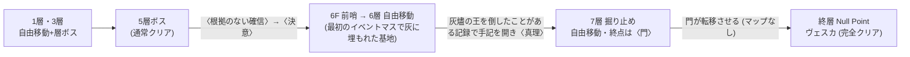

# DICE BOUND — 統合仕様書

本ドキュメントは **設計・ロジック・仕様の統合正本**。
2026-07-27 に `docs/specs/` (18 本)・`docs/plans/`・`docs/open-questions/` を吸収して一本化した。

---

## 0. この文書について

### 0-1. 正本の階層

**最終正本は常に実コード。** 本書はその上位構造（設計意図・ルール・決定履歴）を保持する。
巨大カタログ（個別数値の羅列）は転記せず、下表の外部正本を指す。

| 対象 | 正本 | 本書の扱い |
|---|---|---|
| ダメージ計算の式・適用順・ctx 用語集 | [DAMAGE_CALC_REFERENCE.md](../Assets/Scripts/CombatSystem/DAMAGE_CALC_REFERENCE.md) | 骨子のみ記述・式は複製しない |
| アイテム全カタログ | [items.json](../Assets/Data/InventorySystem/items.json) | 分類とルールのみ |
| パッシブ全 166 種の効果 | `AllPassiveSkillEffects.cs` / `EnemyPassiveSkillEffects.cs` | 体系と機構のみ |
| 敵ステータス | [enemies.json](../Assets/Resources/enemies.json) | 構造のみ |
| 七つの大罪の ID・効果・フレーバー | [PermanentDebuffIds.cs](../Assets/Scripts/MetaProgression/PermanentDebuffIds.cs) | 位置づけのみ |
| ID 定数 | [Ids.cs](../Assets/Scripts/GameLoop/Ids.cs) (`ItemIds` / `BossIds`) | 規約のみ |
| イベント定義 | [event_list.txt](../Assets/Resources/Events/event_list.txt) | フォーマットのみ |
| 筐体レイアウト実寸 | [docs/design/cabinet-layout.html](design/cabinet-layout.html) 他 | 設計思想のみ |
| バランス学習結果 | `BALANCE_CHANGELOG_*.md` / `BALANCE_TIER_LIST_*.md` | **BOT 自動生成・改変禁止** |

### 0-2. プレイヤー向け文面

ゲーム内チュートリアル文面は [handbook.md](handbook.md) が正本。本書とは目的が違う
（あちらは「どう遊ぶか」まで、攻略情報は書かない）。

**画面へ出す (issue #86・2026-11-12・仮置き)**: handbook の各節を、 その節の「出す契機」の場面に初めて来た時に 1 度だけ、 液晶の中央の板 (`Game2DTutorial`) で出す。 文は `python Tools/sync_handbook.py` が handbook から `Game2DTutorialText.cs` へ写す (手で直さない・`--check` で食い違いを見る)。 見出しが見た印の鍵 (`TutorialTopics`)、 印は PlayerPrefs (`UI.TutorialSeen`) でランをまたいで覚え、 設定の画面の「手引きをもう一度」で全部消す。 BOT がランを動かしている間は出さない。 今のコードと食い違う節は出さずに止めてある (`Game2DTutorial.Table` の held・§23-6)。

### 0-3. 記述規約

- 実装され動いているものだけを「仕様」として書く。未実装・保留は §23 に隔離し、silent gap を作らない。
- 数値を書く前に実コードか DAMAGE_CALC_REFERENCE を確認する。**憶測で書かない**。
- 実装を変えたら本書と DAMAGE_CALC_REFERENCE を同時に直す。

---

## 1. プロジェクト概要

**DICE BOUND** — Unity 3D ローグライク（ボードゲーム調・ダイス戦闘）。
分岐するボード状のフロアを進み、マスを解決し、各層のボスを倒して深部へ潜る。

| 項目 | 値 |
|---|---|
| エンジン | Unity 2022.3.22f1 |
| レンダリング | Built-in Render Pipeline（URP/HDRP 不使用・ポスト処理は自前 `OnRenderImage`） |
| 言語 | C# |
| 開始 HP | 30 |
| 層 | 1 → 7（`normalClearFloor` = 5） |

### ディレクトリ地図

| 領域 | 主ディレクトリ |
|---|---|
| 戦闘 | `Assets/Scripts/CombatSystem/` |
| マップ・ラン | `Assets/Scripts/MapSystem/`, `GameLoop/` |
| 自由移動の中身（素の C#） | `Assets/Scripts/MapSystem/FreeMove/` |
| アイテム・パッシブ・ショップ | `Assets/Scripts/ItemSystem/`（名前空間 `ItemSystem`・2026-10-28 に `InventorySystem` から改名。データは `Assets/Data/InventorySystem/` のまま） |
| メタ進行 | `Assets/Scripts/MetaProgression/` |
| 契約 | `Assets/Scripts/GameLoop/Contracts/` |
| イベント | `Assets/Scripts/EventSystem/` |
| BOT・自動調整 | `Assets/Scripts/AutoTest/` |

---

## 2. 設計原則（変更禁止の規約）

### 2-1. 正本ポリシー

- 唯一の正本は実コード。
- ダメージ計算の正本は `DAMAGE_CALC_REFERENCE.md`。式を変えたら同ファイルも更新する。
- 七つの大罪フレーバーの正本は `PermanentDebuffIds.cs`。
- アイテムカタログの正本は `items.json`。
- `BALANCE_CHANGELOG_*` / `BALANCE_TIER_LIST_*` は BOT 自動生成＝改変しない。

### 2-2. 画中画の原則（2026-07-13 確定）

**ゲーム世界はゲーム盤内チップの演算結果にすぎない。**

- **LCD の外**（筐体・机・充電などの盤上機構）に lore は一切関与しない。
- **lore 側も筐体に言及しない**。
- 盤上機構のフレーバーはメカ用語で書き、世界観固有名詞（ヴェイランド等）を使わない。
- 情報表示（予告・収支プレビュー）は LCD 側、物理的な操作対象（ダイス・端子）はワールド側。

### 2-3. ピクセル規約

- ピクセル要素（PPU=32）の状態表現に `transform.localScale` 倍率を**使わない**。
  色／明度／別スプライトで表現する。
- ピクセルパーフェクト（1dot = 物理 4×4px）は **LCD 上のみ**の制約。ワールド側は透視カメラで
  距離により密度が変わるため、そもそも 1:1 対応が成立しない。

### 2-4. ID 直書き禁止

複数ファイルから参照する ID・日本語 ID・ロジック分岐に使う ID/prefix は
`Ids.cs`（`ItemIds` / `BossIds`）か `ClassStarter` の定数を経由する。
ボス判定は `BossIds.IsBoss(id)`。新しい ID を跨ファイル参照する時は先に定数を足す。

### 2-5. CombatContext の 3 区分

新フィールドを足す時は `perTurn` / `decay` / `persistent` の区分を XML コメントに明記し、
perTurn/decay は `BeginNewTurn` の該当 Phase に必ずリセットを追加する。
1〜2 箇所しか触らない一時値はフィールドではなく `accumulatedValues` / `nextTurnBuffs` 辞書へ。

### 2-6. シングルトン規約

`_shuttingDown` + `[RuntimeInitializeOnLoadMethod]` パターンを守る（シーン破棄時の再生成警告防止）。

### 2-7. 用語規約

| 概念 | 正本表記 | 使わない |
|---|---|---|
| 振るダイスの本数 | **ダイス個数**（`playerDiceCount`） | 曖昧な「1ダイス」 |
| 各ダイスの目 | **出目** | — |
| 端子を挿した出目の和 | **端子配線合計+N** | ダイス合計+N |
| 攻撃力への加算 | **攻撃+N** | ダイス合計+N |
| 会心率への加算 | **会心率+N%** | 会心ダイス合計値+N / 会心率+N/9 |
| 与える側 | **与ダメージ** | 与ダメ（略さない） |
| 受ける側 | **被ダメージ** | 被ダメ（略さない） |
| 軽減を無視 | **軽減不可** | 軽減不能 |
| 軸の品を持っている数（心眼・血晶・瘴気・炉温・電流・堅牢の総称） | **偏重** | 深さ / 深度（層と紛れる） |
| 会心の確定 | **会心確定** | 必ず会心ヒット |
| ランの中で集める、持っているだけで効く品（コード上は `passive`・`ownedPassiveItems`・items.json の `category: passive`） | **秘宝** | 画面で「パッシブ」「パッシブアイテム」・「遺物」 |
| ランの外で持ち続ける装備（整備パネルで持ち込む冠・環・符。★・セット・強化あり・§15-5） | **遺物** | 秘宝 |
| 地図の点の種類（宝箱の点・`TileType.Treasure`） | **秘宝**（点の名前） | — |

**「ダイス合計+N」は禁止語彙。** ADR-0009 の相互攻撃モデルでは合計比較が存在しない。

**秘宝と遺物（2026-11-12）。** 画面ではランの中の持ち物を**秘宝**と呼ぶ（秘宝の点で秘宝を得る、と揃う）。
本書の「パッシブ」「パッシブアイテム」は、プレイヤーの持ち物を指す限り秘宝と同じ物（仕様の説明では書き換えない）。
敵の常時効果（敵のパッシブ）・武器の常時効果は持ち物ではないので「パッシブ」のまま。
**遺物**はラン外の装備だけを指す。世界観（§19）の「遺物」は大穴から産出される品の総称で、こちらとも結び付いている（鑑定所が鑑定書を出す）。
識別子（`PassiveSkill*`・`passive*`）・データの項目名・`event_list.txt` の効果の書式（「パッシブアイテム獲得」など・`EventParser` が読む）は変えない。

> **未解消**: `items.json` の効果説明文には旧表記「ダイス合計+N」が残存。一括置換は未実施（§23）。

### 2-8. スキル表示名の統一

同一 `internalName` は武器・パッシブアイテムで同じ `skillName` を使う。

| internalName | 正本 skillName | 旧・別名（廃止） |
|---|---|---|
| Might I–IV | **筋力** | 剛力 |
| Fortitude I–IV | **頑強** | 堅忍 |
| Insight I–IV | **心眼** | 慧眼 |
| Steadfast | **堅忍** | — |

`堅忍` は Steadfast 専用（敗北時の条件付き軽減）。Fortitude の常時軽減は `頑強` で別効果。

---

## 3. 決定履歴（ADR 要約）

ADR 原本は `docs/adr/` に残置（決定の経緯と棄却理由の記録として価値があるため）。
以下は決定内容の要約。

| # | 決定 | 状態 |
|---|---|---|
| 0001 | ランダム Trap マス撤去（死にノードのため）。`karma_trap` は ADR-0002 により撤去 | accepted |
| 0002 | **希望システム採用** — カルマ＋飢餓を単一ゲージへ統合 | accepted |
| 0003 | 装備→戦闘反映は既存パッシブ機構と同経路（案B）。専用ステータス合算層は作らない | accepted |
| 0004 | **武器ダメージ分離** — ダイス＝勝負／武器＝威力／会心＝独立 | accepted |
| 0005 | 敵のロール力↔ダメージ二択スタンス | **superseded by 0009** |
| 0006 | プレイヤー攻撃/防御スタンス | **superseded by 0009** |
| 0007 | **ボス署名ダイス** — 固有面構成で性格づけ、面の各値を学習 | accepted |
| 0008 | **疑似3D スプライト描画** — LCD=平行投影/dot 厳密、ワールド=透視/スプライト可 | accepted |
| 0009 | **相互攻撃モデル + ダイス配線 + 段階エスカレーション** | accepted（実装途上） |
| 0010 | **役システム（ヨット型）** — ダイス5個・端子ごとの役・充電リロール・タイミング判定OL廃止 | **superseded by 0011**（役・ダイス個数の部分。充電リロールは存続） |
| 0011 | **ダイス3個とそろい役** — 目ごとの固有効果・役はカスタム面が持つ・面を足す／外す | **実装済み・Proposed のまま**（バランス未測定。2026-10-18） |
| 0012 | **航行の手番制化** — 隣の点へ 1 歩・追跡者・囮罠統合 | **実装済み・Proposed のまま**（実機確認・バランス未。2026-10-18） |
| 0013 | **防御力と貫通** — 両陣営の防御値・逓減式 `Rmax·D/(D+K)`・貫通は固定削り・武器の家系を貫通〜防御の線に並べる | **実装済み・Proposed のまま**（数値は仮置き・バランス未測定。2026-10-28） |

> ADR-0010 は ADR-0009 を **superseded しない**。相互攻撃・完全情報テレグラフ・段階エスカレーションは
> 土台として残り、柱1（配線）の上に役を載せ、柱5（充電）にリロールという用途を足す形。
> 検討の全記録は [design-yacht.md](design-yacht.md)、棄却案は [design-rejects.md](design-rejects.md)。

### 主要な棄却記録（再提案禁止）

- **勝負判定ベースの配線**（ADR-0009 検討過程）── 敵合計が見えた後の配置が「必要攻撃量の逆算＋余り流し」
  の算数に退化する。また敗北ダメが `max(|差|, threat)` である限り攻撃ダイスが三役を兼ね、
  同レートの防御端子が完全に支配される。
- **職業固有端子**（剣士=追撃/騎士=聖盾 等）── やりすぎ。職業差は「スターター消耗品 1 個」原則へ回帰。
- **Hades 鏡式の A/B 二択メタ**（§15）── 「不均衡なら答え探し / 均衡ならコイントス」のジレンマ。
- **差→会心ルート**（ADR-0004 検討過程）── 大差勝利が確定会心化し、会心率という武器差別化軸を潰す。
- **ダイス側パッシブ**（ADR-0009）── 廃止。ダイスの個性は物理差（個数・面数）のみで表現する。
- **アイテム刻印 / Sigil / 挑戦刻印**（§9・旧§15-2γ）── 廃止。取得時のランダム付加特性を
  通常プールにも挑戦スコア報酬にも再導入しない。

---

## 4. ラン構造

### 4-1. 進行

- 層の番号 `currentFloor` は **0 → 5**（2026-10-20 に 1〜5、2026-11-05 に 0 層を追加）。開始 HP 30。
- **0 層（ファーム層・深さ 0・2026-11-05）**: 前哨基地 → 秘宝 → 戦闘 ×3 → ショップ → ボスの完全な一本道（`FreeMapGenerator.GenerateFarm`）。
  敵は「古いクレート」（`farm_crate`・HP1・攻撃 0）、ボスは「古い宝箱」（`boss_layer0`・HP100・攻撃 0）。無抵抗。
  経緯: 1 層をボット死亡率 8% 以下にしたいが、1 層の敵だけを弱めると 2 層以降の曲線が崩れる → 物資とゴールドを貯める層を前に挟んだ。
  難易度の指標（死亡率・撃破ターン・損耗・`fightCount`・ブロック実績・`HpLossDiag`）には数えない。メタトークンの層到達ボーナスも 0 層は対象外。
  `FirstFloor` は 0（全回復と前哨基地の +200 補給は 1 層から効く）。層タイトル「序層　古い倉庫」は仮置き。
- **層の順は 1 → 2 → 3 → 4 → 5**（正本 [FloorPlan.cs](../Assets/Scripts/MapSystem/FreeMove/FloorPlan.cs)）。
  旧い呼び名（深さ）との対応は **1→1 / 3→2 / 5→3 / 6→4 / 7→5**、旧 8 層（Null Point・ヴェスカ戦）は **5 層の最終段**
  （5 層の〈門〉を処理すると、層は 5 のまま `RunState.inFinalStage` が立ってヴェスカ戦へ入る）。
- **深さ基準のデータは `RunState.Depth`（旧い層番号 1/3/5/6/7/8）で引く** ── 敵（enemies.json の `floor`）・ボス ID・層デバフ・
  層タイトル・報酬・§13-5 の目標・学習ファイルは深さのまま（詰めるとデータが全部ずれ、バランスも動くので、換算で吸収した）。
  `currentFloor` は表示と進行にだけ使う。深さ ⇄ 番号の変換は `FloorPlan.DepthOf` / `OrdinalOf`。
- 以降の本書の「N 層」は、**特記のない限り旧い層番号（深さ）** で書かれている（5 層 = 新 3 層 / 6 層 = 新 4 層 / 7・8 層 = 新 5 層）。
- **通常クリア** (`IsNormalClear`)：5 層ボス撃破。
- **完全クリア** (`IsFullClear`)：**5 層の最終段（旧 8 層 Null Point）** でヴェスカ撃破。
- 1/3/5/6/7 層は**自由移動のマップ**（§5）。前哨基地で始まり、終点（ボス／7 層は〈門〉）へ至る。
- **ボスが居るのは 1/3/5/6/8 層**（`FloorPlan.HasBoss`）。7 層は終点の〈門〉を処理し終えてマップへ戻った瞬間が
  層クリア（`GameManager.IsBosslessFloorCleared`）。
- **8 層は内部でボス戦だけの層**。〈門〉を処理したら**マップを挟まずヴェスカ戦**へ入る
  （`GameManager.EnterFloor` が 8 層だけ前哨基地の処理の直後にボスを起動する）。



**2026-09-14: 7 層からボスを外し、ヴェスカを 8 層へ移した。** 7 層の終端は〈門〉で、
そこが補給と代償の最終地点になる。`boss_layer7`〜`_p4` という **ID は据え置き** ──
学習ファイル・Tier 表・`boss_tuning.json` のキーが ID 基準なので、層番号に合わせて
改名すると過去データと切れる（3 層プールの `boss_layer2`/`boss_layer4` と同じ扱い）。

### 4-2. 〈確信〉ゲート

`convictionStage` — イベント「災厄の予兆」で〈根拠のない確信〉取得時 1、以降**エリート戦勝利毎に +1**。
段階値は確信の強さを表すが、深層ゲートとは分離する。段の加算は**段が 1 以上か**で決める（品を持っているかでは決めない・2026-11-13）。
段を読むのは記録と BOT の道選び（段 1〜4 の間はエリートを優先）だけで、画面には出ない。

| 条件 | 名称 | ゲート |
|---|---|---|
| 〈根拠のない確信〉を持って5層ボス撃破 | 〈決意〉 | 6F 進入可 (`layer6Unlocked`) |
| 6層〈灰に埋もれた基地・再訪〉で手記の最後の頁を開く（灰燼の王を倒したことがある記録だけ） | 〈真理〉 | 7F 進入可 (`layer7Unlocked`) |

**品と資格**（2026-11-13）: 資格の正本はフラグ（`layer6Unlocked`・`layer7Unlocked`）と段で、品はそれを見せる物。
〈根拠のない確信〉→〈決意〉→〈真理〉は同じ 1 枠を書き換えて持ち、**手放せない品**（`ItemIds.Undroppable`・§16-4/16-5）なので
売れず・取り替えに出さず・偽の商人で失わない。図鑑では時計と違い枠を隠さない。古い中断セーブで既に確信を売ってしまったランは、
書き換える時（深さ 5 のボス撃破・灰に埋もれた基地で頁を開く）に元の品が無ければ書き換え先を足す（`ConvictionSystem.ReplaceConvictionItem`・このランで一度持った品は足せない）。

6層（深さ 6 = 画面の第 4 層・灰燼の王の層）は自由移動の層で、**この層で最初に踏んだイベントマスが〈灰に埋もれた基地〉になる**（2026-11-13・作者の決定）。
その点の通常のイベントの抽選の代わりに出す（`BeginWith`・乱数を引かない）。**点は決め打ちしない** ── 地図のどのイベントマスでもよく、地図の種別は生成どおり
（ボスの隣の点もふつうの種別・専用の絵や目印は無い）。2 つ目以降のイベントマスは通常の抽選。**イベントマスを 1 つも踏まずに終点（ボス）に着いた時は、
ボス戦の前に基地を出し、閉じたらそのままボス戦へ入る**（安全弁・`GameManager.StartBossTileOrAshBase`）。基地は 1 ランに 1 回（召喚専用・一度のみ）。
規則の正本は `MapSystem.FreeMove.AshBase.Forces`（本体と `Tools/freemap_check` が同じ式を使う）、版の選び方は `GameLoop.AshBaseEvent`。

**基地の中身はランの外の記録で変わる**（`MetaProgressState.ashKingBeaten` ── 灰燼の王を倒した瞬間に立てる・結末の種類によらない）:

| 記録 | 版（event_list.txt） | 選択肢 | 結果 |
|---|---|---|---|
| 灰燼の王を**まだ一度も倒したことがない** | 〈灰に埋もれた基地〉 | 1 つ: 時限デバフ〈徒労〉を受ける | 手記は開けない。灰燼の王を倒すと**第 4 層のクリアの結末で終わる**（〈真理〉無しの終了） |
| 灰燼の王を**倒したことがある** | 〈灰に埋もれた基地・再訪〉 | ① 手記の最後の頁を開く ② 頁を開かない（〈徒労〉） | ① その場で〈真理〉（品と `layer7Unlocked`）+ 時限バフ〈開眼〉（〈徒労〉は受けない）→ 灰燼の王の後に深さ 7 → ヴェスカ。② 第 4 層のクリアで終わる |

- **〈真理〉はランをまたいで残らない**（毎回、基地で得る）。ヴェスカ（深さ 7〜8）へ進めるのは 2 回目以降の潜行から。
- 〈真理〉を立てるのは選択肢の効果「真理を得る」（`EventEffectType.GainTruth` → `ConvictionSystem.RevealTruthInLayer6`）── 選択肢の並びや名前に依存しない。
- 〈徒労〉〈開眼〉の中身は §17 の「灰に埋もれた基地」の項。文は作者の確定文（2026-11-13）。〈徒労〉は 2026-11-14 から**灰燼の王を倒すまで続く**（説明の文もそれに合わせた）。
- **イベントなしの測定**（`SuppressEvents` / `SuppressConvictionChain`）は層に入る時に〈真理〉を無償で配るので、基地も安全弁も出さず、
  層の 3 分の 1 あたりの固定のイベントの点（`FreeMapLayout.fixedEvent` / `MapNode.isFixedEvent`・乱数を引かない）を置く ── その測定の地図と動きは 2026-11-13 までと 1 点も変わらない。
  ふだんの深さ 6 には固定の点は無い。
- **測定の口** `ashKingBeatenEver`（`GameHooks.AshKingBeatenEver`・既定 True）: BOT は毎回空の記録で走るので、既定では「倒したことがある記録」で走る
  （ヴェスカまで通す・目標のクリア率はこの条件で測る）。False で「はじめて」の形。BOT は再訪の版で必ず手記を開く（効果で選ぶ・`ablateEvent` でも潰さない）。
  記録の欄 `ashBase`（0 = 起きていない / 1 = イベントマス / 2 = 安全弁）・`ashBaseRevisit`・`ashBaseChoice`・`ashBaseTurn`・`ashBaseOpened` とサマリーの「灰に埋もれた基地」の行。
7層は航行マップで終点が〈門〉（ボスなし・追跡者の専用エネミーは 7 層のエリートが土台）。8層はボス戦だけで、
**8層の前哨基地は回復しない**（転移した先の一点であって野営地ではない・物資の補給も無い）。

lore 的には「ギルド管轄も 5 層まで」「5 層を抜けた時点で凱旋級の栄誉」であり、
6 層以降に降りるのは確信に憑かれた者だけ（§19）。

### 4-3. 7 層の〈門〉と不完全起動（GateFlaw）

7 層の終端マス `Gate`。地獄の果ての壁に、大きな円盤が立てかけられている。
横に書かれた文が不思議と読める ── これは**門**で、いくつかの代償を払えば起動する。

門は 3 工程で動く。**手を抜いた工程が、そのまま向こう側での欠陥になる。**

| 工程 | 問われること | 代償 | 怠ると |
|---|---|---|---|
| ① 外縁の再構成 | 生物の血が要るらしい | **最大HP −25%** | 〈不完全な修復〉充電が毎ターン終了時に半減する |
| ② 起動 | いくつかの秘宝が要るらしい | **ランダムに秘宝 2 個** | 〈不完全な起動〉攻撃値が 12% 削られる |
| ③ 転移 | 意識が薄れてゆく | **物資 −400** | 〈不完全な転移〉ボスの攻撃がブロック出目を貫通する |

複数同時所持可（フラグ）。効果は**門をくぐった後の戦闘**＝ 8 層ヴェスカ戦にだけ乗る。
数値の正本は [GateFlaws.cs](../Assets/Scripts/GameLoop/GateFlaws.cs)。
罰の実装は 3 つとも**プレイヤー側の規則**で、敵は一切強化しない。

- 〈不完全な修復〉`CombatContext.ConsumeHalfCharge` をターン終了時に呼ぶ。
  **支出には計上しない**（`ConsumeCharge` を使うと〈短絡〉と充電経済の計装が汚れる）。
- 〈不完全な起動〉攻撃値（atkBase）を 12% 削る（`GateFlaws.ApplyIgnitionCut`・`IgnitionAttackCutPct`）。
  端子ごとの本数上限は 2026-09-14 に撤去済み ── 配線は縛らず、 方策側の特別扱いも要らない。
- 〈不完全な転移〉`TransferPierceRate = 0.50`（**未計測の仮置き**）。
  〈貫きの錐〉がブロックを丸ごと 0 にして致死率を基準の 2.80 倍にした前例があるので、
  割合にして「厚く配線した分は必ず残る」形にしてある。実値は 8 層ボス戦の
  ブロック／被ダメ分布を採ってから決めること。

> **2026-09-14 リワーク。** 旧〈罪の儀式〉（血の儀 / 貪欲の儀 / 遺品の儀 →
> ゴルゴダの心 / 断絶した時間 / 灰燼の烙印）から全面差し替え。廃止の理由は §24。

> GateFlaw と七つの大罪（メタ恒久デバフ）は**全く別系統**。同時に両方を背負い得る。

### 4-4. 特殊フラグ

- `defeatedSaintGeorges` — 5 層裏ボス（シュヴァリエ）撃破。

### 4-5. 中断セーブ（2026-11-12・issue #84）

ローグライクの中断セーブ。**1 枠**・**再開は 1 回きり**（読み込んだらファイルを消す）。正本は
[RunSave.cs](../Assets/Scripts/GameLoop/RunSave.cs) と [GameManager.Save.cs](../Assets/Scripts/GameLoop/GameManager.Save.cs)。

- **セーブできる時点**: 航行のマップ（`MapNavigation`・自由移動の層）で、何も待っていない時だけ（`GameManager.CanSuspendNow`）。
  窓（挑戦カード・開幕パッシブ・武器の入れ替え・端子の報酬・報酬の 2 択）が残っている間、追跡者・使い魔と接触している間、
  戦闘・店・イベント・休憩・〈門〉の途中、8 層（マップの無いヴェスカ戦）は保存しない（その場の状態を写す口を持たない）。
- **入口**: 中断 = 設定の窓（Esc）の「中断して終える」（航行のマップで開いた時だけ出る）→ 書いてタイトルへ。ランは終えない（`EndRun` を通らない＝遺物は出ない）。
  再開 = タイトルの「はじめる」を押した時に中断セーブがあれば窓が出る（続きから／新しく始める（確かめてから消す）／やめる）。
  製品版でゲームを閉じた時、セーブできる時点にいれば自動で中断セーブする（`Application.wantsToQuit`。エディタの再生停止では書かない）。
- **写す物**: `RunState` の公開フィールド**全部**（リフレクション。写せない型を足すとセーブを断って error）、盤面（ノードの状態・航行マップの形・
  `FreeMapSim` の動く中身 ＝ 位置・ターン・崩れた道・痕跡・追跡者・使い魔・囮罠・前線・嵐の時計のずらし・煙玉/前哨の旗の残り。形には嵐の層の印とフェーズ 2 のずらしの量・点の帯も写す）、
  乱数（`GameRng` の塩・キー別カウンタ・シード設定）、戦闘の通し番号（`CombatManager._combatSeq`）、追跡者・使い魔の戦闘の回数、
  ラン中の状態を持つスキル（`IRunStatePersistent`・いまは〈ブレイドダンス〉の剣先だけ）、実績のラン中の進み具合。
- **決定性**: 乱数は `hash(塩, キー, 連番)` なので、塩とカウンタと戦闘の通し番号を戻せば**中断しなかった時と同じ続き**になる
  （実数は丸めずビット列で持つ）。写さないのは診断用の累計（`RunStats`・`HpOutsideDiag` など・バッチ累計で判断に使わない）だけ。
- **混ぜない物**: メタ進行（整備パネル・遺物・実績の解除済み）は従来どおり `MetaProgressManager`（PlayerPrefs）。中断セーブは
  `Application.persistentDataPath/run_suspend.json`。中断中に整備パネル・遺物・難易度を変えると、再開したランには今の設定が効く（警告をログに出すだけ）。
- **版**: `RunSave.Version`（形式の版）と `RunState` のフィールドの名前・型の指紋。どちらかが違うセーブは読まずに捨てて新しく始める。
- **書き込みの安全**（2026-11-13・spec-gaps G-24）: 書きかけ `run_suspend.json.tmp` に書いてディスクまで落とす → 本番を控え `.bak` へ名前を変えて退ける →
  書きかけを本番へ名前を変える → 控えを消す（[SafeFile.cs](../Assets/Scripts/GameLoop/SafeFile.cs)）。どこで落ちても完全な記録が 1 つ残る。
  読む時は本番が無い・使えない（JSON として読めない・版や指紋が違う）と控え → 書きかけの順に試し、読めたら本番の名前へ戻してログに出す。
  **消す時は 3 つとも消す**（控えが残ると、終わったランが次の起動で生き返る）。ファイルを開けなかった時（他のプロセスが掴んでいる等）は消さない。
  検算は `python Tools/save_check/run.py`。
- **メタ進行の記録の安全**（2026-11-13・spec-gaps G-25）: `MetaProgressState_v1` は保存のたびに 1 つ前の値を `MetaProgressState_v1.bak` に残す
  （[BackedPrefs.cs](../Assets/Scripts/MetaProgression/BackedPrefs.cs)・製品版だけ）。鍵があるのに読めない時は、壊れた値を `MetaProgressState_v1.corrupt` へ退避して控えから読み、
  控えも駄目なら空で始める（どちらもログ・画面への知らせは未実装）。鍵が無い時は初回なので控えを見ない。エディタ（毎回空で始める）と
  並列ワーカー（`GameHooks.MetaPersistenceDisabled`）の動きは変えていない。
- **BOT はセーブしない**: `GameHooks.BotDriving`・バッチ実行・遺物の付与を止めた計測の間は、保存・読み込み・削除のどれもしない。

---

## 5. マップ

### 5-1. マップの構造（手番制の航行・2026-10-18）

正本: [FreeMove/](../Assets/Scripts/MapSystem/FreeMove/)（素の C#・UnityEngine 非依存）。数値は
[FreeMapParams.cs](../Assets/Scripts/MapSystem/FreeMove/FreeMapParams.cs)、参照実装は
[docs/design/map-grid-prototype.html](design/map-grid-prototype.html)。経緯は §24 と [ADR-0012](adr/0012-turn-based-navigation.md)。

**点と道で出来た層を、道でつながった隣の点へ 1 歩ずつ進む。** 始点（前哨基地）と終点（ボス／7 層は〈門〉）が決まっていて、
その間の道順を選ぶ。連続時間の「自由移動」（刻み・時計・速さ・道の外の移動・照明の継続・使い魔の巡航ミサイル）は 2026-10-18 に廃止した。

- **1/3/5/6/7 層**が航行マップ。**8 層はボス戦だけ**（§4-1）。
- 層の広さは **16.4 × 9.4**・点は **50 個**（最小間隔 1.15）。始点は左端、終点は右端。始点→終点は平均 12.4 歩（9〜17）。**嵐の層（2026-11-13・§5-12）は、始点を地図の最外周から、ボスの点を外周 2 層の内側から選び直す**（点と道はそのまま・始点→ボス 5〜21 歩・平均 7.8）。
  （GAME.md の旧記述は 11.6 × 6.6・28 点。試作で調整した値が正 ── 監査 D20。）
- **道 = 最小全域木（つながりを保証）＋ 長さ 1.9 未満の組を 45% で**（交差しない範囲）。
  さらに**どの点からも道が 2 本以上**になるよう行き止まりを 2 段（距離 2.6 → 4.0）で潰し、道だと 2 倍以上遠回りな近い組には近道を足す。
  それでも行き止まりが残った層・山岳で分断された層は引き直す（40 回で諦めたら山岳なし）。
- **山岳**: 層に 3〜5 か所の通行不可の楕円。点も道も置かれない。
- 生成は `FreeMapGenerator`。**乱数は `GameRng` のキー `map.free`（連番 = 層 × 1,000,000 + 生成内の通し番号）だけ**。
  座標は生成時に float で確定し、三角関数は使わない（実装ごとの最下位ビットの揺れで層が変わらないように）。
- 6 層（深さ 6 = 画面の第 4 層）は、最初に踏んだイベントマスが〈灰に埋もれた基地〉（§4-2・2026-11-13）。点は決め打ちしない（地図の種別は生成どおり）。
  イベントなしの測定の層だけ、層の 3 分の 1 あたりに固定のイベントの点 1 つ（`fixedEvent`）。
- ゲーム側の規則（整備パネル〈剛胆〉の格上げ・挑戦デバフ〈偽の商人〉）は `MapGenerator.FromLayout` が掛ける。
  エンカウントの乱数添字は点の添字（`FloorManager.NodeRngIndex` の自由移動の帯）。

### 5-2. マス種別と抽選重み

| TileType | 内容 | 重み |
|---|---|---|
| Battle | 戦闘 | 29 |
| Event | イベント | 25 |
| EliteBattle | エリート（**精鋭の敵 1 体**・報酬ゴールド ×2.0） | 14 |
| Exchange | 交換（パッシブ 1 つ→上位 Tier ランダム） | 7 |
| Shop | ショップ | 7 |
| Treasure | 秘宝 | 3 |
| Rest | 休憩（HP 回復 or 強化） | 3（2026-09-28 に 2 → 3・試作の値） |

店と休憩は**層に必ず 1 つずつ**（無ければ店・休憩以外の点を置き換える）。層による表の違いは無い
（旧 4 層だけの「精鋭 7」は層ごと削除）。

非抽選（固定配置）: Outpost（始点）/ Boss・Gate（終点）/ LambdaRing / LambdaExit。
（**補給庫（SupplyCache）は 2026-10-18 に削除**。物資は戦闘・前哨基地・ショップの包で得る。）

**廃止済み**: `Trap`（ADR-0001）/ `Mystery` / `karma_trap`（ADR-0002）。
いずれも生成されない。`TileType` の enum 値と表示ラベルのみ**セーブ互換のため残置**。
（道具の「罠」§5-10 はマスではなく消耗品で、この `Trap` とは無関係。）

#### 危険の帯（2026-11-04）

層を左右で 3 つの帯に分ける（`FreeMapParams.BandOf`・始点の x を 0、終点の x を 1 とした割合を 1/3 と 2/3 で切る）。
**始点（左端）側ほど安全、終点（右端・ボス）側ほど危険。** 1 層の開幕から強い敵に当たらないようにしつつ、層全体を無害にはしない。
**敵の数値は変えない**（倍率なし）。変えるのは、どの敵が出るか・どのマスが置かれるかだけ。

| 帯 | 戦闘の敵 | エリート | 2 体戦 |
|---|---|---|---|
| 安全（左 1/3） | 候補を脅威度の低い順に並べた下の 1/3 だけ。その層の新顔の優先もしない | 置かない（生成時に通常の戦闘へ替える・〈剛胆〉の格上げもしない） | 出さない |
| 中間 | 今どおり | 今どおり | 今どおり |
| 危険（右 1/3） | 下の 1/3 を外す（新顔の優先は残す） | 今どおり | 今どおり |

- **脅威度**（`EnemyData.danger`・内部値）= 実効 HP × 1 ターンの平均攻撃 ÷ 100。実効 HP は防御の軽減・〈虚体〉・割れる/積み上がる装甲・構えを反映する。
  値は `Tools/enemy_danger.py` が enemies.json に書く。**敵の数値を変えたら実行し直す。** 〈死の宣告〉〈13 の宣告〉のような特殊な勝ち筋の強さは式に入っていない。
- 同じ脅威度の敵は同じ側に入れる（1 層のスライム 9・ゴブリン 9 はどちらも安全な帯に出る）。どちら側にも最低 1 体は残す。
- 追跡者・使い魔の戦闘は点の位置に縛られないので帯を使わない。
- **エリートの数は減る**（安全な帯の分を通常の戦闘へ替えるので、層のエリートは約 3 分の 1 減る）。報酬の総量も同じだけ減る。数値は仮置き・未測定。

### 5-3. ノード状態

`visited` / `activated`（**使い切り** ── 一度起動したマスは再訪しても起動しない。戻ってもよいが得は無い）/
`revealed`（**マスの種別が見えているか**。始点・終点・深さ 6 の固定のイベントの点（イベントなしの測定の層だけ）は最初から（**嵐の層の終点は伏せる** ── 照明・隣・嵐のフェーズ 3 で見える・§5-12）、他は視界 1 歩・照明 3 歩・偵察 2 歩で見える。
戦闘名は**完全公開**（照明・偵察で見つけた点）の時だけ開示し、視界 1 歩で見えただけの点は種別だけ（2026-11-05・`FreeMapSim.Scouted`）。開示済みの点はカーソルを乗せると戦闘名が出る（敵の名前は出さない）。**見えていない点は「?」で置かれる** ── 点と道の配置は層全体が見える）/ `isFalseMerchant`（挑戦デバフ「偽の商人」用）/ 自由移動の `freeMap` / `index` / `x` / `y` /
`isFixedEvent`（深さ 6 の固定のイベントの点・〈真理〉を持って入った層 = イベントなしの測定の時だけ）。**点と道の配置は層全体が見える**。`connections` は道で結ばれた点（双方向）。

### 5-4. エリート（2026-09-20 改訂）

**エリートは [enemies.json](../Assets/Resources/enemies.json) の独立した敵**（`"elite": true`、id は `<元の敵>_elite`、
表示名は「精鋭〜」）。EliteBattle マスはエリート敵からだけ、通常の戦闘マスは雑魚からだけ抽選する
（[FloorManager.cs](../Assets/Scripts/GameLoop/FloorManager.cs)）。**強さは JSON の数値そのもの**で、
戦闘直前に倍率を掛ける処理は無い。調整するときは enemies.json の値を直接動かす
（CLAUDE.md「隠し倍率禁止・実数値を直接調整」）。

- **エリートは常に単体。** 2 体戦は通常マスの引き（報酬 ×2 の賭け）として残す。
- 報酬ゴールドは ×2.0（[CombatRewards.cs](../Assets/Scripts/GameLoop/CombatRewards.cs) `EliteRewardMul`）。
  **BOT の航行スコアも同じ値を読む**ので、ここを動かすと BOT の進路選択も動く。
- 4 層以降の敵のエリートは、固有のエリートパッシブ（早業 / 不死の軍勢 / 霊体 …）を持つ。
- 旧実装（雑魚に後から倍率を掛ける 2 系統の「精鋭化」）は §24 を参照。

### 5-5. フロアモディファイア

正本は [FloorModifier.cs](../Assets/Scripts/MapSystem/FloorModifier.cs)。前哨基地で適用し、その層の間ずっと続く。

| 層 | 名前 | 効果 |
|---|---|---|
| 3 | 瘴気侵蝕 | 戦闘終了後に固定 1 ダメージ／休憩の回復量 30% → 50% |
| 5 | 地獄門 | 全ダイスの最大値 −1／敗北時の被ダメージ −2／ショップ価格 +40% |
| 6 | 深淵の洗礼 | 毎ターン自傷 1／会心率 −15%／敵が毎ターン HP +3 回復／前哨基地で最大 HP +5 |

1・7・8 層には層効果が無い（2026-10-17 に空腹だけだった 1 層の効果を削除）。

### 5-6. 層タイトル（正本: `LayerTitles.cs`）

| 層 | ボス | タイトル | サブタイトル |
|---|---|---|---|
| 1 | トレジャーゴブリン | 第一層　陽の差す浅層 | 振り返れば、まだ入口の光が見える |
| 2 | ~~ゴブリン王~~ | ~~第二層　群れの領分~~（**層を削除・2026-09-28**。文言は `LayerTitles.cs` に残置） | 石の通路に、無数の足音が反響する |
| 3 | 毒沼の主 | 第三層　毒の沼 | 空気が変わる。息をするたび、喉の奥が湿る |
| 4 | ~~鏡の双子~~ | ~~第四層　鏡像の界~~（**層を削除・2026-09-28**。3 層ボスプールの鏡の双子は残る） | 影が、ひとつだけ多い |
| 5 | 業火の審判官 | 第五層　審きの淵 | 多くの者が、ここで引き返す。引き返せた者は |
| 6 | 灰燼の王 | 第六層　灰の玉座 | 滅びを見届ける番人が、ここに座している |
| 7 | （なし・終端は〈門〉） | 第七層　掘り止め | ここから下は、誰も掘っていない |
| 8 | ヴェスカ | 終層　Null Point | Signal lost |

発火は `GameManager.EnterFloor` / `EnterLambda`。バナーは Game2D の `Game2DLayerBanner`（`LayerTitles.OnShow` を購読・ロード画面と窓が消えてから出す・仮置き・2026-11-11）。
**表のタイトルの層番号は旧い深さのまま**で、`LayerTitles.cs` の文言は見せる層の番号（第一〜第五層）に書き直されている（コードが正本）。

### 5-7. （欠番）大穴の異常現象 ── 2026-10-29 廃止

層に入るたびに 15 種から 1〜2 件を引く「層の変調」だった。**天候（§5-12）と役割が重なり**、同じ名前で効果の違う現象が
5 つあった（朱の雪・削る砂・崩れる地平・落石のような雹・沈み続ける湖面）ため、天候に一本化して仕組みごと削除した。
経緯は §24。戦闘中の変調が改めて欲しくなったら、天候に戦闘側の効果を足す形で作る（別の仕組みを並べない）。

### 5-8. 移動と手番（2026-10-18）

**移動は道でつながった隣の点へ 1 歩**。道の外へは出られず、山岳も通れない。**物資は距離によらず 1 歩ごとに一定**（50・2026-11-04 に 10 から）で、
速さの区別は無い。**着いた点は必ず起動する**（途中の点を飛ばせない ── 通る点が全部起動するので、道順の選択が「どのマスを踏むか」になる）。
使い切った点は再訪しても起動しない。

**時間は連続ではなく手番制。** 自分が 1 歩動く（または待つ・偵察する）と **1 手番が進み、追跡者が 1 度動く**。

| 行動 | 手番 | 物資 |
|---|---:|---|
| 隣へ 1 歩 | 1 | 10 |
| 待つ | 1 | ― |
| 偵察（道で 2 歩先まで見える） | 1 | ― |
| 照明（3 手番のあいだ道で 3 歩先まで見え、追跡者の補足も 3 歩に伸びる） | 0 | 50 |
| 囮罠を置く | 0 | 消耗品 |
| 戦闘・イベント・ショップ・秘宝など点の起動 | **0** | ― |
| 休憩（通常の回復） | 0 | ― |
| 休憩（多めに回復 = 最大 HP の 60%） | **1** | ― |

- 物資が足りない分は **HP で払う**（物資 10 ごとに HP 1 ＝ 物資 0 の 1 歩は HP 5）。**死ぬ移動も許す**（拒むとデッドロック）。
- **イベントでターンを使う**選択肢（効果「ターン+N」）は 2026-11-11 に入れた（§17）。イベントを閉じて地図へ戻った時に `PassTurnsExternal` で進める。
  イベントの画面には補足中の「最短で何ターンで捕まるか」を出す。
  イベントの航行の効果（地図を明かす・追跡者を撒く・近道・前線 …・2026-11-12）も同じ時に、ターンより先に適用する（§17）。
  **近道+N** は「この後の移動 N 回は物資もターンも使わない」（`FreeMapSim.FreeMovesLeft`）。自分は動かず、どこへ動くかは遊ぶ人が選ぶ。
  ただの 1 歩は表の「隣へ 1 歩」の手番 0・物資 0 版で、待つ・偵察・〈補給線〉には効かない。層を出たら残りは消える。
- 時間を進める口は `GameManager.MoveStep / WaitTurn / ReconTurn / RestHealMore` の 4 つだけ（いずれも `FreeMapSim` の操作 1 回）。
  人も BOT も同じ口を同期的に叩く。同じ操作列なら同じ結果になる。

### 5-9. 追跡者（2026-10-18）

**追跡者**は縄張りを巡回する強敵。**3 層から**・1 層に 1 体（`FloorPlan.HasWanderer`）。**道の上しか動けない**。
旧「徘徊エネミー」。**2026-11-12 から、縄張りを守る番人**（層じゅうを追う狩人ではない）。縄張りに入らなければ会わない。
入るなら、道具（魔石・偵察・照明・囮罠・煙玉）で宝を盗むか、戦って取る。

- **縄張り**: 層の中ほどの一角の、道でつながった 7〜11 点（始点から直線距離 3 未満の点は入れない）。巡回は縄張りの全点を
  **中心の周りの角度順に、毎回同じ順で**回る。地図に出す（追跡者が生きている間、縄張りの**点の絵そのものを赤みのインク**で描き、縄張りの点どうしの道を赤・
  点に赤の破線の輪。強調は彩度で、明度は上げない。**仮の印**）。
- **縄張りの外へ出ない（2026-11-12）**: 本体も使い魔も、縄張りの中の道だけを歩く（`FreeMapSim.FoeStepToward`・`Leashed`）。
  **縄張りの外に居るプレイヤーには気づかない**（補足も煙玉も起きない）。追跡中に外へ出られたら、縁で止まり、補足できないまま
  3 手番で見失う。性質・道具ごとの扱いは下の表。旧い作り（層のどこまでも追う）は測定の口 `pursuerLeavesTerritory=True` で戻る。
- **縄張りを避ける道の保証（2026-11-13・作者の決定「不利な遠回りだとしても、避けられるべき」）**: どの層でも、縄張りの点を
  1 つも踏まずに始点から終点へ行ける道がある。**地図の形（点・道・種類）と乱数の消費は変えず、縄張りの側を削る**
  （`TerritoryBypass.Compute`・層に入った時に `FreeMapSim.ConfigureTerritory` が形の縄張りから計算する。形は書き換えないので、中断セーブから戻しても同じ縄張りになる）。
  規則（乱数を使わない）:
  ① 縄張りを踏まない道が既にあれば何もしない。無ければ、始点から終点への道のうち**踏む縄張りの点が一番少ない道**（同数なら歩数の短い道・それも同じなら
  添字の小さい点を先に広げた道）を選び、その道の上の縄張りの点を外し、中心から縄張りの中の道でつながる点だけを残す（道でつながったまとまりのまま）。
  道を選ぶ時、**中心と宝の点は通れないもの**として扱う。
  ② それで道が無いか、宝の点が中心から離れたら、中心だけを通れないものとして選び直し、宝の点は残った縄張りで決め直す（決め方は下の「縄張りの宝」と同じ）。
  ③ 削った縄張りが**下限 5 点**（`FreeMapParams.TerritoryTrimMin`）に満たなければ、縄張りに道で隣り合う点を中心に直線で近い順に足す
  （選んだ道の上・始点・終点・始点から直線距離 3 未満の点は足さない）。それでも足りないか、中心そのものが道の上にある（どの道も中心を通る）時は、
  削った縄張りの残りのまとまりごとに同じく足してみて、**一番大きくなるまとまりへ中心を移す**（新しい中心は元の中心に直線で一番近い点・宝の点は決め直す）。
  ④ 最後に 3 点（生成が受け入れる最小・`TerritoryHardMin`）に満たなければ、**その層には追跡者を置かない**（宝も無い）。
  巡回の輪は生成と同じ規則（中心の周りの角度順）で並べ直す。地図の赤い印は削った後の縄張りを描く。
  **縄張りを出ない追跡者の時だけ削る**（旧い作り `pursuerLeavesTerritory=True` では巡回の輪を変えないよう削らない）。測定の口 `territoryKeepBypass=False` で削らない作り（2026-11-13 より前）に戻る。
  「縄張りを通らない」は縄張りの点を踏まないことだけで数える ── 補足・使い魔・煙玉は縄張りの外のプレイヤーに働かない（`FoeTurn` の `sees`・`FamiliarSeesMe` が
  `InTerritory(Me)` を条件に持つ）ので、縄張りの縁の隣を通っても、照明で補足の歩数を伸ばしても気づかれない（検算で確認）。
  検算（`Tools/freemap_check`・追跡者の居る深さ 3/5/6 × 3000 種・天候なしの形）:
  避ける道がある層 **70.5% → 100%**（深さ 3/5/6 で削る前 71.5/71.0/69.0%）。削る層 29.5%（中心と宝を残す 22.8%・宝を決め直す 2.6%・中心を移す 3.7%・追跡者を置かない 0.39%）。
  外す点 中央値 2・90% 点 6・最大 10。縄張りの大きさ 全層 平均 7.80 → 7.15（中央値 7 のまま）・削った層だけ 平均 8.07 → 5.86（中央値 8 → 6・3 点 28 層・4 点 45 層・5 点 1153 層）。
  下限まで足した層 7.6%（足した点 中央値 2）。**宝の位置が変わる層 6.3%**（他に追跡者ごと無くなる 0.39%）。
  避ける道が最短の道より長い歩数: 全層 中央値 0・90% 点 3・最大 10（削った層だけ 中央値 0・90% 点 3・最大 8）。避ける道の歩数 中央値 13（最短 12）。
  物資（上限 10・店で上限まで買い足す・HP で払わない）で終点まで着ける層: 層に入る時 10 なら 縄張りを通ってよい道 99.1% / 避ける道 94.4%
  （通ってよいなら賄えるのに避けると賄えない層 **4.8%**・うち削った層 1.7%。残りは削らなかった層で、店が縄張りの中にある・避ける道が長いもの）、
  層に入る時 4 なら 91.6% / 84.1%（7.5%）。賄えない分は HP で払う（物資 1 = HP 5）── 不利な遠回りとして受け入れる。
- **縄張りの宝（2026-11-12）**: 縄張りの中心（追跡者の最初の居場所）を除いた縄張りの点のうち、中心に直線で一番近い点
  （`FreeMapSim.TreasurePointOf`・乱数を使わない）。**層に入った時から地図に「宝」の印が見える**（点の種類は見えないまま）。
  中心を外すのは、動かない召喚者だと取る手が戦うしか無くなるため。置き場所は性質で変えない（置き場所から性質が読めないように）。
  着くと点の起動の前に中身を渡す。**1 層 1 回**。取った後も追跡者の動きは変えない。
  中身（仮置き）: **武器を 1 段鍛える**（休憩の「鍛える」と同じ強化・素材は取らない。鍛えられない武器なら宝箱の中身）。
  前哨基地の自動強化を消した分（§24）を、自分で取りに行く形で補う。測定の口 `territoryTreasure=Chest` で通常の宝箱と同じ中身、
  `None` で宝を置かない。追跡者を倒した時の報酬（物資とアイテム 1 個）は別にそのまま。
  取った後は、地図の左上（上の帯の真下）に「宝: 武器を鍛えた」などをその層のあいだ出す（仮置き）。
- **宝の点の種類と、追跡者との重なり（2026-11-12 決定）**: 宝は点の種類とは別に置く。宝の点も戦闘・エリート・イベントなどの
  普通の種類を持ち、種類は近づくまで見えない（宝の印だけが最初から見える）。着くと**宝を先に渡し、続けてその点を起動する**
  （戦闘の点なら、鍛えた武器でその戦闘に入る）。**追跡者が宝の点に居る・着いた手番に捕まった時は、先に追跡者の戦闘**
  （下の「捕まる」と同じ）。勝てば 宝 → 点の起動 の順、逃げれば直前の点へ戻り、宝も点もそのまま残る。
  理由: 「着いた点は必ず起動する」「捕まった手番の点の起動は戦闘の後」という既存の規則をそのまま使い、宝だけの例外を作らない。
  宝の点を戦闘以外の種類に寄せると、置き場所（中心の隣）から種類が読める上に、地図の生成を変えることになる。
  宝の点は天候で沈まない（沈む点の候補から外す）。

| 性質・道具 | 縄張りを出ない追跡者での扱い |
|---|---|
| 召喚者 | 動かない（中心から動かない）。補足は 5 歩のまま、ただし縄張りの中のプレイヤーだけ。放つ使い魔も縄張りの外へ出ず、縄張りの中では目標に届かなければその場で消える |
| 猟犬使い | 本体も猟犬も縄張りの中だけ。猟犬は倒しても本体の元へ戻る（今どおり） |
| 疾走者 | 1 手に 2 歩のまま、2 歩とも縄張りの中だけ |
| 重装 | 今どおり（縄張りの中だけ） |
| 囮罠 | 縄張りの中に置けば今どおり（気を引き、踏めば 2 手番足止め）。**縄張りの外に置くと、気を引かれて縄張りの縁（囮罠へ道で一番近づける点）まで来て待ち、踏まない**。囮罠が切れたら巡回へ戻る（切れた囮罠の位置へは向かわない） |
| 煙玉 | 補足される時に発動する（縄張りの外では補足されないので減らない） |
| 魔石・偵察・照明 | 今どおり（照明は補足の歩数を伸ばすが、気づかれるのは縄張りの中だけ） |
| 〈補給線〉 | 縄張りの中へ跳んだら追跡者はそこへ向かう（今どおり）。**縄張りの外へ跳ぶと追う先が無く、見失う** |
| 逃げた後 | 今どおり（直前の点へ戻り、追跡者は 2 手番足止め）。直前の点が縄張りの外なら、そのまま安全 |
| イベントの「追跡者を呼ぶ+N」「追跡者を遠ざける+N」（§17） | 縄張りの中の道だけで動かす（2026-11-13）。呼ぶは追跡者が歩く時と同じ道で寄り、自分が縄張りの外なら縁で止まる。遠ざけるは縄張りの中の隣だけへ。旧い作りでは縄張りを見ない |
| 「最短で何手で捕まるか」（ETA） | 縄張りの外に居る間は出ない。中に居る間は縄張りの中の道で数える |
- **状態**: 巡回 → 警戒（プレイヤーの**新しい痕跡**に気づく／**置かれた囮罠**に気を引かれる。痕跡をたどる／囮罠へ向かう）
  → 追跡（**補足**した位置＝最後に分かった位置へ向かう）→ 3 手番補足できなければ巡回へ（見失う）。
- **追跡の上限（2026-11-04）**: 追跡が **8 手番**続いたら諦めて巡回へ戻り、その後 **4 手番**は補足しない
  （`FreeMapParams.ChaseGiveUp` / `ChaseRest`）。同じ速さの追跡者は、下がり続けるプレイヤーとの距離が永遠に縮まらないため。
- **補足**: 手番ごとに、**縄張りの中で**道で**2 歩以内**（照明中は 3 歩）に居れば補足する（歩数は縄張りの外の道も数える）。確率は無い。
  **召喚者だけは 5 歩**（動かない代わりに遠くから気づく・`FoeProfile.detectRange`。照明中も 5 歩のまま）。
- **痕跡**: プレイヤーが踏んだ点に 4 手番残る（天候で伸縮）。巡回中の敵が自分の居る点に痕跡を見つけると警戒へ。
- **捕まる**: 追跡者が自分の居る点に着く。**捕まったら専用エネミーとの 1 戦**（下）。戦闘の間、手番は進まない。
  勝つと追跡者は倒れ、**物資 +3 とアイテム 1 個**。点に着いた手番に捕まった場合、その点の起動は戦闘の後。
- **予告**: 追跡者が見えている（視界の内）間は、**次の一歩**が分かる（`PeekFoeStep`・予告と実際の移動は同じ関数）。
  補足されている間は「**最短で何手で捕まるか**」（`Eta`・こちらが動かなかった場合）を表示する。
- **魔石**: 追跡者への歩数の段と方角（8 方位）。**察知されている**（追跡中）＞ **かなり近い**（≤ 2 歩）＞ **遠い**（≤ 4 歩）＞ 反応なし。
  **使い魔には反応しない**。

**専用エネミー（2026-11-04）**: 捕まった時の戦闘相手は、**その層のエリートを強さの土台**にして（2026-11-05 に「次の層のエリート」から変更・`BuildPursuerEnemy`）、
性質ごとの型を足した専用の敵（`GameManager.PursuerFightOf`・id は土台のまま・数値は仮置き）。

| 性質 | 名前 | 戦い方 |
|---|---|---|
| 召喚者 | 群れ呼び | 2 体戦。 本体（HP ×1.8）と、 その層の通常の敵 1 体 |
| 猟犬使い | 猟犬使い | 2 体戦。 本体（HP ×1.5）と猟犬（HP は本体の 40%・攻撃は 70%・パッシブなし） |
| 疾走者 | 影走り | 最初の 2 ターンは攻撃 ×1.5（`openingTurns`）・HP ×1.4 |
| 重装 | 鉄塊の追手 | 防御 10 以上・〈積み上がる装甲〉・HP ×1.8 |

4 種とも本体の攻撃（基礎攻撃と攻撃ロールの上限）×1.6（2026-11-12・#35。 捕まった後の死亡 Optimal 14%・Super 10%）。

旧仕様の「エリート 2〜3 連戦」は廃止（戦闘に追加の不利益を与えない方針）。 旧「重装は最大 HP ×1.4」（`PursuerHeavyHpMul`）は上の表へ置き換えた。

**性質（2026-10-18）**: 追跡者は層ごとに性質を 1 つ引く（`FoeProfile.ForFloor`・GameRng キー `map.free.profile`）。
**味変**であって標準装備ではない。**プレイヤーには明かさない**（見え方から推理する。BOT も読まない）。数値は全部仮置き。

| 性質 | 本体 | 使い魔 | 特徴 | 出る層 |
|---|---|---|---|---|
| 召喚者 | **動かない** | 1 手に 1 歩 | 補足中は 3 手番ごとに使い魔を放つ | 3〜 |
| 猟犬使い | 1 手に 1 歩 | **1 手に 2 歩**（猟犬・最初から 1 体） | 本体と猟犬の 2 体で最短距離から追う。猟犬は倒しても本体の元へ戻る | 3〜 |
| 疾走者 | **1 手に 2 歩** | なし | | 5〜 |
| 重装 | 1 手に 1 歩 | なし | 捕まった時の戦闘が重い | 3〜 |

**使い魔**: 本体の手先。プレイヤーの最後に分かった位置へ向かい、道で 1 歩以内に入るとプレイヤーへ向きを変える。
目標の点に着いてもプレイヤーが 1 歩以内に居なければ消える。**接触すると戦闘**（その層の通常の戦闘相手 1 体・物資は得ない・逃げられる）。

### 5-10. 索敵と道具

**「見ようとすると見られる」の度合いで分ける**（Highfleet の 3 センサーの置き換え）。範囲は道で何歩先か。

| 手段 | 分かること | 代償 |
|---|---|---|
| 何もしない | 1 歩先までのマスの種別・目の前の追跡者（**戦闘名は出ない**） | なし |
| **照明** | 3 手番のあいだ 3 歩先までのマス**と戦闘名**・追跡者・使い魔。**追跡者の補足も 3 歩に伸びる** | 物資 50・手番は使わない |
| **魔石の反応** | 4 段階（§5-9）と方角 | なし（常時） |
| **偵察** | 2 歩先までのマスの種別**と戦闘名** | 1 手番（その間も敵は動く） |

**道具（消耗品・items.json の `consFamily` で判定。id は表示名）**:

| 道具 | 効果 | 入手 |
|---|---|---|
| **囮罠**（`lure`・2026-10-18 に旧〈囮〉〈罠〉を統合。旧 id は `LegacyIdMap` が解決） | 今いる点に仕掛ける（手番は使わない）。**近く（6 歩以内）の追跡していない敵の気を引き**、**踏んだ追跡者を 2 手番足止めする**。8 手番で効果が切れる | 開始時 2 個・ショップ 8G |

### 5-11. 逃げる

戦闘中の**自分の手番（配線の前）**に選べる（`CombatManager.RequestFlee`）。

- **代償**: 物資 100 ＋ ゴールド半減（切り捨て）、報酬なし。
- そのターンは**こちらの攻撃が発生しない**（素火力・パッシブ・追撃・固定ダメの枠も捨てる）。敵の予告攻撃は**ブロック有効**で受ける
  （防御の端子を挿した出目で軽減できる）。生き残ればそこで戦闘を抜ける（`CombatResult.playerFled`）。
- **直前の点へ戻る**（出発した点）。通常のマスの戦闘から逃げた場合、そのマスは**使い切りにならない**（敵が残る）。
- 追跡者の戦闘から逃げた場合は、直前の点へ戻り、**追跡者は 2 手番足止めされる**。連戦は無いので「途中で救済」は戦闘 1 回の話
  （救済が発動した場合も逃げた扱い・代償なし）。使い魔の戦闘から逃げても使い魔は消える。
- **層のボスからは逃げられない**。イベントの戦闘・偽の商人も対象外（`CombatManager.FleeAllowed` は
  航行マップの層の戦闘・エリート・追跡者／使い魔の戦闘でだけ立つ）。

### 5-12. 天候 ──「嵐」（2026-11-13・二版 = 不安定化の時計・境目は 2 度目の置き値 15/30/45/50（ブランチ storm-tune）・未測定）

正本は [Storm.cs](../Assets/Scripts/MapSystem/FreeMove/Storm.cs)・[Instability.cs](../Assets/Scripts/MapSystem/FreeMove/Instability.cs) と `FreeMapSim` の嵐の欄、数値は [FreeMapParams.cs](../Assets/Scripts/MapSystem/FreeMove/FreeMapParams.cs) の「嵐」「不安定化」（**全部最初の置き値**）。
旧い「前線」（左から右へ進む壁）は廃止した（§24）。測定の口 `stormEnabled=False`（`GameHooks.StormEnabled`）で旧い作りへ戻る ── 生成・乱数の引く回数・天候・動きが嵐の前の main（b7bbc01）と 1 点も変わらない。
手番で進む嵐（storm-boss・§24）は測定の口 `stormClock=Turns`（`GameHooks.StormClock`）で戻る ── storm-boss と 1 手も変わらない
（`Tools/freemap_check` が b7bbc01 と storm-boss の FreeMove をそれぞれ別の名前空間で一緒にコンパイルし、生成と同じ操作列で比べる）。

**世界の理屈: 大穴は、狭間から物が流れ込むほど広がる。大穴から何かを取るたびに不安定になる。** 嵐を進めるのは手番ではなく、**不安定化ポイントの累計**。

**層ごとの出方**

| 深さ（画面の層） | 嵐 |
|---|---|
| 0（序層）・7（画面の第 5 層の 1 本道）・8（第 5 層の最終段・地図なし） | なし（天候もなし・不安定化も溜まらない） |
| 1・3・5（画面の第 1〜3 層） | 累計 0 から。15 で崩れ始める |
| 6（画面の第 4 層） | **累計 15 から**（= 崩れ始める境目・入った時からフェーズ 1・歩くだけで溜まる） |

**溜まり方**（`Instability.PointsOf` が 1 か所の表。本体は理由を渡すだけ。効果の種類・点の種別・戦闘の種類で決める ── id の綴りで判定しない）

| 行動 | ポイント | 呼ぶ所 |
|---|---:|---|
| 宝の点を開ける・縄張りの宝を取る | +3 | `OpenTreasure` / `TakeTerritoryTreasure`（中身の品が秘宝でも重ねない） |
| 秘宝を 1 つ得る（イベント・戦闘の報酬・番人の報酬・〈強奪〉〈剛胆〉の戦利品・観測所の写しの上乗せ） | +3 ずつ | `GrantRewardItem` ほか（秘宝 = items.json の category が Passive）。**進行の資格の品（確信の 3 品・`ItemIds.QualificationItems`）は数えない**（大穴から取った物ではない・2026-11-13・`ItemIds.CountsAsTakenRelic`）── 〈灰に埋もれた基地〉の「真理を得る」・「災厄の予兆」の〈根拠のない確信〉は +0 |
| エリートを倒す・追跡者（番人）を倒す | +2 | `ConfirmBattleResult` / `HandlePursuerWon` |
| 通常の戦闘（使い魔・イベントの戦闘も）に勝つ | +1 | 同上 |
| イベントで**持ち物が増える**（下の「数える」効果が 1 つ以上起きた・秘宝を得た時は +3 だけ） | +1 | `SettleEventInstability`（選んだ効果と「勝利後」の効果で +1 は重ねない） |
| 戦闘の中でエスカレーションの段が 1 つ上がるごと（**ボス戦では溜めない**） | +1 | `CombatManager.NoteEscalationForInstability`（§6-8） |
| イベントの「ターン+N」 | +N | `FreeMapSim.PassEventTurns` |
| **崩れ始めた後**の 1 歩・待つ・偵察 | +1（朱の雪の嵐の中へ動く時は +2 = 手番の数） | `FreeMapSim.MoveTo / Wait / Recon` |
| 「前線を遠ざける+N」/「前線を近づける+N」（イベントの書式は旧い名前のまま） | −N / +N（0 未満にしない・境目を下回れば静かへ戻る） | `FreeMapSim.ShiftStorm` |
| 店・交換マス・強盗・偽の商人・休憩（多めに休むの手番も）・照明・〈補給線〉・近道の 1 歩・崩れ始める前の 1 歩 / 待つ / 偵察・逃げた戦闘・負けて救済された戦闘・ボス戦・端子の報酬 | 0 | |

- 「イベントの得」に数えるのは**持ち物が増えた時だけ**（2026-11-13 作者の決定・判定は `Instability.CountsAsEventGain` の 1 か所・`EventGainKind`。
  `EventEffectExecutor` が効果の種類を読み替えて渡す ── 綴りでは判定しない）: ゴールド・消耗品・強化素材・物資・名指しの品（秘宝でないもの = 武器・出目パーツ・消耗品）・フラグアイテム（秘宝は +3 の側）。
  **数えない得**（物が増えない）: HP の回復 / 全回復・最大 HP の増加・時限バフ・航行の効果（明かす・撒く・追跡者を遠ざける・近道）・次の店の値引き・次の休憩の上乗せ・観測所の写し。
  **得として渡さない**: 嵐を遠ざける（それ自体が −N）・秘宝を差し出して替える（交換）・武器を鍛える（自分の素材を払う・休憩の鍛えると同じ）。
- 宝の点が空になることは無い（素材 +1 が必ず入る）ので、開けたら必ず +3。N つから選ぶ秘宝は、人が後で選ぶ時も提示した時点で +3。
- 何で何ポイント溜まったかは、本体のログ（「不安定 +3（宝の点・累計 12）」）と、理由ごとの通算（`GameManager.InstabilityTotals`）・中断セーブの内訳（取る / 激化 / 歩く / イベントのターン / 嵐を動かす）に残す。

**フェーズの境目**（累計 → 段 → 輪は、累計と層の定数だけで決まる純粋な関数・`Storm.RingAt(L, 累計 − 15, Instability.Schedule)`・境目は `FreeMapParams.InstabilityPhase1At`〜`4At`・段の途中は線形に補間）

| 累計 | 状態 | 輪（安全な円） |
|---|---|---|
| 0〜14 | 静か（歩いても溜まらない） | 嵐なし。画面に「不安定 7/15」（分母は境目の定数から） |
| 15〜 | フェーズ 1: **崩れ始める**（ここから歩くだけでも溜まる） | 地図の中心（層の広さの真ん中）のまま、全部の点を含む半径 → その 60% |
| 30〜 | フェーズ 2 | 中心がボスの点を**少しずらした位置**へ寄りながら 60% → 30%。ずらしは層の生成時に専用の乱数（キー `map.free.storm`）で決める ── 長さはフェーズ 2 の終わりの半径の 30〜70% |
| 45〜 | フェーズ 3: **ボスの点の種別が見える** | 中心がボスの点へ移り、30% → ボスの点から一番遠い隣の点までの半径 |
| 50〜 | フェーズ 4 | ボスの点のほかは全部が嵐の中 |

- **輪の外の点が「嵐の中」**（`Storm.InStorm`）。中断セーブに足した状態は累計（`SavedState.instability`）と内訳（`instabilityParts`）だけ。内訳が空の写し（これより前のセーブ）は層の始まりから数え直す。
  **ボスの点（終点）は常に嵐の外**（ボス戦に〈嵐〉は付かない・終点への 1 歩で嵐の HP は払わない）。
- **点・道・種別には触らない**（作者「地図のノードに干渉するのは禁止」）。嵐の中の店・休憩・イベント・宝も踏めば普通に使える。
- **手番で動く物は手番のまま**（追跡者・使い魔・囮罠・痕跡・照明・雪の 2 手番・`FreeMapSim.Turn`）。嵐だけがポイントで進む。
- 手番の時計（`stormClock=Turns`）の境目は 静かな時間 10 手番 → フェーズ 1（10）→ 2（10）→ 3（5）→ 4（深さ 6 は静かな時間 0）。輪の式は同じで、段の長さだけが手番になる（`Storm.TurnSchedule`）。

**嵐の中の罰**

- 嵐の中の点へ**移動するたびに HP −3**（移動先で判定・`FreeMapParams.StormHp`）。嵐の中で**待つ・偵察**も −3（その場で 1 手番を過ごすので）。〈補給線〉で嵐の中の点へ跳んでも −3。
  イベントの「ターン+N」・多めに休む（`PassTurnsExternal`）では払わない。HP が 0 になったら死亡（物資切れの HP 払いと同じ扱い・死因の文は「嵐の中で力尽きた」）。
  **近道（`FreeMovesLeft`）の間も払う**（近道が消すのは手番と物資だけ）。
- **嵐の中の点で始まった戦闘は、敵に〈嵐〉が付く**: 敵の攻撃 +3（戦闘を通して）。敵のパッシブの欄に「嵐 ── 嵐の中で戦っている。攻撃 +3」と出る（隠し倍率にしない）。
  足し先は威圧+ と同じ `enemyDiceTotalBonus`（[DAMAGE_CALC_REFERENCE](../Assets/Scripts/CombatSystem/DAMAGE_CALC_REFERENCE.md) の表）。点の戦闘・追跡者（番人）・使い魔・イベントの戦闘・偽の商人のどれも、
  始まった時に自分の居る点が嵐の中なら付く。2 体戦は 1 体目に付く（敵側の状態は 1 体目のもの）。
- 追跡者・使い魔は嵐の影響を受けない（動きは今のまま）。

**嵐の種類**（層ごとに 1 つ・`WeatherInfo.ForFloor`・キー `map.free.weather` をそのまま引く。効果は嵐の中でだけ働く）

| 種類 | 嵐の中での追加 |
|---|---|
| （なし = 素の嵐） | なし。深さ 1 はいつもこれ（旧い作りの「深さ 1 は天候なし」を引き継ぐ） |
| 落石のような雹 | 嵐の中の点への 1 歩の HP がさらに −1（計 −4）。待つは −3 のまま |
| 削る砂 | 嵐の中の点への 1 歩の物資がさらに +1（確定・乱数を引かない）。痕跡が 2 倍早く消えるのは旧い作りのまま（嵐の中の点で） |
| 朱の雪 | 嵐の中の点への移動に 2 手番（追跡者は 2 回動き、嵐の時計も 2 進む） |
| 霧 | 嵐の中の、道で 2 歩以上離れた点の種別が「?」に戻る（近づけば見える・中身は引き直さない）。始点・ボスの点は隠れない |
| ~~崩れる地平~~・~~沈み続ける湖面~~ | **廃止**（点や道を消すため）。引いた層は素の嵐。抽選の表は変えず、結果だけ読み替える（`Storm.KindOf`） |

種類は地図の右上（「嵐まで N 霧」「嵐 フェーズ k・次まで N 霧」）・上の帯の天気・層に入る時のロード画面の右上に名前で出す。

**始点とボス**（§5-1・§5-3・`Storm.Apply`・生成の後に 1 回。点・道・山岳・縄張りは作り直さず、キー `map.free` の引く回数も変えない）

- **外周の層**（`Storm.OuterRings`）: 1 層目 = 点の凸包の頂点と、その凸包の辺から直線で 0.3（`StormOuterEdgeSlack`・点の最小間隔 1.15 の約 1/4）以内の点（辺にほぼ乗っていて見た目で外周に見える点）。
  2 層目 = 1 層目を除いた残りで同じように作る。どちらにも入らない点が「内側」。12000 層で 1 層目 中央値 16 点・2 層目 13 点・内側 21 点（最小でも数点はある）。
- **始点を先に選ぶ**: 1 層目の凸包の頂点のうち、生成の終点（右端）でない・道が 2 本以上・追跡者の居る深さでは縄張りの全部の点から直線で 3 以上の点から、専用の乱数（キー `map.free.storm`）で 1 つ。
  前哨基地と、その点の元の種別を入れ替える。候補が無ければ生成の始点のまま（12000 層で 0）。
- **ボスの点（終点）を後から選ぶ**（2026-11-13・作者「ボスの位置は、外周 2 ノードではないノードで、ランダムに」）: 内側の点のうち、始点でない・縄張りの中でない・道が 2 本以上・
  （深さ 6 のイベントなしの測定の）固定のイベントの点でない・**始点から道で 5 歩以上**（`StormBossMinHops`・実装役の決定）の点から、専用の乱数（キー `map.free.storm.boss`）で 1 つ。満たす点が無ければ下限を 1 歩ずつ下げる
  （12000 層で 0 件）。ボスと生成の終点（右端）の種別を入れ替える ── 右端の点は入れ替えで来た種別の普通の点になる。距離の下限はボスの側だけで確かめる（始点 → ボスの順で、循環させない）。
- 深さ 6 のボスの隣の点は、ほかの深さと同じく生成どおりの種別（2026-11-13 に「ボスの隣を全部イベントに」をやめた・§4-2・§24）。
  ボスに隣り合う点の数 中央値 3（2〜6・2:2736 3:5724 4:3087 5:442 6:11 / 12000 層）。
- **危険の帯**（§5-2）は嵐の層では横の位置ではなく、始点と終点への直線距離の比（始点から ÷（始点から + 終点から））を 1/3・2/3 で切る（`FreeMapLayout.BandOf`・`MapNode.band`）。
  新しい安全な帯のエリートは通常の戦闘へ替える。生成が旧い安全な帯（左 1/3）で替えたエリートは戻さないので、エリートは旧い作りより少し減る。
- **ボスの点は種別を隠す** ── ほかの未確認の点と同じ「?」で描き、出口の方角（左下のコンパス）も「？」。見えるのは (a) 照明・偵察・地図を明かす効果などで種別が分かった
  (b) 隣の点に立った（視界 1 歩） (c) 嵐がフェーズ 3 になった。
- 検算（3000 種 × 深さ 1/3/5/6）: 始点 → ボスの歩数 中央値 7〜8・平均 7.8（5〜21。旧い始点と終点は 9〜19・平均 12.4）。
  分布 5:2394 6:1982 7:1776 8:1640 9:1506 10:1095 11:728 12:425 13:220 14:104 15:63 16:30 17:18 18:8 19:4 20:4 21:3。
  始点から見たボスの方角（8 方位）: 東 27%・北東 12%・北 3%・北西 12%・西 18%・南西 11%・南 3%・南東 12%（旧い作りは全部東）。
  縄張りを避ける道は全層にある（削る前にある 84.8%・削った 15.2%・追跡者を置かない 13 / 9000 層）。店と休憩は全層に 1 つ以上。
- 「ボスの点は常に嵐の外」の扱いは残す。この扱いが無かったら、ボスの点が輪の外になる層はフェーズ 1 の終わりで 15.5%・フェーズ 2 の終わりで 0%（4000 層）。

**イベントの航行の効果**（§17）: 「前線を遠ざける+N」= 不安定化 −N、「前線を近づける+N」= +N（手番は進めない・追跡者は動かない・HP も払わない）。
手番の時計では 嵐の時計を N 手番遅らせる / 進める。

**画面**（仮置き・新しい絵なし）

- 地図の右上・上の帯: 静かな間は「不安定 7/15」（あと 8 で崩れ始める）、崩れ始めたら「嵐 フェーズ k・次まで N」（N は不安定化ポイント）と種類の名前。言い方は「不安定」「崩れ始める」で揃える。
- **点に乗せた時の見積もり**: その点を踏む / 開けると何ポイント溜まるか（「不安定 +3」）。戦闘は下限で「+1〜」、イベント（持ち物が増えるかは選び方しだい）と種別の分からない点は「+0〜」（崩れ始めた後は歩く分が乗る）。境目を越えるなら「崩れ始める」「フェーズ 2 へ」。嵐の中の点なら「HP-3」も。
- 戦闘の右の欄: 激化の段が上がって溜まった分「不安定 +N」（ボス戦では出ない）。報酬の画面（端子の報酬・2 つから選ぶ報酬・報酬）・宝の画面とイベントの結果の行に「不安定 +N（累計 M）」。
- **輪の見た目だけ絶えず動かす（規則は変えない）**（`Game2DMapView.Storm.cs`）: 崩れ始めた後、輪の線の半径の揺らぎ・破線の流れ・彩度の高い橙での明滅と、嵐の側の加算の粒。コマ送りは 8 コマ/秒。
  フェーズが進むほど揺らぎを大きく・速く・粒を多く。静かな間は動かさない（対比）。累計が増えて輪が縮む時は 0.5 秒かけて縮む（操作は止めない）。
  輪の判定は論理の位置だけで、見た目の揺らぎは判定に入らない。実時間で進む規則は無い。乱数は見た目専用のハッシュで `GameRng` を引かない。BOT が動かしている間・バッチでは揺らさない。
  **実時間で縮む案は採らなかった**（BOT の測定とシードでの再現が壊れる・戦闘の読み合いを守る・[design-rejects.md](design-rejects.md)）。

**BOT**（最小の対応・航行の作り直しは後の仕事）: 終点の位置は今までどおり知っている。出口へ切り替える条件「フェーズ 3 に入った」と、出口までの見積もり（`exitOk`・`Sustainable`）で
HP で歩ける分から道の上の嵐の HP（今の輪のまま）を先に引く規則は、段を `StormPhase` で読むので時計の種類によらずそのまま働く。**不安定化は値付けに入れない**（取り方は今までどおり）。
イベントの「前線」の値付けは 1 ポイント = 前線 1 段の値段 ÷ 5（`FrontEvery`・手番の時計の 1 手番と同じ値）。

**歩かせた検算**（`python Tools/freemap_check/run.py --walk`・1000 層ずつ・戦闘は全部勝ち・物資は尽きない。着いた点で溜まる分は、歩く人が種別で数える仮定: 宝 +3 / エリート +2+k / 戦闘 +1+k / イベント +1 / 縄張りの宝 +3 / 番人 +2+k / 使い魔 +1+k。
k = 戦闘 1 回あたりのエスカレーションの段の数（仮に 0・1・2）。報酬の秘宝は数えない = 下限。イベントは毎回 +1 と仮定（持ち物が増えるイベントだけが +1 になった今は上限寄り）。
A = 崩れ始めたら終点へ / B = 輪の中で粘る（行って終点まで嵐の中を歩かずに着ける点だけ・歩く分と途中で踏む点の分を見込む）/ C = 全部踏む）。
数は平均。「崩れるまで」= 崩れ始めるまでに踏んだ点、「抜けるまで」= 層を抜けるまでに踏んだ点。手番の時計は前の版（storm-boss・境目に依らない）。境目 15/30/45/50（2026-11-13・2 度目の置き値）。
「B 前の境目」は 10/20/30/35 の時の B（崩れるまで / 抜けるまで・嵐の HP）。

| 深さ（画面の層） | 時計 | A 崩れるまで / 抜けるまで | B 崩れるまで / 抜けるまで・嵐の HP | B 前の境目（10/20/30/35） | B の内訳（取る / 激化 / 歩く） | B の種別（店 休 宝 戦 精 イ） | C 嵐の HP・死んだ層（30 / 85） |
|---|---|---|---|---|---|---|---|
| 1（1） | 手番 | 9.6 / 13.1 | 9.5 / **23.2**・0.0 | （同じ） | ― | 3.3 1.7 1.6 7.9 2.9 5.8 | 147・99.8% / 98.2% |
| 1（1） | k=0 | 14.8 / 17.4 | 14.9 / **25.6**・0.0 | 10.2 / 18.9・0.1 | 26.8 / 0.0 / 17.0 | 3.7 1.8 1.7 8.7 3.2 6.5 | 137・99.3% / 96.8% |
| 1（1） | k=1 | 10.5 / 13.8 | 10.5 / **20.6**・0.1 | 7.2 / 15.0・0.2 | 21.4 / 9.5 / 14.8 | 3.0 1.5 1.4 7.0 2.5 5.3 | 157・99.8% / 98.4% |
| 1（1） | k=2 | 8.1 / 12.0 | 8.2 / **17.4**・0.1 | 5.6 / 12.7・0.3 | 17.9 / 15.9 / 13.0 | 2.6 1.3 1.2 5.9 2.0 4.4 | 168・99.9% / 98.9% |
| 3（2） | 手番 | 9.5 / 12.9 | 9.5 / **23.2**・0.0 | （同じ） | ― | 3.2 1.6 1.6 8.0 2.9 5.9 | 155・99.8% / 98.0% |
| 3（2） | k=0 | 13.6 / 16.2 | 13.6 / **23.8**・0.1 | 9.6 / 17.5・0.3 | 28.2 / 0.0 / 15.6 | 3.3 1.6 1.6 8.3 2.9 6.1 | 151・99.4% / 97.8% |
| 3（2） | k=1 | 9.8 / 13.1 | 9.9 / **19.2**・0.4 | 7.0 / 14.1・0.9 | 22.5 / 9.8 / 13.7 | 2.7 1.3 1.3 6.7 2.3 5.0 | 169・99.8% / 98.3% |
| 3（2） | k=2 | 7.8 / 11.5 | 7.8 / **16.1**・0.7 | 5.5 / 12.1・1.5 | 18.8 / 16.4 / 12.0 | 2.3 1.1 1.1 5.6 1.9 4.2 | 180・99.8% / 98.9% |
| 5（3） | 手番 | 9.5 / 12.9 | 9.5 / **23.1**・0.0 | （同じ） | ― | 3.2 1.6 1.6 7.9 3.0 5.8 | 157・99.1% / 97.9% |
| 5（3） | k=0 | 13.4 / 16.0 | 13.4 / **23.8**・0.2 | 9.4 / 17.4・0.4 | 28.5 / 0.0 / 16.0 | 3.3 1.7 1.7 8.1 3.0 6.0 | 153・98.9% / 97.5% |
| 5（3） | k=1 | 9.7 / 13.0 | 9.7 / **19.1**・0.4 | 6.9 / 14.1・0.9 | 22.6 / 9.7 / 13.8 | 2.7 1.4 1.3 6.6 2.3 4.8 | 170・99.1% / 98.2% |
| 5（3） | k=2 | 7.7 / 11.5 | 7.8 / **16.2**・0.7 | 5.4 / 12.1・1.4 | 18.9 / 16.3 / 12.1 | 2.3 1.2 1.2 5.6 1.8 4.1 | 182・99.8% / 98.6% |
| 6（4） | 手番 | 0.0 / 6.9 | 0.0 / **16.4**・0.2 | （同じ） | ― | 2.0 1.0 1.0 5.0 1.8 5.6 | 188・99.9% / 98.6% |
| 6（4） | k=0 | 0.0 / 6.9 | 0.0 / **13.3**・0.6 | 0.0 / 10.3・1.7 | 15.4 / 0.0 / 16.4 | 1.7 0.8 0.7 4.1 1.3 4.7 | 198・100.0% / 98.7% |
| 6（4） | k=1 | 0.0 / 6.9 | 0.0 / **11.6**・1.3 | 0.0 / 9.1・3.0 | 13.3 / 5.2 / 14.3 | 1.5 0.7 0.6 3.5 1.1 4.1 | 204・100.0% / 98.9% |
| 6（4） | k=2 | 0.0 / 6.9 | 0.0 / **10.5**・2.0 | 0.0 / 8.4・4.8 | 11.8 / 9.0 / 12.8 | 1.3 0.7 0.6 3.1 0.9 3.8 | 208・100.0% / 98.9% |

- **境目を緩めて、輪の中で粘る（B）で踏める点が戻った**: k=0 で 24〜26 点（前の境目 17〜19・嵐の前は約 27・手番の時計 23）、k=1 で 19〜21（14〜15）、k=2 で 16〜17（12〜13）。
  深さ 6 は 10〜13（8〜10）。崩れ始めるまでに踏める点は k=0 で 13〜15（9〜10）。B の嵐の HP は 0〜2.0（前の境目 0.1〜4.8）。
- A（崩れ始めたら終点へ）は k=0 で 16〜17 点（13）。C（全部踏む）は前と同じく 97% 以上の層で死ぬ（最大 HP 85 でも）。深さ 6 は入った時から崩れている。

旧仕様（試作 map-prototype.html にだけあった累積・層をまたぐ・予報つきの 7 現象）は廃止した。予報の GUI
（[weather-forecast.md](design/weather-forecast.md)）は旧仕様前提のまま据え置き。

---

## 6. 戦闘

### 6-1. 現況

**ADR-0009 相互攻撃モデルが正式仕様であり、既定で有効**（2026-07-27〜）。

旧ロール勝負の経路（`UseMutualAttackPipeline=false`）と、それ専用の自スタンス（ADR-0006）は **2026-10-29 に削除**した（§24）。
計算経路の正本は DAMAGE_CALC_REFERENCE.md §9（補正チェーンの各段は §1）。

### 6-2. 設計思想（ADR-0009）

相互攻撃モデルは「早期決着に賭けるか、安全な長期戦を組むか」のジレンマを**構造が素で生成する**。
完全情報でも成立し、被弾を"効率よく受ける"レース判断が熟練の中身になる。

残課題「ブロック合戦の膠着」は**段階エスカレーション**が時計として解決する。

### 6-3. ターン構造（8 段）

```
0. ターン開始処理  : DoT/ステータス tick ・ ボスのダウンの判定（§6-15）・ 端子の山札から手札が 5 枚になるまで引く（§6-4）
1. 敵ロール        : 敵ダイス発火 + 敵パッシブ集計 → 敵攻撃合計 確定
2. 予告            : LCD に敵攻撃値・スケール段階・次段階までの残ターンを表示
3. 自ロール        : 自ダイス発火 + 自パッシブ集計
4. リロール (任意) : 充電を払って、手札を**全部**振り直す ── 配線前のみ可
   逃げる   (任意) : 自分の手番・配線の前に選べる (§5-11)。攻撃せず、敵の予告攻撃をブロックで受けて離脱
5. 配線            : 場の端子（常設 + 手札）を、出目 1 個に 1 枚ずつ挿す → LCD に収支プレビュー
6. 解決            : プレイヤー攻撃 → 敵攻撃（敵 HP 0 で即終了・敵攻撃は発生しない）
7. ターン終了処理  : OnTurnEnd 系 → 1 へループ
```

- **6 の解決順（プレイヤー先制・撃破時は敵攻撃なし）は全戦闘の体感難度を決める急所。**
  変更する場合は AutoRunner 再計測が必須。
- **リロールの規則（2026-10-17 改訂）**: ダイスを**全部**振り直す（振り直せない面は ADR-0011 で無くなった）。
  費用は充電で `振り直す個数 × この戦闘で何回目か`。**回目はターンでは戻らず、戦闘の中で上がり続ける**
  （3 個なら 1 回目 3・2 回目 6・3 回目 9 …）。次の戦闘で 0 に戻る。〈特別・対〉（目 1 の 2 個そろい）で得た
  無料の 2 回は回目に数えない。**1 ターンの回数に規則上の上限は無い**（充電が払える限り振れる）。
  ADR-0011 の「1 ターン 2 回まで」は BOT の方策（`AutoRunner.RerollMaxPerTurn`）にしか入っていない。
  旧規則（選んだダイスだけ・回目は毎ターン戻る）では、1〜2 個を刻んで追えたので充電さえあれば役がほぼ任意に作れた
  （素の 6 面の試算で、〈極〉が設計の 0.077%/ターン → 充電 12 で約 10%、〈満〉4% → 59%）。
  全部振り直しでは、今の手を捨てて引き直す賭けになり、同じ戦闘で続けるほど高くつく（選べるが、続けるとジリ貧）。
  正本は `CombatManager.RerollPhase`。
- 旧ルール「振り直し後も配線先は変更不可」は廃止。配線時点で敵実値も自分の出目も見えているのが
  正規状態であり、防ぐべき事後情報が存在しない。

### 6-4. 端子の山札（ADR-0014・2026-11-11〜・2026-11-12 に main へマージ）

配線は**端子の山札**で行う。規則の正本は [ADR-0014](adr/0014-terminal-deck.md)、端子の一覧と数値の正本は
`TerminalCards.cs`（`Build()` と定数）。式は [DAMAGE_CALC_REFERENCE §9.2「配線」](../Assets/Scripts/CombatSystem/DAMAGE_CALC_REFERENCE.md)。
ここには一覧を写さない（数値は仮。2026-11-11 に 1 枚ずつ合否を取って調整・バランスは未調整）。

- **山札**: ラン単位（`RunState.terminalDeck`）。開始は **攻撃 2・防御 2・充電 1** の 5 枚（`TerminalCards.StartingDeck`）。
  攻撃・防御・充電も山札の 1 枚で、常設ではない。
- **引く**: 戦闘の始めにランの山札を写して切る（乱数は `GameRng` の専用キー）。ターンの頭に**前のターンの手札を捨て札へ送る**。
  ただし、**挿さなかった端子のうち「残す」の印を付けた端子は、次のターンも手札に残る**（手札の規則 Pick・2026-11-13 のユーザーの決定）。
  手札が **5 枚**（`TerminalCards.HandSize`・2026-11-11 に 3 枚から）＋〈配電盤〉の分になるまで引き足すので、残した枚数だけ引く枚数が減る
  （規定の枚数が自然な上限・残す枚数の上限は置かない・それ以上残っていれば引かない）。何も残さなければ旧い規則と同じ（捨てる順・切る乱数の回数まで一致・`Tools/rules_check`）。
  出目は 3 個なので、5 枚から選んで使う。山が尽きたら捨て札を切り直して続きを引く。振り直しの判断より前に引くので、手札を見て振り直せる。
  - 画面: 挿していない手札の端子を押す（つかんで動かさずに放す）と印を付け外しする。印は本体の上の帯と「残す」の字（仮の見た目）。
    挿すと印は効かない。配線の答え（`AnswerWiringSlots` の `keep` / BOT の `WiringPlan.keep`）で本体へ渡り、`TerminalDeckState.KeepFromMarks` が直す。
  - 規則の正本は `TerminalDeckState.SplitHand`（本体の `DrawTurn` と BOT の先読みが同じ関数を呼ぶ）。測定の口 `handCarry` = `Off`（旧い規則・印の仕組みも無い・〈呼び戻し〉は旧〈保持器〉の動き）/
    `All`（挿さなかった端子は全部残る・取り下げた形・§24）/ `Pick`（既定）。旧い `True` / `False` は `All` / `Off` と読む。
  - BOT の残す方策 `handKeepPolicy`: `None`（残さない）/ `Greedy`（素の点が山と捨て札の平均より高い端子・次のターンが大技なら防御の種類も）/
    `Lookahead`（残さない・1 枚ずつ・Greedy の組を、次のターンの最良効用の期待値で比べる）。**既定 `Auto` = どの技量でも None**（2026-11-13 の測定・§23-27）。
  - 残す印の扱い:

    | 端子 | 残す印 |
    |---|---|
    | 挿した端子 | 付けても効かない（捨て札へ・使い捨ては戦闘から外れる） |
    | 挿さなかった手札の端子（使い捨てを含む） | 付ければ残る（使い捨ては使うまで手札に持っておける） |
    | 常設（〈主幹〉） | 付けられない（手札に無い・場に残り続ける） |
    | 止まっている端子（ヴェスカ〈停滞する時間〉） | 付けられない（印が無くても次のターンまで残る・今までどおり） |
    | 〈呼び戻し〉が戻す 1 枚 | 印で残した分の後に戻す。手札が規定の枚数に満ちていれば戻さない |
- **挿す**: 端子 1 枚は出目 1 個に挿す（記載があればその数まで）。**条件に合わない出目には挿せない**（不発）。端子を挿さない出目は捨てる
  （旧「未配置は攻撃へ自動合流」は廃止）。**ターンの頭は何も挿していない状態で始める**（前ターンの配線は残らない）。
- **種類**: 攻撃・防御・充電・補助。「攻撃の端子を挿した個数」などを読む既存の品・武器・敵の規則は、この種類で数える
  （補助の個数は既存の「特殊の端子を挿した個数」の欄へ入る）。**攻撃の種類の端子を 1 枚も挿さないターンは攻撃しない**（§6-6）。
- **振り直しは出目だけ**。手札は変わらない。
- **使い捨て**はその戦闘中は山札に戻らない（次の戦闘ではまた入っている）。**使い捨ての決まりはこれだけ**（2026-11-14・作者の決定:「使い捨ては全部『その戦闘で山札に戻らない』でいい」）。
  〈応急箱〉の「使うとそのランの山札からも抜ける」（2026-11-12）は取り下げた（§24）。旧い決まりへ戻す測定の口は `terminalFirstAidLeavesRunDeck=True`（`TerminalDef.leavesRunDeck`・抜くのは `CombatManager.FinishTerminalTurn`）。
  **常設**は一度引くとその戦闘中ずっと場に残り、手札の枠を使わない。
- **報酬**: 勝った戦闘の後に、通常戦 2 択・エリート 3 択・層ボスはレア 3 択（1〜4 層のボスだけ）から 1 枚を山札に加えるか、受け取らない
  （`GameManager.OfferTerminalReward`）。軸の端子はその軸の品を持っているほど出やすい。誓約で封じられた軸の端子は出ない。
- **店と休憩**: 店に端子の棚（3 枚・レアも混ざる）と「山札から 1 枚抜く」（店で抜くたびに値段が上がる）。休憩は回復の代わりに 1 枚抜ける。
  山札が手札の枚数を下回る抜き方はできない（`GameManager.Terminals`・数値は仮）。
- **撃破のボーナス**（〈収穫機〉〈研ぎ澄まし〉〈戦利品箱〉〈剥ぎ取り〉）は、挿したターンに敵が倒れれば**撃破の経路を問わず**入る（毒・出血・爆発・反撃・ターン終了時の削りでも。
  式と時点は `DAMAGE_CALC_REFERENCE.md`）。2026-11-13（#117）まで「攻撃の端子に挿したターンの、主攻撃までの撃破だけ」で、攻撃の種類でない〈剥ぎ取り〉は説明文に無い条件で落ちていた。
  4 種とも**出目を攻撃にする端子**（〈剥ぎ取り〉は 2026-11-13 に補助から攻撃へ・§24）なので、発動したターンは必ず攻撃する。
- **対象を取る端子**（〈写し取り〉〈焼き切り〉）は、挿していない手札の端子から対象を選ぶ（選ばなければ左端）。
  〈写し取り〉の写しは**次のターンの手札に入る**（2026-11-14）。次のターンに引く 5 枚とは別に足すので、次のターンは手札が 1 枚多い
  （残す印で残した端子は引く枚数を減らすが、写しは減らさない・`TerminalDeckState.copyNext` を `DrawTurn` が引いた後に足す）。そのターンに使わなければ、ほかの手札と同じに捨て札へ行き、
  この戦闘の山札を回る（戦闘が終われば消える）。使い捨ての端子を写した写しも使い捨て（使えばこの戦闘から外れる）。手札の画面は 6 枚目以降を詰めて並べる（〈配電盤〉の 7 枚と同じ）。
  〈焼き切り〉は**攻撃の端子**（使い捨て）: 出目 ×2（`TerminalCards.BurnOutMul`）を攻撃に入れ、空けた手札の端子を 1 枚この戦闘から外す（2026-11-14・作者の決定・旧の形は §24）。
  **外す端子（候補）が無いターンは、挿しても不発**（挿した出目を外す ── 条件に合わない・充電が足りない時と同じ扱い。攻撃にもならず、使い捨ても消費しない・`TerminalCards.Resolve` の 4.）。
  ほかの「倍にする」端子との重なり: 〈変圧器〉は攻撃の端子に挿した出目を足すので +出目（合計 ×3）、〈倍電圧〉は効果を 2 回走らせるので ×2 をもう一度（合計 ×4・外すのは 1 枚）、
  〈増圧〉は先に出目 +1 してから ×2、〈増幅器〉〈共振器〉は与ダメージの別枠の掛け算（攻撃の量とは別に掛かる）。上限は付けない。
  〈呼び戻し〉（旧〈保持器〉・2026-11-13 に改名。旧 id は `TerminalCards.LegacyIdMap` が解決）は**捨て札から選んだ 1 枚を、次のターンの手札に戻す**（2026-11-13 に作り替え・下の表）。
- **手札の規則で役目が変わる端子**（2026-11-13・下の表は「挿さなかった端子が全部残る」形 All で書いたもの。既定の Pick では、印を付けた端子についてだけ当てはまる）:

  | 端子 | 新しい規則での動き |
  |---|---|
  | 〈呼び戻し〉 | 「空けた端子を 1 枚残す」は役目を失ったので、**捨て札から 1 枚を次のターンの手札に戻す**に作り替えた（ユーザーの決定）。出目はブロックに入れる（ADR-0014 の値付けの規則 2: 準備役は出目を素の端子と同じに入れたうえで効果を足す）。対象は挿した時点の捨て札（使い捨てで外れた・焼き切った端子は捨て札に無いので選べない）。選ばなければ最後に捨てた 1 枚。捨て札が空なら挿せるが戻す効果は無し。戻した 1 枚は次のターンの手札に数え（その分引く枚数が減る）、手札が既に規定の枚数なら戻さない。BOT は素の点が最大の 1 枚（同点は後に捨てた方）。正本 `TerminalDeckState.RecallPick` / `ApplyRecall`（本体と BOT の先読みが同じ関数）。旧い規則（`handCarry=Off`）では元の「空けた端子を 1 枚残す」のまま（名前と説明文は今の規則のまま）。人の画面: 〈呼び戻し〉を出目に挿すと捨て札の窓が開き（挿してある〈呼び戻し〉を押しても開く・捨て札が空なら開かない）、今戻る 1 枚に「戻す」の印が付いて選ばれた状態で始まる。[これを戻す] で決め、[閉じる] は今の 1 枚のまま（`Game2DBattleHud.OpenRecall`・窓は道具の窓と同じ部品の仮の見た目） |
  | 〈配電盤〉 | 次のターンは「5 + 2 枚になるまで」引く。持ち越しで手札が埋まっていると、多く引く分が少なくなる（残った手札は捨てない） |
  | 使い捨て（〈起爆筒〉〈非常弁〉〈応急箱〉ほか） | 使ったら今までどおり戦闘から外れる。**使わなければ手札に残る**ので、使い時（大技・ダウン）まで持っておける |
  | 〈写し取り〉 | **写しは次のターンの手札に入る**（2026-11-14・作者の決定。旧: 捨て札へ入れたので山札を一巡しないと引けなかった）。対象の元の端子は手札に残る（印を付ければ） |
  | 〈焼き切り〉 | 変わらない。居座る要らない端子を抜く手段として値打ちが上がる（2026-11-14 に攻撃の端子へ作り直し・下） |
  | 常設（〈主幹〉） | 変わらない（手札の枠を使わない） |
  | ヴェスカ〈停滞する時間〉 | 止まるのは新しく引いた端子だけ（変わらない）。持ち越しで新しく引く枚数が減るので、止まる枚数も減る。止まった端子は挿せないので手札に残る（今までと同じ） |
  | 溜める端子・〈充填〉〈受け太刀〉 | 変わらない（挿した時だけ動く） |
- **アイコン**: 17×17・2 色（明るい主役＋後ろの暗めの飾り・主役の中の線は抜き）。物の絵に限らず意味を表す記号でよい（2026-11-11 確定・`Game2DTerminalIcons.cs`）。
- **BOT**（`AutoRunner.Terminals`）: 挿し方は全列挙して効用で選ぶ。**どの技量でも配線は `DeckWiringPlanPolicy`、振り直しは `MutualRerollPolicy`**
  （素朴版は振り直さない）に上書きされる（`AutoRunner.Combat`）。旧い先読みの `SuperCombatAI` と `ExactCombatAI` の配線・振り直しは呼ばれなかったので
  （2026-11-12 確認・`super_prof.txt` は「配線 0 回 / リロール 0 回」）、同日に判断ごと削除した（§24）。残っていたレバー（`superAI.*`）・計装の口・それを振るメニューも 2026-11-12（#135）に `SuperCombatAI` ごと消した。Super と Optimal の戦闘での違いは、効用への入力（与ダメージの倍率と敵のパッシブを読む）・
  重い攻撃の予告で振り直しを 1 回増やす・護符の使い時だけで、残りの差は航行と買い物（§13-7）。先読みは既定では通らない ──
  切り替え式の 2 ターン先読み `deckLookahead`（既定 OFF・素朴版では使わない・既定はボス戦だけ `deckLookaheadBossOnly`・上位 `deckLookaheadTopK` 3 本 × 標本 `deckLookaheadSamples` 6）を
  入れると、挿し方の値が「今ターンの効用 + 次のターンの最良効用の期待値」になる（#105・2026-11-12・効き目は未測定）。振り直しの値付けと〈猫の手〉には掛けない。撃破のボーナス・対象・使い捨ては
  「この戦闘であと何回引くか」などから値付けする（2026-11-12）。端子ごとの使われ方は `CombatSystem.TerminalDiag`（`Tools/terminal_diag_report.py`）、
  効き目は端子だけを配る ITT（並列メニュー「■ ITT 並列 (端子 57 種)」・結果は `AutoRunLogs/terminal_itt/`）で測る。
- **誓約の封じ**は山札の端子にも及ぶ: 封じた軸の資源を足す部分だけが効かない（品と同じ口で止まる・攻撃とブロックへ入る出目は残る）。
- 端子の結果（攻撃・ブロック・充電に入る量、与ダメージの別枠の掛け算、被ダメージの率、シールド、充電の支払い、敵の攻撃の率など）は
  `TerminalCards.Resolve` の 1 か所で計算し、本体（`CombatManager.ApplyTerminalOutcome`）と BOT（`AutoRunner.Terminals`）が同じ関数を呼ぶ。

旧い配線（攻撃・ブロック・充電の 3 端子が常設・配線は前ターンのまま残る）と、旧い特殊端子（1 つ装着の第 4 端子・層ボスの 2 択）は
2026-11-11 に削除した（§24）。

### 6-5. （欠番）特殊端子 ── 2026-11-11 に削除

1 つだけ装着する第 4 端子（11 種・接続制限 N・層ボスの報酬の 2 択）。端子の山札（§6-4）へ置き換えて削除した（§24）。
効果のいくつか（決死・治癒・蓄電池・冷却材・鋳造口）は山札の端子に名前と役割を移した（数値は別物）。

### 6-6. ダメージ計算（骨子・式の正本は DAMAGE_CALC_REFERENCE §9）

```
自攻撃 atkBase = playerAttackPower + Σ(攻撃端子の出目) + ctx.mutualAttackBonus
                → 臨界爆発（予約消費）→ ProcessDamage → ApplyWinDamageModifiers
                → 物資の疲労（15% で最終ダメージ半減）→ 敵HP 減算

敵攻撃 enemyAtk = Escalation.EnemyAttackValue(敵, ターン, 敵出目合計)
                = round(段階倍率 × (baseAttack + 敵出目合計))
                → プレイヤーの防御で軽減（§6-14・予告に出る値はここまで）
       lossBase = max(0, enemyAtk − Σ(ブロック端子の出目))
                → ProcessDamage → ApplyLossDamageModifiers → プレイヤーHP 減算
```

**敵の攻撃値は 通常/エリート/ボス を問わず、必ずこの 3 段だけで決まる**（2026-07-28 確定）:

1. **規定の基礎攻撃力**（`baseAttack`、未指定なら `threat`）
2. **このターンのダイス合計値** ── パッシブ補正込みの実値を**そのまま**加算
3. **パッシブ等の追加分・倍率・バフ/デバフ**（エスカレーション段階倍率を含む）

**この結果がそのまま予告値になる。** 予告と盤上の数字が一致しない中間係数を置いてはならない。

**enemies.json 未指定時の既定**: `baseAttack = max(1, threat)` / `escalationProfile = "std"`。

#### 構造知見（実装時の必須制約・シミュレート由来）

1. ~~**敵ダイスの攻撃寄与は圧縮必須（β≈0.3）**~~ ── **2026-07-28 撤回**。
   「旧ロール勝負用ダイスを直加算するとレースが閉じない」という観測自体は正しかったが、
   対処として**隠し係数で出目を目減りさせた**のが誤り。予告に出る数字と盤上のダイスが
   一致しなくなる。**正しい対処は署名ダイスそのものをナーフすること**（§13-2 の面を直す。L3 の学習レバーは 2026-11-12 に削除）。
   β 撤去に伴い、**全敵のダイス期待値は旧ロール勝負基準のまま据え置かれている** ──
   実効攻撃が約 3.3 倍になるので、AutoRunner による全面再調整が必須（§23-7）。
2. **エスカレーション倍率は敵攻撃値全体（基礎+ダイス寄与）に適用** ── 基礎のみだとシールド蓄積系の
   成長を追い越せずグラインド無敵化する。
3. **敵 HP はグローバル ×0.5 目安で再スケール** ── 旧 HP はロール勝負前提の値。

### 6-7. 収支トリガー

`balance = (与ダメ + 固定ダメ) − 被ダメ` を解決後に算出し、
`playerWonRoll = balance > 0` / `playerLostRoll = balance < 0` を上書きしてから
`OnRollWin` / `OnRollLose` / `OnRollDraw` を再発火する。

旧「ロール勝敗」トリガーは**収支トリガー**に再定義された。既存 79 箇所のトリガー効果は無改修で動く。
収支はレースの進捗そのもの＝痕跡ではなく本物の指標。

> **副作用**: 出目参照系は `ProcessPostRoll` 時点で発火するため、収支確定前の `playerWonRoll` を
> 参照する効果は値が古い（§23）。

### 6-8. 段階エスカレーション（時計）

敵攻撃値が **T5/10/15/20** の可視閾値で段階スケールする。
**スケール対象は攻撃値のみ**（HP/防御をスケールさせると長期戦だけが一方的に壊れる）。

| プロファイル | 段階倍率 (stage 0..4) | 用途 |
|---|---|---|
| `std`（既定） | 1.00 / 1.20 / 1.40 / 1.60 / 1.80 | 中庸曲線（2026-08-16 緩和・旧 1.30/1.60/1.95/2.30） |
| `rush` | 1.00 / 1.40 / 1.80 / 2.20 / 2.60 | 早期決着教師 |
| `gentle` | 1.00 / 1.15 / 1.30 / 1.45 / 1.60 | グラインド許容 |
| `spike` | std + T12 のみ `max(std, 2.5)` | 断罪周期の後継 |

> **2026-08-16 の緩和根拠**（0pt・1000ラン実測の段階別ターン比）
>
> | | S0 | S1 | S2 | S3 | S4 |
> |---|---|---|---|---|---|
> | 雑魚/精鋭 | **80.8%** | 17.2% | 1.7% | 0.2% | 0.1% |
> | ボス | 51.1% | 28.1% | 12.9% | 4.8% | 3.0% |
>
> 後半 3 段は**実質ボス専用**。雑魚戦の 8 割のターンは倍率 1.00 のまま終わるので、
> 曲線を緩めても道中の難度は動かず、長期戦のボスだけが緩む。
> **閾値 T5/10/15/20 は据え置き** ── 全戦闘の平均は 5.3T で設計時の想定どおりであり、
> 「戦闘が長くなったので閾値が古い」という仮説は実測で否定された。動かすべきは倍率側だった。

狂暴化（T50）は最終段階として体系に統合。
チューニング目安: シールド蓄積系のグラインドビルドが**第 2〜3 閾値までに損益分岐**する傾斜。

**嵐の層の不安定化（2026-11-13 二版・§5-12）**: 予告の段が上がるたびに、地図の嵐の不安定化ポイント +1（`CombatManager.NoteEscalationForInstability`・この戦闘で見た一番高い段を超えた分だけ・〈冷却材〉で下がってまた上がった段は数え直さない）。
**ボス戦では溜めない**（`Instability.EscalationPoints`）。戦闘の規則には何も効かない（段が上がった時は戦闘の画面の右の欄に「不安定 +N」）。

### 6-9. 完全情報テレグラフ

敵の攻撃値・スケール段階・次段階までの残ターンを盤上/LCD で公開する。
隠すことで守っていた均衡（情報切断）は不要になったため、読める情報は全部見せる。

### 6-10. 会心（2026-07-26 リバランス）

> **敵側の会心は 2026-08-08 に全廃した**（雑魚 15 体・ボス 5 体・偽の商人＝全敵）。
> 被弾が「基礎 + ロール × エスカレーション」だけになり、プレイヤーが読める量になる。
> `criticalNumerator` はプレイヤー側と旧データ互換のために残っているが、`enemies.json` は全て 0。
> 廃止によるクリア率の変化は誤差の範囲だった（遺物なし 7 層クリア 22.6% → 22.2%）ので、
> ボスの実数値による相殺は行っていない。

**旧**: 会心率 = 有効分子/9（11% 刻み・分子 9 で 100% 常時会心）／倍率 ×2.0
**新**: 会心率(%) を float で加算 → **0〜1 へクランプするだけ**（2026-09-15 に逓減を撤去）

**式の正本は [DAMAGE_CALC_REFERENCE.md §2-B](../Assets/Scripts/CombatSystem/DAMAGE_CALC_REFERENCE.md)。
ここでは再記述しない**（二重管理で片方が腐るため・CLAUDE.md 正本ポリシー）。設計上の要点だけ:

- **加算した分がそのまま実効会心率になる。** 積むほど効かなくなる区間は無い
- **加算が 100% に届けば常時会心。** 旧カーブは 100% へ漸近するだけで、通常経路では
  常時会心が成立しなかった。`forceCritical` の「確定会心の特権」は、
  **到達コストの差**（特権側は 1 ターンで確定する）へ置き換わった
- 天井は 100%（`ResolveCritRate`）だけ

> **2026-09-15 より前の、会心に関わる測定値は無効。** 同じ加算 50% が 41.8% ではなく
> 50.0% になり、高会心帯ほど差が開く（旧 100% → 60.0% / 旧 200% → 75.4%）。
> 遺物軸〈会心率〉の引退根拠のうち「逓減が会心ビルドで最も価値を下げる」は**もう成り立たない**
> （オーバーキル由来の理由は残るので引退自体は維持・§24）。

**確定/封印フラグ**（`±99` センチネル方式は廃止）:

| フラグ | 意味 | 該当 |
|---|---|---|
| `forceCritical` | 必ず会心（最優先） | 天極(ゾロ目) / 短絡(過充電3T) / 末那識(HP≤35%・与ダメ+30% も) / 画竜点睛(出目最大) |
| `critSuppressed` | 会心を封印 | 無心の刃 |

優先順位は `forceCritical` > `critSuppressed` > 通常判定。

> **会心率は % に統一し 5% 刻みに揃えた（2026-09-19）**: 旧「分子（1 = 5.5%）」を全経路から撤去した。
> `items.json` の武器は `critRatePct`（例 11 = 11%）、層効果は `critRatePctBonus`、
> パッシブ・消耗品・戦闘中バフは `ctx.critRatePctAdd`（小数）へ足す。
> 武器＋層補正だけを 0〜50% にクランプしてから他の会心ソースを加える（層のマイナスは武器分しか削れない）。
> 式の正本は `DAMAGE_CALC_REFERENCE.md` §2-B。 **UI** は `ItemDataV2.CriticalRateLabel()` が判定と同じ変換を通す。

### 6-11. 武器ダメージ分離（ADR-0004）

**ダイス＝勝負（命中）／武器＝威力／会心＝独立** に役割分離。

- `attackPower` は武器の素火力（items.json）。
- **ダイス個数は全武器 3 個**（items.json の `diceCount`・Tier でも家系でも変わらない。2026-10-18 に 5 → 3、ADR-0011）。
  面は出目パーツ（§21-2）が供給する。
- 武器の性能差は **attackPower ＋ critRatePct ＋ パッシブ** のみ。

下表は **`attackPower`**（B〜L ＝ T1〜T4）:

| 武器 | B | S | G | L |
|---|---|---|---|---|
| 盾 | 1 | 2 | 3 | 4 |
| 剣 | 2 | 3 | 4 | 5 |
| 斧 | 3 | 4 | 6 | 8 |
| ダガー | 1 | 2 | 3 | 4 |

（呪い系 2/3/4/5・竜閃 3・炎の杖 3・デフォルト 2d6 = 2。数値は BOT 較正対象）

### 6-12. 敵パッシブの視点スワップ（最重要の前提）

敵スキルは `FireEnemyTrigger` で**視点を入れ替えて**実行される。

| コード上の表記 | 実際の意味 |
|---|---|
| `ctx.playerDiceTotal` / `playerCurrentHP` | **敵自身** |
| `ctx.enemyCurrentHP` / `enemyDiceTotal` | **実プレイヤー** |
| `ctx.fixedDamageToEnemy` | **実プレイヤーへの**軽減不可ダメージ |

**スワップされない共有フィールド**（敵が書くと実値に直接効く）:
`enemyDiceTotalBonus` / `bossDiceBonus` / `enemyDamageReductionPct` / `enemyThreat` /
`enemyDamageTakenMultiplier` / `healBlocked` / `accumulatedValues` /
`ashenSuddenDeath` / `myokakuSuddenDeath` / `pendingEnemySwapId`

---

### 6-13. 役（ADR-0011・2026-10-18）

旧 16 役（ADR-0010・ヨット型）は全廃した。役は **目（1〜9）× {2 個そろい, ゾロ目}** の 18 種で、
**振った時点の 3 個で判定し、端子への置き方は条件にしない**。成立すれば自動で効く（1 戦闘 1 回の制限も、
発動の任意選択も、使用済みの管理も無い）。3 個では 2 つの役を同時に作れないので、効くのは 1 ターンに高々 1 つ。

**役はカスタム面（出目パーツ）が持つ。** 成立するかはその目の面の Tier で決まる:
T1 = 無能力（素の面）／ T2 = 2 個そろいが発動 ／ T3 = ゾロ目も発動 ／ T4 = さらにその目固有の追加効果（§21-2）。
素の面は {2,3,4,5}（全員 T1）で始まるので、**最初は役が一切無い**。

目ごとのテーマは 1 特別 / 2 封じ / 3 追撃 / 4 攻め / 5 守り / 6 時間 / 7 充電 / 8 癒し / 9 富。
**効果の数値はここに写さない** ── 一覧は [DAMAGE_CALC_REFERENCE.md の「役」](../Assets/Scripts/CombatSystem/DAMAGE_CALC_REFERENCE.md)（§9.2 の「役 (ADR-0011・…)」の段）を見る。

数値は叩き台（バランス調整で見直す）。**正本は実コード** [YachtRoles.cs](../Assets/Scripts/CombatSystem/YachtRoles.cs)（判定）・
[YachtRoleEffects.cs](../Assets/Scripts/CombatSystem/YachtRoleEffects.cs)（効果）で、決定の経緯と却下案は
[ADR-0011](adr/0011-three-dice-matching-roles.md)。特定の目の確率は面数 n だけで決まる
（ゾロ目 = 1/n³、どれかのゾロ目 = 1/n²）。検算は `Tools/AutoRun/検算: 役の成立率 (ADR-0011)`。

### 6-15. ボスのダウン（HP の目盛り・2026-11-13）

測定で「端子の挿し方には読みの深さがほとんど無い」と分かった（その場の最良がほぼ常に最善）ので、**前のターンから仕込まないと間に合わない状況**を作る。
規則の正本は `CombatSystem/BossDown.cs`、目盛りの値は `BossParams.DownNotches`、式は DAMAGE_CALC_REFERENCE（「ボスのダウン」）。

- ボスの HP の棒に**目盛り**（最大 HP の割合の一覧・敵ごとに数と位置が違う）。HP が目盛り以下になったターンの**次のターン**、ボスは**ダウン**する:
  **攻撃しない**（予告も 0）・**受けるダメージ ×1.5**（主攻撃・毒・出血・爆発・固定ダメージの枠・反射・品の直接、全部）・**溜めていた大技は取り消し**。
  ダウンが明けると大技の周期は頭から（溜めからやり直し）。
- **連続**: 割った目盛りの数だけダウンのターンが続く（1 ターンで 2 つ割れば 2 ターン・ダウン中に次を割ればもう 1 ターン）。上限は入れない
  （ボスを 3〜4 ターンで倒せる時にしか起きないので、ご褒美でよい・作者の決定）。
- **狙う駆け引き**: 大技を消すには、溜めのターンに目盛りを割る。早すぎるとダウンは空振りで、次の大技の時には次の目盛りが遠い。
- **対象**: 見せる層の第 2 層（内部の深さ 3）以降のボスだけ。エリート・雑魚・追跡者、序層のボス・ファーム層のボスには無い。
- **敵の周期のやり直し**（2026-11-13 の決定・既定は「やり直す」）: ダウンが明けたら、敵が持つ周期は頭から。起点は 1 つ（`Escalation.HeavyCycleOffset`）で、
  大技・構え・〈業火の予兆〉が同じ値を読む。どれも明けたターンが周期の 1 ターン目で、山場（大技・構え・予兆）は 1 周期ぶん後（すぐには来ない）。

  | 周期を持つ物 | ダウンで | 備考 |
  |---|---|---|
  | 大技（`heavyPeriod`・深さ 3 以降のボス） | やり直す | 明けたターンは溜め |
  | 構え（`guardPeriod`） | やり直す | いまボスには無い（大盾の番兵など通常の敵だけで、ダウンは起きない） |
  | 〈業火の予兆〉・〈灰の再生〉の予兆ターン（灰燼の王） | やり直す | 起点が 0 の間は今までどおり T1 が予兆。ダウンの後は明けてから 4 / 3 ターン目（迷った: 「頭から」を T1 と同じく明けた直後の予兆と読む手もある。大技と揃えて、溜めてから来る方にした） |
  | 〈形態転換〉（シュヴァリエ） | 対象外 | 周期ではなく出来事（シールドを割る・ボスの 3 勝）で移る。ダウンのターンは止まり、予約された移行は明けたターンに入る |
  | 〈遺物学者〉の抽選・〈天与の才〉（ヴェスカ） | 対象外 | 毎ターンの抽選と HP の閾値で、周期を持たない |
  | エスカレーション | 進めない | ダウンのターンは数えない（上） |
  | 先手（`openingTurns`）・〈業火の断罪〉`EmberKing`（持つ敵なし）・〈霊体〉の 2 ターンごと（通常の敵） | 変えない | ボスに無い・周期の「やり直し」に当たらない |
- **ヴェスカ**: 段ごとに HP が別なので、段ごとに目盛りを入れ直す（1 つずつ）。段の移行でダウンの待ちは持ち越さない（段を倒した一撃で割った目盛りは数えない）。
  大技の周期は戦闘を通して数えるので、段の移行では起点を戻さない。
- **2 体戦**: ボスには 2 体目が付かない（2 体戦は通常戦だけ）。ダウンは 1 体目の攻撃と〈連撃〉の 2 回目を止める。
- **止まるのは攻撃だけ**: 敵のパッシブ（〈審判の炎〉〈毒の侵蝕〉〈裂け目〉〈遺物学者〉〈停滞する時間〉など）・エスカレーション・敵の回復はダウン中も普段どおり動く
  （ユーザーの決定・一括で止める案は取り消した §24）。「行動不能」とは書かず、起きることをそのまま書く（画面: 「ダウン:攻撃なし」「被ダメ×1.5」・敵の詳細の窓: 「攻撃しない・受けるダメージ ×1.5・溜めていた大技は取り消し」）。
- **「ダウン中は発動しない」の名乗り（opt-in）**: ギミックとして止めたいパッシブだけが `CombatSystem/BossDownPassives.cs` の一覧に SkillId を足して名乗る。
  名乗ったパッシブは、`enemies.json` の説明文に「ダウン中は発動しない。」と書く（説明文と実装を 1 対 1 にする）。止める所は発火の入口 `PassiveSkillManager.FireEnemyTrigger`。
  **いまは誰も名乗っていない**（一覧は空）。
- **ダウンのターンがちょうど予兆のターンだった時**（灰燼の王〈業火の予兆〉）: 予兆のパッシブ自体は動く。周期の起点がダウンのターンにずれるので、
  ダウンのターンは周期の 0 番目 = 予兆ではない（攻撃 +8 は積まれない・〈灰の再生〉は予兆ターンでないので回復する）。どのみち攻撃は 0。次の予兆は明けてから 4 / 3 ターン目。
- **予告と画面**: HP の棒の刻み（割っていない目盛りは明るい色）・右の枠の「目盛りまで N」／ダウン中は「ダウン:攻撃なし」「被ダメ×1.5」・「次: ダウン」・敵の詳細の窓。
  ダウンの印の絵は仮（文字だけ）。手引き「ボスのダウン」は目盛りのあるボスとの初めての戦闘で出す。
- **BOT**: 1 ターンの効用は、ダウンのターンの与ダメ ×1.5 と、目盛りを割って次のターンの攻撃を消す価値（次の攻撃の見込み × 0.5・仮）を見る。
  溜めに合わせて割る段取りは 2 ターン先読み（`deckLookahead`）の役目。判定はどれも本体と同じ関数（`BossDown`）。
- **測定の口**: `bossDown=False` で旧い作り（目盛りなし）。計装はサマリーの `[ダウンと手札]` 行（ボスごとのダウン・取り消した大技・空振り・受けた大技）。
- 中断セーブは戦闘中に書かない（§4-5）ので、ダウンの状態・手札は保存の対象外。

| 敵 | 深さ | 目盛り | 理由 |
|---|---|---|---|
| ゴブリン王 | 3 | 70%・35% | 〈号令〉で毎ターン攻撃が乗る。早めの目盛りで前のめりに割る価値を作る |
| 毒沼の主 | 3 | 60% | 長引くほど毒が深い。目盛り 1 つ（割り時を 1 度だけ選ぶ） |
| 鏡の双子 | 3 | 75%・40% | 浅い一撃を返す鏡。溜めて一気に割る遊びと〈鏡映の応答〉の向きが揃う（鏡映は与ダメの大きさで決まり、HP の位置を持たない） |
| 業火の審判官 | 5 | 75%・50%・25% | 毎ターンの〈審判の炎〉に耐える長丁場 |
| シュヴァリエ | 5 | 65%・30% | 形態の循環で間合いが変わる。少なめ |
| 灰燼の王 | 6 | 80%・30% | 50% は段の切り替え（再生停止・予兆の加速）なので避ける。大技の周期は持たない（〈業火の予兆〉は止まらない・ダウンのターンの予兆は攻撃ごと止まる） |
| ヴェスカ 小手調べ / 遺物学者 / 神話 | 7 | 60% / 50% / 40% | 段ごとに 1 つ |
| ヴェスカ 天与 | 7 | 50% | 66%・33% は〈天与の才〉の踏みとどまりなので避ける |
| ヴェスカ 全段（博士の時計を預かっている時だけ） | 7 | **+80%**（各段に 1 つ足す） | §17「さびれた観測所」の 5 つ目。段ごとの目盛り・〈天与の才〉の 66%・33% と重ならない位置 |

数値は全部仮置き（未測定）。

- **博士の「止まらない時計」**（2026-11-13）: 秘宝〈止まらない時計〉を持っている（`GameLoop.VescaClock.Held`＝`ownedPassiveItems` にある・§17）と、ヴェスカの 4 つの段（`BossIds.VescaP1`〜`VescaFinal`）の目盛りに
  `BossParams.VescaClockNotch`（0.80・実数値の目盛り・隠し倍率ではない）を 1 つ足す（大きい順に入れる・`BossDown.WithExtraNotch`）。足すのは目盛りの並びを作る
  `CombatManager.ResetBossDown` の 1 か所だけで、HP の棒の刻み・「目盛りまで N」・敵の詳細の窓・BOT の見積もりは、戦闘が持つ並び（`CombatManager.Down`）を読む。
  `bossDown=False` の時は何も足さない。敵の詳細の窓にヴェスカの状態として〈止まらない時計〉と説明を出し、最初の段の始めに地の文を 1 回だけ戦闘ログに出す
  （戦闘の画面に文の欄が無いため・§23-27b）。ヴェスカの台詞は置かない（作者の決定・2026-11-13）。品そのものは何も発火しない（skill・axis なし）。
  検算は `Tools/rules_check`（時計あり/なし/`bossDown=False`）と `Tools/event_branch_check` の「時計:」の行（秘宝としての持ち方）。

### 6-14. 防御力と貫通（ADR-0013・2026-10-28）

経緯と仮置きの数値は [ADR-0013](adr/0013-defense-and-penetration.md)、式の正本は
[DAMAGE_CALC_REFERENCE.md](../Assets/Scripts/CombatSystem/DAMAGE_CALC_REFERENCE.md)、実装は
[DefenseFormula.cs](../Assets/Scripts/CombatSystem/DefenseFormula.cs)。

- **両陣営が防御値（整数）を持ち、同じ逓減式で軽減率になる。** 積むほど実効 HP の伸びが落ちる。
- **貫通は相手の防御値を固定値で引く。** 余った貫通は何にもならない（与ダメへの変換は撤去）。
- **プレイヤーの防御は敵の攻撃値に掛ける（ブロックの前）。** 予告の数字は防御を引いた後の値。
  出どころは初期値・武器・アイテム（ステータス `def`）。
- **敵の防御は与ダメの最後のほう**（敵の軽減パッシブの後）に掛かる。固定ダメージ・出血・毒・軽減無視には掛からない。
- **武器の家系は貫通〜防御の線に並ぶ**: 短剣 ＝ 貫通最大・防御 0 ／ 斧 ＝ 貫通高・防御低 ／ 剣 ＝ 中・中 ／
  盾 ＝ 貫通 0・防御最大（§9-4b）。〈竜閃〉は貫通 99・防御 0。
- **貫通の効かない硬さは別系統**: 〈虚体〉（被ダメ半減）と〈霊体〉（偶数ターンは被ダメ 1）は防御値ではない。
  固定ダメージ・手数で答える。
- 敵がプレイヤーの防御を削る固定削り（`EnemyData.armorPen`）は仕組みだけ入っていて、値はエネミー再編で配る（§23-22）。

#### 装甲持ちの敵（2026-11-04）

**防御を持つ敵は、 なぜ硬いのかを説明できるものに限る**（フレーバー・性能・ゲーム上の役割のどれか）。 ばら撒かない。
4 つの型があり、 どれも「貫通で剥がす」以外の答え方を持つ。 数値は全部仮置き。

| 型 | 仕組み | 答え方 |
|---|---|---|
| 高防御・低 HP | `defense` が高く、 HP が層の平均より低い | 貫通。 無くても HP が低いので長引かない |
| 割れる装甲 | 〈割れる装甲〉: ダメージを受けたターンの終わりに防御 −4 | 手数。 早く・多く当てるほど柔らかくなる |
| 積み上がる装甲 | 〈積み上がる装甲〉: 毎ターンの終わりに防御 +3（24 まで） | 早く倒す。 長引くほど硬い |
| 予告つきの構え | `guardPeriod` ターンごとに構える。 構えのターンは防御 +`guardDefense`・攻撃 ×`guardAttackMul`、 次のターンは防御 0 | 構えのターンは守りに回し、 隙のターンに撃つ。 予告（INTENT: GUARD / NEXT: GUARD）で見える |

| 敵 | 出る層（深さ） | 防御 | 理由 |
|---|---|---|---|
| 蛇鱗の戦士 | 4 | 〈硬鱗〉+4 | 鱗 |
| ゴーレム | 5 | 〈硬鱗〉+4 | 石の体 |
| 双角の暴牛 | 4 | 6 | 分厚い皮。 突進型の重い敵が軽い攻撃を通しにくい |
| 黎明騎士 | 4 | 8 | 鎧を着たまま堕ちた騎士 |
| 落日の騎士 | 5 | 16・〈割れる装甲〉 | 古い鎧が限界。 〈死の宣告〉の時間制限と組んで「割り切るまで殴るか」を問う |
| 甲殻の這い虫（新） | 3 | 16（精鋭 20）・HP は層の平均の 55% | 殻だけが育ちすぎた虫 |
| 継ぎはぎ鎧の脱走兵（新） | 5 | 20（精鋭 24）・〈割れる装甲〉 | 拾った板金を継いだ鎧。 打てば外れる |
| 石喰いの蟲（新） | 5 | 0 から〈積み上がる装甲〉 | 鉱脈を食んで殻に変える |
| 大盾の番兵（新） | 5 | 構え（3 ターンごと・+30・攻撃 ×0.5） | 隊列が崩れても大盾を下ろさない |

精鋭は〈精鋭〉で防御 +2。 敵の防御は戦闘画面の右に `DEF` として出る（今の値・構えや装甲の増減を反映）。

## 7. キーワード 4 軸

キーワードは「溜める役 / 増やす役 / 消費する役」で構成され、揃って初めて回る。
各キーワードは §15 のメタ「種火」トラックと接続している。

### 7-1. 毒 — 拘束・妨害

正本: `StatusRegistry.Defs["poison"]`

| 項目 | 値 |
|---|---|
| 対象 | 敵 |
| tick | ターン開始時 |
| DoT | スタック数 × 敵の**最大 HP** の **0.05%**（2026-11-10 に 0.1% から変更・切り捨て・下限 1・軽減不可。2026-11-07 に「最大 HP の 0.5%」から変更。同日に一度「現在 HP の 0.1%」にしたが、毒を 12 本以上積んでも与ダメの 13% しか出ず（無投資の出血が 17%）最大 HP に戻した ── 最大 HP 比は深い層ほど毒が伸びる（深さ 1 → 7 で ×33・主攻撃は ×2.2）ので深い層の比率を見張る。旧: 2026-11-05 に 1% → 0.5%、11-01 に「スタック数 × 1」から 1% へ） |
| 減衰 | **ダメージを出すたびに残りを 50% に**（切り捨て・2026-11-05。ターン開始の分も〈廃庭の霧吹き〉の分も。〈腐れ沼の苔玉〉で最大 70% 残る） |
| 上限 | **99**（2026-11-07。旧 10 は 1〜2 品で上限の半分に届き、つまみ食いが得になっていた。§8-7） |

**溜まりやすく減りやすい**（毎ターン N 与えると約 2N で落ち着く）。毒の品はそれぞれ毒 +1〜+2 の小さな入り口を持ち（§8-7）、高い割合を出すには毒の品を何個も積む。

**主効果はダメージではなく拘束** ── 麻痺毒が毒スタック分だけ敵攻撃を下げる（`mutualEnemyAttackReduction`）。

| 分類 | 効果 |
|---|---|
| ジェネレータ | 毒塗り(開幕+1) / 腐蝕の一撃(攻撃時10%で+1) / 蛇の血(会心時+2) / 毒の霧(3T毎+1) |
| 消費・爆発 | **毒殺者**(毒5到達で敵最大HP×20%・1戦1回) / 毒液噴射(毒2消費で+10 軽減不可) |
| 状態バフ | **麻痺毒**(毒スタック分 敵攻撃-N) / 毒の刃(毒>0 で outgoing+15%) |
| Safety | 遅効の呪(T5以降 毎T+1) |

### 7-2. 出血 — 継戦積み・火力

| 項目 | 値 |
|---|---|
| 対象 | 敵 |
| 減衰 | **毎ターン 1 + 出血 / 10（切り捨て）**の比例減衰（2026-11-07。旧 毎ターン −1 は 1 ターンの付与が 1 を超えると際限なく増え、ヴェスカ 4 段で 2 次関数に伸びた。〈医書裏の開き針〉で無効化・〈凝血の小瓶〉で割る数が増える） |
| 上限 | なし（毎ターン P 与えると約 10 × (P − 1) で落ち着く。**溜まりにくく減りにくい**） |

| 分類 | 効果 |
|---|---|
| ジェネレータ | Sting(与ダメ時+1) / 裂傷の刃心(会心時+2) / 紅蓮の刃(敵HP割合で+1〜+3) / 血の宿命(開幕+2) |
| 消費・爆発 | **血の一撃**(出血1消費で 与ダメ+スタック値×3) / 絞り出し(T終了時 出血×2 追加固定ダメ) |
| 状態バフ | 血路の旗(出血×3% outgoing) / **止血阻害**(自然減衰を無効化＝無制限蓄積) |
| 補助 | 血の匂い(出血3以上で会心率+) |

### 7-3. 充電 — 端子直結

| 項目 | 値 |
|---|---|
| 獲得 | 充電の端子を挿した**ダイスの出目の合計**（2026-07-28 に「個数」から変更・2026-10-17 に出目のままで確定） |
| 上限 | **30**（`CombatManager.ChargeMax`。充電の種火 r2 で +5） |
| 過充電閾値 | **7 以上**（`CombatContext.OverchargeThreshold`。獲得が出目の合計になった後も据え置き ── 1〜2 本で届く。値の見直しは未決） |

| 分類 | 効果 |
|---|---|
| ジェネレータ | 蓄電池(開幕+3) / 発電機(被ダメ時+1) / 触媒(与ダメ時+1) / 雷雲(ロール後25%で+1) |
| 消費型 | 火花(充電1消費で与ダメ+5) / 雷撃(充電3消費で与ダメ+30%) |
| 過充電型 | 過負荷(過充電中 outgoing+30%) / **短絡**(過充電3T継続で会心確定+全消費) |
| Safety | 予備電源(充電0時に1度だけ全回復) |

**消費型と過充電型は構造的に噛み合わない**（消費すると閾値を割る）。どちらかに寄せる設計。

### 7-4. 臨界 — メーター蓄積 → 爆発

Burn（炎上）は 2026-07-16 に**全廃**（Bleed と機構重複のため）。その後継軸。

| 項目 | 値 |
|---|---|
| 蓄積 | 毎T `meter += 攻撃配線ダイスの出目合計 (attackSum)`。 品が溜める分はその出来事の時点で足す（`Kw.AddHeat`） |
| 閾値 | **50**（〈早沸かし釜〉で −15） |
| 爆発 | 閾値をまたいだ瞬間に決まり、 次の攻撃に flat **+30 × 回数**（2026-11-07 に 50 から。〈帳簿外の爆薬〉で同じターンに何度でも。基礎の変わり方は §8-7） |
| 爆発後 | meter = 0（〈帳簿外の爆薬〉は閾値ぶんだけ減らす） |
| 有効化条件 | **臨界の品を 1 つ以上所持**（`rinkaiThreshold > 0`） |

品ごとの効果は §8-6（2026-10-31 アイテム再編）。 旧・発火 / 熱伝導 / 輻射 / 臨界圧 / 連鎖爆発 / 余熱 / 不冷却は §24。
不朽の熱（〈八日目の灰燼〉・メーター40以上で致命ダメを HP1 で耐える・全消費・1戦1回）は据え置き。

---

## 8. パッシブ体系

### 8-1. レイヤリング原則（ADR-0009）

「何がどこでロジックを持つか」を 3 層に固定する。
旧モデルの「パッシブがロール合計を書き換える」習慣は**持ち込まない**。

| 層 | 役割 | ロジック |
|---|---|---|
| ダイス（装備） | 素材の物理特性のみ: 振る個数・面数 | **持たない** |
| 端子 | 出目の変換先（能動・配線が要る） | 変換ルール |
| パッシブ | 常時装置 | 解決時の修飾チェーンで発動 |

**見えない補正の禁止**: パッシブはロール値（LED の表示）を直接書き換えない。
例外は「出目操作」カテゴリのみで、これは **LED の表示が実際に変わる**形でのみ許可
── 「LED に見えている出目 = 配線に使える値」を常に真にし、収支プレビューの信頼性を保証する。

### 8-2. 規模と分類

**全 166 種**（プレイヤー 102 / 敵 64）。個別効果の正本は実コード。

| 群 | 例 |
|---|---|
| 汎用 Tier 制（I〜IV） | 追撃 / 反撃 / 筋力 / 頑強 / 心眼 / 活力 / 吸血 / 不屈 / 貸与された時間 / 利刃 / 賞金首狩り / 重畳（シールドバッシュは 2026-10-28 に盾家系へ移した） |
| キーワード系 | 毒 9 / 出血 9 / 充電 9 / 臨界 9（§7） |
| 鈍器系 | 会心を犠牲に非会心ダメを強化（全 9 種・`nonCritOutgoingMultiplier`） |
| 会心バリエーション | 裂傷の刃心 / 防殻の一閃 / 急所穿ち / 吸命の牙 / 一点集中 / 連環の極み |
| 剣の舞セット | 4 枚集約で〈ブレイドダンス〉へ変化 |
| ユニーク | 虚空 / 騎士団の切り札 / 天命 / 無我無心 / 画竜点睛 他（武器家系の固有段は §9-4b） |
| 敵・エリート固有 | 精鋭 13 種 + 汎用 |
| ボス固有 | 各層ボス + ヴェスカ 4 形態 + シュヴァリエ |

### 8-3. ADR-0009 対応状況

| 分類 | プレイヤー | 敵 | 計 |
|---|---:|---:|---:|
| ✅ そのまま動く | 68 | 43 | **111** |
| 🔀 ヘルパー/切替で対応済み | 30 | 4 | **34** |
| ⚠️ 意味変質（後段対応） | 3 | 15 | **18** |
| ❌ 無効化/no-op | 1 | 2 | **3** |

**ブリッジ方式**（当時）: `ctx.AddPlayerAttackOrDiceBonus(n)` が新旧の経路で書き先を切り替えていた。旧経路は 2026-10-29 に削除。
- `mutualAttackBonus` — atkBase に加算（「ダイス合計+N」の転生先）
- `mutualEnemyAttackReduction` — 敵攻撃値から減算（「敵ダイス-N」の転生先）

主なリワーク:

| パッシブ | 変更 |
|---|---|
| 追撃 I-IV | 固定値 +2/4/6/8 → **与ダメ +15/30/50/100%**（筋力=加算と役割分離） |
| 反撃 I-IV | ロール敗北時 → **被ダメ発生時**発火 |
| 虚空 | ダイス差≤3 → **攻撃端子0本で双方0+敵に最大HP5%** |
| 天命 | 敵合計≥自×2 → **被ダメ≥現HP50%** |
| 画竜点睛 | 即勝利上書き → **攻撃+(出目+10) + forceCritical** |
| 停戦協定 | 収支0が頻発するため **no-op 化**（再設計待ち） |

### 8-4. 発火順の罠（実装時の必須知識）

- **ダイス合計/攻撃への加算は `IPassiveSkillEffect` の `OnPostRoll` に書く。**
  `ITimedEffect` の `OnRoll` に書くと `RecomputeDiceTotals` に上書きされる。
- run 参照は `GameManager.Instance.Run`。
- 敵 `OnPostRoll` は勝敗判定**後**に発火する。敵がダイス合計を判定に乗せたい場合は
  `OnTurnStart` で `enemyDiceTotalBonus` に積む。
- `criticalMultiplier` / `critRatePctAdd` は毎ターン再取得・0 リセット。
  倍率/率への加算は **OnCriticalCheck で毎ターン再適用**する。
- `accumulatedValues` は戦闘開始でのみリセット＝戦闘中は持続。

### 8-5. ステータス統一フレーム

`StatusRegistry.Defs[id] = StatusDef{ target, tickTiming, dotPerStack, dotScalesWithStacks, decayPerTurn, maxStacks }`

- 保持: `CombatContext.playerStatusStacks` / `enemyStatusStacks`（**絶対視点**＝視点スワップしない）。
- tick: `TickStatuses(StatusTick.TurnStart)` を `BeginTurn` の `BeginNewTurn` 直後に 1 回呼ぶ。
- **加算的導入**: 既存の出血/威圧/負傷はバランス済みのため現状フィールドのまま据え置き。
  本フレームに載っているのは現状 **毒のみ**（burn は 2026-07-18 に定義ごと dead 化）。
- 制限: DOT 値は def 単位（発生源別の可変ダメ未対応）／DOT は軽減不可（fixedDamage 経由）。

### 8-6. アイテム再編（2026-10-31・品どうしが 1+1>2 になる形）

パッシブ 84 品の効果を作り直した（名前と絵は、 絵の完成していた品を据え置き、 名前と効果が合わない品は改名）。
実装は `ReworkItemEffects.cs`（各品の数値は XML コメントが正本）、 出来事の配り口は `Keywords.cs`、 計算の位置は
[DAMAGE_CALC_REFERENCE.md §3-H](../Assets/Scripts/CombatSystem/DAMAGE_CALC_REFERENCE.md)。 設計の経緯は設計書（item-rework）。

- **どの品も「何かを増やす」か「何かを条件にする」**。 対象は 臨界・充電・シールド・毒・出血・会心・金 の 7 つに寄せる。
  特定の 1 品を相手にする組は揃わないが、 同じ対象を増やす品が何品もあれば、 それを条件にする品はどれかと出会う。
- **「すべての〜」に効く品は置かない**（何を持っても働く品は、 どの品と組んでも足し算にしかならない）。
- **キーワードの出来事**（爆発・充電を得る/使う・過充電・シールドの増加/吸収/半減/割れ・毒の増加/ダメージ/上限・
  出血の減衰/消費/0）を品が受け取る。 **1 つの出来事から続く連鎖の中で、 同じ品は 1 度しか働かない**。
- **【規則】の品**は量の振る舞いを変える: 〈帳簿外の爆薬〉（多重爆発）・〈雷壷〉（充電の上限を外し、 超えた分の半分をターン開始時に捨てる）・
  〈脈なしの鋼心臓〉（シールドが半減しない）・〈廃庭の霧吹き〉（敵の攻撃のたびにも毒が入る）・〈医書裏の開き針〉（出血が減らない）・
  〈寸鉄〉（会心率の 100% 超過が会心倍率に）・〈研ぎ知らずの銑鉄棍〉（会心の代わりに防御を砕く）・
  〈貸与された時間〉（充電 10 ごとにエスカレーションを 1 ターン遅らせる）・〈早沸かし釜〉（閾値 −15）。
- 移動で貯まる品（〈継ぎ革の旅靴〉〈聖路の白靴〉〈毒草摘みの杖〉〈測量師の片眼鏡〉）は、 前の戦闘からマップで進んだ歩数
  （`RunState.stepsSinceBattle`）を次の戦闘の開始時に 1 度だけ使う。
- 経済: 〈合札〉同じ店で 2 品目以降 10G 引き ／〈銭皿〉戦闘終了時のシールド 3 につき 1G ／〈爆破コンテストの賞金〉（旧 首級控え）
  爆発でとどめで +4G ／〈天工開物〉強化するたび以後の戦闘の開始時の臨界 +5（`RunState.heavenlyCraftUpgrades`）。
- 未承認で入れていない案: キーワードごとの「狙って組む極端な組」の追加・〈鋼心臓〉の代償・〈血車〉〈貸与〉〈銭皿〉の再調整。
  バランスは未測定（クリア率 20〜25% の方針 §13-5 へ合わせる測定は承認を取ってから）。

### 8-7. 軸と軸の品（2026-11-07）

**なぜ。** 再編の品は大半が「軸 X を軸 Y に換える」変換器で、安い変換器を全部買うのが最適だった
（クリアしたランの 64% が毒・出血・爆発の 3 経路を同時に使い、燃料の品の所持率は 94〜99%）。
さらに上限 10 の毒や品数の少ない臨界は、1〜2 品つまむだけで 7 割の性能が出た。

**軸。** パッシブに `axis`（items.json）を付けた: 会心・出血・毒・臨界・充電・シールド・金。品が**読む**資源（発動の条件）の軸、
条件の無い品は作る資源の軸。だから「会心で毒」の品は会心に数え、毒の数を増やさない。**出目は軸にしない**（どの構成にも効く）。
軸の品を持っている数には呼び名がある: **心眼**（会心）・**血晶**（出血）・**瘴気**（毒）・**炉温**（臨界）・**電流**（充電）・**堅牢**（シールド）。
この 6 つをまとめて**偏重**と呼ぶ（2026-11-10）。「最も大きい偏重」は 6 つの中で品の数が最も多い軸（同数は満たす・金は比べない）。

**軸ごとの品**（実装 `AxisItemEffects.cs`・計算の位置は [DAMAGE_CALC_REFERENCE.md §3-I](../Assets/Scripts/CombatSystem/DAMAGE_CALC_REFERENCE.md)）

| 軸 | 燃料（配線を払う） | ① 数を参照 | ②【規則】強さが同じ数で決まる | 誓約（封じる軸） |
|---|---|---|---|---|
| 会心 | 鷹匠の革手袋（率 +15%・倍率 +0.25） | 研ぎ師の見立て書（心眼 × 会心倍率 +0.15） | 重ね斬りの型（会心率 100% 超過分の確率で会心が重なる） | 一点読みの片眼（封じない・代わりに会心しなかった攻撃の与ダメ −30%） |
| 出血 | 返し刃の留め金 | 血止め知らずの針箱（血晶 × 出血ダメ +3%） | 凝血の小瓶（減衰の割る数 10 + 血晶/2） | 赤錆の誓約（毒・シールド） |
| 毒 | 毒見役の小匙 | 瘴気溜まりの壺（ターン開始 毒 + 瘴気・11-07 に瘴気/2 から） | 腐れ沼の苔玉（残る割合 50% + 瘴気 × 2%・最大 70%） | 澱の誓約（出血・臨界） |
| 臨界 | 火守りの火搔き棒 | 焚き足しの炭（旧〈継ぎ目の鞴〉・臨界を得るたび +1） | 火花読みの眼鏡（爆発に会心・会心倍率の半分で乗る〔2026-11-10〕・基礎 15 + 炉温/2） | 炉心の誓約（充電・シールド） |
| 充電 | 継ぎ足しの蓄電瓶 | 漏電する銅線（ターン開始 充電 + 電流・溢れは捨てる） | 二股の端子（充電端子の出目の 電流 × 12% が攻撃にも） | 雷精の誓約（臨界・シールド） |
| シールド | 当て布の籠手（+7） | 油を引いた盾革（減衰で残る +5% × 堅牢・最大 80%） | 盾押しの心得（攻撃の端子を挿したターン シールドの 堅牢 × 5% が攻撃に・2026-11-11 に 10% から） | 城番の誓約（毒・臨界） |

- ほか: 〈斬り重ねの鞘〉〈焼き増しの雷管〉（爆発のたび +5〔2026-11-10: 旧 +6〕・積もる分はターン開始時に 1/4 を失う）。軸なしの〈三つ揃えの打ち台〉〈鍛冶場の秤〉は 11-07 に削除（§24）。
- **軸ごとの品の数（2026-11-07）**: 一度は 6 軸すべて 23 品にそろえた（臨界に合わせて 34 品を追加・`AxisItemEffects2.cs`）が、同日に他の軸の資源へ橋渡しするだけの 8 品（呼雷粉→充電・蛇血瓶→毒・医家の反り刃→出血・燧石の指輪→臨界・戦果の天秤→金・毒棘の小盾→毒・避雷の鉢金→充電・燻りの革胸当て→臨界）を、作る資源の軸へ移した。
  現在は **毒 25・臨界 25・充電 25・出血 24・シールド 20・会心 18**（金 7）。 理由: 会心の 23 品のうち会心率を直接上げるのは 9 品だけで、10 本揃えても会心率は 54% → 68%、シールドも同じ構造で、軸に進んでも値が伸びなかった。
  会心・シールドはどのビルドも最初から使う共通の資源で、揃える利益が出にくい（ゴール 2「軸を揃えるほうが散らすより強い」の対象から外した）。旧の説明:
  旧は棚の 1 枠にその軸の品が出る確率が臨界 21.2% 対 会心 11.5% と 2 倍近く違い、店で自然に絞れるのは臨界だけだった。
  追加の品はどれもその軸の資源を読むか作る（他の軸への変換器は足さない）。
- **① と ② は連動する**: ① が資源を数で増やし、② がその資源の性質を数で変える。深く積むほど 2 乗で効き、浅いと効かない。
  数値は n = 10 で 7 層ボス 1 ターン約 60（主攻撃と同程度）を目安に置いた仮の値。
- **誓約**は自分の軸を強める代わりに他の軸の入口を封じる。封じは「その軸の変換器の出口」で、誓約どうしで重ならない。
  封じは戦闘の情報を作った直後に所持品から立てる（開幕の資源の漏れを塞ぐ）。
- **入り口**: 毒・臨界の軸の既存品 22 品に、決まった機会で毒 +1〜2・臨界 +3 を重ねた（`EntryEffect.Table`）。品の数がそのまま溜まる速さになる。
  - **入り口に偏重の条件（2026-11-10）**: 配布なしの構成でも終了時に瘴気 5・炉温 6 個（中央）を持ち、散らしただけで 5 層ボスの与ダメージの半分が毒・出血・爆発だった。
    機会の多い入り口ほど厳しくする。数は一律にしない（一律だと超えた瞬間に全部が点く）。

    | 機会 | 条件 | 品 |
    |---|---|---|
    | ターン開始 | 最も大きい偏重 | 毒固めの腕環・工廠の材料箱 |
    | ターン開始 | 上位 2 つの偏重 | 主より長い香炉・希望の灯片 |
    | ターン開始 | 絶対数 | 帳簿外の爆薬（炉温 10）・恒温の竈（8）・無害灯（6） |
    | 敵の攻撃のたび | 絶対数 | 廃庭の霧吹き（瘴気 8）・石抜きの毒指輪（6）・早沸かし釜（炉温 7）・八日目の灰燼（5） |
    | 敵の攻撃のたび | 上位 2 つの偏重 | 恒熱の炉壁 |
    | 攻撃が通るたび・受けきり | 無条件 | 残り 9 品（出目を払うか、機会が少ない） |

    数値は仮置き・バランス未測定。画面に偏重の数を出す表示は未実装（§23-26）。
- **全体の規則で「深さ」を変える案は外した**（臨界の閾値・毒の上限・出血の減衰・シールド・会心倍率を軸の品の数で変える案・11-06 に実装して 11-07 に撤去）。
  「深く積むと得」は品が配る。
- **同時に塞いだ穴**（レビューの指摘）: 〈十五年目の計測器〉の溢れ→攻撃（溢れた充電 2 につき次の攻撃で出目 +5% に・2026-11-10 に溢れ 1 につき与ダメージ +3%）・
  〈石抜きの毒指輪〉の最大 HP 15%（毒 50 で 25 使って 100）・毒を読む品のしきい値（×5）・〈百一人切りの鉈〉（毒 5 につき 1%）・
  〈主より長い香炉〉の毒の二重取り（半分の臨界・2026-11-10 に「毒のダメージが入るたび、この戦闘中の与ダメージ +5%」へ作り直し）・種火・毒 r2（毎ターン最初の 1 回だけ +2）・種火の分類を軸から読む。
- **BOT**: 店の評価に「同じ軸を持つほどその軸の品を高く」（`BuildSynergy.AxisAffinity`・1 個 +0.03・上限 0.24）を戻した。
  Super の先読みは配線で決まる品（〈二股の端子〉〈盾押しの心得〉〈当て布の籠手〉）を再現する（`WeaponRungModel`）。

---

## 9. アイテム・インベントリ

### 9-1. カテゴリとレアリティ

- カテゴリ: パッシブ / 消費 / 武器 / ダイス / 武器強化素材 / フラグアイテム。
- レアリティ: BRONZE / SILVER / GOLD / LEGENDARY / MYTHIC。
- **Lv1 以上は全て遺物**（lore 上）。強化素材そのものも遺物。

### 9-2. グリッドインベントリ（**廃止決定済・未実装**）

現行: `GRID_WIDTH = 5`、`inventoryUnlockedRows` 初期 4 → ショップ拡張で +1、最大 8。

> **2026-07-24 ユーザー決定: グリッド式インベントリとシジル（刻印）を完全廃止する。**
> 理由: 煩雑なだけで戦略性を生んでいない。パッシブ所持は**無制限**（制約はゴールドとドロップ運のみ）。
> 新しい物理表現は筐体の USB 状スティック挿し（§18）。
> **実行は筐体ビジュアル確定後・別セッション。現時点で未着手**（詳細な作業手順は §23-4）。

### 9-2b. 副次ステータス → **全廃（2026-09-15）**

〈副次ステータス〉は **2026-09-15 に撤去した**（経緯は §24）。
`subCritRatePct` / `subOpeningShield` / `subMaxHp` / `subOutgoingPct` の 4 フィールドと
`ItemSubStats` は**存在しない**。アイテムの効果はパッシブだけが持つ。

#### items.json の書式（2026-09-19）

**パッシブ品は品そのものが 1 つのパッシブ。** 書くのは `id`・`name`（品名）・`skill`（パッシブ名）だけで、
パッシブ id = 品の `id`、パッシブの説明 = 品の `description`。効果がステータスで表せるなら `stats` も品に直接書く。

```json
{ "id": "Lifesteal_2", "name": "魂喰らいの血石", "skill": "吸血", "description": "…",
  "stats": [ { "stat": "lifesteal", "value": 4 } ] }
```

**武器は共有パッシブを参照する。** 同じラダー（〈間合III〉を T4 武器 4 本が持つ 等）は最上位の `skills` 表に 1 回だけ
定義し（`id`/`name`/`description`/`stats`）、武器は `"skills": ["SwordReachIII", "Destiny"]` と id を並べる。
読み込み時に `ItemDatabase` が従来の `passiveSkills` へ展開するので、下流のコードは変わらない。

**量が実行時の状態で変わる効果も `stats` で書ける（段 3・2026-11-11）。** `per` を書くと `value` は 1 単位の量になり、
乗る量は `value × 単位数`（単位数 0 なら何もしない）。`per` は `coinsSpent` / `axis:軸名` / `enemyBleed` / `enemyPoison` /
`chargeSpent` / `turnsElapsed`、`perEvery: N` で「N につき」（切り捨て）、`perMax: N` で単位数の上限、
`on: トリガー名` でステータスの既定と違うタイミング（OnWired など）を指定する。式は `StatModifierEffect`
（[DAMAGE_CALC_REFERENCE.md](../Assets/Scripts/CombatSystem/DAMAGE_CALC_REFERENCE.md) §2-C）。
移したもの: 溶金の領主剣 / 研ぎ師の見立て書 / 千里眼の水晶 / 血日に澄む佩玉 / 鎧縫いの針 / 麻痺の吹き矢 / 雷神槍 / 猛りII・III。
状態を自分で溜める品（荒砥・十五年目の計測器 等）・資源を払う品・固有の処理を持つ品はクラスのまま。

旧書式の `passiveSkills[].internalName` / `skillName` と、パッシブ品の説明文の二重持ちは廃止した
（87 品すべてで品の説明と同文だった）。旧パッシブ id（`LifestealII` 等）はパッシブ品では品の id（`Lifesteal_2`）に置き換わった。
`sizeX` / `sizeY` も同日に削除（コード側は全品 1×1 として扱う）。

#### 説明文の統一規約（2026-07-27 / 2026-09-15 簡素化 / 2026-09-19 一本化）

**Passive アイテムの説明文は 1 つしかない**（`description` がそのままパッシブの説明）。

- アイテム側とスキル側で言い換える余地はもう無い。
- 括弧は**全角**（`（）`）で統一。
- 装飾的な煽り文句（「初速の爆発起点」「拘束の中核」等）は**書かない**。
  効果の理解に必要な補足（`（ボスは5%）` `（1戦闘1回）` `（消費前の値で計算）` 等）はスキル側に書く。
- **複数スキルを持つ武器**は例外 ── `description` は「攻守バランス型。…」のような要約を維持する。

> 2026-07-27 に 53 件を統一。この時 **Indomitable I〜IV のアイテム説明が
> 「敵の脅威を軽減＋開幕シールド」という旧効果のまま**だったことが判明した
> （実装は 2026-07-15 に「HP◯%以下で被ダメージ-30%」へリワーク済み）。
> アイテム側とスキル側を別々に手書きしていたのが原因で、機械導出はその再発防止でもある。

#### 汎用ラダー（家系ラダー）は 1 ラダー 1 品まで

`Might` / `Pursuit` / `Counter` / `Fortitude` / `Insight` / `Vitality` ほかの
**I〜IV の 4 段ラダーはアイテムとしては解体済み**。各ラダーから**代表 1 品だけ**を残し、
残りの段は items.json から削除してある（`Counter` と `BladeEdge` は 0 品＝全廃）。

| ラダー | 残した段 | アイテム |
|---|---|---|
| Might | I | 半歩深めの力帯 |
| Pursuit | IV | 数え終わりの戦刃 |
| Counter | — | **全廃** |
| Fortitude | I | 戻り数なき革胸当て |
| Insight | I / II | 十五年目の計測器 / 測量師の片眼鏡 ※GOLD・LEGENDARY 帯は空き（§24） |
| Vitality | I | 黙働きの治癒環 |
| Indomitable | III | 折れ旗の肩章 |
| ShieldBash | — | **全廃**（2026-10-28。盾家系〈シールドバッシュ〉へ一本化・§24） |
| LentTime | IV | 刻限付きの質札 |
| Lifesteal | II | 朝嫌いの紅指輪 |
| BladeEdge | — | **全廃** |
| BountyHunter | III | 百一人目の鉈 |
| Conqueror | III | 勝敗不明の戦旗 |

> **`PassiveSkillRegistry` の登録は 54 段ぶん残っており、うち 40 段はどのアイテムも積んでいない。**
> これは**削除の残骸であって、埋めるべき空きではない**。
> [DAMAGE_CALC_REFERENCE.md §3-A](../Assets/Scripts/CombatSystem/DAMAGE_CALC_REFERENCE.md) の表も
> 4 段が生きているかのように書かれたままなので、**あの表からアイテムの存在を推定しないこと**。
> 2026-09-15 に、この残骸を「孤児になったスキル」と読み違えて
> `InsightIII` / `InsightIV` をアイテムへ復帰させかけた（即日撤回）。

### 9-3. パッシブアイテム

- **パッシブアイテム**: `ownedPassiveItems`。追加は `PassiveAddHelper.AddPassiveItem` 経由。
  **同名の重複所持は不可** ── 現所持 (`ownedPassiveItems`) だけでなく
  **`seenPassiveItemIds`（そのランで一度でも取得した ID・売却/廃棄後も残る）**とも照合し、
  ヒットしたら付与自体をスキップする。ショップ陳列・錬金・種火 r3 の抽選も同じ集合で除外する。
  ＝ **同名パッシブはラン中 1 個きり**で、手放しても再取得できない。

### 9-4. 装備・強化

- `equippedWeaponId`（空 = デフォルト 2d6）/ `equippedDiceId`（空 = 武器ダイス）。
  品の入手は `Loadout.Gain` を通す（所持へ足す + 装備）。
- **武器は 1 本だけ（2026-11-11）。** 所持の一覧に残る武器は装備中の 1 本。2 本目を手に入れた時:
  - **人が遊ぶ時（店以外）**: 宝箱・戦闘報酬・交換マス・強盗の戦利品・イベントで武器が入ると `RunState.pendingWeaponIds` に保留し、
    場面の画面が「武器の入れ替え」の窓（入れ替える / 今のままにする）をどの場面よりも先に出す。入れ替えると今の武器は手放す。
  - **人が遊ぶ時（店）**: 武器の枠は**今の武器を下取りに出した差額**で買う（下取り額 = その武器の売値の下限・乱数なし・`ShopManager.WeaponTradeIn`）。
    「買う」は 2 度押し（1 度目で下取りの警告）。
  - **BOT**: 窓を出さず、従来の期待値の判定（`TryAutoEquip`）で装備を決め、負けた方を手放す。下取りは無い。
  - 旧: 武器もパッシブの一覧に何本でも入り、期待値で黙って装備が切り替わっていた（装備していない武器は何もしない）。
    どれを装備しているか・買うとどうなるかが画面から読めなかった。
- **武器の "+" 段階** `weaponPlus`（0/1）: 休憩強化で 0→1、1 の状態で次 Tier 武器へ置換し 0 に戻る。
  **T4+ が終点**（業物は 2026-08-10 に廃止・§24）。**"+" は武器に付く**: 別の武器へ入れ替えたら +0 に戻る（2026-11-11。
  旧: ランに付いていて、入れ替えても残っていた）。
- **防具は独立スロットでない。** 防御値（§6-14）は初期値・武器・アイテムのステータス `def` から来る。

### 9-4b. 武器 4 家系の性格（2026-09-05 リワーク・2026-10-28 整理）

正本は [WeaponFamilyEffects.cs](../Assets/Scripts/ItemSystem/PassiveSkills/Effects/WeaponFamilyEffects.cs)、
割り当ては [WeaponProgression.cs](../Assets/Scripts/ItemSystem/PassiveSkills/WeaponProgression.cs)。
効果表は [DAMAGE_CALC_REFERENCE.md §3-B2](../Assets/Scripts/CombatSystem/DAMAGE_CALC_REFERENCE.md)。

**旧構成は共通ラダー（筋力/追撃/心眼/頑強/活力）を 2 本ずつ借りていた。**
これは**アイテム側の家系システムの名残**で、剣=筋力+追撃 / 斧=筋力+心眼 と半分が同じ
── 家系の違いが数値の大小でしか出せなかった。家系ごとに専用ラダー 2 本へ置換した。

**2026-10-28 整理（ADR-0013 の続き）**: 1 段に仕組みは 1 つ。家系ごとに**防御と貫通の使い方**を分けた。

| | 速い・確実 | 遅い・不確実 |
|---|---|---|
| **敵の防御を越える側** | 短剣「すり抜ける」: 初手から抜ける | 斧「叩き割る」: 殴るほど敵の防御が下がる |
| **自分の防御を使う側** | 剣「攻防一体」: 防御は中程度だが固定削りで剥がされない | 盾「受けて溜め、まとめて放つ」: 防御は最大。固定削りの敵では最も多く失う |

| 家系 | 性格 | ラダーA (T2〜) | ラダーB (T3〜) | 固有1 (T3+〜) | 固有2 (T4〜) |
|---|---|---|---|---|---|
| 短剣 | すり抜ける | 疾手（最初の5T のみ攻撃+N・2026-11-11 に 3T から） | 毒手（開幕に毒／会心で追加） | 急所（**会心は敵の防御を無視**／会心率+10%） | 処刑（敵残HP35%以下で与ダメ+80%・2026-11-11 に 25% から） |
| 剣 | 攻防一体 | 間合（攻撃の端子を挿した出目+20/30/50%／**敵の固定削り −N**） | 一対一（**単体戦のみ**・攻撃の端子を挿した出目+30/50/80%／防御+N） | 切り返し（**攻撃と防御の端子を両方挿したターン** ブロック×0.5 を攻撃にも） | 不滅の刃（両方の端子を挿したターンが**続くたび**与ダメ+8%） |
| 盾 | 受けて溜め、まとめて放つ | 城壁（**完全に受け止めた**ターン 余ったブロックをシールドへ） | シールドバッシュ（**全部攻撃**のターン シールドを使い切って攻撃へ） | 堅守の構え（**全部ブロック**のターン シールド+15・3T に 1 回） | 黎明（**無傷で受け切った**とき 軽減前ダメージ10につき敵の最大HP5%） |
| 斧 | 叩き割る | 猛り（ターン経過ごとに攻撃の端子を挿した出目+10%・上限+50/90/140%） | 鎧砕き（与ダメが通るたび**敵の防御 −N**） | 捨て身（HP割合で負けている間 与ダメ+50%） | 血令（**流した血を刃に**: 敵の攻撃で失ったHPの半分を溜め、次に攻撃したターン攻撃+溜めた分・攻撃が通ったら1/4回復。2026-11-11 作り直し／旧: 防御をすべて貫通へ・血の盟約。斧は元から貫通が高く換えた貫通が余り、防御0の打たれ弱さだけが残った（ITT で段4の斧だけマイナス）） |

**攻撃は出目に掛ける（2026-11-06）**: 攻撃+N の上乗せは出目の比重を薄める（後半は攻撃の元の値の 6〜15% しか出目が無く、
「1 個を攻撃へ回すか守りへ回すか」の重みが消えていた）。〈間合〉〈一対一〉〈猛り〉・[剣の舞] 4 種・〈重増しの拳套〉〈敗残兵の部隊章〉〈力みの小手〉は
**攻撃の端子を挿した出目 +N%** へ置き換えた（品は配線前に率を積み、本体が配線確定後に 1 回だけ掛ける・`CombatContext.attackDicePct`）。
〈疾手〉〈ブレイドダンス〉は据え置き。積み上がる 3 品は「刻みを溜め、攻撃の端子を挿したターンに使い切る」── 攻撃しないターンは持ち越す。

**主攻撃の品の一部は与ダメージ +% へ戻した（2026-11-10）**: 出目 +% の掛け先（攻撃の端子を挿した出目）は 5 層ボス戦で 1 ターン約 3 しかなく、主攻撃（約 57）に対して小さすぎた。出目 +% を配っていたパッシブ 13 品は Super の ITT（11-08）で下位 25% に固まっていた。武器の段と stats の `atkDicePct` は出目 +% のまま。

| 品 | 旧（出目 +%） | 新（与ダメージ +%） |
|---|---|---|
| 剣舞譜「円舞」/ ファコン・タンゴ / フルーレ・バレエ | +10 / +20 / +30% | +10 / +20 / +25% |
| エスパーダ・パソドブレ | +50%（と与ダメージ +20%） | +40%（1 本にまとめた・被ダメージ +20% は据え置き） |
| 力みの小手 / 敗残兵の部隊章 / 重増しの拳套 | 刻み 1 つにつき +10% | 刻み 1 つにつき +10% |
| 蓄電の小手 | 充電 5 につき +7% | 充電 5 につき +5% |
| 十五年目の計測器 | 溢れた充電 2 につき +5% | 溢れた充電 1 につき +3% |
| 振り直しの撃鉄 / 避雷の杭 / 血の滴る刃先 / 割れ盾の仕返し | +25 / +25 / +10 / +50% | +15 / +20 / +10 / +30% |

与ダメージ % は 1 本の加算プール（`CombatContext.AddOutgoingPct`）で、毒・爆発の固定ダメ枠には掛からない。Super の配線の判断は与ダメージの倍率を読まない（既存の与ダメージ品と同じ）。バランス未測定。

**配線を条件にする段**（剣の固有 2 段・盾の 3 段）は配線確定直後のトリガー `OnWired` で判定する（§9.2 の配線と解決の間）。
剣は 3 個の出目を**攻めと守りに分け続ける**ほど伸び、盾は**ターンごとに全部守る・全部攻めるへ振り切る**。
条件はすべて**敵の攻撃の大きさで決まるしきい値を持たない**（〈城壁〉〈黎明〉の「受け止めた」は持つが、溜めの量が変わるだけで段の働きは消えない）
── しきい値型はボス戦で受け切れず雑魚戦専用になる（旧〈切り返し〉案で確認）。

**それぞれの弱点を明示的に持たせている**（「常に得」を作らない・§11 の設計原則と同じ）:
短剣＝4T 目以降ただの武器・防御 0 / 剣＝2 体戦で〈一対一〉が死ぬ・突出しない /
盾＝溜めているターンは火力ゼロ・固定削りの敵に弱い / 斧＝割る前の開幕が弱い・被ダメが大きい。

**貫通と防御（2026-10-28・ADR-0013）**: 家系を貫通〜防御の 1 本の線に並べる。値は items.json の武器の
`armorPen` / `defense`（`[無印, +]` の 2 要素）が正本。交換レートは防御 1 = 貫通 2。

| 家系 | 位置 | T2 | T3 | T4 |
|---|---|---|---|---|
| 短剣 | 貫通最大・防御 0 | 貫通 4/6 | 貫通 8/10 | 貫通 12/14 |
| 斧 | 貫通高・防御低 | 貫通 4/4・防御 1/2 | 貫通 6/8・防御 2/3 | 貫通 8/10・防御 3/4（防御は 2026-11-11 に 0/1・1/1・2/2 から +1〜2） |
| 剣 | 中・中 | 貫通 2/2・防御 1/2 | 貫通 4/4・防御 2/3 | 貫通 6/6・防御 3/4 |
| 盾 | 貫通 0・防御最大 | 防御 2/3 | 防御 4/5 | 防御 6/7 |

装甲持ちには短剣（貫通・〈急所〉）と斧（〈鎧砕き〉）が強く、剣と盾は苦しい。
防御を大きく削るボスには盾が最も損をし、剣は〈間合〉の打ち消しで防御を保つ ── 敵側の 2 つの仕組みが線の両端を狙う。
斧は防御が低いので固定削りの影響が小さい（〈血令〉で防御を捨てる形は 2026-11-11 に外した）。数値は仮置き。

**剣が 2 体戦で弱いのは意図的**（単体戦の条件は〈一対一〉の 1 段だけ・2026-10-28 に〈果たし合い〉との二重を解消）。戦闘名は 1 マス手前で開示される（§ EncounterPresets）ので、
「剣を担いでいる間はペアを避ける」がプレイヤーの選択として成立する。
**開示を外すならこの条件付きの強さも見直すこと**（選べない弱点はただの罰則になる）。

**廃止した設計**: 「全ダイス同値／全ダイス最大」を発火条件にする効果。
素の 6 面 × 5 個で `6/6^5 = 1/1296`、1 ラン 260 ターン前後を回して期待 0.2 回 ＝ **5 ランに 1 回**。
旧・血令（ゾロ目で ×2.5 を軽減不能へ置換）と旧・運命（全ダイス最大で ×2）が両方これで死んでいた。
**同型の条件を再提案しないこと。**

**武器の `diceMax` は死にデータ**。2026-08-17 のダイスアイテム廃止以降、面と最大値は
`DiceFaceParts` が供給し、武器はダイス**個数**と**会心率**しか定義しない
（[GameManager.GatherPlayerCombatStats](../Assets/Scripts/GameLoop/GameManager.cs)）。
items.json 側は誤読防止のため全武器 `6` に揃えてある。

**items.json の武器 `skills` は進行武器では実行時に読まれない**（`RunPassiveSync` が
`WeaponProgression.Compute` を使う）。表示専用なので、**変更時は必ず両方を同期させること**。
ただし共有 `skills` 表の `stats` は、そのパッシブ id の実装そのもの（`PassiveSkillRegistry` が読む）。

### 9-5. 装備→戦闘の反映経路（ADR-0003）

| 反映対象 | 経路 |
|---|---|
| 武器 → ダイス個数・会心率 | `GameManager.GatherPlayerCombatStats` |
| ダイス → 面（最大値は武器から取らない） | 同上（`DiceFaceParts.Build`） |
| 進行武器（`sword/axe/dagger/shield_tN`）のパッシブ | `WeaponProgression.Compute` → `RunPassiveSync` で動的付与 |
| 防具・装備/所持パッシブ | `RunPassiveSync.RefreshFromRun` → `PassiveSkillManager` |
| weaponPlus / 業物Lv | `CombatManager.ApplyWinDamageModifiers` / `MasterworkNotes` |

---


### 9-6. 持ち物の画面（2026-11-13・ブランチ inventory-ui）

正本: `UI/Game2D/Screens/InventoryLayout.cs`（寸法の式）・`ItemCardInfo.cs`（品 1 つの中身と詳細・吹き出しの文）・
`ItemCards.cs`（ゲームの状態から作る）・`ItemCardDraw.cs`（升目・吹き出し・詳細の欄の部品）・`InventoryGridView.cs`（画面）。
寸法の式と文は Unity に依存せず、検算 `python Tools/inventory_check/run.py` がそのままコンパイルする。

- 航行の左下の欄を押すと開く（今までの「所持品」の窓を置き換えた）。窓は幅 472・高さ 258（上下 6 dot・2026-11-13 に 266 から。上端に張り付いて見えた）。題は「持ち物」。
- **戦闘中も開ける**（2026-11-13）: 戦闘の画面の左上（役の板の上の空き・上の帯の左）の [持ち物]・キー I。場所は `BattleHudLayout`（Unity 非依存・検算が他の部品との重なりを数える）。
  見るだけ ── 消耗品の [使う] は出さず、詳細の欄に「今は使えない: 戦闘中は [道具] から使う」（戦闘中に使うのは [道具] の窓・二重の入口にしない）。
  開いている間は戦闘の画面と `Game2DBattleSim` が窓を見て止まり、`GameManager` のキーも止まる。戦闘の進行・乱数・判断待ち・BOT の経路は変えない。店・イベント・報酬の画面からはまだ開けない。
- 持っている物を**全部**、種類ごとの見出しの下にアイコンの升目（18×18・12 列）で並べる: 秘宝 → 武器（装備の 1 本と強化素材）→ 消耗品 → 出目パーツ（サイコロの面の全部）→ 大事な物（`ownedFlags` のフラグの品・〈観測所〉の印は出さない）。
  種類の中は持っている順。同じ品は 1 つの升目にまとめ、右下に数（99 まで・それより多いと印だけで、詳細の欄に個数）。所持数に上限は無いので、入りきらない分は上下に送る（ホイール・矢印）。
- 升目の枠はレア度の枠の絵。アイコンの無い品は品名の頭の字（漢字 1 字・半角 2 字）を枠の中に出す（新しい絵は作らない）。
- **ホバー** = 吹き出し（品名 + 効果の説明文・フレーバー文は出さない）。升目の右（送りの棒の手前までに入る時だけ）・入らなければ左・窓の中に寄せる（右端の列は左に出る）。
- **クリック** = フォーカス（琥珀の外枠・大きさは変えない）。右の欄に詳細: 品名・種類・レア度・軸・家系・段・個数・売値（売れる品だけ・`ShopManager.SellPriceLabel`）・
  手放せない品 / 預かり物の印・今は使えない理由・効果の説明文・**フレーバー文**（付記の行は項目の区切りで折り返す）。長い文は欄の中で頁に割る（右下に「1/2」・Space / Enter / 欄を押すと次の頁）。もう一度押すとフォーカスが外れる。
- 矢印でフォーカスを動かす（← → は並びの順・↑ ↓ は同じ列の上下の段）。Esc で閉じる。消耗品にフォーカスしている時だけ [使う]（`Consumables.Use`）。[ステータス] は今までのステータスの頁。
- 見るだけの画面（使う以外は状態を書かない・乱数を引かない）。開いている間は `GameManager` のキー（Space で待つ・R・F・L・数字）を止める。BOT が動かしている間は開かない。
- 吹き出しと詳細の欄は持ち物の画面に埋め込まない部品なので、店・報酬の画面でも `ItemCards.Of` で作った品を渡せば出せる（今はまだつないでいない）。

## 10. 物資（旧・希望 / ADR-0002 の後継）

**2026-11-09: デノミと段の撤去。** 1 歩 = 物資 1（旧単位の 1/50）・素の上限 **10**。
段（充足・目減り・枯渇し始める・枯渇寸前）とそのデバフ（疲労・苦悩・迷妄）、戦闘の HP 収支による物資の損、
振り直しの物資コスト、物資払い（旧〈燈火〉r10）を撤去した（§24）。**物資は「移動の燃料。尽きたら HP で払う」だけ。**
正本: [ProvisionSystem.cs](../Assets/Scripts/GameLoop/ProvisionSystem.cs)・[ProvisionRules.cs](../Assets/Scripts/GameLoop/ProvisionRules.cs)・`FreeMapParams`。

> 本書の他の節に残る旧単位の数値は 1/50 して読む（2026-09-28〜11-08 の「×10 単位」の値）。

### 10-1. 状態

| 物資 | 状態 |
|---|---|
| 1 以上 | 通常 |
| 0 | **払底**。移動の不足分を HP で払う（物資 1 ＝ HP 5）。佯狂者の「発狂中」はここを読む |

上限は **10 で固定**（2026-11-10 に 20 → 10・物資を移動の燃料として効かせる。実際の上限 9/11/13 で Super Balanced 14.0/24.5/34.0%。整備パネルで伸ばす口は〈兵站〉ごと撤去）。**回復すれば上限まで戻る。**

### 10-2. 減少源

| 行動 | 物資 |
|---|---|
| **移動**（§5-8） | 1 歩 1。削る砂の前線の内側は 50% で +1（手番と行き先で決まる専用の鍵・予告と一致）。**嵐の層（2026-11-13）は、削る砂の嵐の中の点への 1 歩が確定で +1** |
| 照明 | 1 |
| 悪選択（強盗など） | 2 |
| 逃げる（§5-11） | 2（＋ゴールド半減） |
| 〈門〉③ 転移 | 4（上限の 40%） |

### 10-3. 補給

**HP は層を移るたびに全回復**（2026-11-04・`GameManager.EnterFloor`）。

| 補給源 | 物資 |
|---|---|
| ボス撃破 | +3（通常・エリートは 0） |
| 追跡者を倒す | +6 |
| 前哨基地 | +4（1 層は満タンで始まるので無し・8 層は無し） |
| ショップ | 物資 1 ＝ 2G・1 店 60 まで（`ShopManager.TryBuyProvisionPack`） |
| イベント | 文面の「物資±N」（今の単位・2026-11-11 に書き直し・§17）。得る +1〜+3、払う −1〜−3。足りない分は HP で払う |

**払底したら戦って奪うしかない**、という追い詰められ方にする（Highfleet の「追ってきた敵から燃料を奪う」）。

### 10-4. 設計意図

物資は**移動の燃料**で、寄り道の量を決める。自由移動だけだと全部回るのが最適になるので、
移動の代償・追跡者・使い切りと組で働く（§5-1）。

**未決（2026-11-09）**: 恒久デバフ〈トゥルハドの暴食〉（旧「飢餓ダメージ ×2」＝戦闘の物資の損 ×2）は、戦闘の損の撤去で効果が無くなった。差し替え先を決める。

---

## 11. 職業（出自）

ラン開始時に選ぶ。**常時バフは build を硬直化させるため持たせない。**
効果は「専用スターター消耗品 1 個の配布」＋開始武器のみ。

| 職業 | ID | 開始武器 | 消耗品 | 効果 |
|---|---|---|---|---|
| 剣士（既定） | `瞬間研磨剤` | 訓練用の剣 | 瞬間研磨剤 | **次の 1 撃だけ 与ダメージ+150%**（`rollPurity` 中は無効） |
| 騎士 | `不抜の聖紋` | 端材の盾 | 不抜の聖紋 | HP80% 以上を保つ間 被ダメ −40%。**一度割ると戦闘中永久無効**（回復で復活しない） |
| 狂戦士 | `痛覚遮断剤` | 薪割りの斧 | 痛覚遮断剤 | 致命ダメを HP=1 で踏みとどまる。次T 開始時 HP=1 なら大幅強化、**そのターン終了時に死亡**。戦闘外使用不可 |
| 暗殺者 | `仕込み刃` | 懐刀 | 仕込み刃 | 使ったターンの被ダメを 0 にし、その **5 倍**を敵へ軽減不可ダメージとして与える（このターン限り・被弾しなくても失効。2026-09-22） |

### 設計原則（変更時も維持）

- **ハズレ条件を必ず持つ**: 騎士=低HPで死蔵 / 狂戦士=雑魚に切ると無価値 / 暗殺者=長期戦で価値消失 /
  剣士=汎用ゆえ山場を選ぶ判断が問われる。「常に得」な配布品を作らない。
- **暗記耐性**: 全効果がリアルタイム状態に依存し、周回知識で価値が固定化しない。
- **排出隔離**: 職業スターター 4 品（`unique` フラグ）は `EventOnlyItemFilter` でショップ/宝箱/ランダム配布から除外
  （basePrice=0 のため漏れると 0G 陳列）。
- 新職業追加は `ClassType` / `ClassStarter.GetConsumableId` / items.json / フィルタの **4 点セット**。

### 物語的位置づけ

**職業は出自ではなく「空白の数年」の分岐**。主人公の来歴（§19-5）は全職業で共通・固定。
祖父母の急逝による自暴自棄から数年の逸脱があり、その過ごし方が職業。

| 職業 | 空白の数年 | lore 接続 |
|---|---|---|
| 剣士 | 誰でも拾う傭兵団に身を投げた。無名のまま帰還 | 傭兵団（ヴェイランド拠点） |
| 騎士 | 辺境警備に志願、脱退騎士団くずれに型を仕込まれた。騎士にはなれなかった | 騎士旅団＝旧守備騎士団の脱退者 |
| 狂戦士 | 北へ消えようとした。隊商護衛、北方の民に混じる暮らし、儀式薬の常用 | 北方氷原諸部族 |
| 暗殺者 | 使い捨ての刃物として使われることを望んだ。教団の末端 | クルガ由来の暗殺教団 |

**どの分岐でも大成していない。**「何者にもなれずに帰ってきた」が確信テーマの維持条件
── 職業が主人公を特別にしてはならない。職業別バックストーリーを本節の範囲を超えて生やさない。

---

## 12. 旅団契約 —— **廃止 (2026-08-11)**

> **このシステムは削除された。** コード (`Assets/Scripts/GameLoop/Contracts/` 全 10 ファイル、
> `AutoTest/ContractAiPicker.cs`)、`RunState.activeContracts`、戦闘/層/希望の各フック、
> AutoRunner の集計ブロック、起点イベント〈別れのキャラバン〉を撤去済み。
> 経緯と実測は [§24](#24-廃止削除の記録) を参照。
>
> **仕様の記述は残さない** ── 残すと「実装されているもの」として再参照されるため。
> 復活させる場合は git 履歴 (2026-08-11 以前) から取ること。

## 13. ボスと自動難易度調整

### 13-1. 各層ボス

正本は [enemies.json](../Assets/Resources/enemies.json)。下表は **2026-09-19 時点**の実データ（生成）。

| 層 | ボス | id | HP | `baseAttack` | 出目 | 大技 | 特徴 |
|---|---|---|---:|---:|---|---|---|
| 1 | トレジャーゴブリン | `boss_layer1` | 674 | 12 | 0-2 | — | 戦闘不得手・戦利品 |
| 3 | ゴブリン王 | `boss_layer2` | 1964 | 25 | 1-7 | 周期 3・×2.0 / 溜め ×0.6（2026-11-13） | 号令（毎T 自ダイス+3） |
| 3 | 毒沼の主 | `boss_layer3` | 1824 | 25 | 1-7 | 周期 3・×2.0 / 溜め ×0.6（2026-11-13） | 毒の侵蝕（毎T末 毒+1・スタック分の軽減不可） |
| 3 | 鏡の双子 | `boss_layer4` | 2400 | 22 | 4-10 | 周期 3・×2.0 / 溜め ×0.6（2026-11-13） | 鏡映の応答（**12 未満の与ダメは次T反射**。高火力で叩き割る） |
| 5 | 業火の審判官 | `boss_layer5` | 3900 | 39 | 2-9 | 周期 3・×2.5 / 溜め ×0.6 | 審判の炎（毎T末 軽減不可）+ 威圧+。防御 3（旧 `baseDefenseRate` 0.15） |
| 5 裏 | シュヴァリエ | `boss_layer5_hidden` | 4418 | 43 | 2-9 | 周期 3・×2.5 / 溜め ×0.6 | 二形態循環（コントラタック / オポジション）+ プリオリテ累積。防御 3（旧 `baseDefenseRate` 0.15） |
| 6 | 灰燼の王 | `boss_layer6` | 3200 | 46 | 2-9 | — | 二相型（下記）+ 烈炎。防御 3（旧 `baseDefenseRate` 0.15） |
| 8 | ヴェスカ p1 | `boss_layer7` | 2250 | 39 | 2-10 | 周期 3・×2.5 / 溜め ×0.6 | 小手調べ。防御 14（旧 `baseDefenseRate` 0.35） |
| 8 | ヴェスカ p2 | `boss_layer7_p2` | 2250 | 39 | 2-9 | 周期 3・×2.5 / 溜め ×0.6 | 遺物学者（§13-4） |
| 8 | ヴェスカ p3 | `boss_layer7_p3` | 2000 | 39 | 2-11 | 周期 3・×2.5 / 溜め ×0.6 | 神話 |
| 8 | ヴェスカ p4 | `boss_layer7_p4` | 1000 | 26 | 2-11 | 周期 3・×2.5 / 溜め ×0.6 | 天与。**ここが本番**（下記） |

> **2026-11-13: 深さ 3 のボス 3 体に大技の周期（周期 3・×2.0 / 溜め ×0.6・仮置き）を足し、深さ 3 以降の全ボスにダウンの目盛りを置いた（§6-15）。**
> 大技の値は json ではなく `BossParams`（`Depth3HeavyPeriod` ほか・`Apply` で写す）にあり、測定の口 `depth3Heavy=False` で旧い作りへ戻る。
> 深さ 3 の死亡率はいま目標（12〜15%）の倍以上（約 33%）。大技で上がる分とダウンで下がる分の差し引きは未測定。
> ヴェスカの 4 つの段には、博士の「止まらない時計」を預かったランだけ目盛り 80% が 1 つ増える（§6-15 の表・§17「さびれた観測所」・`BossParams.VescaClockNotch`）。
> この表の HP・`baseAttack`・5 層以降の大技の倍率（json は ×2.0 / 溜め ×0.7・ヴェスカ ×1.75 / ×0.7）は 2026-09-19 の値のままで、実データとずれている。数値は `enemies.json` を見ること。

> **2026-09-19: ボスが「素通り」になっていたので攻撃を引き上げ、5 層以降に大技サイクルを入れた。** 本番 BOT (Optimal) の 7 層クリアが 41.0% に達し、ボス戦の死亡率は 1 戦あたり 0.4%（雑魚 0.8%・エリート 5.2% より低い）だった。原因は当時の MUST（`baseAttack` で比べる旧い物・§24。今の MUST は下の予想損失）がまた破られていたこと ── ボスの素の攻撃期待値が同じ層の雑魚以下（5 層ボス 20.5 に対し 5 層雑魚 27〜34）で、09-14 の精鋭化（エリート攻撃 ×1.5）で**エリートとボスの強さが逆転**していた。ボス前の休憩所確定配置（08-16）で挑戦時 HP も 96〜100%。全ボスの `baseAttack` を**同じ層のエリートの攻撃期待値と揃う値**へ直接引き上げ（隠し倍率なし）、梯子（現状→エリート並み を 0/25/50/75/100%）を各 1 万ラン測って 100% を採用。json へ書き込んだ後の実測: クリア 41.0% → **19.4%**、ボス戦死亡率 0.4% → 11.0%/戦（梯子の 100% アームは 22.1% だったが、スイープの文字列受け渡しの不具合で 1 層ボスとヴェスカ p4 の上書きが効いていなかった）。大技サイクル（`heavyPeriod`/`heavyMul`/`heavyWindupMul`、式は DAMAGE_CALC_REFERENCE §9）は 5 層以降のみ。6 層は〈業火の予兆〉が同じ役なので付けていない。狙いは先読みで得られる資源配分（HP を使う・充電を貯める・受け切れない攻撃を受けない・先に倒す）をボスで問うこと。

> **2026-09-14: この表は全行がずれていた。** 実データと突き合わせた結果、HP も `baseAttack` も
> 一致する行が 1 つも無く（例: 6 層 表 4300/17 → 実 3200/29、1 層 表 3 → 実 6）、
> 2 層/4 層の行は**存在しない配置**を層として載せていた（`boss_layer2`/`boss_layer4` は
> 3 層プール用の流用 ID で、層番号ではない）。上表は `enemies.json` から生成し直したもの。
> `threat` は全ボス 7（1 層のみ 1）。**数値を引用する前に実データを見ること。**

> **MUST（2026-11-13・作者の決定で物差しを替えた）**: ボスの脅威は、`baseAttack` でも 1 ターンの攻撃の平均でもなく、
> **その戦闘でプレイヤーが失う HP の見込み = 1 ターン当たりの平均損失 × 撃破までの平均ターン**（予想損失）で測る。
> ボスは**同じ層の通常の敵・エリートより、予想損失が大きく**なければならない。同じ層の敵と比べる時もこの物差しを使う。
> - 理由: 2026-11-06 に敵の攻撃を出目の幅へ移し（§13-6）、ボスは大技の周期（§6・DAMAGE_CALC_REFERENCE §9）と機構（灰燼の王の二相・業火の予兆）を持つので、
>   「`baseAttack` の差がほぼそのまま攻撃値の差になる」という旧い前提が崩れた。1 ターンの攻撃の平均で比べると深さ 5・6・7 のボスは同じ層のエリートを下回り、
>   灰燼の王（深さ 6）は同じ層の敵 14 体のどれより 1 発が軽い ── が、大技のターンでは上回り（平均では下・山では上）、HP の厚さで撃破までのターンが長い。
>   作者の判断は「**今の作りのままでよい。今後は予想損失で測る**」。数値（`enemies.json`・`BossParams`）は変えていない。
> - 1 発の重さ・`baseAttack` の大小は、ボスの脅威の判定に使わない（大技の山・ターン数・機構が入らない）。旧い MUST（`baseAttack` を通常の敵より必ず大きく）は §24。
> - **数え方**（専用の道具は無い・2026-11-13）: 測定の実行ディレクトリの `round_000/c*/learn_runs.json` の `fights`（`LearnFightRow`）から、
>   `end` が立った行を深さ（`floor`）× 敵（`enemyId`。2 体戦・戦闘名で見るなら `key`）× 種別（`isBoss`・エリートは `key` の種）で分けて数える。
>   1 戦の損失 = `hpBefore − hpAfter`（純減・戦闘中の回復を差し引いた後）を `maxHp` で割った割合（受けた量そのものを見るなら `taken`）、
>   1 ターン当たりの平均損失 = Σ損失 ÷ Σ`turns`、撃破までの平均ターン = 勝った戦闘（`won`）の `turns` の平均、予想損失 = 両者の積。
>   負けた戦闘は損失が残り HP で頭打ちになるので、敗北率（`won` が false の率）を横に並べる。ボスの前は休憩・店が多く挑む時の HP が高いので、損失は HP の割合で比べる。
>   近い道具は `Tools/fight_compare.py`（2 つの実行の同じシードのランを戦闘名 `key` ごとに並べ、敗北率と平均損耗（最大 HP 比）を出す。ターンは足しているが印字しない）
>   と `Tools/encounter_danger_from_run.py`（戦闘名ごとの損耗の平均・分散と敗北数。**学習のディレクトリの `encounter_danger.json` を書き換える**ので、数えるだけなら使わない）。
> - 2026-08-04 まで 1F/3F/5F ボスが 2〜3 のまま放置され（同層の雑魚は 10〜15）、5 層ボスが同じ層の雑魚の半分以下の攻撃値しか出していなかった
>   （ボス戦の死因 3.1%）。物差しが替わっても、ボスが関門として働いているかを測る、という狙いは同じ。§13-5 の梯子表を必ず確認すること。

> **`boss_layer7` は 8 層のボス**（2026-09-14 にヴェスカを 7 層から Null Point へ移した）。
> ID を層番号に合わせて改名していないのは、学習ファイル・Tier 表・`boss_tuning.json` の
> キーが ID 基準で、改名すると過去データと切れるため。3 層プールの `boss_layer2`/
> `boss_layer4` と同じ扱い（`FloorManager.BossIdForFloor` が対応表の正本）。

**灰燼の王 v2 二相型**（2026-07-16 ADR-0009 対応リワーク）:

- Phase1 (HP>50%): 灰の再生 毎T +2%（予兆Tはなし）/ 業火の予兆 周期 4T で敵ダイス +15
- Phase2 (HP≤50%): 再生停止 / 予兆を周期 3T に加速 / 憤怒の残滓 敵ダイス +3 常時
- 共通: 灰塵の外殻（被ダメ 15 超え分を半減）/ 焦土契約（収支負けで敵攻撃+5・最大+25）
- 旧 JudgmentBlaze/AshArmor/ImmortalEmber/EmberAura/StarfireProliferation/ScorchedEarth は
  **相互攻撃パイプで発火経路が壊れる**ため全廃（OnPreDealDamage 依存だった）。

> **2026-11-14: 灰燼の王（深さ 6・画面の第 4 層）の 5 つの値に測定の口を付けた（既定の値は変えていない）。** 測定（Super・嵐なし・イベントあり・3,000 ラン）で勝率 97.2%・10.9 ターン・予想損失 5.9%（第 3 層のボス 92.2% / 7.4%・ヴェスカ p4 78.1% / 24.8%）と軽く、作者が「もっと強くしていい」と決めた。
> 口: 基礎の攻撃 `enemyAttackSpec=boss_layer6:N`（今 6 / 案 9）・最大 HP `enemyHpSpec=boss_layer6:N`（1945 / 2300）・`bossParamSpec="id:名前:値,…"` で〈業火の予兆〉`JudgmentDice`（+8 / +12）・〈憤怒の残滓〉`FuryAttack`（+3 / +5）・〈灰の再生〉`RegrowthRate`（0.02 / 0.03・最大 HP の割合）。値は `BossParams.Spec` が正本で、説明文の数字は enemies.json の印（`{JudgmentDice}` ほか）を `BossParams.Describe` が今の値で埋める。
> 測定の計画（Super・挑戦 0・嵐なし・イベントあり・各 3,000 ラン）: K0 口なし / K-atk 攻撃 9 だけ / K-all 攻撃 9・予兆 +12・憤怒 +5・再生 3% / K-all-hp K-all + HP 2300 / K-hp HP 2300 だけ。物差しは予想損失（`Tools/boss_loss_report.py <実行ディレクトリ> …`・ダウンの回数も出る）とクリア率。採る値は結果を見て作者が決め、決まったら `enemies.json`・`BossParams.Spec` へ実数値で書き込む。
> ダウンの目盛り（80%・30%）・段の切り替え（50%）・再生は最大 HP の割合なので、HP を上げても同じ位置で働く（2300 なら目盛り 1840 / 690・段の切り替え 1150）。
>
> **2026-11-14（同日）: 作者が承認した値を既定にした（ブランチ king-toil-defaults）。** 基礎の攻撃 6 → **21**・最大 HP 1945 → **3800**（`enemies.json`）・
> 〈業火の予兆〉+8 → **+12**・〈憤怒の残滓〉+3 → **+5**・〈灰の再生〉2% → **3%**（`BossParams.Spec`）。口を指定しない時の値が、口で `boss_layer6:21` / `boss_layer6:3800` /
> `boss_layer6:JudgmentDice:12,boss_layer6:FuryAttack:5,boss_layer6:RegrowthRate:0.03` を指定した時と同じになる（HP・攻撃の口は敵の DB を読み直す時に json の値を置き換えるだけで、戦闘に入る時に後から掛かる分は両方に同じく掛かる。例外は全敵の HP 倍率  ≠ 1 の測定だけ ── HP の口はその倍率の後で置き換えるので、json に書いた 3800 には倍率が掛かり、口の 3800 には掛からない）。
> 根拠: 2026-11-14 測定 (Super・3000 ラン・嵐なし): 王の勝率 〈徒労〉なし 74.1%。〈徒労〉−50% は作者の決定（§17〈徒労〉の戦闘のデバフ）。HP 3800 では目盛り 3040 / 1140・段の切り替え 1900。
> 上の「Phase1 / Phase2」の数（+15・+2%・+3）は 2026-07-16 の v2 の記録で、今の値はこの段落と `BossParams.Spec`。

**全ボス共通**: ボスノードの敵に「狂暴化」を自動付与（T50 で回復封印・敵被ダメ×3・ダイス+10）。

### 13-2. ボス署名ダイス（ADR-0007）

均一ダイスは `E25 (5d9)` が上限で、強ビルドの基礎ロール（4D 完全 E26〜、フラット加算で E33+）に
追従できず、チューナーが HP 水増しに陥っていた。これを解消する。

5 個振り・面 6 つ・各値 ∈ **[1,9]**（11 等はグラフィック表現不可）。

| ボス | 署名ダイス | 面 | ×5 期待値 | 形＝性格 |
|---|---|---|---|---|
| 5層 業火の審判官 | 裁火のダイス | `[2,3,3,6,7,8]` | E24.2 | 二極（赦免/断罪）・荒い |
| 5層裏 シュヴァリエ | 決闘のダイス | `[4,5,5,6,6,7]` | E27.5 | 低分散・規律 |
| 6層 灰燼の王 | 薄火のダイス | `[4,6,7,7,8,8]` | E33.3 | 上寄り |

~~**学習**: L3 が面の各値そのものを増減。~~ L3 は 2026-11-12 に削除（§13-3）。面は `BossParams` の既定面のまま。

### 13-3. ~~ボス自動チューナー L3~~（2026-11-12 削除・#126）

**削除済み（§24）。** バッチの結果からボスの数値（パッシブの実数値・ダイス／固有面・HP）を自動で動かす
L3 調整器（`AutoTest/BossTuning.cs`・`BossBalanceTuner.cs`・メニュー「③ 学習/ボスチューナー ON」・`AutoRunner.tuneBosses`）は消した。
調整値のファイル `boss_tuning.json` は 2026-07-28 にリセットされたまま空（knobs 0 件）で、測定は既定で OFF だった。
効かない値（弱ロール比・高火力スタンス倍率・読む敵のいない値）を飽和するまで「調整した」と記録し、効く HP まで降りてこない欠陥もあった（#126）。

- **残したもの**: ボスの数値の正本 `CombatSystem/BossParams.cs`（`BossParam` の基準値と範囲・固有面ダイス・`Apply`）と、
  外から値を差し込む口 `BossParams.Overrides`（既定 null = 基準値。いまは入れる側が無い）。
- **ボスの数値を変えるときは**、`BossParams.Spec` の基準値（実数値）か `enemies.json` を直接直す。**隠し倍率（×1.xx）は使わない**方針は変わらない。
- 列挙 `BossParam` から、読む側の無い `RobeStacks`・`StanceAtkMult`・`WeakRollRatio` を外した（番号で保存している所は無い）。
  敵スタンス（ADR-0005）の残り（`EnemyStance`・`ctx.enemyStanceDamageMult` ほか）も呼ぶ所が無かったので消した。
  `JudgmentCoefBase`・`RegenReduction` は、効果のクラス（〈業火の断罪〉`JudgmentBlaze`・〈灰塵の鎧〉`AshArmor`）が読むので残す（どの敵も持っていない）。

### 13-4. 8 層ヴェスカ ── 遺物抽選（実装済・正本は VescaEffects.cs）

物語側は §19-4。ヴェスカは 2026-09-14 に 7 層から 8 層（Null Point）へ移った（ID は `boss_layer7` のまま・§4-1）。
覚者は廃止済み（§24）。

#### 仕組み

**ターン開始時に、その段のプールから遺物を抽選して発動する。**効果は攻撃力・シールド・
バフ/デバフ・挙動を複合的に足す。段が上がるほど上位等級が解禁される（**下位等級も引き続き出る**）。

| 段 | プール | HP（仮） | 台詞 |
|---|---|---|---|
| 1 | 〜SILVER | 750 | 「小手調べといこう」 |
| 2 | 〜LEGENDARY | 1000 | 「少しは心得が有るようだが、まだまだ若いな」 |
| 3 | 〜MYTHIC | 1500 | 「遺物の使い方を見せてやろう」 |
| 4 | 〜DIVINE | **9999** | 「知りたいぞ、その強さの源が。」 |

#### 固有パッシブ

| 名前 | 効果 | 備考 |
|---|---|---|
| **遺物学者** | 上記プールから毎ターン抽選して遺物を使用 | 予告に `天与の剣[遺物学者]` 形式で表示 |
| **連続実験** | **HP が 0 になったとき死亡せず、次のフェーズに移行する** | 4 段連戦の存在をパッシブ欄で説明する枠。**最終段 (p4) はこれを持たない** ── 欄に無いこと自体が「これで最後」の告知になる |
| **停滞する時間** | **端子を引くたび、1 枚ごとに確率 p でその端子を止める**（毎ターンの手札・〈配電盤〉で多く引く分も）。止まった端子はそのターン挿せず（場には見えていて手札の枠を 1 つ使う）、捨て札に行かず次のターンまで手札に残って解ける（もう一度は止まらない・その分 新しく引く枚数が減る）。常設（〈主幹〉）が止まった時はそのターンだけ挿せない。〈写し取り〉〈焼き切り〉〈呼び戻し〉の対象にならない | 2026-11-12（#103）に作り直し。**p が L3 第一レバー**（`BossParam.Stagnation` = 1 枚あたりの %・基準 p1 10 / p2 15 / p3 20 / p4 25・範囲 0〜50・実数値なので §13-3 の隠し倍率禁止に適合）。旧: 攻撃 < ブロックのターンに停滞を積み、次ターン以降の敵攻撃 +1/スタック（上限 10）。処理は `TerminalDeckState.DrawTurn`（引く・止める・残す）と `TerminalCards.Resolve`（止まった端子の出目を外す）── 式は [DAMAGE_CALC_REFERENCE.md](../Assets/Scripts/CombatSystem/DAMAGE_CALC_REFERENCE.md) |
| **解析演算** | プレイヤーが収支プラスで終えるたび、**回避率 +2%**（最大 **40%**） | **回避は全ダメージを回避する**（通常・固定・軽減不可すべて）。既存のメタ俊敏回避（[CombatManager.cs:2083](../Assets/Scripts/CombatSystem/CombatManager.cs#L2083)）と同じ挙動・同じフック位置 |
| **裂け目** | **毎ターン、最大 HP の 5% を自ら失う** | 裂け目を強引に開き続けている代償（§19-4）。下記の通り**戦闘構造そのものを決める** |
| **天与の才** | **段 4 以降限定。**遺物を 2 つ同時に使用（1 枚 DIVINE 確定＋1 枚ランダム） | 段 4 の 2 枚抽選はハードコードではなくこのパッシブが実装する |

#### 裂け目 ── 各段は 20 ターンで自壊する

`最大値の 5%` は定数なので、**HP がいくつでも 20 ターンで 0 になる。**
9999 は「削って倒す数値」ではなく、**段 4 が耐久戦であることの表明**。

| 段 | HP | 裂け目/T | プレイヤー寄与（150/T 時） | 実ターン数 |
|---|---|---|---|---|
| 1 | 750 | 37.5 | 80% | 4T |
| 2 | 1000 | 50 | 75% | 5T |
| 3 | 1500 | 75 | 67% | 6.7T |
| 4 | 9999 | 500 | **23%** | 15.4T |

**HP 配分は「勝てるか」ではなく「どれだけ短縮できるか」を決めるパラメータ。**
そして戦闘の質が段を追って反転する ── **段 1 は自分が殺している / 段 4 は彼が勝手に死ぬのを耐えて見ている。**

#### 抽選プール（18 品・名前は items.json から流用、効果は別物）

| 等級 | 攻撃 | 防御 | 妨害 |
|---|---|---|---|
| **BRONZE** | **鉛芯の握斧**<br>使用時、攻撃力+5 | **革の手甲**<br>使用時、シールド+5 | **裂傷の刃心**<br>攻撃でダメージを与えたとき、大出血+1 |
| **SILVER** | **溜め打ちの拳套**<br>使用時、次ターン開始時に攻撃力+1（**永続・最大5**） | **返しの盾**<br>被ダメージ時、シールドで軽減したダメージの **100%** を反射 | **腐敗の塗り薬**<br>3 ターンの間、プレイヤー回復量 -50% |
| **GOLD** | **落雷の避雷針**<br>プレイヤーのロール時、ダイスの数値を 1 つだけ（ランダム）1 に固定 | **不死の心臓**<br>減少 HP の **20%** を回復 | **麻痺毒の小瓶**<br>このターン、プレイヤーの攻撃力 -10（0 で床） |
| **LEGENDARY** | **抱え式の破城槌**<br>攻撃力+20 | **不落の城盾**<br>シールド+10、シールドで軽減したダメージの **200%** を反射 | **処刑人の烙印**<br>攻撃終了時、プレイヤー HP が最大の 20% 以下なら 9999 の軽減不可ダメージ |
| **MYTHIC** | **殺戮**<br>攻撃時、大出血+3、攻撃力+20 | **真守**<br>シールド+99 | **刻**<br>毒・出血を 0 にし、プレイヤーの臨界／充電ゲージを 0 にする |
| **DIVINE** | **天与の剣**<br>攻撃時、プレイヤーの最大 HP を 10 削る、攻撃力+20 | **天与の盾**<br>受けるダメージ -99% | **天与の指輪**<br>プレイヤーはこのターン行動不可 |

#### 大出血（新規ステータス）

**解除不可・ターン経過で数値が減らない・数値分を次のターン開始時に HP へダメージ。**
既存の出血（自然減衰あり ── `止血阻害` が「自然減衰を無効化」と書いているのが根拠）とは別物。
**4 連戦を跨いで持ち越す。**

**これが 7 層の実際の死因**（設計意図・上限や減衰は入れない）。期待累積:

| 段 | ターン（回避 60% 想定） | 大出血の増加/T | 累積 |
|---|---|---|---|
| 1 | 7.7 | 0.17（裂傷の刃心 1/6） | 1.3 |
| 2 | 9.1 | 0.08（1/12） | 2.1 |
| 3 | 11.1 | 0.27（裂傷+殺戮 各 1/15） | 5.1 |
| 4 | 17.9 | 0.27 | **9.9** |

段 4 終盤で **10/T**、段 4 だけで累計約 **120 ダメージ**。軽減不可・回避不能・解除不可。

> **設計意図: 7 層は回復手段の持ち込みを要求する。** これは明示的な build 要件であり、
> 攻撃一辺倒のビルドを 7 層で止めるゲート。
> 同時に**回復は 3 方向から攻撃される** ── 腐敗の塗り薬（-50%）／天衣無縫（採用時）／
> **狂暴化 T50（回復封印）**。
> **狂暴化の T50 が事実上の制限時間**になる ── 回復を封じられた状態で 10/T の大出血は詰み。
> 回避 60% まで乗った場合の想定総ターンが約 46T なので、**T50 との余裕は薄い。AutoRunner の要監視項目。**

#### ヴェスカのシールド規約（確定）

- **ターン跨ぎで持ち越し、毎ターン半分になる。**
- **切り捨て**（99 → 49）。1 → 0 で確実に消える。
- **§6-3 段 0「ターン開始処理」で、半減 → 抽選付与の順**。逆にすると真守が半減して届く。
- **プレイヤーのシールドも同じ規約で毎ターン半減する**（2026-10-16〜。T1 は半減しない）。式と適用点は
  [DAMAGE_CALC_REFERENCE.md ③-D](../Assets/Scripts/CombatSystem/DAMAGE_CALC_REFERENCE.md) を正本とする。

```
99 → 49 → 24 → 12 → 6 → 3 → 1 → 0      (7T で消滅)
```

**上限は自動で決まる**: `S = S/2 + 収入` の定常解 ＝ **収入の 2 倍**
（真守を引き続けても 198 が上限。別途キャップ不要）。

#### 設計上の含意

- **割れない相手には待った方が得**（半減で勝手に減るため）。だがエスカレーション（T5/10/15/20）・
  大出血の累積・溜め打ちの永続加算が待機を罰する ＝ §6-2 のジレンマが素で立つ。
- **真守 × 不落の城盾 で最大 198 反射。** プレイヤーの開始 HP は 30（`RunState.Initialize`）なので
  実質即死。半減により脅威が **3 ターン尾を引く**（198 → 98 → 48）＝読めるカウントダウンになる。

#### 抽選規約（確定）

- **1 ターン 1 枚。段 4 のみ 2 枚。**
- **形態変化直後の 1 ターン目は、その段で追加された等級から確定で選出。**
  台詞と同時に新等級が出るので、段の identity がその場で立つ。
- **プールは累積**（段 4 は 18 品すべて）。下位等級も最後まで出る ── 基礎攻撃力があるので、
  守勢の札しか無い等級（GOLD）が混ざっても問題にならない。
- **予告（§6-3 段 2）で開示する。** パッシブ欄に `天与の剣[遺物学者]` の形式で表示。
  §6-2「完全情報でも成立する」に従う。**真守 × 不落の城盾（198 反射）が
  「殴らないことが正解のターン」として成立するのは、開示があるからこそ。**
- **大出血は 4 連戦を跨いで持ち越す。**
- **落雷の避雷針が 1 に固定するダイスはランダム**（最大出目固定だと重すぎ、最小だと
  屑目を充電端子へ流せるため無害 ── §6-4 で充電は個数参照）。
- **麻痺毒の攻撃力 -10 は 0 で床を引く。** LEG 武器の `attackPower` は 4〜8 なので、
  実効は「武器攻撃力を消す」。攻撃端子の出目分は残る。
- **天与の指輪の「行動不可」はロールしないこと。** §6-4「配線は残る」が適用されても
  置くダイスが無いためブロック端子は 0 ＝ **エスカレーション済みの敵攻撃を素で全部受ける**。
  段 4 で単発致命があり得るのは仕様として許容。

#### 出現確率（上記から決まる）

| 段 | プール | 枚数 | 各品/T | 新等級が出る確率 |
|---|---|---|---|---|
| 1 | 6 | 1 | 16.7% | T1 確定 → 以降 50.0% |
| 2 | 12 | 1 | 8.3% | T1 確定 → 以降 25.0% |
| 3 | 15 | 1 | 6.7% | T1 確定 → 以降 20.0% |
| 4 | 18 | 2 | 11.1% | T1 確定 → 以降 31.4% |

8 ターンの段なら、最も薄い段 3 でも MYTHIC を平均 2.4 回見る。等級重み付けは不要。

#### 抽選制が「二値の壁」を消している（重要）

回復・防御札の均衡は、**発動が確率であること**によって薄まる。

```
均衡 減少HP = D ÷ (P × f)        撃破条件: D ≥ 段HP × P × f
```

不死の心臓（f = 20%）は、段 HP 600・段 2（P=8.3%）で **撃破閾値 D ≥ 10/T**。
7 層到達ビルドなら確実に超えるため、**回復量を上げても詰みは発生しない**。
発動時は残 50% で 60 回復 ＝ 盤面で見える一撃になり、期待値は 5/T で押し切れる。

**確定発動（灰の再生型）と抽選発動では、同じ % でも意味が全く違う。**
このプールに新しい札を足すときは、必ず `P × f` で評価すること。

#### 未確定

| 項目 | 論点 |
|---|---|
| **署名ダイス・HP の実値** | HP 750/1000/1500/9999 は仮。AutoRunner の測定で手で決める（L3 チューナーは 2026-11-12 に削除・§13-3） |
| **停滞する時間の p** | ヴェスカの第一レバー（止まる確率 %・`BossParam.Stagnation`）。基準 p1 10 / p2 15 / p3 20 / p4 25 は仮置き・未測定 |
| **毒/出血 tick の回避判定** | 解析演算は全ダメージを回避するが、ターン終了時の DoT tick が回避判定を通るかは実装時に決める |


### 13-5. 難易度カーブ（2026-08-08 改訂）

> **2026-11-12 決定（作者）: クリア率の目標（20〜25%）を測る基準の BOT は Super。** Optimal は参考値として並べて測るだけで、目標の条件にしない
> （§13-7 の「基準 BOT のクリア 10〜15%」は外した・§24）。理由: 高難易度を Optimal で合わせると、難易度 0 が大幅に易しくなる。
> 実測（難易度 0・遺物なし・各 3,000 ラン・2026-11-12）: **Super 20.2%**（目標の下の端）/ Optimal 6.7% / Naive 5.7%。
> 下の 11/05 以前の実測は Optimal を基準にした値（当時の基準）。
>
> **2026-11-05 の実測（0 層導入後・新しい層番号 1〜5）。** 条件: Optimal・遺物なし・挑戦 0pt・ITT の序列で買う・イベントなし。
> 2〜4 層の敵の攻撃を引き上げた後の全体クリアは **23.8%**（8 ラウンド 40,000 ラン・目標 20〜25% の中）。
> 層別の死亡率（到達者あたり・1 ラウンド）: 1 層 0.9% / 2 層 21.0% / 3 層 23.8% / 4 層 33.7% / 5 層 36.7%。
> **整備パネルを 0pt にすると 4.9%**（1 層 19.2% / 2 層 52.8% / 3 層 41.1% / 4 層 49.2% / 5 層 56.8%）。メタ込みの標準配点との差は約 20pt。
> Super（先読み）+ 標準配点 + 挑戦 0pt は 19〜21%（1,000 ラン）、挑戦 50pt（全開）は **0%**（1 層で 75% 死亡）。
> 2 層の十三番の札は『回避可能な罠枠』なので、難しいままにする（調整対象にしない）。
> 測定の注意: 学習データは 1 バッチ増えるごとに約 8% のランの結果が変わる。日をまたいだ・間を置いた測定はペア比較しても完全一致にならない。
> 並列ワーカーは 2026-11-05 まで `metaBuffMode` を無視して常に Balanced を注入していた（配点を変える並列測定はそれ以前すべて無効）。
> **2026-11-12 (#118)**: 挑戦の難易度 1〜3 は学習の帯 `bot_band_1_15` を読むが、そのフォルダは無く、黙って手書きの序列で買っていた（クリア 0%）。帯 16_30 / 31up は 2026-09-22 の古いデータ。今は帯の欠けを見つけると測定を止める（`failOnMissingLearning`・既定 ON・学習を作る経路は止めない）。今の学習で難易度を振るときは `botLearningBandOverride=0`（帯 0 を読む・難易度は変えない）。読んだ帯はサマリーの「学習の読み」と `[実効状態]` 行に出る。
> **2026-11-12 (#119)**: 並列ワーカーは、前の測定が PlayerPrefs に残した挑戦の難易度で、バッチ開始時の学習と戦闘名の危険度を読んでいた（同じ設定の繰り返しがワーカー単位で割れた）。今はワーカーがメタ進行を PlayerPrefs から読まず書かず（`GameHooks.MetaPersistenceDisabled`）、Begin が腕の難易度を先に入れ、危険度もラン開始時に帯を合わせる。**これより前の、難易度を変えた並列測定は比べられない。**
> **2026-11-05 (SuperV3 の A/B)**: Optimal の効用に被ダメージの罰 (`v3.takenCost`) を足すと、同じ条件のクリアが **25.0% → 43〜45%**（罰 4〜32・z>24）。
> 基準 BOT を強くすると、同じゲームでもクリア率が高く出る。 バランスの基準を置き換えるか、 別の技量として並べるかは未決（§23-24）。
> → 2026-11-12 にクリア率の基準は Super に決めた（この節の頭）。SuperV3 の罰（`v3.takenCost`）を既定にするかは §23-24 で未決のまま。
> A/B の道具: `AutoRunLogs/v3_arm.txt` / `v3_queue.txt` + メニュー『SuperV3 A/B』（学習へ合流しない）・`Tools/v3_ab.py`（同じシードの対）。 全スイッチ OFF は Optimal と 5,000 ラン完全一致。

#### 層ごとの役割（2026-09-20 方針）

**全体のクリア率の目標は 20〜25%**（基準条件は下の「調整基準」と同じ。**測る BOT は Super**・2026-11-12 決定）。

| 層 | 役割 |
|---|---|
| 1 層 | 完全にファーム（グラインド）用のゾーン。無害・無風を許容する |
| 2 層 | 多少ダメージを受ける程度。極度に下振れたランはここで死ぬ |
| 3 層 | 最初の関門。そこそこ下振れたラン、もしくは初心者がここで死ぬ |
| 4 層 | 休憩。ボスなし・タイムリミットなし。ただし雑魚を素通り（ほぼ 0 ダメージ）でクリアはさせない |
| 5 層 | 大きめの関門。ボス・雑魚ともに圧力がかなり高まる |
| 6 層 | 上振れていても、航行の判断ミスやアイテムの下振れ次第では死ぬ可能性が高い |
| 7 層 | 決戦（ヴェスカ）。全体のランの 25% しか通れない狭き門 |

**戦闘の長さ**: 雑魚は 2〜5 ターン（エリートは 10 ターン超も許容）。ボスは 5 層以降 10 ターン超が好ましいが、絶対ではない。

**到達者のうちその層で死ぬ割合の目標**（2026-09-20 承認）:

| 1 層 | 2 層 | 3 層 | 4 層 | 5 層 | 6 層 | 7 層 (ヴェスカ) |
|---:|---:|---:|---:|---:|---:|---:|
| ≤1% | 3〜5% | 12〜15% | 3〜5% | 20〜25% | 25〜30% | 45〜50% |

積み上げると 100 → 99 → 95 → 82 → 79 → 61 → 44 → クリア約 22%。

**エリートの強さに層ごとの倍率は掛けない**（2026-09-20 決定）。1 層からエリートを叩き続けるのが最適なら、それは判断ではない ──
序盤のエリート死は**航行判断 (BOT) の欠陥**と**エリート敵そのものの数値**（§5-4）で直す。

測り方: `Tools/floor_death_report.py`（層ごとの死亡）、 `SkillDiag.ByFloorKind`（層 × 種類別のターン分布・死亡）。

#### 調整基準 = 遺物なし・挑戦 0pt（2026-08-08 決定）

**バランスの基準は「遺物なし・挑戦 0pt」のクリア率とし、目標は最終ボスクリア 2 割強。**
**測る BOT は Super**（2026-11-12 決定・この節の頭。Optimal・Naive は参考値として並べる）。下の 2026-08〜09 の値は当時の基準 BOT（Optimal 相当）で測ったもの。

> **現在値: 24.60%**（Balanced 10,000 ラン / 2026-09-14 / 95%CI ±0.84pt / 平均到達段 6.92）。
> 「7 層クリア」という旧称は 2026-09-14 の 8 層化（§4-1）以前の呼び方で、
> 指すものは同じ（ヴェスカ撃破 = `bandScore 11`）。

それまでは最良遺物（`TheoreticalBestCursed`）込みの数字を基準にしていたが、遺物は周回引継ぎなので
**初回プレイヤーは 0 個**。最良遺物を前提に調整すると、遺物が報酬ではなく「持っていないと基準に
届かない前提条件」になる。実測でも遺物は 7 層クリアを 5.0% → 15.3% と 3 倍動かしていた。

**実測 2026-08-09（ADR-0010 役システム導入後）**
（ペルソナ Standard / メタ `Balanced` / 配線技量 = 最適 / 500ラン）:

| 条件 | 5層クリア | 7層クリア | 1〜3F 平均ターン | 1攻撃与ダメ |
|---|---:|---:|---:|---:|
| **遺物なし・0pt（基準）** | 43.2% | **25.8%** | 2.86 | 144.4 |

> **基準は目標どおり**（7層クリア 25.8% ＝「2割強」）。ADR-0010 前の 26.3% と同水準に戻した。
>
> **測定条件が変わった。** 予見メタ軸が廃止された（§24）ので、旧基準の `BalancedForesight10`
> は存在しない。新しい基準配分は `Balanced`。「予見に払うかどうかで 16.5pt 動く」という
> 旧・未解決事項はレバーごと消えたので閉じた。

##### 難易度の再配分（2026-09-14）

**問題: 難易度が 6 層ボス 1 点に集中し、序盤と最終戦前半が無風だった。**
実測（Balanced 10,000 ラン・調整前）:

| | 調整前 | **調整後** |
|---|---:|---:|
| クリア率 | 33.82% | **24.60%** |
| 1〜2F死 | 5.64% | 8.53% |
| 4F道中 | 16.14% | 20.90% |
| 5F道中 | 16.94% | 20.50% |
| **6Fボス死** | **20.24%** | **12.63%** |
| **最終戦死** | 3.51% | **7.61%** |

6 層ボス単独でランの 2 割を刈る一方、最終戦（8 層ヴェスカ）は突入後の勝率 90.6%。
`baseAttack` の梯子が `3層 13 → 5層 13 → 6層 29 → 7層 5` と、6 層だけ突出して最終戦で落ちていた。

**やったこと**（数値は `enemies.json` の実数値。倍率は残していない）:

| 対象 | 前 | 後 | 理由 |
|---|---:|---:|---|
| 6 層ボス | 29 | **22** | 単独 20% の死因を緩める |
| 7層 p1/p2/p3 | 5 | **13** | 資源を削らせる（後述） |
| 7層 p4 | 5 | **9** | 本番を厚くする |
| 5 層ボス | 13 | 16 | 梯子の谷を埋める |
| 3 層プール 3 種 | 14/13/10 | **9** に統一 | 同じ層に並ぶ 3 体の差が大きすぎた |
| 1 層ボス | 6 | **4** | 「ボスとはこういう画面だ」の枠なので下げる |
| 全敵の攻撃側 | — | **×1.10** を畳み込み | 総量を目標 2 割強へ戻す |

**×1.10 は `baseAttack` / `attackRollMin` / `attackRollMax` / `threat` の 4 つに掛けて
`enemies.json` へ実数値で書き戻した。**較正時のノブ（`AutoRunner.enemyAttackSpec` /
`enemyAttackMul`、既定は空 / 1.0）は**製品挙動に一切関与しない** ── §13-3 の
「隠し倍率禁止」に従い、畳み込み後に素の状態で測り直して
**digest 4,000/4,000 完全一致**を確認済み。

##### 得られた知見（2026-09-14）

**① 序盤ボスを強くしても難易度は動かない。** 1 軸ずつ 4,000 ラン で振った結果:

| 変更 | クリア率の差 | z |
|---|---:|---:|
| 1 層ボス 3→4 | +0.28 | +0.8 |
| 3 層ボス 6→8 | −0.02 | −0.1 |
| 5 層ボス 13→15 | −0.27 | −1.7 |
| **6 層ボス 29→24** | **+2.65** | **+8.2** |
| **7層 p1-3 5→12** | **−3.17** | **−10.3** |

**序盤の死因はボスではなく道中**（3Fボス死 0.59% に対し 4F道中 20.9%）。
序盤を締めたいなら通常敵を触ること。**ボスの数値は序盤では死に変数**。

**② 連戦の前段は「資源を削る」と「時計を進める」が別物。** 調整前の p1〜p3 は
敗北 54/11,225 で、残 HP も 99.9% → 95.3%（4.6pt）しか動かしていなかった。
一方でダイス配分は p1 攻撃 3.09 本 → p4 1.29 本と大きく変わる ── これは段の圧ではなく
**エスカレーション（p4 が 13.7T 目から始まる）**の効果。
「前段が効いている」の根拠にダイス配分を使うと取り違える。
`baseAttack` 5→13 で残 HP 減が 4.6pt → **8.8pt**、消耗品も p3 0.08 → 0.34 個へ。

**③ p2 だけ薄い。** 消耗品 0.04 個/突入。ロール上限が p1 2-11 / p2 2-10 / p3 2-12 と
p2 だけ低いのが残っている。

##### ADR-0010 の再調整（2026-08-09）

ダイス 5 個化と役の追加で、**同じ敵数値のままだと 7層クリア 73.4%** まで跳ねた。
`enemies.json` を 2 軸で戻した。**HP と攻撃を別々に測ったのが要点** ── 両方を同率で
上げると「戦闘は長くなるが被弾しない」状態になり、クリア率だけが下がって手応えが出ない。

| 軸 | 倍率 | 何で決めたか |
|---|---:|---|
| `maxHP` | **×2.2** | 1〜3F 通常戦の平均ターンを 1.62 → 2.86 に戻す（目標 3T 前後） |
| `baseAttack` / `threat` / `attackRollMin` / `attackRollMax` | **×1.25** | 7層クリアを 2 割強に戻す |

攻撃倍率の応答は極端に非線形で、実測は ×1.00 → 73.4% / ×1.25 → 25.8% / ×1.35 → 18.4% /
×1.45 → 15.6% / ×2.60 → 1.0%。**×1.0 と ×1.45 の間で 58pt 動く**ので、この軸を
0.1 刻みより粗く振ってはいけない。

##### 技量帯の実測（ADR-0010 Verification ①）

同一シード・同一条件で、**配線方策だけ**を差し替えた 500 ラン。

| 配線技量 | 5層クリア | 7層クリア | 1攻撃与ダメ | 1〜3F 平均ターン |
|---|---:|---:|---:|---:|
| 素朴（本数分割のみ・役もリロールも使わない） | 23.6% | **4.4%** | 118.7 | 3.40 |
| 最適（3^5 全列挙 + 役 + リロール） | 43.2% | **25.8%** | 144.4 | 2.86 |

**7層クリアで 5.9 倍。** これが役システムの開けた「プレイヤーの伸びしろ」の実測値で、
ADR-0010 以前は技術介入がオーバーロードのタイミング判定しかなく、ここが実質 0 だった。
**基準値（2割強）は最適側の数字**である点に注意 ── 素朴に打つ初回プレイヤーは 4.4%。

#### 難易度階段（実測 2026-08-09）

**理論最良+刻印 (29pt/5枠) を持たせた状態**での、挑戦スコア別の到達。300ラン/点。
「その難易度が現実的に可能か」の上限であって、平均的なプレイヤーの成績ではない。

| 挑戦pt | 平均到達層 | 5層クリア | 7層クリア | 調整前の 7層クリア |
|---:|---:|---:|---:|---:|
| 0 | 5.95 | 63.7% | **45.3%** | 45.7%（据え置き） |
| 10 | 5.54 | 51.0% | 27.3% | 24.3% |
| 20 | 5.28 | 42.0% | 13.7% | 9.3% |
| **30** | 5.07 | 32.7% | **9.3%** | 3.7% |
| 42 | 4.82 | 25.7% | 3.7% | 0.3% |
| **50** | 4.47 | 16.7% | **1.3%** | 0.3% |

**梯子が伸びた**（2026-08-09）。0pt は一切触らず、30pt が 3.7%→**9.3%**、
50pt が 0.3%→**1.3%**。42pt は 0.3%→**3.7%** と 12 倍。
半減期は 8.8pt → **13.1pt**（0〜30pt 区間）。

やったことは 3 つだけで、いずれも**数値を一律に薄める調整ではない**:

1. **§15-2 の「技量で答えられない軸」だけを緩めた。** 最大HP・与ダメ・会心率の乗算は、
   ADR-0010 で厚くした天井をそのまま削るので、技量帯を閉じてしまう。難易度は
   ブロックで受け切れる圧（狂暴化）・早く倒せば届かない圧（天変地異）・
   リロールで振り直せる圧（見放された運）に担わせる
2. **Λ 層の撤退判断を難易度依存にした。** それまで BOT は挑戦スコアを見ずに常に同じ深さまで
   潜っており、30pt では **68.3% のランが 5F（＝Λ）で終わっていた**。Λ デバフは挑戦デバフと
   乗算で重なるので、高難易度では同じ深さが自殺行為になる。「いつ降りるか」は本来
   プレイヤーの判断＝技量帯の一部で、**BOT の欠陥が梯子の長さを決めてしまっていた**
3. **同種デバフの重ねがけを禁止した。** 挑戦〈練度不足〉と Λ〈微妙な手応え〉は
   どちらも与ダメ低下で、掛けると 0.89 × 0.85 = **0.756** まで落ちていた。
   Λ は 6 層への強制通過点なので、高難易度では必ずこの二重取りを踏む。
   **厳しい方 1 つだけを採る** (`min`) 形へ。会心側（〈俊敏〉と〈注意散漫〉）は
   「減算 → 逓減 → 上限」の順で既に `min` 相当だったので、そちらへ揃えた。
   なお**「乗算をやめて合計にする」は緩和にならない** ── 減少系は
   合計 (−11% −15% = −26% → 0.74) のほうが乗算 (0.756) より**厳しい**。
   緩和になるのは `min`（＝重ねがけの禁止）だけ

> **注意: これは BOT の成績**。実際の人間はこれより上にも下にも出る。素朴に打つと
> 0pt でも 4.4%（§技量帯の実測）なので、**30pt の 8.3% は「最適に打てる人の数字」**。

**メタバフの寄与が桁違いに大きい**点は未解決の課題。整備パネル 36pt の有無で 7 層クリアが
1.0% → 24.6% と 20 倍以上動く。「遺物なしを基準にする」のと同じ論理はメタバフにも当てはまるが、
メタは抽選でなく確定的に積み上がるため、初回だけ厳しい設計は成立し得る。落差の許容範囲は未決（§23-7）。

#### 層別死亡率

**目標**: 層別死亡率は **7F > 6F > 5F > 4F > 3F > 2F > 1F** で単調。
2F / 4F はボスが居ない層なので順序の厳密さは問わない。

層別死亡率 = **その層に到達したランのうち、その層で死んだ割合**。「死亡層の分布」は
到達数に引きずられる（到達しなければ死にようがない）ので、層の危険度を比べるならこちらを見る。
AutoRunner の周回モードレポートが `到達数` / `層別死亡率` の行で出力する。

> **条件付きであることの注意**: 分母が「その層に到達した集団」なので、**深い層ほど母集団が選抜されている**。
> 6F と 7F を比べて 7F の方が低く出ても、それは難易度の逆転ではなく母集団の質の差でしかない。
> 深層どうしの大小に単調性を求めると生存バイアスを追いかけることになる。
> **最終的な指標は非条件のクリア率（到達率の積）**であって、条件付き死亡率は
> 「どの層が濾過器として働いているか」を見るための道具にとどめる。

| 層 | 目標 | 実測 (2026-08-04 確定) | 到達率 | ボス戦が占める死因 |
|---|---:|---:|---:|---:|
| 1F | 4% | 4.2% | 100% | 11.0% |
| 2F | 6% | 6.1% | 95.8% | — |
| 3F | 10% | 11.0% | 90.0% | 63.0% |
| 4F | 14% | 14.5% | 80.1% | — |
| 5F | 35% → **29%** | 29.0%（Λ 分離後） | 68.5% | 53.6% |
| 6F | 50% | 47.7% | 37.1% | 100% |
| 7F | 55% | 49.7%（生存バイアス・上の註記） | 19.1% | 100% |
| **Λ** | — | 18.3%（突入 45.5%・全死亡の 9.6%） | — | — |

**→ 完全クリア 9.6%**（n=3001・シード `0000 0000 0000 0000`・Standard 方策）。
`4.2 < 6.1 < 11.0 < 14.5 < 29.0 < 47.7 < 49.7` で、ボスの無い 2F/4F を含めて**全層が単調**。

> **Λ層は 5F から分離して計上する**（2026-08-04〜）。§14-1 の通り Λ 滞在中は
> `currentFloor` が 5 のままで、`LambdaRing` は `EnemyKind.Elite` として記録され
> **再訪で再発火**する。分離前は `5F エリ` のターン数 55,998 のうち **38,837（69%）が Λ** で、
> そのせいで 5F の死亡率が 41.1% と出て「5 層が難しすぎる」と誤診していた。
> 実際の 5 層本体は **29.0%** で、当初の目標 35% を下回っている。
> 計装は `CombatManager.StatFloorIndex()` が `run.inLambda` を見て添字 0 に振り分け、
> 死亡側は `deathInLambda` で切り出す。**目標 35% は混入した指標の上で決めた値なので 29% に改めた。**
> （Λ層は 2026-10-28 に廃止。`inLambda` / `deathInLambda` も削除し、添字 0 はいまは空。）

#### 通常 < エリート < ボス の梯子（2026-08-04 実測 敵攻撃値）

| 層 | 通常 | エリート | ボス |
|---|---:|---:|---:|
| 1F | 3.0 | (3.1) | 4.7 |
| 2F | 5.0 | (5.0) | — |
| 3F | 10.2 | (10.2) | 11.8 |
| 4F | 13.7 | **17.6** | — |
| 5F | 14.3 | **18.5** | **23.8** |
| 6F | — | — | 36.4 |
| 7F | — | — | 34.0 |

括弧付きは**エリートではない**。当時の実装ではエリート化が 4 層以降にしか掛からず、
1〜3F の「エリ」行はエリートマスで出た通常敵そのものだった。
**2026-09-20 以降、エリートは全層で専用の敵**（§5-4）なので、この表の 1〜3F は現状と一致しない。

> **落とし穴**: エリート化は長らく `e.threat += 2` だけを書いていたが、
> `EnemyData.EffectiveBaseAttack` が `baseAttack > 0 ? baseAttack : threat` である以上、
> `enemies.json` の敵は全員 `baseAttack` を明示しているので **threat は攻撃値に一度も参照されない**。
> エリートの攻撃力上昇は発生しておらず、実質「HP2倍の雑魚」だった（2026-08-04 に
> `e.baseAttack += 2` を併記して修正）。**threat を強さのレバーとして使わない。**

#### 何が難易度を決めているかの実測（2026-08-04）

- **1〜5F は道中の層、6〜7F はボスの層**。5F の死亡の 97% は非ボス戦で、5 層ボス自体は
  戦闘勝率 98.7% とほぼ殺していない。層の難度を動かすとき、どちらを触るかを取り違えない。
- **ブロックは定額減算で出力上限がある**（配線本数の制約で実測 ~17）。敵攻撃値がこの値の
  上か下かで挙動が不連続に変わる。攻撃値 21 の 6 層ボスはほぼ無害、38 の 7 層ボスは致命的だった。
  **攻撃値を上げても、上限内に収まる限り BOT はブロックを増やして吸収する。**
- 敵攻撃値 = `(baseAttack + 1 ロール) × エスカレーション倍率`。
  `UsesAttackRoll => attackRollMax > 0` かつ `enemies.json` の敵は全員それを持つので、
  **雑魚もボスも一律 1 ロール**（`diceCount` は旧方式の残骸で参照されない）。
  したがって `baseAttack` の差はほぼそのまま攻撃値の差になり、**単独レバーとして素直に効く**。
  実測で検算できる: boss_layer5 は atk 2・出目[2-7] で `(2+4.5)×1.38 = 9.0` に対し実測 9.0。

  > **2026-08-04 訂正**: 以前ここには「ボスはダイスを 1 個しか振らないため `baseAttack` の効きが悪い」
  > と書いてあったが誤り。雑魚も 1 個しか振らないので、その非対称は存在しない。
  > 1F/3F/5F ボスが弱かった原因は `baseAttack` が 2〜3 だったこと**だけ**である。
- **戦闘長はエスカレーション倍率を通じて二乗で効く**。ターン数が増えると 1 ターンあたりの
  被ダメも上がるため、総被ダメは長さの二乗に近い伸び方をする。

#### 戦闘長を伸ばすときは HP を使う（敵の防御値は使わない）

敵の防御（2026-10-28 までは `baseDefenseRate`、いまは防御値 `defense`・§6-14）は割合軽減なので、上げると**プレイヤーの火力投資が丸ごと目減りする**
（攻撃アイテム・会心ビルド・与ダメ% 遺物・業物 Lv が同じ割合で削られる）。
0.42 なら「集めた火力の 42% は最初から無かったことになる」。

HP は「必要な総ダメージ量が増える」だけで **1 撃の価値を変えない**。火力を積んだ側は
その分速く倒せる。同じ「10 ターンの戦闘」でも意味が正反対になる。
**長さが欲しいときは HP、テーマとしての硬さ（貫通を用意させたい装甲持ち）が欲しいときだけ防御値。**

#### 烈炎（6 層ボス・BlazeBrand）

出目 2 個以上に防御の端子を挿したターン終了時に烈炎 +1、ターン開始時に烈炎の数だけ軽減無視ダメージ。
6 層ボス戦が防御配線率 95% / 遮断率 59% で「守れば止まる」に固定されていたため、
**数値ではなく「守ると損をする」構造**として追加した。

`MutualTurnTelegraph.blazeStacks` / `blazePenalizesBlock` で**配線前に開示する**（§6-2 完全情報原則）。
開示しないと配線側が「守ると罰される」を判断できず、一方的な税になる。

実測では BOT は**閾値のすぐ下（ブロック 1 本）に張り付く**という対応を取った。
烈炎は直接のダメージ源ではなく、**ブロック配線の上限を 1 本に固定する装置**として働く。
その結果 遮断率が 59% → 23% に落ち、以降の攻撃値・HP の引き上げが素通しで効くようになった。
閾値を 1 本にすると「守るな」と同義で選択が消えるため、2 本を維持する。

#### 6 層ボスの最終値（`enemies.json` boss_layer6）

| 項目 | 値 |
|---|---:|
| maxHP | 4300 |
| baseAttack | 17 |
| defense | 3（旧 baseDefenseRate 0.15） |
| パッシブ | + `BlazeBrand`（烈炎） |

死亡率 **6.1% → 48.1%**。到達に至る過程は **構造 → 数値の順**でしか動かせなかった：
烈炎で「守れば止まる」を壊す前に数値だけ上げても、BOT がブロック配線を増やして吸収してしまう。
`baseDefenseRate` を 0.42/0.50 まで上げた案は棄却し（§24）、0.15 + HP 4300 に組み直したところ
31.7% → 44.1% と**結果まで改善**した。7 層ボス p4 の `baseAttack` を 7 に上げる案も
試した上で 6 に差し戻している（7F の条件付き死亡率は生存バイアスであり、
クリア率が 10.8% → 9.8% に落ちた分がそのまま損だった）。

---

### 13-6. 敵の強さの尺度（2026-11-04）

**敵の数値は段差の無い 1 本の尺度から作り、どの層に出すかは出来上がった強さで決める。** 層ごとに敵の組を持つ旧方式は、層の境目で強さが段になっていた。
プレイヤーは層を跨いでも極端には強くならないので、層ではなく強さを主に置く。正本は [Tools/enemy_scale.py](../Tools/enemy_scale.py)（数値を書く道具）と `EnemyData.scale`。

- **尺度 `s`**（0 = 最弱〜1 = 最強）。敵の型を今の強さの順に並べ、等間隔に置いた（手直しは `ORDER_FIX` に理由つき。13番目の死は〈13 の宣告〉を脅威度が数えないので 2 層の中ほどへ）。
  一度書いた後は enemies.json の `scale` の順を保つ。並びを変えたい時は `scale` を手で書き換えて道具を流し直す。
- **曲線は 2 本**（HP と攻撃 = 基礎攻撃 + ロールの平均）。制御点を単調な 3 次補間でつなぐ。1 層（`s` 0〜0.25）は控えめ、2 層から本格化。

  | `s` | 0 | 0.25 | 0.5 | 0.75 | 1 |
  |---|---|---|---|---|---|
  | HP | 100 | 200 | 900 | 1350 | 1800 |
  | 攻撃 | 4 | 6.5 | 11 | 14 | 16 |

- **攻撃は早めに頭打ちにする。** ブロックは出目の合計（最大 9 × 3）＋端子調律だけで、火力のようには伸びない。敵の攻撃を火力に合わせて伸ばすと受けられなくなる。
  型の個性（HP 寄りか攻撃寄りか）は攻撃に ±20% までしか乗せず、残りは HP で受け持つ（HP × 攻撃は尺度どおり）。長引いた時の圧は段階の倍率（§6）が持つ。
- **防御を持つ型**は、その分だけ素の HP を下げる（実効の強さを尺度に合わせる）。防御の値そのものは §6-14 の表のまま。
- **精鋭** = 同じ型の HP ×1.6・攻撃 ×1.15。
- **層への配り方**（`FloorManager.ScaleWindows`）: 1 層 0〜0.25 / 2 層 0.2〜0.5 / 3 層 0.45〜0.75 / 4 層 0.7〜1.0（隣と少し重ねる）。
  5 層は一本道でエリート 1 回だけなので、4 層の範囲から引く。`floor` には初めて出る層の深さを入れる（「その層の新顔を優先」に使う）。
  2 体戦の組は、2 体ともその層の範囲に入る時だけ出る（`EncounterPreset.AppliesTo`）── 範囲が離れた組（執行の立会人など）は出なくなった。
- **ボス**（ヴェスカを除く）は関門なので、その層に出る雑魚より圧倒的に硬くする。HP の下限 = max(雑魚の最大 × 5, 精鋭の最大 × 3)（1 層だけ ×3 / ×2）。
  攻撃は精鋭の最大 ×1.0〜1.1 の範囲。ボスの怖さは HP の厚さ・段階の倍率・ボスごとの機構で出す。機構で戦う灰燼の王は攻撃を触らない。
  （ボスが同じ層の敵より怖いかの判定は、攻撃の値ではなく予想損失 = 1 ターン当たりの平均損失 × 撃破までの平均ターンで見る・§13-1 の MUST・2026-11-13。）
- 敵の数値を変えたら `Tools/enemy_danger.py`（脅威度・§5-2 の危険の帯）を流し直す。
- **2026-11-06: 攻撃を出目の幅へ戻した**（曲線の攻撃 s=0.5/0.75/1.0 を 12/44/53 → 9/12/14・3 層ボス 12・5 層ボス 13・灰燼の王 10・ヴェスカ 14/16）。
  後半の一撃が 60〜115 で、ブロック（3 個で 10〜15）の外にあり、配線の判断が消えていた（「品で押し切るか、すり潰されるか」）。
  目安は **通常の一撃 = 3 個のブロックの 0.5〜1.0 倍、予告つきの大技（×2.0）で約 2 倍**。1 層ボス → ヴェスカの伸びは ×16 → ×3。
  実測（Optimal 5,000 ラン・`Tools/turn_audit.py`）: 被弾 ÷ 3 個のブロック = 1 層 0.3 / 3 層 0.5〜0.6 / 5 層 0.65〜0.8 / 6 層 0.7〜0.9、大技 1.4〜2.1。
  後半もブロックに 1.4〜1.9 本挿すようになった。**HP はアイテムの改修後に合わせる**ので、このとき HP は書き込み前の値へ手で戻した（`enemy_scale.py` の注記）。
  上の「ボスの攻撃は精鋭の最大 ×1.0〜1.1」「灰燼の王は攻撃を触らない」は、この日から `BOSS_ATK_FIX` の実数値が優先する。
  その結果、1 ターンの攻撃の平均では深さ 5・6・7 のボスが同じ層のエリートを下回る（大技のターンでは上回る）。2026-11-13 に作者が「今の作りのままでよい」と決め、
  ボスの脅威の物差しを `baseAttack` から予想損失へ替えた（§13-1 の MUST・旧い MUST は §24）。`BOSS_ATK_FIX` の値は変えていない。

### 13-7. 統合調整と技量の梯子（2026-11-06）

**条件**: クリアしたランのパッシブ取得 30〜40 個 / 深さ 1→3→5→6→7 で死亡率が逆転しない / ~~基準 BOT のクリア 10〜15%~~ / Super と Optimal に数ポイント〜十数ポイントの差 / ボス戦を 3〜5 ターンで決着させない（ヴェスカの形態は例外）。

> **2026-11-12 決定（作者）: 「基準 BOT（Optimal）のクリア 10〜15%」の条件は外した。** クリア率の目標は **Super で 20〜25%**（§13-5）。
> Optimal は技量の梯子の参考値として測り、目標には使わない（高難易度を Optimal で合わせると難易度 0 が大幅に易しくなる）。§24 に記録。
> 実測（難易度 0・遺物なし・各 3,000 ラン・2026-11-12）: **Super 20.2%** / Optimal 6.7% / Naive 5.7%。下の表の「基準」は 2026-11-06 当時の呼び方。

**結果**（遺物なし・挑戦 0pt・同じシード）:

| BOT | クリア | 死亡率（深さ 1 / 3 / 5 / 6 / 7） | 取得（クリア平均 / P90） |
|---|---|---|---|
| Naive | 6.0% | 0.2 / 15.8 / 40.7 / 59.5 / 70.2 | 35.1 / 41 |
| **Optimal（当時の基準）** | **12.3%** | **0.0 / 13.0 / 31.9 / 49.2 / 59.3** | **33.2 / 40** |
| Super | 16.8%（+10.69σ） | 0.0 / 7.5 / 21.6 / 38.7 / 62.3 | 33.0 / 41 |

ボス戦のターンの中央値は深さ 1〜6 で 9〜12。5 ターン以内の決着はボスごとに 2〜15%（深さ 1 が最多）。

**値（全部 実数値で焼いた）**: 敵の HP = 2026-11-05 の値の ×0.6 × 0.75 × 0.8 × 0.9（深さ 1 は ×0.72、5 刻み）・ボス 300 / 505 / 1,835 / 1,945 / ヴェスカ 1,605, 1,605, 1,425, 2,915・道中の攻撃 深さ 5 ×0.9 / 深さ 6 ×0.85・予兆の上乗せ 15 → 8・ヴェスカの大技 ×2.0 → ×1.75・〈裂け目〉のプレイヤー側 2% → 1%・〈宣告〉13% → 1/13・品物の価格 ×2・`ProgressPriceK` 3・`RaritySlope` 0.25・〈銭皿〉勝つたび 2G（旧 残りシールド 3 につき 1G は護符で金を増やせた）・〈黄金色の封蝋〉+15G・〈擦り減った小盾〉+1・宝箱のパッシブ 30%（残りは消耗品）・ドロップ 精鋭 10% / 通常 0。

**敵の HP を手で焼いたので `Tools/enemy_scale.py` を再実行しないこと**（再実行すると HP が戻る。使う前に CURVE を今の値へ合わせ直す）。

**技量の梯子**（`AutoRunner.Begin` が技量から設定）:

> **2026-11-13（#135）: 技量の Ultra（方策の組を並列ワーカーで測って選ぶ・判断ごとに rollout で手を選ぶ）は削除した。** 梯子は Naive / Optimal / Super の 3 段。
> `WiringSkill.Ultra`（番号 4）は保存済みの設定のために残し、選ばれていたら Super として走る。経緯は §24。


| | Optimal（10〜100 戦の経験者） | Super（攻略を知り尽くした人） |
|---|---|---|
| 購入の序列 | ITT を **3 段**に丸める（同じ段は安い方） | ITT を**無段階**・効果 − 価格 × 0.02 |
| 配線 | **HP の帳簿**（下記）・**ミス 10%**（`optimalMistakeRate = 0.1`）。端子の山札（2026-11-11〜）では一度ミスが通らなくなり、2026-11-12（#134）に山札の方策へつなぎ直した。**ミス = 効用が最良より真に低い挿し方のうち最良のもの（次点）を選ぶ**（旧い 3 端子の「1 個を攻撃とブロックの反対へ挿す」は、端子が手札ごとに違う山札では決まらないため）。致死を見落とすミスはしない（次点が今ターンの被ダメの見込みで HP を失い切るならその次・全部致死ならミスしない）。最良と同点の手しか無ければミスしない。判定の乱数は局面のハッシュ（GameRng を消費しない）。2 ターン先読みの後・〈金で殴る〉の払い方の前に判定。効くのは実効の技量が Optimal の時だけ（Super・素朴版は経路を通らない）。測る口は `optimalMistakeRate=0`（ミスなし＝2026-11-12 以前の挙動）。**つなぎ直した後の基準値は未測定**（以前の Optimal の測定値と直接比べない） | **HP の帳簿**・与ダメージの倍率と敵のパッシブを効用で読む・重い攻撃の予告でリロールを 1 回増やす（予備の充電も使う）。**先読みはしない**（配線は Optimal と同じ山札の方策・§6-4） |
| 消耗品 | 開幕に油と護符 | 護符は予告を見て足りない分を埋める。油は開幕 |
| 航行 | 価値 ÷ 歩数 が最大の点（貪欲） | **層の回り方の計画**（`AutoRunner.Macro`）: クリアの対数オッズの増減で **5 手先**まで比べ、得にならなければ層を出る。物資は「出口か、まだ入っていない店まで歩けるか」で見て、尽きた分は HP で歩く（ボスのいる層は最大 HP の 75%・いない層は 25% を残す）。店が見つかっていなければ照明で探す。次の点を偵察し、敗北率 10% 以上の戦闘名を避ける（2026-11-10） |

**HP の帳簿（2026-11-10 に既定化・`V3Flags.hpLedger`）**: 配線の効用を **−（今ターンの被ダメ ＋ 撃破までの残りターンで受ける被ダメの見込み × 0.2）** にする。戦闘の中で配線が変えられるのは「この戦闘で失う HP」だけなので、通貨を HP 1 つにそろえる。与ダメは撃破を早めて先の（エスカレーションで伸びる）被ダメを消す分だけ価値になり、HP を払って火力を買う手も場面で選ばれる。手置きの重み（与ダメ・ブロック・時間の罰・被ダメの罰 4・防ぎ切りの +1000・撃破の +50）は使わない。3 シード × 5000 ランの対で **+1.81 ± 0.49（z +3.71）**、割合 0.5 は +1.14、1.0 は −2.6（先のターンも全部受ける前提は払いすぎ）。防ぎ切りの規則は、全ターンで選んでも被ダメ 0 で終わる戦闘が 42%（2 層 13%・4 層 0%）しかなかった。

**Super の差はマクロから出た**。戦闘の配線の上積み（2 手先読み・ロールアウト・リロール期待値）は全部不発で、層の計画で 12.2 → 17.9%（+7.81σ 相当）。観測した V の係数のままでは HP を重く見すぎて品不足でヴェスカに負けたので、HP ×0.25・品 ×3 に焼いた。
`BossPlaybook` は敵のパッシブから読む形へ作り直した（旧表は実在しない被ダメ軽減と反射を計算していて、全 BOT の不具合だった）。

**未解決**: Super を 3 段にするとさらに強い（無償の序列で 16.3 → 20.6% 相当）。理由は不明（価格ではないと確認済み・足切り `PowerCuts` を疑っている）。金の価値は層で違うはずなので、価格の差し引きの k は層別にできる。戦闘名の危険度は `Tools/encounter_danger_from_run.py` で作り直す（敵を変えたら必須）。旧 `SuperCombatAI` の配線・リロールの方策は未使用だったので 2026-11-12 に削除した（§24。レバーの公開フィールドは名前で指す口のために残し、何にも効かない）。端子の山札（2026-11-11）の後は配線とリロールが山札の方策に上書きされていたので、差し込む口（`useOldSuperAI`・`superRerollMode`・Super と Optimal の配線の差の記録 `logWiringDiff`）は 2026-11-12 に削除した（§6-4）。サマリーの「配線AI」の行は実際の方策と先読みの有無（`deckLookahead`）を書く（2026-11-12）。
- **数値は全部仮置き・未測定。** 攻撃を下げた分、全体は今より易しいはず。HP で戻すかは測ってから決める。今の終盤のバランスは攻撃 30 前後で較正されていた。

## 14. 深部への降下（旧 Λ層・2026-10-28 廃止）

5 層ボスを〈決意〉付きで倒すと、**そのまま 6 層へ降りる**（`GameManager.HandleFloorClear`）。
間に挟まっていた Λ層（時間の狭間: 環状線の周回・次元の乱れ・恒久 Λ デバフ 7 種・固有イベント・
〈Λ共鳴〉）は 2026-10-28 に**丸ごと廃止**した。理由と経緯は §24。

- **演出のフック**: 降りる直前に `GameManager.OnDeepDescent(RunState)` が 1 回だけ鳴る。
  GUI 1 枚（時空のずれが記録の残らない深さへ入る節目）を出す想定。発火後は待たずに `FloorClear` へ進むので、
  画面で止めたいときは `ConfirmFloorClear` を遅らせる。
- **世界観**: Λ という場所は無くなった。時空のずれは**大穴全体**にあり、5 層を越えると揃わなくなる（§19-10-1）。
- **7 種の Λ デバフ**: 挑戦デバフの軸を作り直すときの素材として §23-23 に保留。
- **保存互換**: `TileType.LambdaRing/LambdaExit`・`RelicAxis.LambdaResonance` の該当値は
  序数を保つため enum に残す（使う箇所は無い。`UltraTileView` は 2026-11-13 に技量の Ultra ごと削除・§24）。台帳の F1〜F3 は再利用しない。

---

## 15. メタ進行

### 15-1. 整備パネル v6（2026-07-25 承認・実装済）

**固定予算配点方式。** 旧 MetaBuffTrack 58 段固定トラックを置換。

#### 設計経緯（再提案禁止）

Hades 鏡式の A/B 二択は「**不均衡なら答え探し / 均衡ならコイントス**」のジレンマで棄却。
bot は数値カーブ検証のみに限定し、**選択の正解を統計に作らせない**。

| 問題 | 二択ミラー（棄却） | 固定予算（採用） |
|---|---|---|
| 答え探し | A/B の統計的正解をブラインドで探す | 全効果が可視の加算。隠れた比較が存在しない |
| コイントス化 | bot で均衡させるほど選択が無意味に | 均衡させる対象がない。選択の意味は機会費用 |
| 最終状態 | 全部買えて選択消滅 | **上限 24/98 で約 1/4 しか埋まらない** |

#### 予算

- **n 個目のポイント = 8 × n トークン**（1 個目 8 … 24 個目 192）。
- **上限 24pt**。枠総数 98（数値 8×10 + 宣言 6×3）に対し **約 24%** → 割り振りは永遠に取捨選択。
- **1 段あたりの単価**: 数値系（max10）= 1pt / 宣言系（max3）= 3pt。
- **リスペックは拠点で無料・全額組み替え可**（「正解がランごとに変わる」設計の前提）。

**成立条件: 予算上限 ≪ 枠総数。「ポイント上限だけ増やす」施策は禁じ手**（増やすなら枠も増やす）。

**なぜ 24 か（2026-09-12）。** 「均等配分」と「1 本振り切り」が同額で成立する点だから。

```
均等      数値系 8 本 × 3pt                = 24pt
振り切り  焦点 1 本 10pt + 他 7 本 × 2pt   = 24pt
```

極点を取る代償が「**全軸を 1 段ずつ削る**」という均一な形になる。旧 33pt では Balanced が
強奪/商才を 0 に置いていたため、その 2 本を極点にしたときだけ 10pt 全額を新規に払い、
**出力を 4 段まるごと失っていた**（犠牲が不均一で、トラックの弱さと火力喪失が混ざって読めなかった）。

#### 数値系トラック（8 本 × 10 段）

正本は [MetaPanel.cs](../Assets/Scripts/MetaProgression/MetaPanel.cs)（2026-10-17 に実装から転記）。

| # | ID | 段効果 | r10 極点 |
|---|---|---|---|
| 1 | Shell（外殻） | HP +4/段（r10 のみ +8 ・計 +44） | **ラストスタンド解禁**（その場蘇生・最大 HP 半減の代償つき・ボス戦でも発動） |
| 2 | Output（出力） | 与ダメ +7%/段（+70%） | **〈戦意〉**: 戦闘に勝つたび与ダメ +1.5%（そのラン中・端数は切り捨て） |
| 3 | Guard（**〈剛胆〉**・リスク軸） | 戦闘マスのエリート格上げ +5%/段・エリート報酬ゴールド +10%/段・エリート撃破のパッシブドロップ +1%/段 | **精鋭スレイヤー**: エリートへの与ダメ +10%（ボスは対象外）。**勝った戦闘の残りシールドの 30%（切り上げ）を次戦へ持ち越す** |
| 4 | Vault（金庫） | 開幕ゴールド +5/段 | **宝箱ゴールド復活**＋**貸金庫**（層を突破するたびに所持金が 1.5 倍・200G までの分。ランを跨ぐ預金は並列測定の前提を壊すのでやめた・`VaultBank`） |
| 5 | Plunder（強奪） | ボス撃破の追加ゴールド +1/段（ボスのみ）・通常敵撃破の追加パッシブドロップ +2%/段 | **ショップ強盗 解禁**（§16-6） |
| 6 | Trade（商才） | 特売枠 +1/段（最大 10）。割引は 15/30/50%（重み 42:38:20） | **99% 引きの枠が出る**（15/30/50/99%・重み 42:35:15:8） |
| 7 | Supply（宝物庫） | 開幕パッシブ r3/6/9 で +1 本（計 3）・段が上がるほど開幕パッシブのレア度が上寄り | **開幕パッシブを選べる**（1 本目 1 択 / 2 本目 2 択 / 3 本目 3 択・`MetaPanel.SupplyStartingOffers`） |
| 8 | Armor（装甲・2026-11-10） | **防御 +2/段**（r10 で +20・逓減式で軽減率になる。初期 2 で 10%・r3 で約 27%・r10 で約 41%）・**被ダメージ −1/2 段**（防御の後に引く・下限 1・逓減を受けない。1 段ごとだと他から 7 点移して +2.9/+2.3 と強すぎ、2 段ごとで +1.1/−1.5 ＝釣り合い・2026-11-10） | **〈不動〉**: 1 回の攻撃で受けるダメージは最大 HP の 35% まで（条件なし）。旧案「失った HP 10% ごとに防御 +1」は逓減で効かず差し替え。「固定ダメージ −N」も試したが、敵に固定ダメージが無く常に 0 だったので被ダメージ −N に戻した（2026-11-10） |

撤去済みのトラック: 精密（2026-09-10・寄与が測定分解能未満）・兵站（旧〈燈火〉・2026-11-10。物資の上限の価値が「頭打ちの手前か後か」で反転し、段の効き目を制御できなかった。素の上限 8 で r3→r10 の 7 点は −11〜−20、素の上限 5 なら +2〜+4。r10〈補給線〉のコードは残置）。

> **2026-09-13 の作り替え**: 出力 r10〈オーバーロード〉を撤去して〈戦意〉へ。防御は「耐える」軸を捨てて
> 〈剛胆〉（強敵を呼び、その見返りを取るリスク軸）へ完全リワーク。経緯と実測は MetaPanel.cs のコメントと §24。
> 旧〈防御〉の「開幕シールド +3/段」（2026-08-15 に割合軽減へ差し替え）と割合軽減も、今は存在しない。

**2026-09-12 の変更**（極点比較 5,000ラン/アーム の実測に基づく。§24 に撤回記録）:
- 強奪 r10 の「ボス追加報酬」を**廃止**し、商才から**ショップ強盗**を移設。
  商才 r10 が「割引下限 40% + 強盗」の二階建てで、+4.50pt の内訳を分離できなかったため。
  1 トラック 1 極点へ揃えた。
- 特売の割引率を一様 20〜60% から**固定段の重み付き抽選**へ。半端な割引率を無くし、
  調整の摘みをレンジから重みへ移した。

- 端数段は「効果なしの較正段」＝節目までの積み立て。パネル上は目盛りが進むだけ。

#### 宣言系トラック（8 本 × 3 段）

**費用**: 種火は **2 点/段**（r3 で 6 点・2026-11-07 に 3 点から）、端子調律は 3 点/段。実測で種火 r3（9 点）はクリア率 +0〜4 ポイント、同じ 9 点の強奪・商才・兵站は約 7.5 ポイントだった。

**キーワード種火 ×5**（充電 / 臨界 / 毒 / 出血 / シールド・2026-11-07 にシールドを追加。会心の種火も同日に足したが、測定で効かず廃止 §24）── 値でなく**ランの形**を買う。対応は品の軸（items.json の `axis`・§8-7）。

| 段 | 効果 |
|---|---|
| 1 | 対応キーワードアイテムの**出現重み +100%**（11-07 に +60% から）。**店のパッシブ枠の抽選だけ**に掛かる（`ShopManager.PickWithSparkBias`。報酬・ドロップ・宝箱には掛からない） |
| 2 | **固有効果**（下表） |
| 3 | 対応キーワードアイテム **2 つ**（LEGENDARY を除く・11-07 に 1 つから）を**所持してランスタート** |

| キーワード | r2 固有効果 | 機構上の根拠 |
|---|---|---|
| 充電 | **拡張バッテリー**: 充電上限 +10（30→40）・戦闘開始時に充電 +10（2026-11-07・`MetaPanel.ChargeCapBonus` / `ChargeOpening`） | 容量拡張が溜め込み型を開放 |
| 臨界 | **保温炉**: 戦闘終了時、メーターの 50% を次戦闘へ持ち越し | ラン単位の熱管理という新しい遊び |
| 毒 | **濃縮**: 毎ターン最初に与える毒 +5（2026-11-07 に「付与のたび +1」から変更。入り口が増えて全付与が 2 倍になったため。同日 +2 → +5・`MetaPanel.PoisonApplyBonus`） | 回転率がそのまま伸びる |
| 出血 | **失血衰弱**: 出血 3 以上の敵は攻撃 −4（2026-11-07 に −2 から・`MetaPanel.BleedWeakenAttack`） | 耐久面を支援（止血阻害とは別ベクトル） |
| シールド | **厚手の芯**: ターン開始の減衰で残るシールド +10%（2026-11-07・仮・残る割合の上限 80% は共通） | 積み上げ型の盾に持ち越しを与える |

固有効果は**既存パッシブとの重複を避けて選定**（重複すると「メタで取ったからアイテム不要」の
食い合いが起きる）。

**端子調律 ×2**: 攻端子 / 防端子 ── 配線合計 +1/段（各 max +3）。

#### 実装

| ファイル | 役割 |
|---|---|
| `MetaPanelKind.cs` | 15 種 enum + `MaxRank()` |
| `MetaPanel.cs` | 予算式・全段効果の正本 |
| `MetaProgressState.cs` | `panelPointsPurchased` + `panelRanks[]` + 旧セーブ移行 |
| `MetaProgressManager.cs` | `TryPurchasePoint` / `TryAssignRank` / `TryRefundRank` / `RespecAllRanks` |
| `MetaBuffApplicator.cs` | 全 getter を Panel 参照に |
| `SparkStarterPicker.cs` | キーワード→BRONZE ピッカー（分類表は item-dex.html の KW_MAP と同期対象） |
| ~~`MetaProgressDebugHUD.cs`~~ | 2026-10-28 削除（どのシーンにも載っていないデバッグ表示だった）。パネル UI は Game2D の `Game2DMetaPanel`（仮置き・2026-11-04） |

**移行**: 旧 58 段の消費トークンを全額返却 → ポイント購入に充当（`MigrateFromLegacyTrackIfNeeded`）。

**v6 で削除**: 神の加護 / FloorClearHeal / LastStandHpLossDisable / BossRestHealAndUpgrade /
CritDamageBonus / BossExtraRare 昇格 / **DiceTotalBonus（ダイス合計概念の消滅）**
── いずれも Applicator の互換 stub 経由で `0/false` を返す。

> **旧 58 段 UI（`SkillTreeView`）と段の定義（`MetaBuffStep` / `MetaBuffTrack` / `MetaBuffKind`）は 2026-11-13 に削除（§24・#132）。** v6 の配点は Game2D の `Game2DMetaPanel` が担う（タイトルの「SKILL TREE」→ `TitleMenuRouter.metaPanelButton`・§23-5）。移行の返金の式（30 + 段×2）は `MetaProgressState.LegacyTrackStepCost` に残す。

**適用箇所の追跡（2026-11-12・§23-7）**: 枠に残る 15 本（数値 8・種火 5・端子 2）の段効果は、すべて本番の経路から読まれている。
読む所: 外殻 = `MetaBuffApplicator.ApplyToRunStart`（`GameManager.cs` のラン開始）・r10 `LastStand.cs` ／ 出力 = `CombatManager.Damage.cs`・`Mechanics.cs` の与ダメ%・〈戦意〉の勝利数 `GameManager.Combat.cs` ／
剛胆 = エリート格上げ `MapGenerator.ApplyEliteUpgrade`（航行マップの `FromLayout`）・報酬 `GameManager.Rewards.cs`・ドロップ `GameManager.Combat.cs`・r10 与ダメ `CombatManager.Damage.cs`・シールド持ち越し `CombatManager.Finish.cs` → 開幕 `CombatManager.cs` ／
金庫 = 開幕ゴールド・r10 宝箱 `GameManager.Rewards.cs`・貸金庫 `VaultBank.cs` ／ 強奪 = ボス `GameManager.Rewards.cs`・ドロップ `GameManager.Combat.cs`・r10 強盗 `ShopManager.cs` と `Game2DPhaseScreens.cs` ／
商才 = 特売枠と割引の抽選 `ShopManager.cs` ／ 宝物庫 = 本数・選択 `GameManager.cs`・レア度 `GameManager.Rewards.cs` ／
装甲 = 防御 `CombatManager.cs` の戦闘開始・被ダメ −N と r10 の一撃の上限 `CombatManager.Turn.cs` ／
種火 = r1 `ShopManager.PickWithSparkBias`・r3 `GameManager.cs`・r2 充電 `CombatManager.cs` / `CombatContext.ChargeCap`・臨界 `CombatManager.Finish.cs` → `CombatManager.cs`・毒 `CombatContext.AddStatus`・出血 `CombatManager.Turn.cs`・シールド `CombatContext` の減衰 ／
端子 = `CombatManager.Turn.cs` の配線合計。
**常に 0 を返すだけの口**（読む側はあるが効果は無い）: `GetArmorOpeningShield`（刻み 0）・`GetProvisionCapBonus` / `IsSupplyLineUnlocked`（兵站は枠の外）・`GetCritDamageBonus`（会心の種火は枠の外）・`GetCritRatePctBonus` の精密の分（枠の外）。
`RollRefund`・`GetArmorImmovableDefense`・`GetSaleDiscountMin/MaxPct`・`GetProvisionLossReduction`・`GetFloorClearHeal`・`GetDiceTotalBonus` は 2026-11-12 に削除（0 を返すだけ、または呼ぶ側が無かった）。

### 15-2. 挑戦デバフ — 配点ハイスコア方式（**2026-11-10 撤去・記録として残す**）

> **2026-11-10 に撤去した（#9）。** 難易度は挑戦カード（§23-25）だけになった。以下は旧仕様の記録で、現行仕様として参照しない。撤去の理由は §24。


2026-07-30 再設計、2026-08-08 実装完了。10 軸 × T1/T2/T3（各 1/2/3pt、基礎満点 30）＋
カテゴリごとの Tier4（各 4pt、満点 50）。効果値の正本は
[MetaDebuffApplicator.cs](../Assets/Scripts/MetaProgression/MetaDebuffApplicator.cs)。

**効果値の現況（2026-08-09 調整後）**

| カテゴリ | 軸 | T1 | T2 | T3 | 技量で答えられるか |
|---|---|---|---|---|---|
| A 生存圧 | 脆弱な肉体 | 最大HP ×0.94 | ×0.91 | ×0.89 | ✗ |
| | 練度不足 | 与ダメ ×0.94 | ×0.91 | ×0.89 | ✗ |
| B 敵強化 | 厚い皮膚 | 敵HP +10% | +15% | +20% | △ 長引く＝役の機会も増える |
| | 狂暴化 | 敵ダメ +10% | +15% | +20% | ○ ブロック配線・防御役で受け切れる |
| C 戦闘則 | 俊敏 | 会心率 −6 | −9 | −12 | ✗ |
| | 見放された運 | 最初 2T ダイス1本を1に | 3T | 4T | ○ **リロールで振り直せる** |
| D 経済 | 搾取経済 | 店価格 +10% | +15% | +20% | △ |
| | 補給断絶 | 前哨基地の回復 ×0.88 | ×0.83 | ×0.78 | ✗ |
| E 崩壊 | 絶望的な戦闘 | 希望上限 −3（＋HP収支マイナス時 −1） | −5 | −7 | △ |
| | 天変地異 | エスカレーション閾値 1T 前倒し | 1T | 2T | ○ 早く倒せば届かない |

Tier4: 破綻 = 層開始HP上限 **×0.86** / 全回復 **×0.92**（旧 0.70 / 0.75）。他 4 種は据え置き。

##### 「技量で答えられるか」で強弱を分ける（2026-08-09 / ADR-0010 後）

**難易度は「プレイヤーの数値を削る」のではなく「最適に打たないと勝てない状態にする」ことで上げる。**

ADR-0010 で技量帯が 5.9 倍に開いた（§13-5）。ところが階段の傾きは変わらなかった ──
デバフの大半が**プレイヤーの天井そのものを削る乗算**（最大HP・与ダメ・会心率）で、
天井を厚くしても同じ率で削られてしまうため。上表の ✗ 印がそれで、これらを緩めて
○ 印（配線・役・リロールで対処できる圧）に難易度を担わせる形へ寄せた。

**T1 はほぼ据え置き。** 0→10pt の手応えを保ったまま、T3 と Tier4 だけを緩めている
（2026-08-05 と同型の調整）。0pt の数字は一切動かしていない。

**実測カーブ** → §13-5「難易度階段」に一本化した（同じ測定なので二重に持たない）。

**廃止した効果**（いずれも実測で機能していなかった）

- 俊敏の敵回避 → 会心率減へ。単独 T3 で対照群比 ×0.39 と 10 軸中最重量級だった
- 搾取経済の GOLD 獲得減 → 価格増のみへ一本化。獲得減と価格増の二重取りで購買力が 1/3 に
- 補給断絶の宝箱減量 → 回復阻害のみへ。T1→T3 が ×0.80→×0.40 と半減する劣悪な傾き
- 天変地異のボス初撃強化＋ラストスタンド封印 → エスカレーション前倒しへ。
  40 ターン級のボス戦で 3 撃だけ強化しても誤差、封印もラストスタンド使用率 0% で無意味。
  **単独 T3 が対照群を上回る＝実質無料**だった

実装手順の記録は [challenge-debuff-plan.md](challenge-debuff-plan.md)。

#### コンセプトと成立条件

**「全 ON = 最低クリア条件」を捨てる。** 有効化したデバフの配点合計 = ラン挑戦スコア。
プレイヤーは自分の目標スコアを置いて挑む。ただし、これは**全盛りを未完走前提にする**という意味ではない。

- 挑戦スコアの主判定は、ゲーム本来の**通常クリア＝5 層撃破**。50pt もここで正式なクリアとして記録する。
- 7 層は〈真理〉等の条件を満たしたランだけが到達するチャレンジボスであり、50pt の必須勝利条件にしない。
  到達して撃破した場合は、通常クリアとは別に **50pt 完全クリア**として記録する。
- 選択したデバフは**ラン終了まで有効**。5 層クリアを境に解除・減衰させる特別規則は置かない。
- 50pt 通常クリア・完全クリアとも、通常プールの装備・アイテム・契約だけで可能にする。
  挑戦専用の救済アイテムを前提にしない。
- デバフは判断を難しくしてよいが、HP 0 開始・全供給源消滅・無限回復・完全ランダム進行のような
  **プレイ前または抽選だけで決まる詰み**を作らない。
- ランダムな恒久呪いは候補を開示して選ばせる。
- 軸は**10個だけ**とし、各軸に Tier 1 / 2 / 3を置く。**1 Tier = 1pt**なので1軸最大3pt。
- **1軸で選べるTierは1つ。** T2はT1を、T3はT2を置換する上位効果。
- 各カテゴリの2軸をT3にするとTier4を解禁する。Tier4は4ptで、1カテゴリ最大`3+3+4=10pt`、全盛り50pt。
- 最低の1ptでも体感できる値にする。敵攻撃+2〜5%のような、丸めや乱数へ埋没する刻みは置かない。
- Tier4を含めても1カテゴリ2軸に限定し、小効果を大量に積まない。各選択がラン方針を変えることを優先する。

#### 深層を壊さない規約 — 重複乗算を制御する

5 層は 0pt で約 75〜80%がクリアする通常終点、7 層はフラグ到達を経てなお 0pt で1桁後半%しか
完全クリアしない別難度である。よって、5 層を難しくする目的で**全ターン倍率**を重ねると、長期戦の7層へ
同じ倍率が何十ターンも再乗算され、先に7層だけが消滅する。

- 継続倍率は低く抑えすぎず、50pt 合成時に敵HP ×1.30 / 敵攻撃 ×1.30 / 与ダメージ ×0.70 / maxHP ×0.80 とする。
- 見放された運T3は最初の6T、ボス追加倍率は最初の3撃で飽和させる。Tier4-Cだけは出目固定を全Tへ延長する。
- 俊敏だけは初撃確定後も確率回避が続くが、敵固有の回避率とは加算も独立抽選もせず、**高い方1つ**を使う。
- ボス用デバフも戦闘全体倍率にせず、最初の 1〜3 回の敵攻撃だけを強化する。
- 経済・供給・希望・大罪はランを通して有効だが、供給源そのものは削除しない。

これにより短い1〜5層戦では初動税が戦闘の大部分を占める。長い7層戦にも俊敏の確率回避は残るが、
固有回避との二重抽選による指数的悪化は起こさない。
**通常敵・通常ボス・フラグ条件には触れず、デバフ自身の効果形だけで難度差を吸収する。**

#### 軸一覧（10軸・基本30pt）

| # | 軸 | T1（1pt） | T2（2pt） | T3（3pt） |
|---|---|---|---|---|
| 1 | **脆弱な肉体** | 最大HP ×0.90 | ×0.85 | ×0.80 |
| 2 | **練度不足** | 与ダメージ −10% | −20% | −30% |
| 3 | **厚い皮膚** | 敵HP +10% | +20% | +30% |
| 4 | **狂暴化** | 敵攻撃 +10% | +20% | +30% |
| 5 | **俊敏** | 各戦闘の第1撃を回避 | 第1撃を回避 / 第2撃以降20%回避 | 第1撃を回避 / 第2撃以降40%回避 |
| 6 | **見放された運** | 最初の2T、ダイス1個を1固定 | 最初の4T | 最初の6T |
| 7 | **搾取経済** | GOLD収入−15% / 価格+15% | −30% / +30% | −50% / +50% |
| 8 | **補給断絶** | 宝箱出現率80% / 前哨基地回復−20% | 60% / −40% | 40% / −60% |
| 9 | **絶望的な戦闘** | 希望上限−10 / HP収支マイナス時の減少+1 | −20 / +2 | −30 / +3 |
| 10 | **天変地異** | ボスの最初の1撃×1.50 | 最初の2撃×1.50 / ラストスタンド不発 | 最初の3撃×1.50 / ラストスタンド不発 |

- 最大HPは全ソース集計後へ乗算し、最低1を保証する。
- 俊敏はプレイヤー側の攻撃解決1回につき1回だけ判定する。多段攻撃は技全体を1撃と数える。
  敵固有回避がある場合は `max(固有回避率, 俊敏回避率)` で1回だけ抽選し、連続抽選しない。
- 補給断絶は宝箱マス・前哨基地を削除しない。宝箱のアイテムと素材は独立抽選する。
- 大罪は未所持の3候補を開示し、プレイヤーが1つ選ぶ。候補不足時は残候補から選ぶ。
- 天変地異のボス倍率は狂暴化と乗算する。50ptでは最初の3撃が `1.30×1.50=×1.95`、以後は×1.30。

#### Tier4（各カテゴリ4pt・合計20pt）

カテゴリ内の2軸を両方T3にすると解禁する。Tier4選択中に下位軸を下げた場合はTier4を自動解除する。

| カテゴリ | 解禁条件 | Tier4効果 | 点 |
|---|---|---|---:|
| **A. 破綻** | A生存圧の基礎軸6pt | 有利マス（休憩/秘宝/交換）が15%で空白化 | 4 |
| **B. 鋼の皮膚** | B敵強化の基礎軸6pt | 各戦闘1回、敵が致命傷をHP1で耐える / ボス最大HP×1.20 | 4 |
| **C. 凶運** | C戦闘則の基礎軸6pt | 全16役からランダムに2役をラン中封印 | 4 |
| **D. 破産** | D経済の基礎軸6pt | 開幕GOLD−10 / 売却額−20% | 4 |
| **E. 最後の審判** | E崩壊の基礎軸6pt | ラン累計戦闘ターン125T以降、すべての被ダメージ×1.30 | 4 |

**総計30 + 20 = 50pt。**

**Tier4 の較正は 2026-08-15 に完了とする。** 5 軸すべて上表の効果で確定。

較正の途中で 破綻 −2.2pt / 最後の審判 +1.4pt という「効かない・逆効果」が出たが、
どちらも**強度不足ではなく効く場所が違った**ことが原因で、値ではなく効果そのものを
差し替えて解決した（経緯は [§24-1](#24-1-旅団契約の廃止2026-08-11) と
[MetaDebuffApplicator.cs](../Assets/Scripts/MetaProgression/MetaDebuffApplicator.cs) の
`GetBreakdownThreshold` / `GetJudgmentTurnThreshold` の廃止コメント）。

- **破綻**: HP20% 割れで最大HP半減 → 発動率を 1.7 倍にしても 0.5pt しか動かず。
  **HP20% を割る局面は既に勝敗が決している**。有利マスの空白化へ差し替え
- **最後の審判**: 削り量を 2 倍（55,772 → 112,462 HP）にしても 7層クリアが
  18.8% → 18.8% と小数点以下まで不動。真因は**刻限が HP を押し下げて旅団契約を
  剥がしていた**こと（契約は 24-1 で廃止）。被ダメ増幅へ差し替え

差し替え後の較正は**別途のバランス調整パスで完了**している（2026-08-15）。

> **旧値を引用しないこと。** −9.8 / −9.8 / −8.3（鋼の皮膚・凶運・破産）は
> **効果を差し替える前**の実測で、現行仕様の値ではない。破綻・最後の審判の
> 差し替え前の値（−2.2 / +1.4）も同様に無効。数値が要るときは現行仕様で measure し直す。

#### 50pt 時の合成値

個々の値ではなく、**全盛りで何倍になるか**を先に制約する。

| 系統 | v1 | v3.0 の 50pt |
|---|---:|---:|
| 継続する敵攻撃 | ボスで ×2.70 | 全敵×1.30。ボスの最初の3撃だけ×1.95 |
| 継続倍率だけで見た討伐時間 | ×3.57 | `1.30÷.70=×1.86` |
| 俊敏40%を含む期待討伐時間 | — | `1.30÷(.70×.60)=×3.10`（初撃確定回避分を除く） |
| 最大HPを含む概算被弾圧 | — | `3.10×1.30÷.80=×5.03`（同上） |
| GOLD購買力 | 12.5% | `.50÷1.50=33.3%` |
| 最大 HP | 固定−30 | 最終値×0.80（最低1） |
| 宝箱・前哨基地 | 両方消失 | アイテム/素材40%、前哨基地回復量40%・他機能は存続 |
| Tier4固有負荷 | — | 回復−25%、敵致死耐え、出目固定全T、開幕GOLD 0、大罪2個 |

この表は初期案であり、弱くするための上限契約ではない。50ptが非ゼロの完走可能性を残す範囲で、
各軸単独でも体感できることを優先する。俊敏は継続確率税、見放された運は初動税として別枠で扱う。

#### 想定スコア帯

| 帯 | 点 |
|---|---|
| 探検 | 1〜5 |
| 苦境 | 6〜15 |
| 絶望的 | 16〜25 |
| 死地 | 26〜40 |
| 全盛り | 41〜50 |

#### 50pt の検証ゲート

AutoRunner は人間の高難度最適化を代替する正解器ではない。同じ方策・同じシードで 0pt と 50pt を比較する
**回帰計測器**として使い、絶対クリア率を人間向け難度の正本にしない。

最新一次集計（[2026-07-29 12:23:29、0pt・バフ全開、n=3000](../AutoRunLogs/batch_20260729_122329_n3000_buffOn_debuffOff/summary_buffOn_debuffOff_20260729_122329.txt)）は、5 層クリア 2251/3000 = **75.0%**、
7 層到達 1248/3000 = **41.6%**、7 層クリア 239/3000 = **8.0%**。
条件付きでは `P(7層到達 | 5層クリア)=55.4%`、`P(7層勝利 | 7層到達)=19.2%` である。

したがって 5 層を 5% に落としつつ 7 層を 1% に保つ絶対目標は置かない。深層条件付き率が 0pt と同じでも
`5% × 55.4% × 19.2% = 0.53%` にしかならず、デバフ継続時はさらに下がるためである。

| 指標 | 50pt 暫定ゲート | 意味 |
|---|---:|---|
| `C5(50) / C5(0)` | **7〜20%** | 現基準75%なら約5〜15%。全盛りの通常クリアを明確な実績にする |
| `C7(50) / C7(0)` | **1〜12%** | 現基準8%なら約0.08〜0.96%。1%を保証下限にはしない |
| `P(完全クリア\|C5,50) / P(完全クリア\|C5,0)` | **10%以上** | 5層突破後の深層転換が完全消滅していない |

- 比率は毎回、同一ビルド方策・同一シードの同時点 0pt バッチを分母にする。75%/8%を恒久目標値に固定しない。
- 50pt の総合 7 層クリア率には絶対下限を置かない。ただし n=100,000 で実クリア 0 件なら失格。
- 挑戦スコア限定アイテムや特定 LEG を必須条件にしない。火力寄りと持久寄りの双方で手動クリア可能性も確認する。
- 下限未達時は通常敵・通常ボスを調整せず、デバフの値・発動回数・1戦上限だけを下げる。

> 検証ツール: [docs/tools/meta-debuff-tester.html](tools/meta-debuff-tester.html)（配点シミュレータ）

### 15-2γ. 挑戦刻印（**廃止決定・未実装**）

2026-07-31 廃止決定。

挑戦スコア15 / 30 / 45ptを閾値として、取得アイテムへ20% / 40% / 60%で
「ランダム条件 × ランダム効果 × ランダム濃度」を付与する比較案は撤回する。
付与率、条件テンプレート、濃度、12種の効果、重複シナジーを含め、旧案は実装しない。

通常アイテムへ取得時ランダム効果を付ける例外は設けず、§9・§23-4のSigil廃止決定を維持する。
高難度におけるプレイヤー側の可能性は、ランダム刻印ではなく、§23-10の
オーバーロード／予見等、効果と投資量を公開する仕組みとして検討する。

ここで廃止するのはゲームシステムとしてのSigil／挑戦刻印であり、
§19の世界観用語「遺物の読めない刻印」とは別である。

### 15-3. 旧挑戦デバフ（廃止・移行記録）

旧 `MetaDebuff.cs` の Lv1〜Lv10 独立トグル。**全 ON = バフトラック満開放が最低クリア条件**を想定した設計。
配点方式のデータ骨格導入時に enum は削除済み。下表は旧セーブを写像せず破棄した理由を残すための記録であり、
現行仕様として参照しない。

| Lv | 名称 | 効果 |
|---|---|---|
| 1 | 困窮した商隊 | ショップ価格 +25% |
| 2 | 俊敏 | 敵が各戦闘の最初の 1 回の被弾を必ず回避 |
| 3 | 向かい風 | 敵への与ダメ −1 |
| 4 | 前途多難 | マップ視界 2 マスで遮断 |
| 5 | 偽の商人 | ショップマスが 30% で偽商人化 |
| 6 | 死神の影 | 3 層突入時に固有恒久デバフ +1 |
| 7 | 補給断絶 | 前哨基地の回復上限 = 最大 HP の 50% |
| 8 | 飢餓の極地 | 飢餓ダメージ ×2 |
| 9 | 鋼の皮膚 | 敵が初回致命傷を HP1 で耐える |
| 10 | 天変地異 | 全戦闘で敵ダメ +100% / 1 層突入時に恒久デバフ +1 / ラストスタンド不発 |

### 15-4. 固有恒久デバフ（七つの大罪）

正本: `PermanentDebuffIds.cs`。メタ層から付与され `run.permanentDebuffs` に格納。

| ID | 効果 |
|---|---|
| カイロスの傲慢 | 通常戦闘の勝利報酬 0、エリート/ボスでは 2 倍 |
| ヤルノクの嫉妬 | 1 ショップにつき 1 個しか購入不可 |
| ムシュファの強欲 | 5 層突入時にゴールドが 0 になる |
| コルヴェンの憤怒 | ボス戦 1T 目: 自ダイス全最大 ＋ 現在 HP 半減 |
| クェシナの怠惰 | 戦闘開始から 3T 間、消費アイテム使用不可 |
| トゥルハドの暴食 | 飢餓ダメージ ×2 |
| クァディルの色欲 | ショップ入店時、買える中で最も高価な品を強制購入 |

lore 上の位置づけは §19-6。

> **上の表は旧配点方式（T4〈最後の審判〉が付与）の効果。** 2026-11-10 の点検で、5 層ではほとんど働いていなかった:
> 怠惰は効果のコードが無く、暴食は飢餓の廃止で常に 0、強欲は判定が深さ 5（＝今の 3 層）のまま（5 層へ直した）、
> 嫉妬と色欲は 5 層の店 1 軒にしか効かず、傲慢は 5 層の報酬にほぼ意味が無い。

#### 挑戦カード IV の固有デバフ「大罪:○○」（2026-11-10・#93）

IV は 4→5 の場所でだけ配られるので、**5 層（エリート戦とヴェスカの 4 形態）の間だけ効く**。Tier IV 相当、大罪なので
かなり強くて良い。店ではなく戦闘に効く形へ作り直した（`ChallengeCards.cs`）。差は Super・各 3,000 ラン・基準 28.4%・
同じシードの対。IV の目安（今の基準で約 −11）より強い −13 前後に寄せた。

| 札 | 効果 | 1 枚の差 |
|---|---|---|
| 大罪:嫉妬 | 残り HP の割合がこちらのほうが敵より高い間、敵の攻撃 +60%（押しているほど反撃が重い） | −13.8 |
| 大罪:暴食 | 受けた時に最大 HP −60%・回復 −100%（吸血・層の入口の全回復にも） | −13.8 |
| 大罪:色欲 | 受けた時、持っているパッシブ 8 個（ランダム）が働かなくなる | −13.5 |
| 大罪:強欲 | 受けた時、所持金と消耗品をすべて失い、最も高価なパッシブ 1 個を失う | −13.4 |
| 大罪:傲慢 | 防御の端子を挿した出目 −75%・シールドの獲得 −10% | −13.3 |
| 大罪:憤怒 | ボスの**各形態**の最初のターン、自ダイスが全て最大・現在 HP 半減 | −12.7 |
| 大罪:怠惰 | 全部の出目 −2（下限 1）・与えるダメージ −30%（主攻撃はすべての倍率の後・敵の防御の前。毒・出血・爆発・固定ダメも全部・2026-11-11 に追加） | −5.7（出目 −2 だけの時） |

- 寄せた経緯: 傲慢はブロックだけだと 50% −3.9 ／ 75% −6.9（BOT が殴りに寄せる）、シールドの獲得も削ると 75% −27.4 ／ 30% −19.2 ／ 10% −13.3。
  色欲 3 個 −5.3 ／ 6 個 −9.9 ／ 10 個 −16.0 ／ 8 個 −13.5。暴食は回復だけ 70% −3.8 ／ 100% −7.6、最大 HP −20% −8.3 ／ −40% −9.4 ／ −60% −13.8。
- 嫉妬の初案「シールドか回復を得るたび、敵も同じ量を回復」はシールドも回復も使わないビルドに何も起きないので差し替えた。
- 怠惰の旧案「最初の N ターン攻撃端子に挿せない（ブロックへ回る）」は全部ブロックで受けるのと同じで 2T −4.5 ／ 4T −6.3 ／ 7T −7.3。
  「全部の出目 −2」でも −5.7 ── **5 層では出目の効力が低い**（#97）。−4 は出目が潰れすぎるので不採用（ユーザー判断）。
- 振り直しで出目のデバフ（〈出目 1〉・怠惰）が消える穴を直した（`CombatManager.ReapplyDicePenaltiesAfterReroll`）。〈鋳造口〉の上乗せも同じ穴だが、直すと基準が動くので未修正（#97）。

**同日のほかの調整**: 〈出目 1〉の札を外した（ユーザー判断）。代わりに〈厚い皮〉（旧〈敵の最大 HP〉）を II にも置いた（I +30% ／ **II +45% = −5.9**）。
Tier ごとの正味（本番と同じく 2 枚配って選ぶ・各 1 万ラン・基準 27.2%）: **I −2.9 ／ II −4.7 ／ III −6.3 ／ IV −9.8**
（11/09 の目標をオッズで今の基準へ換算すると −2.9 ／ −4.4 ／ −5.8 ／ −8.4。11/09 の組み直す前は −0.1 ／ −0.1 ／ −0.8 ／ −1.2）。

---|---|
| 大罪:傲慢 | 防御の端子を挿した出目 −50%（守りを侮る） |
| 大罪:嫉妬 | 残り HP の割合がこちらのほうが敵より高い間、敵の攻撃 +60%（押しているほど反撃が重い） |
| 大罪:強欲 | 受けた時、所持金と消耗品をすべて失う |
| 大罪:憤怒 | ボスの**各形態**の最初のターン、自ダイスが全て最大・現在 HP 半減 |
| 大罪:怠惰 | 全部の出目 −2（下限 1）。旧案「最初の N ターン攻撃端子に挿せない（ブロックへ回る）」は全部ブロックで受けるのと同じで効かなかった |
| 大罪:暴食 | 回復 −70%（吸血・層の入口の全回復にも） |
| 大罪:色欲 | 受けた時、持っているパッシブ 3 個（ランダム）が働かなくなる |

嫉妬の初案「シールドか回復を得るたび、敵も同じ量を回復」は、シールドも回復も使わないビルドには何も起きず弱いので差し替えた。

---

### 15-5. 遺物（周回進行・**2026-11-10 再編・実装済み・バランス未調整**）

整備パネル（§15-1）は固定予算で配点が埋まると周回しても強くならない。周回を重ねるほど強くなる成長軸を、
これとは別に遺物で持つ。lore 上、遺物は大穴から産出される未解明の品で、ギルド鑑定所が鑑定書を発行する（§19-9）。

> **2026-11-10 の再編**: 旧仕様（1 個だけ持ち込み・メイン＋サブ 4 枠・13 軸・総点と充填率・刻印・高難易度軸）を
> 撤去し、**3 部位・セット・強化**へ組み直した。旧仕様の記録は §24。コードは `MetaProgression/Relics/`（`RelicCatalog` が定義と段の表・`Relic` が 1 個・
> `RelicRoller` が抽選と強化・`RelicApplicator` が効果の口）、窓は `Game2DRelicPanel`（整備パネルの「遺物」）。
> `docs/tools/relic-roller.html` は旧仕様のまま。**数値はすべて仮置きで、バランス調整は別 issue。**

#### 部位と持ち込み

| 部位 | 役割 | 主ステの系統 |
|---|---|---|
| **冠** | 攻め（主攻撃を伸ばす） | 攻撃 / 与ダメ% / 防御貫通 / 会心率 |
| **環** | 守り（長い戦闘を支える） | 最大 HP / 被ダメ% / 防御 / 血贄 / 敵の段階の遅れ / 防御の端子を挿した出目% |
| **符** | 軸（その軸の資源を作る） | セットの軸の資源 |

- 持ち込みは**各部位 1 個・計 3 個・コストなし**。インベントリ面積は使わない。
- 守りの部位（環）を必ず 1 つ持つので、守りの価値が整備パネルの攻めと予算を取り合わない。
- 3 部位の系統が別なので、**1 個の遺物の中で、また 3 部位の間で、主ステが重なることはない**。

#### 遺物 1 個の中身

```
[部位] 冠   [セット] 瘴気   [★] 4   [強化] +4
主: 与ダメ +20%                 ← セットと部位で決まる・★で段が決まる (強化では伸びない)
サブ: 攻撃 +2 / 最大HP +8 / 吸血 +4%   ← 0〜3 個・1 個 1〜2 段・強化で増える・伸びる
```

- **主ステはセットと部位で固定**（下表）。★が段を決める: ★1〜2 = 2 段 / ★3 = 3 段 / ★4 = **4 段（最大）**。
- **サブは最大 3 個・各最大 2 段**。主ステと同じ接辞は出ない。
- **1 個の最大 = 主 4 段 ＋ サブ 6 段 = 10 段**、3 部位で 30 段（旧仕様の理論最良 29 とほぼ同じ天井）。
- 段の単位は旧仕様を引き継ぐ: **1 段 = 参照状態（4〜5 層・通常敵）での期待与ダメ 6%** 相当。

#### セットごとの主ステ

| セット（軸） | 冠 | 環 | 符 |
|---|---|---|---|
| 心眼（会心） | **会心率 +N%** | 被ダメ −N% | 会心倍率 +N% |
| 血晶（出血） | 攻撃 +N | **血贄 +N%** | 開幕出血 +N |
| 瘴気（毒） | **防御貫通 +N** | **敵の段階の遅れ +N** | 開幕毒 +N |
| 炉温（臨界） | 与ダメ +N% | 防御 +N | 臨界（爆発時に敵の現在 HP の N%） |
| 電流（充電） | 与ダメ +N% | 被ダメ −N% | 充電（開幕・毎ターン） |
| 堅牢（シールド） | 攻撃 +N | **防御の端子を挿した出目 +N%** | シールドの獲得量 +N% |

- **血贄 +N%**（2026-11-10 新設）: **敵味方を問わず、出血が与えたダメージの N% を回復**する。吸血（`lifestealPct`）は主攻撃にしか掛からず出血を吸わないので、血晶には別の接辞として置く。現状プレイヤーに掛かる状態異常は無い（`fixedDamageToPlayer` は常に 0）ので、当面は敵の出血だけが対象。
- **敵の段階の遅れ**は役〈時間〉と同じ `YachtRoleEffects.AddEscalationDelay`。段階（5/10/15/20 ターン目）を N ターン遅らせる。短い雑魚戦ではほぼ 0、長い戦闘ほど効く。
- **シールドの獲得量 +N%** は品・端子で作ったシールドにだけ掛かる（投資しなければ 0）。
- **堅牢だけは、ブロック → 城壁 → シールド → シールドバッシュで 3 個揃えが火力に化ける道がある**。セットの個性として残すか、どこで切るかは未決。

| 主ステ | 1 段 | 4 段 | 備考 |
|---|---|---|---|
| 攻撃 | +1 | +4 | |
| 与ダメ | +5% | +20% | |
| 防御貫通 | +1 | +4 | 装甲持ちにしか効かない |
| 最大 HP | +4 | +16 | |
| 被ダメ | −3% | −12% | 割合軽減（旧遺物のコードの値） |
| 防御 | +2 | +8 | 仮。逓減式。整備パネル〈装甲〉1 段と同じ |
| 血贄 | 5% | 20% | 仮。出血ビルドの出血ダメージ/T を測ってから決める |
| 敵の段階の遅れ | 1T | 4T | 仮。要計測（20 ターン目以降で効きが跳ねる） |
| 防御の端子を挿した出目 | +5% | +20% | 仮。出目の合計に掛けて切り上げ・端子調律より前 |
| 会心率 | +4% | +16% | |
| 会心倍率 | +11% | +44% | 基準 2.0 に対する %（旧遺物のコードの値） |
| 開幕出血 / 開幕毒 / 臨界 / 充電 | 旧仕様の段の表 | | |
| シールドの獲得量 | +10% | +40% | 仮。シールドが増えるたびに増えた分へ掛ける（切り捨て） |

**置かない主ステ**: 開幕シールド・毎ターンのシールド（毎戦闘タダで配られ、シールドバッシュで火力に化け、防御の効かないダメージまで肩代わりする）。

> **会心率を心眼の冠で戻す（2026-11-10）**: 2026-08-08 の引退理由は `ResolveCritRate` の逓減で、逓減は 2026-09-15 に撤去済み（§24）。いまは線形なので主ステに置ける。段の値は旧表の 1 段 4%。

#### サブの接辞（8 種）

攻撃 / 与ダメ% / 会心倍率% / 防御貫通 / 最大 HP / 被ダメ% / 防御 / 吸血%

- 軸の資源（毒・出血・充電・臨界・シールド）はサブに出さない。軸は符の主ステとセット効果が担う。
- 開幕シールドはサブにも出さない（主ステから外したのと同じ理由）。

**サブはセットに寄せる**（2026-11-10）: 抽選の重みを、出やすい ×3 / 普通 ×1 / 出にくい ×0.25 にする。出にくいを 0 にしない
のは、セットごとにサブの中身が決まりきらないようにするため。主ステと同じ接辞は出ない。

| セット | 出やすい（×3） | 出にくい（×0.25） | 理由 |
|---|---|---|---|
| 心眼 | 会心倍率・攻撃・吸血 | 防御 | 大きい一撃で殴って吸う |
| 血晶 | 攻撃・吸血・最大 HP | 会心倍率・防御 | 攻撃が通るたびに出血を乗せる。主攻撃で吸う |
| 瘴気 | 最大 HP・被ダメ%・防御 | 会心倍率・吸血 | 毒は固定ダメ枠で会心も吸血も乗らない。長い戦闘を耐える |
| 炉温 | 防御・最大 HP・与ダメ% | 会心倍率・吸血 | 爆発は固定ダメ枠。臨界はボス戦（長い戦闘）向け |
| 電流 | 与ダメ%・攻撃・被ダメ% | 防御 | 充電で主攻撃を伸ばす |
| 堅牢 | 防御・攻撃・最大 HP | 吸血 | 受けて溜め、シールドバッシュ（攻撃値・会心が乗る）で放つ |

試算（主ステ以外の 7 種が 出やすい 3・普通 2・出にくい 2 のセット）: 強化しきった遺物に「出にくい」が 1 つ以上混ざる確率
71.5%（一様）→ **17.1%**、出やすい 3 個が揃う確率 2.8% → 30.1%。理論値（出やすい 3 個）の 95% に届く周回は難易度 8 で
中央 126 → **13 周**（9 割の人で 310 → 30）。周回を長くしたいときは★4 の出る率を下げる（外れの体験を増やさずに待ちだけ伸ばす）。

#### セット効果（2 個 / 3 個）

| セット | 2 個 | 3 個（ビルドの形を決める効果） |
|---|---|---|
| 心眼 | 会心倍率 +30% | 会心のターン、次のターンの会心率 +20% |
| 血晶 | 開幕出血 +4 | 出血が 10 以上の敵へ与ダメ +20% |
| 瘴気 | 開幕毒 +10 | 毒が残る割合 +20%（出すたびの半減 → 7 割残る・〈腐れ沼の苔玉〉と同じ `poisonKeepPct`） |
| 電流 | 毎ターン充電 +2 | 過充電の間、被ダメ −3 |
| 炉温 | 臨界のメーター +20% | 爆発のたびにシールド +6 |
| 堅牢 | シールドの獲得量 +20% | ターン始めの減衰で残るシールド +25%（上限 90%） |

値はすべて仮置き。**3 個揃えは 3 部位を 1 セットで埋める** ── 主ステ・サブの良い他セットの遺物を捨てて形を買う
トレードオフで、「2 個 ＋ 最強の 1 個」と「3 個揃え」の選択が終盤まで残る。

> **遺物にパッシブ（3 個の効果）を持たせる理由**: 2026-08-03 に「メインをビルド指向パッシブにする案」を棄却したのは、
> 1 個だけの持ち込みでは常に最良の 1 個を持つだけで選択が消えるため（§24）。3 部位では 3 個揃えに部位の代償が付くので、
> 棄却の前提が成り立たない。

#### 手に入れ方

- **ランの終わりに落ちる数**: 3 層以下で 1 個 / 4 層で 2 個 / **5 層到達で 3 個**（5 層で終わったランはクリアと同じ扱い）。
- 部位は均等、セットは**ランの始めに 1 つ指名**でき、落ちる遺物の半分が指名セットになる（残りは 6 セット均等）。
- **★と難易度（#7）**: 難易度 0 = ★1〜2・サブ 0 個 / 難易度 4 = ★2〜3・サブ 1 個 / **難易度 8 以上 = ★3〜4（半々）・サブ 2 個**。
  **難易度 8 で頭打ち**、9・10 は見返りの増えない純粋な挑戦。
- **強化 +1〜+4**: 1 段ごとに、サブが 3 個未満なら 1 個増える（1 段）、3 個なら 2 段未満のサブのどれかが +1 段。
  +4 でサブ 3 個がすべて 2 段になる。素材は**要らない遺物の分解**から（外れが無駄にならない）。

#### 周回の長さ（2026-11-10 試算）

難易度 8 の実測到達分布（5 万ラン: 1〜2 層 12.4% / 3 層 17.6% / 4 層 40.4% / 5 層到達 29.6%）から 1 周 平均 2.00 個。
理論値（3 部位とも指名セット・★4・効くサブ 3 個・+4 = 30 段）に届くまでの周回（中央値 / 9 割の人）:

| ビルドに効くサブ（主ステを除く 7 種中） | 理論値の 80% | 90% | 95% |
|---|---|---|---|
| 4 種 | 8 / 15 | 18 / 39 | 45 / 95 |
| 5 種 | 5 / 10 | 9 / 18 | 18 / 35 |
| 6 種 | 5 / 9 | 6 / 11 | 9 / 18 |

強化素材が足りなくならない前提・遺物によるクリア率の上昇は入れていない。試算の経緯: 主ステを部位ごとにランダム
（冠・環 4 種 / 符 6 種）・サブ 12 種の初案は 95% 圏まで 1,185 周 ── 主ステの当たり率とサブの当たり率の掛け算で
遠のいていた。主ステのセット固定とサブ 8 種への絞り込みで縮めた。

#### 実装の決定（2026-11-10）

- **名前**: 「セット名 ＋ 部位名」。表記はセットごとに固定: **心眼の○○ / 血晶○○ / 瘴気の○○ / 炉温の○○ / 電流○○ / 堅牢な○○**（例: 心眼の冠・血晶環・堅牢な符）。★は表示だけ。
- **持ち込みとセットの指名**: ランを始める前、整備パネルと同じ画面に「持ち込む 3 個」と「指名するセット」を並べる（UI は仮置き）。
- **入手の表示**: 結果画面に「入手した遺物」を見せ、自動で所持品に入れる。
- **所持の上限なし**。分解は手動 ＋「★2 以下を一括で分解」。**分解 1 個 = 強化 1 段ぶんの素材**。
- **毒が残る割合の上限を 70% → 90%**（瘴気の 3 個揃えと〈腐れ沼の苔玉〉を重ねられるように）。
- 符の主ステとセット効果が同じ数値を伸ばす（心眼の会心倍率・堅牢のシールドの獲得量）のは合算でよい。
- 堅牢の 3 個揃え（シールドの持ち越し）は残す。測定で強すぎたら持ち越しの割合を下げる。
- 旧遺物のコード（`MetaProgression/Relics/`）は作り直し、旧セーブの遺物は捨てる。ヴェスカ〈天与の才〉は別の仕組みなので触らない。
- 仮置きの段の値（防御・敵の段階の遅れ・防御の端子を挿した出目%・シールドの獲得量・血贄）は 1 段 = 期待与ダメ 6% 相当で置き、測定で詰める。

> **堅牢の 3 個の書き換え（2026-11-10・実装時）**: 「残ったシールドの半分を次のターンへ持ち越す」は、
> もともとシールドがターンの始めに半分残る仕様（`CombatContext` の減衰）なので効果が 0 だった。
> 「減衰で残る割合 +25%（遺物の分は上限 90%）」に置き換えた。

#### 実装で必要なもの

- `MetaProgressState` に遺物の一覧（部位・セット・★・強化・サブ）と 3 部位の装備枠。旧遺物のセーブは捨てる（開発段階）。
- 血贄・吸血・敵の段階の遅れ・防御の端子を挿した出目% ・シールドの獲得量 % を、遺物から入れる口。セット効果 6×2 種。
- BOT: 持ち込む 3 個の選び方（各部位「3 個揃え / 2 個 ＋ 最強 / 最強 3 個」の候補を作り、学習したスコアで選ぶ）、強化と分解。
- `AutoRunner` に遺物プリセット（無し / 中間 / 理論値）。抽選は `GameRng`（キー指定）でシード固定。
- `docs/tools/relic-roller.html` を作り直すか削除する。

---

## 16. 経済・ショップ

正本: `ItemSystem/Shop/`

### 16-1. ショップ構成

| 枠 | 数 | 備考 |
|---|---|---|
| パッシブ | **5** | 2026-09-03 に 3 → 5 |
| 消費 | 3 | **1 枠目は回復で固定**、残り 2 枠は他の系統から重複なしで抽選 — §16-8 |
| 出目パーツ | 2 | 旧「ダイス」枠（2026-08-17 に置換・§24） |
| 武器 | **1** | 2026-09-03 に 2 → 1 |
| 武器強化素材 | 1 | 在庫無限・価格 = base × 2^N × 倍率 |
| ~~インベントリ拡張~~ | **撤去** | 2026-09-03 |
| **物資・囮罠**（棚の外） | 常設 | 2026-09-28（2026-10-18 に囮と罠を囮罠へ統合）。物資 1 包 100 ＝ 4G（1 店 30 包）・囮罠 8G（在庫無限）。価格は層で変えない（`ShopManager.TryBuyProvisionPack` / `TryBuyDecoy` / `TryBuyTrap`・**UI 未実装**） |

**陳列数 12 は据え置きで、内訳だけ入れ替えた（2026-09-03）。** 根拠は 1000 ラン の購入実測:

| 枠 | 旧枠数 | 購入/ラン |
|---|---:|---:|
| 消費 | 3 | 8.46 |
| パッシブ | 3 | **6.12** |
| 出目パーツ | 2 | 1.77 |
| 素材 | 1 | 1.06 |
| **武器** | 2 | **0.12** |
| **拡張** | 1 | **0.00** |

- **拡張は完全な死に枠だった。** `InventoryCapacity.Unlimited = true` なので買っても何も起きず、
  1000 ラン で購入 0 個。§24 が廃止した〈ダイス 10 種〉と同じ形。撤去。
- **武器は 16 訪問に 1 個しか買われない。** 死に枠ではなく `Loadout.WouldUpgrade` が
  「装備更新にならない武器は買わない」と弾いているためで、主経路が素材強化 (T1→T4) だから。2 枠は過剰。
- 空いた 2 枠は**パッシブへ**。パッシブ購入数はクリア率の主要駆動源（7.30 → 9.37 個で 57.8% → 68.3%）。

### 16-2. Tier 重み

| 枠 | BRONZE | SILVER | GOLD | LEGENDARY |
|---|---|---|---|---|
| 通常 | 45% | 32% | 18% | **5%** |
| 武器 | **90%** | **10%** | 0% | 0% |

**武器は控えめ（2026-11-07）。** 店の武器枠の重みは BRONZE 90% / SILVER 10% / GOLD 0 / LEGENDARY 0。 武器のレアリティ自体は SILVER / GOLD / LEGENDARY（段 2 / 3 / 4）のまま BRONZE の武器は無く、 `RollTier` が実在するレアリティだけで正規化するので、 実質は SILVER（段 2）だけが出る。
**段 3・段 4 は店に出ず、 強化素材で育てる道だけ**（旧は段 4 が 0.5% の直引き）。 段 3 を時々出したければ GOLD に小さな重みを足す。 MYTHIC は排出しない。
理由: 武器の ITT は「家系を乗り換える損得」を測っており、 斧を渡すと −20 ポイント（家系ロックを入れると中立）だった。 パッシブに比べて武器は控えめに出す方針。

> **MUST**: 武器枠の SILVER 以上の重みを恣意的に引き上げない。
> 強化ルート完走の価値を守るため、 段 4 は強化でしか手に入らない。
> **BOT は武器を買わない（既定・`AutoRunner.botBuysWeapons`）**。 強化素材で今の武器を育てる道は残す。 武器の ITT は家系ロックを入れて測る。

### 16-3. 価格・割引

#### パッシブの基準価格（2026-09-04 校正）

| 帯 | basePrice |
|---|---|
| BRONZE | **4G** |
| SILVER | **6G** |
| GOLD | **8G** |
| LEGENDARY | **10G** |

**帯だけで決める。** 校正前は BRONZE 5/6/8・SILVER 8/9/10/11・GOLD 12/13/14・LEGENDARY 14/16 と
帯の中で 2〜3 段に割れていたが、**その刻みに機構上の根拠は無かった** ──
`basePrice` を計算するコードは存在せず、docs にも記載が無い、手で付けた値の残骸。

> **`sizeX`/`sizeY` と価格は無関係。** 「大きい品ほど高い」という関係は**存在しない**
> （GOLD の 1x1 が 13G、1x3 が 12G だった）。 サイズはグリッド廃止（§23-4）に伴い参照ゼロ化する対象で、
> 価格を含めどの機構にも接続していない。

**0G の品は据え置き**（ブレイドダンス）。0G は「非売品」の表現。NPC の形見 7 品は 2026-09-19 に NPC ラインごと削除（§24）。

**武器と消費アイテムは対象外。**
- 武器 8/12/16/20 は素材強化の `base × 2^N` 経済と §16-2 の MUST に絡む。
- 消費は `cons_def` / `cons_dmg` / `cons_heal` の 3 系統が **T1〜T4 = 4/5/6/7G で一致**しており、
  手付けの残骸ではなく**設計された階段**なので壊さない（物資回復の `cons_hope` は 2026-10-31 に廃止）。

- フロアモディファイア由来で **5 層 +40%**。
- 商人の符牒所持で半額、商人の鈴で次ショップ半額。
- **特売品**: 商才トラック 1 段ごとに特売枠 +1（最大 10 枠）。割引は 15/30/50%（r10 で 99% 枠が加わる・§15-1）。

### 16-4. 売却

- **ショップ滞在中のみ可**。入手由来を問わない。
- 売値は items.json の `basePrice` の ×0.50〜×0.75（乱数で 1 つ・下限 1G・`basePrice` の無い品も 1G）。強化素材は 15G。
  売却・下取り・売る画面の表示・BOT は全部 `ShopManager.SellRange`（規則は `SellPriceRule`）を通る。
  （2026-11-13 まで書いてあった「レア度で BRONZE 3〜MYTHIC 12G」は、コード上は一度も通らない死んだ分岐だったので消した）
- **売値 0G の品**（2026-11-13・items.json の `noSellValue: true`＝〈ちいさな灯火〉〈シュヴァリエのレイピア〉）: 人は売れる（0G が入る・売る画面に「0G」）。
  **BOT は売らない**（`SellOneScore0` が `ShopManager.SellsForNothing` で候補から外す・売れるかの `ItemIds.CanSell` とは別の条件）。買値は `basePrice` のまま。
- 商人の符牒所持中は売却不可。
- **手放せない品は売れない**（2026-11-13・`ItemIds.Undroppable`＝確信の 3 品〈根拠のない確信〉〈決意〉〈真理〉＋預かり物の博士の〈止まらない時計〉）。
  売る画面に並べず、`ShopManager.TrySell` も断る（判定は `ItemIds.CanSell`・キー操作と BOT の売却も同じ口で断られる・BOT は次の品へ進む）。
  断りの文は預かり物が「預かった品は売れない」、確信が「これは手放せない」（`ItemIds.RefuseSellText`・ログだけに出る）。
  説明文には書かない（売る画面に並ばないので、売ろうとする場面が無い）。〈ちいさな灯火〉〈シュヴァリエのレイピア〉は手放せない品ではなく、売値 0G（上）。

### 16-5. フィルタ

| フィルタ | 除外対象 |
|---|---|
| `WeaponShopFilter` | 武器の排出可否（LEGENDARY は排出可・頻度は重みで制御） |
| `EventOnlyItemFilter` | イベント限定固有 / 連番フラグ系 / **職業スターター消耗品** / レイピア / ブレイドダンス / 博士の〈止まらない時計〉 |
| `ItemIds.Undroppable`（手放せない品・2026-11-13） | 売却（`CanSell`）・取り替え（交換マス・イベントの取り替え・`CanTradeAway`）・ランダムな喪失（偽の商人に敗北・`CanBeLost`）の対象外。確信の 3 品＋`Entrusted` |
| `ItemIds.Entrusted`（預かり物・2026-11-13） | 記録（図鑑）には手に入れるまで「？？？」の枠も出さない（`HiddenInCodexUntilOwned`）。`Undroppable` にも入る。今は〈止まらない時計〉だけ |
| `ItemIds.ProgressionItems`（進行用の品） | 〈門〉で捧げない（`CanOfferAtGate`）・大罪の強欲/色欲の対象外（`CanBeTakenBySin`）・BOT の学習から外す。`Undroppable` は全部ここにも入る。売れるかはこの集合では決まらない |

> **MUST**: 職業スターター 4 品とシュヴァリエのレイピアは除外を維持（basePrice=0 のため漏れると 0G 陳列）。

### 16-6. 値下げ交渉（＝強盗）

**強奪 r10 で解禁**（2026-09-12 に商才から移設）。1 ラン 1 回まで。物資 −100（悪選択）を払い、「怪しい商人戦」へ。
勝利で `robberyPendingItems`（その店の品）を獲得。**罰は以降のショップ価格の割増**（`shopRobberyDone` ・
`ShopManager.RobberySurcharge`）── 2026-09-12 までは「以降のショップを全部素通り」の出禁だったが、
報酬（現金と品）と罰が同じ資源を指して打ち消し合っていたため、価格割増へ置き換えた。

### 16-7. ~~CoinSystem~~（2026-10-28 削除・§24）

3D のコイン演算（排出・プール・スタック・物理・チケット換算）はコードごと削除した。所持金は `RunState` の整数だけが持つ。

> **ショップの 3D ビジュアルは無い**（どのシーンにも載っていなかった購入確認 `ShopPurchaseDialog` は 2026-11-12 に削除。
> 旧 `ShopVisualizer`（3D 棚）は 2026-10-28、どのシーンにも無かった遷移演出 `MapTransitionController` は 2026-10-29 に削除）。ロジックは可動（§23）。

### 16-8. 消費アイテム（2026-08-08 再編）

正本は [items.json](../Assets/Data/InventorySystem/items.json)、ID は
[Ids.cs](../Assets/Scripts/GameLoop/Ids.cs) の `ItemIds.ConsId(family, tier)` 経由。
**4 系統 × Tier 1〜4 の 16 種**。

| 系統 | prefix | T1 | T2 | T3 | T4 |
|---|---|---|---|---|---|
| 回復 | `cons_heal_` | 最大HP 25% | 40% | 60% | 100% |
| シールド | `cons_def_` | 15 | 30 | 50 | 80 |
| 攻撃強化 | `cons_dmg_` | 与ダメ +15% | +30% | +50% | +75% |
| **物資回復** | `consFamily: provision` | **+50** | **+100** | **+150** | **+200** |

希望回復は 2026-08-08 追加。希望は横移動 −5 / 戦闘 −N と一方的に減る一方で回復源が無く、
進路判断の自由度を奪っていた（`ComposureRecover` は 2026-06-04 に 0 へ撤廃済み）。
前哨基地での自動回復（減少分の 20%）も試したが、各層で発動し減っているほど回復量が増えるため
実質「毎層リセット」になり、最低希望 38.9 → 71.0 / 発狂到達率 15.6% → 0.4% と資源性を失って**棄却**。
**ゴールドを払い枠も食う**消費アイテムの形なら、希望は資源のまま残る。上限は伸ばさず現在値のみ回復。

- `basePrice` は **4 / 5 / 6 / 7**（1/5 デノミ後の実売で同 Tier のアイテムの概ね半額）。
- 攻撃強化の持続は**全 Tier「その戦闘中」に統一**。
  旧実装は Tier ごとにターン数が違い、戦闘が長いと T3 が T4 を実効量で上回る逆転が起きていた。
- ショップの消費枠は 3。**1 枠目は回復で固定**し、残り 2 枠を シールド / 攻撃強化 / 希望 から
  重複なしで抽選する（`ConsumableFixedFamily` / `ConsumableRandomFamilies`）。Tier は一様抽選。
  回復が並ばない店があると消費で耐久を賄う設計自体が成立しないため、固定枠は維持すること。
- BOT は**回復を 1 つも持っていなければ武器・パッシブ・素材より先に確保する**。
  旧実装は購入順の最後で余り金依存だったため、搾取経済で価格が上がる高難易度ほど買えなくなり、
  手ぶらで進む悪循環になっていた（高難易度の敗因の 56% が「低HPで戦闘に入る」削り負け）。

> **廃止**: 満腹度に紐づく食料系（`cons_food_*` / `RestoreHope` / `IsFood` /
> `FoodHopeAmount` / `TryUseBestFood`）は削除済み。§24 参照。

---

## 17. イベントシステム

正本: `EventSystem/`、データは `Assets/Resources/Events/event_list.txt`（67 イベント・うち抽選に出るのは 62・2026-11-12）。

### フォーマット

```
イベント名:出現条件:フレーバー:選択肢-結果-選択後フレ@@記録の文/選択肢-結果-選択後フレ@@記録の文/...
```

- 記録の文（`@@` の後ろ）は戦記（§20-1）に出る。三人称・過去形。
- **確率分岐ごとの文（2026-11-12）**: 結果の欄が `50%でA、50%でB` の選択肢は、選択後フレと記録の文を `||` で分岐ごとに分けられる。
  ```
  全力で躱す-50%で武器強化素材+1、50%でHP-8-当たりの時の文||外れの時の文@@当たりの記録||外れの記録
  ```
  - 並びは結果の欄の `N%で` の順。引いた分岐の文が画面と戦記に出る。`||` が無ければ全分岐で同じ文（これまでどおり）。選択後フレと記録の文は片方だけ分けてもよい。
  - 区切った数が分岐の数と合わない（確率分岐の無い選択肢で区切った、も含む）行は、読み込み時に警告して**先頭の文を全分岐に使う**。
  - 検算: `python Tools/event_branch_check/run.py`（Unity なし・全イベントファイルで数が合うかも見る）。
  - 仕組み: `EventBranchText.cs`（切り分け）→ `EventChoice.postFlavorByBranch` / `digestByBranch` → 実行の `ExecutionResult.pickedBranch`（乱数の引き方・消費順は変えない）→ 画面 `EventChoice.PostFlavorFor` / 戦記 `RunChronicle.Event` の `b=`（記録の文を分けた選択肢だけ書く）→ `RunDigest` が `DigestFor`。
  - 文の中に `/`・`-` は使えない（選択肢と結果の欄の区切り）。
- **全角の `／` は段落の区切り = 画面の頁の区切り**（2026-11-13・下の「イベントの窓」）。導入にも選んだ後の文にも使える。画面には出ない。
- `EventParser.cs` が条件（例 `パッシブ:[xxx]`・`フラグ:[xxx]`）や効果文字列を解釈。
- `EventDatabase.cs`: priority / rare / onceOnly に対応。
- `EventEffectExecutor.cs`: 効果を `RunState` / `ProvisionSystem` に適用。
  戦闘後にしか適用できない効果は `postCombatEffects` にキュー。
- 一度のみイベントは `RunState.seenOnceEvents` で既出管理。
- 召喚専用の〈灰に埋もれた基地〉2 本（深さ 6）は抽選に出ない。深さ 6 で最初に踏んだイベントマス（踏まずに終点へ着いたらボス戦の前）で
  `EventEncounter.BeginWith` が出す（§4-2）。済んだかは `seenOnceEvents` で見る（`AshBaseEvent.Seen`・どちらの版でも・中断セーブに乗る）。中断セーブは地図にいる時だけなので、イベントの途中では保存できない。

### 出る層（2026-11-13）

- **出現条件の「N層」「N-M層」は深さ（`RunState.Depth`・旧い層番号）で読む** ── 画面の層の番号ではない（`EventDatabase.Pick` が `run.Depth` を
  `EventCondition.MatchesFloor` に渡す・書式の解析は `EventParser.ParseCondition`）。今ある深さは 1・3・5・6・7（= 画面の第 1〜5 層・§4-1）。
  書式（「N-M層」「N層」「全」）と、深さで読む決まりは変えていない。
- **書き方: 範囲の両端には今ある深さだけを書く**（2・4・8 以上を書かない）。範囲は両端の間を全部含むので「1-3層」= 深さ 1 と 3、「5-7層」= 深さ 5・6・7。
- **深さ 0（序層）にはイベントの点が無い**（`FreeMapGenerator.GenerateFarm` の一本道）。
- **深さ 6・7 に降りるのは〈決意〉を持つランだけ**（§4-2）。深さ 7 は一本道（`FreeMapGenerator.GenerateLinear`）でイベントの点は 1 つ。
  地図（`FreeMapSim`）はあるので地図・近道の効果は起きる（一本道なので得はほぼ無い）。追跡者（`FloorPlan.HasWanderer`）と嵐（`Storm.HasStorm`・
  深さ 0・7 は嵐なし。旧い前線の作りでも `Weather.PoolFor` が天候なし）が無いので、追跡者の効果と `前線を遠ざける+N`（嵐の作りでは嵐の時計を遅らせる・
  理由は「この層に嵐は無い」）の得しか持たない選択肢はそこで選べない（下の「選べない選択肢」の (b)）。深さ 7 に出すイベントには、そこで得のある選択肢を残す（検算が見る）。
- **召喚専用（名指しで出す）は層の条件を見ない**（`EventEncounter.BeginWith` は条件を見ない・`EventDatabase.IsAvailable` が抽選から外す）。
  〈灰に埋もれた基地〉は深さ 6 の最初のイベントマス（§4-2）、〈さびれた観測所〉3 本は深さ 1〜7 のどのイベントマスでも出る（専用の事前ロール）。
  観測所の条件の欄は、効いていないが実態に合わせて「1-6層」→「1-7層」に書き直した（`event_list_observatory.txt` の冒頭に注記）。
- 検算: `python Tools/event_branch_check/run.py` の「出る層」── 条件が今ある深さだけで書かれている・深さごとのプールの数（条件なしの最小 ≧ 最大の 3/4・
  深さ 6・7 に「全」以外が 5 件以上）・連鎖の順（フラグを渡すイベントの深さ ≦ 受けるイベントの深さ。始まりも終わりも）・確信の連鎖は深さ 1〜5・
  深さ 7 に出るイベントは追跡者も嵐も無い状況（嵐の作りと旧い前線の作りの両方）で選べる選択肢と得のある選択肢を持つ。

**割り振り直し（2026-11-13・作者「適当に再編して」）。** 2026-09-28 に深さ 2・4 を無くした時に条件を直さなかったので、範囲が痩せていた
（「1-2層」9 件 → 深さ 1 だけ・「4-5層」6 件 → 深さ 5 だけ・「3-4層」1 件 → 深さ 3 だけ）。深さ 6・7 には「全」以外が 5 件・2 件（2026-11-12 の航行のイベントだけ）だった。

- 読み方: 条件は 2026-05 に、深さ 1〜5 が通常のラン（深さ 5 のボス = 通常クリア）だった頃に書かれた。深さの番号はそのまま残っているので
  「N層」の意味は変わっておらず、失われたのは**幅**だけ。だから痩せた範囲は**隣の今ある深さへ広げて元の段数へ戻し**、
  終盤の物（旧「4-5層」・深さの言葉を持つ「3-5層」）は、文が深部の主題に合う物だけを深さ 6・7 へ広げた。
  層の主題（`LayerTitles`・§5-6・§19-10）: 深さ 1 = 陽の差す浅層（入口の光・縁の入植地・隊商）／ 3 = 毒の沼 ／ 5 = 審きの淵（多くが引き返す・ギルドの管轄はここまで）／
  6 = 灰の玉座（灰燼の王・ここから先は確信に憑かれた者だけ）／ 7 = 掘り止め（誰も掘っていない・時のずれが最も強い §19-10-1）。
- 機械的に「旧 1〜5 段 → 今の 1・3・5・6・7」と読み替えはしなかった ── 旧「5層」を深さ 7 へ送ると、深さ 5 で終わるはずの物が〈決意〉のランにしか出なくなる。

| イベント | 前 → 後 | 理由 |
|---|---|---|
| 釣りをする老人・帰郷・迷子の子供・苗木・歌う盲目の少女・巡礼者の石碑 | 1-2層 → 1-3層 | 浅い 2 段へ戻す（隊商・旅人は深さ 3 の前哨基地にも通う） |
| 迷い犬 | 1-2層 → 1-3層 | 犬の連鎖の 1 段目（浅い 2 段） |
| 灯台の光 | 1-2層 → 1層 | 文が「この浅層」= 深さ 1 の題 |
| 復興の旗 | 1-2層 → 1層 | 穴の縁の入植地（「大穴の息吹が届く」） |
| 再会の咆哮 | 3-4層 → 3-5層 | 連鎖の 2 段目（1 段目の後・3 段目の前） |
| 最後の咆哮 | 5層 → 5-7層 | 連鎖の 3 段目・文が「深層の底知れぬ闇」。深さ 5 は残す（通常クリアのランでも最後まで進める） |
| 連鎖する恐慌 | 4-5層 → 3-5層 | 大きな野営地と擦り切れた人々 = ギルドの管轄（深さ 5 まで）の中 |
| 奴隷商人の檻 | 4-5層 → 3-5層 | 商いの人 = 管轄の中 |
| 窮地の冒険者 | 4-5層 → 5-7層 | 深部へも人は行く（§19-10「行っている。記録にならないだけ」） |
| 血に酔う者 | 4-5層 → 5-7層 | 憑かれた者 = 深さ 6 から先に降りる者の姿 |
| 死人の宴 | 4-5層 → 5-7層 | 腐らない料理 = 時のずれ（掘り止め） |
| 凍結した時計塔 | 4-5層 → 5-7層 | 止まった針 = 時のずれ |
| 大波 | 3-5層 → 5-7層 | 文が「深層では、地上の天候も空間の道理も意味をなさない」 |
| 水底の鐘 | 3-5層 → 5-7層 | 文が「深層の水場で、こんな鐘の音が鳴るはずはない」 |
| 黒い気配 | 3-5層 → 5-6層 | 文が「幾度も死線を潜り抜けてきた」= 深い所。深さ 7 は一本道で「迂回する」が成り立たない |
| 腐敗した旅団 | 3-5層 → 5-6層 | 文が「ギルドの目の届かない深層」。深さ 7 に柵を張る旅団は居ない |

変えなかった物: 放棄された補給基地・迷い込んだ商隊・毒見の依頼（1-3層・もう深さ 1 と 3）／ 毒の霧（3-5層・毒の沼）／ 切り伏せる男（3-5層・〈ちいさな灯火〉の続き）／
確信の連鎖 3 本（1-5層・深さ 5 のボスまでに終わる必要がある・§4-2。狭めず深さ 6 へ広げない）／ 亡霊との決闘（5層・2026-11-11 に決めた）／
航行のイベント 5 件（3-6層・3-7層・2026-11-12 に今の深さで書いた）／「全」の 27 件。

| 深さ（画面の層） | 前: プール（条件なし・うち「全」以外） | 後 |
|---|---|---|
| 1（第 1 層） | 42（40・13） | 42（40・13） |
| 3（第 2 層） | 45（41・14） | 50（46・19） |
| 5（第 3 層） | 49（45・18） | 50（45・18） |
| 6（第 4 層） | 32（32・5） | 42（41・14） |
| 7（第 5 層） | 29（29・2） | 36（35・8） |

プール = 召喚専用を除き、その深さを範囲に含むイベント（フラグ・秘宝の持ち物を要る物を含む）。条件なし = 持ち物を要らない物。

- **深さ 6・7 の主題**: 深さ 7（掘り止め）には時のずれの物（凍結した時計塔・死人の宴・大波・水底の鐘）が入った。
  **深さ 6（灰の玉座）の主題 ── 灰・玉座・滅び ── を持つイベントは、今ある物の中に無い**（深さ 6 に入ったのは深部一般の物）。新しく書くかは作者が決める。
- 報酬の大きさ: 深さ 5〜7 へ広げた物の報酬は品・HP・最大 HP・素材・物資で、金の小さな報酬は無い（品の値段は層の物価で上がる・上の値段表）。
  浅い方へ広げた物は深さ 3 で大き過ぎる報酬を持たない（釣りをする老人の HP+40 は 2 ターン = 1 ターン 20 で、休憩の目安の内）。
- **BOT・学習**: イベントの学習のキー（`EventChoiceLearningStats.EventKey` = `eventId#c4|番号`・`eventId` は名前から作る）は変わらない。
  出る層が変わるので、イベントありの測定値は動く（イベントなしの測定は変わらない）。

### イベントの窓（画面・2026-11-13）

正本: `UI/Game2D/Screens/EventPaging.cs`（頁割り）・`UI/Game2D/JpTextLayout.cs`（折り返し・`／` で段落に分ける）・
`UI/Game2D/Screens/ModalJpMetrics.cs`（窓の寸法の式）。画面は `Game2DPhaseScreens.Event`。どれも Unity に依存せず、検算がそのままコンパイルする。

- 窓は幅 420・高さは 266 まで（GUI の格子 480×270・上下 2 dot）。本文の折り返しの幅は 384 dot（ドット字の送り幅で数える・禁則なし）。
- **導入は段落（`／` の区切り）ごとに 1 頁。** 1 頁は 8 行まで。8 行を超える段落と `／` の無い長い導入は、行の切れ目で次の頁へ送る（文の途中では切れるが、行の途中では切らない）。**文を切り捨てない。**
- **選択肢は最後の頁だけに出す。** 途中の頁は [前へ] [次へ]、最後の頁は [前へ] [選ぶ]。最後の頁は選択肢と説明（選んだ行の代償・選べない理由・2 行）に場所を空けるので、本文はそこに入る行数まで（溢れる行は 1 つ前の頁へ）。本文が 3 行も残らない時・最後の段落が割れる時は、選択肢の行の高さを 20 から 16 に詰める。
- 結果（結果の行「・ゴールド+10」と選んだ後の文）も同じ規則で 8 行ずつ頁に割る。最後の頁の [次へ] で地図へ戻る。
- 窓の高さは全頁で同じ（一番高い頁に合わせる）。頁の位置（「2/4」）は題の右に暗い字で出す。
- 操作は手引きの板と同じ: Space / Enter / → で次の頁・← / Backspace で前の頁・1〜9 は選択肢の頁でだけ選ぶ（選択肢の頁の Space は何もしない）。この間 `GameManager` のイベントのキーは止める（`GameManager.EventKeysByScreen`）。
- 頁の位置は画面だけが持つ。進行（乱数・効果・BOT の経路）は変えない。BOT が動かしている間（`GameHooks.BotDriving`）は窓を出さない。中断セーブは航行のマップでしか書けない（`GameManager.CanSuspendNow`）ので、イベントの途中の状態は保存されない。
- 今の窓に入る選択肢は 7 つまで（説明の 2 行あり・本文 0 行）。超えると検算が落ちる。
- 書く時の目安: 1 段落 1〜6 行（1 行 ≒ 40 字・240 字まで）。長い導入は `／` で段落に分ける。選択肢の名前は 1 行（376 dot・≒ 38 字）に収める。
- 検算: `python Tools/event_page_check/run.py`（全イベントの導入・結果の文で切り捨て 0・窓の高さ 266 以下・選択肢が全部描ける・選択肢の名前と説明が切れない。直す前の窓で溢れていた件数も出す）。

### 効果種別

HpDelta / HpFullHeal / HpSetTo / HpHalve / MaxHpDelta / GoldDelta / HungerDelta（旧表記・物資±N と同じ）/
ProvisionDelta / MaterialDelta / ArmorDurabilityLoss / TimedBuff / TimedDebuff / PermanentDebuff /
GainPassiveItem / GainConsumableItem / GainSpecificItem / GainFlag / DiscardFlag /
DiscardPassiveItem / EnterCombat / EnterEliteCombat / RandomEvent / CircusHandover（廃止・無効）/
ObservatoryTakeCopy / **TurnsPass（ターン+N）** / Probability（確率分岐の親）/ None /
（2026-11-12 追加）RevealMap / RevealEncounters / RevealSupplies / ShakeOffPursuer / PushPursuer / PullPursuer / Shortcut / ShiftFront /
OfferPassives / TradePassive / ForgeWeapon / NextShopDiscount / NextRestBonus /
（2026-11-13 追加）VescaClockTake（`止まらない時計を預かる`・〈さびれた観測所・再訪・写し〉専用・下の「さびれた観測所」）

- 確率分岐（「N%でA、N%でB」）の**前に書いた効果は全分岐に共通**（例 `ターン+1,50%でA、50%でB`）。2026-11-11 まではここが黙って捨てられていた。

#### 報酬を多様にする効果（2026-11-12）

2026-11-11 の時点で、何かを得る選択肢の 3 割がパッシブ・2.5 割が消耗品で、ランの形を変える報酬がほとんど無かった。
**イベント専用の分岐を本体に持たせず**（§24 の NPC ラインの教訓）、どれも汎用の動詞として `EventEffectExecutor` と
`FreeMapSim` / `GameManager` の既存の処理に置いた。`event_list.txt` の冒頭に書き方の要約がある。

| 書き方 | 効果 | 実装 |
|---|---|---|
| `地図を明かす+N` | 今いる点から道で N 歩以内の点の**種類**を明かす（戦闘名は出さない） | `FreeMapSim.RevealAround(N, false)` |
| `戦闘を見抜く+N` | 道で N 歩以内の点を**完全公開**（偵察と同じ・戦闘名まで） | `FreeMapSim.RevealAround(N, true)` |
| `補給の場所が分かる` | この層の店と休憩の点を完全公開 | `FreeMapSim.RevealPoints` |
| `追跡者を撒く` | 補足を外す: 巡回へ戻り、`ChaseRest`（4）ターンは補足しない。放たれた使い魔は消え、猟犬は本体へ戻る | `FreeMapSim.ShakeOff` |
| `追跡者を遠ざける+N` | 本体を道で N 歩、自分から遠ざける（追跡中なら追跡は続く・動かない召喚者も動く）。**縄張りを出ない番人（既定）は縄張りの中の隣へしか動かない**（縁で止まる・2026-11-13） | `FreeMapSim.PushFoe` |
| `追跡者を呼ぶ+N`（代償） | 本体が道で N 歩近づく（隣で止まる・補足は次のターンの手番が決める）。**縄張りを出ない番人（既定）は追跡者が歩く時と同じ道（`FoeStepToward`）で寄る** ── 自分が縄張りの外なら縄張りの縁で止まる（2026-11-13） | `FreeMapSim.PullFoe` |
| `近道+N` | **この後の移動 N 回ぶん、物資を使わずターンも進まない**（2026-11-12 のユーザーの決定で作り替え）。自動では動かない ── どこへ動くかは遊ぶ人が選ぶ。待つ・偵察・〈補給線〉には効かない。重ねたら足し合わせ。層を出たら残りは消える。**見せ方は時限バフ「近道」（残り N 回）に統一**（2026-11-13・作者の決定）: イベントの結果の行は時限バフと同じ「時限バフ獲得: 近道 (N回)」、地図の上の帯（経過ターンの帯の右）は「近道 N回」、ログは「時限バフ「近道」」。残りは中断セーブに写す（`SavedState.freeMovesLeft`）。ただの 1 歩の扱いは下の表 | `FreeMapSim.GrantFreeMoves` → `FreeMapSim.MoveTo` |
| `前線を遠ざける+N` / `前線を近づける+N` | **嵐の層・不安定化の時計（2026-11-13 二版・既定・§5-12）: 不安定化ポイントを −N / +N**（0 未満にはしない・境目を下回れば「崩れ始める前」へ戻る・手番は進まない）。結果の行は「嵐が遠のく（不安定 -N）/ 嵐が迫る（不安定 +N）」。遠ざけるは「何かを得た +1」に数えない。**手番の時計（`stormClock=Turns`）: 嵐の時計を N 手番遅らせる / 進める**（静かな時間が残っていれば延びる / 縮む・嵐が来ていれば輪が N 手番ぶん戻る / 進む・手番は進まない）。結果の行は「嵐が N 手番ぶん遠のく / 迫る」。旧い作り（`stormEnabled=False`）: 天候の前線を N 段（1 段 = 2.4 = 5 ターンぶん）戻す / 進める。近づけると崩れる地平・沈む湖面がその回数働く。天候の無い層・前線が来ていない時に遠ざけるのは何も起きない | `FreeMapSim.ShiftFront` → `ShiftStorm` |
| `パッシブアイテムをNつから選ぶ` | N 個を引いて 1 つ選ぶ（同じ提示に同じ品は並べない・ラン重複は除く）。人は地図へ戻った時の選択画面（開幕パッシブの選択と同じ形）、BOT は `GameHooks.ChooseOfferedPassive`。提示の抽選は選ぶ前に済むので乱数の消費は人と BOT で同じ | `GameManager.OfferPassiveChoice` |
| `パッシブを差し出して替える` | 交換マスと同じ取り替え（いちばん段の低いパッシブ → 上の段のパッシブ） | `GameManager.TradeLowestPassive`（交換マスもここを通す） |
| `武器を鍛える` | 休憩の「鍛える」と同じ 1 段の強化。**素材は通常どおり払う**（ダイス強化への切り替えはしない） | `GameManager.TryUpgradeWeapon` |
| `次の店の値段-N%` | 次に入る店の全価格に (1 − N/100) を掛ける。重ねたら掛け合わせ（上限で止めない形） | `RunState.nextShopPriceMul` → `ShopManager.Generate` |
| `次の休憩の回復+N%` | 次に休憩で**回復する**時、回復量に最大 HP の N% を足す（鍛える・面を外す・山札から抜くを選んだ休憩では残る）。重ねたら足し合わせ | `RunState.nextRestHealBonusPct` → `GameManager.TakeRestHealBonus` |

- **航行の効果はターン+N と同じ口**: 選んだ瞬間ではなく、イベントを閉じて地図へ戻った時に `GameManager.PassEventTurns` が
  **航行の効果 → ターンの順**で適用する（「ターン+1,追跡者を撒く」は撒いてから時間が過ぎる）。航行マップの無い層・戦闘になった選択肢では捨てる。
  航行の効果はどれも自分を動かさないので、適用の途中で点が起動することは無い（近道とターン+N を同じ選択肢に置いてよい）。
  確率分岐の中・「勝利後」には置かない（後者は読まれない）。
- **近道のただの 1 歩**（`FreeMapSim.MoveTo` の `FreeMovesLeft > 0` の時）:

  | 項目 | ただの 1 歩 | 通常の 1 歩 |
  |---|---|---|
  | 物資 | 0（砂の +1・〈渡り鳥の羅盤〉の割引の順番も数えない） | 1（砂は 50% で +1） |
  | ターン | 0（雪の前線の内側でも 0） | 1（雪 2） |
  | 追跡者・使い魔・猟犬 | 動かない | 1 ターンぶん動く |
  | 前線・天候の崩れと沈み（嵐の時計） | 進まない | 5 ターンごとに進む（嵐の時計は 1 手番ずつ） |
  | 嵐の HP（嵐の層・2026-11-13） | **払う**（近道が消すのは手番と物資だけ） | 嵐の中の点へなら −3（雹 −4） |
  | 雹 | **払わない**（2026-11-13・作者の決定。旧: 時間でなくその点に入る損として HP −1 を払っていた）。**嵐の層では払う**（同日の作者の決定で上書き: 近道が消すのは手番と物資だけ・嵐の HP は雹の分も含めて全部払う。この「払わない」が生きるのは口 `stormEnabled=False` の時だけ ── 嵐の無い深さ 0・7 にはそもそも雹が無い） | HP −1 |
  | 痕跡 | 残す（今のターンの印。続けて動いた点は同じ新しさになるので、警戒の追跡者は先をたどれない） | 残す |
  | 着いた点の起動 | 通常どおり起動する | 起動する |
  | 補足の判定 | **鳴らない**（判定は追跡者の手番 = 次にターンが進んだ時。補足の範囲に入ってもその場では補足されない） | 毎ターン |
  | 追跡中の追跡者の目当て（最後に補足した点） | 動かない（だから追われている時は距離を稼げる） | 補足の範囲なら今の点 |
  | 追跡者・使い魔の居る点へ踏み込む | その場で接触（本体なら捕まる・補足も入る。〈煙玉〉は効かない） | 追跡者の手番で捕まる |
  | 囮罠の残り・照明の残り | 減らない | 1 ターンぶん減る |
- **選べない選択肢**（`EventChoice.UnavailableReason`・2026-11-13 に作者の決定で規則を絞った）: 暗くするのは次の 2 つだけ。画面には理由を暗く出す。
  - **(a) 払えない時**: ゴールド（`ゴールド-N`）・物資（`物資-N`・確率分岐の外の支払い）・素材（`武器強化素材-N` と、鍛える時の素材）。
  - **(b) その選択肢の得になる効果が、何ひとつ起きない時**（`EventEffectRoles.NothingGainedReason`）。起きない効果が**代償だけ**
    （追跡者の居ない層の `追跡者を呼ぶ+N`、天候の無い層の `前線を近づける+N`）なら選べる（作者「いないならいないで OK」）。
    得になる効果が複数あって一部だけ起きない時も選べる（1 つでも起きるなら選べる）。**HP が満ちている時の `HP+N` は起きるとみなす**（作者の決定）。
    得になる効果を持たない選択肢（立ち去る「なし」・代償だけ）は (b) では暗くならない。「勝利後」の得も得として数える。
- **得か代償か**は効果の種類ごとに `EventEffectRoles.RoleOf` の 1 か所で決める（綴りで判定しない・BOT の値付け `EventChoiceScorer` の符号と同じ向き）:
  得 = 正の HP・最大 HP・ゴールド・物資・素材、HP 全回復・時限バフ・品・フラグ・観測所の写し・止まらない時計・地図・見抜く・補給の場所・撒く・遠ざける・近道・
  前線を遠ざける・N つから選ぶ・取り替え・鍛える・次の店・次の休憩。代償 = 負の量・HP が N になる・HP 半減・防具・時限 / 永続デバフ・廃棄・戦闘・
  ターン+N・追跡者を呼ぶ・前線を近づける。確率分岐はどれかの分岐に得があれば得。なし・ランダムなイベントはどちらでもない。
- **効果が起きない時**（`EventEffectRoles.NotHappeningReason`・選べるかの判定と結果の行が同じ文を使う）:

  | 効果 | 起きない時 | 理由の文 |
  |---|---|---|
  | `追跡者を撒く` / `追跡者を遠ざける+N` / `追跡者を呼ぶ+N` | その層に追跡者が居ない・倒した後（`FreeMapSim.FoeAlive` が false）・航行マップの無い層 | この層に追跡者は居ない |
  | `前線を遠ざける+N` / `前線を近づける+N`（嵐の作り・2026-11-13） | 嵐の無い層（深さ 0/7）・航行マップの無い層 | この層に嵐は無い |
  | `前線を遠ざける+N` / `前線を近づける+N`（旧い作り `stormEnabled=False`） | 天候の無い層・航行マップの無い層 | この層に前線は無い |
  | `前線を遠ざける+N`（旧い作りだけ） | 前線がまだ届いていない（`FreeMapSim.FrontArrived`）。嵐の作りでは外した（静かな時間に遅らせるのは意味があるので） | 前線はまだ来ていない |
  | `地図を明かす+N` / `戦闘を見抜く+N` / `補給の場所が分かる` / `近道+N` | 航行マップの無い層（`GameManager.FreeMap` が null） | この層に地図は無い |
  | `パッシブを差し出して替える` | 差し出せる秘宝が無い | 差し出せる秘宝が無い |
  | `武器を鍛える` | 武器が終点 | 武器はもう鍛えられない |

  航行の効果は地図へ戻った時に適用するが、イベントの間に追跡者・前線・地図の有無は変わらないので、選ぶ時の状態で決める。
  **起きなかった効果は、選んだ後の結果の行に理由を 1 行出す**（`EventEffectExecutor.DescribeNav`・例「この層に追跡者は居ない」。既存の「取り替えは成り立たなかった」と同じ並び）。
  縄張りを出ない番人を呼ぶ・遠ざける時の行は「追跡者が縄張りの中で N 歩まで近づく / 遠のく」（縁で止まるので N 歩とは限らない）。
  BOT（`EventChoiceScorer.Score` → `V_UNAVAILABLE`・`AutoRunner.Events` の `IsChoiceSelectable`）も同じ判定を通る。起きない代償は値付けで 0 になる。学習のキーは変えていない。
- **全部が選べない時の安全弁**（`EventEncounter.IsChoiceSelectable`）は残す: 全部が選べない時だけ全部を選べる扱い。
  立ち去るだけの選択肢（「なし」）は常に選べるので、それを持つイベントでは安全弁は働かない。
  2026-11-13 に〈苗木〉（水を分ける・踏み潰すが両方 `物資-1`。物資 0 で両方が暗くなっていた）へ「立ち去る」（なし）を足し、
  **全部の選択肢が同時に暗くなり得るイベントは 0 件**になった。
- 検算: `python Tools/event_branch_check/run.py` が、本物の解析（`EventParser`）で全イベントを読み、状況（手持ち 0 / 十分・地図の有無・追跡者の有無・
  天候と前線・差し出せる秘宝・武器の終点の 56 通り。層によらず総当たりなので実際より厳しめ）を総当たりして、**暗くなり得る選択肢の一覧と理由**を出し、
  〈焚き火の跡〉「火にあたって体を休める」・〈置き去りの荷車〉「荷を全部ひっくり返す」が追跡者なしの層で選べること、全部が暗くなり得るイベントが 0 件であることを見る。
- 行動台帳の「代償を払った」は素材の減少も数える。

#### 出やすさの重み（2026-11-12・倍率は全部仮置き）

イベントの出現条件に札を書くと、今の状況で札の条件が立っている時だけ抽選の重み（ふつう 1・稀 0.33）に倍率が掛かる。
札が複数なら掛け合わせ。**倍率と閾値の正本は [EventWeights.cs](../Assets/Scripts/EventSystem/EventWeights.cs) の 1 か所**。
重みは乱数の消費本数を変えない（`EventDatabase.Pick` は重みに関わらず 2 本引く）。

| 札 | 条件 | 倍率 | 付けたイベント |
|---|---|---:|---|
| `重み[追跡]` | 補足されている（追跡者・猟犬・使い魔に追われている = `FreeMapSim.Eta` が有効） | ×3 | 毒の霧・連鎖する恐慌・獣道の分かれ目・焚き火の跡 |
| | 補足されていないが、魔石が反応する距離（道で 4 歩以内）。縄張りを出ない番人では、自分が縄張りの中に居る時だけ（2026-11-13） | ×2 | |
| `重み[地図]` | この層で種類が分かっている点の割合が 3 割未満 | ×2 | 監視塔・灯台の光・巡礼者の石碑・崩れた見張り台・測量士の小屋 |
| `重み[素材]` | 素材の手持ち 10 以上 / 20 以上 | ×1.5 / ×2 | 放棄された補給基地・復興の旗・凍結した時計塔・古い坑道・流れの鍛冶 |

#### 報酬の分布（2026-11-12・抽選に出るイベントだけ・召喚専用は除く）

| 報酬の種類 | 前（54 イベント・125 選択肢・得る 91） | 後（62 イベント・152 選択肢・得る 114） |
|---|---:|---:|
| パッシブ（ランダム + 名前付き） | 27（29.7%） | 22（19.3%） |
| 消耗品（ランダム + 名前付き） | 23（25.3%） | 20（17.5%） |
| ゴールド | 18（19.8%） | 19（16.7%） |
| 強化素材 | 14（15.4%） | 14（12.3%） |
| 物資 / 時限バフ / HP 回復 | 8 / 8 / 7 | 9 / 9 / 8 |
| 地図（明かす・見抜く・補給の場所） | 0 | 7（6.1%） |
| 選べる品 / 追跡者を撒く・遠ざける / 近道 / 前線 | 0 | 5 / 5 / 4 / 2 |
| 取り替え / 鍛える / 次の店 / 次の休憩 / 最大 HP | 0 / 0 / 0 / 0 / 1 | 1 / 2 / 2 / 2 / 2 |

割合は「何かを得る選択肢」に対して（1 つの選択肢が複数の種類を持つことがある）。**どの種類も 2 割を超えない**。
素材を払う選択肢は凍結した時計塔（2 つ）・復興の旗・古い坑道・流れの鍛冶の 5 か所と、素材を払って鍛える 2 か所。
数えた道具は Tools に入れていない（効果の綴りで種類を分けて数えただけ）。

### 損得の規則（2026-11-11・issue #17 の再編）

選択肢は今の航行（§5-8・§10）の資源で払い、受け取る: **物資・ターン・HP・ゴールド・アイテム**。
値は `event_list.txt` が正本（ここには写さない）。数値は全部仮置き・未測定。

- **物資±N は今の単位**（1 歩 = 1・上限 10）。旧単位（1 歩 10 の頃）の読み替え（`FromLegacyEventAmount`）は外した。
  目安は 得る +1〜+3・払う −1〜−3。悪選択（強盗・殺し・嘘）は −2〜−3（`ProvisionRules.EvilChoiceCost` = 2 が基準）。
  **支払いの物資が足りなければ選べない**（2026-11-13・作者の決定）。確率分岐の中の `物資-N`（結果として失う物）は、
  足りなければある分だけ失う（HP では払わない）。~~足りない分は HP で払う（物資 1 = HP 5）~~ → 2026-11-13 に廃止（§24）。
- **ターン+N**: その場で N ターンを使う。**イベントを閉じて地図へ戻った時に進める**（`GameManager.PassEventTurns` →
  `FreeMapSim.PassEventTurns`（不安定化の時計では **不安定化ポイント +N** を足してから N 手番・2026-11-13 二版・§5-12）/ 手番の時計では `PassTurnsExternal`・休憩の「多めに回復」と同じ口（休憩は不安定化 0））。その間に追跡者・使い魔・天候の前線が N 回動き、
  捕まれば追跡者の戦闘になる。航行マップの無い層では何も起きない。確率分岐の中・「勝利後」には置かない。
  - 補足されていない時はほぼ無料（巡回が通りかかる見込みと天候の前線だけ）、**補足中は「最短で何ターンで捕まるか」より
    長く使えば捕まる**。時間の重みは航行の状況で変わる ── 倍率や上限で重くしない。
  - イベントの画面では選択肢の下に「N ターンを使う」と、補足中は「（補足されている: 最短 M ターンで捕まる）」を出す
    （`EventEncounter.DescribeCost`・見込みは `EventEncounter.CatchEtaNow` = `FreeMapSim.Eta`。航行の画面の表示は #72）。
  - 文面の型: **時間を払って得をする**（漁る・待つ・手当て・掘る・埋葬する）／**払わずに去る**（立ち去る・迂回しない）。
    時間で得るものは HP・物資・素材・消耗品が中心。上限のある資源（HP・物資）は満ちていれば価値が無いので、
    追跡者の居ない層でも「いつも時間を払う」にはならない。
- **払えないゴールドの選択肢は選べない**（`EventChoice.IsAvailable`）。2026-11-11 までは所持金 0 でも「20 ゴールドで品を買う」が通っていた。
  画面では暗く出す。全部が選べない時だけ全部を選べる扱いにする（詰み防止・上の「効果が起きない選択肢」の項）。
- 行動台帳（`RunChronicle`）の「代償を払った」は、ゴールド・HP に加えて物資の減少とターンの使用も数える。
- **ゴールド±N は今の大きさ**（戦闘 1 回 = 10G）。2026-11-11 に収入を ×3/5 する読み替え（2026-08-10 の経済リスケールの名残）を外し、文面を書き直した。
- **立ち去るだけの選択肢は「なし」**。旧「希望」の名残で 11 か所に付いていた物資 +1 は外した（下の値段表で 2〜6G・どの状態でも選択を動かしていなかった）。
  物資を受け取る文面（携帯食料・缶詰・スープ）のある選択肢だけ物資を残す。

#### 値段表（ゴールド換算・2026-11-11）

選択肢の値はこの表で決める。**品の値段は層の物価で動く**（店の値段の進行倍率 `ShopManager.ProgressPriceMultiplier` = 1 + 3 ×（層 / 5）²:
層 1 = ×1.12・2 = ×1.48・3 = ×2.08・4 = ×2.92・5 = ×4.0）が、**戦闘の金は層によらず 10G**。だからイベントの金の報酬は序盤ほど重く、終盤ほど軽い。

| 物 | 値段（層 1 / 2 / 3 / 4） | 根拠 |
|---|---|---|
| 戦闘 1 回の金 | 10G（エリート 20G・2 体戦 ×2）。層によらない | `FloorManager.cs:296-297`（`ceil((7 + 深さ/2)/5) × GoldScale 5` = 2 × 5）・`CombatRewards.cs:51,57` |
| 戦闘 1 回の HP の純減（実測） | 通常 2.4 / 4.6 / 2.1 / 11.6、エリート 3.6 / 9.9 / 6.4 / 13.1 | 2026-11-11 の runs.jsonl（Optimal・n=10 ラン・378 戦。小さい標本） |
| 戦闘のドロップ | 通常 0%・エリート 10%（パッシブ）・素材 +1（エリート +2） | `CombatRewards.cs:30,37`・`GameManager.Combat.cs:37-40` |
| イベントの戦闘 | **金も報酬も無い**（HP の損だけ）。「エリートとの戦闘」も敵は通常の抽選 | `GameManager.Rewards.cs:120-128`・`GameManager.Events.cs:206` |
| ランダムなパッシブ 1 個 | 22 / 29 / 41 / 58G | 店頭価格 = 基準価格 × 抽選の幅 1.0〜1.25 × 2 ×（1 + 0.25 × レア度）× 物価（`ShopManager.cs:190,196,526`・`ItemDatabase.cs:250-251`）をレア度の抽選重み 54/35/10/1%（`RarityWeightedPicker.cs:16-19`）で平均 |
| ランダムな消耗品 1 個 | 15 / 20 / 28 / 39G | 同じ式（基準価格 4〜8・items.json） |
| HP 1 | 0.46 / 0.61 / 0.86 / 1.21G | 回復薬（最大 HP の 40%・基準価格 5）の店頭価格 ÷ 回復量（最大 HP 85）。層を移ると全回復（`GameManager.Floor.cs:79`）なので、層の終わりの HP ほど安い |
| 物資 1 | 2.3 / 3.1 / 4.3 / 6.0G | 店の 2G（`FreeMapParams.cs:138`・物価は掛からない）と、不足を HP 5 で払う（`FreeMapParams.cs:57`）の高い方。実測で 9 割のランが物資 0 に落ちる（runs.jsonl の minProvision 平均 0.1）ので、ふだんは HP 5 の方で効く |
| 強化素材 1 | **約 2G** | 店の値段（15 × 物価・`ShopInventory.cs:19`）ではない。1 ランに 56 入り、使い道は武器の 5 段の合計 16（`GameManager.Rest.cs:87`）で、終了時に平均 43 余る（runs.jsonl） |
| 1 歩（= 1 ターン + 物資 1） | 物資 1 の値段 + ターン | `FreeMapParams.cs:55` |
| 1 ターン（補足されていない） | ほぼ 0（〜0.5G: 天候の前線・巡回が通りかかる見込み） | 1 ランに 213 ターン・103 歩（runs.jsonl）── ターンは余っている |
| 1 ターン（補足中・捕まらない） | 距離が詰まる（BOT は −3） | `FreeMapSim.Eta` |
| 捕まる | 追跡者の戦闘: HP の純減 約 14（実測 n=17・負けか逃げ 4/14）。勝てば物資 +6 とパッシブ 1 個 | `GameManager.FreeMap.cs`（`HandlePursuerWon`）・`FreeMapParams.cs:134` |
| 休憩 | 回復 = 最大 HP の 30%（0 ターン）／多めに回復 = 60%（**1 ターン**） | `GameManager.Rest.cs:21`・`FreeMapParams.cs:109-110` |
| **（2026-11-12 追加）** 地図を明かす+N | 新しく種類が分かる点 1 つ = 物資 0.1（N = 4 で 10〜15 点 ≒ 1〜1.5 歩 = 3〜9G） | 偵察（1 ターン・2 歩・完全公開）の値段は 1 ターン（上の行・ほぼ 0〜3G）。地図は「寄り道を 1 歩ほど減らす」 |
| 戦闘を見抜く+N | まだ完全公開でない点 1 つ = 物資 0.05 | 戦闘名は種類より使い道が狭い（エリート・2 体戦を避けるだけ） |
| 補給の場所が分かる | まだ分かっていない店・休憩 1 つ = 1 歩（物資 1） | 探して歩く 1 歩ぶん |
| 追跡者を撒く | 補足中: 捕まる 1 回（BOT の −18）の 6 割 ≒ 11G（HP 65% 未満は ×1.8）／ 補足されていないが近い 2G（縄張りを出ない番人では、自分が縄張りの中に居る時だけ・2026-11-13）／ それ以外 0 | 「捕まる」の行（HP の純減 約 14）。撒いても巡回に戻るだけで、また補足されることがある |
| 追跡者を遠ざける+N | 補足中: 1 歩 = 補足中の 1 ターン（3G）／ 巡回中 0.3G ／ 縄張りを出ない番人で自分が縄張りの外なら 0（無益・2026-11-13） | 「補足中・捕まらない 1 ターン」の行 |
| 追跡者を呼ぶ+N（代償） | 補足中 −3G/歩 ／ 補足される距離（2 歩）まで来るなら捕まる 1 回の半分（−9G）／ それ以外 −1G/歩 ／ 縄張りを出ない番人で自分が縄張りの外なら 0（縁で止まり気づかれない・無害・2026-11-13） | 同上 |
| 近道+N | 1 回 = 物資 1 + 1 ターン（補足中 3G・巡回中 1G・追跡者なし 0.3G。縄張りを出ない番人で自分が縄張りの外なら追跡者なしと同じ 0.3G・2026-11-13）。数えるのは終点までの歩数まで ── 層 1 の巡回中で 1 回 ≒ 3.3G・補足中 ≒ 5.3G | 1 歩の行そのもの（物資もターンも払わない 1 歩）。自分で道を選ぶので点の報酬は逃さない（旧い作りの「飛ばした点の報酬を逃すので 6 割」は理由が無くなった） |
| 前線 1 段 | 物資 0.5（今いる点が前線の内側なら ×2）。遠ざけるは得・近づけるは損。**嵐の層（2026-11-13）は 1 手番 = 物資 0.5 ÷ 5（`FrontEvery`）・嵐の中に居れば ×2**（今ある定数だけで作った最小の対応・BOT の航行の作り直しは後） | 1 段 = 5 ターンぶんの前線の進み。前線の内側の損は 雹 HP −1/歩・砂 物資 +0.5/歩・雪 2 ターン/歩 |
| パッシブを N つから選ぶ | パッシブ 1 個 ×（1 + 0.15 ×（N − 1））── 3 つで ×1.3 | 選べる分の上乗せ。BOT は開幕パッシブと同じ買いの点で選ぶ |
| パッシブの取り替え | パッシブ 0.4 個 | 段の低い品（ふつう BRONZE）を上の段（SILVER 以上）にする差。価格のレア度の倍率は 1 + 0.25 × レア度（`ShopManager.RarityPriceMul`） |
| 武器を 1 段鍛える | パッシブ 0.7 個 − 払う素材（2〜5 × 2G） | 強化の機会（休憩・前哨基地は層に 1 回ずつ）を 1 回増やす。素材は余っているので、重いのは機会の方 |
| 次の店の値段 −N% | （所持金 + 15G）× N% | 次の店までの収入は戦闘 1〜2 回 |
| 次の休憩の回復 +N% | 最大 HP の N% × HP 1 の値段 × 0.6 | 次の休憩で回復を選ばない・満ちている分を割り引く |
| 最大 HP +1 | HP 3 ぶん | 層を移るたびの全回復で 3 回ほど効く（既存の BOT の値） |

**ゲーム自身の「1 ターンの値段」は休憩の「多めに回復」**: 1 ターンで最大 HP の 30%（≒ 26 HP = 12 / 16 / 22 / 31G）。
イベントでターンを使う選択肢は、**1 ターンあたりこれを大きく超えない**（超えると休憩より得になる）ことを上限の目安にする。
1 歩（1 ターン + 物資 1）で得る物の目安は戦闘 1 回の正味（10G − HP の純減 ≒ +6〜+8G。エリートは +13G 前後）。

**イベントの損得の規則**（上の表から）:

- 金の報酬の大きさ: 小 5G・中 10G（戦闘 1 回）・大 15〜20G・賭けの当たり 30G。
- ランダムなパッシブを得る選択肢は、何かを払う（金 20〜25G・HP 10〜15・物資 2〜3・ターン 2〜3 のどれか）── 合計でパッシブの半分前後。
  無料で配るのは名前付きの品（ユニーク）だけ。悪選択（強盗・殺し・嘘）は**金を足さず**物資 −2〜−3 だけを払う（善い選択肢と、払う資源の違いで比べる）。
- ターンで得るもの: HP なら 1 ターン 15〜20、消耗品は 1〜2 ターン。品を得る選択肢は「補足されていなければ得」で、補足中は捕まる見込みと比べる。

**採点**（全イベント・全選択肢・状態 = HP の空き / 物資の空き / 物資の手持ち / 補足（なし・あと 1・あと 3 ターン）/ 瀕死 / 所持金 の組 96 通り）:
同じイベントの中で「どの状態でも最も得」な選択肢は、再調整の前 31 → 後 19。残り 19 のうち 8 はフラグの連鎖（採点はフラグに値を付けない）、
4 は名前付きの品を受け取るか断るか（ちいさな灯火・幸運の硬貨・血に酔う者・大波）、3 は**強化素材が余っていて**素材の選択肢が負ける
（帰郷・風化した日記・苗木）、残りは監視塔・オーロラ（品・バフを時間で受け取る。補足中でも捕まる損より品が重い）・裏切り者の墓・賢者の問い（ほぼ同点）。
採点の道具は Tools に入れていない（式はこの表のとおり）。

**BOT**（`AutoTest/EventChoiceScorer`・`AutoRunner.Events`）: **点の単位をゴールドにして、上の値段表をそのまま使う**（品の値段は本体の物価の式を読む）。
旧: 手置きの点（パッシブ 9・消耗品 5・ゴールド 0.55/旧単位）で、パッシブがゴールド 16 ほどにしか見えていなかった。
ターンは本体と同じ見込みを読み、捕まるなら追跡者の戦闘 1 回ぶん（−18・HP 65% 未満は ×1.8）、補足中で捕まらないなら 1 ターン −3、
巡回中 −1、追跡者なし −0.3（縄張りを出ない番人で自分が縄張りの外なら、巡回中でも追跡者なしと同じ −0.3・2026-11-13）。二撃で死ぬ手はパッシブ 2 個ぶんの罰（品 1 つでは覆らない）。「進路」の近道（数値を見ずに選ぶ）は**フラグと名前付きの品だけ**にし（旧: ランダムなパッシブも含み、
どんな代償でも選んでいた）、選べない・二撃で死ぬ・捕まる手は近道でも選ばない。イベントの学習（`event_stats.json`）のキーは版つき
（`EventChoiceLearningStats.ChoiceRevision` = **c4**・2026-11-12 の報酬の多様化で c3 から上げた）── 選択肢を作り直したら版を上げる。
2026-11-12 に上の値段表の追加の行を `EventChoiceScorer` へ足した（地図・見抜く・補給は今の航行マップで新しく分かる点を数える。
撒く・遠ざけるが同じ選択肢にあれば、ターンの値段はその後の見込みで付ける）。「Nつから選ぶ」の提示は `GameHooks.ChooseOfferedPassive`
（BOT は開幕パッシブと同じ `BotHooks.ChooseByBuyScore`）で選ぶ。**イベントはまだ測定に戻していない**（2026-11-12 のユーザーの判断）── 値は全部未測定。

### 主要イベント

- **災厄の予兆** ── 〈根拠のない確信〉を取得し `convictionStage` が始動。
- **亡霊との決闘** ── 出現条件を 4 層 → 5 層（深さ）へ（2026-11-11）。深さ 4 は 2026-09-28 に削除済みで、出現しなくなっていた。
- **灯台の光** ── 「訪ねる」の時限バフ〈導きの光〉は効果の実装が無かった（`TimedEffectRegistry` に登録が無い）。2026-11-11 に HP・物資の回復へ置き換えた。
  2026-11-12 に物資 +2 → +1 にして「地図を明かす+4」を足した。
- **報酬の多様化（2026-11-12）で置き換えた選択肢**: 異国の旅人（20G の品 → 25G で 3 つから選ぶ・15G の品 → 手持ちの品と取り替える）・
  窮地の冒険者（加勢 → 3 つから選ぶ）・連鎖する恐慌（宥める → 勝利後に 3 つから選ぶ・立ち去る → 追跡者を撒く）・奴隷商人の檻（買い上げる → 3 つから選ぶ）・
  監視塔（語り → 地図と補給の場所・ターン 3 → 1）・巡礼者の石碑（刻み → 地図）・迷い込んだ商隊（正しい道 → 金 15 → 5 と次の店 −25%）・
  老婆の商店（持ち合わせが無い → 物資 +1 を次の店 −15% へ）・釣りをする老人（話しかける → 次の休憩の回復 +50%）・毒の霧（待つ → 追跡者を撒く）・
  腐敗した旅団（支払う → 近道 +2）・帰郷（無事を祈る → 消耗品を近道 +2 へ）・凍結した時計塔（直す → 素材 −3・前線を遠ざける +2。旧〈古い歯車〉は 2026-07-17 に削除済みの品で、何も入っていなかった）。
  足した選択肢: 放棄された補給基地（炉で鍛える）・復興の旗（白い鉱片を譲る）・死人の宴（骨の杯 = 最大 HP +8・HP −15）。
- **航行のイベント（2026-11-12・文は 2026-11-13 に書き直し）**: 獣道の分かれ目・崩れた見張り台・古い坑道・焚き火の跡・測量士の小屋・風鎮めの社・置き去りの荷車。
  〈古い坑道〉の 2 つの選択肢と〈腐敗した旅団〉「護衛料を支払う」の文は、近道の作り替え（自動で先へ移る → しばらく移動がただ）に合わせて直した。
- **幸運な落とし物**「降りて拾う」（2026-11-13・作者の決定）: `HP-3` を全分岐の共通へ（旧: 確率分岐の後ろに書いた `HP-3` が消耗品の分岐だけに付き、
  ゴールドの分岐は無傷だった）。期待値は層 1 で 11.8 → 11.1G・層 4 で 22.7 → 20.9G（立ち去るは 0）。
  ほかに素材の使い道の〈流れの鍛冶〉。
- **さびれた観測所**（博士・召喚専用・1 ラン 約 1/38・`event_list_observatory.txt`・2026-11-13 に文を作者の確定文へ作り直し）: 初回・再訪・写しを持った再訪の 3 本。
  人物と文の決まり（遊び手のやり直しを知らない・言わない・盤の外に触れない・主人公の結末を言わせない・素性は小屋の物から推せる形）は定義ファイルの冒頭の注記が正本。
  選択肢の効果と出現条件は作り直しの前のまま（4 つ目の名前だけ「向こうへ行けるのか聞く」「自分も渡れるのか聞く」へ）。写しの上乗せ報酬（`EventEffectExecutor.GrantObservatoryCopyBonus`）は
  どの選択肢でも入る。**写しを持った再訪だけ 5 つ目「時計を預かる」**（効果 `止まらない時計を預かる`）: 木箱の荷（ふだんの 4 つの報酬）は受け取らず、
  **秘宝〈止まらない時計〉**（2026-11-13 にフラグから秘宝へ・items.json・id = 表示名 = `ItemIds.VescaClock`・GOLD・`unique`・skill / axis なし）を得る。
  持ち物の画面に出る。秘宝なので次の潜行には持ち越さない（中断セーブには残る）。結果の行は「秘宝獲得: 止まらない時計」。持ったまま七層のヴェスカに入ると、
  4 つの段それぞれにダウンの目盛り 80% が 1 つ増える（§6-15・`GameLoop.VescaClock`）。説明は「ヴェスカとの戦闘で、ダウンの目盛りが各段に 1 つ増える。」
  配布の山（店・宝箱・ドロップ・イベントの秘宝獲得・開幕の秘宝・縄張りの宝・ITT の配布）には出ない（`EventOnlyItemFilter`）。
  手放せない品（`ItemIds.Undroppable`・§16-5）なので売れず・取り替えに出さず・ランダムに失わない。預かり物（`ItemIds.Entrusted`）なので図鑑は手に入れるまで枠も出さない。進行用の品（`ItemIds.ProgressionItems`）なので〈門〉で捧げず・
  大罪（強欲・色欲）の対象外・BOT の学習（lift・回帰）から外す。偏重（軸の品の数）には数えない（軸を持たない）。
  BOT の値付けは強化素材 1 つ分（ふだんは選ばない）。測定の口 `vescaClockHeld=True` でランの最初（開幕の秘宝の後）から秘宝として持つ。
- **灰に埋もれた基地**（深さ 6・召喚専用・一度のみ・2026-11-13・文は作者の確定文・§4-2）: 深さ 6 で最初に踏んだイベントマス（踏まずにボスへ着いたらボス戦の前）で、
  本体がランの外の記録で 2 本から選ぶ（〈さびれた観測所〉と同じ出し分け・`GameLoop.AshBaseEvent`）。はじめて =「手記を閉じて立ち去る」（`時限デバフ[徒労]を獲得`）の 1 択（最後の頁は灰ではりついて開かない）。
  再訪（灰燼の王を倒したことがある）=「手記の最後の頁を開く」（`真理を得る,時限バフ[開眼]を獲得`）/「手記を閉じて立ち去る」（`時限デバフ[徒労]を獲得`）。導入の 3 段落目だけが版で違う（頁の端が浮いて開けるようになっている）。
  効果「真理を得る」（`EventEffectType.GainTruth`・2026-11-13 に足した）は〈決意〉を〈真理〉へ書き換え、深さ 7 の資格を立てる（得として扱う）。
  - **〈徒労〉**（時限デバフ・**2026-11-14 から灰燼の王を倒すまで続く**・作者の決定「徒労は王を倒すまで永続化」・`toilMode=UntilKing`）: 効いている間、**通常の戦闘**
    （地図の戦闘マスの戦闘で、エリート・ボス・追跡者・使い魔・イベントの戦闘・偽の商人・値下げ交渉でない）**は勝っても何も得られない**
    （ゴールド・ドロップ・強化素材・物資・強奪のドロップが 0。ドロップの抽選の乱数は引く）。**勝っても減らない**。**灰燼の王（深さ 6 のボス）を倒した時に消える**
    （`GameManager.Rewards` の `NoteAshKingBeaten` の直後。王を倒さずに深さ 6 を出る道は無いはずだが、念のため深さ 7 に入った時にも消す・`GameManager.Floor`）。
    エリート・ボスなどは報酬が出る。宝箱はそのまま（空にしない）。説明は「灰燼の王を倒すまで、通常の戦闘は勝っても何も得られない。」（`BattleBoonRule.ToilUntilKingDescription`）。
    残りの数は出さない（航行の状態行も報酬の画面の 1 行も）。イベントの文（導入・結果）は変えていない。
    メタのトークン・〈戦意〉の勝利数・実績の勝利数は減らさない（報酬ではないので掛けない・実装役の決定）。BOT は〈徒労〉を値付けに入れない（今のまま）。
    - **旧い形**（`toilMode=Stacks`・2026-11-13〜11-14 の既定・測定で比べる口）: 3 つ持った状態になり、通常の戦闘に勝つたびに 1 つ減る（中身は同じ・3 勝で晴れる）。
      逃げた・負けた戦闘は減らさない。層を出ても残る。説明は作者の確定文「この後の通常の戦闘三回は、勝っても何も得られない。」。
    - **戦闘のデバフ**（2026-11-14・ブランチ toil-combat → king-toil-defaults・**既定 50 = 与えるダメージ −50%**・`BattleBoonRule.DefaultToilDamageDownPct`・測定の口 `toilDamageDownPct` で 0 にすれば切れる）: 持っている間（形を問わない）、**すべての戦闘**で与えるダメージ −N%。
      根拠: 2026-11-14 測定 (Super・3000 ラン・嵐なし): 王の勝率 〈徒労〉なし 74.1%。〈徒労〉−50% は作者の決定（灰燼の王の値は §13-1）。
      枠は大罪:怠惰と同じ `MetaDebuffApplicator.ApplyOutgoingCut`（重なったら厳しい方・式と掛からない経路は [DAMAGE_CALC_REFERENCE](../Assets/Scripts/CombatSystem/DAMAGE_CALC_REFERENCE.md) §③-A）。
      N > 0 の時だけ説明の後ろに「与えるダメージ −N%。」、戦闘の自分のステータス欄の攻撃の横に「徒労−N%」。狙いは灰燼の王の勝率を〈徒労〉あり 50% / なし（〈開眼〉）75%。〈開眼〉には戦闘の効果を足さない。
  - **〈開眼〉**（時限バフ）: 〈徒労〉の対。3 つ持った状態になり、通常の戦闘に勝つたびに 1 つ減り、**その戦闘のゴールドと強化素材が 2 倍・ドロップは抽選を 2 回引く**
    （乱数 `GameManager.1` / `plunder.drop` を余分に 1 回引く）。物資は増やさない。両方を持っている時は〈徒労〉が勝つ（両方減る）。
  - 仕組み: 既存の時限効果（`RunState.timedDebuffs` / `timedBuffs`・`TimedEffectRegistry`）に、減る時機「通常の戦闘に勝った時」（`TimedEffectTrigger.NormalBattleWon`・
    `TimedEffectManager.OnNormalBattleWon`）を足した。判定は `GameManager.TakeNormalBattleBoon` の 1 か所（戦闘の終わりに 1 回）で、規則と数値（3 つ・2 倍）の正本は
    `EventSystem.TimedEffects.BattleBoonRule`（UnityEngine に依存しない・検算 `Tools/event_branch_check`）。報酬の各所（素材と強奪 = `GameManager.Combat.cs`、
    ゴールド・物資・ドロップ = `GameManager.Rewards.cs`）がその結果を読む。
  - 画面: 報酬の画面に「〈徒労〉のせいで、この戦闘では何も得られなかった」（旧い形 Stacks は後ろに「（残り N）」）/「〈開眼〉で、ゴールドとドロップと強化素材が 2 倍（残り N）」。
    航行の状態行の 2 行目（ほかに出す行が無い時）に「〈名〉残りN 説明」（減らない〈徒労〉は残りを出さず「〈名〉 説明」）。時限バフ / デバフを並べる欄は今まで無かった（§23-28）。
  - 嵐の不安定化（§5-12）: 基地のどの選択肢も持ち物が増えない得（時限デバフ・時限バフ・「真理を得る」）なので +0。〈真理〉は進行の資格の品で「秘宝を得た +3」にも数えない。
    〈徒労〉で何も得られなかった通常の戦闘の勝ちも、勝ちの +1 は溜まる（検算 `Tools/freemap_check` の「灰に埋もれた基地と不安定化」）。
  - **測定用の別の形**（`toilMode=LayerLong`・2026-11-14・ブランチ toil-ab・測定で比べる口・既定は上の形 `UntilKing`）: 〈徒労〉は深さ 6 にいる間ずっと続き（勝っても減らない）、層を出たら消える。
    通常の戦闘は**品を一切落とさない**（ドロップ・強奪の戦利品。ゴールド・強化素材・物資と端子の報酬は出る）。宝箱（宝の点・縄張りの宝）は `toilChestEmptyPct`%（既定 50・乱数 `toil.chestEmpty`）で空になり、
    何も得られない（不安定化の「宝を開ける」は溜まる）。説明は「この層の間、通常の戦闘は品を落とさず、宝箱は空のことがある。」（仮の文）。規則は `BattleBoonRule` の形を見る版、
    検算は `Tools/event_branch_check` の「徒労 (別の形)」。記録はサマリーの「〈徒労〉」の行と `LearnRunRow.toil*`・`chestsOpened`。

---

## 18. ビジュアル・筐体（ADR-0008）

### 18-1. 二層構造

| ゾーン | カメラ | 制約 |
|---|---|---|
| **LCD**（ゲーム世界） | 平行投影・RT 転写 | **dot 厳密**（1dot = 物理 4×4px） |
| **ワールド**（盤・筐体・部屋） | 透視 | **dot 制約なし**・2D スプライトを 3D 空間に直接配置可（疑似3D） |

- レイヤーの Z は実距離として使ってよい（平行投影では見た目に影響しない）。
- 奥行きの「見た目」（パース・窪み・影）は実行時投影ではなく**素材に描き込む**。
- LCD の絵はドット厳密、ワールドの絵は透視で歪む ── この質感差は
  「筐体とその画面」というダイエジェティックな関係性そのもので、演出上の矛盾にならない。

### 18-2. LCD 解像度

**924 × 556 物理 px**。**4 物理 px = 1 dot** のため、内部は **231 × 139 dot**。

### 18-3. 実装フェーズ（W1〜W10）

W1〜W3 が基盤、W4〜W6 で操作が成立、**W7〜W8 で戦闘接続**、W9〜W10 は演出。

- **W1**: 盤面レイアウト設計（区画割り / 計器盤 / 配線盤の枠数 = **物理最大 5 枠固定** / 視線動線）
- **W2**: スロット端子の実体化
- **W7**: 配線状態の永続化と戦闘接続 ← **ADR-0009 のパイプラインを実装するフェーズ**

### 18-4. 筐体デザイン（2026-07-24 確定）

正本: `docs/design/cabinet-layout.html`（静的）/ `overlay-layer.html`（動的 UI）/ `dice-spec.html`

- **刻印禁止**（筐体に世界観の文字を入れない＝画中画の原則）
- 暖色白熱灯 / USB 状スティック / ニキシー管
- グリッド + シジル廃止決定（§9-2）に伴い、パッシブは**スティック挿し**で表現:
  直近 12 本を実体表示 + 超過分はバンクモジュールに集積（ニキシー管カウンタ）
- 消費アイテムは同ラックの下段（カテゴリ分け 2 段構成）
- **スティックを「抜く」= 破棄。ショップ画面中に抜くと売却。**
- 武器スロット 1（カセット型）/ ダイススロット 1（実物はめ込み）は筐体の物理ソケット

### 18-5. 計器盤

HP / 物資 / ターン / **充電ゲージ**（10 目盛り LED バー）/ **エスカレーションゲージ**
（ターン数字 + 閾値ランプ）を常設。充電の消費予測はゲージの点滅表示。

---

## 19. 世界観（lore）

**物語・世界観の確定稿。** ゲーム内テキストの出所をここに集約する。

### 19-1. 大衆に既知

- **大穴** ── 突如出現した大穴。当初は大災害として扱われ多くが死んだが、現在は産出される**遺物**の
  経済的利益で街が発展し、多くの探検家を呼び込んでいる。
- **ギルド**（正式名: 探索者協会）── 潜行チームを支援する組織。潜行深度を層単位で事前申請し帰還する
  ことが定められるが、指定ルートを外れた一攫千金狙いの遭難・死亡が後を絶たない。**管轄は 5 層まで。**
  母体は**弔い金の互助慣行**（1845・§19-8）であって探検企業ではない ── 業務は登録と精算であり、
  遠征の企画ではない。**この管轄線が 5 層より下の記録を成立させない**（§19-10）。
- **時代背景** ── 全体は 19〜20 世紀。ただし**無線技術**などは一部発展している。
- **遺物** ── 大穴から産出されるアイテム。未解明の技術も多い。**Lv1 以上は全て遺物。強化素材も遺物。**
- **鑑定所** ── ギルド直轄の遺物鑑定・買取機関。鑑定書を発行し市場流通価格の基準を決める。
  鑑定人の職は**のれん株として世襲・継承が認められている**（19 世紀の公認仲買人株と同型）。

### 19-2. 噂レベル ＝ 真実

- 大穴は**次元の狭間に出現したポータル**。地表が崩落したのは地層ごと狭間へ落下した跡。
  狭間の近辺から別次元のアイテムが流れ込む。それが遺物。
- 大穴は**日々拡大**している。深層探索が進めば均衡が崩れ、**いずれ世界ごと呑まれる**。
  ギルドは産出統計を把握できる立場にあるが、繁栄の数字としてしか読み解いていない。
  **そしてギルドの原資は鑑定所のスプレッドなので（§19-7）、決算は堰の緩みに連動して良くなる。**
  読み違えを正す動機が、収益の側から一つも生まれない。
- **3 層以降は地上の天候・物理法則が通用しなくなる**。深層の異常気象は狭間の物理が支配する領域。
- **終末サイン（誰も気づかない）** ── 地震が増えているが誰も気に留めない。逆に遺物の産出量・質が
  右肩上がりで街は潤う。＝堰が緩み深層遺物が溢れている＝**破滅が近いほど街は栄える**、という皮肉。
- **発狂** ── ポータルと遺物がもたらす歪み。単体では発狂しないが、**極地環境と限界状態の精神**に強く働く。
- **昇華** ── もとは宗教儀式。遺物に適用すると力を内在化できるが、代償として**少しずつ自己を明け渡す**。
- **刻印** ── 遺物特有の、異次元の文字列。意味は謎。

### 19-3. 玉座と王の系譜（没落＝終末カウントダウン）

**玉座** ── 灰燼の王が着いていた異界の遺物。**ただの人間すら王とする**力を与える。
王は戴冠後、狭間から湧く異常を切り続けポータルの拡大を引き止める＝**世界の堰**。
継承＝弱った現王を討ち、空いた玉座に着くこと（6 層ボス）。

**継承のたびに堰が緩む。** だから遺物産出が増え、街は潤い、誰も気づかない。

| 代 | 人物 | 道 / 確信 |
|---|---|---|
| 初代 | 異界存在（ヒトか不明） | 力の起源・最強の堰 |
| 2 代 | 運よく到達した盗賊 | 一攫千金。疑わぬ愚かさ＝恐れ無き確信 |
| 3 代 | **ヴェスカ**（探究） | 座って裂け目の真相を見、**下に降りられることに気づいて玉座を捨てた**。7 層最終ボス（§19-4） |
| 現王(4 代) | 濡れ衣で流刑された辺境警備隊長＝**クェシナ** | 国境の守り。戴冠 60 年余（王の主観時間）。大罪「怠惰」の名簿に刻まれた女と同一人物。生涯独身、子なし |
| 次代候補 | プレイヤー | 悲嘆。死に避けられ続けた末の確信 |

**玉座は上りを許さない。** 一度着いた者が地上へ戻ろうとすると肉体が焼け落ち、意識が薄れる。
灰燼の王の「**半身を焼かれてなお燃え上がり**」（`enemies.json` boss_layer6）は、
**クェシナが繰り返し上ろうとして焼かれた痕**である。彼女は実直すぎて、それが唯一の出口だと信じた。

**だが下りは禁じられていない。** 誰も試さなかっただけで、ヴェスカだけがそれに気づいた。
**焼かれた王と無傷の王**という対比が、二人の全てを説明する
── 彼女は持ち場を離れようとし、彼は離れたいと思ったことがない。

**3 代→4 代は継承ではなく空席だった。** ヴェスカは討たれていない。歩いて降りた。
クェシナは誰も殺していない ── 流刑で落とされ、彷徨い、空の椅子を見つけ、
**誰かが座らねばならないから座った**。この**空席期間の堰の緩み**が、大穴が 100 年で
街を作るほど広がった主因である（通常の継承より遥かに大きい）。

**玉座の時間歪み**: クェシナの戴冠は地上暦 1912 年＝地上では在位 12 年。だが深層の時間は地上と等しく
流れない。「戴冠 60 年余」は**王の主観時間**であり、両記述は矛盾しない。
**歪みは深いほど強い。** 7 層のヴェスカの地上経過は数十年だが、主観では数百年に及ぶ
（大穴出現は 1824 年頃＝約 100 年前なので、地上暦では全代が 100 年に収まる）。

**各代の王はすべて、それぞれの形で確信に憑かれた狂人**である。〈確信〉/〈決意〉/〈真理〉という段階呼称は、
現代の探検家文化が事後的に整理した便宜名であって、初代〜3 代の頃には分類自体が存在しなかった。

### 19-4. ヴェスカ（学者・7 層最終ボス）

> 名前は仮確定。既存の罪人名（カイロス／ヤルノク／ムシュファ／コルヴェン／クェシナ／トゥルハド／クァディル）と
> 同じ音域から採った。**称号ではなく固有名にすること**が要件 ── クェシナが名で呼ばれるのに
> 彼が称号だと、対等な人物として並ばない。

**3 代目の王**。玉座に着き、そこから何が見えるかを知り、**下に降りた**（§19-3）。

#### 裂け目

降りた先で **裂け目** を見た。大穴の底にある、狭間との実際の裂け目
── **大穴は裂け目そのものではなく、地層が裂け目へ落下した跡**（§19-2）。

**裂け目は徐々に閉じつつあった。** ヴェスカはそれを**強引に開き続けている**。

#### 動機（悲しい過去は無い）

もっと広がれば、見たことのない遺物が出る。もっと大きな天変地異が起きる。
**まだ知らないことを知れるかもしれない。**

同情の余地は一切無い。事情も、報復も、赦しも無い。**身勝手で独善的な、本物の狂気。**

- **このゲームで唯一、望みが叶っている人物。** 数百年（主観）正気と力を保ったまま、欲しいものを得続けている。
  **苦しんでいないことが、彼を怪物にしている。**
- クェシナが 60 年で**物言わぬ歯車**になったのに対し、彼は桁違いの時間を**興味だけで**保っている。
- **噂層の出所は彼**（§19-2）。手記／無線で真実を漏らしたのは読まれたいからではなく、
  **人を誘い込むため** ── 探検家が増える→採掘が増える→裂け目が広がる→知らないものが出る。
  **ヴェイランドの探索文化は彼の求人であり、プレイヤーもその一人。**

#### 撃破＝向こう側へ送り返す

彼は**無限の情報を喰い続けた**。それを向こう側へ戻すことで**収支が均衡する**
（情報は質量を持たないため、採掘総量との辻褄合わせが不要）。

同時に**裂け目を維持する者がいなくなる**。裂け目は元の通り閉じ始め、**大穴はいずれ消滅する**。

**即座には閉じない。** 街が死ぬのは数年かけて ── 帰還した主人公は、ヴェイランドがゆっくり
貧しくなるのを見ながら原稿を書くことになる（Epilogue「刊行史」へ接続）。

#### 4 段階連戦

**設計原則: 彼は特別なボス数値を持たない。** プレイヤーと同じ機構（パッシブ積み・端子配線・会心・
エスカレーション）を、**より上の等級の遺物で**使う。「押し付けてきたパワープレイを、今度は自分が受ける」。

| 段 | 等級 | 内容 | 台詞 |
|---|---|---|---|
| 1 | 〜SILVER | **見たことのある遺物**を、明らかに上手く使う。安物で倒しにくる | 「小手調べといこう」 |
| 2 | 〜LEGENDARY | 深層の遺物が混ざり始める。手を抜かなくなる | 「少しは心得が有るようだが、まだまだ若いな」 |
| 3 | 〜MYTHIC | **神話の遺物**。遺物のパワーでも負け始める | 「遺物の使い方を見せてやろう」 |
| 4 | 〜DIVINE | **天与の遺物**。天変地異すらをも引き起こす品を手足のように扱う | 「知りたいぞ、その強さの源が。」 |

- 1 段目が**安物**なのは意図的。「遺物が強いのではない、使い方だ」という彼の主張を最初の 30 秒で証明する。
- 4 段目の台詞は**答えを聞く気が無い**。知りたいだけ。そして直後に倒され送り返される＝**最後まで知れない**。
- `ItemRarity` は `BRONZE / SILVER / GOLD / LEGENDARY / MYTHIC` が既存（**MYTHIC は使用数 0 の予約枠**）。
  **DIVINE のみ追加**する。
- **MYTHIC / DIVINE はドロップしない。** items.json にも入れない（item-dex とドロップ抽選への漏れ防止）。
  強さの正体が「入手不能であること」なので、`enemies.json` 側の専用スキルとして持つ。

#### 博士（〈さびれた観測所〉・2026-11-13）

- **玉座へ向かう前のヴェスカの研究仲間。** 二人は同じ問い（裂け目の向こうに何があるか）を立て、博士は渡って先へ進み、ヴェスカは降りて底に残った。
  博士はヴェスカのやり方にうなずかないが、裁きもしない（同じ問いのために帰らない道を選んだのは自分も同じ）。
- **時計は二つで一組。** 片方は博士の手元で絶えず針を進め、もう片方のくぼみは空。ヴェスカは時計の音にだけ反応する（顔も名も覚えていない）。
  ただし**ヴェスカに時計のことを言わせる台詞は置かない**（2026-11-13・作者の決定）。遊び手に見えるのは、七層の始めの地の文と、敵の状態の欄の〈止まらない時計〉だけ。
- **博士は時間と世界線を越えて歩き、大穴が消えた後の世界線を見て来ている。** そこでは遺物も秘宝も値が付かない（閉じた鑑定所・「閉鎖精算済」）ので、
  まだ穴が開いているこちらで惜しまず渡す。撃破で裂け目が閉じ始め大穴がいずれ消える（上）こととは矛盾しないが、**誰が閉じたか・主人公の結末は博士に言わせない**。
  素性は説明させず、小屋の物から推せる形に留める。仕組み（世界線がなぜ分かれるか）は足さない ── §24 の永劫回帰とは別物（反復も決定論も主張しない）。
  文の決まりは `event_list_observatory.txt` の冒頭の注記が正本。

#### 寂照の教え

地上には **寂照の教え**（クルガ起源の東方思想）が伝わる。「完成者は循環から外れ、地上に還らない」
という教義は、**玉座が上りを許さないこと**の異郷での言い換えである。
信徒たちは、それが椅子の話だとは知らない。

### 19-5. 確信とプレイヤー

- **確信** ── 「自分は特別な人間だ」というよくある勘違い。ただし勘違いしない者はそもそも大穴に挑まない
  ので、**素質**でもある。
- **育ち方** ── 強敵を倒し続けることで「**あれ？ 自分は本当に特別な人間では？**」という感覚が積み重なる。
- **地上では欠陥である**（2026-08-29 追加）── 確信は深層で生き延びるための素質だが、
  **序列と上役と他人の杯がある社会へ戻すと壊れる。** 数年かけて「自分は例外だ」を積み上げた人間は、
  格付けされることに耐えられない。正本の七つのうち **カイロス（傲慢）と ヤルノク（嫉妬）は
  両方とも「比較の罪」で、両方とも祝われた直後に発火している** ──
  カイロスは格下の指図に耐えられず隊長を刺し、ヤルノクは杯の大きさが違うことに耐えられず宴で刺した。
  **深層が彼らを狂わせたのではない。深層を越えるために必要だったものが、地上で毒になった。**

- **5 層と 6 層の間の分水嶺** ── 5 層を抜けた者は「最深を踏破した英雄」として凱旋し、一生分の宝物と栄誉を
  得る。だが**そこで満足するから止まる、のではない**（2026-08-29 訂正）。
  19〜20 世紀は記録更新の世紀であり、合理的な利得が尽きた先で人が死んでいく時代である。
  **英雄は 6 層を目指す。目指してよい。止まる理由を作る必要はない。**
  阻んでいるのは動機の欠如ではなく、**到達が記録にならない構造**（§19-10）。
  ただし**周囲はそれを、引退宣言ではなく自殺宣言として受け取る** ── 降りる行為そのものが
  この世界で最も金と技量を要する自殺の手段であり（§19-10-3b）、実際に踏み切るのは
  **十年に一人**の水準に落ちる。
- **プレイヤー** ── 普通の人間。父は早くに死んだが探検家ではなく呼吸器の病。母・叔母・祖父母に育てられ、
  妹が 2 人。来歴は全職業で共通・固定で、次の順に進む（年は §19-8）。
  1. **浅層で日銭** ── 浅い層で日銭を稼ぐ毎日。
  2. **祖父母の急逝**（1921 年頃）── **祖父母の立て続けの急逝**で自暴自棄になる。
  3. **逸脱の数年**（空白の 2〜3 年）── 自暴自棄のまま数年を過ごす。その過ごし方が職業の分岐（§11）で、
     どの分岐でも大成していない。
  4. **帰還**（1924 年・現在）── 何者にもなれずに戻り、無登録のまま大穴へ潜る。

  帰還したいま、自暴自棄の中でも**死が自分を避けて通るように生還し続け**、確信を持ち始めている。

### 19-6. 七つの大罪

**罪状も身分もばらばらだが、判決の形式だけが同一の七人**の名と呪い。
効果は各々の罪の在り様に対応する。正本: `PermanentDebuffIds.cs`

> **2026-08-29 訂正。** 旧要約は「当時の最深部まで到達し、全員その罪に呑まれて発狂し、流罪となった
> **著名探検家**」と書いていたが、**正本の 7 本のフレーバーと三点で食い違っていた**。
> ①コルヴェンは酒場で暴れた男、クェシナは辺境警備隊長で、**二人とも潜っていない**。
> ②**七つとも発狂の描写がない** ── 罪はすべて正気のうちに犯されている。
> ③クェシナに至っては罪ですらない（「名簿を作った者は、彼女が床にあった時刻のことを、知らなかった」）。
> 要約が正本からドリフトしていた例。**正本は `PermanentDebuffIds.cs`**（§2 正本ポリシー）。

**七人を束ねているのは深度でも狂気でもなく、処分の形式である。** 七つのフレーバー全部に同じ一文が入る:

> 裁きは流刑──**補給も供もなく、（再び）大穴へ落とされた**

**これは処刑である。**供も補給も与えず穴へ落として、生きて戻る道はない。
「流刑」という語が残っているのは、**死体が出ないからにすぎない**（§19-10-3b-④）。

つまり七つの大罪は探検家の名簿ではなく、**流刑判決の名簿**。そしてこの判決形式が、
**「供もなく・戻る場所もなく大穴へ入る人間」を司法制度が継続的に供給している**ことを意味する。
4 代目の王クェシナはこの経路で玉座に着いた（§19-3 / §19-10）。

**七人は実在した歴史上の人間である。** 前世でも別人格でも主人公の投影でもない
（旧「前 iteration の主人公の残滓」設定は §24 で廃止 ── クェシナが同時に "過去のあなた" かつ
"現在生きている 6 層ボス" になり成立しなかった）。

**七つ全てが、機構と韻を踏んでいる。** これがこの企画の文章的な強みであり、新規追加時の要件でもある。

| 罪 | 話 | 機構 |
|---|---|---|
| 怠惰（クェシナ） | 第二巡を副長に任せて床に入った | 戦闘開始から 3T 間、消費アイテム使用不可 |
| 暴食（トゥルハド） | 全員の十日分を三日で喰い尽くした | 飢餓ダメージ ×2 |
| 強欲（ムシュファ） | 財のために連れに手を下した | 5 層突入時にゴールドが 0 |
| 色欲（クァディル） | 欲しいものから目を離せなかった | ショップで最高額の品を強制購入 |

### 19-7. 地理・組織・言語

#### 地理

| 名称 | 内容 |
|---|---|
| **ヴェイランド** | 大穴の縁にできた街。ストレリツ公国の辺境。中央広場にギルド鑑定所。人口数万人規模 |
| **ストレリツ公国** | ヴェイランドを擁する国家。中央大陸北部、工業化途上 |
| **ストラスバウム** | 公都。学界・新聞社・中央行政府の所在 |
| **クルガ** | 南方の異郷（砂漠）。寂照の教えと暗殺教団の発祥地 |
| **極東** | さらに東方の諸国総称。具体名は意図的に未定 |
| **旧アルフォニア遺跡** | 大穴周辺および公国各地に点在。遺物とは別系統の「ただ古いだけの古代遺物」 |

#### 組織

| 組織 | 内容 |
|---|---|
| **ギルド** | 大穴探索の管理・鑑定所運営。5 層までが管轄。**旅団はギルド管轄外**の自由業者 |
| **聖教会** | 七大罪を体系化した伝統宗教。公国は宗教国家ではなく、教会は政治権力を持たない |
| **寂照の教え** | クルガ起源の異教思想。**完成者は循環から外れ、地上に還らない**（＝玉座が上りを許さないことの異郷での言い換え。§19-4） |
| **アルフォニア学術系譜** | ストラスバウム学界の一派が古代文献を継承。錬金術師旅団の出自。教会から異端視される |

#### ギルドの資金フロー（2026-09-01）

**申請料では賄えない。** 探検家の弔い金は保険として最悪の帳簿である ── 損失が相関し
（悪い季節は一隊まるごと死ぬ）、巨額で、逆選択が効く（危ない潜行をする者ほど加入する）。
掛金だけの互助会なら 1845 年の設立から十年で破綻している。

**原資は鑑定所である。** §19-1 が既に書いているとおり、鑑定所はギルド直轄の
**鑑定・買取**機関であり、**鑑定書を発行して市場流通価格の基準を決める**。
つまり **査定する者が、買い手でもあり、基準価格の決定者でもある。**
収入は手数料ではなく**スプレッド**で、幅は自己申告になる。
のれん株（世襲の座席）は 19 世紀の公認仲買人株と同型なので、**座席の売買が資本**。
申請料は取っているが、目的は収入ではなく**名簿**である ── 誰が下にいるかを知らないと帳簿が引けない。

ここから三つ帰結する。

**1. 弔い金は、死者の遺物で払われている。**
死んだ男の遺物は隊が持ち帰り、鑑定所が査定し、売る。ギルドが差益を取り、残りが遺族へ回る。
**基金は、それが弔う相手の死によって養われている。**「還らなかった者の家族を支える互助慣行」
という建前と実務のずれ。この世界の書き方（帳簿・名簿・統計で人を処理する）に合う。

**2. ギルドの利害は、探検家の安全ではなく遺物の流量である。**
そして §19-2 のとおり産出増は**堰の緩み**の指標なので、
**ギルドの決算は世界の終わりに連動して良くなる。**「破滅が近いほど街は栄える」が
損益計算書として具体化する。**誰も悪意を持っていない ── 数字が良いだけ。**

**3. 管轄 5 層は、安全の線ではなく採算の線である。**

| | 収入 | 負債 |
|---|---|---|
| 〜5 層 | 遺物が戻る（死者のぶんも） | 弔い金。**原資がある** |
| 6 層〜 | **何も戻らない** | 弔い金。**原資ゼロ、期限も無い** |

保険数理上、そこで線を引くしかない。**6 層を管轄に入れた瞬間、ギルドは原資のない弔い金を
無期限に積む義務を負う。** §19-10-2 の「認めたら義務が発生するから認定しない」は、
制度の惰性ではなく**具体的な金額の話**である。

#### 言語（4 種）

標準語（公用語・ゲーム内テキスト）/ アルフォニア語（死語・遺跡銘文）/
クルガ語（寂照経典・暗殺教団の隠語）/ 極東言葉

#### 12 旅団の出自

| 旅団 | 出自 |
|---|---|
| 傭兵団 | ヴェイランド拠点の自由傭兵団 |
| 補給キャラバン | ヴェイランド商業組合 ロジスティクス部門 |
| 商業連合隊 | 同組合 市場販売部門（補給キャラバンとは組合内の派閥対立） |
| 宣教師 | 聖教会の派遣 |
| 騎士 | 旧ストレリツ守備騎士団の脱退者 |
| 暗殺教団 | クルガ起源の影の組織（組織名は明示されない） |
| 旅する錬金術師 | ストラスバウム学界の異端派 |
| 放浪医術官 | 元軍医・元教会医療院・元学界の混成 |
| 捨て子のサーカス団 | ヴェイランドの孤児たちが結成した興行団 |
| 影武者一座 | ヴェイランドの裏町興行集団 |
| 狩猟旅団 | ヴェイランド周辺の狩人同業組合 |
| 戦術家 | 旧アルフォニア戦術書を継承する私塾の卒業生 |

### 19-8. 年表

**起点**: 大陸暦 0 年 = アルフォニア帝国崩壊（千年以上前）。
**現在**: 大陸暦 **1924 年**前後（曖昧運用・±数年）。大穴出現は **1824 年**前後 = 約 100 年前。
**前史**: 大陸暦 0 年以前は **帝国暦**（帝国暦 800 年 = 帝国崩壊 = 大陸暦 0 年）。

#### 前史: 都市国家期（帝国暦 -300 〜 0）

| 帝国暦 | 出来事 |
|---:|---|
| -300 頃 | 中央高原に 6 城塞都市（タレフ / ヴァスタン / コルメル / イシュト / ザール / ニフェル）が並立 |
| -210〜-180 | 「水利戦争」。ザール市陥落、5 都市体制へ |
| -150 頃 | ヴァスタン市で青銅製の暦盤が製作（現存品はストラスバウム学界収蔵）。「古アルフ語」 |
| -120 頃 | 北方草原から騎馬民アヴァール族が南下。ニフェル市が短期占領される |
| -80 頃 | コルメル市の将軍タレフ・ヴァスタンが騎馬民を撃退、5 都市の盟主に |
| -50〜-10 | アルフォン・ヴァスタンが 5 都市を統合。「アルフォニア」の名はアルフォン家にちなむ |
| -3 | アルフォン 4 世が「皇帝」を称し、旧 5 都市の祭司団が承認 |

#### アルフォニア帝政（帝国暦 0 〜 800）

| 帝国暦 | 出来事 |
|---:|---|
| **0** | **帝国成立**。帝都はヴァスタン市改め**ヴァスタリオン** |
| 12 | 行政言語として**アルフォニア語**を制定（古アルフ語を整備した人工的標準語） |
| 40 頃 | ファランクス改軍団制。アルフォニア戦術論の起源【→ 戦術家旅団】 |
| 78〜82 | 継承戦争。傍系キレ家が皇位を継承 |
| 90 頃 | 帝都に大学院開設。哲学・天文・医学・戦術の 4 学部【→ 学術系譜の最古層】 |
| 110〜145 | 「北方戦役」。アヴァール族を北方氷原まで押し戻す |
| 188 | 南方クルガ砂漠への遠征軍 6 万が消滅。以降クルガに手を出さない |
| 200 頃 | 版図が中央大陸の約 7 割。公称「人類圏統一」 |
| 230 頃 | 哲学者イシュメルが『静かなる円環について』を著す。**「世界は同じ円を描いて回る」**【→ 寂照の教えの中央大陸側起源説（確証なし）】 |
| 305 | 帝都大改造完了。**七柱神殿**（後の旧アルフォニア遺跡群の代表例） |
| 320〜360 | 「ヴァスタリオン古典派」全盛。叙事詩『イル讃歌』全 24 巻 |
| 410 頃 | 哲学者ネメリオン『七つの咎について』【→ 聖教会「七つの大罪」の理論源流】 |
| 425 | 戦術書『戦象論』編纂（現存最古の体系的戦術書）【→ 戦術家旅団の遠祖】 |
| 470 頃 | 錬金術の体系化を試みる。元素変成は失敗、薬剤学・冶金学として継承【→ 錬金術師の知識的源流】 |
| 500 | 帝都の大火で帝国学院図書館の蔵書 4 割が焼失。古アルフ語文献の多くが失われる |
| 555 | 軍閥オスタル家がキレ朝を打倒。実権は軍司令官へ |
| 630〜660 | 「長い不作」。人口は推計 2500 万まで減少 |
| 795〜800 | 「3 年炎上」。帝都ヴァスタリオン炎上、帝国学院焼失、七柱神殿は廃墟として残る |
| **800** | **アルフォニア帝国崩壊**。最後の皇帝タレフ 7 世は行方不明。以降を**大陸暦 0 年**とする |

#### 大陸暦 0 〜 1820

| 大陸暦 | 出来事 |
|---:|---|
| 0〜30 | 「灰の世紀」。旧帝国版図で数十の小領主が割拠 |
| 50 頃 | 旧帝国の戦術書を写本した私塾が各地に散在発生【→ 戦術家旅団の遠祖】 |
| 120 頃 | 旧帝国遺跡で「読めない刻印」の文書が発見され始める。当時は単なる古文書扱い |
| 180 頃 | 中央大陸北部の小領主が「北方諸侯連合」を結成 |
| 230 頃 | クルガ砂漠で**寂照の教え**の祖が説法を始めたとされる（口伝のみ） |
| 400 頃 | クルガ諸族が一時統一され「クルガ汗国」を称する。半世紀後に分裂 |
| 500 頃 | 北方諸侯連合の盟主家がストレリツ家を称し、**ストレリツ公国 建国**（公式年 504） |
| 620〜700 | 七徳信仰共同体が組織化 → 700 年「聖典統合会議」で**聖教会**成立、**七つの大罪**体系を確立 |
| 812 | 公都をストラスバウムに固定 |
| 880 頃 | ストラスバウムに「学塾」開設（学界の起源） |
| 920 | 聖教会が**大破門令**。アルフォニア時代の自然学を異端と宣告 ── 継承者は地下化 |
| 950 頃 | 学塾の一部が「異端派」として分派、地下サークル化【→ 錬金術師系譜の起源】 |
| 1024 / 1242 | 第一次・第二次クルガ遠征。いずれも失敗。以降クルガへの軍事行動を放棄 |
| 1050〜1080 | 寂照の教えの文献が中央大陸へ流入。聖教会は禁書指定するが知識人層に広がる |
| 1180 頃 | 南方海港都市群が**ホーリン同盟**を結成 |
| 1300 頃 | 「黒霧の疫病」。人口の 4 割喪失。貴族体制が動揺 |
| 1410 頃 | ストラスバウムで活版印刷術が実用化 |
| 1450 頃 | 寂照の教えの翻訳本が秘密出版される。焚書が追いつかない |
| 1600 頃 | 「自然学復興」。聖教会の影響力低下、学界が自然学の中心地に |
| 1710 頃 | 蒸気機関が実用化 |
| 1742 | 大陸初の日刊紙『ストラスバウム時報』創刊 |
| 1790 | ストレリツ公国で鉄道初開通 |
| 1812 | クルガ諸族と公国の交易協定。砂漠経由の隊商路が公認される |
| 1820 頃 | 人口がストラスバウム周辺に集中、**辺境警備の要員不足**が問題化 |

#### 大穴期（大陸暦 1824 〜 現在）

| 大陸暦 | 出来事 |
|---:|---|
| **1824** | **大穴 出現**。北東辺境の荒野が突然崩落。周辺集落が呑まれ死者数千。当初は大災害として扱われる |
| 1825〜1830 | 各国軍が接近するが異常現象で多数の死者。引き上げ |
| 1832 | 最初の独立探検家が浅層から**遺物**を持ち帰る。学界は古代文明の遺物と誤認 |
| 1838 | 「ヴェイランド辺境特別区」指定。開拓奨励金制度開始。街が成立し始める |
| 1845 | **ギルド（探索者協会）設立**。還らなかった者の家族を支える弔い金の互助慣行が母体 |
| 1850 頃 | 遺物経済が成立、人口数千 → 数万へ |
| 1855 | **初代の玉座継承** ── 異界存在が深層に着座、堰として機能し始める。当時は誰も認識していない |
| 1860 頃 | 学界が遺物のレプリカ製作を試みるが完全失敗。「再現不能技術」として論文発表 |
| 1872 | **2 代継承** ── 一攫千金狙いの盗賊が偶然深層到達、初代を討つ。在位 5 年で死亡 |
| 1877 | **3 代継承** ── 探究心に憑かれた探検家（記録者王）が玉座に着く |
| 1882 | 無線電信の初期型が実用化（発明者はヴェイランドの技師） |
| 1885〜1895 | 記録者王が深層から無線で真相を送り続けるが、「発狂した戯言」として**噂層に沈む** |
| 1895 | 記録者王、消息不明。後年「発狂死」と扱われる |
| 1896〜1910 | **玉座空位期**。異常現象が増加するが、ギルドは「探索ブームの副作用」と統計を読み違える |
| 1910 頃 | 国境緊張を受け辺境警備隊を増員。隊長の一人に**クェシナ**が配属される |
| 1912 | **4 代継承** ── クェシナが流刑先で大穴に降り、玉座到達、戴冠。公国では「行方不明」と記録される |
| 1915 | 「七つの大罪」の伝承が、過去の最深部到達者 7 名の発狂事例として民間で語られ始める |
| 1918 | 第三次国境紛争（短期）。大穴経済の重要性から「ヴェイランド不可侵」が条約化 |
| 1920 頃 | **遺物産出量・質が史上最高水準**。ギルドは「黄金時代」と発表 ── 実態は堰の緩み |
| 1921 頃 | プレイヤーの祖父母の急逝。以後 2〜3 年の空白（職業の分岐・§11） |
| 1923 | **旅団契約制度**がギルド管轄外で慣習化 |
| **1924** | **現在**。プレイヤーの帰還（§19-5） |

#### 同時代 他地域（1900 年代）

ヴィルヘル共和国（西部・工業力は公国より一段上）/ ホーリン同盟（南方海洋都市群・遺物の二次流通市場）/
クルガ諸族（南方砂漠・寂照の本山と暗殺教団の根拠地）/ 極東諸国（交易は希薄）/
北方氷原諸部族（狩猟採集・国家を成さない）

### 19-9. フック「灰燼の王＝クェシナ」の配達設計

**本作最大のフック**: 初見では灰燼の王が元凶に見える。**実際はただの部品にすぎない。**

**直接言及しない。** だが配達経路ゼロだと成立しない（現状、同定を語る出荷テキストは存在しない）。
以下の 4 段で、**説明せずに**届ける。

| 段 | 対象 | 内容 |
|---|---|---|
| **0** | **全員** | **6 層勝利の瞬間に、椅子を見せる。** 火が落ちたあと椅子があることに気づき、そこに残っているものが**小さい**。名前・性別・経歴・罪は一切出さない |
| ~~**1**~~ | ~~怠惰を背負っている周~~ | **2026-11-12 廃止（#115・§24）。** 旧案は「灰の中に焼け残った金属 ── 辺境警備隊の階級章」。条件の `RunState.permanentDebuffs` に〈クェシナの怠惰〉を入れる所が無くなり（旧〈七つの大罪〉の付与は c89b942 で撤去・大罪は挑戦カード IV の `sin_*` へ）、誰にも届かなかった。カードの〈怠惰〉へ付け替える案は採らなかった |
| **2** | 7 層到達 | **ヴェスカが名前ではなく機能で言及する。**「上のは、まだ座っているのか。」 |
| **3** | codex | 明示（codex 整理時に配置） |

**段 0 が中核。** 怠惰を背負うかどうかは周ごとに違うので**条件にできない**
── 全員に届く経路が必要。かつ一語も説明せず「怪物だと思ったものが、椅子に座った人間の大きさだった」
だけを成立させる。

**段 0 は End3 を変質させる。** 「空の玉座に着く」＝**たった今、座るとどうなるかを見た椅子に座る**。
同時に 7 層へ降りる動機も立つ ── **あの椅子に座りたくないから、通り過ぎる。**

**段 2 の calibration**: ヴェスカは彼女を名指ししない ── **憶えていないから**。
同定ではなく**分類**（灰の怪物 →「座った人間」）。「まだ」の一語が、椅子が繰り返し埋められてきたことを漏らす。
そして彼にとって彼女が**家具でしかない**ことの証明になる。

**既存データが既に彼女を書いている**（書き足し不要・読み替えのみ）:

- **灰の再生**（HP>50% は毎ターン回復・削れない/でも死なない）── Phase 1 は「**動かず、死なないもの**」。
  60 年座り続けた人間の機構的な肖像として既に正しい。
- **焦土契約**（プレイヤーが収支マイナスで終わったターン、次ターンの敵攻撃+5）──
  **手続き上の失敗を罰する。** 手続き上の失敗で罰された女が。

**業火の帰属に注意**: 業火は 5 層審判官の核（業火の審判官／審判の炎）。
灰燼の王が持つのは 業火の予兆 1 つのみ。**彼女は「灰」の側に寄せる**こと ── 5 層とキャラが被る。

### 19-10. 五層より下 ── 到達が記録にならない構造（2026-08-29）

**問い**: 5 層ボス（業火の審判官）はゲーム的に全滅させるほど強くない。なのに 6 層からの帰還者の記憶が
世界に無く、他の探検家が向かう描写も無い。なぜか。

**答えは「誰も行かない」ではない。行っている。記録にならないだけである。**
到達を阻む関門は存在しない。存在しないのは、**到達が記録になる条件**のほう。

#### 19-10-1. 深部のずれ ── 同時性を壊すもの（2026-10-28 改稿）

大穴には**全体に時空のずれがある**。§19-3 が既に確定させているとおり **ずれは深いほど強い**
（クェシナ: 地上 12 年 = 主観 60 年余 / ヴェスカ: 地上 数十年 = 主観 数百年）。
浅い層のずれは小さく、**同じ時刻に入った者には同じだけ掛かる** ── だから 1〜5 層では隊が成り立つ。
5 層を越えたあたりから、ずれは大きくなるだけでなく**一人ひとりに、降りるたびに違う量で掛かる**。
境目に門や裂け目があるわけではない。**ずれ方が揃わなくなる深さ**があるだけである。

**当人はずれたことに気づかない。** 主観時間は連続しており、食い違いは地上へ出て初めて判る。

> 旧設定では、この「揃わなくなる」を 5 層と 6 層の間の **Λ層（時間の狭間）**という一つの場所に
> 押し込めていた。2026-10-28 にゲームから Λ層を外したのに合わせ、場所ではなく**大穴の性質**へ戻した。
> 以下の帰結はすべてそのまま成り立つ。

##### ずれの三方向（2026-09-01 確定）

```
5 層より下へ降りると、地上経過時間と主観時間が一致しなくなる。ずれ方は三通り。

  ① 地上が進む   … 3 週間潜って、出たら 30 年後（浦島）
  ② 自分が進む   … 4 年ぶん生きて、出たら 3 週間後（自分だけ老いている）
  ③ 入る前に出る … 1900 年に潜り、1870 年に出る

  どれになるか、幅がどれだけかは、降りるまで分からない。
  下限は 1824 年（大穴出現・§19-8）── 裂け目が存在しなかった時刻へは出ない。
```

**①②③ のどれに転んでも、失うものは同じ ── 世界との同期である。**
②は一見損失が軽いが、3 週間しか待っていない妻の前に 4 歳老けた夫が帰る。
③は一見「払い戻し」に見えるが、**その年の彼はまだ存在しない** ── 名簿に名前が無く、
財産はまだ彼のものでなく、妻とはまだ出会っていない。**戻る先が無いことは変わらない。**

**通行料は形を変えるだけで、返ってはこない。** これが §19-10-3「手の込んだ自殺」の土台になる。

##### ③ が矛盾を起こさない理由（重要・作中では一度も説明しない）

③ を認めると、潜る前の探索者 A と、③ で出てきた A' が**同時に存在する**局面が生じる。
物理的には問題ない ── 物質は複製されておらず、A' は同じ物質が長い世界線を通ってきただけで、
保存則は無傷である。「同一人物は一人」は法則ではなく帳簿の都合。

問題になるのは A' が A に警告した場合だが、**場合分けするとどれも矛盾しない**:

| | 起きること | 帰結 |
|---|---|---|
| **A' が死ぬ** | 何も起きない | 問題なし |
| **A' が生き残り、A に警告し、A が降りない** | **A' が存在しなくなり、タイムラインごと変わる** | **矛盾がそこで解消される** |
| **A' が生き残り、警告しない** | A' の存在が確定するだけ | ループも矛盾も起きない |

**したがって禁止規則は一つも要らない。** 接触の禁止も、消滅も、自己無撞着の法則も置かない。

> **結果として、残っている歴史には「警告が成功した例」が入らない。**
> 成功した場合、その歴史は自分自身を書き換えて消えているからである。
> **試みる者はいる。成功する者もいる。ただし成功した世界はここではない。**

**書き方の要件**: 「A' は変えられない」と書いてはいけない。**「届かなかった」と書く。**
前者は法則（＝運命論）で、§24 が永劫回帰を廃した理由に触れる。後者は出来事である。
**この構造は 1924 年のヴェイランドの誰にも言語化できない。** 設定資料には書き、
**作中では一度も説明しない。** 世界の側に残るのは次の一つだけ:

> **止めようとして、笑われた男がどこかにいる。**

これは偶然そういう例が多いのではなく、**その形でしか存在できない。**

> **人海戦術を阻んでいるのは、これである。**
> 100 人の隊が 100 人ぶんの力を持つのは、100 人が同じ時刻にいるからだ。
> 補給・指揮・増援・撤収・報酬の分配は、すべて**同時性**の上に載っている。
> 5 層より下のずれはそれを壊す。壊れた瞬間、100 人の隊は **100 回の単独潜行**になる。

| 隊の機能 | 5 層より下では |
|---|---|
| 補給 | 後発の輸送隊が先発と違う時刻に着く。同期できない相手に物資は渡せない |
| 指揮 | 無線は 1882 年に実用化済み。**繋がるのに因果が合わない**（返信が発信より前に届く） |
| 増援 | 救援隊が、先発隊がまだ入っていない時刻に着く／数年遅れて着く |
| 撤収 | 一斉退却の号令が成立しない |
| 報酬 | 1901 年に降りた男が 1924 年に持ち帰った遺物は誰のものか。**契約が書けない** |

**成功が観測できない事業に資本は付かない。** 出資者は「100 人が地下で生きている」と
「100 人が死んだ」を数十年区別できない。保険も引き受けられない。

**ずれは誰も殺さない。散らすだけである。** これが以下すべての土台になる。

#### 19-10-2. 三つの層 ── 一つで全部を説明させない

単一の理由が全部の不在を説明する構造は「都合がいい」と読まれる。**三層に分け、それぞれ単独では
不十分にしておく** ── 政治だけなら密航者が行く、制度だけなら民間資本が動く、ずれだけなら国家が力ずくで試す。

| 層 | 内容 | 典拠 |
|---|---|---|
| **政治** | 大規模組織を送れるのは国家だけだが、**「ヴェイランド不可侵」が条約化**（1918）されている。動機は高潔ではなく経済 ── 全列強が大穴経済の受益者で、一国が軍を入れれば他国が黙っていない。1825〜1830 の各国軍の失敗が、その前例として今も生きている | §19-8 |
| **制度** | ギルドの母体は**弔い金の互助慣行**（1845）であって探検企業ではない。業務は登録と精算。**管轄は 5 層まで**で、その下は書式が存在しない | §19-1 / §19-8 |
| **物理** | 深部のずれが同時性を壊す（§19-10-1） | §19-3 |

**ギルドが 6 層の主張を認定しないのは、検証できないからではない。**
認めれば管轄を広げ、規約を書き、弔い金を積む義務が発生するからである。
値付けできないリスクを引き受けたくない ── 組織として当たり前の反応で、嘘も陰謀も要らない。

#### 19-10-3. 英雄が 6 層へ行かない理由 ── **行かないのではなく、英雄のままでは行けない**

**確信は地上で毒になる**（§19-5）。最深から英雄として還った者は、地上で自壊する。
そして判決は流刑 ── **補給も供もなく、再び大穴へ落とされる**（§19-6）。

```
5 層突破 → 英雄として凱旋 → 地上で自壊 → 罪 → 流刑
                                          ↓
                        補給も供もなく、大穴へ落とされる
                                          ↓
                                 6 層へ行けるのはここから
```

**英雄は 6 層へ行かない。英雄は、流刑者になってから 6 層へ行く。**
七人のうち五人（カイロス・ヤルノク・ムシュファ・トゥルハド・クァディル）がこの軌道に乗っている。
**七つの大罪は「6 層へ行った者の名簿」ではなく、「英雄が 6 層へ行ける身分になるまでの過程の名簿」である。**

**ただし自壊は確定ではない。** 壊れなかった 1% の聖人は実在してよい。彼は財も名声も判断力も保ったまま、
当然のように隊を組んで 6 層を目指す ── **そして 5 層の下で、ずれがその隊を剥がす。**
彼は 20 人を連れて降り、**一人で 6 層に立つ。** 金は使えず、名声は届かず、部下は別の時刻にいる。

> **ずれは関門ではなく入場条件の強制装置である。**
> どの道から来ても、6 層に立つ人間は「一人で、何も持っていない」に揃えられる。
> ゲームが単独行なのは仕様の都合ではなく、**世界が 5 層より下へ隊を出せないから**である
> （§19-6 の「機構と韻を踏む」要件を満たす）。

#### 19-10-3b. 手の込んだ自殺（2026-09-01）

**6 層以降へ降りる行為は、この世界で最も金と技量を要する自殺の手段である。**

| 自殺の要件 | 満たすもの |
|---|---|
| **確実性** | 代金が正確に見えている（19-10-3b-①） |
| **自発性** | 流刑（＝処刑）と対になっている（19-10-3b-④） |
| **手の込みよう** | **5 層突破の技量・装備を買う財・数年の準備が要る** |

> **この死に方を選ぶには、まず成功しなければならない。**
> 首を吊るのに資格は要らないが、これには要る。だから選ぶのは絶望した貧者ではなく、
> **達成し終えて理由が尽きた人間**になる ── カイロス、ヤルノク、ヴェスカ、そして主人公。

##### ① 代金は見えている。商品は見えていない

| | 地上は知っているか | なぜ |
|---|---|---|
| 6 層に何があるか | **知らない** | **証言**だから。矛盾し、日付が合わず、照合されない（§19-10-4） |
| 下へ行くと何を失うか | **正確に知っている** | **身体**だから。誰でも見れば分かる |

1884 年に潜り、1919 年に**歳を取らずに**歩いて出てきた男が街にいる。
彼が 6 層について語ることは支離滅裂だが、その顔は議論の余地がない。
**証言は疑えるが、老いていない顔は疑えない。**

**値段だけが分かっている買い物。** 商品が何かは誰も知らず、代金が人生であることは全員が知っている。
だから降りる行為は「無知ゆえの無謀」ではなく、**分かっていて選ぶこと**になる。

##### ② 連れて行くことが殺人になる

隊を連れて降りれば、20 人も同じ代金を払う。

> **正しく理解している者は、必ず一人で行く。**
> 隊を組めないからではなく、**誰かを連れて行くことが、20 人分の自殺を代行させることだから。**

**遠征には仲間がいる。自殺は一人でやる。そしてその孤独は選ばれたものである。**
同じ単独行でも、§19-10-1 の物理的帰結（ずれが隊を剥がす）とは意味が正反対になる。
連れて行った者はそのまま**ムシュファの側**へ落ちる ── 一人だけ還り、疑われる男。

##### ③ 帰りの荷を積まない

帰る予定がないので、帰路の食料も、売るための空き荷も要らない。持つのは使い切るものだけ。

> **「あの男は、帰りの分を積んでいなかった」**

街の側から見える。**装備が遺書になる。** 噂ではなく物なので誰も否定できない。

##### ④ 書類が死亡処理をする ／ 流刑は処刑である

ギルドは 5 層より下の**保険を引き受けない**（原資が構造的に存在しない・§19-7）。
しかし**遺言の執行は引き受ける。手数料を取って。**

- 基金からは一円も出ない ── 申請者はリスクプールの外
- **死亡処理だけは満額で行われる。弔い金ではなく相続開始**
- 申請書の**帰還予定日欄が空白**になる ── **「戻り日を書かなかった」＝死んだ**

**守る気は無いが、片付ける気はある。**

そして七人の判決（§19-6）── **供も補給も与えず穴へ落とすのは処刑である。**
「流刑」と呼ばれているのは**死体が出ないからにすぎない。**

> **国家は裂け目を執行人として使い、市民は同じものを自殺の手段として使っている。**
> **遺言を書いたかどうかだけが、両者を分けている。**

##### ⑤ 帰ってきても、死は取り消されない

1% の聖人（§19-10-3）は遺言を書き、財を分け、一人で降り、到達し、生還する。
**そして帰ってきたとき、彼の死は既に完了している。** 遺言は執行済み、財産は分配済み、
法的に死亡、妻は死に、子は自分より年上。

**彼は自殺に失敗したのではない。自殺は成功していて、身体だけが余っている。**

だから彼は証言を通そうと戦わない ── **通っても、彼の死は取り消されないから。**
§19-10-4 の「帰還者の証言が採用されない」に制度の不備を仮定する必要はない。
**本人が争っていない。**

##### ⑥ §19-5 との接続

英雄が 6 層を目指す気持ちは消えない（記録更新の世紀である）。
ただし**周囲はそれを、引退宣言ではなく自殺宣言として受け取る。**
実際に踏み切る人数は「たまにいる変人」から**十年に一人の自殺者**まで落ちる。
§19-5 の降りる者の一覧はこう読み替わる:

- **落とされた者**（＝処刑された者）
- **失った者**
- **知ることが自分の命より重い者**（ヴェスカ）
- **そして主人公** ── 祖父母を立て続けに失い、自暴自棄で、死が自分を避けて通る。
  **入場資格ではなく、動機そのものである。**「なぜこの人が降りるのか」に説明が要らなくなる。

**「なぜ 6 層へ行くのか」に答えが無いこと自体が正しい。** 自殺に合理的な見返りは無い。
**得るために行くのではなく、終わるために行く。**

#### 19-10-4. なぜ記録にならないか ── 証言が増えるほど弱くなる

**一人で還った者は疑われるが、裁かれない。** 告発する死体も遺族もいないからである
（ムシュファが裁かれたのは**生き残りの証言が出たから**であって、単独帰還そのものは罪にならない）。
聖人は無罪のまま歩いて帰り、正気で、正直に報告する。

**それでも記録にならない。部下が死んでいないからである。**

散った隊員は帰ってくる。一人ずつ、ばらばらの時刻に、**互いに矛盾する話を持って。**

| 帰還 | 証言 |
|---|---|
| X 年 | 隊長が単独で帰還。「6 層に到達した」 |
| X+4 年 | 兵の一人。「5 層を越えられず、隊長は消えた」 |
| X+11 年 | 別の一人。「6 層には着いたが、隊長はいなかった」 |
| X+20 年 | また一人。「あの遠征は 3 週間で終わった」 |

**全員、嘘をついていない。各自の主観では全部正しい。**
普通の事件なら目撃者が増えれば裏が取れるが、ここでは逆で、**人が帰るたびに話が割れる。**
証拠は真実へ向かって集まらず、支離滅裂へ向かって集まる。

**理屈の上では 20 人中 12 人が「6 層に着いた」と言えば裏は取れる。**
問題はそれが 30 年に散らばっていることで、別々の年・別々の書記・別々の帳簿・別々の世代に分かれ、
**照合すれば真実が出る情報が、照合されないまま保管される。**

> **この失敗の型は既に世界に書かれている。** ギルドは産出統計を把握できる立場にありながら
> 繁栄の数字としてしか読まず（§19-2）、玉座空位期の異常増加を「探索ブームの副作用」と読み違えた（§19-8）。
> **同じ組織が、同じ失敗を、二つ目の帳簿でもやっている。** 新しい欠陥は足していない。

1885〜1895 に記録者王（ヴェスカ）が無線で送り続けた真相が「発狂した戯言」として噂層に沈んだのも
同じ経路である ── 情報は届いていた。**日付が合わなかった。**

#### 19-10-5. 遺物は証拠にならない

> 狭間の近辺から**別次元のアイテムが流れ込む**。それが遺物（§19-2）

**遺物は上がってくるものなので、持っていることは行った証明にならない。** 5 層でも 6 層でも同じ。
1〜5 層の到達を認定しているのは遺物ではなく**隊**である ── 申請し、複数人で潜り、同じ日付・同じ内容で帰る。
口裏合わせで破れる程度の緩い認定だが、**管轄内で・免許を持つ隊からの申請で・認めても何も負わない**以上、
ギルドはそれを通す。厳密さは要求されていない。

6 層はここが categorically 違う。**隊が渡れないので、必ず単独になる。**

| | 1〜5 層 | 6 層以降 |
|---|---|---|
| 潜り方 | 隊 | **必ず単独**（ずれが隊を剥がす） |
| 認定の根拠 | 同行者の証言（緩いが通る） | 無し |
| 証言者の身分 | 申請済みの探検家 | 流刑者、または単独帰還者 |
| 日付 | 合う | **合わない** |

#### 19-10-6. まとめ ── 到達者の数とは無関係である

**6 層の情報は、一度も「同時に・一箇所に」揃わない。**

| 経路 | 出口 |
|---|---|
| 地上で自壊した英雄 | 流刑 → 供なく 6 層へ → 前科者の証言として捨てられる |
| 壊れなかった英雄が隊を組む | ずれが隊を剥がす → 単独で到達 → 帰還 → **後から帰る隊員の証言と食い違う** |
| 壊れなかった英雄が単独で行く | 到達しうる → 帰還 → **照合相手も無く、日付も合わず、記録に残らない** |

**三本とも記録が残らないという同じ結末に出る。しかも一本も「死ぬ」を通っていない。**
だから 1% の聖人が何人いても結論は変わらない ── **彼らは到達し、生還し、正直に報告し、そして記録にならない。**

**皮肉**: 正直に語る者ほどムシュファの供述に似ていく。何も言わない者だけが疑いを免れ、
そして何も記録に残さない。

#### 19-10-7. 地上の通説

探検家は「**5 層で降りろ**」を知っている。理由も持っている。**ただしその理由が間違っている。**

- 彼らが信じているのは「**下は死ぬ**」（観測できるのは未帰還者の数だけで、ずれて帰る者と死者を区別できない）
- 実際に起きているのは「**下は居場所を奪う**」
- **そして両方とも、降りないという同じ結論を出す**

嘘を教えられているのではなく、**正しい行動を、間違った地図で取っている。**
§19-2 の産出統計の読み違えと同じ構図であり、世界の書き方として一貫する。

**ギルドは気づいていない**（上層部だけ知っていて隠している、という形は採らない ──
§19-2 の「繁栄の数字としてしか読み解いていない」と揃え、**無能ではなく盲目**として書く）。

#### 19-10-8. 段階が積めないこと

記録更新の文化は前例に燃料を得る。**4 回転が意味を持つのは、3 回転半があり、練習があり、
前の選手の映像があるからである。**

6 層には**部分的達成が存在しない** ── 5 層の下へ降りるか降りないかで、途中が無い。
そして渡った者は装備も供も地図も持たない（流刑者は持たされず、聖人はずれに剥がされる）。
**route data が一切残らないので、毎回ゼロから始まる。**

70 年やって蓄積がゼロなのは、そういう構造だからである。**一度も承認されない記録は、
何度達成されても後続を生まない。**

#### 19-10-9. プレイヤーの位置

主人公の設定（祖父母の立て続けの急逝／自暴自棄／**死が自分を避けて通るように生還し続ける**・§19-5）は、
導入フレーバーではなく**入場資格**である。待つ者が減り、居場所が薄い者だけが深部の通行料を払える。

§19-8 で 1921 年頃（祖父母の急逝）と 1924 年（帰還）の間に置いた空白の 2〜3 年（職業分岐 §11）は、
**居場所を失う期間**として読める。

---

## 20. エンディング

分岐は `Endings.Resolve(run)` ＝ `lastBossId`。ただし **7 層だけは撃破後の一択**
（`RunState.riftLeftOpen`）で割れる。本文の実装は `GameLoop/Endings.cs`。

**敗北ではエンディングを出さない（2026-08-17）。** 死ぬたびに同じ文章を読ませるのは
物語ではなく作業になる。旧 end4（7 層敗北エンド）は**定義だけ残置し、どこからも参照しない**。
7 層敗北時に `Endings.Resolve` を呼んではいけない ── `lastBossId` しか見ないので TRUE END が返る。

| id | タイトル | 条件 | 概要 |
|---|---|---|---|
| end1 | 英雄の帰還 | `boss_layer5`（審判官） | 富と平穏を得て帰還。だが大穴を忘れられない |
| end2 | 無明の剣 | `boss_layer5_hidden`（剣聖） | 剣聖を破り、語らず、剣を携え独り街を去る |
| end3 | 空の玉座 | `boss_layer6`（灰燼の王） | 空いた玉座に着く＝次の王に。滅びだけが残る |
| end_true | 帳尻 | ヴェスカ撃破 → **[1] 閉じる** | **TRUE END。** 自らと遺物の山とヴェスカを対価に、こちら側と向こう側の帳尻を合わせる。遺物経済は破綻し、町は経済的優位を失って多くが職を失う。家族は散り、墓だけが町に残る（妹が年に一度来る）。**主人公は行方不明** ── 世界を救う代わりに身内と自分を差し出した。数年後、整備された七層への調査でヴェスカと主人公の手記が見つかり、小説と卓上遊戯の製作が始まる |
| end_good | 見送り | ヴェスカ撃破 → **[2] 閉じない** | **GOOD END。** 倒したが、本当に閉じるべきか。大穴の拡大ペースを見ても、孫が大人になって死ぬまでの数倍でも亡びには程遠い。ならば自分と母と兄妹を優先していい。**こちらでは本が書かれない** |
| end4 | 最後の見出し | （到達不能・定義のみ残置） | 旧 7 層敗北エンド。文面は codex 側へ移し、`end_good` の初回クリアで開く |

**姿勢**: End1/End2 ＝ **帰る**（見なかったことにする）／ End3 ＝ **座る**（先送り・しかも悪化させる）
／ EndTrue ＝ **塞ぐ**（代償を払って終わらせる）／ EndGood ＝ **見送る**（自分の代では払わないと決める）。

**額縁が閉じるのは TRUE END だけ。** [Endings.cs](../Assets/Scripts/GameLoop/Endings.cs) の Epilogue「刊行史」
── 男が台所の隅で原稿の一枚目に「大穴」と書き、三十部が刷られ、噂になり、劇団の台本になり、
卓上遊戯になり、今夜あなたが遊んでいる。**EndGood では本が書かれない**ので接続しない ──
額縁に繋がらないことが GOOD END の代償にあたる。

**一択の実装**: 撃破直後は `GamePhase.RiftChoice` で止まり、`GameManager.ChooseRiftFate(bool leaveOpen)`
を呼ぶまで `RunClear` へ進まない。撃破と決断を同じフレームで済ませると「選んだ」事実が残らない
── 分岐の重さは待たされることで出る。**この phase は必ず答えること**（放置するとランが閉じない）。
UI 未実装のため当面はキー `1`/`2`、BOT は常に「閉じる」。

**codex の解禁**（2026-11-11 再編・#24。条件は [WorldVignettes.cs](../Assets/Scripts/Codex/WorldVignettes.cs)、判定は
[VignetteUnlockState.cs](../Assets/Scripts/Codex/VignetteUnlockState.cs) と [CodexRecord.cs](../Assets/Scripts/Codex/CodexRecord.cs)）:

**重大な内容（世界の真相・額縁の種明かし・結末に関わる事）ほど後で開く。** 軽い項目（層・敵・品）はランの途中で出会った時に開く。
旧 gate は全部が結末の後（初回 / 3 回）で、「3 回」は 7 層の 4 段連戦を 3 度踏ませる作業になっていたので使わない（enum は残す）。

| 段 | 条件 | 開く項目 |
|---|---|---|
| 0 | 常時 | 読み物「ある朝」 |
| 1 | ランの途中: 層に着いた / 敵と戦った / 品を手に入れた（`MetaProgressState.codexFloors` / `codexEnemies` / `codexItems`。人が遊んでいる時だけ数える） | 層（`LayerTitles` の題と副題）・敵（enemies.json の説明・数値・パッシブとフレーバー）・品（items.json の説明とフレーバー）。読み物「弔い金」（Run.Depth 5〈審きの淵〉に着いた ── 組合の管轄の話） |
| 2 | どれかの結末を 1 つ見た | 読み物「豊作」（遺物の産出が増える理由をほのめかす ── 前振りで、種明かしではない） |
| 3 | 結末ごとの初回 | 「南の端」（end1）・「決めていない」「師の剣」（end2）・「玉座の番」（end3 ── §19-9 の段 3「codex で明示」） |
| 4 | 7 層の後（ヴェスカ撃破後の一択） | 「調査報告（第三次）」（`end_good` 初回 ＝ 閉じなかった世界の後日談）・「畳む順番」（`end_true` 初回 ＝ 遺物経済の破綻） |
| 5 | `end_true` を含む全部の結末（end1・end2・end3・end_good・end_true）を見た | 「一枚目」（『大穴』が書かれる ＝ 額縁が閉じる地点。いちばん最後） |

画面: タイトルの「GALLERY」→ `Game2DCodexPanel`（読み物・層・敵・品の 4 分類・未解禁は「？？？」・読み物の伏せ字には結末の名を出さない手がかりだけ）。
旧 `CodexView`（TMP・`debugUnlockAll` で全部読める）は Game2D の窓が無い環境の予備。
メタ進行はエディタの起動ごとに初期化されるので（`MetaProgressManager.Load`）、記録もエディタでは毎回空から始まる。

### 額縁構造

タイトル **DICE BOUND** は、原作『大穴』（作者不詳・帝都刊）の卓上遊戯翻案という額縁。
Epilogue は実装済み（`Endings.cs`）。**現実リンク表現は禁止。**

### 20-1. ラン記録のダイジェスト（2026-08-15）

エンディング後に、そのランを**短い事後記録**として読ませる。額縁の内側から見れば
「原作がその一回をどう書いたか」にあたる。

**記録と表現を分離する。** セーブに載るのは文章ではなくコードで、文面は別レイヤが持つ。
文を書き換えてもセーブ形式は動かず、コードを足しても既存の文が壊れない。

| 層 | 正本 |
|---|---|
| 台帳（記録） | [RunChronicle.cs](../Assets/Scripts/GameLoop/RunChronicle.cs) — 24 コード。`RunState.chronicle` に 1 行 1 出来事 |
| ダイジェスト（表現） | [RunDigest.cs](../Assets/Scripts/GameLoop/RunDigest.cs) — 選抜と文の組み立て |
| 事件の文面 | `Assets/Resources/Events/event_list.txt` の選択肢末尾に `@@` で続ける（59 イベント 130 選択肢すべて記入済み） |

行の形式は `A4|f=7|e=boss_layer7|boss=1|t=14|hp=8|d=42`。
**コードは文字列で持つ** ── enum の暗黙 int にすると `RelicAxis` / `RoleKind` 等と同じ
「宣言順を変えると過去のセーブが壊れる」制約をもう 1 つ作ることになる。

#### 厳守事項

- **文中に実数値を出さない。** ターン数・被ダメ率・残 HP・金額を書かない。数値は
  **どの文を選ぶかの判断にだけ**使う。体裁の問題ではない ── 生値を並べると
  「8ターン立ち続けた／残り体力100%」のように**回復で埋め戻された戦闘**で事実と食い違う
- **第三者視点の記録。** 本人の主観的独白を書かない。第三者が知り得ないこと（行動の理由・内心）を
  断言しない。知り得なかったことは「確かめられなかった」と書く。決め台詞を置かない
- **`postFlavor` で代用しない。** あれは選択直後に読む独白調で、回想の文脈では語りの位置がずれる。
  `digest` 未記入の選択肢は**沈黙させる**（違う声で喋るより欠落の方が害が小さい）
- **バリアントは戦闘の「形」だけを表す。** 敵・層・数値は引数へ逃がす。形に敵を畳み込むと
  組み合わせが爆発して文プールが維持できない

#### 選抜の規則

要約ではなく**選抜**。1 ラン は戦闘 35.6・事件 8.3・購入 21.5 件あり、全部書くと議事録になる。

1. **ボス戦は分類に関わらず無条件で入れる**（層の節目）。危なげなく勝った層だけボスが
   消えるのは記録として歪む ── 実装当初、一〜四層のボスが「圧倒」判定で全部落ちていた
2. **敗北も無条件**（ランの決着）
3. **ボス以外の戦闘は層ごとに最も重い 1 件だけ。** 反復遭遇の二度目を書いても記録は増えない
4. 残枠を**事件その他**で埋める（事件の重みは戦闘より高い）。**ここで戦闘を拾い直さない**
5. 上限 [`MaxBeats`](../Assets/Scripts/GameLoop/RunDigest.cs) = 20。時系列は保つ

戦闘の 87%（圧倒 61.0% / 順当 26.2%）は雑魚なら捨てる。

#### 台帳が計装を兼ねる

BOT のランからも同じコード列が出るので、`RunChronicle.CodeCounts` を集計すれば
**一度も出ないコード＝死んでいる行動**と**出過ぎているコード＝仕様と乖離した頻度**が出る。
`DescribeCounts` は**出現 0 のコードを省略しない** ── それを見つけるのが主目的だから。

実測（601 ラン）でサマリと一致することを確認済み: 漁り 3.57／リロール 3.57、
鍛え 3.01／強化発火 3.02、Λ踏み込み 490／Λ突入 490。

> F1〜F3（Λ の踏み込み・離脱・沈む）は 2026-10-28 に Λ層ごと削除。コードは再利用しない。
> **B5 見送り は BOT では原理的に出ない** ── 購入前に所持金を確認するため分岐に到達しない。人間のプレイでのみ発火する。

---

## 21. ツール・BOT

| ツール | 用途 |
|---|---|
| `AutoTest/AutoRunner.cs`（＋ `AutoRunner.*.cs` の partial: Step / Navigation / FreeMap / Shop / Combat / Events / Sweeps / Ascension / RandomGrant / Tracking / Report） | ヘッドレス自動プレイ。バランス計測の中核 |
| ~~`AutoTest/BossTuning.cs` / `BossBalanceTuner.cs`~~ | ボス自動難易度調整 L3。2026-11-12 に削除（§13-3）。ボスの数値の正本は `CombatSystem/BossParams.cs` |
| `AutoTest/ContractAiPicker.cs` | 契約評価 AI（BaseValue / AllianceBonus 1.30 / RivalryPenalty / AcceptThreshold 1.5） |
| `AutoTest/PolicyParameters` / `PolicyExplorer` | L2 学習（方策パラメータの composite 勝率最適化） |
| `AutoTest/InventoryTriage.cs` / `InventoryPower.cs` | 所持品の取捨選択・評価 |
| `AutoTest/ItemLearningStats.cs` | アイテム別 lift 集計（全ラン / 6F 到達ラン の 2 層） |
| `tools/adr0009_sim.py` | ADR-0009 事前シミュレータ |
| `docs/tools/item-dex.html` | アイテム辞書（items.json を読み込み・ソート/検索/逆フィルタ） |
| `docs/tools/meta-debuff-tester.html` | 挑戦デバフ配点シミュレータ（§15-2） |

**BOT の職業運用**: ラン開始時に 4 職からランダム選択（均等サンプル）。
使い分けは 騎士=HP90%以上 / 暗殺者・剣士=強敵戦冒頭 / 狂戦士=desperate（ボス + HP33%以下）のみ。

### 21-1. アイテム評価軸 ── 準パワー（2026-08-17）

正本は [LearnedPriorityProvider.cs](../Assets/Scripts/AutoTest/LearnedPriorityProvider.cs)。

**S/A/B/C/D/E のパーセンタイル枠は廃止した。** 旧方式は `S 5% / A 10% / B 30% / C 25% / D 15% / E 残り`
の**相対配分**で、枠の数が固定だった。つまり強い品がプールに増えると、**定義上ほかの品が押し出される**。
出目パーツ 36 種を学習に載せた時点でこれが致命的になる ── パーツが上位を占めれば
同じだけパッシブが降格し、BOT はパッシブを買わなくなる。実測（2026-08-17）では
**パッシブ購入 7.30 → 9.37 の増加がそのまま 7 層到達 57.8% → 68.3% を作っており**、
パッシブが買えること自体が勝率の源泉だった。そこを枠の取り合いで削るのは危険。

代わりに **準パワー（連続値）の降順に 1 本で並べ、予算が許す限り上から買う**。

| 段 | しきい値 | 挙動 |
|---|---|---|
| 絶対取得 | `≥ 1.60` | リロールしてでも入手 |
| 強推 | `≥ 0.45` | Late/Apex 帯の足切り |
| 余裕時 | `≥ -0.05` | Mid 帯の足切り・通常の購入下限 |
| 中立 | `≥ -0.35` | Weak/Early 帯の足切り |
| 罠 | それ未満 | 取得優先度なし |

**しきい値は絶対値で、定員は無い。** 値は旧パーセンタイル境界を 1 度だけ実測して固定したもの
（buffOn_debuffOff / 10 バッチ 10,000 ラン / n=159 で 上位 5%=1.65・15%=0.45・45%=−0.06・70%=−0.34)。
採用値では 該当 9 / 24 / 71 / 111 品となり、旧配分の 8 / 24 / 72 / 111 とほぼ一致する
── **Power の絶対値を据え置く**ことで `InventoryPower` の帯境界（10/25/50/80）が意味を変えずに済む。
分布は `Reload` ごとにログと `BALANCE_TIER_LIST_*.md` へ印字するので、ずれていたらしきい値を動かす。

### 21-1b. 準パワーの成分と重み ── 何を「強さ」と呼ぶか（2026-09-04）

正本は [LearnedPriorityProvider.cs](../Assets/Scripts/AutoTest/LearnedPriorityProvider.cs) の `Score()` と
[ItemRegression.cs](../Assets/Scripts/AutoTest/ItemRegression.cs)。

**問題**: 旧配分は lift 系（取得群 vs 非取得群の band 差）に合計 0.60 を与えていた。
だが取得はランの成否と**同時に決まる内生変数**で、長く生きて金が回ったランほど何でも取得している。
lift はこの共通因子をまるごと拾うので、測っているのは強さではなく**取得選択性**である。
証拠はプール統計そのもの ── `lift5F μ=+0.856 / σ=0.407`、つまり共通成分が品目間のばらつきの 2 倍ある。
z 化はこの平均を引くだけなので、残るのは選択性の差になる。
実害の代表例が武器チェーン終端で、`血帝廻天 [斧Ⅳ]` は**全ランの 42% が最終的に所持する既定値**
（強化素材で誰でも到達する）ため lift ≒ 0 → z ≒ −2σ → 準パワー −1.30「罠」判定を受けていた。
実測では斧 T3→T4 は 7 層クリア 1.36% → 12.48% と**全チェーン中で最大の上げ幅**である。

**regβ だけが構造的に免れている。** 多品目同時回帰は他の全品の所持を統制するので、
ランの豊かさ（= Σ所持ダミー = 所持品数）は特徴量の線形結合として既にモデルに入っている。
実測 `corr(取得率, regβ) = −0.02`。
── したがって **所持品数を明示的な統制列として足すのは誤り**。既存列と共線で SE だけ跳ね上がり
（中央 0.011 → 0.026）、β も因果一致度も動かない。2026-09-04 に実測して棄却済み。

**成分の採点。** 無作為化ホールドアウト由来の `ExploreLift`（唯一の因果推定量）を正解として順位相関を採った:

| 成分 | 因果順位r | 新重み |
|---|---|---|
| regβ（全ラン） | **+0.596** | **0.55** |
| regβ（6F 限定） | +0.494 | 0（表示のみ） |
| lift6F | +0.382 | 0.15 |
| formΔ | +0.365 | 0.15 |
| offL6F | +0.354 | 0.10 |
| lift7F | +0.273 | 0.05 |
| lift5F | +0.119 | **廃止** |

合成スコア自体を同じ基準で採点すると **旧 0.543 → 新 0.669**（対象 111 品）。純 regβ のみは 0.585 なので、
混ぜた方が良い。6F 限定 regβ は混ぜると悪化する（0.669 → 0.658）ため表示専用。

**`ExploreLift` はスコアに入れない**（`ExploreBlendK = 0`）。入れると上の検証が循環する ──
唯一の独立した検定用ホールドアウトとして温存する。

**回帰の設計**（[ItemRegression.cs](../Assets/Scripts/AutoTest/ItemRegression.cs)）:

- **全ランで fit**。旧実装は `reachedFloor ≥ 6` で絞っていたが、到達は取得の**下流**なので
  コライダー条件付けになる。さらに 6F 群の band はほぼ動かない（σ=0.58）ため
  「6F まで連れて行く力」が測定対象から外れていた。
- **行を切らない**。旧実装は `LoadRecentRows=50000` で末尾 5 万行に切り、さらに 6F で絞って **N=7891**
  ── 蓄積 14.5 万行の 5.4% しか使っていなかった。現在は csv をストリームで舐めるので上限なし。
- **列標準化リッジ**（生スケールでは対角 `λ·s_j²`, `s_j²=p(1−p)`, λ=100）。生の二値列に一律 λ を掛けると
  取得数の少ない品ほど強く 0 へ縮み、**取得率依存のバイアスを自分で作る** ── λ=10000 で武器 4 品の順位が
  実測と食い違い始めるのを確認済み。λ は N に対して十分小さく保つ。
- **取得率 1% 未満は信用しない**（`IsTrusted`）。この帯は split-half r ≈ 0（実測 −0.045）で係数がノイズしかない。
  信用しない品は regβ の重みを lift6F へ転送する。欠落変数バイアスを避けるため、列としては残す。

**健全性の合格線**（`BALANCE_TIER_LIST_*.md` と `[ItemRegression]` ログに毎バッチ印字される）:

| 指標 | 合格線 | 2026-09-04 実測 |
|---|---|---|
| split-half r（信用品） | ≥ 0.80 | 0.918 |
| corr(取得率, β) | ≤ 0.25 | −0.017 |
| 独立に答えのわかる 4 品の順位 | 実測一致 | 短剣 > 斧 > 盾 > 剣 ✓ |

**split-half r が 0.80 を割ったら regβ の重みを上げてはいけない。**
なお split-half r は**再現性**であって妥当性ではない ── 交絡した推定量も安定して再現する。
妥当性の根拠は `ExploreLift` との一致と、答えが独立にわかる品での符号・順位確認だけである。

### 21-2. 出目パーツと学習（2026-08-17・ADR-0011 で 2026-10-18 に作り直し）

正本は [DiceFaceParts.cs](../Assets/Scripts/GameLoop/DiceFaceParts.cs)。
サイコロの**面**そのもの。出目 1〜9 × Tier 1〜4 の 36 種で、**同じ目の面は 1 枚まで**
（持っている目より高い Tier だけが棚に並び、買うと差し替え）。面の全部が `RunState.diceFaceParts` に入り、
素の面 {2,3,4,5}（T1）から始まる。

| Tier | 効果 | 価格 |
|---|---|---|
| T1 | **無能力**（素の面）。その目でそろっても何も起きない | 8 |
| T2 | その目の **2 個そろい**の効果が発動する | 11 |
| T3 | T2 に加えて**ゾロ目**の効果も発動する | 14 |
| T4 | T3 に加えて、その目**固有の追加効果**が付く（§6-13） | 17 |

**面を外す**（休憩エリアの強化・回復／武器強化と択一）: 最低 2 枚まで。価格は基礎 30、外すたびに +30（ラン通算）、
外す前が 4 枚なら ×2、3 枚なら ×3。**価格の 40% を強化素材（1 個 = 15G 換算）で、残りをゴールドで払う**。
`GameManager.RestRemoveFace`。専用のイベントは作らない。

旧 T1（振り直せない）・T3（2 端子へ同時接続＝ゴースト）・T4（同一端子へ重ねて +3）は廃止した
（端子の置き方が前提の効果だったため）。

**面は値ではなく個体。** ロールは値ではなく**どの面に止まったか（添字）**を持ち回り、効果はその面の Tier で引く。
**パーツも他アイテムと同じ学習経路に乗る（2026-08-17b）。** `facepart_<face>_t<tier>` の
安定 ID を `DiceFaceParts.Id()` が機械生成し、`ShopSlot.itemId` に入る。以後
提示/取得の記録も lift も regβ も準パワーも、パッシブや武器とまったく同じ扱いになる。

> **学習ゼロ時の詰みに注意。** 統計が無いと準パワー 0 で足切りされ、
> **買わない → 統計が溜まらない → 永遠に買わない**。`InventoryPower.BootstrapPowerScore` が
> 面の期待値換算を準パワースケールへ写して橋渡しする。**これは暫定値であって実測ではない**ので、
> いつまでもここが効いているなら統計が溜まっていない疑い。

### 21-3. 航行の BOT（手番制・2026-10-18）

航行マップの層の BOT は 2 系統。**どちらも乱数を使わない**（同点は添字の小さい方）。追跡者の性質は読まない。

| 技量 | 航行 | 見るもの |
|---|---|---|
| Naive | 行き先（Rank ÷ 歩数）へ最短の道を歩く。追跡者を避けない | なし |
| Optimal / Super / Exact / Ultra | 同じ行き先に加え、**見えている追跡者・魔石の方角を避ける**次の一歩を選ぶ。補足されて「最短 3 手以内」なら囮罠を使う | 視界の追跡者・魔石の段と方角・ETA |

- 行き先: 物資が「出口までの歩数 × 10 ＋ 150」を割るか、1 層の行動回数（120）を超えたら出口へ。それ以外は未使用の点のうち
  `desire / (1 + 歩数 × 10 / 100)` が最大の点。`desire` は種別が見えていれば `10 − Rank`、見えていなければ 5。
- 追跡者の戦闘は HP が 45% 未満なら頭で逃げる。照明・偵察・待つは使わない。
- `AutoRunner.freeNavModeOverride` で戦闘の技量と切り離して測れる（0 = Naive / 1 以上 = 回避あり）。
- 旧 `FreeNav`（マクロ航行・ビーム探索・縄張りの推定）は連続時間前提だったので廃止した（§24）。回避の中身は仮置きで、測定はこれから。

### 23-1. ADR-0009 の残実装

**2026-07-27 に `UseMutualAttackPipeline` を既定 true 化した**（仕様と挙動の乖離は解消）。
~~ただし ADR-0008 の **W7〈戦闘接続〉**以降の要素が未実装で残っている。~~ → 2026-10-29 に旧ロール勝負の経路と `UseMutualAttackPipeline` ごと削除（§24）。
W7 は ADR-0008（疑似 3D）の作業区分で、3D の戦闘表示は同日に失効。配線の操作は Game2D の戦闘画面が持つ。

> ~~**既定 true 化の未検証事項**: AutoRunner による全体バランス再計測がまだ。~~
> → 2026-11-12 の棚卸しで解消扱い。以後の基準値はすべて相互攻撃モデルで測っている（最新は §23-7 の端子の山札の基準値）。契約は 2026-08-11 に廃止（§12）。

**ADR-0009 v1 未実装リスト**（2026-11-12 の棚卸しで全項目が閉じた）:

- ~~特殊端子 11 種（§6-5）~~ → 2026-11-11 に削除。端子の山札（§6-4）へ置き換え
- ~~ダイス改変系（鐘 / 正午 / 蝕夜 / 影の代償 / コルヴェンの憤怒）~~ → 2026-11-12 確認: 鐘・正午・影の代償はコードに 0 件、〈蝕夜〉は 2026-10-28 に削除（§24）。
  〈コルヴェンの憤怒〉は相互攻撃モデルで動いている（1 ターン目の出目の最大化 `CombatManager.Turn.cs` の `wrathDiceOverrideArmed`・HP 半減 `CombatManager.cs` の戦闘開始。挑戦カード IV「大罪:憤怒」が後継・§15-4）
- ~~ボス固有機構（サドンデス / コントラタック / 妙覚）~~ → コントラタック（5 層裏ボスのレイピア・`player_contre`）は移植済み、サドンデス（灰燼の烙印）と妙覚は機構ごと廃止（`CombatManager.Turn.cs` の `ExecuteTurnMutual` の注記）
- ~~リロール自動ポリシーの目的関数を「ロール勝率」→「配線価値」へ差し替え~~ → 旧の自動ポリシー（期待値割れだけ振り直す）は廃止。振るかどうかは `RerollPolicy`（BOT / 画面が差す）が決める（[DAMAGE_CALC_REFERENCE](../Assets/Scripts/CombatSystem/DAMAGE_CALC_REFERENCE.md) §1 ⓪）
- ~~収支確定前の `playerWonRoll` を参照する効果の棚卸し~~ → **2026-11-12 に実施**。読む側は次の 2 種類だけで、どちらも確定した値を読む:
  ① `ProcessDamage` の中の「いま攻撃している側」（`CombatManager.Turn.cs` が計算の前に立てる）── 〈剛力〉〈闇技〉〈精鋭ダイアウルフ〉〈精鋭オーク〉〈断罪〉〈吸血〉〈虚体〉〈灰塵の鎧〉〈逆さ避雷針〉ほか、
  ② 収支の確定後（敵の収支トリガー・OnTurnEnd の〈焦土〉）。
  書くだけだった `consecutiveWins/Losses` は削除。
  ~~**残る旧ロール勝負の挙動**: 出目の合計が敵と同じだと `ProcessPostRoll` が両者のダイスを振り直す（振り直しの判断の後・面の添字を同期しない）→ issue #112~~ → **2026-11-12 に削除**（#112）。`ProcessPostRoll` は勝敗を決めず、出目の合計の比較・引き分けの振り直し（`RerollDiceForDraw`）も外した。乱数の消費が変わるので、これより前の測定値とは直接比べない。

### 23-2. 会心リバランス（2026-07-26）の残件

- ~~bot スイープ未実施 / Unity でのコンパイル確認が未実施~~ → 2026-11-09 の棚卸しで解消扱い（以後の測定・コンパイルはすべてこの後の版で行っている）。
- ~~Λ「注意散漫」の再設計~~ → **2026-07-27 完了**（§14-3）。

### 23-2b. 相互攻撃モデルで機能していないパッシブ（要design判断）

既定 true 化により顕在化。いずれも `playerDiceTotal` / `nextTurnBuffs["diceBonus"]` に書くが、
相互攻撃モデルでは**プレイヤー攻撃力が `playerAttackPower + 攻撃端子の出目合計` で決まる**ため
一切反映されない。**効果が無いものに説明文は書けないため items.json の記述は旧のまま据え置いてある。**

| 対象 | 現在の記述 | 実挙動 |
|---|---|---|
| **盟約 (ReversalFlame)** — dice_flame | 収支マイナスのターン、次ターンのダイス合計+3 | `nextTurnBuffs["diceBonus"] += 3` → 無効 |
| **佯狂者の杖** | [発狂]中、ダイス合計+（他の[佯狂者]数） | `ctx.playerDiceTotal += n` → 無効 |
| ~~瞬間研磨剤~~ (剣士スターター) | **2026-07-27 解消** → 「次の 1 撃だけ 与ダメージ+150%」へリワーク（`ApplyWinDamageModifiers` で `outgoingDamageMultiplier += 1.5`） | — |

> **2026-11-09 確認: 盟約・佯狂者の杖は items.json から消えている（アイテム再編）。この節は記録として残す。**
> ~~残骸として `RunState.pendingFirstRollTotal`（書き込み元なし）と `diceBonus` バフの経路がある~~ → **2026-11-12 に削除**。
> `pendingFirstRollTotal` は書く側が 1 か所も無く（読むのは `CombatManager` の戦闘開始だけ）、`nextTurnBuffs["diceBonus"]` を書くのはその読み口だけだったので、
> `PassiveSkillManager.RecomputeDiceTotals` の `GetBuff("diceBonus")` も一緒に外した（常に 0 を足していた・挙動は変わらない）。

**転生先の候補**: `ctx.AddPlayerAttackOrDiceBonus(n)` helper 経由で `mutualAttackBonus` へ。
ただし「他の佯狂者数」は攻撃力へ直接足すと威力が変わるため、値の再設計が要る。
瞬間研磨剤は倍率（与ダメージ+150%）へ移して解決した ── 同じ手が使える可能性がある。

### 23-3. 挑戦デバフ（§15-2）── **2026-11-10 に挑戦カード（§23-25）へ置き換え**

**v3.0 実装済（2026-08-08）。** 配点方式は 2026-11-10 に撤去した（§15-2・§24）。以下は当時の残件の記録。
2026-11-12 の棚卸しで、配点方式に紐づく項目はすべて閉じた（残る論点は §23-25 で扱う）。

- ~~**Tier4-E〈最後の審判〉の選択 UI が未実装。**~~ → 2026-11-12 確認: 旧配点の T4〈最後の審判〉（大罪を 1 つ付与）ごと撤去済み。`MetaPermanentDebuffPicker` はコードに 0 件。
  〈最後の審判〉は挑戦カードのデバフ（ランの累計戦闘ターン `ChallengeCards.cs` の `Judge` の 2 つ目の量を過ぎると敵の攻撃 +N%・`MetaDebuffApplicator.IsPastJudgmentDeadline` → `CombatManager.Mechanics.cs` の刻限）として残り、選ぶ候補は無い。
  大罪は挑戦カード IV の「大罪:○○」が後継で、1 回の引きの 2 枚から 1 枚を選ぶ。以下は当時の記述。
  仕様は「未所持の 3 候補から 1 つ選ぶ」だが、現状は `MetaPermanentDebuffPicker.Pick` で抽選して 1 個付与している。UI 実装時に差し替える。
- ~~**挑戦スコア選択 UI は仮置きで実装（2026-11-04）。**~~ → 2026-11-12 確認: 今の「挑戦」の窓（`Game2DChallengePanel`）は難易度の目盛り（記録 +1 まで・§23-25）。以下は配点方式の頃の記録。 整備パネルの「挑戦」から開く窓（`Game2DChallengePanel`）で、軸ごとに点数の列（1pt / 2pt / 3pt・Tier4 は 4pt）へそろえた分離式のトグルボタンで選ぶ（存在する Tier の列だけにボタン・もう一度押すと外す）。
  Tier4 はカテゴリの基礎軸で 6pt 払うまで押せず、割ったら自動で外す。旧スキルツリーの DEBUFF 側（星座 10 ノードで軸を順送り・波紋シェーダー）は同日削除。
  同時に `SetChallengeMax` が T4 だけを立てて軸を上げておらず、ゲートで全部無効＝0pt になっていたのを直した（AutoRunner の最高難度モード）。
- 厚い皮膚 / 狂暴化とボス自動チューナーの相互作用は未検証。チューナーは現在 OFF 運用。（2026-11-12: チューナーは削除・§13-3）
  → 2026-11-12: 〈狂暴化〉の軸は配点方式とともに撤去。敵の HP を上げる札（挑戦カードの厚い皮・〈鋼の皮膚〉・`CombatManager.cs` の戦闘開始で最大 HP に掛ける）とチューナーの相互作用は**未検証のまま**
- ~~50pt 専用カウンターアイテムは作らない方針を維持する。~~ → 50pt は配点方式の単位で、今は難易度 10 が上限（§23-25）。「その難易度専用の対策品を作らない」は同じ
- 旧 §15-2γ の挑戦刻印は廃止。付与率 20/40/60% を含め実装せず、通常アイテムへ
  取得時ランダム効果を付ける例外も作らない。

### 23-4. グリッド + シジル廃止（**2026-10-28 コード上は完了**）

**2026-10-28 の実施内容**: `Grid/`・`Placement/`・`Interaction/`（DragDropHandler 等）・`InventoryManager`・
`InventorySaveManager`・`ItemEquipHandler` ほかインベントリの 3D UI 一式と CoinSystem をコードごと削除し、
SampleScene / Game2D から該当オブジェクトを外した（§24）。`ItemSize`・`sizeX/sizeY` も型ごと削除。
`Sigils/` は 2026-08-24 に削除済み。`RunState` に配置状態は残っていない。

**残り**:
- 完了条件のうち **AutoRunner 1000 ラン完走（クリア率 ±5pp）は未実施**。削除したのは本番で呼ばれない経路だけ
  （`ItemEquipHandler` はどのシーンにも無く常に null だった）なので挙動は変わらない見込みだが、測ってはいない
- ~~Λデバフ〈神経錯乱〉が本番で効いていない~~ → Λ層ごと 2026-10-28 に廃止。作り直すなら §23-23 の注記を参照

以下は当初の作業命令（記録）。

削除対象: `InventorySystem/Sigils/` 全ファイル / `Grid/` 全ファイル / `Placement/` 全ファイル。

改修が必要な参照箇所:

| ファイル | 対応 |
|---|---|
| `CombatManager.cs` | `activeSigilBonuses` 参照除去。`CombatContext` のフィールドも削除 |
| `GameManager.cs` | グリッド/シジル初期化・配線の除去 |
| `RunState.cs` | グリッド配置状態のフィールド削除 + セーブマイグレーション |
| `InventoryManager.cs` | `ownedPassiveItems` / `ownedConsumables` の平坦リスト管理に縮小 |
| `InventorySaveManager.cs` | 座標なし版へ。旧セーブは座標を読み捨ててリスト化 |
| `ItemDataV2.cs` | `sizeX`/`sizeY` は 2026-09-19 に items.json から削除。コード側（グリッド系）は全品 1×1 固定 |
| `AutoTest/InventoryTriage.cs` | 容量前提のトリアージ廃止 → 無制限前提（ゴールド期待値のみ）へ |
| `AutoTest/InventoryPower.cs` | 配置効率の評価軸を除去 |

**完了条件**: ディレクトリ 3 つが存在しない / `grep -r "Sigil\|GridManager\|PlacementValidator"` が 0 件 /
コンパイルエラー 0 / AutoRunner 1000 ラン完走（クリア率が現行 ±5pp 以内）/ 旧セーブでアイテムリストが保持。

> **七つの大罪はSigilではなく、削除対象外。混同禁止。**

### 23-5. UI 未実装

| 領域 | 状態 |
|---|---|
| ショップビジュアル | ~~ロジック可動・シーンセットアップ未完~~ → 2026-11-12 確認: Game2D の場面の画面（`Game2DPhaseScreens` の `Shop`・仮置き）で買う・売る。固有の絵は無い |
| ~~層タイトルバナー~~ | 2026-11-11: Game2D の `Game2DLayerBanner` が `LayerTitles.OnShow` を購読して出す（コード描画の板＋ドット字・仮置き。固有の絵は無い） |
| 整備パネル v6 の本 UI | 2026-11-04: Game2D の `Game2DMetaPanel`（タイトルの「SKILL TREE」から開く・仮置き）が v6 の配点を担う。挑戦・遺物は同じ窓の頁。旧 `SkillTreeView`（58 段の一直線）は 2026-11-13 に削除（§24・#132）。ボタンは `TitleMenuRouter` が窓を開く |
| 中断セーブ（§4-5・#84） | 2026-11-12: 中断 = 設定の窓の「中断して終える」、再開 = 「はじめる」の後の窓（`Game2DResumePanel`・仮置き）。タイトルに専用の「続きから」ボタンの絵は無い。2026-11-12 に Game2D の再生で確認（中断 → 「はじめる」→ 続きから で RunState・位置・ターンが一致、 新しく始める で記録が消える） |
| 手引き (handbook を画面へ) | 2026-11-12: `Game2DTutorial` が契機ごとに 1 度だけ出す（コード描画の板＋ドット字・仮置き・§0-2）。 2026-11-12 に Game2D の再生で確認（タイトル・地図・戦闘で出る、 閉じると印が付く、 設定の「手引きをもう一度」で消える） |

### 23-6. データ・ドキュメントのドリフト

- ~~items.json の効果説明文に旧表記が残存~~ → **2026-07-27 に実コード突き合わせで修正済み**
  （100 箇所）。当時残した §23-2b の機能していないパッシブ（盟約・佯狂者の杖）は、アイテム再編で items.json から消えた
  （2026-11-12 確認: 両品の名前も「ダイス合計」の旧表記も items.json に 0 件）。
- ~~ランダム Trap マスの抽選除外~~ → **2026-07-27 完了**（§5-2）。
- ~~武器 Tier 段階補正の items.json 参照の残り~~ → 2026-11-09 確認: 参照は残っていない。
- ~~`docs/items_catalog.md` / `items_uniques.md` が陳腐化~~ → **2026-11-09 削除**（カタログは不要と判断。正本は items.json）。以下は当時の記録。「自動生成」と明記されているが
  **生成元スクリプトがリポジトリに存在しない**（`grep` で 0 件）。総アイテム数も 213 と記載され、
  現在の items.json（186）と合わない。生成スクリプトを書き起こすか、両ファイルを削除するか要判断。

- ~~**handbook.md が今のコードと食い違う節**~~ (2026-11-12・issue #86 で判明 → 同日に handbook をコードへ合わせて held を外した)。 会心率の伸び・旅団契約・時間の狭間は節ごと削除。
  残り: **出自**は契機の画面が Game2D に無いので held のまま。 前哨基地・ダイスを振る・物資・持ち物・装備と強化・ショップは held を外したが、 `Request` を呼ぶ場面がまだ無い (出ない)。
  - 2026-11-12 作者レビュー: 挑戦の 2 ページを「ランと帰還」から新しい節「挑戦」へ移した（第三層を初めてクリアした後のタイトルで出す。挑戦の難易度 1 自体は最初から選べる・`Game2DChallengePanel.MaxSelectable`）。「装備と強化」は休憩でだけ出す。地図の時間の単位は「ターン」。端子は「ダイス（出目）に挿す」向きで書く。
  - ~~ランと帰還 (「契約」が古い語)・層の歩き方 (連続時間の頃の説明)~~ → **2026-11-12 に書き直し済み**・画面へ出す。 ランと帰還はクリアを第三層のボス (深さ 5・`RunState.normalClearFloor`)・端子の山札・トークンと遺物の持ち帰り・整備パネル・挑戦カードに、 層の歩き方は手番制の航行 (§5-8: 隣へ 1 歩・物資・待つ / 偵察 / 照明・着いた点は必ず起動) に合わせた。 **残り**: 層とボスの「第五層のボスを倒した時点でクリア」も古い (今は第三層)。

### 23-7. バランス調整待ち

- **メタバフの寄与が桁違いに大きい（未決）。** 整備パネル 36pt の有無で 7 層クリアが
  **1.0% → 24.6% と 20 倍以上**動く（遺物は 3 倍）。メタ 0 では 1 層終了が 38.6% に達し、
  初回起動のプレイヤーは 5 回に 2 回を 1 層で終える。「遺物なしを基準にする」（§13-5）のと
  同じ論理はメタバフにも当てはまるが、メタは抽選でなく確定的に積み上がるため
  「初回だけ厳しい」設計は成立し得る。**落差の許容範囲と、床（メタ0）を上げるか
  上限（メタ36pt）を下げるかが未決。**
- **5層裏ボス（シュヴァリエ）を計測中は遮断している。** `GameManager.SuppressLayer5HiddenBoss`
  は既定 false の**計測専用フラグ**で、AutoRunner の基準値測定と固定難易度スイープだけが true にする。
  レイピア所持という BOT のアイテム運で 5 層の難度が二分され、分散源になるため。
  遮断の有無でクリア率は 21.2% → 22.6% と 1.4pt しか動かないので本筋ではない。
  **製品挙動は変えていない。恒久化するかは未決。**
- 種火 r2 の数値と r1 の重み（+100%）は暫定（bot スイープ対象）。
- 端子の山札（§6-4・ADR-0014）の数値は仮（1 枚ずつの合否は 2026-11-11 に済み）。基準値は 2026-11-12 に測り直し（Optimal 13.7% / Super 33.3%・各 3,000 ラン）、
  端子ごとの ITT とバランス調整は issue #102。端子の名前は 定電圧（旧 点火栓）・増圧（旧 研磨盤）・充填（旧 蓄電器）に変えた（2026-11-11）。
- ADR-0004 の attackPower 各値は暫定（BOT 較正前提）。
- ~~メタ進行の効果適用箇所の網羅追跡（enum/定数は事実確認済だが、実フックまでの追跡が未完）。~~ → **2026-11-12 に実施**（結果は §15-1 末尾）。枠に残る 15 本の段効果に、読まれていない（死んでいる）ものは無かった。
  ただし種火 r1 の出現重みは店のパッシブ枠だけに掛かる（報酬・ドロップ・宝箱には掛からない）── 仕様の「出現重み」がどこまでを指すかは要判断
  別件: 枠から外したトラック（兵站・会心の種火・精密）の段は、古いセーブを読むと丸められずに残って効く → issue #113

### 23-8. lore の未適用 TODO

- ~~年表の「1924: 祖父母の急逝」を **1921 年頃**へ分離し、空白の 2〜3 年（職業分岐）を確保する。~~ → **2026-11-11 適用済み**（§19-8・#90）
- ~~§19-5 プレイヤー節を「浅層で日銭 → 祖父母急逝 → 逸脱の数年 → 帰還・再登録」の順に組み替え。~~ → **2026-11-11 適用済み**（§19-5・#90）。「再登録」は採らず、4 段目は「帰還（無登録のまま潜る）」とした
- 七つの大罪のフレーバーを各メタデバフ説明文へ移行（現状は `PermanentDebuffIds.cs` のみ）。2026-11-12 確認: `PermanentDebuffIds.GetFlavorText` を呼ぶ所は無い（挑戦カードの「大罪:○○」の説明文にも出ていない）。
- ~~codex 系の表示 UI は非配線。~~ → 2026-11-11（#24）: タイトルの GALLERY → `Game2DCodexPanel`（`CodexView.HandleGalleryClick`・§23-9）

### 23-9. 7 層リワーク（2026-07-27）

#### 実装済み（2026-11-09 確認: 以後の版でコンパイル・測定済み）

| 対象 | 内容 |
|---|---|
| `Effects/VescaEffects.cs`（新規） | 遺物 18 品 + パッシブ 6 種（遺物学者 / 連続実験 / 停滞する時間 / 解析演算 / 裂け目 / 天与の才） |
| `enemies.json` | `boss_layer7` / `_p2` / `_p3` / `_p4` の 4 段（750 / 1000 / 1500 / 9999） |
| `CombatManager.cs` | `ApplyVescaDefense`（回避 → シールド吸収）/ `ApplyVescaOnHitEffects`（大出血・最大 HP 削り・処刑）/ シールド反射 / 行動不可 / 落雷 / 麻痺毒 |
| `CombatContext.cs` | vesca* フィールド 12 個 + `BeginNewTurn` の perTurn リセット |
| `Endings.cs` | End4=敗北 / End5=勝利（無条件）/ End3 冒頭に**椅子の像** |
| `RunState` / `GameManager` | `lostAtLayer7` 新設 + 7 層敗北で End4 を出す配線 |
| `ItemRarity` | `DIVINE` 追加（items.json には登録しない） |
| `BossTuning` / `BossBalanceTuner` | 真我を廃止し **`BossParam.Stagnation`（停滞する時間）を 7 層の第一レバー**に。7 層を通常調整の対象へ復帰 |
| `PassiveSkillRegistry` | 覚者 7 形態 + 真我を**登録解除**（クラス自体は旧パイプライン互換で残置） |

#### 実装時に踏んだ罠（再発防止のため記録）

1. **視点反転** ── 敵パッシブは `FireEnemyTrigger` が `SwapPerspective()` を掛けた状態で走る。
   パッシブ内では **ヴェスカ自身 = `player*` / プレイヤー = `enemy*`**。入れ替わるのは
   HP・ダイス・ダイス合計・固定ダメ・勝敗フラグの 5 組のみ。
2. **`enemyDiceTotalBonus` は累積フィールド**（`BeginNewTurn` でリセットされない）。
   毎ターン `+=` すると雪だるまになる。書き込み口を `RelicScholar` 1 本に絞り `=` で代入する。
3. **連戦の遷移は passive が担う** ── 旧覚者は `AwakenedChainHelper.CheckAndSwap` を
   各形態の `OnTurnEnd` で呼んでいた。登録解除だけすると段が繋がらない。〈連続実験〉がこれを担当。

#### 残作業

| 作業 | 対象 |
|---|---|
| ~~Unity コンパイル~~ | 済み（`AdjustTrueSelf` も残っていない・2026-11-09 確認） |
| ~~AutoRunner の R12「解脱」帯~~ | 2026-11-09 確認: 残っていない |
| **AutoRunner スイープ** | 段別 HP / 署名ダイス / `Stagnation` の初期値決定。**狂暴化 T50 との余裕（想定 46T）が薄い**ため要監視 |
| ~~6 層勝利テキスト~~ | 2026-11-04: 〈真理〉を持って先へ進む時は、 層のクリアの窓に End3 冒頭と同じ場面（`Endings.AshThroneMoment`）を出す。 旧「〈クェシナの怠惰〉を背負っていれば階級章の 1 行（§19-9 段 1）を足す」は 2026-11-12 に廃止（#115・付与元が無く通らなかった） |
| 噂層の出荷 | ポータル/拡大/呑まれる が `items.json` `enemies.json` に **0 件**。§19-2 は完成稿があるのに未配達 |
| ~~codex~~ | 2026-11-11（#24）: 解禁を 6 段に組み直した（§20「codex の解禁」）。層・敵・品はランの途中で開き、重大な読み物ほど後（最後は全結末の後の「一枚目」）。表示はタイトルの GALLERY → `Game2DCodexPanel` |
| ~~end5 タイトル~~ | 2026-11-09: codex の群の名を「終幕」に確定（エンディング本体の題は end_true「帳尻」のまま） |
| ~~`enemies.json` の記述監査~~ | **2026-11-11 実施（#30）**。焦土契約は JSON とコードが一致（古かったのは要約コメントだけ）。全 49 パッシブと敵の説明文を実コードと突き合わせ、数値違い・古い記述（死の宣告 5→10T・夜の王 3→5T・審判の炎・鏡映の応答 5→4%・業火の予兆 +15→+8・停滞する時間・シュヴァリエ・回帰性真理ほか）を記述の側で直した。**効いていない疑いのある敵パッシブ**（罠師・呪縛・暴走・反撃態勢・研ぎ澄まし・剛力・闇技・飛翔・不動・尾撃・地獄の業火・重甲の反射・多頭攻撃・威圧+）と、**積み上がりの疑い**（業火の予兆・憤怒の残滓）、シュヴァリエ形態1の 0d0 不成立は記述を据え置き、[DAMAGE_CALC_REFERENCE](../Assets/Scripts/CombatSystem/DAMAGE_CALC_REFERENCE.md) §0・§4・§5 と各クラスのコメントに [不発の疑い] として残した。**直すかどうかは要判断**（直すとバランスが動く）。→ **同日 #104 で精査・修正**: 〈多頭攻撃〉以外を説明文どおりに直した（数値は据え置き・バランスは未測定）。相互攻撃モデルへの読み替えは DAMAGE_CALC_REFERENCE §4・§5 の [#104 修正]。〈多頭攻撃〉は効果を「攻撃よりブロックに多く挿したターン、2 回攻撃」に置き換えた。シュヴァリエ形態 1 は「攻撃ロールを引かず基礎攻撃は残る」、研ぎ澄ましは「攻撃がブロックを抜けるたび +ターン÷3」で確定。説明文は 2026-11-12 に今の動きどおりへ書き直した（「ロール勝利時」→「与えたダメージが受けたダメージより多かったターン」など）。#104 は閉じた |

### 23-10. オーバーロード／予見 → **全廃（2026-08-09 / ADR-0010）**

タイミング判定・予見ステータス・24Hz dot ゲージ・人間モデル（実測フィット n=524）は
**すべて削除した**。技量帯は反射神経ではなく「ダイス 5 個をどう 3 端子へ割るか」という
判断側へ移した（[ADR-0010](adr/0010-yacht-roles.md)）。経緯と棄却理由は §24。

`ParrySystem.cs` は削除済み。`docs/tools/parry-timing-tester.html` は
**実測データの出所として残す**が、参照先の仕様はもう無い。

### 23-20. 2026-08-10 の測定基盤修正と経済リスケール（要フォロー）

**測定の決定性が壊れていた。** `CombatManager._combatSeq`（戦闘乱数キーの元）がランを跨いで
累積し、同一シード・同一 runIdx でも「そのランがバッチの何番目か」で戦闘の乱数列が変わっていた。
`GameManager.StartNewRun` からリセットして修正済み。**2026-08-10 08:27 より前の測定値は全て無効**
（基準値・階段・単軸スイープ・技量帯すべて）。

症状の特徴として、マップ・エンカウント・報酬は一致し **戦闘に入った瞬間だけ分岐**する。
集計値はほぼ同じ（独立標本に見える）ので、集計だけ見ていると気づけない。実測で 94% のランが
別結果、7層クリアが 4.0pt 振れていた。**挑戦単軸スイープは末尾に「基準の複製アーム」を常設**した
ので、その 7F差分が 0 であることを確認してから結果を読むこと。

**経済を引き直した。** 価格 ×5（二重デノミ解消・§24）/ 収入 ×3 / 支出 ×5。収入だけ ×3 に
抑えたのは、購入数が 1 ラン 29 個（提示 60 枠の約半分）で**店が選択になっていなかった**ため。
併せて敵の最大HP を全体 ×0.85（プレイヤーの 1 攻撃与ダメが 12% 落ちたぶんの相殺。実測で
平均戦闘ターンが 2.74 へ正確に復帰）。基準値（遺物なし・0pt・500ラン）は **7層クリア 16.6%**。

**未解決**:
- GOLD 総獲得が収入 ×3 に対し **×1.8 にしかなっていない**。収入源ごとの内訳が未確認で、
  経済の土台がずれている可能性がある
- **3F 壁**（一部条件で 2〜3 割のランが 3 層で終わる）。単軸では再現せず、組み合わせ固有の疑い
- ~~**インベントリ拡張が 1 度も購入されない**（実測 0.00 回）。ショップ枠が 1 つ死んでいる~~ → 2026-09-11 に枠ごと削除（`ShopManager.cs`・`ShopSlot.cs` の注記）。所持数に上限は無い
- ~~挑戦デバフ〈狂暴化〉〈浅い眠り〉〈売り渋り〉の扱いが未決。~~ → 〈売り渋り〉は 2026-08-10 に撤去（`ShopManager.cs` の注記）、残りは 2026-11-10 に配点方式ごと撤去（§24）。以下は当時の記録。〈浅い眠り〉と〈売り渋り〉は
  実測で効果ゼロ（p>0.4）。〈売り渋り〉は陳列枠を削っても BOT が別枠へ流れるだけだった
- ~~**スーパーAI モード**（戦闘決着まで先読みして配線・リロールを決める天井 BOT）は設計のみ。~~ → 実装済み（`AutoTest/SuperCombatAI.cs`・§21・§23-24）。当時の決まり: 実装時は **GameRng を一切消費しない独立乱数**で探索すること（消費すると決定性が壊れ、
  かつ「未来の出目を読んだ」ことになる）

### 23-21. 航行マップ・物資・追跡者（2026-10-18 に手番制へ移植・未決と残作業）

**2026-10-18 に、連続時間の自由移動を手番制の航行へ作り直した**（仕様は §5・§10、経緯は
[ADR-0012](adr/0012-turn-based-navigation.md)、廃止の記録は §24）。試作は [map-grid-prototype.html](design/map-grid-prototype.html)。
Unity 側は規則（`FreeMap/*`）・統合（`GameManager.FreeMap.cs`）・表示（Game2D の `Game2DMapView`。旧 `MapVisualizer` は 2026-10-29 削除）・BOT まで入れたが、
**Unity での実機確認・バランス測定はまだ**。**数値は全部仮置き ── 動かす時は採否を取ってから測定する。**

**未決**

- **捕まりやすさ**: 追跡者を避けない BOT が終点へ直行すると、召喚者 52%・猟犬使い 77%・疾走者 81%・重装 63% で捕まる
  （層 5・天候なし・300 層。単体検算 `Tools/` 外のハーネス）。捕まった後の死亡 15〜25%・生還時の残り HP 30〜40% の目標と合わせて測り直す
  → **2026-11-12（#35）**: 回避ありの BOT でも 1 ランに約 1.9 回捕まる（Optimal / Super とも・3,000 ラン）。
  **捕まるのは得だった**: 勝った時の報酬（アイテム 1 個・物資）を外すとクリア率 Optimal 11.9→7.8%・Super 30.1→23.9%。
  専用エネミーを 2 段強くした（§5-9）: 捕まった後の死亡 Optimal 14.2%・Super 10.4%、 生還時の残り HP 63〜67% は目標に届かない
  （勝つか死ぬかに割れる。HP の目標は死亡率と両立しないので見直す）。
  BOT を「囮罠を踏ませて逃げる」ようにする案（Optimal 11.9→8.7%）と、 行き先が推定した追跡者に近いほど引く「恐れ」
  （`AutoRunner.navFear` / `navFearMacro`・恐れ 0.5〜4 / 0.02〜0.2 の掃引）は、 どれも捕まる回数を 1 割しか減らさずにクリア率を下げた
  ── 避ける損（寄れない点）が捕まる損より大きい。 恐れは既定 0（使わない）。測る口は残す
  → **2026-11-12 作者の決定**: 「出ると損なら運ゲーの勝率マイナス装置になる」ので、追跡者を**縄張りの番人**へ作り替えた（§5-9）。
  ① 縄張りの外へ出ない ② 縄張りの中に見えている宝（中身は仮置きで「武器を 1 段鍛える」）。踏み込むかを遊ぶ人が選ぶ。
  **未測定**。測る腕（AutoRunner のフィールド）:
  旧い作り `pursuerLeavesTerritory=True territoryTreasure=None`（縄張りの作り直し前と同じ動きのはず）／
  縄張りだけ `territoryTreasure=None`／縄張り + 宝（鍛える）= 既定／縄張り + 宝（宝箱）`territoryTreasure=Chest`／
  BOT が宝を取らない `territoryTreasureHpMargin=9`。
  BOT の規則は最小（`AutoRunner.WantsTerritoryTreasure`: HP の割合 − 追跡者の戦闘の損の見積もり ≥ `territoryTreasureHpMargin` の時だけ宝へ）。
  検算（freemap_check の直行 BOT）: 層 5 で終点へ直行しても縄張りを通る道が多く、捕まる率は 63〜81% → 53〜64% までしか下がらない
  ── 縄張りが層の中ほどにあるので、最短の道の多くが縄張りを横切る。避けられるかは迂回の道の有無と物資で決まる。
  → **測定 1 回目（2026-11-12・Super・難易度 0・各 3000 ラン・同じシード）**: 旧い作り 564 勝（18.8%）／縄張りだけ 575（z 0.52）／
  縄張り + 宝（鍛える）・取りに行く 596（z 1.45）／宝（宝箱）525（z −1.81）／宝（鍛える）・取りに行かない 627（**z 2.90**）。
  Optimal: 旧い作り 174 → 縄張り + 宝（鍛える）194（z 1.34）。縄張りに縛っても 3000 ランで約 4500 回捕まっていた（BOT が縄張りを横切っていた）。
  → **手直し（同日）**: ① BOT は払える遠回りなら縄張りを横切らない（`AutoRunner.TerritoryAwareStep`・`navTerritoryDetour` 既定 +3 歩・
  −1 で使わない。回避ありの方策だけ・旧い作りでは何もしない）② 宝を取りに行く見積もりに宝の点そのものの戦闘を足した
  ③ **既定は取りに行かない**（`territoryTreasureHpMargin` 0.35 → 9）④ 縄張りの点の絵を赤みのインクにした ⑤ 宝を取った後の知らせが上の帯の裏に隠れていたのを直した。
  検算（freemap_check・層 5・終点へ向かう）: 直行 捕まる 53〜64%・縄張りに入る 68% → 遠回り +3 で 19〜26%・31%（縄張りを通らない道が無い層が 27.5%）。
  **未測定**。次に測る腕: 基準（既定）／`navTerritoryDetour=-1`（横切る BOT）／`territoryTreasureHpMargin=0.35`・`0.5`・`0.7`（直した見積もりで取りに行く）／
  旧い作り `pursuerLeavesTerritory=True territoryTreasure=None`（main と全件一致のはず）。
  → **2026-11-13 作者の決定**: 「微妙。不利な遠回りだとしても、避けられるべき」。縄張りを通らない道が無い層（深さ 3/5/6 × 3000 種で 29.5%）を無くすため、
  **縄張りの側を削る**（地図の形・乱数は変えない・§5-9「縄張りを避ける道の保証」）。検算: 避ける道がある層 70.5% → 100%・宝の位置が変わる層 6.3%・
  追跡者を置かない層 0.39%・遠回り 中央値 0 / 90% 点 3 / 最大 10 歩・物資で賄えない層 4.8%（避けると賄えない分。HP で払う）。
  検算の避ける BOT（層 5・300 層）: 遠回り +3 で 捕まる 5%・縄張りに入る 6%（削る前 10〜11%・11%）、+5 で 1%・1%、+8 以上で 0%・0%（削る前は +99 でも 5%）。
  **未測定**。測る腕: 基準（既定 `territoryKeepBypass=True`）／`territoryKeepBypass=False`（削らない・main と全件一致のはず）／
  BOT の遠回りの上限 `navTerritoryDetour=3`（既定）・`5`・`8`・`99`（避ける道は必ずあるので、上限は「払うか」だけを決める。既定は変えていない）。
  **未決**: 下限 5 点・追跡者を置かない 3 点未満は仮置き／削った縄張りの見え方（地図の赤い印は削った後を描く）は実機で未確認／
  前線の天候（道が崩れる・点が沈む）で、層の途中に避ける道が切れることはある（生成時点の保証。崩れ・沈みは終点へのつながりだけを守る）。
  **残り**: 縄張りと宝の本番の絵（いまは赤みの点の絵・赤い道と破線の輪・「宝」の字）／宝の中身と BOT のしきい値の測定／
  呼び名（「追跡者」のまま）を変えるか
- ~~専用エネミーの中身~~ → 2026-11-04 に性質ごとの型を入れた（§5-9）。数値は仮置き・未測定
- ~~イベントで手番を使う選択肢~~ → 2026-11-11 に入れた（§17・issue #17）。物資の値も今の単位へ書き直した。
  残り: **数値は仮置き・未測定**（31 の選択肢が 1〜3 ターン。値段表は §17）／~~イベントの「ゴールド±N」の大きさ~~ → 2026-11-11 に今の大きさへ書き直した／**強化素材が余っている**（1 ラン 56 入って使い道 16）ので、素材を報酬にする選択肢は弱い ── 素材の経済で直す／
  補足中の判断を BOT が読むのはイベントの評価だけ（移動の方策は「イベントで時間を使う」ことを先読みしない）
- ~~沈む静寂の作り直し~~ → 2026-11-09 に削除（WeatherKind の 2 番は空き番）
- ~~Λ 層を残すか~~（2026-10-28 廃止）／**逃げるで全体が楽になる分**（§13-5 の目標は測り直し）
- **整備パネル〈兵站〉**（2026-11-09 に〈燈火〉から改名。旧〈兵站〉＝開幕パッシブは〈宝物庫〉へ）: 物資上限 +150/段。**r10 の物資払いは見直し中**（物資と金の境目がぼやける・判定が r1 から通っていた）
- ~~挑戦デバフ〈戦場の霧〉/〈暗夜〉~~ → 廃止済み（2026-11-09 確認・挑戦カードにも無い）
- **補給の量**（前哨基地 +200・戦闘 +30/80/150・追跡者 +300・ショップ 1G ＝ 10）が層の広さ（平均 12.4 歩 × 10）に合っているか
- **囮罠の数値**（効く範囲 6 歩・足止め 2 手番・8 手番で切れる・開始時 2 個・8G）は仮置き
- 魔石の方角（`FreeMapSim.Bearing`）は層の座標の「y が小さい側 = 北」で定義した。**Unity の画面で上がどちらか**は実機で確認する

**残作業**

- **表示**: 液晶向けの本番のマップ表示（Game2D の `Game2DMapView` が担う。旧 `MapVisualizer` は 2026-10-29 に削除）、待つ／偵察／照明／囮罠の操作 UI（いまはキー W/R/F/L）、休憩の「多めに回復」と面を外す選択肢、ショップの囮罠・物資の売り場。
  ~~補足中の警告の表示（ETA）~~ → 2026-11-11 に仮置き（`Game2DNavExtras` の状態の帯: 経過ターン・補足中は「あとNターンで捕まる」を赤の明滅・誰が来るかは出さない）。
  **魔石の計器は作らない**（2026-11-11 決定・レーダーで足りる）。脱出の確認（終点へ踏み出す前の窓）・層タイトルのバナーも同日に仮置き
- **航行アイテム 13 品**（2026-11-11 実装・[nav-items.md](design/nav-items.md)）: items.json のパッシブ（BRONZE 7G／SILVER 8G／GOLD 9G／LEGENDARY 10G）。
  効果は `GameLoop.NavItems` が係数 `FreeMapPerks` にして `FreeMapSim` へ渡す（Sim は品の id を見ない）。〈前哨の旗〉だけ「使う」（右の 3 枠・`GameManager.UseOutpostFlag`）。
  連続時間の前提の品は手番制へ読み替えた（読み替えの一覧は `NavItems.cs` の冒頭と nav-items.md）。**数値は全部仮置き・未測定**。
  通常の配布の山（ショップ・宝箱・報酬）に混ぜてある ── 以前の山で測りたい時は `NavItems.InRandomPools = false`。
  **BOT は〈前哨の旗〉を使わず、航行アイテムの値打ちも測れない**（学習は戦闘の強さで測る・nav-items.md「測り方」）
- **効果音**: 魔石の段・補足された瞬間・捕まった時（旧設計の組み方は §24 の連続時間の項に残さない ── 手番制の合図は作り直す）
- **BOT**: 航行は Naive（直行）と回避あり（見えている追跡者・魔石の方角を避ける・補足されたら囮罠）の 2 系統。照明・偵察・待つは使わない。
  縄張りの宝（2026-11-12）はどの技量も同じ最小の規則で取りに行く（上の未決）。縄張りを出ない追跡者なら、縄張りの外の点は避けない。
  宝を取りに入る時に、囮罠を縄張りの外へ置いて番人を引き寄せる・巡回の隙を待つ、といった盗み方は**しない**
  （旧 Ultra は航行マップの層では無効だった。2026-11-13 に技量ごと削除・§24）
- **バランス**: §13-5 の層ごとの目標は「1 層あたりの戦闘数がほぼ一定」という前提だったので、**全層やり直し**

### 23-22. 防御力と貫通（2026-10-28・ADR-0013 の未決と残作業）

仕組みは §6-14、経緯と仮置きの数値は [ADR-0013](adr/0013-defense-and-penetration.md)。
**数値は全部仮置き ── 動かす時は採否を取ってから測定する。** 再編の順番は 武器 → アイテム → エネミー。

**未決**

- ~~**Rmax / K / 初期防御**~~ → 2026-11-11 に今の値（0.6 / 10 / 2）で確定（#39）。式を動かすと武器・アイテム・敵の釣り合いが全部ずれる（斧の武器の防御 +1〜2 だけでクリア率が 4% → 19% 動いた）。変える明確な理由が出たら開き直す
- **武器以外の「被ダメ −N」パッシブ**（〈戻り数なき革胸当て〉など）を防御値へ寄せるか。硬くなりすぎる疑いがある
- **敵ごとの防御値と固定削り**（エネミー再編で決める）。ボス・エリートの固定削りを大きくして、防御への投資が無駄になる戦闘を作る
- **現実的に積める防御値 vs 各ボスの固定削り**の突き合わせ（アイテムとエネミーの再編後）
- ~~〈利刃〉と遺物〈防御貫通〉の値付け~~ → 2026-11-11 に閉じた（#42）。〈利刃〉は 2026-07-15 に「敵のシールド −N」へ作り直し済みで貫通と無関係。遺物〈防御貫通〉は 2026-11-10 の遺物の副ステータス（瘴気のセット）で、値付けは遺物のバランス（#95）で扱う

**残作業**

- **エネミー再編**: ~~装甲持ちの 4 型~~ → 2026-11-04 に入れた（§6-14・数値は仮置き・未測定）。
  ノードへの焼き付けと戦闘名だけの開示は実装済み（`FloorManager.EnsureEncounter`／`EncounterTitle`・照明と偵察で開示）。残りはボス・エリートの固定削り
- ~~**BOT**: 敵の防御を読むのは Exact だけで、 それも今のターンの値だけ（`ExactCombatAI` の `_eDefRate`）。 Super（先読み）は敵の防御を読まない。 構え・割れる/積み上がる装甲の「先のターンの防御の変化」はどの BOT も知らない~~
  → 2026-11-12 確認: 古い。 Optimal は予告に出ているこのターンの敵の防御と自分の貫通で与ダメを見積もる（`AutoRunner.Combat.cs` の `BuildOptimalTurnState`・`eDefNow` / `myPen`・2026-11-04）。
  Super / Exact は `AutoTest/EnemyArmorModel.cs`（2026-11-04）で構えの周期・割れる/積み上がる装甲・斧〈鎧砕き〉の先のターンの防御を再現する
- **UI**: 防御値・貫通・敵の防御を画面に出す口が無い（予告の攻撃値は防御を引いた後の値になっている）
- **BOT**: Naive は予告の値をそのまま使う（防御・貫通を読まない）。Optimal / Super / Exact は上の項のとおり読む
- **武器家系の整理（2026-10-28 実装済み・§9-4b）の残り**:
  - ~~**BOT の配線方策が新しい段を知らない。** 剣「分けるほど伸びる」・盾「全部守る／全部攻める」・〈堅守の構え〉を大技に合わせる、
    のどれも方策の評価に入っていない（Exact は〈切り返し〉等の攻撃加算を読まない）。~~
    → 2026-11-12 確認: Optimal と Super は 2026-11-05 から `AutoTest/WeaponRungModel.cs` で〈切り返し〉〈不滅の刃〉〈シールドバッシュ〉〈城壁〉〈堅守の構え〉〈黎明〉を評価に入れている
    （Optimal は `OptimalUtilityCore`、Super は先読みの盤面）。端子の山札（ADR-0014）の後も、山札の挿し方の評価（`AutoRunner.Terminals.cs` の `DeckSums`）は同じ `BuildOptimalTurnState` → `OptimalUtilityCore` を通るので段は効いている。
    **残り**: ~~① Exact（`ExactCombatAI`）は今も段を 1 つも読まない~~（2026-11-12 に `ExactCombatAI` ごと削除・§24）。② Optimal は 1 ターンの貪欲なので、〈堅守の構え〉を大技まで温存する・〈血令〉の血を溜めておく判断は持たない（旧 Super の先読みは〈血令〉の血を盤面で持ち回っていたが、2026-11-12 に削除・§24）。
  - ~~〈急所〉と特殊端子〈急所〉の同名~~ → 2026-11-09 に端子を〈一寸〉へ改名（id `term_vital` は据え置き）
  - 数値（〈切り返し〉×0.5・〈不滅の刃〉+8%・〈城壁〉0.5/0.75/1.0・〈シールドバッシュ〉0.5/1.0/1.5・〈堅守の構え〉15・
    〈黎明〉10 につき次の主攻撃 +150%・〈鎧砕き〉2/3/4・〈血令〉失った HP の 50% を溜め攻撃 +・1/4 回復・〈騎士団の切り札〉30% / 50%）は全部仮置き・未測定（#43）。
    2026-11-11: 家系どうしの差は #98 で埋めた（剣 19.8% / 盾 24.8% / 斧 19.2% / 短剣 17.8%）。
    **段 4 の価値は大きい**: 武器の強化を段 3 で止める測定用の口（`GameHooks.WeaponTierCap`・AutoRunner `weaponTierCap`）で同じシードを比べると、
    全体 20.4% → 11.3%（−9.0・剣 −9.1 / 盾 −14.3 / 斧 −5.2 / 短剣 −7.6）。主に 4 層のボス（勝率 67% → 55%）とヴェスカ到達（1401 → 872）で落ちる。
    ITT で段 4 の武器がほぼ 0（剣 +0.5 / 短剣 +0.6 / 盾 +0.1）に出たのは、BOT が休憩の強化で毎回段 4 へ届く（ヴェスカ到達の 100%）ので
    「無料で配る」差が出ないだけ ── **ITT の値を武器の段の強さとして読まない**。段ごとの寄与は #52 を直してから測る
  - ~~2 体戦: 〈黎明〉の削りは 1 体目にだけ入る~~ → 2026-11-09 に 2 体目にも同じ量を入れるよう修正

---

### 23-24. 基準 BOT の強化 (SuperV3・2026-11-05)

Optimal の効用に被ダメージの罰 (`V3Flags.takenCost`) を足すとクリアが 25.0% → 約 44%（詳細は [design-rejects.md](design-rejects.md) 末尾）。
**未決**: ① 基準 BOT をこの強化版に置き換えて敵の強さを再調整するか ② 別の技量として並べるか ③ 罰の値 (4〜32 は頭打ち)。
（2026-11-12: クリア率の目標を測る BOT は Super に決めた ── §13-5。この節の ①〜③（SuperV3 の罰を既定にするか）は別の話として未決のまま。）
~~Super (先読み) が Optimal に届かない件は未解決（V2 は 14.7%・`SuperCombatAI.V2.cs`）。~~ → 2026-11-06 に Super を「Optimal の効用 + マクロ（航行・買い物）」へ置き換えた（§13-7・#51）。
**2026-11-12 確認: 今の Super は戦闘を先読みしない。** 端子の山札（2026-11-11）の後は、どの技量でも配線は `DeckWiringPlanPolicy`・リロールは `MutualRerollPolicy`（§6-4）。
先読みは山札の 2 ターン先読み `deckLookahead`（#105・既定 OFF・技量とは別の口）だけで、サマリーの「配線AI」の行と `[実効状態]` 行にその値を出す。 Exact と旧 Super の先読みの判断（`ExactCombatAI`・`SuperCombatAI` の配線とリロール・V2）は 2026-11-12 に削除した（§24）。
~~挑戦デバフは自由配点をやめて固定の「段」へ移す方針（階段は汎用の圧だけ・狙い撃ち系は任意の縛りへ）。 実装は未着手。~~ → 挑戦カード（§23-25）として実装し、配点方式は 2026-11-10 に撤去（§24）。

**SuperV3 の方針（2026-11-05 決定）**

- **基準は畳んだ後の Optimal**（被ダメ罰 4 込み・44.7%）。 SuperV3 = その Optimal と**同じ関数**に、 先読みを `V3Flags` のスイッチで足したもの。 全 OFF は Optimal と同一（同じシードで 100% 一致を毎回検算）。
- 旧 Super（独自の写しの規則・手置きの重み 14 個）は捨てる。 畳んだ後の Optimal に対して勝つ遭遇が 1 つも無い（20.4%・z=−13.4）。
- **評価は Optimal の効用そのもの**。 新しい手置きの重みを足さない。 規則の式は `TurnRules` の 1 箇所。
- **先読みが効く場所だけに足す** ── 1 ターンの貪欲では見えない、 公開された時間の構造: 大技の周期・構えの周期・エスカレーションの段・武器の段の周期 (堅守/バッシュ/不滅の刃)・ヴェスカ (停滞・解析演算・天与の才の閾値・段の移行)。 Optimal の最大の死因は 5 層ボス (学者) の 28.4%。
- **先の出目は知らない**: 次のターンの出目は面の多重集合の全列挙で期待値を取る (GameRng を消費しない)。
- 手順: ① 効用を『盤面の値 → 効用』の純粋な関数に切り出す (挙動は不変・100% 一致で検算) ② E8 = 2 ターン先読み (各配線の効用 + 次ターンの最良効用の期待値・ボス戦のみから) ③ 効けば全戦闘・3 ターンへ。
- 採否: 同じシード・学習に合流しない対で z>1.96 の改善。 1 ラン当たりの時間も併記。 効かない案は design-rejects へ。

### 23-23. 旧 Λ デバフ 7 種 ── 挑戦デバフの軸を作り直す素材（2026-10-28 保留）

Λ層の廃止で使い道が無くなった。**挑戦デバフ（§15-2）の軸を作り直すときの候補**として残す。
実装は Λ層ごと削除済み（`LambdaDebuffs.cs` ほか）なので、使うなら作り直しになる。数値は Λ 当時のもの。

| 旧 ID | lv1 / lv2 / lv3 | 当時のフック |
|---|---|---|
| 重い足取り | 出目 −2 / −4（1T 目のみ）/ −8（2T 目まで） | `RecomputeDiceTotals` |
| 微妙な手応え | 与ダメ ×0.95 / 0.90 / 0.75 | `ApplyWinDamageModifiers` |
| 苛立つ強敵 | 5 / 4 / 2 T 間隔で敵ダイス +1 | `RecomputeDiceTotals` 末尾 |
| 注意散漫 | 実効会心率の上限 50% / 35% / 会心の枝を通さない | `ResolveCritRate` の**後** |
| 慈悲の処刑 | 被弾後 HP ≤ 最大の 5 / 10 / 20% で即死 | 被弾後 |
| 神経錯乱 | 3 / 5 / 10 T 目まで消費アイテム使用不可 | **本番では一度も効いていなかった**（判定が旧 `ItemUseHandler` にだけあった） |
| 迫りくる死 | lv3 のみ: 戦闘開始時 HP=1 | `StartCombatInternal` |

作り直すときに持ち越す知見:

- **同種のデバフは重ねがけしない**（厳しい方 1 つを `min`）。〈練度不足〉×〈微妙な手応え〉で 0.756 まで落ちた（§13）
- **会心の上限は逓減の後に掛ける**。前に掛けると `critRatePctAdd` が素通りする（旧〈注意散漫〉の 2026-07-27 の修正）。
  上限 20% はほぼ全ビルドに刺さり「確定の罰」になったので 50%/35% へ緩めた
- 〈慈悲の処刑〉＋〈迫りくる死〉は「開幕 HP1 → 初回被弾で確定死」の即死コンボ。挑戦軸に移すなら組み合わせを禁じるか意図として残すか決める
- Λ では「選べない場所に置いた賭けは固定の税になる」が繰り返し問題になった。挑戦デバフは**自分で選ぶ**ので、この点は解消される

### 23-26. 入り口の偏重の条件（2026-11-10・未測定）

§8-7 の入り口 22 品のうち 13 品に偏重の条件を付けた。残り:
- **バランス未測定**。同じ 7 腕＋基準で、5 層ボスの与ダメージの内訳とクリア率を前（2026-11-10 の基準 28.4%・毒+出血+爆発 51.2%）と比べる。
- **画面に偏重の数が出ない**。順位の条件（最も大きい / 上位 2 つ）は、6 つの数を並べて見せないと判断できない。
- **BOT の購入判断は条件を知らない**（`AxisCatalog` は ①②誓約だけ）。条件付きの入り口を持つ品の価値が、偏重で変わることを Super は読まない。
- 低レアで条件の安い毒・出血・臨界の品の書き換え（主攻撃の条件 12・所持数の条件 6 の下書き）は未着手。

### 23-25. 挑戦カード（設計・第 2 段を実装中・2026-11-09）

§15-2 の配点方式（ラン前にデバフを自由に積む）を**置き換える**。 ここには仕組みだけを書く。
カードの中身・Tier ごとの値は調整で変わるので書かない（正本は `MetaProgression/ChallengeCards.cs`）。

- **難易度 = ラン中にカードを引く回数。** 記録に残るのも難易度（5 層の踏破で更新）。
- **引く場所は見せる層の入口**（開始と、 層を降りるたび）。 回数が場所の数を超えたら、 **後ろの場所から順に 2 回目を足す**。
  Tier は難易度ごとの並びで低い方から配る（ランダムにしない）。 そのため **上の Tier ほど深い層 (5 層 = ヴェスカ連戦の前) で引かれる** ──
  I・II は経済と道中で効く種類、 III・IV は 5 層で効く種類に分ける。
- **1 回の引きは 2 枚から 1 枚。** 表がデバフ・裏がバフで、 **選んだカードの両方を受ける**。
- **同じ種類はランで 1 度だけ**（デバフもバフも）。 持っている種類は配らない。 重ねの定義も上限も要らない。
  軽い段で先に取って重い段を消すのは**戦術として許す**。
- **デバフは系統で分けて配る**（攻撃・耐久・手・経済）。 1 回の 2 枚は別の系統から。 作れなければ系統の条件を外す。
- **バフは軸ごとに 1 種類**（毒・出血・臨界・充電・シールド・会心）＋ 汎用（与ダメ・端子・勝利の金など）。 1 枚に打ち消し合う組は作らない。
- **ハードキャップで止めない**。 壊れは効果の定義（残る割合の足し算でなく「減る量を N% 減らす」など）と、 同じ種類は 1 度だけで防ぐ。

**デバフの方針** ── 技量で答えられる汎用の圧だけ。 特定の軸の狙い撃ち・抽選だけで詰むもの・防御の技量を消すものは入れない。

**バフの方針** ── 構成の向きに寄せる。 汎用の地力は少なめ。

**実装の決まり（第 2 段）**
- 効果は**カード専用**。 旧の挑戦の軸と整備パネルの段の上乗せは使わない（カードのランでは旧の軸は全部「無し」になる）。
  各システムは `MetaDebuffApplicator` / `MetaBuffApplicator` の getter からカードの値を読む。
- **敵の攻撃の上乗せは予告の前**（`Escalation.GetMultiplier`）に掛ける。 予告・実際の被ダメ・BOT の先読みが一致する（柱 3）。
- 敵の HP・防御・〈鋼の皮膚〉は**ヴェスカ連戦の全段**に掛ける。 「最初の N ターン」は**形態ごとに**数える。
- 受けた時に 1 回だけ効く札（所持金・物資の上限）は、 受けた時に適用する。 **層の入口の全回復は、 その入口の札を全部受けた後**（人と BOT で同じ）。
- 〈最後の審判〉はランの累計ターンで数える（ファーム層は数えない）。 刻限の値は計装してから決める。
- **選ぶ画面**: Hades の恩恵の行の形。 Tier はレアリティの色を使わず、 灰 → 琥珀 → 熾火 → 深紅の色と紋章の刻みの数で見せる。
- **難易度を選ぶ画面**: 整備パネルの「挑戦」を一本の目盛りに。 選べるのは記録 +1 まで。 カードの中身は見せない。
- **ステータスの窓**: 持ち物の画面の「ステータス」の頁に、 会心率・攻撃 (武器)・会心倍率・与ダメ・防御・貫通と、 受けている挑戦カードを集約（HP とシールドは計器）。
- BOT は「バフが自分の軸に合う方」を取る（`BotHooks.ChooseChallengeByAxis`・AutoRunner `challengeCardPickByAxis`）。 測定の口は `challengeForce`（知らない id は腕を止める）。
- ~~旧の配点（§15-2）は BOT の旧測定のために残す。 配点が入っているランは配点、 空なら挑戦カードのラン。~~ → 2026-11-10 に配点方式を撤去（§24・#9）。BOT の測定の口は「点数 ÷ 5 = 難易度」で読み替える。

**測定の方針**: まず全部の札を 1 枚ずつ、 実際に引かれる場所で、 勝率への影響を測る。 目標は**同じ Tier のバフ : デバフが おおむね +1 : −2**。

**難易度の曲線（2026-11-09 確定）**: デバフの 1 枚あたりの重さを Tier ごとに I −3.6 / II −5.3 / III −6.6 / IV −9.7（クリア率の差・Super 単体測定）へ寄せた上で、 難易度 0〜10 を本番の配り方で各 5 万ラン（Super）: 24.9 / 22.3 / 20.2 / 18.7 / 15.6 / 13.1 / 10.7 / 7.1 / 4.5 / 2.5 / 1.1%。 当初の目標（難易度 10 で 2.4%）に対して中盤が軽く終盤が重い（II は実際には 2〜3 層で配られて軽く効き、 9〜10 は 4〜5 層に 2 枚ずつ重なって強く効く）が、 **この曲線で受け入れた**。 〈敵のシールド〉IV は単体 −15.0 と重いまま残す（ユーザー判断）。 値の正本は `ChallengeCards.cs`。

**〈猫の手〉（バフ・#5・2026-11-12 実装）**: 毎ターン札の確率で、 端子を引き終え出目が決まった後（振り直しの判断が済んだ配線の判断の頭）に、
猫が 1 組（場の端子 1 枚 → 出目 1 個）を先に挿す。 選ぶのは **Super の評価** ── Super の山札の挿し方の評価で最良の挿し方を出し、
その中で「外すと効用が一番落ちる 1 組」を挿す（`TerminalWiring.MostValuablePair`）。 猫の組はそのターン外せない（人の画面も BOT の列挙も固定として扱う）。
- 評価は AutoTest 側にあるので本体は `GameHooks.CatPawPick` を呼ぶだけ。 口は `AutoTest.CatPawAdvisor` が**起動時に常に**差す（BOT の口ではなく札の効果なので、 人が遊ぶ時も同じ評価・`GameHooks.Clear` では外さない）。
  評価は猫専用の AutoRunner の写し（非アクティブ・既定の Super）で、 走っている BOT の腕には左右されない。 口が null・評価に失敗した時は既定の挿し方の素朴な点で選ぶ（`TerminalWiring.CatPawFallback`）。
- 乱数は専用の鍵 `challenge.cat`（札が無ければ引かない）。 確率は Tier I〜IV で 25 / 50 / 75 / 100%（仮置き・`ChallengeCards.cs`）。
- 画面: 猫が挿した出目は琥珀の枠と肉球の印（`Game2DBattleHud.DrawCatMark`）。
- 曲線への影響（2026-11-12・Super 各 5000 ランの対比較・配る札に猫を入れた／入れない）: 難易度 5 は 11.6 → 12.2%（z +1.25）、 難易度 10 は 0.3 → 0.4%（z +0.73）。 どちらも有意でない。 BOT が猫を何回受けたかは記録に無い。

**〈金で殴る〉（#6・2026-11-12）**: 本体の効果（攻撃するターンだけ、払った金を攻撃+N の枠へ足す・`ChallengeCards.GoldPunchAttack`・`CombatManager.Turn`）と
BOT の払い方（`AutoRunner.Terminals` の `ChooseGoldPunch`）は実装済み。人の戦闘画面に払う金額を決める操作が無いので、札は **pending のまま**（配らない）。
測定は `challengeForce` で配らずに受ける。

**未決**: 1 戦闘で使える消耗品の数と〈最後の審判〉の刻限（計装してから）・〈金で殴る〉の人の画面の操作（付けたら pending を外す）・遺物（§15-5）の難易度ボーナスとのつなぎ。

### 23-27. イベントの報酬の多様化（2026-11-12・未測定）

§17 の「報酬を多様にする効果」「出やすさの重み」。残り:

- **測定していない**（イベントはまだ測定に戻さない・ユーザーの判断）。値段表の追加の行・重みの倍率・選択肢の値は全部仮置き。
- **画面の確認をしていない**: 「Nつから選ぶ」の選択画面（開幕パッシブの選択と同じ形を地図の上に出す）・選べない理由の表示・
  近道の残りの表示（地図の上の帯の「近道 N回」・2026-11-13 に時限バフの言い方へ）・前線を戻した時の表示（前線の描画が戻るか）。
- ~~航行のイベント 7 個と〈流れの鍛冶〉、置き換えで直した選択肢の文は仮置き~~ → 2026-11-13 に 70 件の文を「語りかけ」の調子へ書き直して入れた
  （Gemini の書き直し・作者が全部採用）。確率分岐ごとの文も 11 の選択肢・23 の分岐に入れた（§17）。
- ~~追跡者の作り替え（縄張りの番人・§5-9）との突き合わせ（案だけ・作者に確認中）~~ → 2026-11-13 に作者の決定で直した:
  `追跡者を呼ぶ` / `追跡者を遠ざける` は縄張りを出ない番人を縄張りの中の道だけで動かす（縁で止まる・§17 の表。直す前の検算: 572 層中 呼ぶ+3 で 192・遠ざける+4 で 328 が縄張りの外へ →
  直した後 0。`Tools/freemap_check`）。値付け（`EventChoiceScorer`）の「近いなら撒くは 2G」・重み[追跡] の「近い ×2」は縄張りの中に居る時だけ、
  ターン+N・近道の巡回中の 1 ターン（−1 / 1）は縄張りの外なら追跡者なしと同じ（−0.3 / 0.3）、呼ぶ・遠ざけるは縄張りの外なら 0（`FreeMapSim.OutsideFoeReach`）。
  旧い作り（`pursuerLeavesTerritory=True`）では動きも値付けも変えていない（検算で縄張りを見ない動きと全件一致）。**未測定**。
- **選べない選択肢の規則を絞った（2026-11-13・作者の決定）**: 代償だけが起きない選択肢・得の一部だけが起きない選択肢は選べる（§17）。
  画面の確認をしていない: 〈焚き火の跡〉「火にあたって体を休める」を追跡者の居ない層で選んだ時の結果の行「この層に追跡者は居ない」・
  〈置き去りの荷車〉「荷を全部ひっくり返す」・〈風鎮めの社〉の素材の選択肢（天候の無い層で「この層に前線は無い」）・〈苗木〉の「立ち去る」・
  縄張りの外で呼んだ時の行「追跡者が縄張りの中で N 歩まで近づく」。
- BOT の航行（`AutoRunner.FreeMap`）は明かした点を `MapNode.revealed` / `Scouted` 経由で今の方策のまま読む（明かすための専用の方策は足していない）。
- **既存の不具合（直していない）**: 凍結した時計塔「砂時計を持ち帰る」の〈記憶の砂時計〉と、呪われた泉「汲んで持ち帰る」の〈怪しい水〉は 2026-07-17 に削除済みの品で、選んでも何も入らない（`items.json` に無く `LegacyIdMap` にも無い）。

---

### 23-27. ボスのダウンと手札の持ち越し（2026-11-13・ブランチ boss-down-1113・未測定）

§6-15・§6-4。実装と型チェック・Unity なしの検算（`python Tools/rules_check/run.py`）まで。残り:

- **BOT の残す方策（2026-11-13 の 2 回目の測定・Super・難易度 0・各 3000 ラン・同じ種・0e7e68c）**: 旧い規則 634 勝（21.1%）/ ダウン + 深さ 3 の大技・手札 Off 749（25.0%）/
  Pick・None 745（24.8%・ダウンだけの腕と 95.3% 一致）/ Pick・Greedy 479（16.0%・ダウンだけに対して z −10.77）/ Pick・Lookahead 581（19.4%・z −6.69）/ Off + 先読み 757（25.2%・z 0.49）。
  Optimal: 旧い規則 222 → Pick・Greedy 151（z −4.82）。残した端子を次のターンに使った割合は Greedy 29.6%・Lookahead 33.0%。
  人には「残さない」手が常にあるので規則は損にならず、BOT の残し方が悪い。**BOT の残し方が出来るまで、基準の BOT は残さない**（`handKeepPolicy` の既定を None に）。
- **測定**: 腕は v3_queue の `handCarry`（Off / All / Pick）・`handKeepPolicy`（None / Greedy / Lookahead）・`bossDown` / `depth3Heavy`（`handCarry=Off bossDown=False depth3Heavy=False` = main と全件一致のはず）と `deckLookahead` / `deckLookaheadProbe`。
  深さ 3 の死亡率（いま約 33%・目標 12〜15%）を、大技で上がる分とダウンで下がる分で差し引いて決める。目盛りの位置・BOT の割る価値（0.5）も仮。
- **〈呼び戻し〉**（旧〈保持器〉）: 「捨て札から 1 枚戻す」に作り替え・改名済み（§6-4）。残り = BOT が先読みの効用で戻す 1 枚を選ぶこと（いまは素の点）。
- **画面**: ダウンの印の絵（敵の頭上の予告の代わり）・HP の棒の目盛りの絵（いまは 1 ドットの刻み）。

### 23-27b. 博士の「止まらない時計」（2026-11-13・ブランチ observatory-rework → clock-relic・未測定）

§17「さびれた観測所」・§6-15。実装・型チェック・Unity なしの検算（`Tools/rules_check`・`Tools/event_branch_check`）まで。
作者の決定（2026-11-13）で、時計はフラグから**秘宝**へ変えて持ち物の画面に出し（ブランチ clock-relic）、ヴェスカの台詞（旧 `VescaLine`）は消した。残り:

- **測定していない**: 時計の目盛り 80%（`BossParams.VescaClockNotch`・仮置き）が七層の勝率をどれだけ動かすか。腕は `vescaClockHeld=True` / `False` を同じシードで
  （既定 False は今の作りと同じ動き・乱数を余分に引かない）。条件（写しを持った再訪）が数百ランに 1 度なので、全体のクリア率にはほぼ乗らない。
- **BOT の値付け**: 「時計を預かる」は強化素材 1 つ分（`PRICE_MATERIAL`）の仮の値で、ふだんは選ばない。時計の価値を測ってから付け直すかを決める。
- **戦闘の始めの地の文**: `GameLoop.VescaClock.BattleLine` は、戦闘の画面に文の欄が無いので戦闘ログ（`Debug.Log`）に出しているだけ。画面に出す口を作るか。
- **アイコンが無い**: `Resources/Icons/Items/止まらない時計.png` が無い（`Tools/icon_audit.py` の欠落に出る）。絵の無いほかの品と同じく、
  持ち物の画面（§9-6）はレア度の枠と品名の頭の字「止」・航行の所持品の欄（`Game2DNavExtras.Slot`）は代わりの絵 `relic` を出す。描くかは未決。
- **実機で見ていない**: 持ち物の画面・売る画面（並ばない）・記録（手に入れるまで出ない）・イベントの結果の行「秘宝獲得: 止まらない時計」。

### 23-28. 灰に埋もれた基地と〈徒労〉〈開眼〉（2026-11-13・ブランチ ash-base・未測定）

§4-2・§17「灰に埋もれた基地」。実装・型チェック・検算（`Tools/freemap_check` の「灰に埋もれた基地」・`Tools/event_branch_check` の「基地」「徒労・開眼」）まで。
（同日の「ボスに隣り合う点を全部イベントマスにし、最初に踏んだ 1 つで〈裂け目の記録〉」は §24。）残り:

- **文は作者の確定文**（2026-11-13）: 基地 2 本（`event_list.txt`・導入は段落を全角の「／」でつなぐ = 1 段落 1 頁）と〈徒労〉〈開眼〉の名前と説明（`BattleBoonRule`）。
  良い効果の名前は仮の〈覚悟〉から〈開眼〉に決まった。報酬の画面の 1 行（`GameManager.BattleBoonLine`）は実装役の文のまま。
- **数値は置き値**: 〈徒労〉3 つ・〈開眼〉3 つ・2 倍（`BattleBoonRule`）。〈開眼〉は物資を増やさない・〈徒労〉はメタのトークンと〈戦意〉の勝利数を減らさない（実装役の決定）。
- **BOT は〈徒労〉を値付けに入れていない**: 〈徒労〉を持っている間に通常の戦闘を避ける / こなす判断は無い（値付けは変えていない）。基地では必ず手記を開く。
- **測定**: 口 `ashKingBeatenEver`（既定 True = 倒したことがある記録 = ヴェスカまで通す。目標のクリア率はこの条件で測る / False = はじめて = 第 4 層のクリアで終わる）。
  見る数は 7 層（深さ 7）クリア率と、サマリーの「灰に埋もれた基地」の行（深さ 6 へ届いたのに起きなかったラン = イベントありの測定では 0 のはず・安全弁のラン数・起きた手番）。
  ボスの隣がイベントでなくなった分、深さ 6 の店・休憩・戦闘が 2026-11-13 の作りより増える（`[挙動変化]`）。イベントなしの測定（`suppressEvents=True`）の動きは変わらない。
- **〈門〉の扱い**: 深さ 7 の〈門〉（`TileType.Gate`）は今までどおり。〈真理〉が無いと深さ 7 へ進めないので、はじめての潜行では〈門〉に届かない。〈門〉の文や代償をこの流れに合わせて見直すかは未決。
- **時限バフ / デバフの欄**: 名前・残り・説明を並べる欄は画面に無かった。仮に航行の状態行の 2 行目（ほかに出す行が無い時）に〈徒労〉〈開眼〉だけ出している。並べる欄を作るか（GUI）。
- **〈徒労〉の形**（2026-11-14）: 旧い形（`Stacks`・3 つ持ち）では灰燼の王を越える率が 2 クリア率のポイントしか下がらなかった（78.4% 対 80.5%）。
  作者の決定で既定を「灰燼の王を倒すまで続く」（`toilMode=UntilKing`・§17）にした。効き目は未測定 ── `toilMode=Stacks` / `LayerLong` の腕と同じシードで比べる口は残してある。
- **〈徒労〉の戦闘のデバフと灰燼の王の値**（2026-11-14・決定済み）: 戦闘のデバフの既定は −50%（§17）、王は攻撃 21・HP 3800・予兆 +12・憤怒 +5・再生 3%（§13-1）。
  根拠: 2026-11-14 測定 (Super・3000 ラン・嵐なし): 王の勝率 〈徒労〉なし 74.1%。〈徒労〉−50% は作者の決定。〈徒労〉あり（−50%）の王の勝率は、この既定の上ではまだ測っていない。
- **第 4 層の結末と次の潜行のつながり**: 第 4 層の結末（玉座に着いて帰らない・`Endings.End3`）と、次の潜行で頁が開けるようになることのつながりは、**説明しないと決めた（2026-11-13・作者の決定）**。文にも lore にも理屈を足さない。

### 23-29. 嵐（2026-11-13・二版 = 不安定化の時計・ブランチ storm-instability・未測定）

§5-12。実装・型チェック・検算（`python Tools/freemap_check/run.py` の「嵐」「不安定化」の項目・歩かせる検算は `--walk`・口の一致の全数は `--full`）まで。残り:

- **数値は全部最初の置き値**: 不安定化（宝・秘宝 3・エリート・番人 2・戦闘・イベントの得 1（持ち物が増えた時だけ・2026-11-13）・激化 1・歩く 1）と、
  嵐の作り（半径 60%/30%・嵐の HP 3・雹 +1・砂 +1・雪 2・敵の攻撃 +3・ずらし 30〜70%・ボスの始点からの下限 5 歩・外周の辺の幅 0.3）。動かす時は採否を取ってから測る。
- **測定**: 腕は `stormEnabled`（True = 嵐 / False = 旧い前線 = 嵐の前の main と全件一致のはず）と `stormClock`（Instability = 既定 / Turns = storm-boss と全件一致のはず）。
  実際のエスカレーションの段の数（戦闘 1 回あたり）と、層を抜けた時の累計・理由ごとの内訳は測定で見る（検算は段の数を 0/1/2 と仮定しただけ）。
  記録: `RunRec.stormLayers` / `LearnRunRow.stormLayers`（12 列ずつ: 深さ・累計・フェーズ・内訳 取る / 激化 / 歩く / イベントのターン / 嵐を動かす・崩れ始めた手番・嵐の中の歩数・嵐の HP・航行の手番。ボスの点の戦闘に入った時の値）と
  戦闘ごとの `escRises`（激化の段の数・ボス戦も）/ `instEsc`。サマリーと並列の `rounds.txt` に 2 行（層ごとの平均・フェーズの分布・内訳 / 戦闘 1 回あたりの激化の段）。
- **境目 15/30/45/50 は 2 度目の置き値**（2026-11-13・作者の決定で 10/20/30/35 から緩めた。深さ 6 は 15 から = 入った時からフェーズ 1）。測ってから動かす。
- **BOT の航行は未対応**: 不安定化を値付けに入れていない（取り方は手番の時計と同じ）。隠れたボスを探す方策・輪の縮みの先読み・「取るのを止める」判断も無い。測った数字は「嵐を知らない BOT」の値。
- **手引きは未対応**: `docs/handbook.md`・`Game2DTutorialText`・`Game2DTutorial.Table` は触っていない（作者が文を決める）。〈層の歩き方〉の「左端の入口から、右端の奥を目指して進む」、
  「時間はターンで進む … そのあいだに層の中の敵も動く」（嵐はターンでは進まない）が食い違う。天候・嵐・不安定化の節は無い。
- **イベントの書式は「前線を遠ざける / 近づける+N」のまま**（`event_list.txt` の効果の書式は変えない規約）。結果の行は「嵐が遠のく（不安定 -N）」。
- **物資は今のまま**（1 歩 1・物資切れは HP 5）。嵐の HP と物資切れの HP は別に払う。
- **方角の偏り**: ボスの点は外周 2 層の内側から（東 27%・西 18%・斜め 4 方位 各 11〜12%・北 / 南 各 3%・始点から平均 7.8 歩・最短 5）。
- **文**: items.json の〈削る砂〉を打ち消す品の説明「削る砂の前線の中でも、1歩の物資が増えない。」は「前線」のまま。ロード画面のヒントの嵐の一文は不安定化の言い方に替えた（仮置き）。

## 24. 廃止・削除の記録

「なぜ無いのか」を残すための節。**再提案する前にここを読むこと。**

| 対象 | 時期 | 理由 |
|---|---|---|
| **旧い〈焼き切り〉（補助の使い捨て: 出目を使って、空けた手札の端子を 1 枚この戦闘から外すだけ）** | 2026-11-14 | 測定で発動 1.7%。挿した出目が攻撃にも守りにも入らず、使い時が無かった。作者の決定（「1 枚捨てる代わりに、刺したダイス ×2 とかはどうか」）で攻撃の端子「出目 ×2 を攻撃に。空けた手札の端子を 1 枚、この戦闘から外す。」へ作り直した（§6-4）。旧い形は外す端子が無くても発動した（無駄撃ち）。測定で戻す口は作っていない |
| **〈応急箱〉の「使うと、そのランの山札から抜ける」** | 2026-11-14 | 作者の決定:「使い捨ては全部『その戦闘で山札に戻らない』でいい」「使うとランの山札から抜けるの？ そりゃ弱いわ」。2026-11-12 に ITT（+7.09 / +12.08 pt）で強すぎた回復を「機会の少なさ」で止めるために入れたが、使い捨ての決まりを 1 つに戻した（ADR-0014 の規則 7「永久に消える区分は作らない」）。測定の口 `terminalFirstAidLeavesRunDeck=True` で戻る（旧い口 `terminalFirstAidBattleOnly` は既定と同じ意味になったので消した） |
| **深さ 6（画面の第 4 層）の「ボスに隣り合う点を全部イベントマスにし、最初に踏んだ 1 つで〈裂け目の記録〉」・手記はボスの手前（`PlaceRiftGate`・`MapNode.isRiftGate`・口 `riftRecordAtBoss`）** | 2026-11-13 | 作者の決定で同日に置き換えた。進行の要を層の最初のイベントマス（〈灰に埋もれた基地〉・§4-2）へ移し、ヴェスカ（〈真理〉）を灰燼の王を倒したことがある 2 回目以降の潜行に置いた。ボスの隣の点は生成どおりの種別に戻した。口と記録の欄 `riftRecord*` は消した（戻して比べる必要が無い） |
| **〈剥ぎ取り〉が補助の端子だったこと（挿しても出目が攻撃にならない）** | 2026-11-13 | 作者の決定で、ほかの撃破のボーナスの端子（〈収穫機〉〈研ぎ澄まし〉〈戦利品箱〉）と同じ攻撃の端子にした（撃破のボーナスはそのまま）。補助のままでは挿しても攻撃にならず、レアの 3 択でほかに必ず負けて、BOT の測定（Super / Optimal・難易度 0・各 3000 ラン・2026-11-13）で一度も山札に入らなかった。BOT の報酬の点も 1.5 → レアの既定 3 へ揃えた |
| **嵐を航行の手番で進めること（静かな時間 10 → フェーズ 1 (10) → 2 (10) → 3 (5) → 4・storm-boss）** | 2026-11-13 | 作者の決定で「不安定化ポイントの累計」で進める作りへ（§5-12）。手番の時計は全部計算できてしまい、圧力にならなかった（輪の中で粘れば嵐の HP を 1 も払わずに層の半分を踏めた・歩かせた検算 B）。測定の口 `stormClock=Turns` で戻る（storm-boss と 1 手も変わらない） |
| **MUST「ボスの `baseAttack` は同じ層の通常敵より必ず大きく」（ボスの脅威を `baseAttack` で測る物差し）** | 2026-11-13 | 2026-11-06 に敵の攻撃を出目の幅へ移し（§13-6）、ボスが大技の周期と機構を持つので「`baseAttack` の差がほぼそのまま攻撃値の差」という前提が崩れた（1 ターンの平均では深さ 5〜7 のボスがエリートを下回り、大技のターンでは上回る）。作者の決定「今の作りのままでよい。今後は予想損失 ── 1 ターン当たりの平均損失 × 撃破までの平均ターン ── で測る」。§13-1 の MUST をこの物差しへ書き直した。数値は変えていない |
| **近道のただの 1 歩で、嵐の層の雹の HP（+1）を払わないこと** | 2026-11-13 | 作者の決定で上書き。近道が消すのは手番と物資だけで、嵐の HP は雹の分も含めて全部払う。同日の「近道の 1 歩は雹を払わない」は、口 `stormEnabled=False`（旧い前線）の時だけ残る |
| **嵐の層のボスの点を生成の右端のままにしたこと** | 2026-11-13 | 作者の決定「ボスの位置は、外周 2 ノードではないノードで、ランダムに」。右端のままだと始点から見た方角が東 77% に偏った（§5-12） |
| **天候の「前線」（左から右へ 5 手番ごとに 2.4 進む壁・その内側でだけ天候が効く）と、崩れる地平・沈み続ける湖面** | 2026-11-13 | 作者の決定で「嵐」（§5-12）に作り直した。どの天候でも答えが「右へ急ぐ」の 1 つ・罰しか無い・点や道を消す（作者「地図のノードに干渉するのは禁止」）。測定の口 `stormEnabled=False` で戻る |
| **確信の 3 品（〈根拠のない確信〉〈決意〉〈真理〉）を、資格を失わずに売れた・取り替えに出せた・偽の商人に失えたこと** | 2026-11-13 | 不具合。資格はフラグが持つので進行はできたまま、確信 5G・決意 7G・真理 9G で売れ、売った後は〈決意〉〈真理〉への書き換えが空振りして持ち物と図鑑に出ず、エリートの段も止まった。BOT は点数 0 の品を売る処理で毎回売っていた（深さ 5 に着いた 2442 本のうち確信を持っていたのは 118 本）。手放せない品（`ItemIds.Undroppable`・§16-4）にした。売ると進めなくなる形にはしない |
| **〈さびれた観測所〉の博士の旧い講義（狭間は場所ではなく進み方の違う「写し」を繋ぐ・遺物は先まで進んだ写しから落ちる・深層は別の物理ではなく後の物理・壁の日付の列とまだ来ていない日付・「この観測所に座るのは三度目」）** | 2026-11-13 | 作者の確定文へ作り直した（§17「さびれた観測所」・§19-4「博士」）。博士は大穴が消えた後の世界線を見て来た人物で、素性は説明せず小屋の物から推せる形にする。宇宙論を語らせる講義は §19-2 に無い設定を足し、§24 の永劫回帰へ寄りやすかった。「観測所の写し」は、穴のない北の跡地の地図と閉鎖の年を書き写した紙になった（効果は変えない） |
| **近道のただの 1 歩で雹の HP −1 を払うこと** | 2026-11-13 | 作者の決定「雹の中をただで動いた時、HP −1 は払わない」。ただの 1 歩は時間も物資も使わない「バフ」として見せるので、その点に入る損だけが残るのは分かりにくかった（§17 の表） |
| **イベントの「物資-N」の不足を HP で払うこと（物資 1 = HP 5・この効果では死なない）と、効果が起きない選択肢を選べたこと** | 2026-11-13 | 作者の決定「選択肢をブラックアウトさせて、選択不可にする」。追跡者の居ない層で「追跡者を撒く」、天候の無い層で「前線を遠ざける」などが選べて、起きていない効果を起きたように書いた文を出していた。支払いの物資が足りない選択肢・起きない航行の効果を持つ選択肢は暗くして選べなくする（§17）。確率分岐の中の物資-N はある分だけ失う |
| **起きない効果が代償だけの選択肢も暗くしたこと（追跡者の居ない層の〈焚き火の跡〉「火にあたって体を休める」・〈置き去りの荷車〉「荷を全部ひっくり返す」など・8be3fa8）** | 2026-11-13 | 同じ日のうちに作者の決定「（追跡者が）いないならいないで OK」で絞った。代償（追跡者を呼ぶ・前線を近づける）が起きないだけなら損は無く、回復や品を受け取る理由はそのまま残る。暗くするのは払えない時と、得になる効果が何ひとつ起きない時だけ（§17・`EventEffectRoles`）。起きなかった効果は結果の行に出す |
| **挿さなかった端子が全部次のターンの手札に残る形（手札の持ち越し All・c7c000e）** | 2026-11-13 | 測定で取り下げた（Super・難易度 0・各 3000 ラン・同じシード）: 旧い規則 634 勝（21.1%）に対し、持ち越しだけ 285 勝（9.5%・z=−15.0）。毎ターン平均 2.4 枚が居座り、新しく引ける端子が 5 → 3 枚に減り、攻撃の端子に挿せる手の無いターンが 4.2% → 6.6% に増えた。既定は「全部捨てる・残す印を付けた端子だけ残る」（Pick・§6-4）。All は測定の口 `handCarry=All` で残す |
| **ボスのダウン中に敵のパッシブを一括で止める案（発火の入口で止め、止めない物を一覧にする形・5f1ddaf）** | 2026-11-13 | 作者の決定で取り消した（7b0c678 で revert）。「このパッシブは止まるのに、なぜこれは止まらないのか」の線引き（軽減の割合・〈連続実験〉・狂暴化などは止めない）を合理的に説明できない。ダウンで止まるのは攻撃だけ。ギミックとして止めたいパッシブは「ダウン中は発動しない」を説明文に書いて名乗る（opt-in・§6-15） |
| **〈保持器〉の「挿さずに空けた端子を 1 枚、次のターンも手札に残す」** | 2026-11-13 | 作者の決定。手札の規則を変えた時（全部残す形 → 取り下げて「残す印」の形・§6-4）に、空けた端子を残す役目は印の仕組みが持つので、「捨て札から 1 枚戻す」〈呼び戻し〉に作り替えて改名した。旧い動きは測定の口 `handCarry=Off` で戻る |
| **技量の Ultra（`WiringSkill.Ultra` の中身）: 方策の組（`UltraPolicyPortfolio`・候補の並列ワーカー `UltraProductionWorkerBootstrap`・選んで回す `PrepareUltraAndRun` / `UltraAutoRunBridge` / `UltraAutoRunProfile`）・判断ごとの rollout（`UltraRolloutSink` / `UltraRolloutEvaluator`・`UltraCheckpoint`・`UltraObservation`・`UltraDispatch`・国勢調査 `UltraDecisionCensus`・`UltraRunSnapshot` / `UltraMapSnapshot` / veil・episode ワーカー・`UltraWorkerProtocol`）・進捗 HUD・計時 `UltraPhaseClock`・本体の rollout 用の復元口（`MapManager.RestoreState`・`GameManager.ResumeAtPhase`・`MapGenerator.RandomRowTileWeights`）・メニュー「Ultra AI」一式と ④ の Ultra・Ultra の部品のテスト・設計書 `docs/design-ultra-ai.md` / `docs/HANDOFF-ULTRA-AI-20260818.md`** | 2026-11-13 | 作者の決定（#135「作り直していい。Ultra はすでに個別プロファイルとして存在しないので、利用しているプロファイルに統合」）。方策の組の候補は Super の設定違いで、rollout の sink は Ultra のメニューからしか立たず、通常のランでは一度も判断を変えていなかった（国勢調査は既定 OFF で数えるだけ）。`WiringSkill.Ultra` の値（番号 4）は保存済みの設定のために残し、選ばれていたら `AutoRunner.Begin` が Super に読み替える（並列ランナーは腕の名前と中身がずれないよう起動前に止める）。並列ワーカーの凍結ビルド（`UltraProductionWorkerBuild`・descriptor `ultra-production-worker.json`・`UltraWorkerBuildManifest`）は今の測定が使うので名前ごと残す。descriptor の `actionFingerprint` は候補集合のハッシュから固定の印 `action:no-policy-portfolio-v1` のハッシュに替えた（照合する所は無い・並列ランナーが照合するのは `buildFingerprint` と exe の hash だけ）。ラン 1 本の digest の印 `ultra-production-run-v1` は過去のランと突き合わせるため変えない。中断セーブ（`RunSave`）は別の口（`MapManager.RestoreFromSave`・`GameRng.RestoreState`）を使うので触っていない |
| **近道+N の自動の移動（終点へ向かう最短の道を N 歩先の点へ移る・途中の点は起動しない・`FreeMapSim.Shortcut`）と、それに伴う「近道とターン+N を同じ選択肢に置かない」の制約** | 2026-11-12 | 同じ日に入れた作りを、ユーザーの決定で「この後の移動 N 回は物資もターンも使わない」へ作り替えた（§17）。行き先を自動で決めると遊ぶ人の道順の選択を奪い、途中の点を起動しない例外が点の起動の規則（§5-8）に穴を開けていた。自分を動かさない形なので、近道で着いた点が起動して残りの効果を捨てる場合も無くなった |
| **画面の呼び名「パッシブ」「パッシブアイテム」と、ランの中の持ち物を「遺物」と呼ぶこと（〈門〉の「遺物を焚く」など）** | 2026-11-12 | 作者の決定。「遺物」がランの中の持ち物とラン外の装備（§15-5）の 2 つに使われて紛れていた。ランの中の持ち物は**秘宝**、ラン外の装備は**遺物**、点の種類の「秘宝」はそのまま（§2-7）。画面・〈門〉・手引き・イベントの結果の行・GameManager のログを直した。識別子・データ・`event_list.txt` の効果の書式・敵のパッシブは変えていない。イベントの文面で持ち物を「遺物」と呼ぶ所と、TRUE END の「自分と遺物の山」は未決（作者に確認中） |
| **追跡者が層じゅうを追う作り（補足したら縄張りの外まで、層のどこまでも追う）** | 2026-11-12 | 作者の決定。測定で、追跡者は避けるのが常に正解・捕まるのは失敗でしかない「クリア率を下げるだけの装置」だった（§23-21）。縄張りを守る番人にして（外へ出ない）、縄張りの中に見えている宝を置き、踏み込むかを選ばせる（§5-9）。旧い作りは測定の口 `pursuerLeavesTerritory=True` で戻る |
| **`SuperCombatAI` の残り（レバーの公開フィールド `superAI.*`・計装 `DescribeSearch` / `DescribeProf`（`super_prof.txt`）・進捗行 `superWiringDecisions` ほか）と、それを振るメニュー（同点拡張・充電値付け・ttd 頭打ち・ttk 価格・残 HP 値付け・リロール全列挙・飽和センサス・並列の superAI.* 診断 3 本）・技量「厳密 (Exact)」を選ぶメニューと速度計測・`superLayer6OptimalCombatRoutine` / `superLayer7OptimalCombatRoutine`（6・7 層だけ Optimal へ逃がす切替）・`AutoRunner.lambdaFarmTiles`** | 2026-11-12 | 作者の決定（#135「作り直していい」）。端子の山札（2026-11-11）の後はどの技量でも配線が山札の方策に上書きされ、どれも読む所が無く、計装は常に 0 だった。A/B の腕に使うと差が出ない理由を取り違える。`WiringSkill.Exact` の値（番号 3）は保存済みの設定のために残す（選べない・Optimal と同じ）。Ultra の方策仕様 `UltraPortfolioPolicySpec` の `superLayer6OptimalCombatRoutine` / `lambdaFarmTiles` は、候補集合のハッシュがワーカーの `actionFingerprint` に入るので値だけ残した（受け取る側は無い。2026-11-13 に Ultra ごと削除・上の行） |
| **ボス自動チューナー L3（`BossTuning`・`BossBalanceTuner`・メニュー「③ 学習/ボスチューナー ON」・`AutoRunner.tuneBosses`・計装 `playerRollSum` / スタンス別のロール勝ち数）と、敵スタンス（ADR-0005）の残り（`EnemyStance`・`ctx.enemyStanceDamageMult` / `enemyStanceKind` / `enemyStanceWeakRollRatio`・`BossParam.StanceAtkMult` / `WeakRollRatio` / `RobeStacks`）** | 2026-11-12 | 作者の決定（#126「オートチューナーは削除でいい」）。調整値ファイルは 7/28 から空で、測定は既定 OFF。効かない値（呼ぶ所の無い敵スタンスの 2 値・読む敵のいない値）を飽和するまで動かして「調整した」と記録し、効く HP まで降りない欠陥があった。ボスの数値は `BossParams` の実数値を手で直す。差し込み口 `BossParams.Overrides` は残す（§13-3） |
| **灰燼の王の撃破の場面に足す階級章の 1 行（§19-9 の段 1・`Endings.AshThroneSlothLine`・〈クェシナの怠惰〉を背負った周だけ）** | 2026-11-12 | 作者の決定（#115 の案 c）。条件の `RunState.permanentDebuffs` に怠惰を入れる所が c89b942（旧配点方式の撤去・#9）で無くなり、分岐が通らなくなっていた。挑戦カード〈怠惰〉（`sin_sloth`）への付け替えは採らず、段 0（椅子）だけを全員に見せる。`PermanentDebuffIds` のフレーバー本文は正本のまま残す |
| **クリア率の基準を Optimal に置く決まり（§13-7 の条件「基準 BOT のクリア 10〜15%」・2026-11-06）** | 2026-11-12 | 作者の決定。クリア率の目標 20〜25% は Super で測る（§13-5）。高難易度を Optimal で合わせると難易度 0 が大幅に易しくなる。Optimal は参考値として測り続ける（同日の実測: 難易度 0 で Super 20.2% / Optimal 6.7% / Naive 5.7%） |
| **旧い先読みの戦闘の判断: `ExactCombatAI`（expectimax の参照実装）と `SuperCombatAI` の配線・リロール（ロールアウト・浅い評価・並列ワーカー・新方式 V2・実測からの自己較正 `DmgMul`）** | 2026-11-12 | 端子の山札（2026-11-11）の後は、どの技量でも配線は `DeckWiringPlanPolicy`・リロールは `MutualRerollPolicy` に上書きされ、呼ぶ所が 0 件だった（`super_prof.txt` は「配線 0 回 / リロール 0 回」）。`BeginCombat` は自分のメモを消すだけで、共有の状態にも GameRng にも触れていなかった。自己較正 `DmgMul` は判断の中でしか更新されず常に 1 だったので、読む側（`AutoRunner.PowerGap`）を 1 に畳んだ。`WiringSkill.Exact` の値と `SuperCombatAI` のレバーの公開フィールド（Editor のメニューとリフレクションの上書きが名前で指す）は残すが、何にも効かない。戻すなら山札の挿し方を列挙する形で書き直す（旧い 3 端子の列挙はそのまま使えない） |
| **Lv 家系（追撃・剛力・堅忍・慧眼・不屈・治癒阻害の I〜IV）の仕組み一式: 上位互換アップグレード割引（下位 Lv を持っていると上位が 1G）・上位 Lv だけ発動・到達済み Lv 以下の抽選除外・BOT の下位 Lv の売却と段の計装 `FamilyTierStats`・英字 id の効果クラス 21 種** | 2026-11-12 | 2026-09-03 に家系を 1 段に固定し、2026-09-22 にスキル id を品の名前にしたので、段を持つ id（`MightII` など）がどの品にも無くなり、全部が発火しない死んだ経路だった。段の判定は id の綴り（接尾辞 I〜IV）を読んでいて、id から構造を読まない規約にも反していた。戻すなら items.json の `family` / `tier` で書く |
| **敵パッシブの未装備クラス 21 種（精鋭 Slime / Goblin / Kobold / Skeleton / Wolf / Harpy / Orc・ScratchAura・IntimidatePlusPlus・旧 3 層ボス FrozenBardSong・旧 6 層ボス RoyalEmber / SinChain / EternalBurning / ReturnToAshes / ImmortalEmber / EmberAura / StarfireProliferation / ScorchedEarth・ボス威風 StrongOne / Throne / Setsuna）** | 2026-11-12 | どの敵も持っておらず（enemies.json・BossParams・段の切り替え・AutoTest・シーン・json のどこからも id で引かれていない）、登録だけ残っていた。相互攻撃モデルで発火経路が壊れていたもの・説明が「ダイス合計」のままのものが多い。戻すなら相互攻撃モデルで書き直す |
| **ショップの購入確認ダイアログ `ShopPurchaseDialog`（IMGUI・`GameManager` のキー入力の分岐ごと）** | 2026-11-12 | どのシーン・プレハブにも載っておらず `AddComponent` も無いので `Instance` は常に null だった。状態を `transform.localScale` 倍率で表す規約違反（×1.5）も抱えていた。購入は Game2D の画面が持つ |
| **前哨基地の武器の自動強化（層に入った時に素材があれば武器を 1 段・各層 1 回・`GameManager.OutpostUpgrade`・`RunState.outpostUpgradeUsedThisFloor`）と、休憩・前哨基地の強化がダイス強化（`DiceEnhance.TryUpgradeEquipped`）へ回る経路** | 2026-11-12 | 作者の決定。2026-05-31 に「UI 開発まで暫定」の自動挙動として入れたもので、プレイヤーが選ばないまま素材が消え、休憩の「鍛える」と同じ強化が層の入口でも起きていた。武器の強化は休憩の「鍛える」だけにする。ダイス強化は 2026-08-15 に止めてあり（`TryUpgradeEquipped` は常に false）、回り道は何もしない死にコードだった。休憩の「鍛える」の説明から「ダイス強化」を外し、手引きの前哨基地の節から強化の文を消した。**BOT も前哨基地で強化されなくなるので、この変更より前のクリア率とは直接比べない**（素材の余り方が変わる）。`DiceEnhance` 本体と `CanSpendMaterials` のダイスの分岐は残っている |
| **特殊端子（1 つ装着の第 4 端子・11 種・接続制限 N・層ボスの報酬の 2 択）と旧い配線の経路（攻撃・ブロック・充電の常設 3 端子・前ターンの配線の自動適用・未配置は攻撃へ自動合流）・切り替え `TerminalCards.Enabled`** | 2026-11-11 | **端子の山札（ADR-0014・§6-4）へ置き換えた。** 旧い配線では端子が出目を足し込むだけの受け皿で「6 は常に 3 より良い」＝配線が判断にならず、配線も前ターンのまま残るので毎ターンの判断が無かった。特殊端子は 1 つを装着して層ボスの 2 択で入れ替える形で、種類が効かなかった（ADR-0014「なぜ」）。削除: `SpecialTerminals.cs`・`RunState.equippedSpecialTerminalId`・`GameManager.SelectedSpecialTerminal` / `OfferSpecialTerminal` / `ResolveTerminalOffer`・`GameHooks.ChooseSpecialTerminal`・`CombatManager.ApplySpecialTerminal` / `SanitizeWiring`・BOT の特殊端子の見積もりと 2 択の方策・層ボスの 2 択の画面。`DiceTerminal.Special`（値 3）は「補助の種類の端子に挿した出目」として残す（並びを変えない）。BOT の旧い配線の方策（Exact・Super・旧い Optimal）は、山札の方策（`AutoRunner.Terminals`）が常に上書きするので戦闘の判断には使われない。**この変更より前のクリア率は全部比べられない**（基準値の測り直しは issue #102） |
| **物資の段（充足・目減り・枯渇し始める・枯渇寸前）と段のデバフ（疲労・苦悩・迷妄）・戦闘の物資の損・物資払い（〈燈火〉r10）・天候〈沈む静寂〉** | 2026-11-09 | 物資を「移動の燃料。尽きたら HP で払う」だけにした。段は 1000 という大きな数の目盛りでしかなく、デバフは物資を減らさないための罰として二重に効いていた。物資払いは物資と金の境目をぼかし、判定が r1 から通っていた。同時にデノミ（1 歩 50 → 1・上限 1000 → 20）。沈む静寂は作り直し中の仮の天候で、抽選にも入っていなかった |
| **会心の種火（r2 研ぎ澄まし: 会心倍率 +0.2 → +0.8）** | 2026-11-07 | 会心はどのビルドも最初から使う共通の資源で、 種火で会心の品を 2.5 本増やしても Balanced に対して +1.6 / −0.7 ポイント（有意でない）。 整備パネルの枠から外した（MaxRank 0・enum は保存データがずれるので残す）。 会心の品は店と宝箱から引くだけ |
| **軸なしの品〈三つ揃えの打ち台〉〈鍛冶場の秤〉（出目 +10% / 合計 14 以上で出目 +30%）** | 2026-11-07 | 出目は軸にしない方針（どの構成にも効く）なのに、軸のないまま足した品だった。 Super が「全部攻撃に挿したターン」の条件を読む見本のつもりだったが、 軸の仕組みに要らない。 〈二股の端子〉〈盾押しの心得〉〈当て布の籠手〉の先読みは残す |
| **電力経済の「停電」（ADR-0009 柱 5 の充電の消費）** | 2026-11-04 | ターン開始時に充電を払ってパッシブを動かし、足りなければそのターンのパッシブが全部止まる設計。**実装されないまま**、充電は「端子に置いて溜め、振り直しで払う」資源として定着した。設計ごと削除（ADR-0009 の柱 5 の該当項は記録として残す） |
| **挑戦デバフの「敵成長曲線型」（旧 §15-2β）** | 2026-11-04 | 配点方式（§15-2）と並べて置いた比較案。敵を層ごとに大きく育て、プレイヤーの恒常弱体を減らす方向だったが、**一度も実装・測定されないまま**配点方式が実装・較正された。比較案として残す理由が無くなったので削除 |
| **3D コイン演算（`CoinSystem/` 全 22 ファイル・`Prefabs/CoinSystem`）／インベントリの 3D UI 一式（`Grid/`・`Placement/`・`Interaction/`（DragDropHandler 2,600 行）・`UI/`・`Effects/`・`DetailView/`・`Actions/`（ItemEquipHandler / ItemUseHandler / ItemSellHandler 等）・`Save/`・`Core/`（InventoryManager）・`Shop/Visual/` の一部・`Prefabs/InventorySystem`）・`ItemLibrary`・`ItemSize`・昇華（`SublimationSystem`）・`MetaProgressDebugHUD`・試験用コンポーネント／シーン（`InventoryVisualTester`・`InventoryTestScene` 等）** | 2026-10-28 | **ゲームの流れ（GameManager・戦闘・ショップ・AutoRunner）から一切呼ばれていなかった。** シーン（SampleScene / Game2D）に部品として載っていたことと、エディタのセットアップツールが参照していたことだけで残っていた。所持品は `RunState` の平坦なリスト、装備は `RunState.equippedWeaponId`、所持金は整数が持つ。`ItemEquipHandler` は `FindObjectOfType` で探す作りだったが**どのシーンにも無く常に null**で、GameManager / CombatManager / RunPassiveSync の該当分岐はすべて RunState 側の代替経路で動いていた（分岐ごと削除）。昇華は BOT からも UI からも呼ばれていなかった（再導入するなら発動条件から設計する）。計 88 ファイル・約 2.4 万行。削除前のファイルは git で戻せる（`.meta` とシーン（SampleScene 以外）は git 管理外） |
| **盾〈反攻〉（ブロック合計 × 0.4/0.7/1.0 を軽減無視で返す）** | 2026-10-28 | 固定ダメージの枠に入るので倍率も会心も掛からず、出目 3 個の合計（十数〜二十前後）× 1.0 ではボス HP（1824〜4640）の 1% に届かなかった。さらに「全部ブロックへ挿すと守りながら返す」形で防御連打が理論上最強になる。〈シールドバッシュ〉（全部攻撃のターンにシールドを攻撃値へ）へ置換。**「（ブロック合計＋防御で減らした量）× 係数」「min(ブロック, 敵攻撃) × 係数」も検討して棄却**（前者は複雑で防御連打が最強、後者は枠が同じで桁が足りない） |
| **盾〈パリィ〉（最初の被弾を無効化し 3 ターンごとに再発動・自動）** | 2026-10-28 | 相互攻撃ではほぼ毎ターン被弾するので発動は T1・T4・T7… に固定され、5 層以降の大技（`turn % 3 == 0` ＝ T3・T6・T9）と**一度も重ならなかった**。選択も無い。〈堅守の構え〉（全部ブロックのターンにシールド +15・3 ターンに 1 回）へ置換 ── 発動をプレイヤーが選び、大技の周期と揃えられる |
| **盾〈衛士の慣い〉・〈城壁〉の HP 回復** | 2026-10-28 | 盾家系の 4 段中 3 段が自動発動で選択が無かった。〈黎明〉（無傷で受け切ったとき軽減前ダメージで最大 HP の % を削る）と〈城壁〉の「余ったブロックをシールドへ」へ置換 |
| **剣〈果たし合い〉（単体戦のみ 会心率/与ダメ/被ダメ）・旧〈切り返し〉（被弾した次のターン 攻撃+7）** | 2026-10-28 | 単体戦の条件が〈一対一〉と二重で、〈切り返し〉も相互攻撃ではほぼ毎ターン成立するので、**単体戦では全段がほぼ常時発動**だった。次の案「完全に受け止めた次のターン」はボスの攻撃を出目 3 個のブロックで受け切れず雑魚戦専用になるので棄却。〈切り返し〉（攻撃とブロックの両方に挿したターン）と〈不滅の刃〉（それが続くたび）へ置換 |
| **斧〈復讐〉（被弾ごとに攻撃 +2）・〈大鉈〉（敵の失った HP 割合で与ダメ +%）** | 2026-10-28 | 〈復讐〉は相互攻撃ではほぼ毎ターン被弾するので〈猛り〉（ターン経過）と同じ意味だった。〈大鉈〉は〈血令〉（現〈捨て身〉）と同じ HP 割合条件で重なっていた。〈鎧砕き〉（殴るほど敵の防御を下げる）へ置換。旧〈血令〉は〈捨て身〉へ改名し被ダメ −15% を外した |
| **短剣〈蝕夜〉（過剰ダメージ ×4 を次の戦闘へ持ち越す）・〈処刑〉のダイス潰し（勝利時に次ターン敵の最大ダイスを 1 に固定）** | 2026-10-28 | 4 段に仕組みが 5 つ詰まっており、〈処刑〉1 段に無関係な効果が同居していた。〈急所〉（会心は敵の防御を無視）を入れて〈処刑〉を T4 へ移した |
| **〈内から落ちた城盾〉（LEGENDARY・旧シールドバッシュIV）・効果クラス ShieldBashI〜III** | 2026-10-28 | 盾家系の〈シールドバッシュ〉と役割が重なる。I〜III はどの品にも付いていない死にコードだった。〈騎士団の切り札〉（旧・盾解放）は削除せず「戦闘に 1 回、低 HP で得たシールドの半分を取り戻す」へリワーク |
| **連続時間の自由移動（`FreeMapClock`・0.1 手番の刻み・移動の速さ（忍び足 / 通常 / 急ぐ）・道の外の直線移動・距離に比例する物資・気配と察知の 1d6・山岳を横切る直線の禁止・照明の継続消費・偵察 2 手番の足止め・戦闘の物音・痕跡の距離刻み・徘徊エネミーの連戦 2〜3 戦・使い魔の巡航ミサイル・補給庫（`SupplyCache`）・囮と罠の別々の道具）** | 2026-10-18 | **手番制の航行へ置き換えた**（ADR-0012）。連続時間は「察知で時間が止まる」緊張を生んだが、道の外へ逃げる・速さで振り切るなど**道順の選択が薄まり**、BOT・UI・検算のすべてが刻みに縛られた。手番制では移動が隣の点への 1 歩になり、「どのマスを踏むか」が道順の選択になる。補給庫は物資の補給源を戦闘・前哨基地・ショップに絞るため削除。囮と罠は 1 つの囮罠に統合 （気を引き、踏むと足止め）。連戦は「専用エネミーとの 1 戦」にした（戦闘に追加の不利益を与えない）。FreeNav（マクロ航行の BOT）も廃止 |
| **空腹（`HungerSystem`・移動ごとの空腹度と飢餓ダメージ・休憩の「食事」・層効果の空腹度補正・1 層〈残光の加護〉・2 層〈嘆きの共鳴〉・4 層〈煉獄の刻印〉）** | 2026-10-17 | 物資（§10）へ統合済み（ADR-0002）で、空腹度は旧来の点つなぎの移動でしか減らず、どの層でも働いていなかった。イベントの `HungerDelta` は物資±N として残す。時限効果〈芽吹きの祈り〉は旧「空腹度 +1」を物資 +10 へ置き換えた。2 層・4 層の層効果は層ごと削除済み（下の行）なので一緒に消した |
| **覚者の残骸（〈天衣無縫〉`FlawlessRobe`・消耗品の使用フラグ `consumablesUsedThisTurn`・BOT の目的関数の「解脱」帯・文書の記述）** | 2026-10-17 | 覚者は 2026-07-27 に廃止済み（下の行）。〈天衣無縫〉はどの敵も持っておらず、使用フラグは書くだけで読む処理が無かった。ヴェスカが流用している連戦の差し替え・死因（大出血・裂け目）は残す |
| **3 列前進のマップ（`LaneCount = 3` × `RowCount = 10`・前方 / 斜め / 横移動の接続・中央行の確定ショップ・ボス前の確定ショップ行と休憩行・6 / 7 層の一本道）** | 2026-09-28 | **自由移動のマップ（§5）へ置き換えた。旧マップは残していない。** 前進しかできない盤では進路判断が「3 本のどれにするか」を数回選ぶだけで、層の中を探る・追われて逃げる・危険を承知で稼ぐ、といった判断が入る余地が無かった。2026-09-27 の試作（[map-prototype.html](design/map-prototype.html)）をユーザーが遊んで「相当面白い」と確認した上で置き換え。`FloorMap.CategorizeMovesFrom` / `MapManager.GetCategorizedMoves` / BOT の `LateralPenalty` も同時に削除 |
| **横移動の物資（旧・希望）コスト（`LateralCost` 5・`GetLateralHopeCost`）** | 2026-09-28 | 横移動という概念が無くなった（どの点へも直接動け、移動そのものに距離で物資を払う）。整備パネル〈兵站〉の旧極点「横移動の希望消費 0」（2026-09-13 に物資払いへ差し替え済み）も同じ理由で名残ごと消えた |
| **ラチェット（希望 45 / 20 以下で上限を恒久固定・`UpdateCapLock`）** | 2026-09-28 | 物資は**燃料のように補給できる資源**にした（戦闘の報酬・補給庫・前哨基地・ショップ）。一方向の上限ロックはそれと矛盾し、補給した分がロックで捨てられる。§23-21 で「撤廃する前提」としていたものを確定 |
| **発狂（希望 0 で 5 移動後にラン終了・`madnessMoveCounter`）** | 2026-09-28 | 自由移動では物資 0（払底）でも移動を止められない（止めると補給地点へ戻れず詰む ── Highfleet の燃料切れ＝事実上のゲームオーバーをそのまま移さなかった理由）。**払底中は移動に HP を払う**形に置き換えた。死ぬ移動も許す。佯狂者シリーズの「発狂中」は払底で読み替え、冠の燃え尽きは「払底中に点へ着くたび」として残した |
| **2 層と 4 層** | 2026-09-28 | ボスの居ない層（2026-07-29 にボスを外した時点で勝率 98.8% / 98.2% の無風の層だった）。自由移動で 1 層あたりの密度が上がるので、層を減らしてランの長さを保つ。**内部の層番号は深さのまま**（1 → 3 → 5）── 敵・ボス ID・層タイトル・目標・学習ファイルが深さ基準。2 / 4 層の敵は 3 / 5 層の抽選窓（層 −2〜層）に残り、層タイトルの文言も残置 |
| **層番号 1/3/5/6/7/8 → 1〜5 / 7・8 層の統合** | 2026-10-20 | 2・4 層の削除で番号が飛んでいたのを詰めた。旧 7 層（〈門〉）と旧 8 層（ヴェスカ戦）は **5 層**に統合（〈門〉の後が同じ層の最終段）。深さ基準のデータは壊さず `RunState.Depth` の換算で吸収（§4-1）。層タイトルの数字だけ新番号へ（第二層＝毒の沼 / 第三層＝審きの淵 / 第四層＝灰の玉座 / 第五層＝掘り止め）。バランスは動かしていない |
| **6 層（深さ 6 = 画面の第 4 層）の「裂け目の記録」の固定の点（層の 3 分の 1 あたりの 1 点・`MapNode.isFixedEvent`）** | 2026-11-13 | **踏まずにボスへ行けた。** 七層へ進む資格の唯一の入口なのに素通りでき、BOT の測定（Super・3000 ラン）では深さ 6 のボスを倒した 1320 本のうち 705 本が〈真理〉にならず 6 層クリアで終わっていた。終点に隣り合う点を全部イベントマスにし、最初に踏んだ 1 つで確定で起きる形へ（同日にそれも廃止・上の行）。固定の点はイベントなしの測定の層にだけ残る（地図を変えないため・§4-2） |
| **6 層と 7 層の一本道・8 層のマップ** | 2026-09-28 | 6 / 7 層も自由移動にした（6 層の「裂け目の記録」は固定の点、7 層の終点は〈門〉）。8 層は前哨基地→ボスの 1 手だけの盤を見せる意味が無いので、門の処理後にマップを挟まずヴェスカ戦へ入る（内部では 8 層として残る） |
| **精鋭化（`CombatSystem.EliteScaling` と `GameManager.MaybeMakeElite`）** | 2026-09-20 | **雑魚に後から倍率を掛ける方式をやめ、エリートを enemies.json の独立した敵にした（§5-4）。** 後掛けは 2 系統あり、4 層以降では二重に掛かっていた（`MaybeMakeElite` の HP×1.7 / 攻撃+1 / 威圧+2 / 固有パッシブ → `EliteScaling` の HP×1.6 / 攻撃×1.5 / ロール上限+3 / 威圧+3 ＝ 実効 HP×2.72）。しかも設計（旧 §5-4「4 層以降・スライムとゴブリンは対象外」）と実装が食い違い、**1 層のスライムまで精鋭化**されて 1 層エリート戦の死亡率 46%・被ダメ 53% を作っていた。強さが JSON から読めず、数値の由来が 2 ファイルに散っていたのが事故の原因。較正ノブ `eliteHpMul` / `eliteAttackMul` / `eliteRollMaxAdd` / `eliteThreatAdd` も同時に撤去（エリートの数値は enemies.json を直接動かす）。報酬倍率だけは `CombatRewards.EliteRewardMul` へ移設。あわせて **`StartEliteSecondCombat`（激戦の 2 戦目）も削除** ── 呼び出し元が無い死にコードで、旧 §5-2 の「連続 2 戦」は一度も実装されていなかった |
| **NPC ライン（8 体の 3 段チェーンイベント・帯同補正・形見 7 品）** | 2026-09-19 | **有無でクリア率が動かず（2026-08-24 実測: あり 20.2% / なし 21.1%、McNemar p=0.61）、保守だけが残る機構だった。** 形見は固有効果を直書きした品で、戦闘コードの 6 か所（回復・与ダメ・致死耐え・攻撃加算・被ダメ・エスカレーション）に個別の分岐を持っていた。アイテムと数値が動くたびに追従が要り、段3 が 5〜6 層と遅いので使う区間も無い（申請書は 7 層限定で 633 戦中 19 戦しか効かなかった）。イベント枠の最大 6 枠を占有する割に BOT の判断軸にもならなかった。削除: `NpcLines` / `NpcLineSystem` / `NpcKeepsakes` / `NpcIds` / `RunState.npcLines` / 効果語 NPC同行・決別・死・生存 / `event_list_npc.txt` の段イベント 24 個 / BOT の先読み項と計測アーム。**〈さびれた観測所〉は NPC ラインではない**（ラン跨ぎの単発イベント）ので残し、`event_list_observatory.txt` へ分離した。**深層資格（〈根拠のない確信〉→〈決意〉→〈真理〉）は別の連鎖で、触っていない** |
| **罪の儀式 3 種（血 / 貪欲 / 遺品 → ゴルゴダの心 / 断絶した時間 / 灰燼の烙印）** | 2026-09-14 | **名前が機能を説明せず、代償と罰の因果も見えなかった。**「貪欲の儀」を拒むとなぜ敵のダイスが増えるのかは誰にも読めない。加えて罰の実装が全部「ボスに HP と攻撃を足す」形だったので、払わずに残した戦力と罰が同じ軸で相殺され、結局どちらも数字の増減にしかなっていなかった。さらに 6 層に置いていた時期の測定で**払う側が −4.33pt（McNemar z = −16.6）と一方的に損**。〈門〉（§4-3）へ全面差し替え ── 3 工程は門を動かす手順そのもので、怠った工程が向こう側での欠陥になるという因果が 1 行で読める。罰も敵強化ではなく**こちらの手の形を狭める**（充電が漏れる / 端子に 2 本しか挿せない / ブロックが貫かれる）ので、刺さるビルドが 3 つとも違う。実装では `Boss6Golgotha` / `Boss6SeveredTime` / `Boss6Ashen` と `ashenSuddenDeath`（両者 1d6 強制のサドンデス）を撤去 |
| **副次ステータス 4 種（`subCritRatePct` / `subOpeningShield` / `subMaxHp` / `subOutgoingPct`）と `ItemSubStats`** | 2026-09-15 | **オマケの枠が最上位レアの本体になっていた。** 「弱アイテムに小さな常時ボーナスを足す」という趣旨（§9-2b）に対し、〈読み手なき演算核〉(GOLD) と〈一手先を待つ演算剣〉(LEGENDARY) は**副次だけで出来ていた** ── `passiveSkills` が空で、効果が丸ごと `subCritRatePct` 0.06 / 0.12。加えて〈予見複合品に付ける〉という当初の用途は**予見ステータス自体が 2026-08-09 に廃止**されて消滅しており（下記）、`subOutgoingPct` に至っては一度も使われていない。フィールド・集計・4 つの適用経路・計測スロット（`DamageBreakdown[14]`）を全撤去し、残る 10 品は `passiveSkills` だけの品へ戻した（説明文もスキル説明からの機械導出に一本化）。**このとき、空になった 2 品へ `InsightIII` / `InsightIV` を「孤児のスキル」として戻しかけたが誤り** ── 汎用ラダーはアイテムとしては 1 ラダー 1 品まで解体済み（§9-2b）で、登録に残る 40 段は**削除の残骸**。同日中に撤回した |
| **〈読み手なき演算核〉(GOLD) / 〈一手先を待つ演算剣〉(LEGENDARY)** | 2026-09-15 | 副次ステータスの全廃で効果がゼロになった。この 2 品は**副次だけで出来ていた**（`passiveSkills` が空）ので、副次を消すと何も残らない。`InsightIII` / `InsightIV` を積むのは汎用ラダーの再生産になるため不可（§9-2b）。`Counter` / `BladeEdge` と同じく**アイテムごと削除**。結果、会心率を素で配る品は 心眼I（BRONZE +5.5%）と 心眼II（SILVER +11%）だけになり、**GOLD / LEGENDARY 帯に会心率の品は無い**（会心系の固有品〈鎧縫いの針〉〈末那識の仮面〉等はある）。items.json 132 → 130 品 |
| **7 層のボスマス** | 2026-09-14 | ヴェスカを 8 層 Null Point へ移し、7 層の終端を〈門〉にした。7 層は店→休憩→門の補給層になり、ボスなし層（2/4 層と同じ終端判定）として層クリアする |
| **Tier のパーセンタイル枠 S/A/B/C/D/E** | 2026-08-17 | **相対配分**なので強い品が増えると定義上ほかが押し出される。出目パーツ 36 種を学習へ載せるとパッシブが枠を失い、パッシブ購入 = 7 層到達の源泉（7.30→9.37 で 57.8%→68.3%）を削る。準パワーの絶対しきい値 + 降順購入へ置換（§21-1） |
| **ダイスというアイテム種別（10 種）** | 2026-08-17 | 固有の面表を持つ設計だったが**実装されず 10 種すべて `[1..6]` で同一**。面が同じでは `Loadout` の更新判定が常に false になり、ショップのダイス枠は BOT が 1 個も買わない死に枠だった。個性は出目パーツが引き継ぐ（§21-2） |
| **敗北エンド（旧 end4 の自動表示）** | 2026-08-17 | 死ぬたびに同じ文章を読ませるのは物語ではなく作業。定義のみ残置し参照しない。文面は codex へ移し `end_good` 初回で開く（§20） |
| **勝利の無条件エンド（旧 end5）** | 2026-08-17 | 代償が軽すぎた ── 主人公が生きて登り、母は同じ台所に立っていた。主人公自身を収支に含める `end_true` と、閉じないことを選ぶ `end_good` の一択に割った（§20） |
| **旅団契約 12 種（システム全体）** | 2026-08-11 | 下記に詳述 |
| **メタ整備パネル〈防御〉の開幕シールド（+3/段・r10 で +30）** | 2026-08-15 | **定額シールドが難易度曲線を反転させていた。** 戦闘ごとに無条件で満タン配給され、道中の被ダメ（1戦 9.9% ≒ 9.2 HP）を丸ごと吸う一方、ヴェスカの 45.2 HP には効かない ＝ **危険でない戦闘だけを消す**。実測（各 1000 ラン）: メタ 0 と全開の差は 1 ラン 920 シールド＝ 26.4/戦 で、測定されたシールドの大半がこれ。飛来ダメージの吸収率はメタ 0 の 41% に対し全開で **77%**、HP 被ダメは 18.4%/戦 → 9.9%/戦 と半減していた。副作用として HP が資源でなくなり、**回復スポット到着時に HP 90% 以上が 71.9%（うち満タン 35.8%）＝ 回復地点が機能しない**状態を作っていた。戦闘数に比例して総軽減が積み上がる点も構造的に逆。→ **被ダメ割合軽減 −3%/段** へ差し替え（§15-1）。撤去による 7層クリアは 0pt で 33.6% → 26.6%、割合軽減の追加で **29.8%** へ。50pt・天井 AI では 3.3% で低下を検出できず（記録 3.71%）＝ **定額シールドは弱い帯だけを支えていた**ことの傍証 |
| **カルマ / 飢餓（2 ゲージ）** | 2026-06-03 | 希望へ統合（ADR-0002）。分かりにくさの解消 |
| **ランダム Trap マス** | ADR-0001 | 全可視＋分岐では常に回避され死にノード化する |
| **`karma_trap`** | ADR-0002 | カルマ廃止に伴い撤去（当初の改名案 KarmaAltar は破棄） |
| **敵/プレイヤーのスタンス 2 本** | ADR-0009 | ロール勝負の完全廃止に伴い廃止。敵スタンスは攻撃値の高低テレグラフとして再利用 |
| **`diceDifference` と差依存ダメージ** | ADR-0009 | 断罪の天秤・天命の倍率条件など十数個。引き分け再ロール・画竜点睛の即勝利上書き・敗北 base の threat 床も同時に廃止 |
| **ダイス側パッシブ** | ADR-0009 | ダイスの個性は物理差（個数・面数）のみで表現する。既存分はパッシブアイテムへ転生 |
| **職業固有端子** | 2026-07-14 | やりすぎ。職業差は「消耗品 1 個」原則へ回帰。旧効果の一部は特殊端子プールへ転生 |
| **Burn（炎上）8 種** | 2026-07-16 | Bleed と機構重複（敵に stack を積んで消費/バフ）。臨界（メーター爆発）軸に置換 |
| **武器 Tier 段階補正**（軽量/熟練/技量） | 2026-07-15 | 筋力と役割重複 |
| **呪縛 / 刹那の惜別（Abyss）** | 2026-07-17 | curse 武器系列 curse_t1〜t4 の全廃に伴い deregister |
| **低使用ユニーク 18 品** | 2026-07-17 | 記憶の砂時計 / 死神の数珠 / 嵐の徽章 / 沈黙の剣帯 / 狂乱のメダリオン / 静寂のローブ / 黒煙の符 / 蒼穹の眼 / 守護天使の鈴 ほか |
| **停戦協定（Truce）** | ADR-0009 | 収支 0 が頻発するため no-op 化。再設計待ち |
| **旧メタ 58 段トラック** | 2026-07-25 | 整備パネル v6（固定予算配点）へ置換 |
| **旧スキルツリーの画面（`SkillTreeView`・星座の 58 段）と段の定義（`MetaBuffStep` / `MetaBuffTrack` / `MetaBuffKind`）・`MetaProgressManager` の Obsolete stub・`TitleBgm` の SkillTree モード・専用の絵 21 枚** | 2026-11-13 | 2026-11-04 から「SKILL TREE」は整備パネルの窓を開き、旧画面は窓が開けない時の予備でしか出なかった。廃止した効果の説明（禁止語彙「ダイス合計 +1」の Lv42 ほか）を持ったまま残っていた（#132）。ボタンは `TitleMenuRouter.metaPanelButton` から `Game2DMetaPanel.Open` を呼ぶ。セーブ移行の返金の式だけ `MetaProgressState.LegacyTrackStepCost` に移して残す |
| **メタ「神の加護」/ 進行度機能解放レーン / 較正ボーナス / 賽筋** | 2026-07-25 | v6 設計時に削除。賽筋は「ダイス合計」概念が相互攻撃モデルに存在しないため |
| **Hades 鏡式 A/B 二択メタ** | 2026-07-25 | 「不均衡なら答え探し / 均衡ならコイントス」のジレンマ |
| **会心の「分子/9」モデル** | 2026-07-26 | 11% 刻みが粗く、分子 9 で常時会心が成立していた。逓減カーブ + ×3.0 へ（逓減はのちに撤去・下行） |
| **会心率の逓減カーブ（knee 20% / falloff 1.25）** | 2026-09-15 | `ResolveCritRate` が `knee + over/(1+over×1.25)` で 100% へ漸近するだけだったため、**会心率を積むほど 1pt の価値が下がり、会心を軸にしたビルドが構造的に成立しなかった**。実測でも実効会心率の分布が P90/P10 = 1.46 倍まで潰れ（§15-5）、会心率を配るアイテムも遺物軸も差がつかない。精密トラックが 2026-09-10 に撤去された直接の原因も二重減衰（名目 +15% が実効 +9.2pt → 与ダメ +6.9% ＝ 出力の 46%）で、**逓減はそちら側からも否定されていた**。`ResolveCritRate` は 0〜1 のクランプのみに変更（関数自体は残す ── 表示と判定が同じ 1 箇所を通ることが乖離を防いでいる）。副作用: 加算 100% で常時会心が成立するので、`forceCritical` は「唯一の確定手段」ではなくなり **到達コストの差**になった。`CritKnee` / `CritFalloff` は削除。**これより前の、会心に関わる測定値は全て無効** |
| **会心の `±99` センチネル** | 2026-07-26 | 分子以外の入力経路ができたため破綻。`forceCritical` / `critSuppressed` へ |
| **リピーター** | 2026-05-31 | 契約システム実装時に Registry/Effects/Context/docs から全消し |
| **`Mystery`(?マス)** | — | 生成されない。enum のみ互換残置 |
| **会心倍率 ×3.0** | 2026-08-04 | 段別実測で会心段が単独 ×2.18 と全修飾チェーン最大の増幅源だった。2026-07-26 に 2.0→3.0 した変更を差し戻し。遺物の会心倍率軸が「基準値の N%」定義なので、基準 3.0 だと段6 が +2.7 と突出し 12 軸の実効差が 4.2 倍に開いていた |
| **消費アイテム 5 系統（攻撃力 / 食料）** | 2026-08-04 | 回復 / シールド / 攻撃強化 の 3 系統 × Tier1〜4 へ再編。攻撃力(`cons_atk_*`)は与ダメ%(`cons_dmg_*`)へ統合、食料(`cons_food_*`)は廃止（希望の供給はイベント・報酬側へ） |
| **消費アイテムの「効果量↓ × 持続↑」Tier** | 2026-08-04 | 実効量（%·ターン）が戦闘の長さで逆転していた。通常戦 1T の時代は T1 > T2 > T3 と完全に逆順、3.6T でも T2 > T3。**高 Tier ほど弱い**状態が放置されていた。持続は全 Tier「その戦闘中」で固定し、Tier 軸は効果量のみに |
| **ラストスタンドの既定付与** | 2026-08-04 | 実測 62.6% のランが発動しており救済ではなく標準装備だった。メタ〈外殻〉r10 の特典へ移し、ボス戦でも発動可に |
| **↑ に伴う「最大HP半減の廃止」** | 2026-09-12 に**撤回**（半減を復活） | 専用化と無償化を同時にやったため **10 段目 1pt が +11.87pt** の崖になった（Shell r9 36.20% / r10 48.07% / Balanced 40.30%、3000ラン・MDE 3.47pt）。発動率も 62.6%→53.6% で、移設の目的だった「一度は死ねるを前提から外す」が達成できていなかった |
| **戦闘の最大HP＝持ち込みHP** | 2026-08-04 | 全呼び出し箇所が `Run.playerHP`（現在HP）を `pMaxHP` に渡していたため、戦闘は常に「HP 100%」で始まり、回復アイテムの「最大HPの X%」が「持ち込みHPの X%」になっていた（**削られているほど回復が効かない**）。`Run.playerMaxHP` を使うよう分離 |
| **BOT の短期決戦項を「被弾量 × ターン数」で表す案** | 2026-08-04 | `taken * ttk` は完全に防ぎ切ると taken=0 で罰が 0 になり、時間が無料になる。エスカレーション曲線で射影しても、短い戦闘では曲線が立ち上がらず同じ。**被弾量経由で時間を測ると、防ぎ切れる相手で情報が消える。** `ttk` を直接引く形（`TimeCostPerTurn`）に置換 |
| **ボス自動チューナーによる難易度合わせ** | 2026-08-04 | 目標勝率へ寄せるだけで設計意図を持たないため、「勝率が下がるまで HP を上げ続ける」等の無意味な解に落ちる。しかも弱さの原因が別の構造にある場合、無関係なノブで辻褄だけ合わせる。手で実数値を決める方針を維持 |
| **余剰貫通の与ダメ%への転用（〈利刃〉の `wastedPen`）** | 2026-10-28 | 敵の防御を超えた貫通を与ダメ倍率へ変えていたため、貫通が「与ダメ%の 1 段低い亜種」になり、装甲持ちのために貫通を用意する動機が無かった。転用を撤去し、貫通は装甲持ちにしか効かない値にした（ADR-0013） |
| **敵の防御を割合で直接持つ形（`baseDefenseRate`）／貫通を割合で引く形（`armorPenPct`）** | 2026-10-28 | 両陣営で同じ目盛りを持てず、「あいつは防御 40、こっちの貫通は 15」とその場で比べられなかった。防御値（整数）と逓減式 `Rmax·D/(D+K)` へ置換。旧値は 0.15 → 3・0.35 → 14・精鋭 +0.10 → +2（ADR-0013） |
| **Λ層（時間の狭間）と〈Λ共鳴〉** | 2026-10-28 | 5 層ボス後に強制で入る環状線の周回層。層ごと外す判断（2026-10-28）。直前の較正（旧 §14-4・2026-09-20）では撤退しきい値 0.14〜0.40 の 7 層クリア率が統計的に区別できない平坦域のままで、山を彫る作業は層の較正後へ先送りされていた。周辺の仕組み（5F からの分離計装・`deathInLambda`・台帳 F1〜F3・BOT の撤退判断・Λ ファーム量スイープ・遺物〈Λ共鳴〉）も同時に削除。5 層 → 6 層は直接降り、演出は `OnDeepDescent` のフックだけ残す。世界観は Λ という場所を消し、時空のずれを大穴全体の性質へ戻した（§19-10-1）。7 種の Λ デバフは挑戦軸の素材として §23-23 に保留 |
| **〈硬鱗〉〈重甲〉の固定減算・武器スキルの被ダメ −N（〈間合〉〈城壁〉）** | 2026-10-28 | 硬鱗の −2 は数十の攻撃に対して数%しか効かない飾りで、貫通の的にもならなかった。逆に〈城壁 III〉の −7 は 1〜2 層の敵（攻撃 3〜11）をほぼ無力化していた。硬鱗・重甲は防御値へ、武器の被ダメ −N は武器そのものの防御へ移した（ADR-0013） |
| **`baseDefenseRate` を戦闘長のレバーに使う案** | 2026-08-04 | 割合軽減なのでプレイヤーの火力投資（攻撃アイテム・会心・与ダメ%遺物・業物Lv）が丸ごと目減りする。長さが欲しいときは HP（§13-5） |
| **エリート強化を `threat += 2` で表す実装** | 2026-08-04 | `EffectiveBaseAttack` が `baseAttack > 0 ? baseAttack : threat` なので、`enemies.json` の敵は全員 `baseAttack` を持つ以上 threat は攻撃値に届かない。エリートは HP2倍の雑魚でしかなかった。`e.baseAttack += 2` を併記して修正（§13-5） |
| **ボスの `baseAttack` を雑魚と同水準に置く運用** | 2026-08-04 | 攻撃値は `(baseAttack + 1 ロール) × 倍率` で、雑魚もボスも一律 1 ロールなので `baseAttack` の差がそのまま攻撃値の差になる。実際 5 層は雑魚 15 / ボス 2 で、ボスの攻撃値が雑魚の半分以下だった。結果 5 層の死因のうちボス戦は **3.1%** しかなく、ボスがフロアの関門として機能していなかった（§13-1 の MUST。2026-11-13 に物差しを予想損失へ替えた・この節の先頭の行） |
| **死亡時の層点を一律 `clamp(floor,1,4)` にする実装** | 2026-08-04 | 7 層で死んでも 2 層で死んでもほぼ同点になり、「難しくする → 浅く死ぬ → 層点が落ちる → 遺物が弱くなる」という**負のフィードバック**を作っていた。挑戦スコアが 13 前後で固着する主因。到達層は「その 1 つ下をクリアした証拠」として扱う形へ（6層死=7 / 7層死=9）。**実ゲームだけがこの旧規則で、AutoRunner の周回モードは呼び出し側で既に読み替えていた**ため、両者が食い違っていた（§15-5） |
| **挑戦デバフの昇順を「最も安い上げ幅」だけで決める実装** | 2026-08-04 | 同コスト時に `cost < bestCost` の厳密不等号で List 先頭が必ず勝ち、脆弱な肉体 T1→T3 → 練度不足 T1→T3 → … と**カテゴリA(数値悪化)だけを埋め続けた**。B(戦闘機構)に入るのは挑戦pt 15 からで、実測のラチェット上限が 4〜13 のため **B〜E の 39pt が一度も発火していなかった**。コスト昇順を優先キーに残したままカテゴリ巡回を入れる形へ。なお同じ挑戦pt でも「1軸をT3まで」は「3軸をT1ずつ」よりはるかに重く、修正後は上限合計が 72→94 と**上がった** |
| **周回モードの「挑戦上限」を遺物システムの評価指標として読む運用** | 2026-08-04 | 上限を決めているのは**ペルソナの素の強さ**で、挑戦pt がまだ 0 に近い序盤の 5 層クリア率との相関が **r = +0.92**。一方 遺物効用との相関は **r = +0.13** しかない。効用と上限を横並びで比べても `RelicUtility` の重みの良し悪しは判定できない（ペルソナ強度による交絡）。重みを検証するなら**同一ペルソナ内で遺物だけを振る**こと |
| **5F の難易度を Λ層込みの数字で判断する運用** | 2026-08-04 | Λ 滞在中も `currentFloor` が 5 のままなので `5F エリ` に Λ の再訪周回が合算される。実測で 55,998 ターン中 38,837（69%）が Λ で、5F 死亡率が 41.1% と出て「5 層が難しすぎる」と誤診した。分離すると 5 層本体は 29.0% で目標を**下回っていた**（§13-5） |
| **「ボスはダイスを 1 個しか振らないので `baseAttack` の効きが悪い」という説明** | 2026-08-04 | 誤り。`UsesAttackRoll => attackRollMax > 0` で `enemies.json` の敵は全員それを持つため、**雑魚も 1 個しか振らない**。`diceCount` は旧方式の残骸で `attackRollMax > 0` のとき一切参照されない。この非対称は存在しない |
| **深層どうしの条件付き死亡率に単調性を求める運用** | 2026-08-04 | 層別死亡率は分母が「その層に到達した集団」なので深層ほど母集団が選抜されている。7F が 6F より低く出るのは生存バイアスであって難易度の逆転ではない。これを追って 7 層ボス p4 の `baseAttack` を 7 に上げたところ、7F 死亡率は 44.3%→46.8% に動いた一方で**クリア率が 10.8%→9.8% に落ちた**ため差し戻し。最終指標は非条件のクリア率（§13-5） |
| **最良遺物込みの数字をバランス基準にする運用** | 2026-08-08 | 遺物は周回引継ぎなので初回プレイヤーは 0 個。最良遺物前提だと遺物が報酬ではなく「持っていないと基準に届かない前提条件」になる。実測で遺物は 7 層クリアを 5.0%→15.3% と 3 倍動かす。基準は**遺物なし・挑戦0pt**、目標 7 層クリア 2 割強へ（§13-5） |
| **敵の会心（`criticalNumerator`）** | 2026-08-08 | 全敵 0 へ。被弾が「基礎 + ロール × エスカレーション」だけになり読める量になる。分子 1 のコボルトは実効 5.5% しかない一方、BOT の危険度推定は一律 ×2 と扱っており過大評価の温床でもあった。廃止によるクリア率変化は誤差（22.6%→22.2%）でボスの相殺調整は不要だった |
| **`ActivateTile` の oneShot 判定を `EffectiveType` で行う実装** | 2026-08-08 | Λ環状線のエリート枝が `resolvedType = EliteBattle` を戻さないため、一度エリートを引いたノードが LambdaRing と見なされず `activated` が立って**永久沈黙**。ノード 3 つの環状線は数周で全滅し、踏破 2 倍でもマス起動 5.7 回・取得 7.9 個で固定、デバフだけ比例して積んでいた。**Λ 報酬の約 7 割が消失**。素の `node.type` 基準へ（§14-1） |
| **「Λ は深く潜るほど利得が逓減する」という観測** | 2026-08-08 | 上記 oneShot バグが生んだ偽の現象。枠不足（`InventoryCapacity.Unlimited = true`・破棄 0 件）でも候補枯渇（126 種残存・踏破と無相関）でもなかった。修正後は利得・コストとも踏破に完全比例する。バグ前提で入れた補正（デバフ間隔 3→5 マス、深度連動レア度保証）は同日撤回 |
| **前哨基地での希望自動回復（減少分の 20%）** | 2026-08-08 | 各層で発動し、減っているほど回復量が増えるため実質「毎層リセット」。最低希望 38.9→71.0 / 発狂到達率 15.6%→0.4% と希望が資源でなくなった。**ゴールドを払い枠も食う**消費アイテム `cons_hope_*` の形へ（§16-8） |
| **天変地異の「ボス戦の最初 N 撃 ×1.50 + ラストスタンド封印」** | 2026-08-08 | 40 ターン級のボス戦で 3 撃だけ強化しても誤差。封印側もラストスタンド使用率が全ペルソナ 0% で測定不能。結果**単独 T3 が対照群 50.7% に対し 52.7% と実質無料**だった。エスカレーション閾値の前倒し（T1/T2/T3 で 1/2/3 ターン早める）へ差し替え。全戦闘に効き長引くほど重いので序盤偏重にならない |
| **パリィ／オーバーロード（タイミング判定）** | 2026-08-09 | ADR-0010。反射神経を要求する技量帯と、盤面を読む技量帯が併存すると「上手さ」の定義が二重になる。BOT は全ターンの 3.72% でしか撃たず判定も PERFECT 35%/GREAT 46% で、**上手い人と普通の人の差を生む余地が構造的に無かった**。`ParrySystem.cs` ごと削除 |
| **予見ステータスとメタトラック #16** | 2026-08-09 | 用途がオーバーロードの `EffectiveForesight` だけだったため連座。enum 末尾だったのでセーブ移行は不要（`EnsurePanelRanks` が配列長差を吸収）。アイテム側の `foresight` / `parryMissNextTurnWindowTicks` / `parryGreatGoodCutPctAdd` と `MetaAllocationPresets.BalancedForesight0/5/10` も同時撤去 |
| **〈大出血〉の PERFECT による軽減** | 2026-08-09 | パリィ廃止で唯一の緩和経路が消えた。**完全に軽減不能**へ。役でこれを弱める札は置いていない（止める手段はスタックを増やさないことだけ） |
| **ダイス側パッシブ（再掲・完全廃止）** | 2026-08-09 | ADR-0010 柱5。ダイスの個性は**面構成だけ**で表現する。10 種すべて `passiveSkills: []` |
| **BOT 配線方策の「出目降順 a/b/c 本数分割」列挙** | 2026-08-09 | 役は「どのダイスを同じ端子へ置くか」で決まるので本数分割では原理的に表現できない（2 と 2 を同じ端子なら〈対〉、割れば素の 2）。全 3^5 = 243 列挙へ。**旧実装は素朴側の対照群として保存**し、技量帯の測定に使う |
| **敵 HP と敵攻撃を同率でスケールする調整** | 2026-08-09 | ADR-0010 の再調整で、両方を同率に上げると「戦闘は長いが被弾しない」状態になりクリア率だけが落ちる。HP は**戦闘の長さ**、攻撃は**クリア率**と役割が分かれているので別々に測る（実測: HP ×2.2 で 1〜3F が 1.62T→2.86T、攻撃 ×1.25 で 7層クリア 73.4%→25.8%）|
| **挑戦デバフで「プレイヤーの数値を削る」ことを難易度の主軸にする設計** | 2026-08-09 | 最大HP・与ダメ・会心率の乗算は ADR-0010 で厚くした天井をそのまま削るので、**技量帯を閉じる**。実測でも技量帯が 5.9 倍に開いた直後に階段の傾きが全く変わらなかった。難易度は「最適に打たないと勝てない状態にする」＝ブロックで受け切れる圧・早く倒せば届かない圧・リロールで振り直せる圧に担わせる（§15-2） |
| **BOT の Λ 撤退判断を難易度非依存にする実装** | 2026-08-09 | 挑戦スコアを見ずに常に同じ深さ（lv2 デバフ 4 つ）まで潜っていた。Λ デバフは挑戦デバフと**乗算で重なる**ので高難易度では自殺行為で、30pt では 68.3% のランが 5F（＝Λ）で終わっていた。**BOT の欠陥が難易度の梯子の長さを決めてしまっていた**。スコア 8/18/25 で撤退条件を段階的に厳しくする形へ |
| **同種デバフの重ねがけ（挑戦 × Λ の与ダメ低下を両方掛ける実装）** | 2026-08-09 | 〈練度不足〉×0.89 と〈微妙な手応え〉×0.85 が別の段で二重に掛かり、T3×lv3 で ×0.756 まで落ちていた。Λ は 6 層への強制通過点なので高難易度では必ず踏む。**厳しい方 1 つだけ**を採る形へ（会心側は「減算→逓減→上限」の順で元から min 相当だった）。**加算化は緩和ではない** ── 減少系は合計 (0.74) のほうが乗算 (0.756) より厳しい |
| **挑戦デバフの効果値を Tier に線形で置く実装** | 2026-08-08 | 配点は加算（1/2/3pt）だが効果はクリア率に乗算で効くため、10/20/30 のような線形値だと高スコア帯だけが急落する。実測で 5pt ごとの減衰率が序盤 ×0.69 に対し 25→30pt で ×0.45 まで加速していた。10/15/20 の劣線形へ圧縮し ×0.74/×0.76/×0.64 で平坦化（§15-2） |
| **`MonoBehaviour` シングルトンを `Instance { get; private set; }` だけで書く実装** | 2026-08-08 | 再生中のスクリプト再コンパイルはドメインリロードで static のみ初期化し GameObject を残すため、`Awake` が二度と走らず `Instance` が永久 null になる。AutoRunner が進行不能のまま空回りし、当日 3 回バッチが停止した。`_shuttingDown` + `[RuntimeInitializeOnLoadMethod]` + getter の `FindObjectOfType` 復帰口 + `OnDestroy` での自己参照解除（§2-6）。GameManager / MapManager / MapTransitionController を修正 |
| **ランダム Trap マス / `karma_trap` / 翼の恩寵の罠無効化** | 2026-07-27 | ADR-0001+0002 の決定をコードまで反映。生成経路・`HandleTrapTile`・分岐を削除。enum と表示ラベルのみセーブ互換で残置 |
| **注意散漫の「会心分子 8/6/4 clamp」** | 2026-07-27 | 分子/分母モデル廃止で `critRatePctAdd`・メタ精密を素通りさせていた。実効会心率への天井 30/20/10% に置換 |
| **旧ロール勝負を既定とする運用** | 2026-07-27 | `UseMutualAttackPipeline` を既定 true 化。false は比較スイープ専用の退避経路 |
| **旧ロール勝負の経路そのもの（`UseMutualAttackPipeline=false`）と自スタンス（ADR-0006）** | 2026-10-29 | 新旧比較スイープはもう回さないので削除（旧 `ExecuteTurn` 本体約 515 行・`PlayerStance`・`RollOddsRating`・BOT の方策軸 `stanceDefend*`）。BOT の測定はエディタ設定で常に新経路だった。旧経路にしか配線されていなかった大穴の異常現象の戦闘効果 5 件と同日、大穴の異常現象（§5-7）ごと削除した（下の行） |
| **本番シーン `SampleScene` と旧マップのクリック処理（`MapClickHandler`）** | 2026-10-29 | GUI を Game2D（SampleScene の複製 + 新 GUI）へ一本化。SampleScene にしか無かったのは旧マップのクリックと旧ダイス LED だけだった。Game2D を git で追跡するよう `.gitignore` に例外を追加。Game2D の中に残る旧部品（`MapVisualizer`・`DiceLEDManager`・`BattleVisual`・`GameDebugHUD`）は未整理 |
| **アイテム再編で置き換えた旧効果（2026-10-31・§8-6）**: 臨界の旧 9 品の基礎値修飾（発火 / 熱伝導 / 輻射 / 臨界圧 / 連鎖爆発の会心確定 / 余熱 / 不冷却 / 降下閾値）と文脈のフィールド `rinkaiRadiationBonus` `rinkaiConductionEnabled` `rinkaiCritOnBurst` `rinkaiAfterglow`、 旧〈貸与された時間〉の肩代わりと分割返済（LentTimeI〜IV・`lentTime*`）、品の付いていない段階クラス（Counter / Vitality / BladeEdge / BountyHunter / Conqueror / Lifesteal の I〜IV）、 PassiveItem 側の旧実装 11 件（巡礼の杖・希望の灯片と `rollLossOccurredThisCombat`・旅靴/癒し/白靴・天秤・鋼の心臓と取得時の最大HP+20・災厄の指輪・無害灯・幸運の硬貨・相棒の魂）、〈合札〉の初回リロール無料・〈銭皿〉の買うたび物資 +10・〈首級控え〉のエリート勝利 +4G・〈天工開物〉の素材 1 返還、 記憶の砂時計の残りフィールド | 2026-10-31 | 品どうしが掛け算にならない形（条件なしの数値・全体に効く・特定の 1 品だけを相手にする）だった。効果は §8-6 の形へ作り直し、 置き換えた分は class・フィールド・分岐ごと削除した。 余った画像（〈内から落ちた城盾〉〈賞金首狩りのリスト〉）も削除 |
| **物資を回復する消耗品（湯気の立つ椀・凱旋の記憶・希望の欠片）と、その系統 `consFamily = "provision"`** | 2026-10-31 | 物資はショップの「物資の包」（100 物資 = 10G・1 店 3 包）で直接買えるので、品を買って使わせる段が冗長だった。BOT も入店時に包を買っており、品の使用処理（航行・自由移動・店の 3 か所）は二重になっていた。ショップの消耗品枠は「回復＋シールド＋攻撃強化」で毎回固定になる。〈古い手紙〉だけ「次のターンの被ダメ 0・3 回使える・LEGENDARY」へ作り替えて残した。〈湯気の立つ椀〉の絵は〈鬼火の油〉、〈希望の欠片〉の絵は〈痛覚遮断剤〉へ流用 |
| **大穴の異常現象（§5-7・`AbyssPhenomena/`）** | 2026-10-29 | 層ごとの変調が天候（§5-12・2026-10-18）と二重になっていた。同じ名前で効果の違う現象が 5 つ（朱の雪・削る砂・崩れる地平・落石のような雹・沈み続ける湖面）あり、両方が別々に抽選されるので同じ層で重なりえた（雹は移動の HP 減少が 2 重）。さらに戦闘効果のうち 5 つ（蝕夜・朱の雪・正午・鉄を溶かす太陽・鐘）は旧ロール勝負の経路にしか配線されておらず、2026-07-27 から効いていなかった（ログに名前が出るだけ）。天候に一本化して仕組みごと削除。抽選は GameRng のキー別なので他の乱数列はずれない |
| **Game2D に残っていた旧 UI 部品**（旧マップ描画 `MapSystem/Visual/` 一式・旧ダイス LED `DiceLED/`・3D の戦闘演出 `Battle/`・VFX テスト用シーン・木の駒 2 体と空の物体） | 2026-10-29 | 新 GUI（`UI/Game2D`）はどれも参照しておらず、置き換え済みだった。旧マップ描画は液晶の描画カメラの描画先を差し替える処理を持っており、動けば新 GUI と競合する種だった。3D の戦闘演出は 2026-06-10 の方針（ロール確定まで鍔迫り合い → 勝利時に 3D 敵へ着弾）で作られたもので、ロール勝負が無くなった後の戦闘演出は Game2D の `Game2DBattleFx`（2026-10-23〜・武器 4 家系のモーション）が後継。開発用 HUD（`GameDebugHUD`）は[gui-needed.md](design/gui-needed.md) の方針どおり残す（表示は切ったまま）。外部アセット Eric VFX Studio（173MB）は使う所が無くなったが未削除 |
| **液晶の効果のうち、 画素の格子・サブピクセル（RGB の縦縞）・ドットの芯・バックライトのにじみ・ちらつき・画面のフチ・黒の持ち上げ・ガラスの映り込み**（`Game2D/LcdScreen`・`Game2D/LcdFx`・`Game2DLcdGhost`） | 2026-11-02 | 効果を「走査線（横）・画面の湾曲・色収差・ビネット・ノイズ（フィルムの粒＋既存の横線ノイズ）」へ絞って作り直した（指示は走査線・湾曲・色収差・ビネットとノイズ）。発光のにじみ（ブルーム／縁の光・`Hidden/Game2DBloom`）は同日中に「戻して」と言われて戻した（自動露出も同日に戻した。 光の届く範囲は `_BloomFar`・`_BloomSoft` で絞った）。 寒色の乗算も同日に戻した ── 外すと航行のノードと線が生成りのまま (R244・G239・B220) 見えて、 白く見えなかった。格子は中身が 480×270 に揃っている画面（航行・戦闘・ロード）でしか成立せず、タイトルと職業選択は揃えられなかったので、画面ごとに芯やにじみを弱める例外（`titleCoreScale` など）が積み上がっていた。残像（点灯の瞬間の液晶の応答の遅れ）は `Game2DBoot` の起動演出が使うので残している。走査線とノイズは湾曲した後の座標で引くので画面と一緒に曲がる。効果の再導入は git の履歴（`Game2DLcdScreen.shader` の 2026-11-01 版）から |
| **グリッドインベントリ / シジル** | 2026-07-24 承認 | 煩雑なだけで戦略性を生んでいない。**削除作業は未着手**（§23-4） |
| **挑戦刻印（条件重複シナジー案）** | 2026-07-31 | 挑戦スコア15 / 30 / 45ptでアイテムへ20% / 40% / 60%のランダム付加特性を与える案。廃止済みSigilを別名で再導入し、取得物の理解負荷も増やすため未実装のまま撤回。高難度側の成長余地は公開された別機構で検討する（§23-10） |
| **パリィによる被ダメージ軽減** | 2026-08-01 | タイミング入力を防御に載せると「マイナスを減らすだけ」で成功しても盤面が良くならず、失敗だけが罰として残る。実測でも軽減90%が挑戦デバフの敵攻撃+30%を単独で相殺し、24Hz判定では窓1dotの増減で成功率が55.8%→87.6%→97.9%と跳ねて難度レバーにならなかった。同じ判定機構を**オーバーロード（端子増幅）**へ移設（§23-10）。~~防御はブロック端子のみが担う~~ → 2026-10-28 に防御値を追加（ADR-0013・§6-14）。棄却したのは「タイミング入力を防御に載せること」で、これは変わらない |
| **タイミング入力を会心へ載せる案** | 2026-08-01 | `BuildPersona.Bludgeon`（非会心強化・会心排他）でこの機構が完全に死ぬ。増幅対象を端子にすれば会心の有無に依存しない（§23-10） |
| **オーバーロードの効果を端子ごとに分ける案（烈/堅/疾）** | 2026-08-01 | 効果は「選んだ端子の配線合計を倍にする」一種類でよい。〈疾〉振り直しは期待値が端子倍化に届かず（出目合計を数点動かすだけ）、覚える規則が増えるだけだった。〈貫通〉は相互攻撃モデルに敵ブロック値が存在せず無効化対象がない（§23-10） |
| **オーバーロードの複数ノーツ／連撃判定** | 2026-08-01 | ノーツ間隔が近すぎて対処不能感が出る。1ターン1回・単発に固定 |
| **永劫回帰（決定論的宇宙ループ）** | 2026-07-27 | **どの機構も読んでいなかった**（`totalRuns`/`runCount`/`clearCount` 0 件、七つの大罪は `RunState` 内でランを跨がない、「円環を終わらせるために」は未実装、無上正等覚は enemies.json に不在）。削除してもゲームプレイのコードは 1 行も変わらない＝**枠を主張しながら下流を持たない**状態だった。加えて最良の素材（プロローグの朝／クェシナ）を「同一反復の実例」に降格させる負の作用があった。**End4/End5 の荷重は「裂け目が実際に塞がるか」で代替可能**と判明したため廃止 |
| **覚者（7 形態・妙覚・無上正等覚・解脱 `gedatsuVictory`）** | 2026-07-27 | 永劫回帰の廃止に伴い存在理由が消滅。7 層ジャンルの浮き（1〜2 層＝産業/weird fiction、7 層＝仏教的最高位）も解消。**機構は 1 つも捨てない** ── 逆観/鏡映/天衣無縫/真我はヴェスカの 4 段連戦へ読み替えて流用（§19-4）。7 連戦は 4 連戦へ削減 |
| **七つの大罪＝前 iteration の主人公の残滓** | 2026-07-27 | クェシナが同時に「過去のあなた」かつ「現在生きている 6 層ボス」になり、iteration 非共存則と矛盾した。七人は実在の歴史上の人間に戻す（§19-6） |
| **遺物のメインをビルド指向パッシブにする案** | 2026-08-03 | 持ち込みが 1 個・コストなしなら「常に最良の 1 個」を持つだけで選択が消えるため、メインをパッシブにして「どのビルドを狙うか」の選択にする案を検討したが撤回。12 軸すべてを数値に統一する（§15-5） |
| **遺物の旧仕様（1 個持ち込み・メイン＋サブ 4 枠・13 軸・総点と充填率・平均化バイアス・刻印・高難易度軸〈渇き〉〈刻限〉〈背水〉）** | 2026-11-10 | 3 部位・セット・強化へ再編（§15-5）。1 個持ち込みは「常に最良の 1 個」で選択が消え、周回の目標が早く尽きる。刻印（条件付きでメイン +1 段）は難易度の見返りを★へ移したので削除。高難易度軸は撤去。開幕シールドは毎戦闘タダで配られシールドバッシュで火力に化けるので主ステ・サブとも置かない |
| **挑戦デバフの配点方式（§15-2・軸ごとに Tier を選んで点を積む・`ChallengeAxis` / `Loadout` / `Catalog` / `Resolver`）と、その軸の効果（長引く負傷・綻び・通行料・宿屋連合・破綻・狂暴化・凶運・破産・絶望的な戦闘・天変地異ほか）・計装・旧〈七つの大罪〉の付与（T4〈最後の審判〉）と旧効果（報酬 0・1 店 1 個・強制購入・旧憤怒）・挑戦の単軸／カテゴリ スイープ** | 2026-11-10 | 挑戦カード（§23-25）に置き換え済みで、BOT の旧測定のためだけに残していた（#9）。どのデバフも 1 層から最後まで効くので、序盤の死亡を抑えるために 1 つの値をミリ単位まで削るしかなかった。削除の前後で難易度 0 の基準 3,000 ランが全ラン一致。BOT の測定の口は「点数 ÷ 5 = 難易度」で読み替え（50 点 = 難易度 10）、実績と codex の解禁は難易度と札の系統へ読み替えた（id は据え置き）。大罪は挑戦カード IV の「大罪:○○」が後継（§15-4） |
| **遺物軸としての会心率** | 2026-08-08 | 単軸スイープ（500ラン・同一シード・メイン枠のみ段9）で 5F の McNemar が 41/36・p=0.649、7F が 43/41・p=0.913 ＝ 物差しの攻撃+9（65/34・p=0.002）に対し**有意差なし**。会心特化ビルド（ペルソナ Crit + メタ PrecisionApex）で測り直しても 39/32・p=0.477 で、**噛み合わせても効果が立たない**。原因は `ResolveCritRate` の逓減（knee 20%・falloff 1.25）で、素の会心率が高いビルドほど上乗せが捨てられる ＝ **会心率軸は会心ビルドで最も価値が下がる**という逆転。数値を上げても逓減が吸うので直らない。なお**会心倍率は同条件で 84/27・p=0.000 と全軸最強**なので、「会心という軸が弱い」のではなく**会心率という指標だけが逓減で潰れている**。enum は int 保存のため削除せず `RelicAxisCatalog.Retired` で出現側だけを止める（§15-5）<br>※ 初版はこの欄に「会心ビルドで 31/75・p=0.000 と有害」と記録したが、**それは敵会心バグ（下行）込みの測定値**であり誤り。修正後の再測定値へ差し替えた |
| **敵会心の全廃を `enemies.json` の分子 0 だけで担保する案** | 2026-08-08 | **バグとして修正済み**。敵の攻撃もプレイヤーと同じ `PassiveSkillManager.ProcessDamage()` を通り、その会心率は `criticalNumerator×係数 + context.critRatePctAdd + メタ会心率 + 装備サブステ会心率` の合算。後ろ 3 つは**すべてプレイヤー側の値**なので、分子を 0 にしても**プレイヤーの会心率で敵が会心し、プレイヤーの `criticalMultiplier` で増幅**されていた。実測: 遺物〈会心倍率+135%〉で倍率 2.0→4.7 になると 1〜4 層の戦闘死が 43→97 件へ倍増し、致死敵がトレジャーゴブリン/ハーピィ/オークで埋まった（遺物なしの 72 件より悪いという反転）。`ProcessDamage` に `attackerIsEnemy` を足して会心判定ごと飛ばす形に変更（§6-10）。**この不具合はゲーム全体の被ダメージを底上げしていた**ため、修正前の勝率・難易度階段の測定値はすべて無効 |
| **遺物軸としての予見／判定帯** | 2026-08-03 | オーバーロード倍率の天井が ×2.0 で、基礎予見 9 の時点で E[倍率] 1.588（天井の 79%）に到達済み。判定を限界（1.876）まで強化しても最適方策下で与ダメ +8.8% ＝ 約 1.5 単位にしかならず、1〜6 段の階梯を作れない。基礎予見 9 固定とし軸から除外（§15-5） |
| **遺物の難易度を総点へ加算する案** | 2026-08-03 | 層点 1〜11 に対して難易度の寄与が構造上限 18 へ張り付き、難度 50・7 層では全ロールが 18 に潰れて一定以上の難易度が死に投資になった。難易度は枠数（サブ3/サブ4 の出現率）だけを動かす形へ変更（§15-5） |
| **オーバーロードの充電コスト引き下げ・倍率引き上げ** | 2026-08-03 | 「充電端子に 1 本固定」という配線を前提に赤字と判定したのが誤り。配線はロールの**後**なので低い出目を充電へ回す条件分岐が効き、最適方策では現行（コスト5・×2.0/1.5/1.2）で使用率 46.4%・平均 atkBase +1.08 と既に健全だった。コスト 2 まで下げても使用率は 79.8% で頭打ちになり「毎ターン必須」にもならない。**据え置き**（§23-10） |
| **遺物の総点をクランプで決める案** | 2026-08-03 | 「層点 + 2×追加サブ + ロール を構造上限で切り捨て」だと、難度0・7層クリア・3枠（出現 70%）で総点が必ず 12 に張り付き、組み合わせが (6,3,3) の 1 通りに固定される＝**全段最大が確定で出るうえロールが無意味化**。しかも難易度に一切投資せず到達できるため、周回の最適解が「難度0で7層を回す」に潰れていた。層点・難度点・ロールを合算した充填率を枠数ごとの点数レンジへ写す方式へ変更し、張り付きを構造的に消した（§15-5） |
| **遺物「被ダメージ」をフラット減算にする案** | 2026-08-03 | 参照被ダメ 7.7/T に対し段6 が −6 で 78% 軽減。1〜3 層の敵（baseAttack 2〜10）ならブロック配線と合わせて恒常的に 1 ダメージ固定になり、序盤を無力化していた。「層を稼ぐ＝層点を稼ぐ」最短経路が単一軸に集中するため、割合軽減 −5〜30% へ変更（§15-5） |
| **刻印の条件を職業指定にする案** | 2026-08-03 | 4 職業のいずれかでのみ発動、という形は条件としては成立する（ラン開始時に確定＝成立率 0 か 1）が、遺物 1 個のために職業を固定させる対価として段7（+1 単位）は薄すぎた。「守ろうと思えば守れるが快適さを失う」条件 4 種へ変更（§15-5） |
| **刻印の条件に「武器を強化していない間」「所持アイテム N 個以下の間」を使う案** | 2026-08-03 | どちらも**一度破ると戻せない**うえ、天工開物やショップ経由の強化・イベントの強制付与など**プレイヤーの意思と無関係に破られる**。刻印が永久に死ぬため不採用。判定がターン／戦闘ごとにリセットされるもの、または自分で回復できるものに限る（§15-5） |
| **遺物「臨界」を敵最大HP比にする案** | 2026-08-03 | 5% + 爆発ごと+5% の指定で実測 19.0 単位（段6 の目標 6 に対し 3.2 倍）。1 戦闘に約 8 回爆発し累積するため合計が敵最大HP の 180% に達し、**遺物 1 個でボスを 2 回殺せる**量だった。1% 固定でも 3.2 単位あり、段1 を 1 単位にするには 0.3% 前後という非現実的な刻みになる。敵の**現在**HP 比（1〜7%）へ変更 ── 削るほど威力が落ちて自己減衰し、撃破もできない（§15-5） |
| **遺物「臨界」の開幕メーター加算** | 2026-08-03 | 閾値 50・蓄積 約7/T に対し開幕+5〜7 は全局面で 0.0 単位。爆発でメーターがリセットされるため、一度きりの数ターン前倒しにしかならない。意味を持たせるには開幕+30 以上が必要で、しかもそこは階段関数（+10 で 0.06 → +20 で 6.69 → +30 で 12.39）になり段付けできない。爆発時の効果へ一本化（§15-5） |
| **遺物「充電」の上限拡張** | 2026-08-03 | 充電上限 +5 / +10 のいずれもボス戦で 0.00 単位。既定の上限 10 で既に足りており、オーバーロードは 1 ターン 1 回・コスト 5 なので溜め込む先がない。軸にしない。同じ理由で毎ターン加算も **+5 で構造的な天井**に当たる（§15-5） |
| **業物（限界突破）** | 2026-08-10 | T4+ 以降に与ダメ +20%/lv を無限に積む素の倍率で、**素材の唯一の後半シンク**でもあった。素材価格が `3×2^N` の倍々カーブなので、ショップ価格倍率（挑戦〈搾取経済〉）の効きがこの経路を通って **log で潰れ**、段差を作れなくしていた（実測: 価格 ×1.15 と ×1.35 で業物 3.62 / 3.63 と動かない）。進行武器は **T4+ が終点**。代償として 4 層以降の敵HP を ×0.90（enemies.json の実数値を直接変更。ランタイム倍率は §13-3 の隠し倍率禁止に反するため使わない） |
| **挑戦デバフの「Tier 番号と点数の分離」（v4.0）** | 2026-08-10 | 段数を効果に合わせる目的で `tierPoints` を導入したが、①段数の自由は**存在する Tier 番号を飛ばせば**得られる ②カテゴリ 6pt の構成は点数の話で番号と無関係 ③「1 段だけの軸に 3pt」は **T3 と呼べば済む**（『Tier は 1 から連番』は仕様ではなく実装者の思い込みだった） ④番号 = 点数なら点数の較正がそのまま段の較正。実害として `T2* 3pt` を T3 と読み違える事故が起きた。**v4.1 で番号 = 点数へ戻し**、段を減らす軸は番号を飛ばす（〈天変地異〉= T3 のみ、〈厚い皮膚〉= T2/T3）。副産物として **Tier4 が例外でなくなった**（4pt の段、解禁条件が付くだけ） |
| **特殊端子のショップ販売** | 2026-08-10 | 端子を増やすはずが**選択肢を減らしていた**。BOT が端子に金を払うと武器・パッシブが薄くなり、7層クリアが 25.8% → 20.8% へ低下。**ラン開始前の宣言**へ変更したところ 23.4% へ回復（§6-5） |
| **アイテム価格の 1/5 デノミ（コード側の二重適用）** | 2026-08-10 | `ItemDatabase` が `basePrice / 5` を掛けていたが、items.json 側も既に小さい価格帯（武器 T1..T4 = 8/12/16/20）へ書き直されており**二重デノミ**だった。結果、店頭価格が 1〜5G に潰れ、`CeilToInt` によって**名目 ×1.01〜×1.20 がすべて「全品 +1G」＝実効 ×1.386 に化ける**。〈搾取経済〉に軽い段を作れなかった直接の原因。除算を撤去し、価格 ×5 / 収入 ×3 / 支出 ×5 で経済を引き直した（購入数を意図的に減らすため収入だけ ×3） |
| **〈空の手〉（挑戦デバフ案）** | 2026-08-09 | Λ層とボスの旨みを一切消すため不採用。実装前に棄却 |
| **Λ 撤退条件を「背負った lv2 / lv3 の本数」で書く実装** | 2026-09-20 | 本数では**引いた後にしか降りられない**。lv3 が重い以上、要るのは次の一歩で lv3 を踏む確率で、`GrantRandom` が lv3 未満から一様に引くので厳密に計算できる（`NextLv3Chance` = lv2 の数 ÷ lv3 未満の数）。指標を確率にしたことで、しきい値の A/B が**深さの連続軸**になった（本数だと区分ごとに意味が変わり、付与間隔を触ると壊れる）。旧規則は `AutoRunner.lambdaFarmTiles` の負値として退避（§14-4） |
| **四歩返しの杖飾り（旧 巡礼の杖飾り・BRONZE）** | 2026-09-22 | マップ移動時 25% で希望 +1。弱すぎたため削除。学習データの残骸は `ItemLearningStats.DeletedItems` で序列表から外す |
| **id に構造を持たせる命名（`sword_t2` / `cons_heal_1` / `uniq_*` / 英数スキル id）** | 2026-09-22 | **id・表示名・パッシブ名・スキル名をすべて表示名に統一**（品 115・スキル 34 を改名、衝突 0）。構造は items.json の明示フィールド `family` / `tier` / `consFamily` / `unique` へ出し、id を綴りで切る箇所（12 ファイル 20 箇所）をゼロにしてから改名した。**id から構造を再パースしないこと** ── 復活させた瞬間、調整で品名を変えるたびにロジックが黙って壊れる。旧 id は `ItemDatabase.LegacyIdMap` が新名へ解決する（セーブ・ログ用、**消さない**）。学習データは移行し、items.json に無い残骸（品 22・シナジー 413 ペア）は破棄。**例外は出目パーツ 36 種**（`facepart_<出目>_t<段>`）── items.json に行を持たない生成 id で、ダイスの面であってアイテムではないため構造 id のまま。2026-09-14 に「id を日本語へ寄せる案は採らない」としていた判断を覆したもので、当時の障害 4 件（家系+Tier パース・cons 組み立て・uniq 接頭辞・学習キー）はすべて上の手順で解消済み |
| **複合武器 6 品（T4 のみ）** | 2026-09-21 | 相討ちの大剣 / 受け太刀の片手剣 / 初太刀の双刃 / 鈍い鎧鉞 / 血勢の手斧 / 毒壁の小盾。T3 → T4 で「純家系へ深めるか、別家系と混ぜるか」を選ばせる分岐だったが、**純 T2〜T4 のラダーで足りる**という判断。連動して消えたもの: 複合限定の固有 6 種（相打ちの構え/受け太刀/初太刀/鈍い鎧/血の勢い/毒の壁）、`WeaponProgression.IsHybrid` / `HybridKey` / `HybridTargetsFrom`、`GameManager.ChooseUpgradeTarget` の regβ 分岐・同点乱択・探索ホールドアウト（`BuildSynergy.WeaponBranchExploreRate`）、`Loadout.SameLineage` の親子判定、`WeaponShopFilter` の複合排除枝。**6 品は `ItemLearningStats.DeletedItems` へ移すこと** ── 累積 `item_stats.json` に 250,000 ラン ぶんの残骸があり、外さないと存在しない武器が序列表に居座る |
| **Λ デバフ lv3 を 7 種すべて「ビルドの前提を壊す」級にする案** | 2026-09-20 | 深掘りアームは lv3 を平均 4〜5 本抱えるので、**7 種すべてが致命的なら、どれを引いても同じ**＝引きの内容に判断が乗らず、深さが単なる死のカウントダウンになる。実測でも崖のコストが深さに応じて −2.7 → −8.3pt と伸び、崖なしの上り坂 +1.55pt を踏み潰して**「常に即降りろ」が最適**になった（支配戦略の向きが反転しただけ）。lv3 は「単体では重いが致命ではない」水準へ戻し、**即死枠は〈迫りくる死〉1 本だけ**に限定（§14-3・§14-4） |

---

### 24-1. 旅団契約の廃止（2026-08-11）

**きっかけは「効かないデバフ」の調査だった。** T4〈最後の審判〉が
デバフなのに 7層クリアを **+1.4pt 押し上げる**（プレイヤーが強くなる）という結果が出て、
唯一見つかった説明が「HP20% を割ると契約が全解除される」という契約側の出口だった。

計装したところ、**12,000 ラン で契約の締結が 0 件**だった。

```
前哨基地 5.42 回/ラン / 提示 17.55 / 採用 0.00 / 締結 0.00 / 到着時の所持金 平均 45.0G
```

原因は **2026-08-10 の経済リスケール**。`ContractCost.For(1)` を 3G → 15G（×5）にした一方、
BOT の評価テーブル `ContractAiPicker.BaseValueL1`（値域 2〜8、コメントに「コスト3G に対しての
主観評価」と明記）を据え置いた。採用条件が `value >= cost × 1.5` なので必要値が 4.5 → **22.5** へ跳ね、
テーブル最大値 8 でも到達不能になっていた。

`ValueScale = 5f` で尺度を合わせて修正したところ、契約は復活した（3.81 件/ラン）。
**そして基準の 7層クリアが 31.4% → 21.0% に落ちた。** GOLD の 4 割近く（支出 232G → 139G）が
契約に流れ、装備が買えなくなる。契約は BOT を 10.4pt 弱くしていた。

同時に、審判の仮説も裏付けられた。契約解除の実測が
**審判アームだけ 0.63 件/ラン（他アームは 0.18〜0.29）、しかも深い層（5.26 層 vs 4.48 層）**。
刻限が HP を 20% 未満へ押し下げ、契約を剥がしていた。

**廃止の判断**: 「バランスが悪い」ではなく、次の 3 つが重なった。

1. **長期間死んでいたのに誰も気づかなかった** ── 症状が「減る」ではなく「消える」で、
   集計に行が 1 行も出ない**沈黙**だった。存在感がその程度だった、ということでもある。
2. **HP を削るデバフの効果を打ち消す出口になっていた** ── HP20% 解除は、
   罰を与える動作がそのまま救済の引き金を引く構造。挑戦デバフの設計と正面から衝突する。
3. **復活させると基準が 10.4pt 下がる** ── その分の難易度予算を、
   プレイヤーが選べない固定の税として払い続けることになる。

**再提案する場合**: HP20% 解除ルールを外すこと、および BOT 評価テーブルを現行の経済
スケールで引き直すことが前提。維持費と効果の収支が黒字になる根拠を実測で示せない限り、
「取ると弱くなる選択肢」を復活させる意味はない。

## See Also

- プレイヤー向け文面: [handbook.md](handbook.md)
- ダメージ計算の正本: [DAMAGE_CALC_REFERENCE.md](../Assets/Scripts/CombatSystem/DAMAGE_CALC_REFERENCE.md)
- 決定履歴の原本: [docs/adr/](adr/)
- 筐体設計: [docs/design/](design/)
- ツール: [docs/tools/](tools/)
